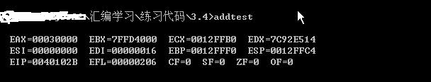

# intel 汇编语言程序设计（第四版）习题解答

> 原文：[`www.pediy.com/kssd/pediy10/98762.html`](https://www.pediy.com/kssd/pediy10/98762.html)

小弟初来匝道，最近在自学 intel 汇编语言（为了看加密解密），为了加深印象，将每章节的习题尝试自己解答。作为自己对自己的监督，将解答贴在这里。

## 第一章

1. 汇编编译器和链接器是如何协同工作的？

汇编编译器将汇编语言转换成机器语言，汇编编译器也可以生成源代码列表文件，包括行号，内存地址，源代码语句，程序中使用的符号及变量的交叉引用列表，

链接器把编译器创建的多个文件合并链接成可运行程序。

2. 学习汇编语言会在哪些地方增强你对操作系统的理解？（答案不明确）

熟悉计算机体系结构  
基本的布尔逻辑概念以及如何应用于程序设计和硬件设计  
IA-32 如何管理内存，如果使用保护模式，实模式以及虚拟模式  
高级语言编译器如何将高级语言翻译成汇编和机器语言。  
高级语言如何在机器语言层次实现算术表达式，循环和逻辑结构。  
数据的表示方式，包括有符号和无符号整数，实数以及字符数据  
机器语言的调试技巧会提高  
了解程序是如何通过中断服务程序，系统调用，共享内存区与操作系统进行交互的以及操作系统如何加载和运行应用程序

3. 在高级语言和机器语言的对比中，一对多的关系是什么意思？

一条简单的高级语言指令会被扩展成多条机器语言指令。

4. 请解释下程序设计语言可移植性概念。

一种语言的程序语言代码可以在多种计算机系统上编译运行，那么它就是可移植的。

5. intel 80X86 系列处理器的汇编语言与 VAX 或者 motorala 68x00 等系统的汇编是否相同？

不相同，汇编语言和 CPU 指令集是密切关联的，每种 CPU 体系对应不同的汇编。

6. 举一个嵌入式系统应用的例子

汽车的燃油控制和点火系统，空调系统，安全系统，飞行控制系统，手持计算机，调至解调器，打印机以及其他计算机外围智能设备。

7. 什么是设备驱动程序

驱动程序是把操作系统的通用命令转换为对特殊硬件的具体细节操作的程序。

8. 在汇编语言和 C++ 语言中，那种语言对指针变量类型检查更为严格？

`C++`，汇编语言对指针不做任何限制。

9. 列举两种汇编语言比高级语言更适合编写的应用程序的例子

嵌入式系统，硬件驱动。

10. 为什么在编写访问某特定品牌打印机的应用程序的时候，高级语言并不是理想工具？

高级语言未必提供直接访问硬件的能力，即使提供了也经常要使用大量技巧维护，导致后期维护困难。

11. 为什么通常不是用汇编语言编写大型的应用程序？

汇编语言只提供最小的结构支持，导致程序员必须人工组织大量代码，不同水平的程序员维护现存代码的难度极高。

12. 挑战：参考本章前面相应的例子，将 c++表达式 `X=(Y*4)+3` 换成汇编语言的形式。

```
MOV EAX,Y
MOV EBX,4
IMUL EBX
ADD EAX,3
MOV X EAX
```

1. 用自己的话概述虚拟机的概念

虚拟机是计算机体系结构的一种抽象描述。将真个计算机假象成一个或者多个虚拟机层次结构。  
最上层提供的人机接口易用使用，并且功能强大，虚拟机之前可以通过解释/编译的方式进行翻译转换，一层一层直至翻译成 CPU 可以直接执行的机器指令。

2. 程序员为什么不用计算机的机器语言编写程序？

要考虑非常细微的地方，全部由数字构成。

3. 是非题：当用 L1 语言编写的解释程序运行的时候，其每条指令都由 L0 写的程序解码并执行。

对的

4. 请解释下处理其他层次虚拟机上运行语言时的翻译技术

编译和解释？

5. 请以 IA-32 处理器体系结构为例说明一个虚拟机

第一层 CPU 逻辑电路  
第二层 intel 微指令  
第三层 intel CPU 机器指令  
第四层 windows 操作系统  
第五层 汇编语言  
第六层 高级语言

6 什么软件可以使编译好的 JAVA 程序可以几乎在任何计算机上运行？

`JAVA` 虚拟机

7. 程序员为什么不用微指令代码编写程序？

微指令是商业机密，

8. 在图 1.1 中，那个层次的虚拟机使用机器语言

第二层？

9. 假设某个层次的虚拟机使用汇编语言，那么他将被翻译到其他那些层次的虚拟机上去运行？

机器语言，微指令。

## 知识点

有符号数： 最高有效位是符号位，0 表示正数，1 表示负数。 这个地方的文字描述和图相反。（怀疑图是错误的）

？？？？？？

补码： 一般用补码表示法表示负整数。是否意味着有符号数只有负数才用补码？？

二进制的补码是所有负数取反最后加一。

思考：补码的取反实际上时 进制数-1 的结果-对应位数的结果。  
比如二进制 1，取反得结果是 `2-1-1` = `0`  
十六进制 `1`，取反结果是 `16-1-1` = `E`

有符号数转换为 10 进制数：  
1.MSB 为 1，表示该数是负数，需要取反码，之后当成无符号数处理。  
2.MSB 为 0，表示概述是正数，直接当无符号处理。

1. 解释术语 LSB

`least significant bit`： 最低有效位，一般指的是最右边的位数。  
比如 123456，其中 6 是最低有效位

2. 解释术语 MSB

`most significant bit`： 最高有效位，一般指的是最左边的位数。

3. 下列无符号二进制数对应的十进制数？

a `11111000` = `248` b `11001010` = `202` c `11110000`=240

4. 下列无符号二进制数对应的十进制？

a.`00110101` = `53` b.`10010110` = `150` c `11001100` = `204`

5 下列二进制数的和是多少？

a.`00001111+00000010` = `00010001` b.`11010101` + `01101011`=101000000（溢出？） c `00001111+00001111`= `00011110`（左移一位）

6. 下列二进制数的和是多少？

a.`10101111+11011011` = `110001010` b.`10010111+11111111`=110010110 c `01110101+10101100`=100100001

7 下列数据类型分别包含多少个字节？

1.字 =2 2. 双字 = 4 3. 4 字 = 8

8. 下列数据类型分别包含多少个数据位

字 = 16 双字 = 32 4 字 = 64

9. 为表示下列无符号数据，最少需要多少个二进制位

`65` = `7` `256` = `9` `32768` = `16`

10. 为表示下列无符号数据，最少需要多少个二进制位

`4095` = `12` `65534` = `16` `2134657` = `22`

11. 2 进制转换成 16 进制

a `1100 1111 0101 0111` = `CF57` b.`0101 1100 1010 1101` = `5CAD` c.`1001 0011 1110 1011` = `93EB`

12. 2 进制转成成 16 进制

a.`0011 0101 1101 1010` = `25DA` b.`1100 1110 1010 0011` = `CEA3` c. `1111 1110 1101 1011` = `FED3`

13. 下列十六进制对应的二进制是什么

a `E5B6AED7` =1110 0101 1011 0110 1010 1110 1101 0111 b `E697C7A1` =1110 0110 1001 0111 1100 0111 1010 0001

c `234B6D92`= 0010 0011 0100 1011 0110 1101 1001 0010

14. 下列十六进制对应的二进制数是什么？

a `0126F9D4` = 0000 0001 0010 0110 1111 1091 1101 0100 B.`6ACDFA95` = 0110 1010 1100 1101 1111 1010 1001 0101

C `F69BDC2A` = 1111 0110 1001 1011 1101 1100 0010 1010

15 下列十六进整数对应的无符号十进制数是什么？

a.`3A` = `58` b.`1BF` = `447` C `4096` = `16534`

16 下列十六进制整数对应的无符号十进制数是什么？

a.`62` = `98` b.`1C9` = `457` C `6A5B` = `27227`

17. 下列有符号十进制整数对应的 16 位进制数是什么？

a `-26` = `11100110` = `E6` b. `-452` = `1110 0011 1100` = `E3C`

18. 下列有符号十进制整数对应的 16 位进制数是什么？

A.`-32` = `1110 0000` = `E0` B. `-62` = `C2`

19. 下列 16 位十六进制数表示的是有符号数，请将其转换为十进制数

a.`7CAB` = `31915` b.`C123` = `-16076`

20. 下列 16 位十六进制数表示的是有符号数，请将其转换为十进制数

a.`7F9B` = `32667` b.`8230` = `-32208`

21. 下列有符号二进制数对应的十进制数是什么？

a.`10110101` = `-75` b.`00101010` = `42` c `11110000` = `-16`

22. 下列有符号二进制数对应的十进制数是什么？

a `10000000` = `-128` b.`11001100` = `-52` c.`10110111` = `-73`

23. 下列有符号十进制整数对应的 8 位二进制数（补码）是什么？

a `-5` = `11111011` b `-36` = `11011100` c `-16` = `11110000`

24. 下列有符号十进制整数对应的 8 位二进制数（补码）是什么？

a `-72` = `10111000` b `-98` = `10011110` c `-26` = `11100110`

25 ASCII 大写字母 X 的十六进制值和十进制值分别是什么？

hex:`58`

dec:`88`

26.ASCII 大写字母 M 的十六进制值和十进制值分别是什么？

hex:`4D` dec:`77`

27. 为什么要发明 unicode?

ASCII 只用 1 个字节存储字符，由于各国语言不同，因此发明了用 2 个字节进行编码的 unicode

28. 挑战：用 256 位无符号整数能表示的最大值是多少？

`2` 的 `256` 次方-1

29. 挑战：用 256 位有符号整数能表示的最大值是多少？

`2` 的 `255` 次方-1

1. 请描述如下的布尔表达式 `~X+Y`

`NOT X OR Y`

2. 请描述如下的布尔比大师 `(X^Y)`

`(X AND Y)`

3. 布尔表达式（T+F)^T 的值是多少？

T

4. 布尔表达式~（F+T)的值是什么？

F

5. 布尔表达式~F+~T 的值是什么？(此题中文版为~F+~,查阅了两个版本的英文原版，一个和中文版相同，一个事~F+~T,因此修改）

T

6. 为~（A+B)描述的布尔函数创建一个真值表，列出所有可能的输入输出

A B A+B ~(A+B)  
T T T F  
T F T F  
F T T F  
F F F T

7. 为（~A+~B)描述的布尔函数创建一个真值表，列出所有可能的输入输出

A B ~A ~B (~A+~B)  
T T F F F  
T F F T T  
F T T F T  
F F T T T

8. 挑战：如果一个布尔函数有四个输入，那么这个函数的真值表需要多少行？

16

9. 挑战：有 4 个输入的多路复用器需要多少个选择位？

4 个输入多路复用器的选择为必须要能表示 4 种状态，因此，至少要用 2 个选择位。


1. 中央处理(CPU)除了包含寄存器之外还包含哪些其他基本部件？

CPU 包含一个高频时钟，一个算术逻辑单元，一个控制单元，以及数量有限的寄存器

时钟主要用于将 CPU 内部的操作和其他系统部件同步。（how？）

控制单元（CU)协调执行机器指令时各个步骤的次序。

算术逻辑单元（ALU)执行加法和减法之类的算术运算以及 AND.OR.NOT 之类的逻辑操作（没有乘除？）

是否可以理解为 CPU 就是加减和 NOT AND OR?

2. 中央处理器使用哪三种总线同计算机的其他部分相连接？

地址总线，控制总线，数据总线。

数据总线：在 CPU 和内存之间传送指令和数据。输入输出设备的数据如何传送的？？

控制总线：使用二进制信号对连接到系统总线上的所有设备的动作进行同步。

地址总线：当和内存进行数据交互的时候，地址总线保存指令和数据的地址。

3. 为什么访问存储器比访问寄存器要花费更多的机器周期？

存储器的速度比 CPU 慢的多，因此访问存储器，CPU 需要等待一个或者几个时钟周期。

4. 指令执行周期中的三个基本步骤是什么？

取指令，解码，以及执行。

5. 当使用内存操作数时，指令执行周期中海需要那两个额外的步骤？

取操作数，存储输出操作数

6. 在指令执行周期的那个阶段中，程序计数器的值会增加？

控制单元取得指令，将其从存储器拷贝到 CPU 中并增加程序计数器的值。因此取指令的时候，PC 的值将增加。

7. 给出流水线执行的定义

PS:这个地方中译版有个地方翻译的不准确，按照原文，应该是 386 将一个指令执行分解为 6 个阶段，486 才引入流水线技术。

intel 的文档说 386 支持并行，486 引入流水线，具体细节有待研究。

通常情况下，一条指令的执行可以分解成 6 步（386），CPU 将一步一步的执行这些步骤，但是下一条指令并不需要等上一条 6 步全部执行完成后

再开始。可以当第一条指令的第一步执行完成后，在执行第一条指令第二步的时候，并发执行第二条指令的第一步。这就是流水线技术。

关于 I386 的 6 步，摘录如下：

1.总线接口单元 BIU，访问存储器并提供输入输出
2.代码预取单元 CPU（code prefetch unit）：从 BIU 接收机器指令并将其插入到 CPU 内部的指令队列。
3.指令解码单元：将队列中的指令进行解码，翻译成微代码
4.执行单元：执行解码后的微代码


## 5.分段部件
将逻辑地址转换成线性地址并进行保护检查。

## 6.分页部件
将线性地址转换为物理地址，进行页保护检查并保留一个最近访问页的列表。

## 8.在 5 级非流水线处理器中，执行两条指令需要多少时钟周期？
对于 K 级的处理器，执行 n 条指令需要（n*k)个时钟周期。因此需要 10 个周期。

## 9.在 5 级单级流水线处理中，执行 8 条指令需要多少时钟周期？
对于单级流水线，k 级处理器执行 n 条指令需要 k+(n-1)=12 个周期

## 10.什么是超标量处理器？
两条以上的流水线，使得两条指令能够同时处于同一个执行阶段。
针对单流水线，如果某个阶段执行操作一个周期，那么将造成瓶颈。
针对某个 K 级处理器，如果某个阶段需要 2 个周期，那么执行 N 条指令需要 k+2n-1 个周期
如果将需要 2 个周期的地方扩充到 2 个流水线，u 和 v，那么直接导致 k+n 出现。
PS:教材按照简化版本分析，貌似 intel 的处理多个阶段都可以并行处理。

## 11.假设 5 级双流水线处理器中有一个阶段的执行周期需要两个时钟周期，执行 10 条指令需要多少时钟周期？
k+n = 5+10 = 15

## 12.当程序运行时，OS 从磁盘的文件目录项中读取哪些信息？
文件大小以及在磁盘驱动器上的物理位置。

## 13.程序装入内存后如何开始执行？
程序装入内存后将程序的大小和位置等信息登记在一张表中。OS 执行一条分支转移指令，使 CPU 在程序的第一条机器指令处开始执行。

## 14.试给出多任务的定义？
操作系统能故同时运行多个任务。任务和进程并不等价。OS 给每个人物分配一个时间片，轮流激活执行这些程序。

## 15.OS 调度程序的功能是什么？
任务切换？？

## 16.当处理器从一个任务切换到另一个任务的时候，必须保存第一个任务的那些值？
处理器中寄存器的内容，任务变量和程序计数器够构成。


### IA-32 处理器
#### 1.IA-32 处理器的三种基本操作模式是什么？
保护模式，虚拟 8086 模式是保护模式的一个特例。
处理器的主要状态，在保护模式下，所有指令和特性都是可用的，程序被赋予了独立的内存区域，并且处理器可以侦测到程序任何
视图访问其段外内存区域的企图。
虚拟 8086 模式，在保护模式下，处理器可以再安全的多任务环境中执行实地址模式的软件。
实模式：
实现了 8086 处理器的程序设计环境以及其他一些新的特性，如切换到其他两种模式的能力。所有的 intel 处理器都是从实地址模式引导的。
系统管理模式：
提供给操作系统用以实现电源管理和系统安全等功能的机制。

#### 2.说出所有 8 个 32 位寄存器的名称。
`EAX`
`EBX`
`ECX`
`EDX`
`EBP`
`ESP`
`ESI`
`EDI`

#### 3.说出所有 6 个段寄存器的名称
`CS`
`DS`
`ES`
`FS`
`GS`
`SS`

#### 4.`ECX` 通常用于什么特殊用途？
cpu 自动使用 `ECX` 作为循环计数器。

#### 5.除了堆栈指针（`ESP`）之外，还有那个寄存器指向堆栈上的变量？
`EBP`,很难根据书中的介绍找到答案。根据理解一般局部变量，函数参数应该存贮在堆栈上。
PS:翻看英文原版有这么一段话：`EBP`:is used by high-level languages to reference function parameters and local variables
on stack..... 因此答案应该是 `EBP`。

#### 6.说出至少 4 个 CPU 状态标志的名字
`EFLAGS` 寄存器由控制 CPU 的操作或反映 CPU 某些运算的结果的独立二进制位构成。
被设置=1，被清除=0
状态标志：
进位标志（`CF`):在无符号算术运算的结果无法容纳与目的操作数中被设置
溢出表示（`OF`）：在有符号算术运算的结果太宽（位数太多）而无法容纳于目的操作数时被设置。
符号标志（`SF`）：在算术或逻辑运算产生的结果为负时背设置
零标志（`ZF`）：在算术或逻辑运算产生的结果为零时被设置
辅助进位标志（`AF`）：在算术运算导致 8 位操作数的位 3 到位 4 产生进位时被设置。
奇偶标志（`PF`）：在统计一个数字内值等于 1 的位数时，如果 1 的总位数为偶数，则设置，否则清除。

#### 7.当无符号操作数的运算结果太宽而无法容纳于目的操作数中时，那个标志位被设置？
`CF`

#### 8.当有符号操作数的运算结果太大而无法容纳于目的操作数中时，那个标志位被设置？
`OF`

#### 9.当算术或逻辑操作产生的结果为负时那个标志位被设置？
`SF`

#### 10.CPU 的那个部分执行浮点算术运算？
`FPU`
从 486 开始集成到 CPU 中。

#### 11.FPU 数据寄存器的位长时多少？
80 位： `ST(0)` --- `ST(7)`,共 8 个。
PS: 48 位指针寄存器 2 个，16 位的控制寄存器 3 个，操作码寄存器 1 个。

#### 12.那种 intel 处理器是 IA-32 系统的第一个成员？
`386`

#### 13.那种 intel 处理器首次因此了超标量执行技术？
奔腾，2 条流水线。

#### 14.那种 intel 处理器首次使用了 MMX 技术？
奔腾 II

#### 15.给出 CISC 指令集的定义。
复杂指令集：包含强大的数据寻址方式以及相对高度复杂的操作。由 CPU 内部的解释程序解码并执行每条指令？？（CPU 内部还能跑解释器？）
缺点，解码时间长，指令总量较多。

#### 16.给出 RISC 指令集的定义。
精简指令集：包含相对较少的简短指令，执行非常迅速。使用硬件直接解码和执行指令。


总结见[保护模式学习小结](http://http://bbs.pediy.com/showthread.php?t=99209)

#### 1.在保护模式下可寻址的内存范围是什么？
保护模式下 32 位地址总线，可寻址范围应该是 0 到 FFFFFFFF

#### 2.在实地址模式下可寻址的内存范围是什么？
实地址模式下 20 位地址总线，可寻址访问时 0 到 FFFFF

#### 3.在实地址模式下描述地址的两种方法是段-偏移量和什么？
20 位线性地址？
段地址*10H+偏移量
`CS` 代码段
`DS` 数据段
`SS` 堆栈段
`ES`,`FS`,`GS` 可指向其他数据段？？

#### 4.在实地址模式下将下面的段-偏移量转换成线性地址：0950：0100
09600

#### 5.在实地址模式下将下面的段-偏移量转成成线性地址：0CD1:02E0
0DFF0

#### 6.在 Microsoft 汇编编译器使用的平坦内存模式下，使用多少个数据位存放指令或变量的地址？
32

#### 7.在保护模式下，那个寄存器引用堆栈段的描述符？
`SS`

#### 8.在保护模式下，那张表包含指向程序使用的各种段的指针？
`Global descriptor table`, `Local descriptor table`

#### 9.在平坦分段模式下，那张表包含指向至少两个段的指针？
`GDT`

#### 10.使用 IA-32 处理器分页特性的主要优点是什么？
同时运行的程序使用的内存总量大于实际内存

#### 11.挑战：MS-DOS 操作系统没有被设计为支持保护模式编程，你能想出一个与之有关的原因么？
CPU 不支持保护模式？内存比较昂贵？

#### 12.挑战：在实地址模式下，解释说明两个段-偏移地址执向同一个线性地址的情况。
段地址*10h+偏移量 可以简化成 X*10H+Y ,X,Y 取不同的值得到的结构可能相同。


#### 1.试描述外部缓存。
介于内存和 CPU 之间的过渡存储器，用户提高 CPU 读取性能。

#### 2.那种 intel 处理器是在 PCI 总线诞生之后出现的？
PCI 总线由 intel 在 1992 年开发，而奔腾处理器产生于 1993 年。

#### 3.在主板芯片组中，intel8259 的功能是什么？
处理来自硬件的请求，产生 CPU 中断

#### 4.供视频显示使用的存储器位于什么地方？
在视频适配器，也就是显卡上

#### 5.试描述一下 CRT 视频监视器的光栅扫描？
电子束照亮屏幕上的荧光点，电子枪从屏幕的最顶端开始从左向右扫描，然后关闭，之后从下一行开始从左向右扫描。
水平回归值得是扫描一行结束后，电子枪关闭的时间。当扫描完成最后一行，电子枪关闭从新开始从第一行开始扫描。
这个关闭的时间叫垂直回归。

#### 6.说出本章中提到的 4 种类型的 RAM 名称？
`ROM` :只读
`EPROM`：通过紫外线可以檫除
`DRAM`：动态 RAM，普通内存
`SRAM`：静态，二级缓存，不需要刷新
`VRAM`：视频 ram，双端口，刷新的同时可以写数据。
`CMOS RAM`，电池供电，保存硬件信息。

#### 7.那种类型的 RAM 用于二级缓存？
`SRAM`

#### 8.和串行和并行设备相比，USB 设备有哪些优点？
智能，传输速度快

#### 9.两种 USB 接头的名称是什么？
A=upstream B= downstream

#### 10.那种芯片用来控制串行口？
`16550 UART`

#### 1.在计算机操作系统的三种访问层次中，那个层次是最通用的和可移植性最好的？
第一层，库函数

#### 2.BIOS 中已经存在和计算机硬件交互的代码了，为什么设备驱动程序还是必须的？
BIOS 没有包括所有的设备，如果出现无法识别的新设备就要用到驱动程序。

#### 3.在显示字符串的例子中，在操作系统和视频控制芯片中还存在什么层次？
BIOS

#### 4.在那个层次上，汇编语言程序可以操作输入输出？
操作系统，BIOS,硬件

#### 5.为什么游戏通常向声卡的硬件端口输出声音？
游戏要求的性能比较高，直接向硬件输出可以提高整体性能。

#### 6.挑战：运行 MS-WINDOWS 的计算机 BIOS 会与运行 LINUX 的计算机使用的 BIOS 有所不同吗？
不会，一样的。

---------------------------------------华丽的分割线----------------------------------------------

终于结束前 2 章了，从第三章开始可以实际动手编程了，期待 ing 

**知识点：**

1.整数常量
`[{+|-}] digits [radix]`
后缀 radix（大小写均可）：
h 16 进制 r 编码实数
q/o 8 进制 t 10 进制（可选）
d 10 进制 y 2 进制（可选）
b 2 进制
如果常量后无后缀，默认是 10 进制
16 进制前面第一个字符如果是字母，必须加 0

2.整数表达式
运算符优先级：
1 () 
2 +- 单目+ -
3 * /
4 MOD
5 +-

3.实数常量
`[sign] interger.[integer] [exponent]`
sign: `{+|-}`
exponent: `E [{+|-}] integer`
实数常量至少有个数字和一个小数点，如果没有小数点就是整数常量
2. +3.0 -44.2E+05 26.E5 都是合格的实数常量

4.字符常量
`'a'` `"A"` 转换成对应的 ASCII

5.字符串常量
`'say good by'` `"hello,world"` `'you are "good man" ?'`
字符相关的常量，单双引号有什么区别？？？

6.保留字
指令助记符：`MOV`
伪指令：
属性： `BYTE`,`WORD`
运算符：
预定义符号：

7.标示符
1.1-247 个字符
2.大小写不敏感 -Cp 选项可以打开大小写敏感
3.第一个字符必须是字母，下划线，@，$,后面可以使数字
4.不能和保留字相同

8.伪指令
编译器在编译的时候执行的指令，与 intel 指令集无关。

9.指令
包含 4 个部分 标号（可选）|指令助记符（必须）|操作数（通常需要）|注释（可选）
标号：怎么感觉像变量。。。
操作数：0-3 个，可以使寄存器，内存操作数，常量表达式，I/O 端口
注释： 单行用分号
块注释 用
`COMMENT *任意符号*`
注释内容
`*任意符号*`

**习题部分：**

1.列出整数常量中可以使用的后缀字符
h,q/o,d,b,r/y,t

2.A5h 是有效的 16 进制常量么？
不是，应该是 0Ah

3.在整数表达式中 * 比 / 优先级高么？
优先级相同

4.写出 10 除以 3 并返回整数余数的常量表达式
10 MOD 3 ?

5.写出一个有效的带指数的常量表达式
1+24.E+05

6.字符串常量必须用单引号引起来么？
用双引号也可以

7.保留字可以是？
指令助记符，伪指令，运算符，属性，预定义符号

8.标示符的长度最大是多少？
247

9.标识符不能以数字开头？
yes

10.汇编语言标识符是大小写敏感的？
不是

11.汇编语言伪指令是在运行时执行的？
不是，编译时执行

12.汇编语言伪指令的书写格式可以是任意大小写字母组合？
应该是可以，属于关键字的一种

13.说出汇编指令的四个组成部分的名称
标号，指令助记符，操作数，注释

14.`MOV` 是一个指令助记符的例子？
是的

15.代码标号后跟：，数据标号后没有：
是的。（如果数据标号加了：会怎么样？

16.举出一个块注释的例子
`COMMENT !`
mov ax,5
aaaaaaa


!  

## 17.在编写访问变量的指令时，为什么使用数字类型的地址不是一个好主意？

如果使用数字地址，假如程序加入了新的变量，那么数字地址就必须重新修改，引起很多不必要的工作。


代码如下：

代码:

```
TITLE Add and subtract     {Addsub.asm) ;TITLE 是个伪指令，相当于注释
; this program add and subtract 32bit integer
INCLUDE Irvine32.inc                  ;INCLUDE 伪指令
.code                                 ;.code 伪指令标示代码段的开始，所有的可执行语句都放在此
main PROC                            ; PROC 伪指令标示子程序的开始，子程序的名字是 main
     mov eax,10000h
     add eax,40000h
     sub eax,20000h
     call DumpRegs
     
     exit                            ;退出程序,定义在 irvine32.inc 中,不属于 MASM
main ENDP                            ;ENDP 伪指令标示子程序结束
END main                             ;END 伪指令表明该行是程序最后一行,编译器将忽略后面的内容,main 表示该程序的入口点
```

**备注：**

1.没有采用书本附带的 MASM 搭建环境。
2.采用网上最流行的 MASM32,参考罗义斌的的介绍搭建环境：
Ultraedit 15.10 + MASM32 V10 + make32.bat(本书附带的，进行了适当修改）
3.关于本书带的几个库，进行了重新编译。

  

习题：

1.INCLUDE 指令含义是什么？
将 `irvine32.inc` 中的内容 copy 到程序中，类似于 C 中的含义

2..CODE 伪指令的作用什么？
代码段的开始，所有可执行代码放在这里

3.以上程序，段的名字都有哪些？
代码段

4.如何显示寄存器内容的？
调用 `dumpregs` 子程序

5.那条程序终止程序的执行？
`exit`

6.那条伪指令开始一个过程？
`PROC`

7.那条伪指令结束一个过程？
`ENP`

8.END 语句中的标识符的作用是什么？
程序的入口点，从这里开始执行

9.PROTO 伪指令的作用是什么？
声明子程序的原型

\------------------------华丽的分割线----------------------------------

终于第一次用汇编编译了第一个 WIN32 程序




**1.汇编编译器生成什么类型的文件？**
目标文件，包含了机器语言，但是还不能直接执行。

**2.链接器从链接库文件中提取已编译的函数的拷贝？**
是的。

**3.程序源代码被修改后，必须重新编译连接，这样才能在执行时反映你的修改？**
是的

**4.操作系统中用来读取并执行可执行文件的部分叫什么名字？**
加载器，loader

**5.链接器生成什么类型的文件**
EXE，map

在回答下列文件之前请先阅读附录 A

**6.使用哪个命令行选项可以使汇编编译器生成列表文件？**
`-Fl`

**7.使用哪个命令行选项可以使汇编编译器添加调试信息？**
`-Zi`

**8.链接器的/SUBSYSTEM:CONSOLE 选项是什么意思？**
链接成控制台程序

**9.挑战：至少列出 kernel32.lib 文件中的 4 个函数的名字.**
`ReadConsoleOutput`
`OutputDebugString`
`OpenEvent`
`RemoveDirectory`
通过 `kernel32.inc` 获取函数声明。

**10.链接器的那个选项允许指定程序入口点？**
`/ENTRY:`


**知识点：**

**1.内部数据定义**
`BYTE` 8 位无符号整数
`SBYTE` 8 位有符号整数
`WORD` 16 位无符号 （实地址模式近指针）
`SWORD` 16 位有符号
`DWORD` 32 位无符号（保护模式近指针）
`SDWORD` 32 位有符号
`FWORD` 48 位整数
`QWORD` 64 位整数
`TBYTE` 80 位整数
`REAL4` 32 位 IEEE 短实数
`REAL8` 64 位 IEEE 长实数
`REAL10` 80 位 IEEE 扩展精度实数

**2.数据定义语句**
`[名称] 数据定义伪指令 初始值[,初始值] ...`
数据定义语句至少要有一个初始值或者`?` 符号。

**3.定义 BYTE 和 SBYTE 数据**
`value1 BYTE 'A'`
`value2 BYTE 0`
`value3 BYTE 255`
`value4 SBYTE -128`
`value5 SBYTE +127`
`value6 BYTE ?  ;未初始化`

DB 伪指令：
`val1 DB 255`
`val2 DB -128`
无法区分有符号数据和无符号数据

多个初始值： `list BYTE 10,20,30,40`
并非所有的数据定义都需要标号：
`list BYTE 10,20`
`BYTE 30,40`
可以同时使用不同进制的数字
`list1 BYTE 10,32,41h,00100010b`
`list2 BYTE 0AH,20h,'A',22h`

**4.定义字符串**
`greeting1 BYTE "Good afternoon",0 ; 空字符结尾的字符串`
`greeting BYTE "Welcome to the encryption demo program"`
`BYTE "created by KIP",0dh,0ah`
`BYTE " if you wish",0`
以上是连续字符串，中间夹杂回车换行。
行延续符： `greeting \`
`BYTE "welcome to the encry"`
DUP 操作符：
`BYTE 20 DUP(0)         ;20 个 0`
`BTTE 20 DUP(?)          ;20 字节，未初始化`
`BYTE 4  DUP("STACK")    ；4 个 STACK`

**5.定义 WORD,SWORD**
`word word 65525`
`word2 sword -32768`
`word3 word ?`
DW 指令：
`val1 DW 65525   ;无符号`
`val2 DW -32768  ;有符号`
字数组：
`mylist word 1,2,3,4  ; 每个 2 字节`
`array word 5 dup(?)`

**5.DWORD  SDWORD**
`val1 dword   12345678h`
`val2 sdword  -2147483648`
`val3 dword   20 dup (?)`
DD 伪指令
`VAL1 DD 12345678`
`mylist DWORD 1,2,,3  每个 4 字节`

**6.QWORD**
`quad1 qword 1111111111111111h`
`quad1 dq  1111111111111111h`

**7.TBYTE**
`val1 TBYTE 111111111111111111h ; 80 bit`
`val1 dt    1111111          ; 80 bit`

**8 定义实数**
`rval1  REAL4  -2.1           ;单精度，有效位数 6，范围 1.18E-38 ---------3.40E+38`
`rval2  REAL8  3.2E-260       ;双精度,  有效位数 15，范围 2.23E-308----------1.79E+308`
`rval3  REAL10 4.6E+4096      ;扩展精度,有效位数 19，范围 3.37E-4932 -------1.18E+4932`
老版本用 DD,DQ,DT 定义实数

**9.小尾顺序**
最低有效字节存储在地址值最小的地址单元。
`12345678H`,在内存中的实际存储时 78563412.

**10.带变量的程序**

代码:

```
    
        TITLE Add and subtract     {Addsub.asm) ;TITLE 是个伪指令，相当于注释
     ; this program add and subtract 32bit integer
        INCLUDE Irvine32.inc                  ;INCLUDE 伪指令
     .data
        val1 dword 10000h
        val2 dword 40000h
        val3 dword 20000h
        finalval dword ?
        .code                                 ;.code 伪指令标示代码段的开始，所有的可执行语句都放在此
     main PROC                            ; PROC 伪指令标示子程序的开始，子程序的名 main
           mov eax,val1
           add eax,val2
           sub eax,val3
           mov finalval,eax
           call DumpRegs
     
           exit                            ;退出程序,定义在 irvine32.inc 中,不属于 MASM
       main ENDP                         ;ENDP 伪指令标示子程序结束
    END main                             ;END 伪指令表明该行是程序最后一行,编译器将忽略后面的内容,main 表示该程序的入口点
```

**11.未初始化数据的声明**
`.data?` 伪指令可用于声明未初始化的数据。
可以缩小包含大块未初始化数据程序的尺寸。
`.data?`
`var1 dword 500 dup(?)`
`.data`
`var1 dword 500 dup(?)`
下面生成的程序会比上面大的多。
`.code`
`.data`
`.code`
可以回来使用。

习题：

**1.为一个 16 位有符号数创建未初始化的数据声明**
`var1 sword ?`
`var1 dw ?`

**2.为一个 8 位无符号整数创建未初始化的数据声明**
`var1 byte ?`

**3.为一个 8 位有符号整数创建未初始化的数据声明**
`var1 sbyte ?`

**4.为一个 64 位整数创建未初始化的数据声明**
`var1 qword ?`

**5.那种数据类型可以存放 32 位有符号整数？**
`var1 sdword ?`

**6.声明一个 32 位有符号整数变量，并用最小的十进制负整数初始化**
`var1 sdword -1`

**7.声明一个名为 wArrary 的 16 位无符号整数变量，并带 3 个初始值**
`wArrary word 1h,2,3`

**8.声明一个包含你最喜欢的颜色名称的字符串变量，并以空字符结尾。**
`var1 byte "yello",0`

**9.声明一个名为 dArry 数组，包含 50 个未初始化的无符号双字整数。**
`dArry dword 50 DUP(?)`

**10.声明一个包含 500 个单词 "TEST" 的字符串变量**
`string byte 500 dup("TEST")`

**11.声明一个名为 bArray 包含 20 个无符号字符的数组，将全部字节初始化为 0**
`bArray byte 20 dup(0)`

**12 说明下列双字节变量在内存中的字节存储顺序（从低到高）**
`vall DWORD 87654321h`
`21  43 65 87 ， 每个占有 4 个字节，总共 16 字节。`


**知识点：**

该部分理解起来类似 `const` 定义或者 `define`

**1 等号伪指令**
`名字 = 表达式`
用`= `定义的常量可以定义任意多次
`count = 100`
.........
`count= 200`
..........
**2. 数组大小计算**
`$` 表示当前指针的地址
`list BYTE 10,20,30,40`


此时 `listsize` = `$` - `list`

所以计算数组大小的语句必须紧跟在 `list` 语句之后，否则 `$` 并没有指向数组末尾。

返回结果是以字节为单位的，因此针对 WORD 以上的数据类型要做相应的除法。

写程序验证

代码:

```
TITLE caculate arraysize     {ArraySize.asm)  ;TITLE 是个伪指令，相当于注释
; Description:Caculate ArraySize
; Author:ukyohy
; Create Date: 2009-10-12
; Version:1.0
; Data:                  Modify by:
include Irvine32.inc
.data
   Array BYTE 10,20,30
   ArraySize = $ - Array
.code                                 ;.code 伪指令标示代码段的开始，所有的可执行语句都放在此
main PROC                             ; PROC 伪指令标示子程序的开始，子程序的名字是 main
   mov eax,ArraySize
   call DumpRegs
   exit
main ENDP                             ;ENDP 伪指令标示子程序结束
END main                              ;END 伪指令表明该行是程序最后一行,编译器将忽略后面的内容,main 表示该程序的入口点

```

### 3.EQU 伪指令

`name EQU expression`

`name EQU symbol`

`name EQU <text>`

一般用来定义非整形的数值

比如实数 `PI EQU <3.1415>`

`presskey EQU <"press some thine",0>`

注意 `max1 EQU 10 * 10`

`max2 EQU <10 * 10>`

`v1 word max1`

`v2 word max2`

写代码验证 //结果相同，形式不同

代码:

```
TITLE equtest     {equtest.asm)  ;TITLE 是个伪指令，相当于注释
; Description:EQU command test
; Author:ukyohy
; Create Date: 2009-10-12
; Version:1.0
; Data:                  Modify by:
include Irvine32.inc
.data
   Array BYTE 10,20,30
   val1 equ 10 * 10              
   val2 equ <10 * 10>
   val3 word val1          ;100
   val4 word val2          ;10*10
.code                                 ;.code 伪指令标示代码段的开始，所有的可执行语句都放在此
main PROC                             ; PROC 伪指令标示子程序的开始，子程序的名字是 main
   mov ax,val3
   call DumpRegs                      ;64h
   mov ax,val4
   call DumpRegs                      ;64h
   exit
main ENDP                             ;ENDP 伪指令标示子程序结束
END main                              ;END 伪指令表明该行是程序最后一行,编译器将忽略后面的内容,main 表示该程序的入口点

```

`EQU` 和 `=` 不同，一个源代码内，`EQU` 只能定义一次。

### 4.TEXTEQU 伪指令

`name TEXTEQU <text>`

`name TEXTEQU textmacro`

`name TEXTEQU %constexpression`

功能和 `EQU` 感觉完全一样，为何要该指令？ 该指令可以再源文件内多次定义。

`aaa1 TEXTEQU <"aaaa">`

`aaa2 TEXTEQU <aaaa>`

以上语句有啥区别？

* 根据程序测试结果

1.`<>` 内的内容编译器不做任何处理，直接替换。
2.不带 `><>`,编译器会计算结果，然后再替换。

### 习题部分

1.用等号伪指令声明一个符号常量，等于退格键的 ASCII 码（08）

`BACKSPACE = 08`

2.用等号伪指令定义一个名为 `SecondsInDay` 的符号常量，赋给它一个计算 24 小时所包含秒的算术表达式

`SecondsInDay = 3600`

`SecondsInDay * 24`

3.计算下面数组所包含的字节数，并将其赋给名为 `ArraySize` 的符号常量

`myArray WORD 20 DUP(?)`

`ArraySize = ($ - myArray)/2`

4.计算下面数组所包含的元素数目，并将其赋给名为 `ArraySize` 的符号常量

`myArray DWORD 30 DUP(?)`

`arraySize = ($ - myArray)/4`

5.使用 `TEXTEQU` 伪指令将 `PROC` 定义成 `PROCEDURE.`

`PROCEDURE TEXTEQU <PROC>`

6.使用 `TEXTEQU` 伪指令创建一个名为 `Sample` 的字符串常量，然后使用 `Sample` 定义一个名为 `MyString` 的字符串变量。

`Sample TEXTEQU <"HELLO,WORLD!",0)`

`MyString BYTE Sample`

7.使用 `TEXTEQU` 伪指令为符号 `SetupESI` 赋予如下代码行：

`mov esi,OFFSET myArray`

`SetupESI TEXTEQU <mov esi,OFFSET myArray>`


DOS 下编程，现在基本用不到。需要的时候再看，暂时跳过。


### 1.三个整数相加

编写三个 16 位整数相减的程序，程序中只需要使用寄存器即可，最后可以插入对 `DumpRegs` 函数的调用来显示寄存器

代码:

```
TITLE three 16bit integer subtract     {No1.asm)  ;TITLE 是个伪指令，相当于注释
; Description: three 16 bit integer subtract
; Author:ukyohy
; Create Date:2009-10-12
; Version:1.0
; Data:                  Modify by:
include Irvine32.inc
.data
   int1 WORD 5000h
   int2 WORD 1000h
   int3 WORD 500h
.code                                 ;.code 伪指令标示代码段的开始，所有的可执行语句都放在此
main PROC                             ; PROC 伪指令标示子程序的开始，子程序的名字是 main
   mov ax,int1                        ;用 eax 会报错
  sub ax,int2
   sub ax,int3
   call DumpRegs   
   exit
main ENDP                             ;ENDP 伪指令标示子程序结束
END main                              ;END 伪指令表明该行是程序最后一行,编译器将忽略后面的内容,main 表示该程序的入口点

```

### 2.数据定义

写一个程序，要求使用 3.4 列出的所有数据类型的定义，用合适的值初始化每个变量

代码:

```
TITLE data define test     {No2.asm)  ;TITLE 是个伪指令，相当于注释
; Description: date define test
; Author:ukyohy
; Create Date: 2009-10-12
; Version:1.0
; Data:                  Modify by:
include Irvine32.inc
.data
   byte1        byte    100           ;2 8 次-1
   sbyte1      sbyte   -50           ; -128 --- 127
   word1       word    65535         ;0 --- 65535
   sword1     sword   -32768         ;-32768 --- 32767
   dword1     dword   100000         ;0 --4294967296
   sdword1   sdword -10000           ;-2147483648 ---- 2147483647
   fword1      fword   5000000            ;0----2 的 48 次方-1
   qword1     qword   100000000            ;0 --- 2 的 64 次方-1
   tbyte1       tbyte   9999999999           ;0 ----2 的 80 次方-1
   string1      BYTE    "good moringing",0
   rval1         real4   0.0
   rval2         real8   3.2E-260
   rval3         real10  3.37E+1024
   
.code                                 ;.code 伪指令标示代码段的开始，所有的可执行语句都放在此
main PROC                             ; PROC 伪指令标示子程序的开始，子程序的名字是 main
   mov  al,byte1
   call DumpRegs
   mov  al,sbyte1
   call DumpRegs
   mov  ax,word1
   call DumpRegs
   mov  ax,sword1
   call DumpRegs
   mov  eax,dword1
   call DumpRegs
   mov  eax,sdword1
   call DumpRegs   
   exit
main ENDP                             ;ENDP 伪指令标示子程序结束
END main                              ;END 伪指令表明该行是程序最后一行,编译器将忽略后面的内容,main 表示该程序的入口点

```

### 3.整数符号常量

写一个程序，定义包含一周所有天数的符号常量，创建一个数组变量并使用该符号作为初始值。

代码:

```
TITLE data const define     {No3.asm)  ;TITLE 是个伪指令，相当于注释
; Description: const date define
; Author:ukyohy
; Create Date: 2009-10-12
; Version:1.0
; Data:                  Modify by:
include Irvine32.inc
.data
   DaysInWeek = 7
   Week BYTE DaysInWeek dup(?)   
.code                                 ;.code 伪指令标示代码段的开始，所有的可执行语句都放在此
main PROC                             ; PROC 伪指令标示子程序的开始，子程序的名字是 main
  
   exit
main ENDP                             ;ENDP 伪指令标示子程序结束
END main                              ;END 伪指令表明该行是程序最后一行,编译器将忽略后面的内容,main 表示该程序的入口点
   

```

### 4.文本符号常量

写一个程序为几个字符串定义符号名。在变量定义中分别使用每个符号。

代码:

```
TITLE text const define     {No4.asm)  ;TITLE 是个伪指令，相当于注释
; Description: const text define
; Author:ukyohy
; Create Date: 2009-10-12
; Version:1.0
; Data:                  Modify by:
include Irvine32.inc
.data
   gm equ <"good moring",0>
   gf textequ <"good afternoon!",0>
   str1 BYTE gm
   str2 BYTE gf  
.code                                 ;.code 伪指令标示代码段的开始，所有的可执行语句都放在此
main PROC                             ; PROC 伪指令标示子程序的开始，子程序的名字是 main
  
   exit
main ENDP                             ;ENDP 伪指令标示子程序结束
END main                              ;END 伪指令表明该行是程序最后一行,编译器将忽略后面的内容,main 表示该程序的入口点

```

-------------------------------------华丽的分割线----------------------------------------------

第三章终于结束了，第四章是汇编的重要基础知识，要多花点时间学习了。

喝口水休息下，let's go go 

知识点：

2.操作数类型

立即操作数，寄存器操作数，内存操作数

`r8` 8 位通用寄存器

`r16` 16 位通用寄存器

`r32` 32 位通用寄存器

`reg` 寄存器

`sreg` 16 位段寄存器

`imm` 8，16，32 位立即数

`imm8`

`imm16`

`imm32`

`r/m8` 8 位寄存器/内存 操作数

`r/m16`

`r/m32`

`mem` 8,16,32 内存操作数

3.直接内存操作数

`mov eax,val1`

`mov eax,[val1]` ;不常用

4 `MOV` 指令

1.操作数尺寸必须一致
2.不能同时为内存操作数
3.目的操作数不能使 `CS,EIP,IP`
4.立即数不能直接送到段寄存器

`mov reg,reg`

`mov mem,reg`

`mov reg,mem`

`mov mem,imm`

`mov reg,imm`


内存数据的移动，要通过寄存器转移，不能直接 `mov` 两个内存操作数。

## 5. 整数的零/符号扩展

当将 16 位数据送入 `EAX` 的时候，虽然 `MOV` 指令必须要用 `AX` 作为操作数，但是要考虑 `AX` 高 16 位旧数据的问题。

`.data`

`var1` `WORD` 1

`.CODE`

`mov eax,0` ; 因此最好在之前将 `eax` 清零
`mov ax,var`

但是针对赋值，不能直接清 0，要用 `FFFFFFFFH` 填充。

`movzx` 0 扩展指令
`movzx r32,r/m16`
`movzx r32,r/m8`
`movzx r16,r/m8`

因为是用 0 扩展最高有效位，所以只能用于无符号数

`movsx` 符号位扩展
`movsx r32,r/m16`
`movsx r32,r/m8`
`movsx r16,r/m8`

## 6. LAHF, SAHF

`LOAD STATUS FLAGS INTO AH`
`STORE AH INTO EFLAGS`
`AH<---->EFLAG 低字节`

## 7. XCHG

数据交换指令
`XCHG REG,REG`
`XCHG REG,MEM`
`XCHG MEM,REG`

## 8. 直接偏移操作数

变量偏移地址 + 常数
`array BYTE 10H,20H,30H,40H`
`MOV AL,[array + 1]` ; al= 20h
`MOV AL,array + 1` ; 两条语句等价

`MASM` 并不对数组的下标进行检查，所以程序员要保证数组下标不越界。

字和双字节数组：
`.data`
`arrayW WORD 100h,200h,300h`
`mov AX,[array + 2]` ;偏移量按照字节计算，所以双字就要+4

例子程序：
代码:

```
TITLE Move data test {Move.asm) ;TITLE 是个伪指令，相当于注释
; Description: all the command in sec. 4.1
; Author:ukyohy
; Create Date:2009-10-14
; Version:1.0
; Data: Modify by:
include Irvine32.inc
.data
 val1 word 1000h
 val2 word 2000h
 arrayB BYTE 10h,20h,30h,40h
 arrayW word 100h,200h,300h
 arrayD DWORD 10000h,20000h
.code .code 伪指令标示代码段的开始，所有的可执行语句都放在此
main PROC PROC 伪指令标示子程序的开始，子程序的名字是 main
 ;movezx
 mov bx,0A69Bh ;ebx= 7FFDA69Bh
 movzx eax,bx ;eax= 0000A69Bh
 movzx edx,bl ;edx= 0000009Bh
 movzx cx,bl ;ecx = 0012009Bh
 ;movsx
 mov bx,0A69Bh ;ebx = 7FFDA69Bh
 movsx eax,bx ;eax = FFFFA69Bh
 movsx edx,bl ;edx = FFFFFF9Bh
 movsx cx,bl ;ECX = 0012FF9Bh
 ;memory to memory xchange
 mov ax,val1 ;EAX = FFFF1000h
 xchg ax,val2 ;eax = FFFF2000H
 mov val1,ax ;val1 = 2000H
 ;direct offset addressing (byte array)
 mov al,arrayB ;EAX = FFFF2010H
 mov al,[arrayB+1] ;EAX = FFFF2020H
 mov al,arrayB+2; ;EAX = FFFF2030H
 ;direct offset addressing (word array)
 mov ax,arrayW ;EAX = FFFF0100
 mov ax,[arrayW+2] ;EAX = FFFF0200
 ;direct offset addressing (doubleword array)
 mov eax,arrayD ; eax=00010000h
 mov eax,[arrayD+4] ;eax = 00020000h
 exit
main ENDP ;ENDP 伪指令标示子程序结束
END main ;END 伪指令表明该行是程序最后一行,编译器将忽略后面的内容,main 表示该程序的入口点
```

--------------------------------------------------------------------------------

习题：

**1. 三种基本的操作数类型都有哪些？**
理解操作数，寄存器操作数，内存操作数

**2. `mov` 指令的目的操作数不能使段寄存器？**
yes

**3. `mov` 指令的第二个操作数是目的操作数？**
no，是源操作数

**4. `EIP` 寄存器不能作为 `mov` 指令的目的操作数？**
yes

**5. 在 intel 使用操作数表示法中，`r/m32` 表示什么？**
32 位内存或者寄存器操作数

**6. 在 intel 使用的操作数表示法中，`imm16` 表示什么？**
16 位立即操作数

以下习题使用下面的变量定义
`.data`
`var1 SBYTE -4,-2,3,1`
`var2 WORD 1000h,2000h,3000h,4000h`
`var3 SWORD -16,-42`
`var4 DWORD 1,2,3,4,5`

**7. 对于下面的每条语句，指明其是否有效**
a.`mov ax,var1` ;no,大小不同
b.`mov ax,var2` ；ok
c.`mov ax,var3` ；ok
d.`mov var2,var3` ；no,不能同时为内存操作数
e.`movzx ax,var2` ；no,源操作数不能和目的操作数长度相同
f.`movzx var2,al` ；no,目的操作数只能是寄存器
g.`mov ds,ax` ；ok
h.`mov ds,1000h` ；no,不能将立即数赋值到段寄存器

**8. 下列每条指令按顺序执行后，目的操作数的 16 进制值是什么？**
`mov al,var1`
al =FCH
`mov ah,var1+3`
ah = 01H

**9. 下列每条指令按顺序执行后，目的操作数的值是什么？**
`mov ax,var2`
ax = 1000h
`mov ax,var2+4`
ax = 3000h
`mov ax,var3`
ax = fff0h ;这里要注意，双字节
`mov ax,var3-2`
ax = 4000h

**10. 下列每条指令按顺序执行后，目的操作数的值是什么？**
`mov edx,var4`
edx = 00000001h
`movzx edx,var2`
edx = 00001000h
`mov edx,var4+4`
edx= 00000002h
`movsx edx,var1` ;OD 无法反汇编出来。。。。
edx = fffffffch

## 1. INC 和 DEC 指令
`INC reg/mem` ;+1
`DEC reg/mem` ; -1

## 2. add 指令
将同尺寸的操作数相加
`add` 目的操作数，源操作数
相加的结果保存在目的操作数，其指令格式和 `MOV` 相同。

## 3. SUB 指令
将源操作数从目的操作数减掉，结果保存在目的操作数，指令格式同 `MOV`

## 4. NEG 指令
（negate）通过将数字转换为对应的二进制补码求其相反数，
`NEG reg`
`NEG mem`

## 5. 实现算术表达式
`Rval = -Xval + ( Yval - Zval)`
`mov eax,Xval`
`neg eax`
`mov ebx,Yval`
`sub ebx ,Zval`
`add eax,ebx`
`mov Rval,eax`

## 6. 算术运算影响的标志
1. 零标志和符号标志
目的操作数=0，`ZF = 1`
`mov cx,1`
`sub cx,1` ;cx = 0,ZF = 1
`mov ax,0ffffh`
`inc ax` ;ax = 0,ZF = 1
`inc ax` ;ax = 1,ZF = 0
算术结果为负，符号标志位被设置
`mov cx,0`
`sub cx,1` ;cx = -1,SF = 1
`add cx,2` ;cx = 1,SF = 0

2. 进位标志位
只有无符号算术运算时，这个标志位才有意义。
如果无符号加法运算的结果对目的操作数太大而无法容纳时，进位标志将被设置。
`mov al,0ffh`
`add al,1` ;cf =1,al = 00
如果将一个较大的无符号数整数从一个较小的无符号整数中减掉，进位标志也会被设置。
`mov al,1`
`sub al,2` ;CF=1,AL=FF?
`INC,DEC` 不影响进位标志

3. 溢出标志
针对有符号算术运算的时候，溢出标志才是有效的。
当算术运算产生的有符号的结果无法容纳于目的操作数中时，溢出标志就被设置。
`mov al,+127`
`add al,1` ; OF =1
`mov al,-128`
`sub al,1` ; OF=1
正+正= 负
负+负= 整
说明溢出
`NEG` 指令： `mov al,-128`
`neg al`
al 装不下 +128，所以 OF = 1

## 7. 例子程序
`TITLE eflags test {addsub.asm)` ;TITLE 是个伪指令，相当于注释
; Description: test eflags value
; Author: ukyohy
; Create Date: 2009-10-15
; Version:1.0
; Data: Modify by:
include Irvine32.inc
.data
`Rval sdword ?`
`Xval sdword 26`
`Yval sdword 30`
`Zval sdword 40`
.code ;.code 伪指令标示代码段的开始，所有的可执行语句都放在此
main PROC ; PROC 伪指令标示子程序的开始，子程序的名字是 main
;inc and dec
`mov ax,1000h`
`inc ax`
`dec ax`
;expression: Rval = -Xval + (Yval - Zval)
`mov eax,Xval`
`neg eax`
`mov ebx,Yval`
`sub ebx,Zval`
`add eax,ebx`
`mov Rval,eax`
;zero flag
`mov cx,1`
`sub cx,1` ;ZF=1
`mov ax,0FFFFh` ;
`inc ax`
;sign flag
`mov cx,0`
`sub cx,1` ;SF = 1
`mov ax,7FFFh`
`add ax,2` ;SF = 1
;Carry flag
`mov al,0FFh`
`add al,1` ; CF = 1
;overflow flag
`mov al,+127` ;
`add al,1` ;OF = 1
`mov al,-128`
`sub al,1` ;OF = 1,SF = 1
exit
main ENDP ;ENDP 伪指令标示子程序结束
;插入其他程序
END main ;END 伪指令表明该行是程序最后一行,编译器将忽略后面的内容,main 表示该程序的入口点

各个标志位总结：
`CF` ：进位标志，最高有效位发生进位或者借尾，该标志设置为 1.
`AF` ：辅助进位标志，bit 3 发生进位或者借位，该标志设置为 1
`PF` : 奇偶位，最低有效字节值等于 1 的位数总数如果是偶数，该标志设置为 1
`SF` : 符号位，取的最高有效位的值
`ZF` ：结果为 0，设置为 1
`OF` ： CF 标志和次高位进位的异或值
01000000
01000000 ；OF = 1
01000000
11000000 ；OF = 0
11000000
11000000 ；OF = 0
10000000
10000000 ； OF = 1

------------------------------------------------------------------

下面几个问题使用以下数据
.data
`val1 byte 10h`
`val2 word 8000h`
`val3 dword 0ffffh`
`val4 word 7fffh`

**1. 写一条 `val2` 加 1 的指令**
`inc val2`

**2. 写一条从 `val3` 中减掉 `eax` 的指令**
`sub val3,eax`

**3. 写一条或多条指令从 `val2` 中减去 `val4`**
`mov ax,val4`
`sub val2,ax`

**4. 如果使用 `add` 指令对 `val2` 加 1，那么进位标志和符号标志的值分别是什么？**
`CF = 0,SF = 1` ;SF 的值是最高有效位的结果。

**5. 如果使用 `add` 指令对 `val4` 加 1，那么进位标志和符号标志的值分别是什么？**
`CF = 0,SF = 1.`
`OF = 1`

**6. 在每条指令执行后，在提示出写下进位，符号，零，溢出标志**
`mov ax,7ff0h`
`add al,10h` CF= 1 SF = 0 ZF= 1 OF= 0
`add ah,1` CF= 0 SF = 1 ZF= 0 OF= 1
`add ax,2` CF= 0 SF = 1 ZF= 0 OF= 0

**7. 用汇编语言实现下面的表达式：`AX=(-VAL2+BX) -VAL4`**
`mov ax,val2`
`neg ax`
`add ax,bx`
`sub ax,val4`

**8. 正整数和负整数相加的时候是否有可能设置溢出标志位？**


不会，整数最高有效位是 0，负数时 1，如果次高位进位必然导致最高位进位，如果次高位不进位，最高位也不会进位。

所以 `OF` 始终等于 0。

### 9.负整数和负整数相加产生正整数时是否会设置溢出标志位？

会，负数最高位是 1，次高位如果进位，那么结果会变成负数，所以只有次高位不进位才会产生整数。

这样 `OF` 必定等于 1

### 10.NEG 指令是否可能设置溢出标志位

可能

### 11.符号标志和零标志是否可能同时被设置？

不可能。

### 12.挑战：写两条连续的指令来同时设置进位标志和溢出标志位的值。

```
mov al,80h
add al,80h
```
