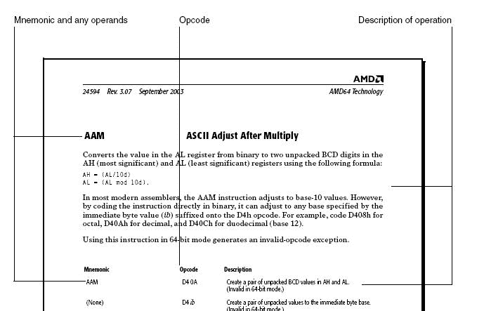
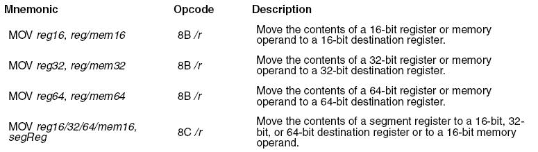
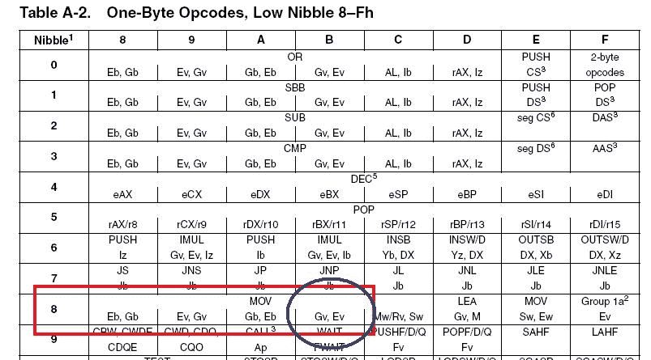

# 深入浅出指令编码之四：指令核心

> 原文：[`www.pediy.com/kssd/pediy10/78121.html`](https://www.pediy.com/kssd/pediy10/78121.html)

## 第三章 指令编码核心

这部分内容较比，花了多点时间去写，所以比较仔细。

本章节讲解的核心是 `Opcode`、`ModRM` 以及 `SIB`，这三者的已经是紧密结合，无论分开谁单独来讲都不能透切的了解 `x64` 的指令编码体系。

## 第一节 学会看 Opcode 表

怎么去看指令的 `opcode`，获得指令 `opcode` 编码，是很有学问的。

### 一、从指令参考页里看 opcode 码

可能许多人喜欢从指令参考页里查看 `opcode`，下面的图是 `AMD` 文档中对于指令参考页的描述：



从指令参考页里可以得出以下信息：

（1）指令助记符 `mnemonic`

（2）指令的 `Operand` 属性

（3）指令的 `Opcode` 码

（4）指令的描述。

这确实可以得到想要的 `Opcode` 码，还是 `Operand` 数以其属性。下面摘录了 `mov` 指令一部分的参考页：



从这里看出，这个 `Opcode` `8B` 有几种操作数形式，`reg` <- `reg`、`reg` <- `mem`，`operand-size` 可以是 `16/32/64`。

不过这并不是了解 `Opcode` 码的好地方，指令参考页主要是对指令的操作进行相应的描述。对掌握 `Opcode` 码不是那么直观和透彻。

### 二、掌握 Opcode 表

只有学会看 `Opcode` 表才是正道，`Opcode` 表是一个全面的透彻的总结表，又可以说十分细致。`Intel` 和 `AMD` 的文档中均提供了 `Opcode` 表，`Opcode` 表有 `One-byte Opcode` 表、`Two-byte Opcode` 表和 `X87 Opcode` 表等。

#### 1、Opcode 表上的基本元素

`Opcode` 表上描述的范围是 `00` ~ `FF`，即 `1` 个字节共 `256` 个值，每 `1` 值描述不同的属性，包括：

● 绝大部分代表 `1` 个 `Opcode` 码。

● `26`、`2E`、`36`、`3E`、`64`、`65`、`66`、`67`、`F0`、`F2`、`F3` 则是 `prefix`。

● `OF` 指示 `2` 个字节的 `Opcode`。

● 还有一部分是 `Group` 指令，由 `ModRM` 中的 `reg` 来决定。这部分还包括了 `x87 float` 指令的 `Opcode` 码。

每个 `Opcode` 码还附有相应的 `Operand` 属性，`Operand` 属性是用来描述 `Operand` 的，包括 `Operand` 寻址类型及 `Size`。

看看 `mov` 指令 `8B Opcode` 表是怎样的：



上图圆圈所示是 `Opcode 8B`，它对应的是 `mov` 的 `mnemonic`，表格中的 `Gv, Ev` 是描述这个 `Opcode` 码所对应的指令的 `Operand` 属性。表示：

（1）两个 `Operands` 分别是：目标操作数 `Gv`，源操作数 `Ev`

（2）`Gv` 表示：`G` 是寄存器操作数，`v` 是表示操作数大小依赖于当前代码的 `Default Operand-Size`，也就是 `CS.D`，可以是 `16` 位，`32` 位以及 `64` 位。

（3）`Ev` 表示：`E` 是寄存器或者内存操作数，具体要依赖于 `ModRM`，操作数大小和 `Gv` 一致。

`4` 个字符便可以很直观的表示出：操作数的个数以及寻址方式，更重要的信息是这个 `Opcode` 的操作数需要 `ModRM` 进行解析。

要看懂 `Opcode` 表必须学会分析和理解 `Operand` 属性字符，`Intel` 和 `AMD` 的 `Opcode` 表前面都有对 `Operand` 属性字符很仔细清晰的定义和说明。

**记住以下两点：**

（1）`Operand` 属性都有两组字符来定义，前面的一组大写字母是 `Operand` 类型，后面一组小定字母是 `Operand` 大小。

如：`Gv` 这里 `G` 是 `Operand` 类型，表示是 `General-Purpose Register(GPR)` 通用寄存器，也就是 `rax~r15` 共 `16` 个。这是有别与 `Segment Register`、`XMM` 寄存器等。`v` 是 `Operand` 大小，这个 `Size` 是依赖于当前的 `Default Operand-Size`。

（2）操作数是直接编码在 `Opcode` 中，这些操作数是寄存器。这些寄存器的 `ID` 值已在 `Opcode` 中，而无需指出。`Operand Size` 是依赖于当前 `Default Operand-Size`。

**以下举两个例子。**

（1）以典型的 `Jmp Jz` 为例，它的 `Opcode` 是 `E9`，`Operand` 属性是 `Jz`，`J` 是代表基于 `EIP` 的相对寻址，也就是说，操作数寻址是偏移量 `Offset` 加上 `EIP` 得出。`z` 则表示 `Operand-Size` 是当前 `Default Operand-Size`，这个 `Operand-Size` 是不能被 `override` 的，也就是说不能被加 `66h Prefix` 来调整 `Operand-Size`。

（2）另一个典型的例子是 `call Ev`，它的 `Opcode` 是 `FF`，这个 `Opcode` 是个典型的 `Group Opcode`，为什么会定义为 `Group`，下面的将会有阐述。操作数的寻址是典型的 `ModRM` 寻址，更严格地讲是 `ModRM` 中的 `r/m` 寻址。`E` 既可是 `GPR` 也可以是 `Mem`。它同样是 `v` 属性的 `Operand-Size`。

**下面列举一些常见的 Operand 属性字符，详述请参考 Intel 或 AMD 手册。**

**(1)、Operand 类型字符**

`E`：`GPR` 或 `Mem`，依赖于 `ModRM` 中的 `r/m` 域

`G`：`GPR` 具体 `ID` 依赖于 `ModRM` 中的 `reg` 域

`I`：`Immediate` 直接在指令 `encode` 中

`J`：`EIP` 相对寻址操作数，`EIP+offset`

`O`：绝对寻址和 `Immediate` 一样，直接在指令 `encode` 中

**(2)、Operand 大小字符**

`b`：`One-byte`

`d`：`four-byte`（`doubledword`）

`q`：`eight-byte`（`quadword`）

`v`：`16` 位、`32` 位、`64` 位依赖于 `Default Operand-Size`，可被 `66h Prefix` 改写

`z`：`16`、`32`、`64` 位依赖于 `Default Operand-Size`，不可被 `66` 改写

通过查 `Opcode` 表能迅速得出该指令的 `Opcode` 及 `Operand` 详情。

#### 2、透析 Opcode 的编码规则

`prefix` 与 `Opcode` 共享 `00~FF` 的空间，由于 `Prefix` 部分是可选的，当 `CPU` 取指单元从 `ITLB` 加载指令 `L1-Icache` 和 `prefetch buffer`，预解码单元通过 `prefix` 自已的 `ID` 值来解析 `prefix`。如读入 `66h` 时是解析为 `prefix` 而不是 `Opcode`。同样，读入 `0F` 时被解析为是 `2` 个字节的 `Opcode` 中的第 `1` 个字节。

`Opcode` 的 `operand` 寻址一部分是在 `Opcode` 码直接中指定，一部分是依赖 `ModRM` 给定，还有一部分不依赖 `ModRM` 给定。直接中 `Opcode` 指定的 `operand` 寻址的是 `GPR` 寻址，如：`inc eax` 指令（`Opcode` 是 `40h`），还有串指令，如 `loads` 等。

有 `2` 个 `Operands` 数的 `Opcode`，有三种情况，一种是：一个 `Operand` 由 `Opcode` 指令指定，另一个 `operand` 却不依赖于 `ModRM`。这种情况下，一个 `operand` 必定是 `GPR`，另一个不依赖于 `ModRM` 的 `operand` 必定是 `Immediate` 和 `Displacement`。看看以下两个 `Opcode`：

指令 `mov rax, Iv` 它的 `Opcode` 是 `B8`，目标操作数是由 `Opcode` 中指定的 `GPR`（`rax`），源操作数不依赖于 `ModRM` 的 `Immediate`，在这种情况下，这个 `Immediate` 可以不受 `4` 字节限制，它可以是 `64` 位的值，即：`mov rax, 0x1122334455667788` 是完全正确的。

又如指令 `mov rax,Ov` 它的 `Opcode` 是 `A1`，目标操作数由 `Opcode` 指定的 `rax` 寄存器，源操作数是不依赖于 `ModRM` 的 `displacement` 值，同样在这种情况下，这个 `displacement` 可以不受 `4` 字节限制，它可以是 `64` 位值，即：`mov rax, qword ptr [0x1122334455667788]` 是完全正确的。

第二种是：两个操数都由 `ModRM` 提供寻址，这种情况下，这两个操作数要么两个都是寄存器寻址。要么是一个是寄存器，一个是内存寻址。那么，`ModRM` 中 `reg` 提供具体的寄存器寻址，`r/m` 提供另一个寄存器寻址或内存寻址。这种指令很常见，如：`mov eax,ecx` 它的操作数由 `ModRM` 提供寻址。大多数编译器会将 `ecx` 由 `reg` 提供寻址，即：`reg = 001`。而 `eax` 则由 `r/m` 提供寻址，即：`r/m = 000`，这样，`ModRM` 的值就是：`11-001-000` 也就是 `c8`。所以：`mov eax, ecx` 指令的机器编码是：`89 c8`

第三种是：一个操作数由 `ModRM` 提供寻址，另一个操作数则不由 `ModRM` 提供寻址，那么这个 `Opcode` 必定是 `Group` 属性 `Opcode`。因为 `ModRM` 的 `reg` 将会用来协同 `Opcode` 来确定最终 `Opcode`。这种指令也很常见，如以下这条指令很常见：`mov dword ptr [eax-0xc], 1` 它是 `operand` 属性字符是：`Ev,Iz` 这是很典型的 `Group` 属性 `Opcode`，目标操作数由 `ModRM` 的 `r/m` 提供寻址，源操作数则是立即数，这种情况的 `Immediate` 则要受到 `4` 字节的限制，若是：`mov qdword ptr [rax- 0x0c], 0x1122334455667788` 则是错误的。最终它的机器编码是：

```
C7 40 f4 01 00 00 00
```

要深入掌握 `Opcode` 规则，必要记住上述 `2` 点：一是 `Opcode` 表的基本元素，学会分析 `Operand` 属性字符，二是理解上面所讲的 `operand` 寻址模式。

### 三、x87 指令、3Dnow 指令、64-media and 128-media 指令介绍

#### 1、x87 指令介绍

`Opcode` 范围从 `D8` ~ `DF` 是 `x87 float` 指令 `Opcode`，实际上 `x87` 指令的 `Opcode` 是 `2` 个字节的，`D8~DF` 是主字节，`ModRM` 是补充字节，协助主字节。也可以说它是 `Group` 属性的 `Opcode`，但 `x87` 的 `ModRM` 比 `Group` 属性 `Opcode` 中的 `ModRM` 是更进一步协助关系。

`x87` 指令绝大部分是 `float` 寄存器（`st0~st7`）寻址的，实际是与 `mmx0~mmx7` 寄存器共用物理寄存器。

在 `ModRM` 的 `mod=11` 模式下，`r/m` 能提供 `8` 个 `Opcode`，它们全是寄存器寻址，而在 `mod != 11` 模式下，`x87` 指令可以提供内存操作数寻址。

像以下这条常见的 `x87 float` 指令：

（1）`fstp st(1)` ；将 `st(0)` 值复制到 `st(1)` 到，并置 `stack` 顶为 `st(1)`

它是寄存器寻址，`ModRM` 中的 `mod = 11` 提供寄存器寻址模式，`reg = 011` 提供 `fstp opcode`，`r/m = 001` 提供寄存器 `ID`，所以，这条指令的编码是：`dd d9`

（2）`fstp dword ptr [eax]` ；将 `st(0)` 值复制到 `[eax]`，并置 `stack` 顶为 `st(1)`

它是内存寻址，`ModRM` 的 `mod = 00` 提供无 `disp` 内存寻址，`reg = 011` 提供 `fstp mem32 opcode`，`r/m = 00` 提供 `[eax]` 内存寻址。所以，这条指令的编码是：`d9 18`

#### 2、3DNow 指令

`AMD` 设计的 `3Dnow` 别开生面，实际上 `3` 个 `Opcode` 的指令集，前 `2` 个 `Opcode` 是 `0F 0F`，这两个 `Opcode` 是起引导为 `3Dnow` 的作用，第 `3` 个 `Opcode` 是主 `Opcode` 但是这个 `Opcode` 却又不跟在第二个 `Opcode` 后面。实际，第 `3` 个 `Opcode` 改由 `Immediate` 来充当，这个 `Immediate` 值是固定为 `1` 个字节的。

它是编码序列是：`0F 0F ModRM SIB displacement Immediate`

`AMD` 在最新的 `SSE5` 指令也沿用了这种模式，只是更进一步增加编码序列单元，这将在以后章节讲述。

下面举 `1` 个例子来示范：指令 `pfcmpge mmx1, qword ptr [eax]`

这条指令的 `operand` 助记符是：`Pq,Qq` 实际上与 `Gv, Ev` 情况一样，只不过这里寄存器由 `GPR` 变为 `mmx` 寄存器，操作数却固定为 `64` 位。

它的 `Opcode` 码是：`90` 也就是 `imme` 为 `90`，由 `ModRM` 的 `reg` 提供 `P` 的寻址，`r/m` 提供 `Q` 的寻址。故 `mod = 00`，`reg = 001`，`r/m = 000`

所以，这条指令的编码是：`0F 0F 08 90`

#### 3、64-media 与 128-media 指令

一部分指令是 `3` 个 `Opcode` 一部分是 `2` 个 `Opcode`，而 `3` 个 `Opcode` 则是有一个 `prefix` 来充当。这是 `Intel` 设计的编码架构，若是 `AMD` 设计的编码则极大可能不同，`AMD` 设计的风格是使用后面的 `Imme` 来充当第 `3` 个 `Opcode`，而 `Intel` 则是使用 `prefix`，这里可以看出 `AMD` 与 `Intel` 风格的不同。

这些指令使用 `66h`、`F2` 以及 `F3 prefix` 作为第 `1` 个 `Opcode`，`0F` 作为第 `2` 个 `Opcode`。

举 `1` 个例子：`movntdq xmmword ptr [rax], xmm0`

这是一条复 `128` 位的指令，从 `xmm0` 复制到 `[rax]` 内存上，它采用 `66 0F` 前导，第 `3` 个 `Opcode` 是 `E7`，`ModRM` 提供寻址，`mod = 00`，`reg = 000`，`r/m = 000`

所以，这条指令的编码是 `66 0F E7 00`

### 四、强悍的 AMD SSE5 指令集

`AMD` 设计 `3Dnow` 与 `SSE5` 指令集的目的很明显，想摆 `Intel` 的制约，反过来想引导 `Intel` 向他自已靠拢。特别是 `SSE5` 指令集。`SSE5` 指令集的数量不少，有八九十个之多。实事上 `AMD` 推出的 `x86_64` 指令集就成功的制约了 `Intel`，`Intel` 不得不跟随 `AMD` 脚步。`SSE5` 能不能再引导 `Intel` 向他靠还得拭目以待。

#### 1、AMD SSE5 指令集编码的特点：

（1）`SSE5` 指令操作数可以增加到 `4` 个。这个 `4` 个操作数可以全是寄存器操作数，这是通过增加 `DREX` 字节来实现的。

（2）`SSE5` 指令编码有 `3` 个 `Opcode`，其中 `2` 个是引导 `Opcode` 和 `1` 个主导 `Opcode`。

（3）`SSE5` 指令编码中有 `3` 个字节来定位寻址操作数。在原有的 `ModRM` 和 `SIB` 的基础上，增加了 `Drex` 字节来寻址。

（4）无需 `prefix` 以及 `REX prefix` 进行修饰。

（5）目标操作数固定为寄存器

#### 2、SSE5 指令编码序列，如下：

`0F 24(或 0F 25)+Opcode3+ModRM+SIB+DREX+Displacment+Immediate`

● `0F 24` 和 `0F 25` 是引导 `Opcode`，这两个 `Opcode` 在原来是无效。

● `Opcode3` 是主导 `Opcode`，定性 `SSE5` 的操作

● `ModRM` 与 `SIB` 意义和原来一致

● `DREX` 意即：`Dest+REX`，`DREX.dest` 是定义目标操作数，`REX` 的含义和 `REX prefix` 一致。

● `Displacement` 含义和以前一致。

● `Immediate` 含义有些改动，在 `SSE5` 指令里只有 `1` 个字节大小。

#### 3、Opcode3 的结构

位 含义

`7 ~ 3` `Opcode` 码

`2` `Oc1`，它与 `DREX` 的 `Oc0` 组合起来控制操作数

`1 ~ 0` `OPS`，它定义操作数的大小

#### 4、DREX 的结构

位 含义

`7 ~ 4` `Dest` 域，即目标操作数的 `ID` 值

`3` `Oc0`，与 `Opcode3` 的 `Oc1` 组合起来控制操作数

`2` 即 `REX.R`

`1` 即 `REX.X`

`0` 即 `REX.B`

#### 5、控制操作数

`Opcode3.Oc1 + DREX.Oc0` 组合共 `2` 位值控制操作数分配

对于 `4` 个操作数的指令来说，例：`fmaddps dest, src1,src2,src3` 其含义如下：

值 含义


`dest` = `DREX.dest`，`src1` = `DREX.dest`，`src2` = `ModRM.reg`

`src3` = `ModRM.r/m`

`dest` = `DREX.dest`, `src1` = `DREX.dest`, `src2` = `ModRM.r/m`

`src3` = `ModRM.reg`

`dest` = `DREX.dest`，`src1` = `ModRM.reg`，`src2` = `ModRM.r/m`

`src3` = `DREX.dest`

`dest` = `DREX.dest`，`src1` = `ModRM.r/m`，`src2` = `ModRM.reg`

`src3` = `DREX.dest`

像：`fmaddps xmm1, xmm2, xmmword ptr [rax], xmm1` 这条指令的机器编码是：

```
0F 24 04 10 10
```

若：`fmaddps xmm1,xmm2,xmmword ptr [rax+0x11223344], xmm1`

则是：`0F 24 04 90 10 44 33 22 11`

# 第二节 ModRM 寻址

本节将讲解另一个重点：`ModRM` 寻址。这个 `ModRM` 寻址非常重要。是理解 x86 和 x64 平台上指令 `Operand` 的关键。

记住，理解透彻是最关键。若真的不能理解，能背出也不错了。

## 一、ModRM 的含义

`ModRM` 字节的组成部分为：`mod-reg-r/m` 三个部分，`mod` 为 2 位，`reg` 与 `r/m` 是 3，组成 2-3-3 的比例。

### 1、mod：寻址模式。

2 位组成 4 种寻址模式，总的来说，只有两种寻址模式，就是：内存寻址模式和寄存器寻址模式。`mod` = `11` 时指出寄存器寻址模式，`mod` = `00` ~ `10` 时指出内存寻址模式：

`mod` = `00`，定义 `[register]` 间接寻址，无 `displacement` 值。

`mod` = `01`，定义 `[register + disp8]`，有 8 位 `displacement` 偏移值。

`mod` = `10`，定义 `[register + disp32]`，有 32 位 `displacement` 偏移值。

### 2、reg：寄存器 ID 值

3 位组成 8 个寄存器 ID 值，从 `000` ~ `111`，对应于 `RAX`、`RCX`、`RDX`、`RBX`、`RSP`、`RBP`、`RSI` 以及 `RDI`。这个 ID 值可以被 `REX prefix` 扩充为 4 位，范围从 `0000` ~ `1111` 可表示 16 个寄存器。

`reg` 域的另一含义是对 `Opcode` 的补充，对分为一组 `Opcode` 的进行选择（`Group` 属性）。

### 3、r/m：意即 register / memory。

提供对 `registers` 或 `memory` 的寻址，也用来表示寄存器 ID，当是 `registers` 时是寄存器 ID 值。当是 `memory` 时是寄存器间接寻址中的寄存器 ID 值。当 `mod` != `11` 时，`r/m` 表示 `[rax]` ~ `[rdi]`，`REX prefix` 用来扩充寄存器 ID 值。

**这里有 2 个设计上的问题：**

(1) 如果像这条指令：`mov eax, [eax+ecx*2+0x0c]` 在这条指令里 `eax` 是 `base` 寄存器，`ecx` 是 `Index` 寄存器，`2` 是 `scale`，还有一个 `displacement`

这种内存寻址是 `base+index*scale+disp`。这需要 `SIB` 字节来进行确定，那么 `ModRM` 必须要有一个手段来引出后续的 `SIB` 字节。在 `[rax]` ~ `[rdi]` 的范围里，Intel 选择了原来应属于 `[rsp]` 的值用来引出 `SIB`，一是因为 `[rsp]` 并不常用吧。二是因为 `rsp` 设计为 `stack top` 指针，专用于 `stack top` 指针。

原来属于 `[rsp]` 的领域对应的，`r/m` 是 `100`，这个领域被 `[SIB]` 替代了，事实上在 16 位机器原本是没有 `SIB` 字节的，`base+index*scale+disp` 这种寻址是后来才增加的。16 位的 `ModRM` 上是没有 `SIB` 引导域。

(2) 如果内存寻址中没有 `base` 和 `index`，只有 `disp` 的话，如：`mov ebx, [0x11223344]`，这种直接寻址方式，在设计上 `ModRM` 还必须为提供这个模式。

Intel 又作出修改，选择了原来属于 `[rbp]` 模式的领域提供给 `[disp]`，选择 `[rbp]` 让给 `[disp]`，是因为 `rbp` 原本意图就是设计为 `stack` 基址指针。`[rbp]` 寻址一般都要加上一个偏移量，也就是基于 `stack frame` 指针的偏移量，即 `[ebp + disp]` 这种寻址模式在 `mod` = `01` 或 `mod` = `10` 中给出。

**所以，在最终的 mod =00 上，r/m 寻址设计上，如下表格：**

`r/m` `内存寻址`

`000` `[rax]`

`001` `[rcx]`

`010` `[rdx]`

`011` `[rbx]`

`100` `[SIB]` ---- 原本对应 `[rsp]`

`101` `[disp]` ---- 原本对应 `[rbp]`

`110` `[rsi]`

`111` `[rdi]`

而在 `mod` = `01` 及 `02` 上，`r/m` 的 `101` 域上，设计为 `[rbp + disp8]` 及 `[rbp + disp32]`，提供了对 `[rbp+偏移量]` 的支持，这样也符合原本设计的语义。

### 4、16 位寻址下的 ModRM

在 16 位寻址下是不支持 `base+index*scale` 这种寻址模式的，这样在编码序列里就无需提供 `SIB` 字节了。但还是有限地支持基址+变址寻址模式，基址寄存器只有 2 个，就是 `bx` 和 `bp`。变址寄存器也只有 2 个，就是 `si` 和 `di`。

基于上述设计，基址+变址寻址的组合只有 4 个，也就是：`[bx+si]`、`[bx+di]`、`[bp+si]` 以及 `[bp+di]`。它们对应 `r/m` 域就是 `000` ~ `011`。

那么这 4 个寄存器的间接寻址就是：`[si]`、`[di]`、`[bp]` 以及 `[bx]`，对应于 `r/m` 的 `100` ~ `111`，同样如上述，`bp` 是 `stack frame` 指针，一般使用需加 `disp(offset)`，所以 `[bp]` 让位给 `[disp]` 解决直接寻址的问题。

所以，16 位的 `mod` = `00` 下，`ModRM` 最终设计方案是：

`r/m` `内存寻址`

`000` `[bx+si]`

`001` `[bx+di]`

`010` `[bp+si]`

`011` `[bp+di]`

`100` `[si]`

`101` `[di]`

`110` `[disp]` ------ `[bp]` 让位给 `[disp]`

`111` `[bx]`

`mod` = `01`、`10` 以及 `11` 的情形下如前如述。

### 5、64 位寻址下的 ModRM

在 64 位下，`ModRM` 的含义与 32 位一致，改进的只是在原来基础上增加了 8 个 `GPRs`，通过 `REX prefix` 进行对新增的寄存器进行访问。

寄存器的 ID 取值为：`0000` ~ `1111`。由 `REX.R` 以及 `REX.B` 位进行扩展访问。

## 二、结合 Opcode 来看寻址模式及 Opcode 的定位

`Opcode` 定义指令的执行码，用于执行什么操作，对于操作数寻址上，`Opcode` 结合 `ModRM` 来定义操作数，这是一个经过反复琢磨推敲的过程，而最终又影响到 `Opcode` 的定位。下面讲讲怎么影响到 `Opcode` 最终定位。

### 3、一个操作数的 Opcode 定位

操作数要么就是 `registers`，要么就是 `memory`，要么就是 `Immediate` 值。如果指令只有一个操作数。

(1) 如它是 `register` 的话，`Opcode` 是无需 `ModRM` 配合确定寻址方式的，`ModRM` 的寻址方式的定位是定位 2 个操作数寻址方式的这种模式。在只有 1 个寄存器操作数的情况下，`ModRM` 无用武之处。所以，在这种情冲下，寄存器操作数绝大部分是嵌在 `Opcode` 里面，它由 `Opcode` 的寄存器域指出。如常见的 `inc ecx`、`dec ecx`、`push eax` 等。那么另一部分肯定是 `Group` 属性。若是 `Group` 属性，则 `ModRM` 有用武之地了。

(2) 如它是 `Immediate` 的话，它绝对是无 `ModRM`。直接将 `Immediate` 值嵌入指令编码里。

(3) 如它是 `memory` 的话，它绝对是 `Group` 属性，需要 `ModRM` 的 `reg` 来配合定位。那为什么不能是直接 `offset` 呢，直接 `offset` 寻址留给最常用的，最有用的 `Opcode`，以免 `Opcode` 占位，浪费资源。

### 4、两个操作数的 Opcode 定位

两个操作数大部分都需 `ModRM` 配合定位寻址。`ModRM` 提供的 2 个操作数寻址大有用武之地。

(1) 2 个操作数中，其中 1 个是寄存器的这种情况最直接简单，由 `ModRM` 的 `reg` 及 `r/m` 提供寻址。若其中 1 个是 `GPRs` 的情形下更简单，`GPRs` 则直接由 `Opcode` 提供寻址。

(2) 2 个操作数中，没有寄存器的情形下，也就是要么是 `memory`，要么是 `Immediate`，它必然是个 `Group` 属性，`reg` 域提供 `Opcode` 的定位，`r/m` 提供内存寻址。`Immediate` 直接嵌入指令编码中。

### 5、三个操作数的 Opcode 定位

三个操作数中有一个必定是 `Immediate`，在 AMD 的 `SSE5` 指令集推出之前，x86 平台是无法提供第 3 个非 `Immediate` 操作数的定位。直至 AMD 的 `SSE5` 通过增加另一个描述操作数的字节来寻址第 3 个操作数。

# 第三节 SIB 寻址

在 `ModRM` 无法提供更多内存寻址方式时，使用 `SIB` 进行协助寻址。对内存操作数寻址提供补充定义。使用 `SIB` 进行寻址的完整模式如：`[rax + ecx * 8 + 0x11223344]`。

此时，`SIB` 字节是：`scale` = `11`，`index` = `001`，`base` = `000`，组合起来是 `c8`

## 一、SIB 的含义及结构

`SIB` 意即：`Scale` `Index` `Base`，用来定义 `base+index*scale+disp` 这种寻址模式。同样按 2-3-3 比例组合。

`scale` 索引因子的含义：

值 含义

`00` 无 `scale`，或者：`scale * 1`

`01` 按 `index * 2` 比例

`10` 按 `index * 4` 比例

`11` 按 `index * 8` 比例

`index` 域指出 `index` 寄存器的 ID 值，范围从 `000` ~ `111`。`base` 域指出 `base` 寄存器的 ID 值，从 `000` ~ `111`。`Index` 与 `base` 经过 `REX prefix` 可以扩展为 `0000` ~ `1111`。

## 二、对 ModRM 的补充定义

前面提到 `ModRM` 中，`ModRM.r/m` = `100` 时，`[esp]` 让位给 `[SIB]` 提供引导 `SIB` 字节。这种情况下，指令使用了 `base+index` 的寻址方式。

`SIB` 提供了从 `[base+index]` 到 `[base+index*8]` 寻址范围，那么这里延续上一节提到的 `ModRM` 设计上的问题：`[esp]` 这种寻址方式将怎么解决呢？在 `ModRM` 中抛弃了 `[esp]` 的寻址模式，在 `SIB` 中将得到补救。

在 `index` = `100` 时，按规则，应该是 `[esp + base]` 这种寻址模式吧？由于 `esp` 的特殊性，`esp` 寄存器只能做 `base` 寄存器，以 `esp` 为基址。而不能作为 `index` 寄存器。所以：`[esp+base]` 这种寻址模式中 `esp` 被去除，那么将剩余 `[base]`。

故当 `index` = `100` 时，`[esp+base]` 具体形式将取决于 `base`。

### 1、对 [esp] 寻址的补救方式

由于 `ModRM` 中没提供 `[esp]` 寻址，而又确实需要 `[esp]` 寻址的话，在 `SIB` 中通过 `index` = `100` 时提供，`[esp+base]` 中去除掉 `esp`，留下 `[base]` 寻址，所以在 `base` = `100` 时就提供了对 `[esp]` 的寻址。

### 2、重复编码

在 `index` = `100`，去除 `esp` 后，变为 `[base]` 寻址，那么此时又提供了 `[base]` 的寻址方式，这样就与 `ModRM.mod` = `00` 时提供了完全相同的寻址方式，所不同的是一种由 `ModRM.mod` = `00` 直接给出，另一种通过 `ModRM./rm` = `100` 然后转接到 `SIB`，再由 `SIB.index` = `100` 时 `SIB.base` 提供。

Intel 设计的时候已不能顾及这么多了，反正重码也没什么多大的害处，只是麻烦了 `processor` 的解码单元而已，但这样就显不得够严谨，话说回来，本来 x86 平台指令集就不是十分严谨。

### 3、那么当 index = 100，也就是 [base] 寻址，而 base = 101 时，按规则此时应该为 [ebp] 寻址。Intel 又变变花样，在 [ebp] 时而又不是 [ebp]。

前面提到，`ModRM`，当 `r/m` = `100`，也就是让位给 `[SIB]` 的原来属于 `[esp]` 的地方，`r/m` = `101` 提供的是 `[ebp]` 寻址，当 `r/m` = `100`，而 `SIB.base` = `101` 时，若还是 `[ebp]`，就重复了。

选择在重复 `[ebp]` 时改变，可能还是基于 `[ebp+disp]` 这个 `stack frame` 指针＋偏移量用法的考虑吧。

此时 `[ebp]` 而不是 `[ebp]` 随着 `ModRM.mod` 而改变。`ModRM.mod` = `00` 时，`index` = `100`，`base` = `101`，此时会改变 `[disp32]` 寻址，这和 `ModRM.mod` = `00`，`ModRM.r/m` = `101` 又完全一样了，提供的是 `[disp32]` 的寻址。

当 `ModRM.mod` = `01` 和 `10` 时，`index` = `100`，`base` = `101`，提供的是 `[ebp+disp8]` 和 `[ebp+disp32]` 寻址。而这又和 `ModRM.mod` = `01` 和 `10` 时，`ModRM.r/m` = `101` 提供了完全相同的编码。

换句话来说：Intel 完全没有提供 `[ebp]` 这种寻址方式，这又验证了 Intel 的设计构思，就是：`ebp` 是 `stack frame` 指针，因此使用 `ebp` 作为基址的话，则要加上一个偏移量。`[ebp+disp]` 这种寻址正好符合 Intel 的这种理念。

那么，要使用 `[ebp]` 这种寻址，只好变通一点：采用 `[ebp + 0x0]` 这种形式了。

## 三、总结一下 SIB 寻址

### 1、重码问题

x86 指令的内存寻址有三个地方的重码现象：

(1)、`[disp32]` 寻址方式的重码现象

`ModRM.mod` = `00`，`ModRM.r/m` = `101` 提供了 `[disp32]` 寻址。

`ModRM.mod` = `00`，`ModRM.r/m` = `100`

然后 `SIB.index` = `100`，`SIB.base` = `101` 提供了 `[disp32]` 重码寻址。

(2)、`[base]` 寻址方式的重码现象

`ModRM.mod` = `00` 提供了 `[base]` 寻址，也就是 `[eax]` 之类。

`ModRM.mod` != `11` `ModRM.r/m` = `100`

然后 `SIB.index` = `100` 提供了 `[base]` 寻址，导致重码。

(3)、`[ebp+disp8]` 与 `[ebp+disp32]` 的重码现象

`ModRM.mod` = `01` 和 `10`，`ModRM.r/m` = `101`，提供了相应的 `[ebp+disp8]` 和 `[ebp+disp32]` 寻址。

`ModRM.mod` 01 和 10，`ModRM.r/m` = `100`，

`SIB.index` = `100`，`SIB.base` = `101`，提供了相应的 `[ebp+disp8]` 和 `[ebp+disp32]`

### 2、不支持 esp 做为 index 寄存器寻址的问题


因 `esp` 设计为 `stack top` 指针，而不支持 `[esp+base]` 这种寻址方式。`esp` 只能作为 `base` 寻址，即：`[esp]`。故 `[esp+base]` 被去除 `esp`，只剩下 `[base]`，而引发重码问题。

### 3、 不支持 `[ebp]` 寻址方式
须作为 `stack frame pointer` 加偏移量的寻址方式。这符合设计语义。程序中使用 `[ebp]` 则要变为：`[ebp+disp8]` 或者 `[ebp + disp32]` 这种方式。

`x86` 和 `x64` 平台的指令编码核心部分：`Opcode`、`ModRM` 以及 `SIB` 讲解到此为止。

后续章节将探讨 `displacement` 和 `immediate` 话题。
