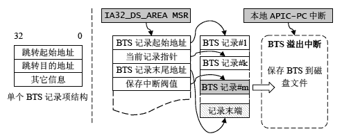

# 谈谈 intel x86 提供的 Branch Trace Store 的功能

> 原文：[`www.pediy.com/kssd/pediy10/66975.html`](https://www.pediy.com/kssd/pediy10/66975.html)

好就没来发贴了...罪过罪过

这里说说 Intel 提供的 BTS 功能，相信对于做系统逆向分析有一定作用

本文在我 blog 的链接：http://www.csksoft.net/blog/post/bts\_setup.html

## 介绍

Branch Trace Store(BTS)是目前广泛被 intel CPU 所提供的一种硬件辅助调试功能，因为在 MSRA 项目需要，所以作了一些基于它的应用。虽然 Intel 的 CPU 开发手册\[1\]提供了比较详细的使用方法，但是由于比较笼统，且缺少 win32 下的相关资料。所以我打算把其中的一些 tricky 的事情和大家分享下。这些内容当然也是我自己查找公开资料得到的，因此也不算什么秘密吧 :-)

BTS 简单的说就是允许 CPU 将自己实际执行到的分支指令(jmp/jxx/call/int/etc.)的相关信息保存下来的功能。一般 CPU 都会保存每个分支指令的源地址和目标地址，该地址在保护模式下是虚拟地址形式表示的。利用这个功能，可以实时地了解当前 CPU 正在执行代码的实际流程情况，很多分析软件，如 Intel 的 Vtune 或者 profiling 库，如\*nix 平台下的 perfmon\[2\]都用它来做一些程序性能分析。当然，还可以做很多其他有趣的事，比如逆向工程，具体我就不说了。

不过目前很少有资料具体介绍如何在 win32 下开启该功能并实现一个可用的 BTS 捕捉引擎。当然可以参考 perfmon 的代码，但 BTS 在其中只是很小一个部分，同时为了实现跨平台，对于新手来说难度较大。因此我这里重点介绍对于单核心的 NetBurst 构架的 CPU（通俗地说就是 P4 这类）在 win32 下的具体实现细节。其他的构架，比如现在的 Core Due，大家可以参考 intel 的开发手册举一反三。

## 工作框架

实际上，上面所说的 BTS 只是 intel 对于分支指令信息捕获机制的一个分支，就 P4 而言，大致提供了下列几种分支指令的捕获手段

### Last Branch Record(LBR)

故名思意，该方式将记录最后几个分支信息，实际上 NetBurst CPU 中内建了若干个 MSR 寄存器用于记录 Last Branch Record，称为 LBR Stack。在该模式下运行的 CPU 会采用 Round Robin 的方式循环填充那几个 MSR 寄存器。

该方式常用在调试器的 Call Stack 分析上，我们这里就不涉及了

### Branch Trace Messages

该方式和我们将介绍的 Branch Trace Store 大致类似，与 LBR 不同的是，CPU 会把分支信息发送到系统总线上供第三方硬件在总线上接收数据。而 BTS 则直接将数据保存到由程序制定的内存单元中。我们这里也不讨论该方式。

### Branch Trace Store

简单的说，BTS 就是将分支信息保存到了有程序（实际就是我们）制定的一块内存空间中。而当这块内存用尽时，CPU 可以采用 Round Robin 的方式循环填充，这就和 LBR 类似，但可以指定内存块的大小来决定最大捕捉量。另一种处理方式是在内存快用尽的时候，一个事先由我们设定的处理中断将触发来完成对当前内存块中 BTS 数据的保存工作。这样就可以记录任意多的分支信息了。我们这里主要考虑的就是这种方式的 BTS。

按照 intel 开发手册的描述，BTS 开启后的 CPU 执行模式如下图所示：



每当 CPU 执行到一个分支指令后，它就会产生一个如上左图的 BTS 记录项。这里举个例子：

```
0x80001234   mov eax,\[esp\]
0x80001238   or eax,eax
0x80001240   jnz 0x80002000
0x80001245   nop
...
```

当执行上面这段执行，其中遇到了 jnz 指令，如果他的跳转条件成立，那么将产生一个从 0x80001240 到 0x80002000 的跳转，那么产生的 BTS 记录项就是{From:0x80001240,To:0x80002000,...}

对于 P4 的 CPU，这个 BTS 记录项的结构如下：

```
struct BTS\_ITEM\_BLOCK\_P4{ 
    ULONG   dwBranchFrom; 
    ULONG   dwBranchTo; 
    ULONG   dwFlags; 
};
```

每次 CPU 执行到分支指令的时候，只要 BTS 开启，它就会产生一个如上结构得数据块，然后把它存储到事先定义好的一块内存当中去。而这块内存是比较灵活的，如上图所示，CPU 需要知道这块内存的起始地址、结束地址、以及当记录到第几个记录时候需要触发一个中断程序来负责将现有的 BTS 记录保存下来防止内存溢出。当 BTS 记录存储到图中那个灰底色的“BTS 记录#m”时，就会触发中断，可以发现它往往并不是整块记录内存的末端，具体原因就不解释了。

为了让 CPU 知道我们设置的内存空间的信息，需要提供一个叫做 `DS_BUFFER_MGR_BLOCK` 的结构来描述这块内存，他包括的内容如图所示，然后我们需要设置一个名为 `IA32_DS_AREA` 的 MSR 寄存器来指向这个 `DS_BUFFER_MGR_BLOCK` 数据的地址。

P4 下 `DS_BUFFER_MGR_BLOCK` 的完整结构是：

```
struct DS\_BUFFER\_MGR\_BLOCK\_P4{ 
    PVOID   pBTSBufferBase; 
    PVOID   pBTSBufferIndex; 
    PVOID   pBTSMaxSize; 
    PVOID   pBTSIntThresold; 
    PVOID   pPEBSBufferBase; 
    PVOID   pPEBSIndex; 
    PVOID   pPEBSMaxSize; 
    PVOID   pPEBSIntThresold; 
    ULONG   dwPEBSCounterReset; 
    ULONG   Reserved; 
};
```

注意上面黑体的条目，这些部分是 BTS 需要设置的，后面的是 PEBS 采用机制所需要的信息，这里我们忽略他们。这些条目需要设置成保存 BTS 内存的相关地址（虚拟内存地址）。

同时，还需要让 CPU 知道用于处理 BTS 溢出的中断号。目前的 Local APIC 控制器上有一个称为 Performance Mon. Counter 的寄存器项。当 BTS 记录项接近溢出时，就会通过这个记录项中存储的中断向量值去触发对应的中断程序。这个 Performance Mon. Counter 的格式如下图所示（图片来自 intel 手册）：


由于 APIC 芯片寄存器映射到了物理内存空间 `0xFEE00000H` 处，因此，对于其中寄存器的读写操作可以像标准内存操作那样进行。不过，由于采用虚拟内存的操作系统环境下，需要将该空间映射到对应的虚拟内存地址下，同时要避免操作系统的缓存行为。该部分细节我会在后面介绍。对于 APIC 芯片和 LVT 的一些具体细节可以参考 intel 手册\[3\]。

以上便是整个 BTS 工作的框架，如果不考虑具体的操作系统环境，对于他们的设置不存在很大的难度。不过由于 OS 引入了各类抽象机制或者保护手段，所以有一些 tricky 的问题需要处理。下面我讲介绍一个具体的实现流程。

## Win32 下 BTS 机制的开启和相关框架

经过上面的分析，对于 Win32 下进行 BTS 捕捉，需要进行如下的操作

1. 初始化用于存放 BTS 记录的内存空间
2. 设置对于上述内存空间的描述信息，即 `DS_BUFFER_MGR_BLOCK`，并将其地址值写入 `IA32_DS_AREA` MSR 寄存器
3. 编写处理 BTS 溢出操作的中断服务程序，并在 IDT 表中设立表项，创建一个中断服务
4. 设置 Local APIC 的 Performance mon. Counter 项，指向上述 IDT 表中我们创建的中断项
5. 通过对专门的 MSR 寄存器读写开启 BTS 功能

下面我就每个过程的关键问题具体展开介绍，同时给出些示例代码（不保证能运行）。同时，因为涉及到了底层的硬件控制，这里的代码自然就是在 Kernel 模式下执行的，如果对 WinDDK 的开发不熟悉，可以先参考相关文献。

### 初始化用于存放 BTS 记录的内存空间

这部分就不具体介绍了，直接可以使用内核的 `ExAllocatePool` 来分配内存单元，需要注意的是，对所分配的内存必须位于系统的 Nonpage pool 中。在这里假设所创建的内存空间用符号 `pBtsBuffer` 表示：

```
BTS_ITEM_BLOCK_P4 \*pBtsBuffer;
```

### 设置 DS_BUFFER_MGR_BLOCK

对于 `DS_BUFFER_MGR_BLOCK` 的设置只需要关注 BTS 部分，假设已经分配了 2000 个 BTS 记录的内存空间，且希望当记录到第 1900 项时触发中断，那么初始化代码可以是：

```
DS\_BUFFER\_MGR\_BLOCK \*pDSBlk = <some allocating code>; 
pDSBlk->pBTSBufferBase = pBtsBuffer; 
pDSBlk->pBTSBufferIndex =  pDSBlk->pBTSBufferBase; 
pDSBlk->pBTSMaxSize = &pBtsBuffer\[2000\]; 
pDSBlk->pBTSIntThresold = &pBtsBuffer\[1900\];
```

在设置好了数据后，就要将 `DS_BUFFER_MGR_BLOCK` 的地址写入 `IA32_DS_AREA`：

```
mov ecx,IA32\_DS\_AREA  
mov eax, pDSBlk  
WRMSR
```

其中， `IA32_DS_AREA` 为值：`0x600`

### 编写 BTS 溢出处理中断服务程序

在 Windows 下添加中断处理程序的具体方式这里就不介绍了，可以参照 Undocumented Windows NT\[4\]。这里需要注意几个问题：

1. 在进入中断后以关闭 BTS 为宜
2. 在中断退出前，需要设置 `pDSBlk->pBTSBufferIndex` 到初始状态，即 `pDSBlk->pBTSBufferIndex = pDSBlk->pBTSBufferBase;`
3. 当 BTS 中断触发后，CPU 将在 Local APCI 中的 Performance Mon. Counter 寄存器项上打开屏蔽位，从而阻止对中断的二次触发，所以需要在中断结束前关闭该屏蔽位
4. 给 APIC 发送 EOI 命令，通知该中断结束服务

对于 BTS 的开关操作，将在后续介绍。对于清除 Performance Mon. Counter 寄存器的屏蔽位，可以通过简单的对其进行重设达到效果，因此可以参考后面介绍的方法。

下面给出一个简单的中断处理过程代码：

```
void \_\_declspec( naked )    BTS\_handler(void) 
{  
     //保存当前线程状态，恢复内核模式相关寄存器 
     \_\_asm 
    {    
        cli 
        pushad 
        pushfd 
        push fs 
        push ds 
        push es 
        push gs 
        mov     ebx,0x30 
        mov     eax,0x23 
        mov     fs,bx 
        mov     ds,ax 
        mov     es,ax 
    } 
    //关闭 BTS，具体见后文 
    \_\_asm{ 
        mov ecx,MSR\_DEBUGCTL 
        RDMSR 
        mov tmp\_old\_msr\_bts,eax 
        xor eax,eax 
        WRMSR 
    } 
    //相关操作，如保存 BTS 到磁盘 
     
    //结束中断处理-------------------------------------- 
    pDSBlk->pBTSBufferIndex =  pDSBlk->pBTSBufferBase; //重设 BTS 记录指针 
     
    //开启 BTS，具体见后文 
    \_\_asm 
    { 
        //restore BTS 
        mov ecx,MSR\_DEBUGCTL 
        mov eax,tmp\_old\_msr\_bts 
        WRMSR 
    } 
    //清除 local apic 中 preformance mon. counter 的屏蔽位，具体间后文 
    local\_apic->lvt\_pc.mask=0; 
    //发送 eoi 指令字 
    local\_apic->eoi.eoi = 0; 
     
    //恢复当前线程环境 
    \_\_asm{ 
        sti 
        pop gs 
        pop es 
        pop ds 
        pop fs 
        popfd 
        popad 
        iretd        
    } 
}
```

其中，对于 BTS 的开启关闭，将在后文介绍。这里主要讨论对于 local apic 的操作。在前一章中已经知道，pc 中将该芯片的寄存器映射到了物理地址的 `0xFEE00000H` 处。而按照 Microsoft Windows Internals\[5\]中的描述，该地址在 windows 中被映射到了虚拟地址：`0xFFFFD000H` 处。

经过我的验证，的确如此，但是估计因为内核的保护机制，对这块映射的内存地址并不能直接操作。首先是对于很多寄存器，比如发送 EOI 的 EOI 寄存器，对它的写入操作将导致 BSOD。同时，我也发现内核采取了缓存的手段。

这里采用来自 Micah Richert\[6\]的方法。同时感谢他提供的 local apic 结构声明\[7\]。不通过 windows 内核映射的空间，而是直接重新将那块物理地址进行映射：

```
   PHYSICAL\_ADDRESS    pa; 

    pa.HighPart = 0;  
    pa.LowPart = 0xFEE00000; // 原始物理地址 
   local\_apic = (PAPIC)MmMapIoSpace(pa,sizeof(APIC), MmNonCached);
```

注意其中的黑体参数。今后便可以直接操作 `local_apic` 。同时，Micah Richert 定义了很完善的 local apic 寄存器结构，可以直接用结构体定义完成操作。

按照 intel 手册的描述，在中断完成后需要发送 eoi 指令，否则该中断将得不到再次触发。具体做法就是给 local apic 中的 eoi 寄存器清零。具体代码见上文。

### 安装中断服务程序并设置 Performance Mon. Counter 寄存器

对于中断服务程序的安装（注册）可以参考很多现有的文章，比如\[4\]。其中，我选用了 ID 为 `0x28` 的中断，因为 win32 中该中断项往往是闲置的。具体的手段就是修改 IDT 表，这部分内容这里不再涉及。

在完成中断的安装后，需要设置 Performance Mon. Counter 寄存器。比如我设置 int `0x28` 为 BTS 溢出中断，那么 Performance Mon. Counter 需要如下设置：

```
local\_apci->lvt\_pc = 0x28;
```

### BTS 功能的开关

对于 NetBurst 构架下，将通过 `MSR_DEBUGCTL` MSR 进行 BTS 的开关操作，下图为该 MSR 我们所关心的位：


换句话说，我们只需要往该 MSR 中写入 `0x1c` 即可开启 BTS。而清零则可关闭。

```
//开启 BTS  
        mov ecx,MSR\_DEBUGCTL  
        mov eax,0x1c  
        WRMSR
//关闭 BTS  
        mov ecx,MSR\_DEBUGCTL  
        xor  eax,eax  
        WRMSR
```

### 其他问题

上述办法仅针对但核心的 P4 处理器有效。如果面对多核环境或者多处理器环境，需要分别设置每个逻辑处理单元的 local apic。同时可能要考虑潜在的竞争情况。


通过上述办法捕捉到的 BTS 将包含整个系统的分支信息，其中不但混杂着用户态、内核态（甚至虚拟化技术的 Hypervisor 模式），同时不同线程也将混合在一起。因此对于实用的分析，需要作额外的处理。比如要知道线程切换的信息。这里可以参考 Pjf 关于线程切换信息的捕获方式\[8\]。
另一个需要注意的问题是如果直接在中断处理程序中进行对 BTS 写入文件将严重影响当前线程的执行。同时如果执行在不同的线程上下文中将使得诸如 `ZwWriteFile` 等导致系统锁死。

## 小结

经过上述的设置过程，即可实现 win32 下的 BTS 功能开启。目前 BTS 已经广泛的存在 intel 各系列 CPU 中。同时也被其他各类 CPU 所采用。除了目前性能分析软件使用外，BTS 对系统分析、逆向工程等均有很大

## 参考文献

\[1\] Chapter 18.6, Intel 64 and IA-32 Architectures Software Developer’s Manual, Volume 3B: System Programming Guide, Part 2
\[2\] perfmon2, the hardware-based performance monitoring interface for Linux, http://perfmon2.sourceforge.net
\[3\] Chapter 9.4, Intel 64 and IA-32 Architectures Software Developer’s Manual, Volume 3A: System Programming Guide, Part 1
\[4\] Prasad Dabak, Sandeep Phadke, Milind Borate, Undocumented Windows NT, Chapter 10
\[5\] Mark E. Russinovich and David A. Solomon, Microsoft Windows Internals, 4th Edition
\[6\] Micah Richert, http://www.snl.salk.edu/~micah/
\[7\] Micah Richert, RTInterrupt, http://www.snl.salk.edu/~micah/RTInterrupt/
\[8\] Pjf, http://www.blogcn.com/user17/pjf/blog/4331410.html
