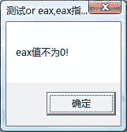
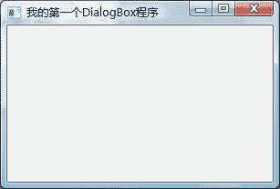

# Windows X64 汇编入门(1)

> 原文：[`www.pediy.com/kssd/pediy09/pediy09-602.htm`](https://www.pediy.com/kssd/pediy09/pediy09-602.htm)

> **Windows X64 汇编入门（1）**  
> tankaiha  

> 最近断断续续接触了些 64 位汇编的知识，这里小结一下，一是阶段学习的回顾，二是希望对 64 位汇编新手有所帮助。我也是刚接触这方面知识，文中肯定有错误之处，大家多指正。  
> 文章的标题包含了本文的四方面主要内容：  
> （1）Windows：本文是在 windows 环境下的汇编程序设计，调试环境为 Windows Vista 64 位版，调用的均为 windows API。  
> （2）X64：本文讨论的是 x64 汇编，这里的 x64 表示 AMD64 和 Intel 的 EM64T，而不包括 IA64。至于三者间的区别，可自行搜索。  
> （3）汇编：顾名思义，本文讨论的编程语言是汇编，其它高级语言的 64 位编程均不属于讨论范畴。  
> （4）入门：既是入门，便不会很全。其一，文中有很多知识仅仅点到为止，更深入的学习留待日后努力。其二，便于类似我这样刚接触 x64 汇编的新手入门。  
> 本文所有代码的调试环境：Windows Vista x64，Intel Core 2 Duo。

## 1. 建立开发环境

### 1.1 编译器的选择

对应于不同的 x64 汇编工具，开发环境也有所不同。最普遍的要算微软的 MASM，在 x64 环境中，相应的编译器已经更名为 `ml64.exe`，随 Visual Studio 2005 一起发布。因此，如果你是微软的忠实 fans，直接安装 VS2005 既可。运行时，只需打开相应的 64 位命令行窗口（图 1），便可以用 `ml64` 进行编译了。

第二个推荐的编译器是 GoASM，共包含三个文件：GoASM 编译器、GoLINK 链接器和 GoRC 资源编译器，且自带了 Include 目录。它的最大好外是小，不用为了学习 64 位汇编安装几个 G 的 VS。因此，本文的代码就在 GoASM 下编译。

第三个 Yasm，因为不熟，所以不再赘述，感兴趣的朋友自行测试吧。  
不同的编译器，语法会有一定差别，这在下面再说。

### 1.2 IDE 的选择

搜遍了 Internet 也没有找到支持 asm64 的 IDE，甚至连个 Editor 都没有。因此，最简单的方法是自行修改 EditPlus 的 masm 语法文件，这也是我采用的方法，至少可以得到语法高亮。当然，如果你懒得动手，那就用 notepad 吧。

没有 IDE，每次编译时都要手动输入不少参数和选项，做个批处理就行了。

### 1.3 硬件与操作系统

硬件要求就是 64 位的 CPU。操作系统也必须是 64 位的，如果在 64 位的 CPU 上安装了 32 位的操作系统，就算编译成功也无法运行程序。

## 2. 寄存器的改变

汇编是直接与寄存器打交道的语言，因此硬件对语言影响很大。先来看看 x64 与 x32 相比在硬件上多了什么，变了什么（图 2）。

X64 多了 8 个通用寄存器：`R8`、`R9`、`R10`、`R11`、`R12`、`R13`、`R14`、`R15`，当然，它们都是 64 位的。另外还增加了 8 个 128 位 XMM 寄存器，不过通常用不着。

X32 中原有的寄存器在 X64 中均为扩展为 64 位，且名称的第一个字母从 E 改为 R。不过我们还是可以在 64 位程序中调用 32 位的寄存器，如 `RAX`（64 位）、`EAX`（低 32）、`AX`（低 16 位）、`AL`（低 8 位）、`AH`（8 到 15 位），相应的有 `R8`、`R8D`、`R8W` 和 `R8B`。不过不要在程序中使用如 `AH` 之类的寄存器，因为在 AMD 的 CPU 上这种用法会与某些指令产生冲突。

## 3. 第一个 x64 汇编程序

本节，我们开始编写自己的第一个 x64 汇编程序。在这之前，先讲一下 calling convention 的改变。

### 3.1 API 调用方式

把 Calling convention 放在第一个讲，代表它的重要性。在 32 位汇编中，我们调用一个 API 时，采用的是 `stdcall`，它有两个特点：一是所有参数入栈，通过椎栈传递；二是被调用的 API 负责栈指针（`ESP`）的恢复，我们在调用 `MessageBox` 后不用 `add esp,14h`，因为 `MessageBox` 已经恢复过了。

而在 x64 汇编中，两方面都发生了变化。一是前四个参数分析通过四个寄存器传递：`RCX`、`RDX`、`R8`、`R9`，如果还有更多的参数，才通过椎栈传递。二是调用者负责椎栈空间的分配与回收。

下面给出一段代码，功能是显示一个简单的 MessageBox，注意对 `RSP` 的操作：

代码:

```
;示例代码 1.asm
;语法：GoASM
DATA SECTION
text     db 'Hello x64!', 0
caption  db 'My First x64 Application', 0

CODE SECTION
START:
sub rsp,28h
xor r9d,r9d
lea r8, caption
lea rdx, text
xor rcx,rcx
call MessageBoxA
add rsp,28h
ret
```

这段代码是在 GoASM 中编译，指令部分 GoASM 与 ML64 差不多，关键是一些宏的定义有差别。比如 masm 中的 `.code`，在这里就成了 `CODE SECTION`。下面再说区别，先编译。GoASM 中编译分两步：

（1） 编译：`goasm /x64 1.asm`  
（2） 链接：`golink 1.obj user32.dll`

如果一些正常，命令行中应显示图 3 的内容。

运行一下，我们的第一个 64 位 windows 程序就运行了。

GoASM 还有一个特点是支持宏：`ARG` 和 `INVOKE`，使用这两个宏可以免除程序员自己对椎栈进行操作。不过初学吗，还是从基础掌握比较好。下面的一段代码相同的功能的 MASM 代码，注意看看区别。ML64 至今仍不支持宏，所以每一步工作都要自己做。

代码:

```
;示例代码 2.asm
;语法：ML64
extrn MessageBoxA: proc

.data
text     db 'Hello x64!', 0
caption  db 'My First x64 Application', 0

.code
Main proc
sub rsp,28h
xor r9d,r9d
lea r8, caption
lea rdx, text
xor rcx,rcx
call MessageBoxA
add rsp,28h
ret

Main ENDP
end
```

编译这段代码的命令行是：`ml64 2.asm /link /subsystem:windows /entry:Main user32.lib`。如果正常，应该如图 5 显示那样。

很有意思吧，在 64 位系统下，我们仍然调用 user32 的 API。可能是名称用习惯了，微软自己都懒得改了吧。

### 3.2 64 位的椎栈

代码中还有一处值得注意，那就是 `sub rsp,28h` 和 `add rsp,28h`。`28h` 这个数值是怎么来的呢？

首先，x64 中椎栈被扩展为 64 位；其次，我们在调用 `MessageBoxA` 时，要给四个参数外加一个返回地址留空间，因此 `8(位)*5=40=28h`。

另外一些小问题要注意，AMD64 不支持 `push 32bit` 寄存器的指令，最好的方法就是 `push` 和 `pop` 都用 64 位寄存器。EM64T 如何？看了下 Intel 的开发手册，各个指令都分三种情况：纯 32 位、纯 64 位和 32 与 64 位混合。下面是手册的片段：

**Opcode*      Instruction        64-Bit Mode       Compat/Leg Mode      Description**  
`FF /6         PUSH r/m16         Valid                  Valid            Push r/m16.`  
`FF /6         PUSH r/m32         N.E.                   Valid            Push r/m32.`  
`FF /6         PUSH r/m64         Valid                  N.E.           Push r/m64.`  
Default operand size 64-bits.

没别的好方法，使用中多注意，尽量在 64 位程序中保用 64 位寄存器。

## 4. 一些参考资料

写完了第一个 hello world，本文就此打住。本还想写一些内容，但掌握不深，留待下回吧。感觉有些资料不得不在第一篇文章中放出来，因为它们是现有学习 x64 汇编的最好教材了，文中很多代码和知识点也来自于这些资料。

（1）《Moving to Windows x64》，出自：http://www.ntcore.com/Files/vista_x64.htm  
（2）GoASM 的帮助文档，目前最好的 64 位汇编教程。出自：www.jorgon.freeserve.co.uk  
（3）《开始进行 64 位 Windows 系统编程之前需要了解的所有信息》，出自：http://www.microsoft.com/china/MSDN/library/Windev/64bit/issuesx64.mspx  
（4）来自 CodeGurus 的两篇文章  
《Assembler & Win64》，  
http://www.codegurus.be/codegurus/Programming/assembler&win64_en.htm  
《bout RIP relative addressing》  
http://www.codegurus.be/codegurus/Programming/riprelativeaddressing_en.htm  
（5）AMD 开发手册  
（6）Intel 开发手册，注意是新的《ntel® 64 and IA-32 Architectures software Developer's Manual》

五一长假就要结束了，总算有时间好好睡了几个懒觉。今天醒来后想到的第一件事就是，该写第二篇了。

64 位技术现在还不成熟，没有好调试器，但是我们搞技术的总是对新东西充满了好奇和热情。这个理由就足够我们现在开始学习 64 位汇编了！OK，Let's go on。

## 1. 再说 Calling convention

关于 API 的调用方式，在入门（1）中说了一些，不过感觉有必要再讲两点。一是在调用 API 时椎栈的框架，也就是 Stack Frame，二是利用反汇编 64 位 C/C++程序来研究 calling convention。

先说 Stack Frame。图 1 是一个通用的椎栈框架。

在一个使用 STDCALL 的 32 位程序中，stack frame 的四项工作：

（1） 传入参数的调用；  
（2） 在返回 caller 时，callee 要负责平衡椎栈；  
（3） 给局部变量提供空间；  
（4） 保证 `ebx`、`esi`、`edi` 和 `ebp` 四个寄存器的值不变（这种寄存器被称为 non-volatile）。

在 64 位环境中，少了一个平衡椎栈的任务，因为平衡椎栈的工作由 caller 负责了，因此 callee 的 stack frame 只剩下三项工作：

（1） 将寄存器传入的参数和其它超过 4 个以上的参数在椎栈上保存（入栈）；  
（2） 给局部变量提供空间；  
（3） 保证 non-volatile 寄存器的值不变，包括 `ebp`、`ebx`、`rdi`、`rsi`、`r12` 到 `r15`，`xmm6` 到 `xmm15`。

所以，在一个函数的开始往往有如下代码：

`MOV [RSP+8h],RCX`  
`MOV [RSP+10h],RDX`  
`MOV [RSP+18h],R8`  
`MOV [RSP+20h],R9`  
`PUSH RBP`  
`MOV RBP,RSP`

而在返回时会有如下代码：

`LEA RSP,[RBP]`  
`POP RBP`  
`RET`

图 2 摘自 GoASM 的帮助文档，上文描述的情况在图中一目了然。

如果能在 VC 中编译 64 位 C/C++程序，再用 IDA 反汇编，不是挺好的吗？正确，这正是我们玩儿逆向工程的人喜欢的方法。Visual Studio 2005 的 64 位开发环境设置网上有，这里不多说了。以一个 C/C++的代码为例：

代码:

```
// Message handler for about box.
INT_PTR CALLBACK About(HWND hDlg, UINT message, WPARAM wParam, LPARAM lParam)
{
  UNREFERENCED_PARAMETER(lParam);
  switch (message)
  {
  case WM_INITDIALOG:
    return (INT_PTR)TRUE;

  case WM_COMMAND:
    if (LOWORD(wParam) == IDOK || LOWORD(wParam) == IDCANCEL)
    {
      EndDialog(hDlg, LOWORD(wParam));
      return (INT_PTR)TRUE;
    }
    break;
  }
  return (INT_PTR)FALSE;
}
```

这段代码是一个地球人都知道的窗口消息处理代码，在编译为 64 位程序后，用 ida64 看一下它的反汇编。这样，熟悉而又有点陌生的 64 位汇编代码就出来了，包括消息的判断，`EndDialog` 的调用等，确实很方便。

## 2. 第二个汇编例子：SMC

在入门（1）中我们写了第一个 64 位的汇编程序，这里我们开始写第二个。当然，代码本身还是有点意思的，这就是 Self Modify Code。让我们试一试 SMC 在 64 位下进行的如何？这还牵涉到 vista 的特性。代码来自修改过的参考资料《About RIP relative addressing》。

DATA SECTION  
testzero    db 'eax 值为 0', 0  
testnonzero  db 'eax 值不为 0!', 0  
testtitle db '测试 or eax,eax 指令', 0  
oldprotect dd ?


# CODE SECTION

## Start
```
;改变当前内存页的保护为可写
sub rsp,28h
lea r9, oldprotect        ; R9  = lpflOldProtect
mov r8d, 40h              ; R8D = flNewProtect
mov rdx, 1                ; RDX = dwSize
lea rcx, modifyhere ; RCX = lpAddress
call VirtualProtect
add rsp,28h

lea rax,modifyhere
inc B[rax]

xor eax,eax
or eax,eax
;如果 eax 为 0，则 or 指令会使 jz 跳转

lea rax, testzero
modifyhere:
jz >.skip  ;这个是 GoASM 的语法，>号表示后面代码中的 label
lea rax, testnonzero

.skip    ;GoASM 中的 label 这样定义

; 显示结果
sub rsp,28h
mov r9d, 0         ; R9D = UINT uType
lea r8,  testtitle ; R8  = LPCTSTR lpCaption
mov rdx, rax       ; RDX = LPCSTR lpText
mov rcx, 0         ; RCX = HWND hWnd
call MessageBoxA
mov ecx, eax       ; ECX = UINT uExitCode
call ExitProcess
add rsp,28h

ret
```

代码的执行流程如下：将`eax`赋 0，然后进行`or eax,eax`，如果不修改代码，则`jz`处会跳转，结果会显示“eax 值为 0”。我们的任务就是把`jz`改为`jnz`。`jz`的十六进制编码为`74`，`jnz`为`75`。

编译一下：
```
GoASM /x64 "2.1.asm"
GoLink "2.1.obj" kernel32.dll user32.dll
```
因为我们加入了下面两句代码：
```
lea rax,modifyhere
inc B[rax]
```
所以`jz`变为`jnz`了。结果显示如下图所示。注意，GoASM 中`byte ptr`简写为`B`。当然，你可以把上面两句指令删除，那出来的就完全是另一个结果了。



## 3. 资源文件

本文的最后一节来讲下带资源的程序编译。由于 GoASM 有自己的编译器`GoRC`，而`visual studio`中是`rc`，因此我们将分别用两种语法编写，看一下两个编译器中的相同与不同。

先按下面的代码建立`MainDlg.rc`，这个`rc`文件是两个例子通用的，代码来自 RadASM 的 32 位默认模板代码，其实就是一个对话框，没有添加任何控件：

代码:

```
#define IDD_DLG1 1000
IDD_DLG1 DIALOGEX 6,6,194,106
CAPTION "我的第一个 DialogBox"
FONT 8,"MS Sans Serif"
STYLE 0x10CF0000
EXSTYLE 0x00000000
BEGIN
END
```

来看一下 GoASM 语法的文件，其中用了很多 GoASM 的宏语法，不熟悉的可以看下帮助文件。我们把它保存为`2.2.asm`。
```
;##################################################################
; DIALOGAPP
;##################################################################

;暂时没有完整的 include 文件，我们把要用的自己添加进来
#Define WM_INITDIALOG               00110H
#Define WM_DESTROY                  00002H
#Define WM_COMMAND                  00111H
#Define WM_CLOSE                    00010H


#IFNDEF FALSE
  #Define FALSE               0
#ENDIF

#IFNDEF TRUE
  #Define TRUE                1
#ENDIF

CONST SECTION
  IDD_DLG1  equ    1000


DATA SECTION
  hInstance  DQ    ?

CODE SECTION

Start:
  ;invoke 是 GoASM 调用 API 的宏，用不着我们自己进行 stack frame 了
  invoke GetModuleHandleA, 0
  mov [hInstance],rax
  invoke InitCommonControls
  invoke DialogBoxParamA,[hInstance],IDD_DLG1,0,ADDR DlgProc,0
  invoke ExitProcess,0

;FRAME 是 GoASM 的宏
DlgProc FRAME hwnd,uMsg,wParam,lParam
  mov eax,[uMsg]
  cmp eax,WM_INITDIALOG
  jne >.WMCOMMAND

    jmp >.EXIT

  .WMCOMMAND
  cmp eax,WM_COMMAND
  jne >.WMCLOSE

    jmp >.EXIT

  .WMCLOSE
  cmp eax,WM_CLOSE
  jne >.DEFPROC
    INVOKE EndDialog,[hwnd],0

  .DEFPROC
    mov eax,FALSE
    ret

  .EXIT

  mov eax, TRUE
  ret
ENDF
```

编译时有个很奇怪的问题，就是要把资源文件编译成`.obj`格式才能顺利链接。命令行如下：
```
GoRC /machine x64 /o maindlg.rc
GoASM /x64 2.2.asm
GoLink "2.2.obj" maindlg.obj kernel32.dll user32.dll comctl32.dll
```
生成了`2.2.exe`后，运行，如下图所示：



下面，看一下`ml64`的编译过程。`rc`文件不变，把下面的代码保存为`2.3.asm`。
```
;##################################################################
; DIALOGAPP
;##################################################################

extrn GetModuleHandleA : proc
extrn MessageBoxA : proc
extrn InitCommonControls : proc
extrn DialogBoxParamA : proc
extrn DestroyWindow : proc
extrn ExitProcess : proc
extrn EndDialog : proc

.const
 WM_INITDIALOG       equ        00110H
 WM_DESTROY          equ        00002H
 WM_COMMAND          equ        00111H
 WM_CLOSE            equ        00010H
 FALSE               equ 0
 TRUE        equ 1

IDD_DLG1  equ    1000


.data?
  hInstance  qword    ?

.code

Main proc
  ;invode 是 GoASM 调用 API 的宏，用不着我们自己进行 stack frame 了
  sub rsp,30h
  xor rcx,rcx
  call GetModuleHandleA
  mov [hInstance],rax
  call InitCommonControls

  mov rcx,[hInstance]
  mov rdx,IDD_DLG1
  xor r8,r8
  lea r9,DlgProc
  push 0
  call DialogBoxParamA
  
  xor rcx,rcx
  call ExitProcess
  add rsp,30h
  ret
Main endp

;DlgProc FRAME hwnd,uMsg,wParam,lParam
DlgProc:
  mov [rsp+8],rcx
  mov [rsp+10h],rdx
  mov [rsp+18h],r8
  mov [rsp+20h],r9
  push rbp
  mov rbp,rsp
  
  mov eax,edx
  cmp eax,WM_INITDIALOG
  jne WMCOMMAND

    jmp EXIT

  WMCOMMAND:
  cmp eax,WM_COMMAND
  jne WMCLOSE

    jmp EXIT

  WMCLOSE:
  cmp eax,WM_CLOSE
  jne DEFPROC
    
    sub rsp,18h
    xor rdx,rdx
    ;注意，这里第一个参数 rcx 未变。按理应该是由 rbp 定位
    mov rcx,[rbp+10h]
    call EndDialog
    add rsp,18h

  DEFPROC:
    pop rbp
    mov eax,FALSE
    ret

  EXIT:
  pop rbp
  mov eax, TRUE
  ret
end
```

编译命令行为：
```
rc maindlg.rc
ml64 2.3.asm /link /subsystem:windows /entry:Main kernel32.lib user32.lib comctl32.lib maindlg.res
```
如果你编译正确了，应该和`2.2.exe`的运行结果一样。

和 GoASM 的宏比起来，`ml64`的语法显得更低级，也更基础。不过要注意的是，在`2.3.asm`中，很多语法我并没有写得很规范，要想知道最规范的代码，便是逆向高级语言或 GoASM 生成的`exe`文件。

OK，第二篇就到这里了。五一长假将在今晚结束，明天上班喽。
