# OllyDBG 入门系列（七）－汇编功能

> 原文：[`www.pediy.com/kssd/pediy08/pediy8-415.htm`](https://www.pediy.com/kssd/pediy08/pediy8-415.htm)

今天我们的目标程序是 `MyUninstaller` 1.34 版。这是一个非常小的程序卸载工具，`VC6` 编写，大小只有 61K。我拿到的这个是上次闪电狼兄弟给我的，附带在里面的简体中文语言文件是由六芒星制作的。

附件下载：`myuninst.rar`

这个程序有个毛病：就是在列出的可卸载程序上双击查看属性时，弹出的属性窗口的字体非常难看，应该就是系统字体（`SYSTEM_FONT`）：

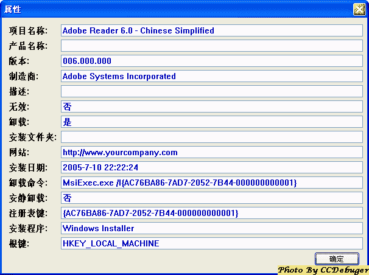

我们今天的目标就是利用 `OllyDBG` 的汇编功能把上面显示的字体改成我们常见的 9 号（小五）宋体。首先我们用 `OllyDBG` 载入程序，按 `CTR+N` 组合键查找一下有哪些 API 函数，只发现一个和设置字体相关的 `CreateFontIndirectA`。现在我们按鼠标右键，选择“在每个参考上设置断点”，关掉名称对话框，`F9` 运行，程序已经运行起来了。我们在程序的列表框中随便找一项双击一下，很不幸，那个字体难看的界面又出现了，`OllyDBG` 没有任何动作。可见创建这个窗口的时候根本没调用 `CreateFontIndirectA`，问题现在就变得有点复杂了。先点确定把这个字体难看的对话框关闭，现在我们从另一个方面考虑：既然没有调用设置字体的函数，那我们来看看这个窗口是如何创建的，跟踪窗口创建过程可能会找到一些对我们有用的信息。现在我们再回到我们调试程序的领空，按 `CTR+N` 看一下，发现 `CreateWindowExA` 这个 API 函数比较可疑。我们在 `CreateWindowExA` 函数的每个参考上设上断点，在 `MyUninstaller` 的列表框中再随便找一项双击一下，被 `OllyDBG` 断下：

```
  00408F5E  |.  FF15 98B24000   |CALL DWORD PTR DS:[<&USER32.CreateWindowExA>]    ; \\断在这里
```

上下翻看一下代码：

```
  00408F3B  |.  50               |PUSH EAX                                     ; |hInst
  00408F3C  |.  8B45 C0          |MOV EAX,DWORD PTR SS:[EBP-40]                 ; |
  00408F3F  |.  6A 00            |PUSH 0                                       ; |hMenu = NULL
  00408F41  |.  03C6            |ADD EAX,ESI                                   ; |
  00408F43  |.  FF75 08          |PUSH DWORD PTR SS:[EBP+8]                    ; |hParent
  00408F46  |.  FF75 D0          |PUSH DWORD PTR SS:[EBP-30]                   ; |Height
  00408F49  |.  57               |PUSH EDI                                     ; |Width
  00408F4A  |.  50               |PUSH EAX                                     ; |Y
  00408F4B  |.  FF75 BC          |PUSH DWORD PTR SS:[EBP-44]                   ; |X
  00408F4E  |.  FF75 EC          |PUSH DWORD PTR SS:[EBP-14]                   ; |Style
  00408F51  |.  68 80DE4000      |PUSH myuninst.0040DE80                       ; |WindowName = ""
  00408F56  |.  68 DCD94000      |PUSH myuninst.0040D9DC                       ; |Class = "STATIC"
  00408F5B  |.  FF75 D4          |PUSH DWORD PTR SS:[EBP-2C]                   ; |ExtStyle
  00408F5E  |.  FF15 98B24000    |CALL DWORD PTR DS:[<&USER32.CreateWindowExA>]    ; \\断在这里
  00408F64  |   6A 00            |PUSH 0                                       ; 第一处要修改的地方
  00408F66  |   8945 F4          |MOV DWORD PTR SS:[EBP-C],EAX
  00408F69  |.  E8 A098FFFF      |CALL <myuninst.sub_40280E>
  00408F6E  |.  50               |PUSH EAX                                     ; |hInst
  00408F6F  |.  8B45 DC          |MOV EAX,DWORD PTR SS:[EBP-24]                 ; |
  00408F72  |.  6A 00            |PUSH 0                                       ; |hMenu = NULL
  00408F74  |.  03F0            |ADD ESI,EAX                                   ; |
  00408F76  |.  FF75 08          |PUSH DWORD PTR SS:[EBP+8]                    ; |hParent
  00408F79  |.  FF75 CC          |PUSH DWORD PTR SS:[EBP-34]                   ; |Height
  00408F7C  |.  53               |PUSH EBX                                     ; |Width
  00408F7D  |.  56               |PUSH ESI                                     ; |Y
  00408F7E  |.  FF75 D8          |PUSH DWORD PTR SS:[EBP-28]                   ; |X
  00408F81  |.  FF75 E8          |PUSH DWORD PTR SS:[EBP-18]                   ; |Style
  00408F84  |.  68 80DE4000      |PUSH myuninst.0040DE80                       ; |WindowName = ""
  00408F89  |.  68 D4D94000      |PUSH myuninst.0040D9D4                       ; |Class = "EDIT"
  00408F8E  |.  FF75 B8          |PUSH DWORD PTR SS:[EBP-48]                   ; |ExtStyle
  00408F91  |.  FF15 98B24000    |CALL DWORD PTR DS:[<&USER32.CreateWindowExA>]    ; \\CreateWindowExA
  00408F97  |   8945 F0          |MOV DWORD PTR SS:[EBP-10],EAX                ; 第二处要修改的地方
  00408F9A  |   8B45 F8          |MOV EAX,DWORD PTR SS:[EBP-8]
  00408F9D  |.  FF30            |PUSH DWORD PTR DS:[EAX]                      ; /<%s>
  00408F9F  |.  8D85 B0FEFFFF    |LEA EAX,DWORD PTR SS:[EBP-150]               ; |
  00408FA5  |.  68 D0D94000      |PUSH myuninst.0040D9D0                       ; |format = "%s:"
  00408FAA  |.  50               |PUSH EAX                                     ; |s
  00408FAB  |.  FF15 90B14000    |CALL DWORD PTR DS:[<&MSVCRT.sprintf>]        ; \\sprintf
  00408FB1  |.  8B35 84B24000    |MOV ESI,DWORD PTR DS:[<&USER32.SetWindowTextA>]  ;  USER32.SetWindowTextA
  00408FB7  |.  83C4 0C          |ADD ESP,0C
  00408FBA  |.  8D85 B0FEFFFF    |LEA EAX,DWORD PTR SS:[EBP-150]
  00408FC0  |.  50               |PUSH EAX                                     ; /Text
  00408FC1  |.  FF75 F4          |PUSH DWORD PTR SS:[EBP-C]                    ; |hWnd
  00408FC4  |.  FFD6            |CALL ESI                                     ; \\SetWindowTextA
  00408FC6  |.  8D85 ACFAFFFF    |LEA EAX,DWORD PTR SS:[EBP-554]
  00408FCC  |.  50               |PUSH EAX                                     ; /Arg3
  00408FCD  |.  FF75 FC          |PUSH DWORD PTR SS:[EBP-4]                    ; |Arg2
  00408FD0  |.  FF35 00EF4000    |PUSH DWORD PTR DS:[40EF00]                   ; |Arg1 = 00BEADCC
  00408FD6  |.  E8 1884FFFF      |CALL <myuninst.sub_4013F3>                   ; \\sub_4013F3
  00408FDB  |.  83C4 0C          |ADD ESP,0C
  00408FDE  |.  50               |PUSH EAX
  00408FDF  |.  FF75 F0          |PUSH DWORD PTR SS:[EBP-10]
  00408FE2  |.  FFD6            |CALL ESI
  00408FE4  |.  FF45 FC         |INC DWORD PTR SS:[EBP-4]
  00408FE7  |.  8345 F8 14       |ADD DWORD PTR SS:[EBP-8],14
  00408FEB  |.  837D FC 0F      |CMP DWORD PTR SS:[EBP-4],0F
  00408FEF  |.^ 0F8C 32FFFFFF    \\JL <myuninst.loc_408F27>
  00408FF5  |.  5F               POP EDI
  00408FF6  |.  5E               POP ESI
  00408FF7  |.  5B               POP EBX
  00408FF8  |.  C9               LEAVE
  00408FF9  \.  C3               RETN
```

我想上面的代码我不需多做解释，`OllyDBG` 自动给出的注释已经够清楚的了。我们双击 `MyUninstaller` 列表框中的某项查看属性时，弹出的属性窗口上的 `STATIC` 控件和 `EDIT` 控件都是由 `CreateWindowExA` 函数创建的，然后再调用 `SetWindowTextA` 来设置文本，根本没考虑控件上字体显示的问题，所以我们看到的都是系统默认的字体。我们要设置控件上的字体，可以考虑在 `CreateWindowExA` 创建完控件后，在使用 `SetWindowTextA` 函数设置文本之前调用相关字体创建函数来选择字体，再调用 `SendMessageA` 函数发送 `WM_SETFONT` 消息来设置控件字体。思路定下来后，我们就开始来实施。首先我们看一下这个程序中的导入函数，`CreateFontIndirectA` 这个字体创建函数已经有了，再看看 `SendMessageA`，呵呵，不错，原程序也有这个函数。这样我们就省事了。有人可能要问，如果原来并没有这两个导入函数，那怎么办呢？其实这也很简单，我们可以直接用 `LordPE` 来在程序中添加我们需要的导入函数。我这里用个很小的 PE 工具 `zeroadd` 来示范一下，这个程序里面没有 `CreateFontIndirectA` 和 `SendMessageA` 函数（这里还有个问题说一下，其实我们编程时调用这两个函数时都是直接写 `CreateFontIndirect` 及 `SendMessage`，一般不需指定。但在程序中写补丁代码时我们要指定这是什么类型的函数。这里在函数后面加个“A”表示这是 ASCII 版本，同样 UNICODE 版本在后面加个“W”，如 `SendMessageW`。在 `Win9X` 下我们一般都用 ASCII 版本的函数，UNICODE 版本的函数很多在 `Win9X` 下是不能运行的。而 NT 系统如 `WinXP` 一般都是 UNICODE 版本的，但如果我们用了 ASCII 版本的函数，系统会自动转换调用 UNICODE 版本。这样我们写补丁代码的时候就可以直接指定为 ASCII 版本的函数，可以兼容各个系统）：我们用 `LordPE` 的 PE 编辑器载入 `zeroadd` 程序，选择“目录”，再在弹出的目录表对话框中选择输入表后面的那个“...”按钮，会弹出一个对话框：

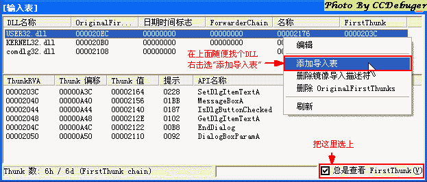

因为 `SendMessageA` 在 `USER32.dll` 中，我们在右键菜单中点击按钮“添加导入表”，来到下面：

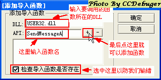

按上面的提示完成后点“确定”，我们回到原先的那个“输入表”对话框：

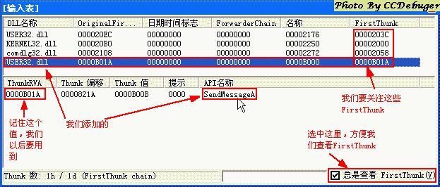


从上图中我们可以看出多出了一个 `USER32.dll`，这就是我们添加 `SendMessageA` 的结果。这也是用工具添加的一个缺点。我们一般希望把添加的函数直接放到已存在的 `DLL` 中，而不是多出来一个，这样显得不好看。但用工具就没办法，`LordPE` 默认是建一个 1K 的新区段来保存添加后的结果，由此出现了上图中的情况。如果你对 `PE` 结构比较熟悉的话，也可以直接用 16 进制编辑工具来添加你需要的函数，这样改出来的东西好看。如果想偷懒，就像我一样用工具吧，呵呵。

在上图中我还标出了要注意 `FirstThunk` 及那个 `ThunkRVA` 的值，并且要把“总是查看 `FirstThunk`”那个选项选上。有人可能不理解其作用，我这里也解释一下：一般讲述 `PE` 格式的文章中对 `FirstThunk` 的解释是这样的：`FirstThunk` 包含指向一个 `IMAGE_THUNK_DATA` 结构数组的 `RVA` 偏移地址，当把 `PE` 文件装载到内存中时，`PE` 装载器将查找 `IMAGE_THUNK_DATA` 和 `IMAGE_IMPORT_BY_NAME` 这些结构数组来决定导入函数的地址，随后用导入函数真实地址来替代由 `FirstThunk` 指向的 `IMAGE_THUNK_DATA` 数组里的元素值。

这样说起来还是让人不明白，我举个例子：比如你有个很要好的朋友，他是个大忙人，虽然你知道他的家庭住址，可他很少回家。如果你哪天想找他，直接去他家，很可能吃个闭门羹，找不到他人。怎么办？幸好你有他的手机号码，你就给他拨了一个电话：“小子，你在哪呢？”，他告诉你：“我正在 XXX 饭店喝酒呢！”这时你怎么办？（当然是杀到他说的那家饭店去蹭饭了！^\_^）

这里的 `ThunkRVA` 就相当于你朋友的手机号码，`SendMessageA` 就相当于你那个朋友。而 `FirstThunk` 就是你手机里的号码分组。你把你的多个朋友都放在 `FirstThunk` 这样的号码分组里，每个 `ThunkRVA` 就是你一个朋友的手机号码。你要找他们，就是通过 `ThunkRVA` 这样的手机号码来和他们联系，直接去他家找他你很可能要碰壁。而移动或联通就相当于操作系统，他们负责把你的手机号码和你的朋友对应上。

而 `FirstThunk` 这样的号码分组还有一个好处就是你可以不记你某个朋友的具体号码，只要记得 `FirstThunk` 号码分组的值，你的朋友会按顺序在里面排列。比如上图中 `USER32.dll` 中的第一个函数是 `SendMessageA`，它的 `ThunkRVA` 值就是 `FirstThunk` 值。如果还有第二个函数，比如是 `MessageBoxA`，它的值就是 `FirstThunk` 值加上 4，其余类推。你只要记住各个函数的位置，也可以通过 `FirstThunk` 加上位置对应值来找到它。当然这比不上直接看 `ThunkRVA` 来得方便。

说了上面这些，我们就要考虑怎么在程序中调用了。你可能会说，我在 `OllyDBG` 中直接在我们要修改的程序中这样调用：`CALL SendMessageA`。哦，别这样。这等于我上面说的都是废话，会让我感到伤心的。

你这里的 `CALL SendMessageA` 就相当于也不跟你朋友打个招呼就直接去他家找他，很有可能你会乘兴而去，败兴而归。别忘了他的手机号码，我们只有通过号码才知道他到底在什么地方。

我们应该这样：`CALL DWORD PTR [40B01A]`，这里的 `40B01A` 就是上面的 `SendMessageA` 在程序载入后的所在的地方，由基址 `00400000` 加上 `ThunkRVA` `0000B01A` 得到的。这就是你要找的人所在的地方，不管他跑到哪，你有他的手机号码就能找到他。

同样道理，你只要记住了 `ThunkRVA` 值，就按这个来调用你需要的函数，在别的 `Windows` 系统下也是没有问题的。系统会自动把你要找到函数和 `ThunkRVA` 值对应上。而你在 `OllyDBG` 中写 `CALL SendMessageA`，可能你在你的系统上成功了，可放到别的系统下就要出错了。为什么？因为你找的人已经不在原来的位置了，他跑到别的地方去了。你还到老地方找他，当然看不见人了。

说了这么多废话，也不知大家听明白了没有，别越听越糊涂就行了。总之一句话，别像 `CALL SendMessageA` 这样直接调用某个函数，而应该通过 `ThunkRVA` 值来调用它。

下面我们回到我们要修改的 `MyUninstaller` 上来，先用 `LordPE` 打开看一下，呵呵，原来 `CreateFontIndirectA` 和 `SendMessageA` 原程序里面都有了，省了我们不少事情。看一下这两个函数的 `ThunkRVA` 值，`CreateFontIndirectA` 在 `GDI32.dll` 里面，`ThunkRVA` 值是 `0000B044`，这样我们就知道在程序中调用它的时候就是 `CALL DWORD PTR [0040B044]`。同样，`SendMessageA` 的 `ThunkRVA` 值是 `0000B23C`，调用时应该是这样：`CALL DWORD PTR [0040B23C]`。

了解了这些东西我们就来考虑怎么写代码了。首先我们来看一下 `CreateFontIndirectA` 和 `SendMessageA` 这两个函数的定义：

### `CreateFontIndirectA`

```
HFONT CreateFontIndirect(
CONST LOGFONT *lplf // pointer to logical font structure
);
```

`CreateFontIndirect` 的返回值就是字体的句柄。

对于这个函数我们需要的参数就是给它一个 `LOGFONT` 的字体结构指针，我们只要在要修改程序的空白处建一个标准的 9 号（小五）宋体的 `LOGFONT` 字体结构，再把指针给 `CreateFontIndirectA` 就可以了。

### `SendMessageA`

```
LRESULT SendMessage(
HWND hWnd, // handle of destination window
UINT Msg, // message to send
WPARAM wParam, // first message parameter
LPARAM lParam // second message parameter
);
```

上面的第一个参数是窗口句柄，我们知道 `CreateWindowExA` 返回的就是窗口句柄，我们可以直接拿来用。第二个消息参数我们这里是设置字体，选 `WM_SETFONT`，这个值是 `30H`。第三个参数是字体句柄，可以由上面的 `CreateFontIndirectA` 获得。第四个参数我们不需要，留空。

现在我们准备开始写代码，首先我们要在程序中建一个标准 9 号宋体的 `LOGFONT`，以便于我们调用。对于 `LOGFONT`，我们再来看一下定义：

```
typedef struct tagLOGFONT { // lf
LONG lfHeight;
LONG lfWidth;
LONG lfEscapement;
LONG lfOrientation;
LONG lfWeight;
BYTE lfItalic;
BYTE lfUnderline;
BYTE lfStrikeOut;
BYTE lfCharSet;
BYTE lfOutPrecision;
BYTE lfClipPrecision;
BYTE lfQuality;
BYTE lfPitchAndFamily;
TCHAR lfFaceName[LF_FACESIZE];
} LOGFONT;
```

这样我们的标准 9 号宋体的 `LOGFONT` 值应该是 32 字节，16 进制就像这样：`F4FFFFFF000000000000000000000000900100000000008600000000CBCECCE5`。

现在在程序中找个空地。我们用 `PEiD` 来帮助我们寻找，用 `PEiD` 打开程序，点 `EP` 段后面的那个 `>` 号，随便选择一个区段右击，选“搜索全 0 处”（原版好像是 `cave` 什么的）：

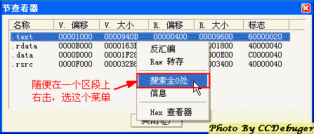

我们看到 `PEiD` 把搜索到的空间都给我们列出来了：

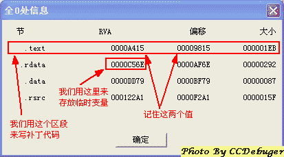

现在我们用 `WinHEX` 打开我们要修改的程序，转到偏移 `9815` 处，从 `9815` 处选择 32 字节（16 进制是 `0X20`）的一个选块，把光标定位到 `9815` 处，右键选择菜单 `剪贴板数据->写入(从当前位置覆写)`，随后的格式选择 `ASCII Hex`，把我们 `LOGFONT` 的 16 进制值

`F4FFFFFF000000000000000000000000900100000000008600000000CBCECCE5`

写入保存。

现在我们用 `OllyDBG` 载入已添加了 `LOGFONT` 数据的程序，先转到 `VA` `40A415` 处（从上图中看到的）往下看一下：

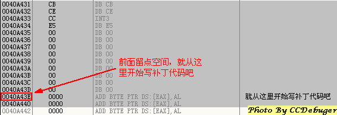

因为 `SendMessageA` 还要用到一个窗口句柄，我们可以通过前面的 `CreateWindowExA` 来获得。现在我们就把前一张图中的 `.rdata` 区段中的地址 `0040C56E` 作为我们保存窗口句柄 `HWND` 值的临时空间。一切就绪，开始写代码。先回顾一下我们最先说的那两个要修改的地方：

#### 第一个要改的地方：

修改前：

```
00408F5E  |.  FF15 98B24000 |CALL DWORD PTR DS:[<&USER32.CreateWindowExA>]  ; \CreateWindowExA
00408F64      6A 00         PUSH 0
00408F66      8945 F4       MOV DWORD PTR SS:[EBP-C],EAX
00408F69  |. E8 A098FFFF   |CALL <myuninst.sub_40280E>
```

修改后：

```
00408F5E  |.  FF15 98B24000 |CALL DWORD PTR DS:[<&USER32.CreateWindowExA>]  ; \CreateWindowExA
00408F64      E9 D5140000   JMP myuninst.0040A43E
00408F69  |. E8 A098FFFF   |CALL <myuninst.sub_40280E>
```

#### 第二个要改的地方：

修改前：

```
00408F91  |.  FF15 98B24000    |CALL DWORD PTR DS:[<&USER32.CreateWindowExA>]    ; \CreateWindowExA
00408F97      8945 F0          MOV DWORD PTR SS:[EBP-10],EAX
00408F9A      8B45 F8          MOV EAX,DWORD PTR SS:[EBP-8]
00408F9D  |. FF30             |PUSH DWORD PTR DS:[EAX]                      ; /<%s>
00408F9F  |. 8D85 B0FEFFFF    |LEA EAX,DWORD PTR SS:[EBP-150]                ; |
00408FA5  |. 68 D0D94000      |PUSH myuninst.0040D9D0                       ; |format = "%s:"
00408FAA  |. 50               |PUSH EAX                                     ; |s
00408FAB  |. FF15 90B14000    |CALL DWORD PTR DS:[<&MSVCRT.sprintf>]        ; \sprintf
00408FB1  |. 8B35 84B24000    |MOV ESI,DWORD PTR DS:[<&USER32.SetWindowTextA>]  ; USER32.SetWindowTextA
```

修改后：

```
00408F91  |.  FF15 98B24000    |CALL DWORD PTR DS:[<&USER32.CreateWindowExA>]    ; \CreateWindowExA
00408F97      E9 D4140000      JMP myuninst.0040A470
00408F9C      90               NOP
00408F9D  |. FF30             |PUSH DWORD PTR DS:[EAX]                      ; /<%s>
00408F9F  |. 8D85 B0FEFFFF    |LEA EAX,DWORD PTR SS:[EBP-150]                ; |
00408FA5  |. 68 D0D94000      |PUSH myuninst.0040D9D0                       ; |format = "%s:"
00408FAA  |. 50               |PUSH EAX                                     ; |s
00408FAB  |. FF15 90B14000    |CALL DWORD PTR DS:[<&MSVCRT.sprintf>]        ; \sprintf
00408FB1  |. 8B35 84B24000    |MOV ESI,DWORD PTR DS:[<&USER32.SetWindowTextA>]  ; USER32.SetWindowTextA
```

这两个地方的修改都是把原代码改成跳转，跳到我们的补丁代码那继续执行。在修改之前先把原代码复制下来，以便恢复。我们在 `OllyDBG` 中按 `CTR+G` 组合键，来到 `0040A43E` 地址处，开始输补丁代码：

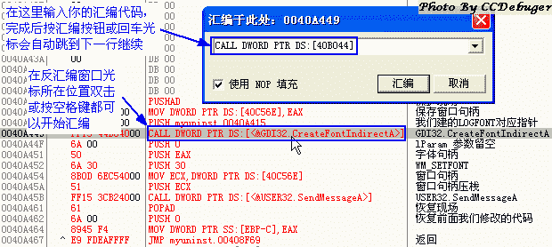

同样，我们也在 `0040A470` 地址处输入我们另一部分的补丁代码。两部分的补丁代码分别如下：

#### 补丁代码 1：

```
0040A43E      60               PUSHAD
0040A43F      A3 6EC54000      MOV DWORD PTR DS:[40C56E],EAX
0040A444      68 15A44000      PUSH myuninst.0040A415
0040A449      FF15 44B04000    CALL DWORD PTR DS:[<&GDI32.CreateFontIndirectA>]
0040A44F      6A 00            PUSH 0
0040A451      50               PUSH EAX
0040A452      6A 30            PUSH 30
0040A454      8B0D 6EC54000    MOV ECX,DWORD PTR DS:[40C56E]
0040A45A      51               PUSH ECX
0040A45B      FF15 3CB24000    CALL DWORD PTR DS:[<&USER32.SendMessageA>]
0040A461      61               POPAD
0040A462      6A 00            PUSH 0
0040A464      8945 F4          MOV DWORD PTR SS:[EBP-C],EAX
```


### 补丁代码 2

```
0040A467    ^ E9 FDEAFFFF     JMP myuninst.00408F69                 ; 返回

0040A470   > \60             PUSHAD

0040A471   .  A3 6EC54000    MOV DWORD PTR DS:[40C56E],EAX

0040A476   .  68 15A44000    PUSH myuninst.0040A415                 ; /pLogfont = myuninst.0040A415

0040A47B   .  FF15 44B04000  CALL DWORD PTR DS:[<&GDI32.CreateFontIndirectA>] ; \CreateFontIndirectA

0040A481   .  6A 00          PUSH 0                                 ; /lParam = 0

0040A483   .  50             PUSH EAX                               ; |wParam

0040A484   .  6A 30          PUSH 30                                ; |Message = WM_SETFONT

0040A486   .  8B0D 6EC54000  MOV ECX,DWORD PTR DS:[40C56E]          ; |

0040A48C   .  51             PUSH ECX                               ; |hWnd => NULL

0040A48D   .  FF15 3CB24000  CALL DWORD PTR DS:[<&USER32.SendMessageA>] ; \SendMessageA

0040A493   .  61             POPAD

0040A494   .  8945 F0        MOV DWORD PTR SS:[EBP-10],EAX

0040A497   .  8B45 F8        MOV EAX,DWORD PTR SS:[EBP-8]

0040A49A   . ^ E9 FEEAFFFF   JMP myuninst.00408F9D
```

补丁代码 2 因为与补丁代码 1 类似，我就不做详细解释了。现在我们的代码都写完了，现在我们开始保存我们的工作，选中我们修改的代码，点击鼠标右键，会出来一个菜单：

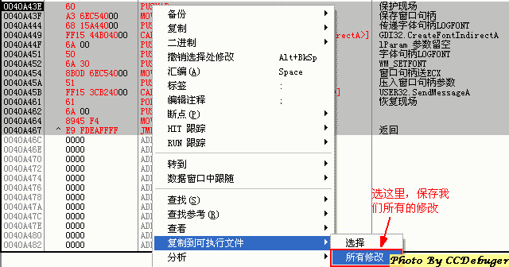

我们左键选所有修改（当然选它了，要不然只会保存我们选定的这一部分。关于这个地方还要说一下，有的时候我们修改完程序选“复制到可执行文件”时只有“选择”菜单，没有“所有修改”菜单项。按 `OllyDBG` 帮助里关于备份功能的说法，好像是受内存块限制的，补丁功能也同样是这样。对于备份及补丁功能我用的比较少，并不是很了解，这方面的内容还是大家自己去研究吧，有什么好的心得也希望能共享一下。我遇到不能保存所有修改的情况就是先把补丁代码全部复制下来，同时利用二进制功能复制代码，先选一段补丁代码保存为文件，再用 `OllyDBG` 打开保存后的文件，转到相应位置分别把我们复制下来的补丁二进制代码粘贴上去后保存。纯属笨办法，当然你也可以用 `HexView` 这样的工具来修改代码），随后会出来一个“把选中的内容复制到可执行文件”的对话框，我们选“全部复制”，又出来一个对话框，我们在上面点右键，在弹出的菜单上选“保存文件”：

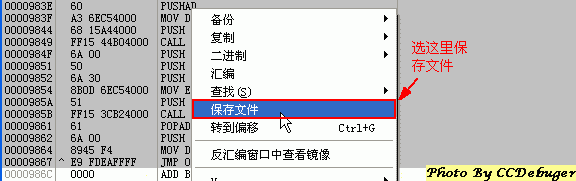

这时会出来一个另存文件的对话框，我们另选一个名字如 `myuninst1.exe` 来保存，不要直接覆盖原文件 `myuninst.exe`，以便于出错后好修改。现在关闭 `OllyDBG`，先不要急着运行刚刚修改过的文件，因为我们还有个地方要改一下。大家还记得我们在 `.rdata` 中用了个地方作为我们保存临时变量的地方吧？原先的 `.rdata` 段属性设置是不可写的，现在我们写入了数据，运行时是会出错的。现在我们要修改一下 `.rdata` 段的属性。用 `LordPE` 的 `PE` 编辑器打开我们修改后的程序，点“区段”按钮，在弹出的对话框中点击 `.rdata` 段，右键选择弹出菜单中的“编辑区段”：

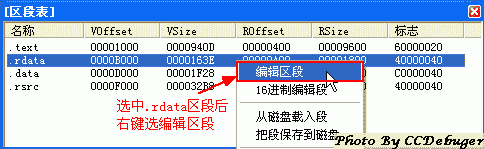

在弹出的对话框中选标志后面那个“...”按钮：

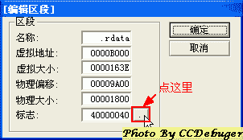

现在我们把区段标志添加一个可写入的属性：

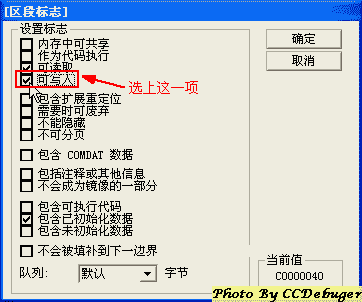

完成后按确定保存我们所做的工作，运行一下修改后的程序，呵呵，终于把字体改过来了：

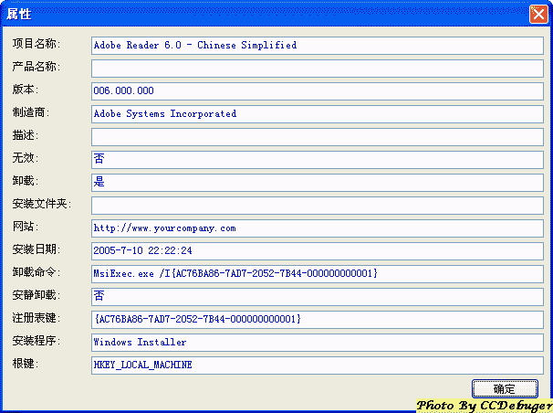

如果你运行出错也没关系，用 `OllyDBG` 调试一下你修改后的程序，看看错在什么地方。这一般都是输入补丁代码时造成的，你只要看一下你补丁代码运行的情况就可以了。到这里我们的任务似乎也完成了，但细心的朋友可能会发现补丁代码 1 和补丁代码 2 前面的代码基本上是相同的。一个两个这样的补丁还好，如果要是多的话，这样重复就要浪费不少空间了，况且工作量也相应加大了。既然前面有很多代码都是重复的，为什么我们不把这些重复的代码做成一个子程序呢？这样调用起来要方便的多。下面我们把前面的补丁代码修改一下，我们先把补丁代码 1 的代码改成这样：

```
0040A43E      60             PUSHAD                                  ; 保护现场

0040A43F      A3 6EC54000    MOV DWORD PTR DS:[40C56E],EAX           ; 保存窗口句柄

0040A444      68 15A44000    PUSH myuninst.0040A415                  ; 我们建的 LOGFONT 对应指针

0040A449      FF15 44B04000  CALL DWORD PTR DS:[<&GDI32.CreateFontIndirectA>] ; GDI32.CreateFontIndirectA

0040A44F      6A 00          PUSH 0                                  ; lParam 参数留空

0040A451      50             PUSH EAX                                ; 字体句柄

0040A452      6A 30          PUSH 30                                 ; WM_SETFONT

0040A454      8B0D 6EC54000  MOV ECX,DWORD PTR DS:[40C56E]           ; 窗口句柄

0040A45A      51             PUSH ECX                                ; 窗口句柄压栈

0040A45B      FF15 3CB24000  CALL DWORD PTR DS:[<&USER32.SendMessageA>] ; USER32.SendMessageA

0040A461      61             POPAD                                   ; 恢复现场

0040A462      C3             RETN                                    ; 返回
```

这样我们的子程序代码就写好了。现在我们再在子程序代码后面写上两个补丁代码，当然不要忘了改前面原程序中的跳转：

#### 修改后的补丁代码 1

```
0040A467      E8 D2FFFFFF    CALL myuninst.0040A43E                  ; 调用子程序

0040A46C      6A 00          PUSH 0                                  ; 恢复前面修改过的代码

0040A46E      8945 F4        MOV DWORD PTR SS:[EBP-C],EAX

0040A471    ^ E9 F3EAFFFF    JMP myuninst.00408F69                   ; 返回继续执行
```

#### 修改后的补丁代码 2

```
0040A47A      E8 BFFFFFFF    CALL myuninst.0040A43E

0040A47F      8945 F0        MOV DWORD PTR SS:[EBP-10],EAX

0040A482      8B45 F8        MOV EAX,DWORD PTR SS:[EBP-8]

0040A485    ^ E9 13EBFFFF    JMP myuninst.00408F9D
```

我在每个补丁代码片断间留了 4 个字节来分隔。同样，我们还要修改一下我们前面的跳转：

##### 第一个要修改跳转的地方

```
00408F5E  |.  FF15 98B24000   |CALL DWORD PTR DS:[<&USER32.CreateWindowExA>] ; \断在这里

00408F64      E9 FE140000    JMP myuninst.0040A467                   ; 跳到我们的第一部分补丁代码处

00408F69  |.  E8 A098FFFF     |CALL <myuninst.sub_40280E>
```

##### 第二个要修改跳转的地方

```
00408F91  |.  FF15 98B24000   |CALL DWORD PTR DS:[<&USER32.CreateWindowExA>] ; \CreateWindowExA

00408F97      E9 DE140000    JMP myuninst.0040A47A                   ; 跳到我们的第二部分补丁代码处

00408F9C      90             NOP

00408F9D  |.  FF30          |PUSH DWORD PTR DS:[EAX]                ; /<%s>
```

修改好后保存，同样不要忘了再修改一下 `.rdata` 区段的属性。运行一下，一切 OK！

**【版权声明】** 本文纯属技术交流, 转载请注明作者并保持文章的完整, 谢谢!

`4dd466d0e1e0cc123afbe504da2462ca`
