# 利用万能断点找出关键跳转

> 原文：[`www.pediy.com/kssd/pediy08/pediy8-511.htm`](https://www.pediy.com/kssd/pediy08/pediy8-511.htm)

实例下载：附件

## 在 Windows XP 中利用万能断点找出关键跳转

大家都知道我们通常在 Windows 98 下做软件调试时有一个 API 函数 `HMEMCPY`（俗称为万能断点），这个函数在 `KERNEL32.DLL` 中，其原形如下：

```
void hmemcpy(hpvDest, hpvSource, cbCopy)

void _huge* hpvDest;       // 目的数据地址
const void _huge* hpvSource; // 源数据地址
 long cbCopy;               // 数据大小 (Bytes)
```

它的工作原理就是将内存中的一块数据拷贝到另一个地方，大家每每使用 `SOFTICE`、`OD` 等调试工具时它都成了首选的断点，但在 2000 以后版本的系统里它却失去了原有的意义，下面我就总结介绍一下如何在 `XP` 中利用万能断点去调试出一个 `Crackme` 的关键跳转。

在 Windows XP 系统中找万能断点的方法有很多，看雪学院外文翻译区里就有一篇 `Point-h in WinXP tutorial` 的文章，写的不错，但不适合初学者，有兴趣却没看过的朋友可以去读读，网上还有一种方法，就是在 `USER32` 模块中搜索十六进制字符 `F3 A5 8B C8 83 E1 03 F3 A4 E8`，找到的地址就是你 `XP` 系统唯一的一处万能断点，好下面我们一步一步的做。

### （1）用 OD 打开所要调试的 crac.exe

用 `OD` 打开所要调试的 `crac.exe`，右键单击汇编区域在“查看”菜单里选择“模块 `USER32`”。

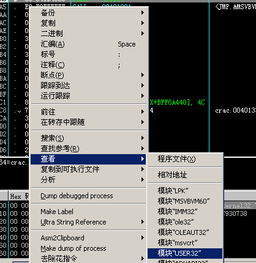

### （2）查找十六进制字符串

利用 `Ctrl+B` 快捷键，查找 `F3 A5 8B C8 83 E1 03 F3 A4 E8`，点击确定。

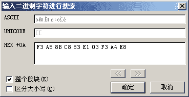

### （3）记录万能断点

由上步操作可以进入下图，好了记录万能断点。

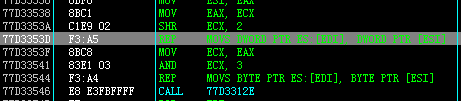

```
77D3353D F3:A5 REP MOVS DWORD PTR ES:[EDI], DWORD PTR [ESI]
```

这个就是我系统的万能断点 `point-h`，接下来我们就利用万能断点来寻找 `Crackme` 的关键比较，`Crackme` 是 `OCN` 的 `lfq168` 做的，^\_^不要怪我盗用啊！好，`CTRL+F2` 重新加载一下程序，`F9` 运行。

### （4）填写注册信息

首先填写好注册信息，不要点注册。

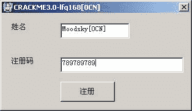

### （5）定位到 point-h

然后我们再按照找 `point-h` 的第一步进入 `USER32` 模块中（应该会做吧），然后快捷键 `CTRL+G`，在出现窗口的 `COMBOBOX` 控件中填入我的 `point-h` 的地址 “`77D3353D`”，点击确定。

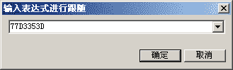

### （6）下断点

在万能断点上 `F2` 下断。

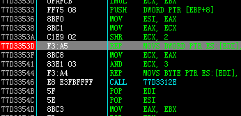

### （7）触发断点

回到 `Crackme` 窗口点击注册，程序被 `OD` 断了下来，看右上的寄存器窗口出现了我的用户名。

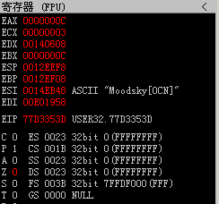

### （8）跟随内存数据

点击 `F9` 键直到第一次出现注册码为止，在 `EDI` 寄存器上单击右键，选择“在转存中跟随”。

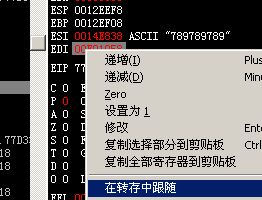

### （9）查看转存数据

按 `F8` 到 `point-h` 下面第一个 `CALL` 处（图九），看转存中数据（图十）。

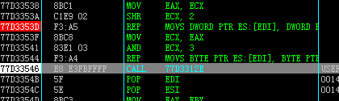

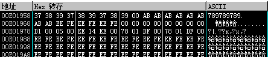

### （10）设置内存访问断点

在伪注册码（`789789789`）上下内存访问断点，`F9` 运行。

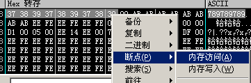

程序被 `OD` 断在 `66061223` 处。

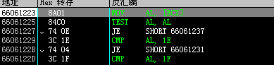

### （11）回到主进程空间

下面我们 `F8`，回到主进程空间。

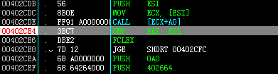

到这里回到了主进程空间，也是回到了算法里，让我们 `F2` 记录一下断点，`CTRL+F2` 重新加载程序，`F9` 运行，填好信息后注册，被 `OD` 断在 `00402CE4`，然后 `F8` 单步继续。

```
00402CE4   .  3BC7          cmp eax, edi                                      ; 被断在这里
00402CE6   .  DBE2         fclex
00402CE8      7D 12        jge short crac.00402CFC                            ; 跳转
00402CFC   > \8B85 78FEFFFF mov eax, dword ptr ss:[ebp-188]                  ; 跳到这里
00402D02   .  50           push eax                                          ; eax=789789789
00402D03   .  FF15 10104000 call dword ptr ds:[<&MSVBVM60.__vbaLenBstr>]     ; 计算长度放在 eax 中
......(省略)
00402D50   .  FF15 38104000 call dword ptr ds:[<&MSVBVM60.__vbaVarForInit>]  ; For 循环，这里根据题目主要找
00402D56   .  8D8D 78FEFFFF lea ecx, dword ptr ss:[ebp-188]                 ; 关键跳转,就不研究算法了
00402D5C   .  8985 3CFDFFFF mov dword ptr ss:[ebp-2C4], eax
00402D62   .  FF15 F8104000 call dword ptr ds:[<&MSVBVM60.__vbaFreeStr>]
00402D68   .  8D8D 70FEFFFF lea ecx, dword ptr ss:[ebp-190]
00402D6E   .  FF15 FC104000 call dword ptr ds:[<&MSVBVM60.__vbaFreeObj>]
00402D74   .  8B35 08104000 mov esi, dword ptr ds:[<&MSVBVM60.__vbaVarMove>]
00402D7A   >  39BD 3CFDFFFF cmp dword ptr ss:[ebp-2C4], edi
00402D80   .  0F84 89010000 je crac.00402F0F                                 ; 条件满足跳出循环
......(省略)
00402EFE   .  FF15 F0104000 call dword ptr ds:[<&MSVBVM60.__vbaVarForNext>]  ; Next 对应 For 循环
00402F04   .  8985 3CFDFFFF mov dword ptr ss:[ebp-2C4], eax
00402F0A   .^ E9 6BFEFFFF  jmp crac.00402D7A                                 ; 向上循环
00402F0F   >  8D85 5CFFFFFF lea eax, dword ptr ss:[ebp-A4]                   ; 鼠标点击这里 F4 跳过 jmp
......(省略)
00402FA4   .  52           push edx                                          ; edx=Moodsky[OCN]，看来算法来了
00402FA5   .  FF15 10104000 call dword ptr ds:[<&MSVBVM60.__vbaLenBstr>]     ; 用户名长度入 eax
......(省略)
00402FF2   .  FF15 38104000 call dword ptr ds:[<&MSVBVM60.__vbaVarForInit>]  ; For 循环
00402FF8   .  8D8D 78FEFFFF lea ecx, dword ptr ss:[ebp-188]
00402FFE   .  8985 34FDFFFF mov dword ptr ss:[ebp-2CC], eax
00403004   .  FF15 F8104000 call dword ptr ds:[<&MSVBVM60.__vbaFreeStr>]
0040300A   .  8D8D 70FEFFFF lea ecx, dword ptr ss:[ebp-190]
00403010   .  FF15 FC104000 call dword ptr ds:[<&MSVBVM60.__vbaFreeObj>]
00403016   .  8B3D 7C104000 mov edi, dword ptr ds:[<&MSVBVM60.__vbaVarAnd>]
0040301C   >  8B85 34FDFFFF mov eax, dword ptr ss:[ebp-2CC]
00403022   .  85C0          test eax, eax
00403024   .  0F84 BD050000 je crac.004035E7                                 ; 条件满足跳出循环
......(省略)
004035D6   .  FF15 F0104000 call dword ptr ds:[<&MSVBVM60.__vbaVarForNext>]  ; Next 对应 For 循环
004035DC   .  8985 34FDFFFF mov dword ptr ss:[ebp-2CC], eax
004035E2   .^ E9 35FAFFFF  jmp crac.0040301C                                 ; 向上跳转
004035E7   >  8D85 ECFDFFFF lea eax, dword ptr ss:[ebp-214]                  ; 鼠标点击这里 F4 跳过 jmp
......(省略)
00403638   .  FF15 38104000 call dword ptr ds:[<&MSVBVM60.__vbaVarForInit>]  ; 又是一个 For 循环
0040363E   >  85C0          test eax, eax
00403640   .  0F84 AF020000 je crac.004038F5                                 ; 条件满足跳出
......(省略)
004038EA   .  FF15 F0104000 call dword ptr ds:[<&MSVBVM60.__vbaVarForNext>]  ; Next 对应 For 循环
004038F0   .^ E9 49FDFFFF  jmp crac.0040363E                                 ; 向上跳转
004038F5   >  8B45 08        mov eax, dword ptr ss:[ebp+8]                  ; 鼠标点击这里 F4 跳过 jmp
004038F8   .  50           push eax
004038F9   .  8B08          mov ecx, dword ptr ds:[eax]
004038FB   .  FF91 FC020000 call dword ptr ds:[ecx+2FC]
00403901   .  8D95 70FEFFFF lea edx, dword ptr ss:[ebp-190]
00403907   .  50           push eax
00403908   .  52           push edx
00403909   .  FF15 3C104000 call dword ptr ds:[<&MSVBVM60.__vbaObjSet>]
0040390F   .  8BF0          mov esi, eax
00403911   .  8D8D 78FEFFFF lea ecx, dword ptr ss:[ebp-188]
00403917   .  51           push ecx
00403918   .  56           push esi
00403919   .  8B06          mov eax, dword ptr ds:[esi]
0040391B   .  FF90 A0000000 call dword ptr ds:[eax+A0]
00403921   .  85C0          test eax, eax
00403923   .  DBE2         fclex
00403925   .  7D 12        jge short crac.00403939                           ; 跳转
......(省略)
00403939   >  8B85 78FEFFFF mov eax, dword ptr ss:[ebp-188]                 ; 跳到这里
0040393F   .  8D95 5CFEFFFF lea edx, dword ptr ss:[ebp-1A4]
00403945   .  8985 64FEFFFF mov dword ptr ss:[ebp-19C], eax                ; 出明码了，先不管了，继续(UNICODE "58737C4CD0436DC7381D325E")
0040394B   .  8D85 BCFEFFFF lea eax, dword ptr ss:[ebp-144]
00403951    .  52           push edx
00403952   .  50           push eax
00403953   .  C785 78FEFFFF>mov dword ptr ss:[ebp-188], 0
0040395D   .  C785 5CFEFFFF>mov dword ptr ss:[ebp-1A4], 8008
00403967   .  FF15 68104000 call dword ptr ds:[<&MSVBVM60.__vbaVarTstEq>]   ; vbaVarTstEq 明面解释就可以看出，算变量是否相等
0040396D   .  8D8D 70FEFFFF lea ecx, dword ptr ss:[ebp-190]
00403973   .  8BF0          mov esi, eax
00403975   .  FF15 FC104000 call dword ptr ds:[<&MSVBVM60.__vbaFreeObj>]
0040397B   .  8D8D 5CFEFFFF lea ecx, dword ptr ss:[ebp-1A4]
00403981   .  FF15 0C104000 call dword ptr ds:[<&MSVBVM60.__vbaFreeVar>]
00403987   .  66:85F6       test si, si
0040398A   . /0F84 9F000000 je crac.00403A2F                                ; ****关键跳转****原来在这里
00403990   . |B9 04000280   mov ecx, 80020004                               ; 关键跳如跳则 OVER 了,所以 Nop 掉就好了
00403995   . |B8 0A000000   mov eax, 0A
0040399A   . |898D 34FEFFFF mov dword ptr ss:[ebp-1CC], ecx
004039A0   . |898D 44FEFFFF mov dword ptr ss:[ebp-1BC], ecx
```


```
004039A6   . |898D 54FEFFFF mov dword ptr ss:[ebp-1AC], ecx
004039AC   . |8D95 ECFDFFFF lea edx, dword ptr ss:[ebp-214]
004039B2   . |8D8D 5CFEFFFF lea ecx, dword ptr ss:[ebp-1A4]
004039B8   . |8985 2CFEFFFF mov dword ptr ss:[ebp-1D4], eax
004039BE   . |8985 3CFEFFFF mov dword ptr ss:[ebp-1C4], eax
004039C4   . |8985 4CFEFFFF mov dword ptr ss:[ebp-1B4], eax
004039CA   . |C785 F4FDFFFF>mov dword ptr ss:[ebp-20C], crac.004026C4
004039D4   . |C785 ECFDFFFF>mov dword ptr ss:[ebp-214], 8
004039DE   . |FF15 DC104000 call dword ptr ds:[<&MSVBVM60.__vbaVarDup>]        004039E4   . |8D8D 2CFEFFFF lea ecx, dword ptr ss:[ebp-1D4]
004039EA   . |8D95 3CFEFFFF lea edx, dword ptr ss:[ebp-1C4]
004039F0   . |51            push ecx
004039F1   . |8D85 4CFEFFFF lea eax, dword ptr ss:[ebp-1B4]
004039F7   . |52            push edx
004039F8   . |50            push eax
004039F9   . |8D8D 5CFEFFFF lea ecx, dword ptr ss:[ebp-1A4]
004039FF   . |6A 00         push 0
00403A01   . |51            push ecx
00403A02   . |FF15 40104000 call dword ptr ds:[<&MSVBVM60.#595>]               ;  rtcMsgBox,正确弹出对话框
00403A08   . |8D95 2CFEFFFF lea edx, dword ptr ss:[ebp-1D4]
00403A0E   . |8D85 3CFEFFFF lea eax, dword ptr ss:[ebp-1C4]
00403A14   . |52            push edx
00403A15   . |8D8D 4CFEFFFF lea ecx, dword ptr ss:[ebp-1B4]
00403A1B   . |50            push eax
00403A1C   . |8D95 5CFEFFFF lea edx, dword ptr ss:[ebp-1A4]
00403A22   . |51            push ecx
00403A23   . |52            push edx
00403A24   . |6A 04         push 4
00403A26   . |FF15 14104000 call dword ptr ds:[<&MSVBVM60.__vbaFreeVarList>]    00403A2C   . |83C4 14        add esp, 14
00403A2F   > \33FF         xor edi, edi
00403A31   >  897D FC       mov dword ptr ss:[ebp-4], edi
```

到了这里，这篇文章也就到了结尾，希望能带给大家更多的启发，我们已经通过了 `WindowsXP` 万能断点的亲身体验，其实方法与工具的结合要灵活运用，由于每款软件的编制手法不同，所以调试方法有很多种，但终究有一种应该适合您的。

**[参考]** `Point-h` in `WinXP` tutorial

**[附件]** `crac.exe`

**[作者]** `Moodsky`

**[日期]** 2005-11-6

本来是没有打算这篇文章的，看到在上篇文章中 `yumikeyabc` 兄弟提供了一个直接找 `Point-h` 的工具（16 楼），下载后试用了一下，发现得到的地址是不对的，以前也用过另一个，同样得到的 `Point-h` 地址不对，所以就自己动手写了一个垃圾品，还是老话，大家不要扔臭鸡蛋、烂柿子就好了，抛砖引玉嘛。

原理和上篇里面讲解的一样，从 `user32.dll` 文件里面搜索 `F3 A5 8B C8 83 E1 03 F3 A4 E8` 数值，用得到的值 `+` 基址 `+` 这个值所在区段的虚拟偏移 `–` 原始偏移量就可以了，代码很简单。


# Point-h 关键代码分析

一个前辈写的 Point-h 中的关键代码分析，因为得出的结果是错的，所以就反来看看。

## 汇编代码

```
00401010  |> \55                   push ebp
00401011  |.   8BEC               mov ebp,esp                          ;  ebp =0012ff30
00401013  |.   81EC 88000000 sub esp,88
00401019  |.   53                   push ebx
0040101A  |.   56                   push esi
0040101B  |.   57                   push edi
0040101C  |.   8DBD 78FFFFFF lea edi,dword ptr ss:[ebp-88]
00401022  |.   B9 22000000   mov ecx,22
00401027  |.   B8 CCCCCCCCC   mov eax,CCCCCCCC
0040102C  |.   F3:AB            rep stos dword ptr es:[edi]
0040102E  |.   C745 FC 00000>mov dword ptr ss:[ebp-4],0               ;  开辟变量空间
00401035  |.   C645 EC 8B     mov byte ptr ss:[ebp-14],8B              ;  同上，这个值是连续的，应该是个数组
00401039  |.   C645 ED C1     mov byte ptr ss:[ebp-13],0C1             ;  可以看到这些连续的数字正是我们要查
0040103D  |.   C645 EE C1     mov byte ptr ss:[ebp-12],0C1             ;  找的
00401041  |.   C645 EF E9     mov byte ptr ss:[ebp-11],0E9            ;  8bc1c1e902f3a58bc883e103f3a4e800
00401045  |.   C645 F0 02     mov byte ptr ss:[ebp-10],2              ;  共 16Byte
00401049  |.   C645 F1 F3     mov byte ptr ss:[ebp-F],0F3
0040104D  |.   C645 F2 A5     mov byte ptr ss:[ebp-E],0A5
00401051  |.   C645 F3 8B     mov byte ptr ss:[ebp-D],8B
00401055  |.   C645 F4 C8     mov byte ptr ss:[ebp-C],0C8
00401059  |.   C645 F5 83     mov byte ptr ss:[ebp-B],83
0040105D  |.   C645 F6 E1     mov byte ptr ss:[ebp-A],0E1
00401061  |.   C645 F7 03     mov byte ptr ss:[ebp-9],3
00401065  |.   C645 F8 F3     mov byte ptr ss:[ebp-8],0F3
00401069  |.   C645 F9 A4     mov byte ptr ss:[ebp-7],0A4
0040106D  |.   C645 FA E8     mov byte ptr ss:[ebp-6],0E8
00401071  |.   C645 FB 00     mov byte ptr ss:[ebp-5],0
00401075  |.   C645 DC 00     mov byte ptr ss:[ebp-24],0              ;  开辟变量空间
00401079  |.   33C0             xor eax,eax
0040107B  |.   8945 DD          mov dword ptr ss:[ebp-23],eax
0040107E  |.   8945 E1          mov dword ptr ss:[ebp-1F],eax
00401081  |.   8945 E5          mov dword ptr ss:[ebp-1B],eax
00401084  |.   66:8945 E9       mov word ptr ss:[ebp-17],ax
00401088  |.   8845 EB          mov byte ptr ss:[ebp-15],al           ;  [24-15]连续开辟了 16Byte 的空间
0040108B  |.   8BF4             mov esi,esp                            ;  esp = 0012ef9c
0040108D  |.   68 58004200   push punto_h.00420058                    ; /FileName = "user32.dll"
00401092  |.   FF15 90514200 call dword ptr ds:[<&KERNEL32.LoadLibrar>; \LoadLibraryA
00401098  |.   3BF4             cmp esi,esp                            ;  esp = 0012fe9c
0040109A  |.   E8 71010000   call punto_h.00401210                    ;  返回 user32.dll 的基址
0040109F  |.   8945 FC          mov dword ptr ss:[ebp-4],eax           ;  eax = 77d10000
004010A2  |.   837D FC 00       cmp dword ptr ss:[ebp-4],0
004010A6  |.   75 1D            jnz short punto_h.004010C5             ;  基址<>0 不做错误处理
004010A8  |.   8BF4             mov esi,esp
004010AA  |.   6A 00            push 0                                 ; /Style = MB_OK|MB_APPLMODAL
004010AC  |.   68 50004200   push punto_h.00420050                    ; |Title = "ERROR"
004010B1  |.   68 38004200   push punto_h.00420038                    ; |Text = "DLL no encontrada"
004010B6  |.   6A 00            push 0                                 ; |hOwner = NULL
004010B8  |.   FF15 AC524200 call dword ptr ds:[<&USER32.MessageBoxA>>; \MessageBoxA
004010BE  |.   3BF4             cmp esi,esp
004010C0  |.   E8 4B010000   call punto_h.00401210
004010C5  |>   8B4D FC          mov ecx,dword ptr ss:[ebp-4]           ;  ecx <- 77d10000
004010C8  |.   894D D8          mov dword ptr ss:[ebp-28],ecx          ;  ebp-28 <- 77d10000
004010CB  |.   C745 BC 00000>mov dword ptr ss:[ebp-44],0              ;  开辟循环变量空间
004010D2  |.   EB 09            jmp short punto_h.004010DD            ;  先跳转比较循环变量
004010D4  |>   8B55 BC          /mov edx,dword ptr ss:[ebp-44]
004010D7  |.   83C2 01          |add edx,1
004010DA  |.   8955 BC          |mov dword ptr ss:[ebp-44],edx
004010DD  |>   817D BC FFFF0>  cmp dword ptr ss:[ebp-44],3FFFF        ;  变量与 0x3ffff 作比较（循环次数）
004010E4  |.   7D 55            |jge short punto_h.0040113B          ;  大于等于跳出
004010E6  |.   C745 B8 00000>|mov dword ptr ss:[ebp-48],0           ;  开辟循环变量空间
004010ED  |.   EB 09            |jmp short punto_h.004010F8          ;  先跳转比较循环变量
004010EF  |>   8B45 B8          |/mov eax,dword ptr ss:[ebp-48]      ;  变量初始值为 0
004010F2  |.   83C0 01          ||add eax,1                          ;  变量+1
004010F5  |.   8945 B8          ||mov dword ptr ss:[ebp-48],eax
004010F8  |>   837D B8 10       | cmp dword ptr ss:[ebp-48],10       ;  变量与 0x10 作比较（循环次数）
004010FC  |.   7D 15            ||jge short punto_h.00401113        ;  大于等于跳出
004010FE  |.   8B4D D8          ||mov ecx,dword ptr ss:[ebp-28]      ;  ebp-28 = 77d10000
00401101  |.   034D B8          ||add ecx,dword ptr ss:[ebp-48]
00401104  |.   8B55 B8          ||mov edx,dword ptr ss:[ebp-48]
00401107  |.   8B45 BC          ||mov eax,dword ptr ss:[ebp-44]      ;  偏移量
0040110A  |.   8A0C01           ||mov cl,byte ptr ds:[ecx+eax]       ;  cl <- 基址+偏移量处字符
0040110D  |.   884C15 DC        ||mov byte ptr ss:[ebp+edx-24],cl     ;  12ff30+变量-24
00401111  |.^ EB DC            |\jmp short punto_h.004010EF
00401113  |>   C645 EB 00       |mov byte ptr ss:[ebp-15],0          ;  4010ef-401111 为取 16Byte，取完跳到这
00401117  |.   8BF4             |mov esi,esp
00401119  |.   8D55 DC          |lea edx,dword ptr ss:[ebp-24]       ;  取到的 16Byte
0040111C  |.   52               |push edx                             ; /String2
0040111D  |.   8D45 EC          |lea eax,dword ptr ss:[ebp-14]        ; |程序头定义的 16Byte
00401120  |.   50               |push eax                             ; |String1
00401121  |.   FF15 8C514200  |call dword ptr ds:[<&KERNEL32.lstrcmpA>>; \lstrcmpA
00401127  |.   3BF4             |cmp esi,esp
00401129  |.   E8 E2000000     |call punto_h.00401210
0040112E  |.   8945 D4          |mov dword ptr ss:[ebp-2C],eax        ;  如果比较 2 个字符串相等，eax 返回 0
00401131  |.   837D D4 00       |cmp dword ptr ss:[ebp-2C],0
00401135  |.   75 02            |jnz short punto_h.00401139
00401137  |.   EB 02            |jmp short punto_h.0040113B
00401139  |>^ EB 99             \jmp short punto_h.004010D4
0040113B  |>   8B4D BC          mov ecx,dword ptr ss:[ebp-44]         ;  ecx <- 找到时的偏移量
0040113E  |.   8B55 D8          mov edx,dword ptr ss:[ebp-28]         ;  user32.dll 的基址
00401141  |.   8D440A 05      lea eax,dword ptr ds:[edx+ecx+5]         eax = edx+ecx+5 也就是说 Point-h 还为 f3 开始的
00401145  |.   8BF4             mov esi,esp
00401147  |.   50               push eax                               ; /<%x>
00401148  |.   68 34004200   push punto_h.00420034                    ; |Format = "%x"
0040114D  |.   8D4D C0          lea ecx,dword ptr ss:[ebp-40]          ; |
00401150  |.   51               push ecx                               ; |s
00401151  |.   FF15 A8524200  call dword ptr ds:[<&USER32.wsprintfA>]  ; \wsprintfA
00401157  |.   83C4 0C          add esp,0C
0040115A  |.   3BF4             cmp esi,esp
0040115C  |.   E8 AF000000     call punto_h.00401210
00401161  |.   8BF4             mov esi,esp
00401163  |.   6A 00            push 0                                 ; /Style = MB_OK|MB_APPLMODAL
00401165  |.   68 1C004200   push punto_h.0042001C                    ; |Title = "DIRECCION PUNTO H"
0040116A  |.   8D55 C0          lea edx,dword ptr ss:[ebp-40]          ; |
0040116D  |.   52               push edx                               ; |Text
0040116E  |.   6A 00            push 0                                 ; |hOwner = NULL
00401170  |.   FF15 AC524200  call dword ptr ds:[<&USER32.MessageBoxA>>; \MessageBoxA
00401176  |.   3BF4             cmp esi,esp
00401178  |.   E8 93000000     call punto_h.00401210
0040117D  |.   33C0             xor eax,eax
0040117F  |.   5F               pop edi
00401180  |.   5E               pop esi
```

## 分析总结

程序为 C++ 的，写的很简练，但得出的结果是不对的，偏移量得到的不对，而且 `00401141` 处的计算方法也是不对的。


### newsearch

**POINT H** 收集翻译

`http://bbs.pediy.com/showthread.php?s=&threadid=10833&highlight=pointh`

### linhanshi

**Point-h** in **WinXP** english tutorial

`http://bbs.pediy.com/showthread.php?s=&threadid=8915&highlight=pointh`

引用:  *最初由 **peaceclub** 发布*

后面的程序读出来的地址还是有问题的，文件 `offset` 定位还得考虑到对齐的问题。

按照上面的分析和 2 篇参考写出具体代码：

```delphi
unit Unit1;

interface

uses
  Windows, Messages, SysUtils, Variants, Classes, Graphics, Controls, Forms,
  Dialogs, ExtCtrls, StdCtrls;

type
  TForm1 = class(TForm)
    GroupBox1: TGroupBox;
    Edit1: TEdit;
    Button1: TButton;
    procedure Button1Click(Sender: TObject);
  private
    { Private declarations }
  public
    { Public declarations }
  end;

var
  Form1: TForm1;

implementation

{$R *.dfm}

function GetWinDir: string; //得到系统目录
var
  Buf: array[0..MAX_PATH] of char;
begin
  GetSystemDirectory(Buf, MAX_PATH);
  Result := Buf;
  if Result[Length(Result)] <> '' then Result := Result + '';
end;

function GetFileSize(const FileName: string): LongInt; //取得一个文件的大小
var SearchRec: TSearchRec;
begin
  if FindFirst(ExpandFileName(FileName), faAnyFile, SearchRec) = 0 then
    Result := SearchRec.Size
  else
    Result := -1;
end;

procedure TForm1.Button1Click(Sender: TObject);
var
  user32Path: string;
  tmp: array[1..10] of byte;
  i, pPoint: integer;
  Stream: TFileStream;
  PEDosHead: TImageDosHeader;
  PENTHead: TImageNtHeaders;
  PESectionHead: array of TImageSectionHeader;
label FoundAnAnswer;
begin
  user32Path := GetWinDir + 'user32.dll';
  Stream := TFileStream.Create(user32Path, fmShareDenyNone);
  Stream.Seek(0, soFromBeginning);
  Stream.Read(PEDosHead, sizeof(PEDosHead)); //读 PEDosHead 结构
  Stream.Seek(PEDosHead._lfanew, soFromBeginning); //将指针挪至 $003c
  Stream.Read(PENTHead, sizeof(PENTHead)); //读 PENTHead 结构
  SetLength(PESectionHead, PENTHead.FileHeader.NumberOfSections);
  for i := 0 to PENTHead.FileHeader.NumberOfSections - 1 do
    Stream.Read(PESectionHead[i], SizeOf(PESectionHead[i])); //读 PESectionHead 结构
  //for i := 1 to GetFileSize(user32Path) do
  for i := 1 to $3ffff do
  begin
    Stream.Seek(i,soFromBeginning);
    Stream.Read(tmp,sizeof(tmp));
    //F3 A5 8B C8 83 E1 03 F3 A4 E8
    if (ord(tmp[1])=$F3) and (ord(tmp[2])=$A5) and (ord(tmp[3])=$8B) and
       (ord(tmp[4])=$C8) and (ord(tmp[5])=$83) and (ord(tmp[6])=$E1) and
       (ord(tmp[7])=$03) and (ord(tmp[8])=$F3) and (ord(tmp[9])=$A4) and
       (ord(tmp[10])=$E8) then
      begin
        pPoint:=i; //记录 Offset 值
        goto FoundAnAnswer;
      end;
  end;

FoundAnAnswer:
  Stream.Free;
  //由于万能断点处于.text 区段时固定的，所以就直接写 PESectionHead[0].SizeOfRawData 了
  edit1.Text :=IntToHex(PENTHead.OptionalHeader.ImageBase+pPoint+ PESectionHead[0].VirtualAddress - PESectionHead[0].PointerToRawData,8);
end;

end.
```
