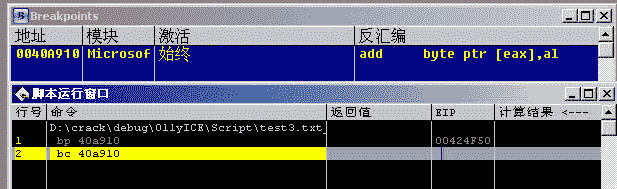
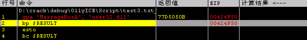
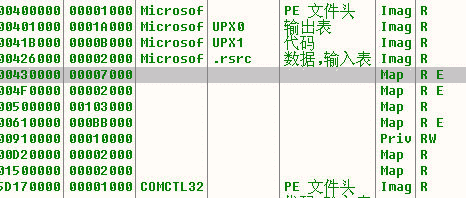
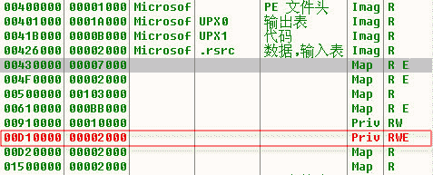
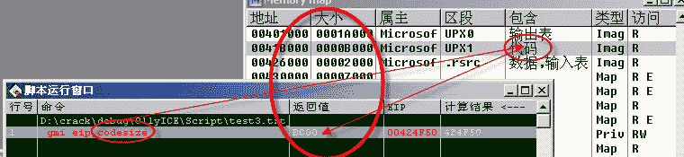
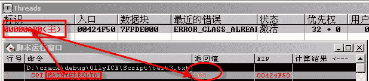

# ODbgScript 入门系列（二） ODbgScript 的命令

> 原文：[`www.pediy.com/kssd/pediy08/pediy8-186.htm`](https://www.pediy.com/kssd/pediy08/pediy8-186.htm)

调试好帮手 ODbgScript 入门系列（二） ODbgScript 的脚本语言和命令

(作者: hnhuqiong)

## 总观

ODbgScript 洋洋洒洒那么多脚本命令，其实它分成了 6 大类：

1. 变量和注释类和杂类
2. 断点类
3. 系统和操作类
4. 流程控制类
5. 计算和寄存器操作类
6. 字符串操作和搜索和替换类

这里我就不那么具体的举例子了，因为那么多命令要是逐一图片讲解将成为天书了。

而具体的例子将在后面的章节来论述。这里将论述的是思想。授人以渔是上策！

文章不短，建议边听音乐边看（建议曲目：喜唰唰，披着羊皮的狼）。

## 一. 变量和注释以及杂类

`$RESULT` : 这个是系统保留变量，函数和 ODS 的命令返回都放这里。它还有一个隐含的变量为 `$RESULT_1`，有的返回是 2 个参数，第二个放这里。

`$VERSION` : 返回当前版本号

`VAR` : 在脚本中，声明一个变量

`AN` : 从指定处，对代码进行分析

`CMT` : 在指定地址处，加入注释

`MSG` : 将指定消息，显示到一个对话框中

`MSGYN` : 将指定消息，显示到一个对话框中，这个对话框有“是”、“否”按钮

`ASK` : 显示一个提示输入框，让用户输入，并将结果保存转保留变量 `$RESULT` 中（如果用户按了取消键，则 `$RESULT=0`）

`#INC` : 脚本里面包含了另外的脚本

这是一个小类，它们主要就是做变量和注释工作。其中唯一需要注意的是 `var` 命令，它是一个变量声明命令。如果要养成一个好的脚本编辑习惯，你最好将脚本的变量名字命令的通俗易懂，这样，不会到了时间久远而不至于你自己都看不懂你的脚本。

例子：

`var a` : 这就不是一个好的变量名，其它人或者时间久了你都不知道它是干什么用的了。

好的例子 -- `var entrypoint`

## 二. 断点类

### 普通断点类

`BP` : 在指定地址设断点

`BC` : 清除指定地址的断点

### 条件断点类

`BPCND` : 在指定地址处，设置条件断点

`BPL` : 在指定地址处设置记录断点，将表达式的结果记录到记录窗口中

`BPLCND` : 在指定地址处设置记录断点，如果条件为真时，将表达式的结果记录到记录窗口中

### 硬件断点类

`BPHWS` : 在指定地址，设置硬件断点

`BPHWC` : 删除指定地址处的硬件断点

`BPHWCALL` : 删除所以的硬件断点

### 内存断点类

`BPRM` : 在指定地址处，设置一个内存读取断点

`BPWM` : 在指定地址处，设置一个内存读写断点

`BPMC` : 清除内存断点

对于调试和逆向工作来说，断点是重中之重！只有掌握了断点基本技能，才能说你学会了逆向工作的入门。

有过编程经验的人都知道在源代码下调试还是比较容易的，因为你可以在源代码上直接下断点调试。而逆向就不同了，你面对的是二进制文件，如何找断点，怎么下断点都是靠常年累月积累下来的经验。当然在看雪你能学到很多很多的下断点技巧。ODbgScript 里面提供的断点基本囊括了 OD 强大的下断点的功能。而如何灵活的组合和使用它们将让你的逆向水平有质的飞跃。

这一节可以和 CCdebuger 的 OD 断点文章相参照学习脚本的编辑和断点使用。

ODbgScript 断点命令是通过 OD 的 API 接口向 OD 下断点命令的，所以，只要你在 OD 中能下的断点，那么，在脚本中就能一样下同样的断点。所不同的是一个是你手工下，一个是脚本帮你下！可以这样说，逆向和解密就是不断的靠近自己所需要的核心地带，只要真正的找到了核心地带，那么剩下的就是程序等待你的肢解和解剖了。而这个过程就是如何利用断点来靠近它。而让人痛苦的是，常常你要经过无数次的实验和验证你才会靠近你所需要的核心地带。没有 ODbgScript 以前，这个是一个让人痛苦不堪的过程，特别是如果程序有大量的干扰和 anti，你必须手工小心翼翼的越过这些障碍，爬山涉水千艰万险的来到程序某个地方，一不留神被 ANTI 打倒，你必须重头再来，这个过程任何玩逆向的人都深有体会。特别是在没有 OD 以前，记得多年前我在 2.8 版的 SICE 上，为记录很多东西不得不鬼画桃符的写的到处都是记录。而一旦"失手"，那么很多过程是不得不再做一遍。其中的艰辛不是能描述的。

而有了 ODbgScript 你就不同了，anti 也好干扰也好，它能让你过去的工作在瞬间帮你完成。你就能集中力量寻找你的核心地带，而不会被已经分析过的各种干扰，anti 所打倒！它就是我们对付 ANTI 和虫海战术的利器！可以说一个软件或者一个壳无论你有多复杂，无论你多虫海，只要有一个人有真正进展！并公布工作脚本，尽管是半成品那么其它人就可以利用脚本不断的站在前人的肩膀上，向你进攻！壳是相对静态的防守，这就是加密和加壳软件的悲哀！你是 anti 是利用不为人知的后门，就有无数人想方设法靠近你的命门，那么你的"专利"就大白天下了。你是多么复杂的算法，多么变态的 VM，那么只要每天有人在算法上进步一点点，点点滴滴的积累将会铁棒磨成针，不要小看逆向界人的耐心！

由于后门和有效 ANTI 越来越少，加密和加壳开始向虫海方向发展，也就是利用反复的加密算法和动态解码，以及 VM(虚拟机)来产生大量的垃圾代码，反复和你斗你的耐心，从个人角度来说，的确逆向界开始遇到了一堵厚实的墙。但大家要相信一句话，自古有矛就有盾！我还相信一句就是众志成城！

这也是我想发展 ODbgScript 的初衷和下力气写这篇文章的动力。

罗嗦了半天，我自己都感觉我像缠脚的老太婆了。

其实我们用 ODbgScript 的一个主要目的就是-----直奔主题！

好了，我现在也回来直奔主题。我说到哪里里了？(各种砖头都来了)

这里，我们来演示一下断点的设置，看看在 ODbgScript 中下一个断点，那么 OLLYDBG 中有什么反应？

我们调出你的编辑器，先写一个简单的脚本如下，然后保存成 txt 或者 osc 文件：

```
bp 40a910
bc 40a910
```

然后调出脚本运行窗口，引导你刚才写的脚本进来，按下 `S` 键，我们看看 ODbgScript 和 OD 中的断点窗口各有什么反应。

(插入图一:2-bp.jpg)



脚本窗口里面一按 `S`，马上 OD 的断点窗口就产生了一个断点。再按一下 `S`，OD 中的断点窗口中的断点又消失了。

哈哈，我再按，我再按。哟，怎么没有反应了？当然就 2 句命令，你按那么多抽风呀？

(被一顿暴打，教学就教学，哪来那么多怪话)

那么，现在我们知道了，ODbgScript 和 OD 之间通过 Plug-in API 接口能很好的沟通。最起码比 OD 断点窗口里面你要手工设断点激活或者删除强多了吧？要知道偷懒的人多了去了(被无数人怒目而视，寒~~~~)，能省下时间干什么去？直奔主题！每次开会看见我们单位的头我都在假想，他会逆向多好呀....

OD 中断点主要分为 4 小类，普通断点，内存断点，硬件断点，条件断点。我不打算讲解断点的原理，有兴趣大家可以看看雪大量的文章，大侠级别的，断点玩的都不叫断点叫 `INT`，这个是什么？我不知道，我是菜鸟级别，不敢往这个上面发言....

那么，这四小类断点和其它命令的的组合将带你进入五光十色的逆向世界！

## 3. 系统和操作类

### 内存操作类

`ALLOC` : 分配新的内存页，你能读／写／执行。

`FREE` : 释放由 `ALLOC` 申请的内存。

### 文件操作类

`DM` : 从指定地址处开始，在内存中提取指定大小的数据，并保存到指定的文件中

`DMA` : 从指定地址处开始，在内存中提取指定大小的数据，并保存到指定的文件中；如果指定文件已存在，则将数据追加到指定文件尾部。

`DPE` : 提取执行模块到指定文件中。

`WRT` : Write to file (replace existing one) the only accepted symbol is `"\r\n"` Numbers are wrote as strings... for the moment

`WRTA` : Append to file

`LM` : 引导 Dm 文件到内存 , LM is the opposite of the DM command

### 系统信息类

`GPA` : 在指定的动态链接库中，获得指定函数的地址。

`GCMT` : 获得指定地址的注释

`GMEMI` : 获得内存块的指定信息

`GPI` : 获得进程信息

`GN` : 获得指定地址的符号名（比如指向 API 函数）

`GMI` : 获得指定地址所在模块的相关信息。

`HANDLE` : 获得句柄信息

### 汇编和 OD 控制类

`ASM` : 修改指定地址的指令。

`EXEC`/`ENDE` : 对当前调试进程，执行在 `EXEC` 和 `ENDE` 之间的指令

`KEY` : 相对于在 OD 中执行按键

古话有说:满纸荒唐言,一把辛酸泪。

其实，这段是最难写的，因为这段是承上启下的一段，有了这段你才能体会 ODbgScript 的强大，才能从这里开始和中断组合产生各种五光十色的脚本世界，来到这段我常常有一种如履薄冰的感觉，生怕误人子弟。这里别看命令不多，可句句都是重点。我在看源程序的时候，对这段的了解才更加的加深了我对 OD 和 ODbgScript 的理解。

而 ODbgScript 今后如果能成功升级，核心的重点也在这里。

古人云:工欲善其事,必先利其器。如果说中断是 ODbgScript 的器。那么这里就是利你的器！

是情报和特工及军队机构，没有情报机构，那就是瞎打乱打。没有特工机构，就会让你身处危险而不知其险。没有军队，你面对敌人强大的防护，束手无策！

希望不至于写成类 MSDN 的东西，可很多东西又难以取舍，霍金有一句话，你的一个公式能让你的读者少 50%。我尽量能写成入门级的东西，霍金的名言才让他的<时间简史>让无比抽象的时空概念深入人心，让千千万万的老百姓明白什么是黑洞和黑洞辐射。

好了我们再次奔小康，不是不是，是奔主题！(场外人全部处于抓狂中....)

首先我们在脚本里面写下这样一些命令，引入 ODbgScript 然后按 `S` 执行。

```
gpa "MessageBoxA", "user32.dll"
bp $RESULT
esto
bc $RESULT
```

(图片 2-gpa.jpg)



大家看到了，在返回值栏里面有一个值，这个值是什么呢？就是函数 `MessageBoxA` 的入口地址，这个函数常常被注册码类的程序所调用，给大家一个比如注册码错误之类的提示。如果我们要定位这个注册码的算法位置，那么如果弹出来了这样的窗口，算法就在附近不远的地方。情报机构上！告诉我坐标，中断大炮在后面等着。大炮要打敌人第一件事情是要知道敌人在什么地方。而这个 `MessageBoxA` 的入口地址就是敌人首先暴露的一个坐标点。我们利用 `GPA` 命令来定位它的位置，而这个位置是随着计算机的不同而不同的，我们要抓住敌人，就要充分利用 GPS 来定位它！不对不对，不是 GPS 是 GPA！(场下开始骚乱，台上死猪不怕开水烫的继续说)，情报机构准确的抓到了这个位置，那么通信兵是谁？就是 `$Result`！它越过重重封锁线将坐标地址给中断大炮阵地送来了坐标，预备！~~~放！！！我们按下空格键让中断大炮去打吧。

轰！程序诧然停止。打中啦~~士兵狂吼，硝烟散去。

作为指挥官的你邹了一下眉头，自言自语的说，是打中了，可离人家指挥中心差老鼻子了。又不是原子弹，覆盖范围可以那么大！

怎么办？还需要更加精确的坐标！我们要派特别行动队出动了。

脚本上开始加下面的句子，然后执行，并调出 OD 的内存窗口，可以进行观察：

```
alloc 2000
```

我们可以看到 OD 的内存区中增加了一个块，大小 2000 属性 RWE。大家对比一下图 3 和图 4

(插入图三: 2-alloc1.jpg)

(插入图四: 2-alloc2.jpg)

 

(我们在敌人的眼皮低下打了一个埋伏区..这个埋伏区可以藏弹药，可以藏军队，还可以打一场 CS............
....台上不说话了，CS 激战中......想暗渡陈仓？小心点记得留退路哟...

突然听见 MS 中央电台广播在不断的播放歌曲：

"洗刷刷，洗刷刷，请你--拿了给我的送回来，吃了我的给我吐出来，欠了我的给我补回来，偷了我的给我交出来！！！"

侦测连长看偷袭阵地这样长期占领危险，还是有借有还！再来不难，马上烧军火等等走人。)

```
free $RESULT,2000
```

这里指挥官还派出了外交官，要打击敌人就要从多方面的入手。

```
gmi eip,CODEBASE (或者 CODESIZE,或者 MODULEBASE,MODULEDSIZE 等,外交部在不断扩大范围中...)
```

(插入图五:2-gmi.jpg)



某某情报局派出了天下无敌光头武乞丐功夫王"零零漆"----外号"走醒醒"上场。

```
GPI MAINTHREADID(可以是 HPROCESS,PROCESSID,HMAINTHREAD,MAINTHREADID,MAINBASE,PROCESSNAME......)
```

(插入图片六:2-GPI.jpg)



某新闻社派出了强大的以"不是零"为代表的著名文字分析专家记者代表团。要知道记者是无冕之王！！！

这里可以说你会明白为什么"焦点访谈"为什么那么可怕了。老百姓欢迎，有的人就要....

(这里放到下面的一章专门讲叙)

为了打好这场战役，某野战军派出了王牌之师，ASM 给以策应。

```
ASM eip,"mov [eax],edx"
```

从战役角度来说，围点一定要打援，那么，现在敌人那么狡猾，我们怎么能缺少这样的策应队伍呢？

它为什么是策应队伍呢？因为它只能向代码区汇编一句，效率比较低。但是毕竟是在和敌人干上了...

最高首长派出了空军王牌师 EXEC/ENDE，直接轰炸给予空中支持，可惜空军轰炸机只有能装 255 颗炸弹的弹药仓。

```
exec
mov eip,[eax]
ENDE
```

对当前调试进程，执行在 `EXEC` 和 `ENDE` 之间的指令。

有这个命令就是你可以越过 ODbgScript 直接跳入进程，对进程进行直接控制。

它的原理就是取当前进程的信息进行保存，然后新分配一个代码内存区(可读/写/执行.大小 1000)
调用 OD 汇编器将你的汇编语句转成 OPcode，将 OPcode 拷贝到代码区，然后将 `EIP` 指向你的代码开头。
然后将控制权交给你。执行完后将 `EIP` 归还原位，然后将控制权交还 ODbgScript。

这里的好处就是让你以很高的效率来避免在较慢的脚本环境运行需要高效的操作。

!注意：由于进程控制权交给你了，那么，你的代码有效性将只有你自己来控制了。

!注意：执行后不保存现场。这都需要你来做工作。(要保存现场，你可以使用 `pushad`,`popad`)

有大括号的，会被大括号中的变量的值替代。


（这对命令有小 BUG 在下一个发布版本中修正）

还有就是我们英雄的幕后部队，电子对抗队伍`KEY`在默默的支持着这场生死之战..

`key 20, 1 //Shift+space`

一场战役就这样开始打响，轰轰烈烈.................（世界没有免费的午餐）

各种部队和敌人短兵相接....刺刀见红..............（见后章）

你会看见我们的军队是那么连贯的一气呵成完成了使命..（效果出来了）

千帆过尽谱写的是华丽篇章........................（过程是那么美不盛收）

尽管尽管曾经历经千山万水........................（过程是那么令人辛酸）

可最终还是剑指七寸红颜笑........................（原来是披着羊皮的狼）

最后是你哼着“日落西山打靶归....”

打扫战场，收获你的战利品，文件类操作就是干这个的.......

`dpe "c:\unpack.exe", 401000`

（再不睡觉我`LP`要和我刺刀见红了 :(( )）

好了，这篇先到这里，下一篇将介绍`ODbgScript`的文字串命令和流程控制命令。

---------------------------------------------------------------

【版权声明】 本文纯属技术交流，转载请注明作者并保持文章的完整，谢谢!

`4dd466d0e1e0cc123afbe504da2462ca`
