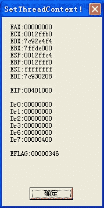
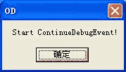
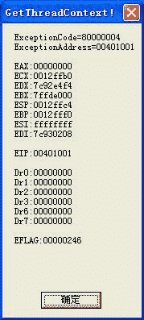

# 理解 OD 的 F4,F7,F8,F9

> 原文：[`www.pediy.com/kssd/pediy10/77259.html`](https://www.pediy.com/kssd/pediy10/77259.html)

这个小程序只是 hook（IAT hook）了 OD 的四个关键调试 API：`WaitForDebugEvent()`、`GetThreadContext()`、`SetThreadContext()`、`ContinueDebugEvent()`  

当程序运行时，OD 通过 `WaitForDebugEvent` 等待系统调试事件，`WaitForDebugEvent` 返回时代表有一个调试事件发生了，hook 了它就可以轻而易举的知道所发生的具体事件。`GetThreadContext` 得到一个 `CONTEXT` 结构，OD 寄存器面板里的各个值就来源于这里，但是 OD 寄存器面板里的值不一定是原始真实的，hook 了这个函数就可以看清清楚楚。最重要的是 `SetThreadContext`，OD 中 `F4`,`F7`,`F8`,`F9`，`shift+F7`,`shift+F9` 的功能就是设置 `CONTEXT` 结构，然后调用这个函数，设置线程环境，hook 了这个函数就能弄清楚 OD 的调试花招。`ContinueDebugEvent` 后系统就恢复执行被调试线程。

以最简单的 `F7` 为例：



看到图中 `EFLAGE：00000346`（0…… 0011 0100 0110）

`TF` 单步标志位是第 9 位，显然 `TF＝1`，表明执行完这条指令后引发单步异常

点确定后出现：



要恢复执行被调试线程了！

再点确定后出现：



图中可以清楚的看到 `ExceptionCode` 和 `ExceptionAddress`，`80000004` 就是上面提到单步异常（果然发生了），当然这个异常 OD 是自己处理的，不会发给被调试程序的！要注意的是硬件断点产生的异常也是 `80000004`，所以最后要通过 `Dr6` 的最后四位来判断！

`F7` 固然简单，`F9` 就比我想象的要复杂，大家可以试一试，它们的第一步居然也是单步，然后才把 `TF` 置零，正真运行。原因是要落实各个断点（关键是刚刚命中的那个断点（如果有）），包括硬件断点！

`F4` 跟 `F9` 一样，只是多设了一个硬件断点（如果用完只能用 `CC` 了）

`F8` 最复杂，如果是 `call` 指令，则在 `call` 后面设置硬件断点（如果用完只能用 `CC` 了），否则就是单步。

`shift+F7`,`shift+F9` 很奇特大家自己看看！

另外 `popfd` 是条奇怪的指令，`F7`、`F8` 时会在下一条指令设置硬件断点！！恐怕 OD 作者怕 `popfd` 改变 `TF` 位而跑飞吧，，但这实际上是不可能的，去 Intel 手册上看看。

需要说明的是：各个 OD 版本处理可能并不一样！

## Dllinject

代码:

```
#include <windows.h>
#define BaseAddr 0x00400000
#define Dll_Export __declspec(dllexport)
extern "C"
{
  Dll_Export BOOL __stdcall My_ContinueDebugEvent(DWORD dwProcessId,
    DWORD dwThreadId,
    DWORD dwContinueStatus);
  Dll_Export BOOL __stdcall My_GetThreadContext(HANDLE hThread,
    LPCONTEXT lpContext);
  Dll_Export BOOL __stdcall My_SetThreadContext(HANDLE hThread,
    const CONTEXT* lpContext);
  Dll_Export BOOL __stdcall My_WaitForDebugEvent(
    LPDEBUG_EVENT lpDebugEvent,  // pointer to debug event structure
    DWORD dwMilliseconds         // milliseconds to wait for event
    );

}
DWORD *GetFuncAddrIAT(char *func_name);

DWORD *p1=NULL;  //kernel32.ContinueDebugEvent
DWORD *p2=NULL;  //kernel32.GetThreadContext
DWORD *p3=NULL;  //kernel32.SetThreadContext
DWORD *p4=NULL;  //kernel32.WaitForDebugEvent
DWORD old_p1,old_p2,old_p3,old_p4;

DWORD ExceptionAddress=0;
DWORD ExceptionCode=0;


BOOL WINAPI DllMain(
          HINSTANCE hinstDLL,  // handle to DLL module
          DWORD fdwReason,     // reason for calling function
          LPVOID lpReserved  )  // reserved
{
    // Perform actions based on the reason for calling.
    switch( fdwReason ) 
    { 
  case DLL_PROCESS_ATTACH:
    // Initialize once for each new process.
    // Return FALSE to fail DLL load.

    p1=GetFuncAddrIAT("ContinueDebugEvent");
    p2=GetFuncAddrIAT("GetThreadContext");
    p3=GetFuncAddrIAT("SetThreadContext");
    p4=GetFuncAddrIAT("WaitForDebugEvent");
    if (!(p1&&p2&&p3&&p4))
    {
      MessageBox(NULL,"At Least One Func Hook Fail!","Exit",MB_ICONERROR);
      return FALSE;
    }

    //保存原来的值
    old_p1=*p1;
    old_p2=*p2;
    old_p3=*p3;
    old_p4=*p4;
    //Hook
    *p1=(DWORD)My_ContinueDebugEvent;
    *p2=(DWORD)My_GetThreadContext;
    *p3=(DWORD)My_SetThreadContext;
    *p4=(DWORD)My_WaitForDebugEvent;
    MessageBox(NULL,"Dll Inject Success!!","Injected!",MB_OK);
    break;
    
  case DLL_PROCESS_DETACH:
    // Perform any necessary cleanup.
    //restore
    *p1=old_p1;
    *p2=old_p2;
    *p3=old_p3;
    *p4=old_p4;
    MessageBox(NULL,"Dll 即将退出","Waring!",MB_OK);
    break;

  default: 
    break;
    }
    return TRUE;  // Successful DLL_PROCESS_ATTACH.
}


BOOL __stdcall My_ContinueDebugEvent(DWORD dwProcessId,
               DWORD dwThreadId,
               DWORD dwContinueStatus)
{
  MessageBox(NULL,"Start ContinueDebugEvent!","OD",MB_OK);
  return ContinueDebugEvent(dwProcessId,dwThreadId,dwContinueStatus);
}

BOOL __stdcall My_GetThreadContext(HANDLE hThread,
             LPCONTEXT lpContext)
{
//  MessageBox(NULL,"Start GetThreadContext!","OD",MB_OK);
  char buf[256]={0};
  char buf1[512]={0};

  if (ExceptionCode)
  {
    wsprintf(buf1,"ExceptionCode=%08x\nExceptionAddress=%08x\n\n",ExceptionCode,ExceptionAddress);
  }
  BOOL b=GetThreadContext(hThread,lpContext);
  wsprintf( buf,
       "EAX:%08x\nECX:%08x\nEDX:%08x\nEBX:%08x\nESP:%08x\nEBP:%08x\nESI:%08x\nEDI:%08x\n\nEIP:%08x\n\nDr0:%08x\nDr1:%08x\nDr2:%08x\nDr3:%08x\nDr6:%08x\nDr7:%08x\n\nEFLAG:%08x\n",
        lpContext->Eax,
        lpContext->Ecx,
        lpContext->Edx,
        lpContext->Ebx,
        lpContext->Esp,
        lpContext->Ebp,
        lpContext->Esi,
        lpContext->Edi,
        lpContext->Eip,
        lpContext->Dr0,
        lpContext->Dr1,
        lpContext->Dr2,
        lpContext->Dr3,
        lpContext->Dr6,
        lpContext->Dr7,
        lpContext->EFlags
        );
  strcat(buf1,buf);
  MessageBox(NULL,buf1,"GetThreadContext!",MB_OK);
  ExceptionAddress=0;
  ExceptionCode=0;
  return b;
}

BOOL __stdcall My_SetThreadContext(HANDLE hThread,
            const CONTEXT* lpContext)
{
//  MessageBox(NULL,"Start SetThreadContext!","OD",MB_OK);
  char buf[256]={0};
  wsprintf( buf,
      "EAX:%08x\nECX:%08x\nEDX:%08x\nEBX:%08x\nESP:%08x\nEBP:%08x\nESI:%08x\nEDI:%08x\n\nEIP:%08x\n\nDr0:%08x\nDr1:%08x\nDr2:%08x\nDr3:%08x\nDr6:%08x\nDr7:%08x\n\nEFLAG:%08x\n",
      lpContext->Eax,
      lpContext->Ecx,
      lpContext->Edx,
      lpContext->Ebx,
      lpContext->Esp,
      lpContext->Ebp,
      lpContext->Esi,
      lpContext->Edi,
      lpContext->Eip,
      lpContext->Dr0,
      lpContext->Dr1,
      lpContext->Dr2,
      lpContext->Dr3,
      lpContext->Dr6,
      lpContext->Dr7,
      lpContext->EFlags
        );
  MessageBox(NULL,buf,"SetThreadContext!",MB_OK);
  BOOL b=SetThreadContext(hThread,lpContext);
  return b;
}

BOOL __stdcall My_WaitForDebugEvent(
                  LPDEBUG_EVENT lpDebugEvent,  // pointer to debug event structure
                  DWORD dwMilliseconds         // milliseconds to wait for event
                  )
{
  BOOL b=WaitForDebugEvent(lpDebugEvent,dwMilliseconds);
  if(lpDebugEvent->dwDebugEventCode==EXCEPTION_DEBUG_EVENT)
  {
    ExceptionAddress=(DWORD)(lpDebugEvent->u.Exception.ExceptionRecord.ExceptionAddress);
    ExceptionCode=lpDebugEvent->u.Exception.ExceptionRecord.ExceptionCode;      
  }
  return b;
}

DWORD *GetFuncAddrIAT(char *func_name)
{
  DWORD FuncAddr=(DWORD)GetProcAddress(LoadLibrary("Kernel32.dll"),func_name);

  //Get Import Table
  DWORD *DATA_DIRECTORY_ADDR=(DWORD *)(*(DWORD *)(BaseAddr+0x3C)+0x78+BaseAddr);
  DWORD *Import_table_addr=(DWORD *)(*(DATA_DIRECTORY_ADDR+2)+BaseAddr);
  DWORD Import_Size=*(DATA_DIRECTORY_ADDR+3);

  DWORD OldProtect;  //有些 OD 输入表只读，害我郁闷了半天!
  VirtualProtect(Import_table_addr,Import_Size,PAGE_READWRITE,&OldProtect);

  DWORD *Find_Addr=Import_table_addr;
  while (Import_Size>0)
  {
    if (*Find_Addr==FuncAddr)
      break;
    Import_Size-=4;
    Find_Addr++;
  }
  if (!Import_Size)
    Find_Addr=0;
  return Find_Addr;
}
```

inject_tool:

代码:


```c
#include <windows.h>
#include <Tlhelp32.h>
#define BUF 0x0050B000
#define DLLPATH "C:\\\\Dllinject.dll"

DWORD GetProcessIDbyName(char *name);

int main()
{
  DWORD ProcessID=GetProcessIDbyName("OllyICE.exe");
  if (!ProcessID)
  {
    ProcessID=GetProcessIDbyName("OllyDBG.exe");
    if (!ProcessID)
    {
      MessageBox(NULL,"开了 OD 了吗?","Not Found!",MB_ICONERROR);
      return -1;
    }
  }
  HANDLE hProcess=OpenProcess(PROCESS_ALL_ACCESS, FALSE, ProcessID);
  char dllpath[MAX_PATH]=DLLPATH;
  if(!WriteProcessMemory(hProcess,(LPVOID)BUF,dllpath,strlen(dllpath),NULL))
  {
    MessageBox(NULL,"写入进程失败!!","Err!",MB_ICONERROR);
    return -1;
  }
  PVOID lpStartAddress=GetProcAddress(LoadLibrary("Kernel32.dll"),"LoadLibraryA");
  if(!CreateRemoteThread(hProcess,NULL,0,(LPTHREAD_START_ROUTINE)lpStartAddress,(LPVOID)BUF,0,NULL))
  {
    MessageBox(NULL,"启动远程线程失败!!","Err!",MB_ICONERROR);
    return -1;
  }
  MessageBox(NULL,"Inject Complete!!","OK!",MB_OK);
  return 0;
}

DWORD GetProcessIDbyName(char *name)
{
  PROCESSENTRY32 stProcess;
  HANDLE hSnapShot=CreateToolhelp32Snapshot(TH32CS_SNAPPROCESS,0);
  
  Process32First(hSnapShot,&stProcess);
  do
  {
    if(!stricmp(stProcess.szExeFile,name))  //大小写不敏感
    {
      CloseHandle(hSnapShot);
      return stProcess.th32ProcessID;
    }
  } while (Process32Next(hSnapShot,&stProcess));
  //not found
  CloseHandle(hSnapShot);
  return 0;
}
```

## 使用方法
1. `Dllinject.dll` 放到 C 盘根目录下  
2. 启动 OD  
3. 想试验的时候运行 `inject_tool.exe` 

 忘了附件：  

又更新了一下附件：增加了很多别的 `DEBUG_EVENT` 的提示  

`CREATE_PROCESS_DEBUG_EVENT` 时，进程名通过别的方法获取了，但 `LOAD_DLL_DEBUG_EVENT` 时模块名无法获取，它们的 `lpImageName` 是 NULL（或无效），用 PSAPI 也不行，刚刚得到这个事件时别的工具也无法察出来，OD 里的模块列表应该是后来枚举出来的……不知道大家有什么高招！◎＃￥％……※×

上传的附件

|  || `New_OD_inject.rar`  

 |
