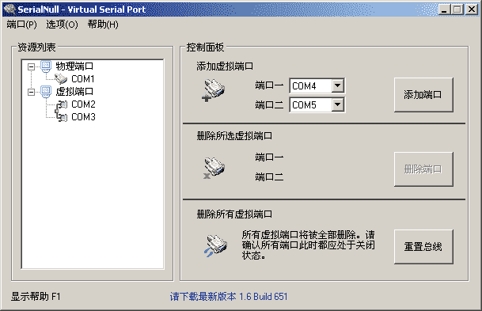
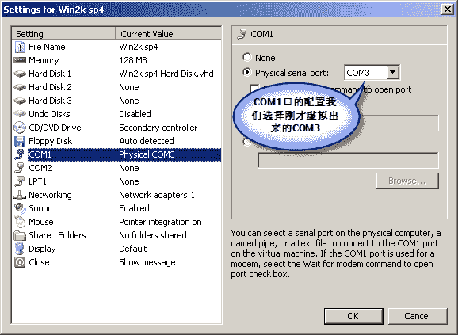
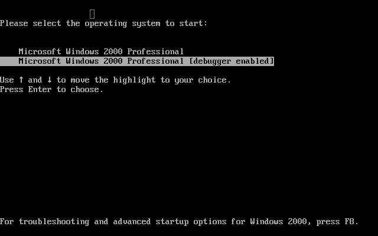
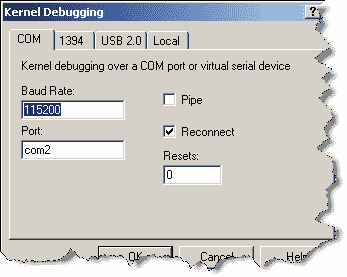
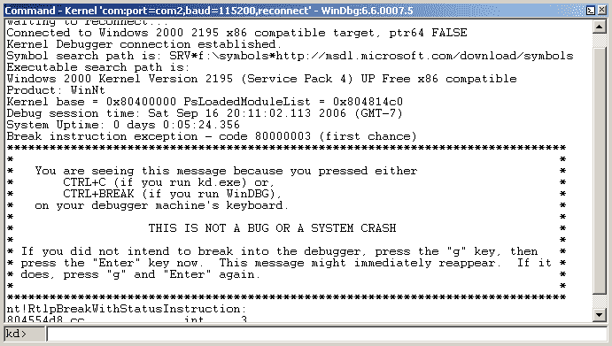

# 使用 WinDBG 进行双机内核调试

> 原文：[`www.pediy.com/kssd/pediy08/pediy8-437.htm`](https://www.pediy.com/kssd/pediy08/pediy8-437.htm)

> 使用 WinDBG 进行双机内核调试

> By xikug.xp

> 版本：1.0

> 作者：xIkUg/RCT

> xikug.xp `[at]` `gmail` `[dot]` `com`

> 我常去的网站：

> `http://www.wintoolspro.com`
>
> `http://debugman.wintoolspro.com`
>
> `http://www.fcgchina.com`
>
> `http://bbs.pediy.com`
>
> `http://www.unpack.cn`

> 由于我没有物理的两台机器，因此我这里使用虚拟机来进行讲解(虚拟机真是个好东西)。我将先讲述如何设置，然后以一个实例来讲述如何进行内核驱动的调试。

> Target 环境：
>
> `Virtual PC 2004`、`Win2000 sp 4 en`

> Host 环境：
>
> `WinXP sp2`, `WinDBG 6.6.07.5`, `SUDT SerialNull 1.6` 试用版

## 一) 设置篇

> `SUDT SerialNull` 是一个虚拟串口软件，用于模拟 `RS232` 串口的虚拟连接，`SerialNull` 可以在不占用真实串口的情况下，创建任意数量并互为连接的纯虚拟串口对。

> 我们将用这个软件虚拟一个串口对出来供 `Host` 与 `Target` 使用。

如图：



我们虚拟了一个串口对，`COM2-COM3`，这对串口是联通的。

在 `VirtualPC` 中设置：



进入虚拟机系统(`Win2k`)，打开 `boot.ini` 文件，添加一行，如下：

```
multi(0)disk(0)rdisk(0)partition(1)\WINNT="Microsoft Windows 2000 Professional" /fastdetect /debug /debugport=com1 /baudrate=115200
```

意思是以 `Debug` 模式起动系统，调试端口为 `COM1`，波特率为 `115200`

重新以 `Debug` 模式启动系统：



在 `Host` 端，启动 `WinDBG`，选 `File->Kernel Debug…`，`COM` 页，在 `BaudRate` 输入 `115200`，`Port` 输入我们建立的虚拟串口对的 `COM2` 口，钩上 `Reconnected`：



点击“OK”之后在 `COMMAND` 窗口出现：

```
Opened \\\\.\\com2
Waiting to reconnect…
```

此时按 `Ctrl+Break`，会出现如下画面：



调试器显示：“`Connected to Windows 2000 2195 x86 compatible target, ptr64 FALSE`”，此时代表连接目标成功，处于中断状态，我们可以在 `File->Symbol File Path…` 中设置符号路径，我习惯于使用 `Symbol Server`，因此我在这里设置了：

```
SRV*f:\\symbols\\*http://msdl.microsoft.com/download/symbols
```

到此时我们的双机调试环境搭建完成。此环境已经可以工作了。

## 二) 实例讲解

接着上面的步骤，我将以一个软件做为实例进行讲解，做为练习目标的软件是国产软件，在此隐去软件名称，我使用 `A` 软件代替。

在 `command` 窗口输入：`G`，此命令跟 `SoftICE` 中的 `G` 一样，让程序继续运行。

将 `A` 软件安装在虚拟机中，安装完成后，运行 `A` 软件，进入注册界面，此时我们在 `WinDBG` 中再次按 `Ctrl+Break`，让 `Target` 中断下来，`A` 软件的注册算法在驱动程序 `snbus.sys` 中 `DeviceControl` 例程中（为什么在 `snbus` 中的 `DeviceControl` 例程中，请自行跟踪应用程序并查看 `DDK` 的相关文档就知道了，这里的重点不是 `Crack` 软件，而是讲内核驱动的调试），在 `Command` 窗口中输入：

```
!drvobj snbus 2
```

`!drvobj` 命令类似于 `SoftICE` 中的 `driver` 命令，用于显示驱动对象的相关信息，具体的用法请参看 `WinDBG` 的帮助文档，当我们输入 `!drvobj snbus 2` 时，我们将得到这个驱动的 `Dispatch routines` 信息：

```
kd> !drvobj snbus 2

Driver object (81454a70) is for:
\Driver\SnBus
Dispatch routines:
[00] IRP_MJ_CREATE                   f7353aa0 +0xf7353aa0
[01] IRP_MJ_CREATE_NAMED_PIPE        80423f0c nt!IopInvalidDeviceRequest
[02] IRP_MJ_CLOSE                    f7353aa0 +0xf7353aa0
[03] IRP_MJ_READ                     80423f0c nt!IopInvalidDeviceRequest
[04] IRP_MJ_WRITE                    80423f0c nt!IopInvalidDeviceRequest
[05] IRP_MJ_QUERY_INFORMATION        80423f0c nt!IopInvalidDeviceRequest
[06] IRP_MJ_SET_INFORMATION          80423f0c nt!IopInvalidDeviceRequest
[07] IRP_MJ_QUERY_EA                 80423f0c nt!IopInvalidDeviceRequest
[08] IRP_MJ_SET_EA                   80423f0c nt!IopInvalidDeviceRequest
[09] IRP_MJ_FLUSH_BUFFERS            80423f0c nt!IopInvalidDeviceRequest
[0a] IRP_MJ_QUERY_VOLUME_INFORMATION 80423f0c nt!IopInvalidDeviceRequest
[0b] IRP_MJ_SET_VOLUME_INFORMATION   80423f0c nt!IopInvalidDeviceRequest
[0c] IRP_MJ_DIRECTORY_CONTROL        80423f0c nt!IopInvalidDeviceRequest
[0d] IRP_MJ_FILE_SYSTEM_CONTROL      80423f0c nt!IopInvalidDeviceRequest
[0e] IRP_MJ_DEVICE_CONTROL           f7353b1a +0xf7353b1a
[0f] IRP_MJ_INTERNAL_DEVICE_CONTROL  80423f0c nt!IopInvalidDeviceRequest
[10] IRP_MJ_SHUTDOWN                 80423f0c nt!IopInvalidDeviceRequest
[11] IRP_MJ_LOCK_CONTROL             80423f0c nt!IopInvalidDeviceRequest
[12] IRP_MJ_CLEANUP                  80423f0c nt!IopInvalidDeviceRequest
[13] IRP_MJ_CREATE_MAILLOT           80423f0c nt!IopInvalidDeviceRequest
[14] IRP_MJ_QUERY_SECURITY           80423f0c nt!IopInvalidDeviceRequest
[15] IRP_MJ_SET_SECURITY             80423f0c nt!IopInvalidDeviceRequest
[16] IRP_MJ_POWER                    f735065e +0xf735065e
[17] IRP_MJ_SYSTEM_CONTROL           f7354db8 +0xf7354db8
[18] IRP_MJ_DEVICE_CHANGE            80423f0c nt!IopInvalidDeviceRequest
[19] IRP_MJ_QUERY_QUOTA              80423f0c nt!IopInvalidDeviceRequest
[1a] IRP_MJ_SET_QUOTA                80423f0c nt!IopInvalidDeviceRequest
[1b] IRP_MJ_PNP                      f7354590 +0xf7354590
```

我们找到了

```
[0e] IRP_MJ_DEVICE_CONTROL           f7353b1a +0xf7353b1a
```

知道 `DeviceControl` 例程的入口在 `0xf7353b1a` 处，于是我们在 `0xf7353b1a` 处设下断点，在 `Command` 窗口中输入：

```
bp 0xf7353b1a
```

`bp` 指令相当于 `softice` 的 `bpx`，后面跟“地址”即可在指定地址设下断点，具体用法请参加 `WinDBG` 的帮助。

输入 `G`，让 `Target` 继续跑起来，此时我们在注册窗口中输入我们的注册用户名与假码：

```
xIkUg
aaaaaaaa-bbbbbbbb-cccccccc-dddddddd
```

点“确定”，此时 `WinDBG` 把 `Target` 中断了下来，中断之处正是我们刚才设置的 `DeviceControl` 的例程处 `0xf7353b1a`：

```
f7353b1a 8bff         mov     edi,edi                          ; 这里断下
f7353b1c 55           push    ebp
f7353b1d 8bec         mov     ebp,esp
f7353b1f 51           push    ecx
f7353b20 8b4508       mov     eax,dword ptr [ebp+8]            ; [ebp+8] = DeviceObject
f7353b23 56           push    esi
f7353b24 57           push    edi
f7353b25 8b7828       mov     edi,dword ptr [eax+28h]          ; [eax+28h] = DEVICE_OBJECT.DeviceExtension
f7353b28 807f0400     cmp     byte ptr [edi+4],0               ; ds:0023:8145494c=01
f7353b2c 897dfc       mov     dword ptr [ebp-4],edi            ; 保存设备扩展
f7353b2f 751a         jne     f7353b4b                         ; 8145494c 如果为真则跳，否则执行下面的代码并退出这个 routine
f7353b31 8b4d0c       mov     ecx,dword ptr [ebp+0Ch]          ; Irp
f7353b34 be100000c0   mov     esi,0C0000010h                   ; 0C0000010h = STATUS_INVALID_DEVICE_REQUEST
f7353b39 32d2         xor     dl,dl
f7353b3b 897118       mov     dword ptr [ecx+18h],esi          ; [ecx+18h] = IoStatus
f7353b3e ff15182635f7 call    dword ptr ds:[0F7352618h]       ; [0F7352618h] = IofCompleteRequest
f7353b44 8bc6         mov     eax,esi                          ; 返回状态
f7353b46 e977020000    jmp     f7353dc2                         ; Exit
```

在这里你可能看到这些代码后的注解可能会问为什么是这样的？不急，让我们看看 `MSND`，`DeviceControl` 的函数原型如下：

```
NTSTATUS XxxDispatchDeviceControl(
    IN PDEVICE_OBJECT DeviceObject,
    IN PIRP Irp);
```

于是我们知道 `f7353b20` 的 `[ebp+8]` 指向 `DeviceObject`

在 `Command` 窗口输入 `dt _DEVICE_OBJECT`，我们得到如下信息：

```
kd> dt _DEVICE_OBJECT

  +0x000 Type                 : Int2B
  +0x002 Size                 : Uint2B
  +0x004 ReferenceCount       : Int4B
  +0x008 DriverObject         : Ptr32 _DRIVER_OBJECT
  +0x00c NextDevice           : Ptr32 _DEVICE_OBJECT
  +0x010 AttachedDevice       : Ptr32 _DEVICE_OBJECT
  +0x014 CurrentIrp           : Ptr32 _IRP
  +0x018 Timer                : Ptr32 _IO_TIMER
  +0x01c Flags                : Uint4B
  +0x020 Characteristics      : Uint4B
  +0x024 Vpb                  : Ptr32 _VPB
  +0x028 DeviceExtension      : Ptr32 Void
  +0x02c DeviceType           : Uint4B
  +0x030 StackSize            : Char
  +0x034 Queue                : __unnamed
  +0x05c AlignmentRequirement : Uint4B
```


### 结构分析

通过结构我们知道 `f7353b25` 的 `[eax+28h]` 是指 `DeviceObject` 偏移 `0x28` 处，即是指向 `DEVICE_OBJECT.DeviceExtension`。

同理，我们可以知道 `f7353b31` 的 `[ebp+0Ch]` 是指 `Irp` 了。

好，话就到这里，相当聪明的你应该都知道后面我讲的那些东西是怎么得出来的了，后面我会大致讲一讲，不会讲得太细，毕竟这篇文章的重点不是将 Crack，如果你还不懂的话可能需要补一下相关的 Crack 知识。

### 代码执行流程

当我们输入假码后，运行上面的代码之后会由 `f7353b2f` 跳到 `f7353b4b`：

```asm
; 跳到这里来执行

f7353b4b  57               push    edi 
f7353b4c  e835c9ffff      call    f7350486 
f7353b51  837f0806        cmp     dword ptr [edi+8],6 
f7353b55  8b750c          mov     esi,dword ptr [ebp+0Ch]             ; Esi = Irp 
f7353b58  750c            jne     f7353b66                            ; 跳 

; 跳到这里来执行

f7353b66  8b4660          mov     eax,dword ptr [esi+60h]            ; eax = Irp.Tail.CurrentStackLocation 
f7353b69  8b5008          mov     edx,dword ptr [eax+8]              ; edx = CurrentIoStackLocation.Parameters.InputBufferLength 
f7353b6c  8b400c          mov     eax,dword ptr [eax+0Ch]            ; eax = CurrentIoStackLocation.Parameters.IoControlCode = 2A4010h 
f7353b6f  b914402a00      mov     ecx,2A4014h                        ; ecx = IOCTL_CODE 
f7353b74  3bc1            cmp     eax,ecx                            ; 比较 IO 控制码 
f7353b76  53              push    ebx 
f7353b77  8b5e0c          mov     ebx,dword ptr [esi+0Ch]            ; ebx = Irp.AssociatedIrp.SystemBuffer, 指向输入缓冲区 
f7353b7a  c745080d0000c0  mov     dword ptr [ebp+8],0C000000Dh 
```

上面的注解得出方法同前面的一致：

```
kd> dt -b _IRP

  +0x000 Type             : Int2B 
  +0x002 Size             : Uint2B 
  +0x004 MdlAddress       : Ptr32 
  +0x008 Flags            : Uint4B 
  +0x00c AssociatedIrp    : __unnamed 
      +0x000 MasterIrp        : Ptr32 
      +0x000 IrpCount         : Int4B 
      +0x000 SystemBuffer     : Ptr32 
  +0x010 ThreadListEntry  : _LIST_ENTRY 
      +0x000 Flink            : Ptr32 
      +0x004 Blink            : Ptr32 
  +0x018 IoStatus         : _IO_STATUS_BLOCK 
      +0x000 Status           : Int4B 
      +0x000 Pointer          : Ptr32 
      +0x004 Information      : Uint4B 
  +0x020 RequestorMode    : Char 
  +0x021 PendingReturned  : UChar 
  +0x022 StackCount       : Char 
  +0x023 CurrentLocation  : Char 
  +0x024 Cancel           : UChar 
  +0x025 CancelIrql       : UChar 
  +0x026 ApcEnvironment   : Char 
  +0x027 AllocationFlags  : UChar 
  +0x028 UserIosb         : Ptr32 
  +0x02c UserEvent        : Ptr32 
  +0x030 Overlay          : __unnamed 
      +0x000 AsynchronousParameters : __unnamed 
          +0x000 UserApcRoutine   : Ptr32 
          +0x004 UserApcContext   : Ptr32 
      +0x000 AllocationSize   : _LARGE_INTEGER 
          +0x000 LowPart          : Uint4B 
          +0x004 HighPart        : Int4B 
          +0x000 u              : __unnamed 
              +0x000 LowPart          : Uint4B 
              +0x004 HighPart        : Int4B 
          +0x000 QuadPart         : Int8B 
  +0x038 CancelRoutine    : Ptr32 
  +0x03c UserBuffer       : Ptr32 
  +0x040 Tail             : __unnamed 
      +0x000 Overlay          : __unnamed 
          +0x000 DeviceQueueEntry : _KDEVICE_QUEUE_ENTRY 
              +0x000 DeviceListEntry  : _LIST_ENTRY 
                  +0x000 Flink            : Ptr32 
                  +0x004 Blink            : Ptr32 
              +0x008 SortKey          : Uint4B 
              +0x00c Inserted         : UChar 
          +0x000 DriverContext    : Ptr32 
          +0x010 Thread           : Ptr32 
          +0x014 AuxiliaryBuffer  : Ptr32 
          +0x018 ListEntry        : _LIST_ENTRY 
              +0x000 Flink            : Ptr32 
              +0x004 Blink            : Ptr32 
          +0x020 CurrentStackLocation : Ptr32 
          +0x020 PacketType       : Uint4B 
          +0x024 OriginalFileObject : Ptr32 
      +0x000 Apc              : _KAPC 
          +0x000 Type             : Int2B 
          +0x002 Size             : Int2B 
          +0x004 Spare0           : Uint4B 
          +0x008 Thread           : Ptr32 
          +0x00c ApcListEntry     : _LIST_ENTRY 
              +0x000 Flink            : Ptr32 
              +0x004 Blink            : Ptr32 
          +0x014 KernelRoutine    : Ptr32 
          +0x018 RundownRoutine   : Ptr32 
          +0x01c NormalRoutine    : Ptr32 
          +0x020 NormalContext    : Ptr32 
          +0x024 SystemArgument1  : Ptr32 
          +0x028 SystemArgument2  : Ptr32 
          +0x02c ApcStateIndex    : Char 
          +0x02d ApcMode          : Char 
          +0x02e Inserted         : UChar 
      +0x000 CompletionKey    : Ptr32 

kd> dt -b _IO_STACK_LOCATION

  +0x000 MajorFunction    : UChar 
  +0x001 MinorFunction    : UChar 
  +0x002 Flags            : UChar 
  +0x003 Control          : UChar 
  +0x004 Parameters       : __unnamed 
     
      ...... 省略若干 ...... 
     
      +0x000 DeviceIoControl  : __unnamed 
          +0x000 OutputBufferLength : Uint4B 
          +0x004 InputBufferLength : Uint4B 
          +0x008 IoControlCode    : Uint4B 
          +0x00c Type3InputBuffer : Ptr32 
     
      ...... 省略若干 ...... 
     
  +0x014 DeviceObject     : Ptr32 
  +0x018 FileObject       : Ptr32 
  +0x01c CompletionRoutine : Ptr32 
  +0x020 Context          : Ptr32 
```

通过上面的代码我们得到了输入缓冲区和其长度，并且取得了控制码为 `2A4010H`，`EBX` 指向输入缓冲区，`EDX` 为其长度，值为 `604H`，于是我们在 Command 中输入如下命令来查看一下内存中的数据：

```
kd> d ebx L0x604

812715c8  04 06 00 00 00 00 00 00-00 00 00 00 00 00 00 00  ................ 
812715d8  00 00 00 00 00 00 00 00-00 00 00 00 00 00 00 00  ................ 
812715e8  00 00 00 00 00 00 00 00-00 00 00 00 00 00 00 00  ................ 
812715f8  00 00 00 00 00 00 00 00-00 00 00 00 00 00 00 00  ................ 
81271608  00 00 00 00 00 00 00 00-00 00 00 00 00 00 00 00  ................ 
81271618  00 00 00 00 00 00 00 00-00 00 00 00 00 00 00 00  ................ 
81271628  00 00 00 00 00 00 00 00-00 00 00 00 00 00 00 00  ................ 
81271638  00 00 00 00 00 00 00 00-00 00 00 00 00 00 00 00  ................ 
81271648  00 00 00 00 00 00 00 00-00 00 00 00 00 00 00 00  ................ 
81271658  00 00 00 00 00 00 00 00-00 00 00 00 00 00 00 00  ................ 
81271668  00 00 00 00 00 00 00 00-00 00 00 00 00 00 00 00  ................ 
81271678  00 00 00 00 00 00 00 00-00 00 00 00 00 00 00 00  ................ 
81271688  00 00 00 00 00 00 00 00-00 00 00 00 00 00 00 00  ................ 
81271698  00 00 00 00 00 00 00 00-00 00 00 00 00 00 00 00  ................ 
812716a8  00 00 00 00 00 00 00 00-00 00 00 00 00 00 00 00  ................ 
812716b8  00 00 00 00 00 00 00 00-00 00 00 00 00 00 00 00  ................ 
812716c8  00 00 00 00 00 00 00 00-00 00 00 00 00 00 00 00  ................ 
812716d8  00 00 00 00 00 00 00 00-00 00 00 00 00 00 00 00  ................ 
812716e8  00 00 00 00 00 00 00 00-00 00 00 00 00 00 00 00  ................ 
812716f8  00 00 00 00 00 00 00 00-00 00 00 00 00 00 00 00  ................ 
```


在这 `604H` 个字节中包含了我们输入的用户名和注册码。

好，我们继续向下走：

```
f7353b81 0f8727010000    ja      f7353cae
f7353b87 0f84d2000000    je      f7353c5f
f7353b8d 2d00402a00      sub     eax,2A4000h                ; IO 控制码减 2A4000h
f7353b92 0f8488000000    je      f7353c20                   ; 为 2A4000h 跳
f7353b98 83e804          sub     eax,4
f7353b9b 7469           je      f7353c06                   ; 为 2A4004h 跳
f7353b9d 83e804          sub     eax,4
f7353ba0 7444           je      f7353be6                   ; 为 2A4008h 跳
f7353ba2 83e808          sub     eax,8
f7353ba5 0f85f8010000    jne     f7353da3                   ; 不为 2A4010h 的话则结束处理
```

此处是处理控制码为 `2A4010h` 的代码

```
f7353bab 833d543a35f700  cmp     dword ptr ds:[0F7353A54h],0      ; 是否注册
f7353bb2 0f85eb010000    jne     f7353da3                   ; 已经注册则结束处理
f7353bb8 b804060000      mov     eax,604h
f7353bbd 3bd0           cmp     edx,eax                    ; 缓冲区长度是否为 604h
f7353bbf 0f85de010000    jne     f7353da3                   ; 不为 604h 则结束处理
f7353bc5 3903           cmp     dword ptr [ebx],eax        ; 比较缓冲区的长度
f7353bc7 0f85d6010000    jne     f7353da3                   ; 不为 604h 则结束处理
```

从前面知道 `edi` 指向设备扩展, `ebx` 指向 输入缓冲区，后面就处理结束了，因此可以知道 `f7351532` 是处理注册的算法函数，我们跟进

```
f7353bcd 57             push    edi
f7353bce 53             push    ebx
f7353bcf e85ed9ffff     call    f7351532                   ; 跟进
f7353bd4 85c0           test    eax,eax
```


### 1. 内存操作与流程跳转

```
f7353bd6 894508     mov  dword ptr [ebp+8],eax         ; 保存注册结果
f7353bd9 0f94c0     sete al
f7353bdc a2803535f7 mov  byte ptr ds:[F7353580h],al
f7353be1 e9bd010000 jmp  f7353da3                      ; 处理结束
```

跟进 `f7351532` 后我们来到这里：

### 2. 函数入口与栈帧设置

```
f7351532 8bff      mov  edi,edi
f7351534 55       push ebp
f7351535 8bec     mov  ebp,esp
f7351537 81ecac000000 sub  esp,0ACh
f735153d 803d183a35f700 cmp  byte ptr ds:[0F7353A18h],0 ds:0023:f7353a18=01
f7351544 a1a03335f7 mov  eax,dword ptr ds:[F73533A0h]
f7351549 53       push ebx
f735154a 8b5d08  mov  ebx,dword ptr [ebp+8]           ; [ebp+8] = 输入缓冲区
f735154d 56       push esi
f735154e 8b750c  mov  esi,dword ptr [ebp+0Ch]         ; [ebp+0Ch] = DeviceExtension
f7351551 8945fc  mov  dword ptr [ebp-4],eax
f7351554 c6855bffffff00 mov  byte ptr [ebp-0A5h],0
f735155b 750a    jne  f7351567                      ; 跳
f735155d b8010000c0 mov  eax,0C0000001h
f7351562 e9e3000000 jmp  f735164a
f7351567 8d4e30  lea  ecx,[esi+30h]                  ; 跳到这里
f735156a 57       push edi
f735156b 898d54ffffff mov  dword ptr [ebp-0ACh],ecx ss:0010:bcbc1b34=00000000
f7351571 ff15802535f7 call dword ptr ds:[0F7352580h] ; call ds:ExAcquireFastMutex
f7351577 6a0a    push 0Ah
f7351579 59       pop  ecx
f735157a 33c0    xor  eax,eax
f735157c 8d7d84  lea  edi,[ebp-7Ch]
f735157f 56       push esi
f7351580 f3ab    rep stos dword ptr es:[edi] es:0023:bcbc1b64=00000000
f7351582 e851fdffff call f73512d8
f7351587 be083a35f7 mov  esi,0F7353A08h
f735158c 8d7dcc  lea  edi,[ebp-34h]
f735158f a5      movs dword ptr es:[edi],dword ptr [esi]
f7351590 a5      movs dword ptr es:[edi],dword ptr [esi]
f7351591 8d45dc  lea  eax,[ebp-24h]                  ; [ebp-24h] = 存放用户名 MD5 值的缓冲区
f7351594 a5      movs dword ptr es:[edi],dword ptr [esi]
f7351595 50      push eax
f7351596 8d8304020000 lea eax,[ebx+204h]
f735159c 50      push eax
f735159d a5      movs dword ptr es:[edi],dword ptr [esi] ; 这一段是把序列号复制到 edi 指向的地方
```

### 3. 序列号字符映射分析

我们对比一下，在驱动内部的序列号表示和 `ring3` 应用程序中显示的序列号，某些数字是被替换过了，他们有一种对应关系：

```
a5 13 c1 18 26 f7 30 4e 56 09 19 d8 38 fe 28 cc

A513C11W-26F73M4E-56M919DW-3WFE2WCC
```

对应关系为：

* `8` -> `W`
* `0` -> `M`
* `B` -> `K`

### 4. 用户名 MD5 值计算

继续往下：

```
f735159e e8dbfcffff call f735127e                    ; 跟进，这里是求用户名的 MD5 值
f73515a3 6a0a     push 0Ah
f73515a5 59       pop  ecx
```

从 `f735127e` 跟进，我们来到下面的地方：

```
f735127e 8bff     mov  edi,edi
f7351280 55       push ebp
f7351281 8bec     mov  ebp,esp
f7351283 e898f5ffff call f7350820                    ; 初始化 MD5 种子
f7351288 8b4508  mov  eax,dword ptr [ebp+8]          ; [ebp+8] = 用户名
f735128b 8d4801  lea  ecx,[eax+1]
f735128e 8a10    mov  dl,byte ptr [eax]
f7351290 40      inc  eax
f7351291 84d2    test dl,dl
f7351293 75f9    jne  f735128e
f7351295 2bc1    sub  eax,ecx                        ; 求用户名长度
f7351297 50      push eax                            ; 长度入栈
f7351298 ff7508  push dword ptr [ebp+8]              ; 用户名入栈
f735129b e874feffff call f7351114                    ; 求用户名的 md5 值
f73512a0 ff750c  push dword ptr [ebp+0Ch]            ; [ebp+0Ch] = md5 值缓冲区
f73512a3 e836ffffff call f73511de                    ; 把用户名的 md5 值放入缓冲区
f73512a8 5d      pop  ebp
f73512a9 c20800  ret 8                               ; 返回
```

我们于是知道 `f735127e` 函数是求 `md5` 值的，从这个函数返回后，我们继续：

### 5. 二进制转十六进制与掩码运算

```
f73515a3 6a0a     push 0Ah
f73515a5 59       pop  ecx
f73515a6 33c0     xor  eax,eax
f73515a8 8dbd5cffffff lea edi,[ebp-0A4h]             ; [ebp-0A4h] = 存放 md5 值字符串的缓冲区
f73515ae f3ab     rep stos dword ptr es:[edi]        ; 缓冲区清 0
f73515b0 8d855cffffff lea eax,[ebp-0A4h]
f73515b6 50       push eax                            ; 入栈
f73515b7 8d45dc  lea  eax,[ebp-24h]                  ; [ebp-24h] = 用户名的 md5 值缓冲区
f73515ba 50       push eax                            ; 入栈
f73515bb e8d8f1ffff call f7350798                    ; 把二进制值转为 16 进制字符串
f73515c0 6a10     push 10h
f73515c2 5e       pop  esi
f73515c3 33c0     xor  eax,eax
f73515c5 5f       pop  edi
f73515c6 8a4c05dc mov cl,byte ptr [ebp+eax-24h]      ; 用户名的 md5 值
f73515ca 224c05cc and cl,byte ptr [ebp+eax-34h]      ; 跟序列号的值进行“与”运算
f73515ce 40       inc  eax
f73515cf 3bc6     cmp  eax,esi
f73515d1 884c05bb mov byte ptr [ebp+eax-45h],cl      ; 运算结果放到 [ebp+eax-45h] 的地方
f73515d5 7cef     jl   f73515c6
f73515d7 8d45ec  lea  eax,[ebp-14h]
f73515da 50       push eax                            ; 输出缓冲区
f73515db 56       push esi                            ; esi = 10H, 缓冲区长度
f73515dc 8d45bc  lea  eax,[ebp-44h]                  ; 输入缓冲区, 指向用户名的 md5 值与序列号运算的结果
f73515df 50       push eax
f73515e0 e8cdfcffff call f73512b2                    ; 再次计算 MD5
f73515e5 8d4584  lea  eax,[ebp-7Ch]                  ; [ebp-7Ch] = 存放 md5 值字符串的缓冲区
f73515e8 50       push eax
f73515e9 8d45ec  lea  eax,[ebp-14h]                  ; [ebp-14h] = 指向刚计算出来的 md5 的值
f73515ec 50       push eax
f73515ed e8a6f1ffff call f7350798                    ; 这个函数与前面的函数一样，把二进制值转为 16 进制字符串
f73515f2 8d45ec  lea  eax,[ebp-14h]                  ; md5 值的输出缓冲区
f73515f5 50       push eax                            ; 入栈
f73515f6 8d4584  lea  eax,[ebp-7Ch]                  ; 输入缓冲区，指向刚才转换出来的字符串
f73515f9 50       push eax                            ; 入栈
f73515fa e87ffcffff call f735127e                    ; 计算 MD5 值, 这里是最终与注册码比较的 md5 值了，我们设为 Result_MD5
f73515ff 8d45ac  lea  eax,[ebp-54h]
f7351602 50       push eax                            ; md5 值输出缓冲区
f7351603 81c304040000 add ebx,404h                   ; ebx = 指向我们输入的注册码
f7351609 53       push ebx
f735160a e86ffcffff call f735127e                    ; 计算 md5 值
f735160f 33c0     xor  eax,eax
f7351611 8a4c05ac mov cl,byte ptr [ebp+eax-54h]      ; [ebp+eax-54h] = 我们输入的注册码的 md5 值
f7351615 3a4c05ec cmp cl,byte ptr [ebp+eax-14h]      ; 与 Result_MD5[eax]进行比较
f7351619 7505     jne  f7351620                      ; 不一样就失败跳
f735161b 40       inc  eax
f735161c 3bc6     cmp  eax,esi
f735161e 7cf1     jl   f7351611
```


```asm
f7351620 3bc6                cmp     eax,esi                     ; eax 索引与 esi 表示长度是否一样，这句话的意思就是看是不是把 md5 值的各字节都比较完了
f7351622 b301                mov     bl,1                        ;
f7351624 7406                je      f735162c                    ; 如果是比较完成则证明注册码是正确的，注册成功
f7351626 8a9d5bffffff        mov     bl,byte ptr [ebp-0A5h]       ; [ebp-0A5h]存放的是 0，表示注册失败了
f735162c 8b8d54ffffff        mov     ecx,dword ptr [ebp-0ACh]
f7351632 ff15842535f7        call    dword ptr ds:[0F7352584h]
f7351638 f6db                neg     bl
f735163a 1bdb                sbb     ebx,ebx
f735163c 81e3f3ffff3f        and     ebx,3FFFFFF3h
f7351642 81c30d0000c0        add     ebx,0C000000Dh
f7351648 8bc3                mov     eax,ebx
f735164a 8b4dfc              mov     ecx,dword ptr [ebp-4]
f735164d 5e                  pop     esi
f735164e 5b                  pop     ebx
f735164f e86a030000          call    f73519be
f7351654 c9                  leave
f7351655 c20800              ret     8
```

到这里我们的算法分析就完成了。

## 算法总结

1. 求用户名的 `md5` 值，设为 `usermd5`
2. `usermd5` 的值与序列号的值进行“与”运算，结果设为 `mid_result1`
3. 求 `mid_result1` 的 `MD5` 值，结果设为 `mid_result2`
4. `mid_result2` 转换为字符串，结果设为 `mid_result3`
5. 求 `mid_result3` 的 `MD5` 值，结果设为 `Result_MD5`
6. 求注册码的 `MD5` 值，结果设为 `Regcode_MD5`
7. 比较 `Result_MD5` 与 `Regcode_MD5`，如果值都相等则注册成功，否则注册失败。

据此，我们这次内核驱动调试之旅就结束了，相当成功，我们可以根据算法写注册机了。

感谢：`Forever`, `fly`, `heXer`, `jwh51`, `+dEMON`, `kanxue`, `shoooo`, `南蛮妈妈`, `sucsor`, `cnbragon`, `堀北真希`, `DarkNess0ut` and `RCT` & `FCG` & `CCG` all Members and you

`4dd466d0e1e0cc123afbe504da2462ca`
