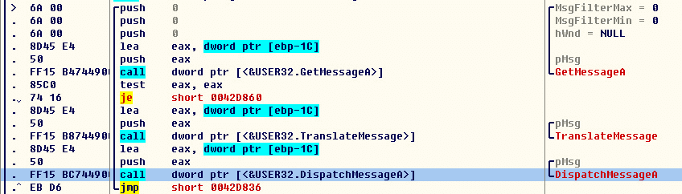
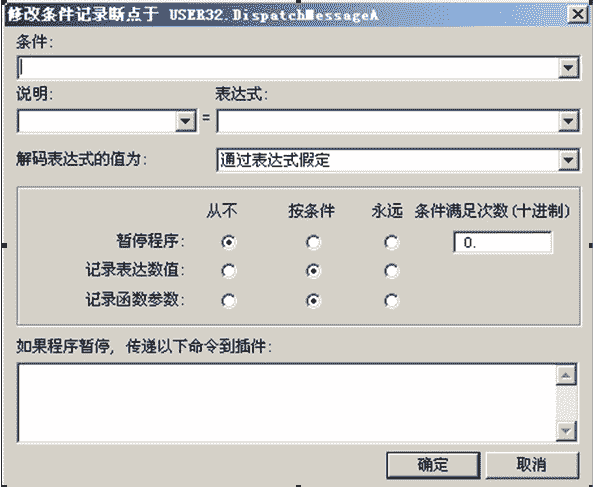
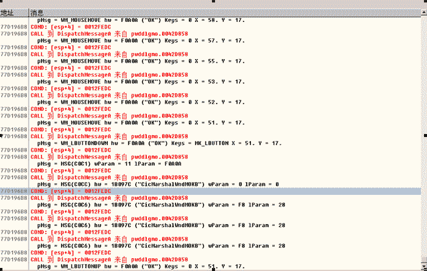
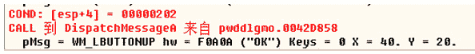
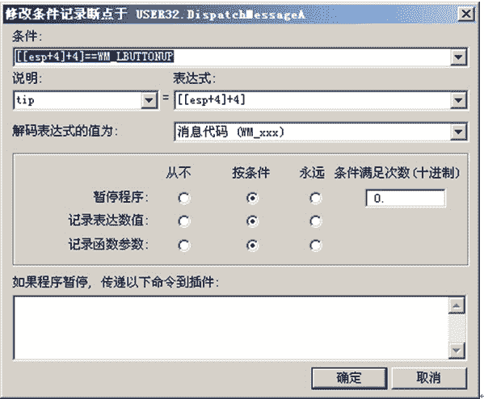
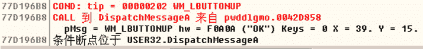
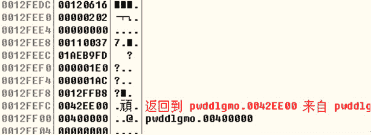

# 手工消息断点的一个小例子

> 原文：[`www.pediy.com/kssd/pediy11/110200.html`](https://www.pediy.com/kssd/pediy11/110200.html)

一直想对消息机制感兴趣

涉及

1. 消息过程
2. 消息记录断点
3. 在调试的过程中捕捉消息
4. 欺骗消息过程

用一个小对话框来看看

## 代码

```
#include "stdafx.h"

LRESULT CALLBACK  PwdWindow(HWND, UINT, WPARAM, LPARAM);

int APIENTRY _tWinMain(HINSTANCE hInstance, HINSTANCE hPrevInstance, LPTSTR lpCmdLine, int nCmdShow)
{
   MSG msg;
   WNDCLASSEX wcex;
   HWND hWnd = NULL;
   HWND hEdit = NULL;

   (void) memset( &wcex, 0x00, sizeof(WNDCLASSEX) );

   wcex.cbSize        = sizeof(WNDCLASSEX);

   wcex.style       = CS_HREDRAW | CS_VREDRAW;

   wcex.lpfnWndProc   = PwdWindow;

   wcex.hCursor     = LoadCursor(NULL, IDC_ARROW);

   wcex.hbrBackground = (HBRUSH)(COLOR_WINDOW+2);

   wcex.lpszClassName = "@PWDWIN@";
  RegisterClassEx(&wcex);

   hWnd = CreateWindow( "@PWDWIN@",
                       " Type the password ...",
                       WS_OVERLAPPED,
                       GetSystemMetrics(SM_CXSCREEN)/2-100,
                       GetSystemMetrics(SM_CYSCREEN)/2-75,
                       200, 150,
                       NULL, NULL, NULL, NULL);

   if (!hWnd)
      return 0;

   CreateWindow("BUTTON", "OK", WS_CHILD | WS_VISIBLE | BS_TEXT, 10, 80, 70, 30, hWnd, (HMENU)10123, NULL, NULL);

   CreateWindow("BUTTON", "Cancel", WS_CHILD | WS_VISIBLE | BS_TEXT, 110, 80, 70, 30, hWnd, (HMENU)10456, NULL, NULL);

   hEdit = CreateWindow("EDIT", NULL, WS_CHILD | WS_VISIBLE | WS_BORDER | ES_PASSWORD | ES_AUTOHSCROLL, 10, 20, 170, 25, hWnd, (HMENU)10789, NULL, NULL);

   ShowWindow(hWnd, SW_SHOW);

   UpdateWindow(hWnd);

   SetFocus(hEdit);

   while ( GetMessage(&msg, NULL, 0, 0) )
   {
    TranslateMessage(&msg);
    DispatchMessage(&msg);
   }
  if ( (int)msg.wParam == 0 )
      exit(0);

   DestroyWindow(hWnd);

   return 0;
}

LRESULT CALLBACK PwdWindow(HWND hWnd, UINT message, WPARAM wParam, LPARAM lParam)
{
  int wmId = -1;
   char pwd[32];
  switch (message)
  {
    case WM_COMMAND:
      {

      wmId = LOWORD(wParam);
         switch (wmId)
         {
            case 10123:
            {
               (void) memset( pwd, 0x00, sizeof(pwd) );
               GetWindowText( GetDlgItem(hWnd, 10789), pwd, 32 );
               if ( strcmp( pwd, "123456" ) )
               {
                  MessageBox( hWnd, "Sorry! Wrong password.", "Password", MB_ICONERROR );
                  }
               else
          ::MessageBoxA(hWnd, "Right password.", "Password",MB_OK);
            }

            break;
            case 10456:
               PostQuitMessage(0);
               break;
            default:
               break;
         }
      }
      break;
    default:
      return DefWindowProc(hWnd, message, wParam, lParam);
  }
  return 0;
}
```

`GetMessage` 取数据放入`&msg`

`TranslateMessage` 取`&msg` 进行一下处理

`DispatchMessage` 取`&msg` 发送给处理循环消息 `PwdWindow`

》》如图 1



`Msg` 结构为

```
tagMSG           struc ; (sizeof=0x1C)
00000000 hwnd             dd ?
00000004 message          dd ?
00000008 wParam           dd ?
0000000C lParam           dd ?
00000010 time             dd ?
00000014 pt              POINT ?
0000001C tagMSG           ends
```

我们实际操作验证一下

1）对 `DispatchMessageA` 下条件记录断点

如图 2

》》



`dispatchMessageA` log

》》`F9`



`log` 窗口观察生成很多记录

如下

```
Log data

地址        消息

77D196B8   COND:
77D196B8   CALL 到 DispatchMessageA 来自 pwddlgmo.0042D858
              pMsg = MSG(C0C1) wParam = 11 lParam = 1009EA
77D196B8   COND:
77D196B8   CALL 到 DispatchMessageA 来自 pwddlgmo.0042D858
              pMsg = MSG(C0CC) hw = 1B097C ("CicMarshalWndMOKB") wParam = 0 lParam = 0
77D196B8   COND:
77D196B8   CALL 到 DispatchMessageA 来自 pwddlgmo.0042D858
              pMsg = WM_MOUSEMOVE hw = 100AA8 (" Type the password ...") Keys = 0 X = 103. Y = 92.
77D196B8   COND:
77D196B8   CALL 到 DispatchMessageA 来自 pwddlgmo.0042D858
              pMsg = WM_PAINT hw = 100AA8 (" Type the password ...")
77D196B8   COND:
77D196B8   CALL 到 DispatchMessageA 来自 pwddlgmo.0042D858
              pMsg = WM_PAINT hw = F0A0A ("OK")
77D196B8   COND:
77D196B8   CALL 到 DispatchMessageA 来自 pwddlgmo.0042D858
              pMsg = WM_PAINT hw = F0A22 ("Cancel")
77D196B8   COND:
77D196B8   CALL 到 DispatchMessageA 来自 pwddlgmo.0042D858
              pMsg = MSG(C0C6) hw = 1B097C ("CicMarshalWndMOKB") wParam = F8 lParam = 28
77D196B8   COND:
77D196B8   CALL 到 DispatchMessageA 来自 pwddlgmo.0042D858
              pMsg = MSG(C0C6) hw = 1B097C ("CicMarshalWndMOKB") wParam = F8 lParam = 28
77D196B8   COND:
77D196B8   CALL 到 DispatchMessageA 来自 pwddlgmo.0042D858
              pMsg = MSG(C0C6) hw = 1B097C ("CicMarshalWndMOKB") wParam = F8 lParam = 28
77D196B8   COND:
77D196B8   CALL 到 DispatchMessageA 来自 pwddlgmo.0042D858
              pMsg = WM_MOUSEMOVE hw = 100AA8 (" Type the password ...") Keys = 0 X = 103. Y = 91.
77D196B8   COND:
77D196B8   CALL 到 DispatchMessageA 来自 pwddlgmo.0042D858
              pMsg = WM_PAINT hw = F0A94 (class="Edit")
77D196B8   COND:
77D196B8   CALL 到 DispatchMessageA 来自 pwddlgmo.0042D858
              pMsg = WM_TIMER hw = F0A60 ("M") ID = 1 Callback = 0
77D196B8   COND:
77D196B8   CALL 到 DispatchMessageA 来自 pwddlgmo.0042D858
              pMsg = WM_MOUSEMOVE hw = 100AA8 (" Type the password ...") Keys = 0 X = 102. Y = 91.
77D196B8   COND:
77D196B8   CALL 到 DispatchMessageA 来自 pwddlgmo.0042D858
              pMsg = WM_MOUSEMOVE hw = 100AA8 (" Type the password ...") Keys = 0 X = 98. Y = 90.
77D196B8   COND:
77D196B8   CALL 到 DispatchMessageA 来自 pwddlgmo.0042D858
              pMsg = WM_MOUSEMOVE hw = 100AA8 (" Type the password ...") Keys = 0 X = 87. Y = 91.
77D196B8   COND:
77D196B8   CALL 到 DispatchMessageA 来自 pwddlgmo.0042D858
              pMsg = WM_MOUSEMOVE hw = 100AA8 (" Type the password ...") Keys = 0 X = 83. Y = 91.
77D196B8   COND:
77D196B8   CALL 到 DispatchMessageA 来自 pwddlgmo.0042D858
              pMsg = WM_MOUSEMOVE hw = 100AA8 (" Type the password ...") Keys = 0 X = 82. Y = 91.
77D196B8   COND:
77D196B8   CALL 到 DispatchMessageA 来自 pwddlgmo.0042D858
              pMsg = WM_MOUSEMOVE hw = 100AA8 (" Type the password ...") Keys = 0 X = 81. Y = 91.
77D196B8   COND:
77D196B8   CALL 到 DispatchMessageA 来自 pwddlgmo.0042D858
              pMsg = WM_MOUSEMOVE hw = F0A0A ("OK") Keys = 0 X = 68. Y = 12.
77D196B8   COND:
77D196B8   CALL 到 DispatchMessageA 来自 pwddlgmo.0042D858
              pMsg = WM_MOUSEMOVE hw = F0A0A ("OK") Keys = 0 X = 66. Y = 12.
77D196B8   COND:
77D196B8   CALL 到 DispatchMessageA 来自 pwddlgmo.0042D858
              pMsg = WM_MOUSEMOVE hw = F0A0A ("OK") Keys = 0 X = 64. Y = 12.
77D196B8   COND:
77D196B8   CALL 到 DispatchMessageA 来自 pwddlgmo.0042D858
              pMsg = WM_MOUSEMOVE hw = F0A0A ("OK") Keys = 0 X = 63. Y = 12.
77D196B8   COND:
77D196B8   CALL 到 DispatchMessageA 来自 pwddlgmo.0042D858
              pMsg = WM_MOUSEMOVE hw = F0A0A ("OK") Keys = 0 X = 62. Y = 12.
77D196B8   COND:
77D196B8   CALL 到 DispatchMessageA 来自 pwddlgmo.0042D858
              pMsg = WM_MOUSEMOVE hw = F0A0A ("OK") Keys = 0 X = 61. Y = 12.
77D196B8   COND:
77D196B8   CALL 到 DispatchMessageA 来自 pwddlgmo.0042D858
              pMsg = WM_MOUSEMOVE hw = F0A0A ("OK") Keys = 0 X = 60. Y = 12.
77D196B8   COND:
77D196B8   CALL 到 DispatchMessageA 来自 pwddlgmo.0042D858
              pMsg = WM_MOUSEMOVE hw = F0A0A ("OK") Keys = 0 X = 61. Y = 12.
```


```
77D196B8   COND:  

77D196B8   CALL 到 DispatchMessageA 来自 pwddlgmo.0042D858  

            pMsg = WM_MOUSEMOVE hw = F0A0A ("OK") Keys = 0 X = 66. Y = 11.  

77D196B8   COND:  

77D196B8   CALL 到 DispatchMessageA 来自 pwddlgmo.0042D858  

            pMsg = WM_MOUSEMOVE hw = 100AA8 (" Type the password ...") Keys = 0 X = 80. Y = 91.  

77D196B8   COND:  

77D196B8   CALL 到 DispatchMessageA 来自 pwddlgmo.0042D858  

            pMsg = WM_MOUSEMOVE hw = 100AA8 (" Type the password ...") Keys = 0 X = 82. Y = 91.  

77D196B8   COND:  

77D196B8   CALL 到 DispatchMessageA 来自 pwddlgmo.0042D858  

            pMsg = WM_MOUSEMOVE hw = 100AA8 (" Type the password ...") Keys = 0 X = 87. Y = 91.  

77D196B8   COND:  

77D196B8   CALL 到 DispatchMessageA 来自 pwddlgmo.0042D858  

            pMsg = WM_MOUSEMOVE hw = 100AA8 (" Type the password ...") Keys = 0 X = 89. Y = 91.  

77D196B8   COND:  

77D196B8   CALL 到 DispatchMessageA 来自 pwddlgmo.0042D858  

            pMsg = WM_MOUSEMOVE hw = 100AA8 (" Type the password ...") Keys = 0 X = 95. Y = 92.  

77D196B8   COND:  

77D196B8   CALL 到 DispatchMessageA 来自 pwddlgmo.0042D858  

            pMsg = WM_MOUSEMOVE hw = 100AA8 (" Type the password ...") Keys = 0 X = 98. Y = 92.  

77D196B8   COND:  

77D196B8   CALL 到 DispatchMessageA 来自 pwddlgmo.0042D858  

            pMsg = WM_MOUSEMOVE hw = 100AA8 (" Type the password ...") Keys = 0 X = 100. Y = 92.  

77D196B8   COND:  

77D196B8   CALL 到 DispatchMessageA 来自 pwddlgmo.0042D858  

            pMsg = WM_MOUSEMOVE hw = 100AA8 (" Type the password ...") Keys = 0 X = 103. Y = 92.  

77D196B8   COND:  

77D196B8   CALL 到 DispatchMessageA 来自 pwddlgmo.0042D858  

            pMsg = WM_MOUSEMOVE hw = 100AA8 (" Type the password ...") Keys = 0 X = 105. Y = 92.  

77D196B8   COND:  

77D196B8   CALL 到 DispatchMessageA 来自 pwddlgmo.0042D858  

            pMsg = WM_MOUSEMOVE hw = 100AA8 (" Type the password ...") Keys = 0 X = 109. Y = 92.  

77D196B8   COND:  

77D196B8   CALL 到 DispatchMessageA 来自 pwddlgmo.0042D858  

            pMsg = WM_MOUSEMOVE hw = F0A22 ("Cancel") Keys = 0 X = 2. Y = 12.  

77D196B8   COND:  

77D196B8   CALL 到 DispatchMessageA 来自 pwddlgmo.0042D858  

            pMsg = WM_MOUSEMOVE hw = F0A22 ("Cancel") Keys = 0 X = 7. Y = 12.  

77D196B8   COND:  

77D196B8   CALL 到 DispatchMessageA 来自 pwddlgmo.0042D858  

            pMsg = WM_MOUSEMOVE hw = F0A22 ("Cancel") Keys = 0 X = 9. Y = 12.  

77D196B8   COND:  

77D196B8   CALL 到 DispatchMessageA 来自 pwddlgmo.0042D858  

            pMsg = WM_MOUSEMOVE hw = F0A22 ("Cancel") Keys = 0 X = 10. Y = 11.  

77D196B8   COND:  

77D196B8   CALL 到 DispatchMessageA 来自 pwddlgmo.0042D858  

            pMsg = WM_MOUSEMOVE hw = F0A22 ("Cancel") Keys = 0 X = 13. Y = 11.  

77D196B8   COND:  

77D196B8   CALL 到 DispatchMessageA 来自 pwddlgmo.0042D858  

            pMsg = WM_MOUSEMOVE hw = F0A22 ("Cancel") Keys = 0 X = 18. Y = 11.  

77D196B8   COND:  

77D196B8   CALL 到 DispatchMessageA 来自 pwddlgmo.0042D858  

            pMsg = WM_MOUSEMOVE hw = F0A22 ("Cancel") Keys = 0 X = 19. Y = 11.  

77D196B8   COND:  

77D196B8   CALL 到 DispatchMessageA 来自 pwddlgmo.0042D858  

            pMsg = WM_MOUSEMOVE hw = F0A22 ("Cancel") Keys = 0 X = 20. Y = 11.  

77D196B8   COND:  

77D196B8   CALL 到 DispatchMessageA 来自 pwddlgmo.0042D858  

            pMsg = WM_MOUSEMOVE hw = F0A22 ("Cancel") Keys = 0 X = 21. Y = 11.  

77D196B8   COND:  

77D196B8   CALL 到 DispatchMessageA 来自 pwddlgmo.0042D858  

            pMsg = WM_MOUSEMOVE hw = F0A22 ("Cancel") Keys = 0 X = 22. Y = 11.  

77D196B8   COND:  

77D196B8   CALL 到 DispatchMessageA 来自 pwddlgmo.0042D858  

            pMsg = WM_MOUSEMOVE hw = F0A22 ("Cancel") Keys = 0 X = 21. Y = 11.  

77D196B8   COND:  

77D196B8   CALL 到 DispatchMessageA 来自 pwddlgmo.0042D858  

            pMsg = WM_MOUSEMOVE hw = F0A22 ("Cancel") Keys = 0 X = 19. Y = 11.  

77D196B8   COND:  

77D196B8   CALL 到 DispatchMessageA 来自 pwddlgmo.0042D858  

            pMsg = WM_MOUSEMOVE hw = F0A22 ("Cancel") Keys = 0 X = 13. Y = 13.  

77D196B8   COND:  

77D196B8   CALL 到 DispatchMessageA 来自 pwddlgmo.0042D858  

            pMsg = WM_MOUSEMOVE hw = F0A22 ("Cancel") Keys = 0 X = 2. Y = 14.  

77D196B8   COND:  

77D196B8   CALL 到 DispatchMessageA 来自 pwddlgmo.0042D858  

            pMsg = WM_MOUSEMOVE hw = 100AA8 (" Type the password ...") Keys = 0 X = 103. Y = 94.  

77D196B8   COND:  

77D196B8   CALL 到 DispatchMessageA 来自 pwddlgmo.0042D858  

            pMsg = WM_MOUSEMOVE hw = 100AA8 (" Type the password ...") Keys = 0 X = 94. Y = 94.  

77D196B8   COND:  

77D196B8   CALL 到 DispatchMessageA 来自 pwddlgmo.0042D858  

            pMsg = WM_MOUSEMOVE hw = 100AA8 (" Type the password ...") Keys = 0 X = 88. Y = 94.  

77D196B8   COND:  

77D196B8   CALL 到 DispatchMessageA 来自 pwddlgmo.0042D858  

            pMsg = WM_MOUSEMOVE hw = 100AA8 (" Type the password ...") Keys = 0 X = 83. Y = 94.  

77D196B8   COND:  

77D196B8   CALL 到 DispatchMessageA 来自 pwddlgmo.0042D858  

            pMsg = WM_MOUSEMOVE hw = F0A0A ("OK") Keys = 0 X = 68. Y = 14.  

77D196B8   COND:  

77D196B8   CALL 到 DispatchMessageA 来自 pwddlgmo.0042D858  

            pMsg = WM_MOUSEMOVE hw = F0A0A ("OK") Keys = 0 X = 64. Y = 15.  

77D196B8   COND:  

77D196B8   CALL 到 DispatchMessageA 来自 pwddlgmo.0042D858  

            pMsg = WM_MOUSEMOVE hw = F0A0A ("OK") Keys = 0 X = 62. Y = 16.  

77D196B8   COND:  

77D196B8   CALL 到 DispatchMessageA 来自 pwddlgmo.0042D858  

            pMsg = WM_MOUSEMOVE hw = F0A0A ("OK") Keys = 0 X = 56. Y = 15.  

77D196B8   COND:  

77D196B8   CALL 到 DispatchMessageA 来自 pwddlgmo.0042D858  

            pMsg = WM_MOUSEMOVE hw = F0A0A ("OK") Keys = 0 X = 53. Y = 15.  

77D196B8   COND:  

77D196B8   CALL 到 DispatchMessageA 来自 pwddlgmo.0042D858  

            pMsg = WM_MOUSEMOVE hw = F0A0A ("OK") Keys = 0 X = 48. Y = 16.  

77D196B8   COND:  

77D196B8   CALL 到 DispatchMessageA 来自 pwddlgmo.0042D858  

            pMsg = WM_MOUSEMOVE hw = F0A0A ("OK") Keys = 0 X = 47. Y = 16.  

77D196B8   COND:  

77D196B8   CALL 到 DispatchMessageA 来自 pwddlgmo.0042D858  

            pMsg = WM_MOUSEMOVE hw = F0A0A ("OK") Keys = 0 X = 46. Y = 16.  

77D196B8   COND:  

77D196B8   CALL 到 DispatchMessageA 来自 pwddlgmo.0042D858  

            pMsg = WM_LBUTTONDOWN hw = F0A0A ("OK") Keys = MK_LBUTTON X = 46. Y = 16.  

77D196B8   COND:  

77D196B8   CALL 到 DispatchMessageA 来自 pwddlgmo.0042D858  

            pMsg = MSG(C0C1) wParam = 11 lParam = F0A0A  

77D196B8   COND:  

77D196B8   CALL 到 DispatchMessageA 来自 pwddlgmo.0042D858  

            pMsg = MSG(C0CC) hw = 1B097C ("CicMarshalWndMOKB") wParam = 0 lParam = 0  

77D196B8   COND:  

77D196B8   CALL 到 DispatchMessageA 来自 pwddlgmo.0042D858  

            pMsg = MSG(C0C6) hw = 1B097C ("CicMarshalWndMOKB") wParam = F8 lParam = 28  

77D196B8   COND:  

77D196B8   CALL 到 DispatchMessageA 来自 pwddlgmo.0042D858  

            pMsg = MSG(C0C6) hw = 1B097C ("CicMarshalWndMOKB") wParam = F8 lParam = 28  

77D196B8   COND:  

77D196B8   CALL 到 DispatchMessageA 来自 pwddlgmo.0042D858  

            pMsg = MSG(C0C6) hw = 1B097C ("CicMarshalWndMOKB") wParam = F8 lParam = 28  

77D196B8   COND:  

77D196B8   CALL 到 DispatchMessageA 来自 pwddlgmo.0042D858  

            pMsg = WM_LBUTTONUP hw = F0A0A ("OK") Keys = 0 X = 46. Y = 16.  

》》观察到  

77D196B8   CALL 到 DispatchMessageA 来自 pwddlgmo.0042D858  

            pMsg = MSG(C0C6) hw = 1B097C ("CicMarshalWndMOKB") wParam = F8  

77D196B8   CALL 到 DispatchMessageA 来自 pwddlgmo.0042D858  

            pMsg = WM_MOUSEMOVE hw = F0A0A ("OK") Keys = 0 X = 46. Y = 16.  

77D196B8   COND:  

77D196B8   CALL 到 DispatchMessageA 来自 pwddlgmo.0042D858  

            pMsg = WM_LBUTTONDOWN hw = F0A0A ("OK") Keys = MK_LBUTTON  

Log data, 条目 3  

 消息=  pMsg = WM_LBUTTONUP hw = F0A0A ("OK") Keys = 0 X = 51. Y = 17.  

0042D857  |.  50            |push eax               ; /pMsg  
```


# 断点设置与消息处理

## 1. 初始断点位置

`0042D858` 处调用 `DispatchMessageA`：

```
0042D858   |.   FF15 BC744900  call    dword ptr <&USER32.DispatchMessageA> \]  ; \DispatchMessageA
```

`[esp+4]` 指向 `tagMSG`，这是系统中接收到的消息。`[[esp+4]+4]` 的含义是 `message` 代码。

因此，将表达式改为 `[[esp+4]+4]` 再运行。

## 2. 观察日志输出

**Log 中**

见图 4



上图的 `00000202` 是不是很眼熟？

对了，就是 `WM_LBUTTONUP`。

## 3. 最终修改记录条件断点

见图 5



结果如下

见图 6



输入密码后按下 `ok` 键。

断点在 `user32` 领空。

## 4. 堆栈分析

断点处的反汇编代码：

```
77D196B8  >   8BFF            mov     edi, edi                    ; ntdll.7C92E920
77D196BA    55               push    ebp
77D196BB    8BEC            mov     ebp, esp
77D196BD    6A 01           push    1
77D196BF    FF75 08         push    dword ptr [ebp+8]
77D196C2    E8 2AF2FFFF     call    77D188F1
77D196C7    5D              pop     ebp
77D196C8    C2 0400         retn    4
```

堆栈内容为：

```
0012FE50   0042D85E  /CALL 到 DispatchMessageA 来自 pwddlgmo.0042D858
0012FE54   0012FEDC  \pMsg = WM_LBUTTONUP hw = 120616 ("OK") Keys = 0 X = 55. Y = 17.
```

可以看到 `DispatchMessageA` 发送了 `WM_LBUTTONUP`，句柄 `hw = 120616` ("OK")，即 `ok` 按钮。这个句柄值不固定，原因这里就不多说了。

## 5. 查看 msg 结构内存布局

有兴趣可以看看 `msg` 结构在内存中的情况。怎么看呢？

参考堆栈信息：
`0012FE54` 为 `0012FEDC`，即 `pMsg = WM_LBUTTONUP hw = 120616 ("OK")`。

`0012FEDC` 即 `msg` 结构在内存中的首地址。

执行命令：
`dd 0012FEDC`

见图 7



内存数据解读：

```
0012FEDC  00120616     .  --> hwnd===120616
0012FEE0  00000202    ..  --> message==202= WM_LBUTTONUP
0012FEE4  00000000  ....    --> wParam
0012FEE8  00110037  7.  .  --> lParam
0012FEEC  01AEB9FD  ?  --> time
0012FEF0  000001E0  ?..    --> POINT
```

## 6. 返回代码并定位消息处理函数

在 `Alt+m` 模式下，对 `00400000` 到 `00498000` 范围下 `F2` 断点，再按 `F9` 运行。

断点在 `42c2f2`。

执行跳转指令：
`Jmp 42d8f0`

`0042D8F0` 即消息处理函数的入口。后面详细分析不再赘述。

`0042D8F0` 处的反汇编代码：

```
0042D8F0  /> \55                    push    ebp                                         ; winmain
0042D8F1  |.   8BEC                 mov     ebp, esp
0042D8F3  |.   83EC 6C              sub     esp, 6C
0042D8F6  |.   A1 10304900          mov     eax, dword ptr [493010]
0042D8FB  |.   33C5                xor     eax, ebp
0042D8FD  |.   8945 FC              mov     dword ptr [ebp-4], eax
0042D900  |.   53                  push    ebx
0042D901  |.   56                  push    esi
0042D902  |.   57                  push    edi
0042D903  |.   C745 F8 FFFFFF     mov     dword ptr [ebp-8], -1
0042D90A  |.   8B45 0C             mov     eax, dword ptr [ebp+C]
0042D90D  |.   8945 94             mov     dword ptr [ebp-6C], eax
0042D910  |.   817D 94 11010000    cmp     dword ptr [ebp-6C], 111
0042D917  |.   74 05               je      short 0042D91E
0042D919  |.   E9 AE000000         jmp     0042D9CC
0042D91E  |> 8B45 10              mov     eax, dword ptr [ebp+10]
0042D921  |.   25 FFFF0000        and     eax, 0FFFF
0042D926  |.   0FB7C8             movzx   ecx, ax
0042D929  |.   894D F8             mov     dword ptr [ebp-8], ecx
0042D92C  |.   8B45 F8             mov     eax, dword ptr [ebp-8]
0042D92F  |.   8945 94             mov     dword ptr [ebp-6C], eax
0042D932  |.   817D 94 8B270000    cmp     dword ptr [ebp-6C], 278B
0042D939  |.   74 0E               je      short 0042D949
0042D93B  |.   817D 94 D8280000    cmp     dword ptr [ebp-6C], 28D8
0042D942  |.   74 7E               je      short 0042D9C2
0042D944  |.   E9 81000000         jmp     0042D9CA
0042D949  |> 6A 20                push    20
0042D94B  |.   6A 00                push    0
0042D94D  |.   8D45 D8             lea     eax, dword ptr [ebp-28]
0042D950  |.   50                  push    eax
0042D951  |.   E8 F5DBFFFF         call    0042B54B
0042D956  |.   83C4 0C             add     esp, 0C
0042D959  |.   6A 20                push    20                          ; /Count = 20 (32.)
0042D95B  |.   8D45 D8             lea     eax, dword ptr [ebp-28]     ; |
0042D95E  |.   50                  push    eax                         ; |Buffer
0042D95F  |.   68 252A0000        push    2A25                      ; |/ControlID = 2A25 (10789.)
0042D964  |.   8B4D 08             mov     ecx, dword ptr [ebp+8]        ; ||
0042D967  |.   51                  push    ecx                         ; ||hWnd
0042D968  |.   FF15 84744900      call    dword ptr [<&USER32.GetDlgItem>]          ; |\GetDlgItem
0042D96E  |.   50                  push    eax                         ; |hWnd
0042D96F  |.   FF15 88744900      call    dword ptr [<&USER32.GetWindowTextA>]       ; \GetWindowTextA
0042D975  |.   68 EC3D4800        push    00483DEC                    ;  ASCII "123456"
0042D97A  |.   8D45 D8             lea     eax, dword ptr [ebp-28]
0042D97D  |.   50                  push    eax
0042D97E  |.   E8 B7DDFFFF         call    0042B73A
0042D983  |.   83C4 08             add     esp, 8
0042D986  |.   85C0                test    eax, eax
0042D988  |.   74 20               je      short 0042D9AA
0042D98A  |.   6A 10                push    10                        ; /Style = MB_OK|MB_ICONHAND|MB_APPLMODAL
0042D98C  |.   68 E03D4800        push    00483DE0                    ; |Title = "Password"
0042D991  |.   68 C43D4800        push    00483DC4                    ; |Text = "Sorry! Wrong password."
0042D996  |.   8B45 08             mov     eax, dword ptr [ebp+8]        ; |
0042D999  |.   50                  push    eax                         ; |hOwner
0042D99A  |.   FF15 8C744900      call    dword ptr [<&USER32.MessageBoxA>]       ; \MessageBoxA
0042D9A0  |.   90                  nop
0042D9A1  |.   00FF                add     bh, bh
0042D9A3  |.   15 90744900        adc     eax, <&USER32.PostQuitMessage>
0042D9A8  |.   EB 16               jmp     short 0042D9C0
0042D9AA  |> 6A 00                push    0                         ; /Style = MB_OK|MB_APPLMODAL
0042D9AC  |.   68 E03D4800        push    00483DE0                    ; |Title = "Password"
0042D9B1  |.   68 B03D4800        push    00483DB0                    ; |Text = "Right password."
0042D9B6  |.   8B45 08             mov     eax, dword ptr [ebp+8]        ; |
0042D9B9  |.   50                  push    eax                         ; |hOwner
0042D9BA  |.   FF15 8C744900      call    dword ptr [<&USER32.MessageBoxA>]       ; \MessageBoxA
0042D9C0  |> EB 08               jmp     short 0042D9CA
0042D9C2  |> 6A 00                push    0                         ; /ExitCode = 0
0042D9C4  |.   FF15 90744900      call    dword ptr [<&USER32.PostQuitMessage>]     ; \PostQuitMessage
0042D9CA  |> EB 18               jmp     short 0042D9E4
0042D9CC  |> 8B45 14              mov     eax, dword ptr [ebp+14]
0042D9CF  |.   50                  push    eax                         ; /lParam
0042D9D0  |.   8B4D 10             mov     ecx, dword ptr [ebp+10]       ; |
0042D9D3  |.   51                  push    ecx                         ; |wParam
0042D9D4  |.   8B55 0C             mov     edx, dword ptr [ebp+C]        ; |
0042D9D7  |.   52                  push    edx                         ; |Message
0042D9D8  |.   8B45 08             mov     eax, dword ptr [ebp+8]        ; |
0042D9DB  |.   50                  push    eax                         ; |hWnd
0042D9DC  |.   FF15 94744900      call    dword ptr [<&USER32.DefWindowProcA>]     ; \DefWindowProcA
0042D9E2  |.   EB 02               jmp     short 0042D9E6
```


### 0042D9E4 汇编指令段

```
0042D9E4  |>  33C0         xor     eax, eax  
0042D9E6  |>  5F         pop     edi  
0042D9E7  |.  5E         pop     esi  
0042D9E8  |.  5B         pop     ebx  
0042D9E9  |.  8B4D FC    mov     ecx, dword ptr [ebp-4]  
0042D9EC  |.  33CD       xor     ecx, ebp  
0042D9EE  |.  E8 C5D7FFFF call    0042B1B8  
0042D9F3  |.  8BE5       mov     esp, ebp  
0042D9F5  |.  5D         pop     ebp  
0042D9F6  \.  C2 1000    retn    10  
```

### 文档与日志

`doc` 文档

`dispatchMessageA log2.doc`

---

### 欺骗消息过程

前面已经定位到 `msg` 的位置，只要我们在 `DispatchMessage` 前重写 `msg` 结构体，比如将 `code` 变为 `WM_CLOSE`，

### 调整

```
tagMSG          struc ; (sizeof=0x1C)
00000000 hwnd            dd ?                  ; offset
00000004 message         dd ?
00000008 wParam          dd ?
0000000C lParam          dd ?
00000010 time            dd ?
00000014 pt              POINT ?
0000001C tagMSG          ends
```

，就可以达到我们关闭的要求，消息过程收到欺骗。

或者对此溢出攻击。
