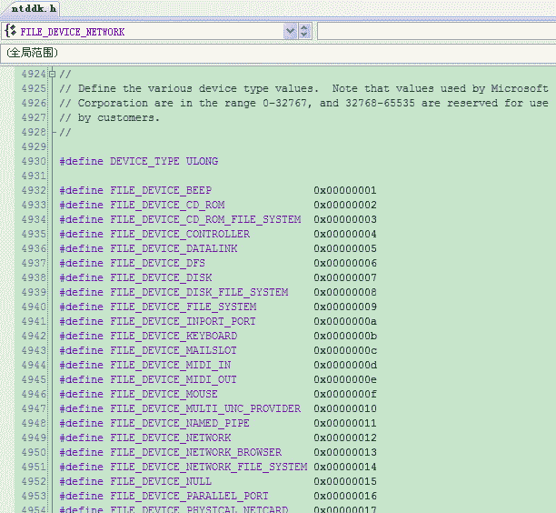

# IOCTL 解码程序

> 原文：[`www.pediy.com/kssd/pediy11/125640.html`](https://www.pediy.com/kssd/pediy11/125640.html)

大都数驱动逆向的人都会碰到 `IOCTL` 的 16 进制码，这时候需要将这 16 进制码解码成原生的 `IOCTL_CODE`，这里参照了 `OSROnline` 论坛上的在线 `DECODE`，写下了这个小工具，希望对大伙儿有帮助（也为自己留一份，嘿嘿）。``

代码:

```
//////////////////////////////////////////////////////////////////////////
// Decode.h
//////////////////////////////////////////////////////////////////////////
#pragma once

#include <windows.h>
#include <tchar.h>
#include "resource.h"

//
// Macro definition for defining IOCTL and FSCTL function control codes.  Note
// that function codes 0-2047 are reserved for Microsoft Corporation, and
// 2048-4095 are reserved for customers.
//
//#define CTL_CODE( DeviceType, Function, Method, Access ) (                  \
//   ((DeviceType) << 16) | ((Access) << 14) | ((Function) << 2) | (Method) \
//   )
//

// 设备类型字符串
LPCTSTR DeviceTypeString[54];

// 对话框回调函数
BOOL CALLBACK MainDlgProc(HWND hDlg, UINT uMsg, WPARAM wParam, LPARAM lParam);

// 对话框初始化
void OnInitDialog( HWND hDlg );

// CTL_CODE_VALUE 窗口处理过程
LRESULT CALLBACK CTL_CODE_EditProc( HWND hWnd, UINT uMsg, WPARAM wParam, LPARAM lParam);

void OnCommand( DWORD dwId, LPARAM lParam );

// 解码
bool Decode();

// 初始化设备类型集
void InitDeviceType();

// 清除 EDIT 存在的值
void ClearEditValue();
```

==========================华丽的分割线===================================

代码:


# Decode.cpp 源码分析

```c
//////////////////////////////////////////////////////////////////////////
// Decode.cpp
//////////////////////////////////////////////////////////////////////////
#include "Decode.h"
#include <strsafe.h>


WNDPROC    g_lpOldProcEdit = NULL;  // IOCTL_VALUE Edit
HWND    g_wndDlg = NULL;    // 对话框窗口句柄


// 对话框回调函数
BOOL CALLBACK MainDlgProc(HWND hDlg, UINT uMsg, WPARAM wParam, LPARAM lParam)
{
  switch ( uMsg )
  {
  case WM_COMMAND:
    OnCommand( LOWORD(wParam), lParam );
    break;

  case WM_CLOSE:
    EndDialog(hDlg, 0);
    break;

  case WM_INITDIALOG:
    OnInitDialog(hDlg);
    break;

  default:
    return FALSE;
  }

  return TRUE;
}


void OnCommand( DWORD dwCtrlId, LPARAM lParam )
{
  // Decode
  if ( dwCtrlId == IDOK )
  {
    ClearEditValue();
    Decode();
  }
}


// 清除 EDIT 存在的值
void ClearEditValue()
{
  SetDlgItemText( g_wndDlg, IDC_EDIT_ACCESS, _T("") );
  SetDlgItemText( g_wndDlg, IDC_EDIT_DEVICE, _T("") );
  SetDlgItemText( g_wndDlg, IDC_EDIT_FUNCTION, _T("") );
  SetDlgItemText( g_wndDlg, IDC_EDIT_METHOD, _T("") );
}


#define WARN_MSG(msg)  \
  MessageBox(g_wndDlg, msg, _T("Warning"), MB_OK | MB_ICONWARNING )

// 解码
bool Decode()
{
  TCHAR szText[MAX_PATH];
  int nLen = _countof(szText);
  GetDlgItemText( g_wndDlg, IDC_EDIT_IOCTLVALUE, szText, nLen - 1 );
  if (_tcslen(szText) <= 0)
  {
    WARN_MSG(_T("Enter IOCTL_VALUE."));
    return false;
  }

  unsigned long nIOCtlCode = _tcstoul( szText, NULL, 16 );

  int nDeviceType = (nIOCtlCode >> 16) & 0xFFF;
  int nDevsCount = _countof(DeviceTypeString);

  // 设备类型
  if ( nDeviceType <= nDevsCount && nDeviceType != 0 )
  {
    SetDlgItemText( g_wndDlg, IDC_EDIT_DEVICE, DeviceTypeString[nDeviceType - 1] );
  }
  else
  {
    StringCchPrintf( szText, nLen, _T("0x%X"), nDeviceType );
    SetDlgItemText( g_wndDlg, IDC_EDIT_DEVICE, szText );
  }

  // Function
  int nFuncVal = (nIOCtlCode >> 2) & 0xFFF;
  StringCchPrintf( szText, nLen, _T("0x%X"), nFuncVal );
  SetDlgItemText( g_wndDlg, IDC_EDIT_FUNCTION, szText );

  // access
  int nAccess = (nIOCtlCode >> 14) & 3;
  LPCTSTR lpszAccess = _T("");

  switch ( nAccess )
  {
  case 0:
    lpszAccess = _T("FILE_ANY_ACCESS");
    break;

  case 1:
    lpszAccess = _T("FILE_READ_ACCESS");
    break;

  case 2:
    lpszAccess = _T("FILE_WRITE_ACCESS");
    break;

  case 3:
    lpszAccess = _T("FILE_WRITE_ACCESS | FILE_READ_ACCESS");
    break;

  default:
    break;
  }
  SetDlgItemText( g_wndDlg, IDC_EDIT_ACCESS, lpszAccess );

  // method
  int nMethod = nIOCtlCode & 3;
  LPCTSTR lpszMethod = _T("");

  switch (nMethod)
  {
  case 0:
    lpszMethod = _T("METHOD_BUFFERED");
    break;

  case 1:
    lpszMethod = _T("METHOD_IN_DIRECT");
    break;

  case 2:
    lpszMethod = _T("METHOUD_OUT_DIRECT");
    break;

  case 3:
    lpszMethod = _T("METHOD_NEITHER");
    break;

  default:
    break;
  }

  SetDlgItemText( g_wndDlg, IDC_EDIT_METHOD, lpszMethod );
  return true;
}


// CTLCODE_VALUE 窗口处理过程
LRESULT CALLBACK CTLCODE_EditProc( HWND hWnd, UINT uMsg, WPARAM wParam, LPARAM lParam)
{
  if ( uMsg == WM_CHAR )
  {
    if ( wParam == VK_BACK || wParam == VK_DELETE )
      return CallWindowProc( g_lpOldProcEdit, hWnd, uMsg, wParam, lParam );

    // 是否是进制
    if ( !_istxdigit(wParam) )
    {
      return FALSE;
    }
  }

  return CallWindowProc( g_lpOldProcEdit, hWnd, uMsg, wParam, lParam );
}


// 对话框初始化
void OnInitDialog( HWND hDlg )
{
  g_wndDlg = hDlg;
  SendDlgItemMessage(hDlg, IDC_EDIT_IOCTLVALUE, EM_LIMITTEXT, 8, 0);
  HWND hCodeEdit = GetDlgItem(hDlg, IDC_EDIT_IOCTLVALUE);

  // 更改回调函数
  g_lpOldProcEdit = (WNDPROC)SetWindowLong(hCodeEdit, GWL_WNDPROC, (LONG)CTLCODE_EditProc);
  HICON hIcon = LoadIcon( NULL, MAKEINTRESOURCE(IDI_DECODE) );
  ::SendMessage(g_wndDlg, WM_SETICON, TRUE, (LPARAM)hIcon);
  ::SendMessage(g_wndDlg, WM_SETICON, FALSE, (LPARAM)hIcon);
}


void InitDeviceType()
{
  DeviceTypeString[0]=_T("BEEP");
  DeviceTypeString[1]=_T("CD_ROM");
  DeviceTypeString[2]=_T("CD_ROM_FILE_SYSTEM");
  DeviceTypeString[3]=_T("CONTROLLER");
  DeviceTypeString[4]=_T("DATALINK");
  DeviceTypeString[5]=_T("DFS");
  DeviceTypeString[6]=_T("DISK");
  DeviceTypeString[7]=_T("DISK_FILE_SYSTEM");
  DeviceTypeString[8]=_T("FILE_SYSTEM");
  DeviceTypeString[9]=_T("INPORT_PORT");
  DeviceTypeString[10]=_T("KEYBOARD");
  DeviceTypeString[11]=_T("MAILSLOT");
  DeviceTypeString[12]=_T("MIDI_IN");
  DeviceTypeString[13]=_T("MIDI_OUT");
  DeviceTypeString[14]=_T("MOUSE");
  DeviceTypeString[15]=_T("MULTI_UNC_PROVIDER");
  DeviceTypeString[16]=_T("NAMED_PIPE");
  DeviceTypeString[17]=_T("NETWORK");
  DeviceTypeString[18]=_T("NETWORK_BROWSER");
  DeviceTypeString[19]=_T("NETWORK_FILE_SYSTEM");
  DeviceTypeString[20]=_T("NULL");
  DeviceTypeString[21]=_T("PARALLEL_PORT");
  DeviceTypeString[22]=_T("PHYSICAL_NETCARD");
  DeviceTypeString[23]=_T("PRINTER");
  DeviceTypeString[24]=_T("SCANNER");
  DeviceTypeString[25]=_T("SERIAL_MOUSE_PORT");
  DeviceTypeString[26]=_T("SERIAL_PORT");
  DeviceTypeString[27]=_T("SCREEN");
  DeviceTypeString[28]=_T("SOUND");
  DeviceTypeString[29]=_T("STREAMS");
  DeviceTypeString[30]=_T("TAPE");
  DeviceTypeString[31]=_T("TAPE_FILE_SYSTEM");
  DeviceTypeString[32]=_T("TRANSPORT");
  DeviceTypeString[33]=_T("UNKNOWN");
  DeviceTypeString[34]=_T("VIDEO");
  DeviceTypeString[35]=_T("VIRTUAL_DISK");
  DeviceTypeString[36]=_T("WAVE_IN");
  DeviceTypeString[37]=_T("WAVE_OUT");
  DeviceTypeString[38]=_T("8042_PORT");
  DeviceTypeString[39]=_T("NETWORK_REDIRECTOR");
  DeviceTypeString[40]=_T("BATTERY");
  DeviceTypeString[41]=_T("BUS_EXTENDER");
  DeviceTypeString[42]=_T("MODEM");
  DeviceTypeString[43]=_T("VDM");
  DeviceTypeString[44]=_T("MASS_STORAGE");
  DeviceTypeString[45]=_T("SMB");
  DeviceTypeString[46]=_T("KS");
  DeviceTypeString[47]=_T("CHANGER");
  DeviceTypeString[48]=_T("SMARTCARD");
  DeviceTypeString[49]=_T("ACPI");
  DeviceTypeString[50]=_T("DVD");
  DeviceTypeString[51]=_T("FULLSCREEN_VIDEO");
  DeviceTypeString[52]=_T("DFS_FILE_SYSTEM");
  DeviceTypeString[53]=_T("DFS_VOLUME");
}


int WINAPI _tWinMain(HINSTANCE hInstance, HINSTANCE hPrevInstance, 
          LPTSTR lpCmdLine, int nCmdShow)
{
  InitDeviceType();
  return DialogBoxParam(hInstance, MAKEINTRESOURCE(IDD_DECODE_DLG), 
    NULL, (DLGPROC)MainDlgProc, NULL);
}
```

## 附件

|  || `IOCTL_DECODE.rar` |

引用: 最初由 `陈老师` 发布 

`void InitDeviceType()` 里头的数组是怎么来的

不太明白

参考 `WDK` 的文档和 `NTDDK.h` 中的定义


