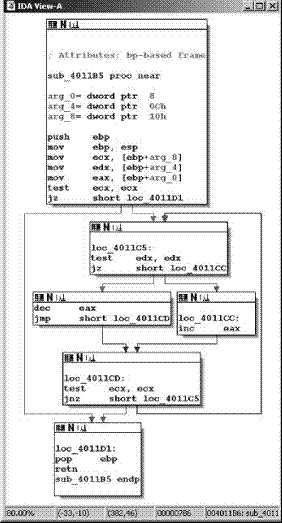
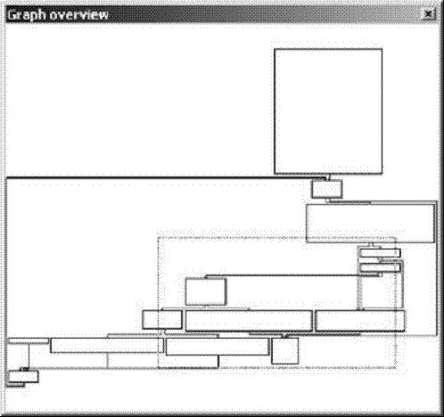
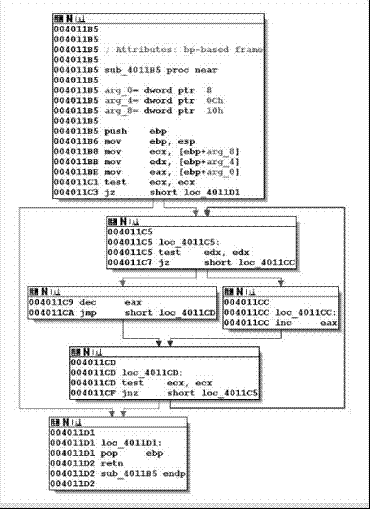
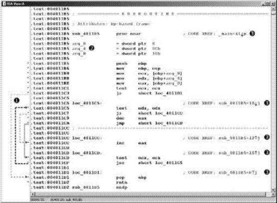
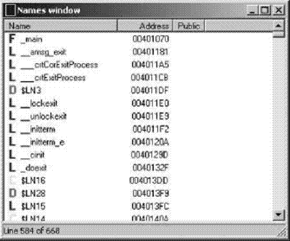
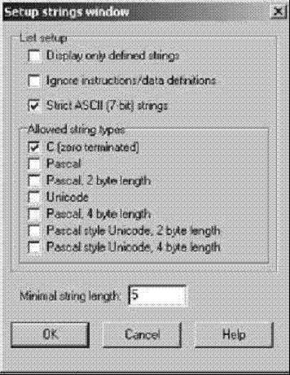
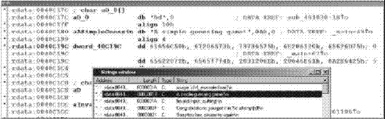
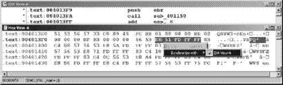
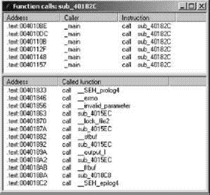

# 【翻译】The IDA Pro book 第五章 --- IDA DATA DISPLAY

> 原文：[`www.pediy.com/kssd/pediy10/74838.html`](https://www.pediy.com/kssd/pediy10/74838.html)

在此之前先表示对 `Aleaxander` 校正的感谢.另:(1)PDF 和贴子不是同一版本.(2)两者都还有不少错误.见谅.

## IDA 数据视图(IDA Data Display)

通过之前的学习,相信现在的你应该能够非常自如地使用 `IDA` 了,并且能够边喝最喜欢的饮料,边让 `IDA` 自动工作了.`IDA` 的初始化分析完成后,就是你开始动手的时候了.一个最好的熟悉 `IDA` 视图的方法就是浏览各个由 `IDA` 提供二进制文件数据的窗口．随着你对 `IDA` 喜爱程度的加深，你的效率和效能将会得到很大的提高．

在详细的探讨 `IDA` 的各个主要子窗口之前，让我们先来看一下 `IDA` 用户界面的一些基本的规则：

- 没有 `Undo`(撤消）
  如果您不小心按错了键，而意外修改了你的数据(`database`)，你只能够自己改回来．

- 大部分动作都有相应目录项，快捷键和工具栏按钮.
  值得注意的是,`IDA` 的工具栏和目录项里边的动作(`actions`)都是可以配置快捷键的.

- `IDA` 拥有非常好的，内容相关的右键目录菜单.
  尽管这些目录不能提供特定位置所有的允许操作的动作，但是她已经可以提供一些常用的动作选项了.

知道了这些基本规则，我们就可以开始探讨 `IDA` 的主体数据视图了．

## IDA 主体视图(The Principal IDA Displays)

在初始化与分析新的二进制文件时，`IDA`(如 `5.2` 版)默认地会显示 `8` 个窗口.每一个窗口都可以通过点击浏览条下边的标题标签显示出来(见图 `4-10`).`IDA-View` 窗口,`Names` 窗口,`message-out` 窗口三个窗口会即时显示出来.`IDA` 的老手可能已经习惯了 `Strings` 窗口默认显示;但是在 `5.2` 版里,`Strings` 窗口已经不再默认显示了.不管这些窗口是不是默认打开的,所有本章讨论的窗口都可以通过 `ViewOpen Subviews` 目录来的打开.牢记这句话,因为你极有可能不小心把这些窗口关了.

`ESC` 键一直都是所有 `IDA` 版本当中最有用的快捷键之一.当 `disassembly` 窗口激活时,`ESC` 键的作用正如网页浏览器当中的后退键一样,因而在浏览汇编代码的时候其作用特别大(浏览(`navigation`)将会在第六章进行讨论).然而,当有其他窗口打开时,`ESC` 键是用来关闭这些窗口的.有时候你可能也期望关闭这些窗口.不过更多的时候,你可能并不需要关闭这些窗口.

### 反汇编窗口(The Disassembly Window)

也称为 `IDA-View` 窗口,这个反汇编窗口将会成为您处理和分析二进制文件的主要平台.因此,快速熟悉这个窗口的内容就变得非常重要了.

反汇编窗口存在两种视图模式(`Display`):基于文本列表的文本模式和于 `5.0` 版当中提出的基于图形的图形模式.大部分的 `IDA` 用户会更偏爱其中的一种模式,而什么模式更能满足的您的需求往往取决于您想如何显示整个程序的工作流程.初次使用时,默认的视图模式为图形模式.你可以打开 `OptionsGeneral` 对话框,在 `Graph` 标签栏下勾掉 `Open graph view by default` 来改变默认的视图模式.在反汇编窗口激活的任何时间,你都可以通过点击空格键来切换这两种视图模式.

#### IDA 图形模式(IDA Graph View)

图 `5-1` 显示了一个简单函数的图形模式.图形模式有点像经典的流程图,将一个函数分为很多基本块\[1\],然后通过各个块之间的联系来形象地显示整个函数的流程.



*图 5-1：IDA 图形视图(IDA Graphic View)*

______

1.\[基本块\]是从开始到结束都没有分支的最大的程序指令块.因此每一个基本块都有一个入口点(块的第一个指令),一个出口点(块的最后一个指令).块的第一个指令一般是分支指令的目的地,相反地,块的最后一个指令一般是分支指令本身.

`IDA` 使用不同颜色的箭头来表示函数基本块之间不同的流程\[2\]类型.以一个条件跳转指令结束的基本块根据测试条件的不同会产生两种不同的控制流:`Yes Edge` 箭头(这个分支将会运行)默认是绿色显示而 `No Edge` 箭头(这个分支将不会运行)默认是红色显示.只一个后续基本块的基本块使用 `Normal Edge`(默认蓝色)箭头来指向下一个的基本块.

在图形模式下,`IDA` 一次只显示一个函数.鼠标有滑轮的用户可以使用 `Ctrl+滑轮` 来缩放图形.您也可以使用键盘上的 `Ctrl+` 来放大图形或者使用 `Ctrl-` 来缩小图形(要使用小键盘上边的`+`-键).大型或者复杂的函数可能会使得整个图形变得非常复杂,从而加大了浏览图形的难度.这个时候,整体图形(`Graph Overview`)窗口(图 `5-2`)能够提供一些简明扼要的信息.这个窗口将一直显示整个图形的块结构,并用虚线框来表示现在所处的反汇编窗口的位置.你也可以拖到这个虚线框到任意位置,来快速定位到目的位置.



*图 5-2:整体图形窗口(Graphic Overview Window)*

在图形模式中,有几种方法来改变图形显示的方式以满足你的要求:

**拖动(Panning)**

首先,除了使用整体图形窗口来快速定位图形,你也可以拖动图形模式下背景来完成定位.

______

2.`IDA` 使用\[流程(`flow`)\]这个词来表示一个特定指令是如何继续其执行的.正常(`Normal` 或者 `Ordinary`)流程表明执行默认的后续的指令.跳转流程表明指令跳转(或者可能跳转)到一个非连续的位置.调用流程表明指令将会调用一个子程式.

嗯,是不是缺少一些东西呢?

当使用图形模式的时候,您可能会发觉每一行反汇编语句的信息变少了.`IDA` 会隐藏每一行反汇编语句的一些信息(如虚拟地址信息),来减少显示每一个基本块的所使用的空间.当然,你也是可以查看每行反汇编语句的完整信息,此时您可以通过选择 `OptionsGeneral` 对话框 `Disassembly` 标签栏中的 `Display disassembly line parts` 区块当中的信息来决定显示哪些信息.例如为了显示虚拟地址,我们勾选了 `line prefixes` 这个选项.这样图 `5-1` 就会变成图 `5-3` 的样子了.



*图 5-3:拥有行前缀的图形视图(Graphic view with line prefixes enable)*

**重置块(Rearranging blocks)**

图形当中的每一个基本块都可能通过点击其标题栏来拖动到新的位置.值得注意的是 `IDA` 只会做为该基本块上的指向线做最小化的重置.

**分组块与隐藏块(Grouping and collapsing blocks)**

最后,不管只是一个块还是多个块一起,块都是可以分组的.而且,块也可以隐藏起来来降低图形的复杂度.隐藏块是一个很好的处理已分析块的方法.你可右键点击块的标题栏然后选择 `Grouping Nodes` 来隐藏任意块.

**创建多个反汇编窗口(Creating additional disassembly windows)**

如果要同时显示两个函数的图形,您只需通过 `ViewsOpen SubviewsDisassembly` 来打开其他额外窗口.第一个窗口标题为 `IDA View-A`,接下来的窗口标题为 `IDA View-B`,`IDA View-C`,以次类推.每个窗口都是独立的,因此你可以在一个窗口当中使用文字模式,在另一个窗口当中使用图形模式或者在三个窗口都使用图形模式.

须得注意你能够控制的图形显示的参数要远超出这里所列举的例子.其他 `IDA` 的图形选项将会在第九章讨论.更多的图形显示信息可参考 `IDA` 的帮助文档.

#### IDA 文字模式(IDA Text View)

文字模式是显示和操纵 `IDA` 生成的反汇编代码的传统显示模式(她也是 `5.0` 版本之前的和控制台版本唯一的显示模式).文字模式显示出了整个程序的反汇编代码(不同于图形模式的只有一个函数),是唯一的可以显示二进制文件的数据的方法.所有图形模式的信息在文字模式都会以这样或者那样的形式显示出来.

图 `5-4` 显示了图 `5-1` 和图 `5-3` 所表示的同一个函数的文字模式视图.反汇编代码遵循线性规则,并且默认会显示虚拟地.虚拟地址一般显示成`[SECTION NAME]:[VIRTUAL ADDRESS]`的结构,如`.text:0040110C0`.



*图 5-4:IDA 文本模式视图(The IDA Text View)*

左边标记为 `1` 的部分,被称为箭头窗口(`arrows windows`),用来显示函数的非线性流程.实线用来表示无条件跳转,而虚线用来表示条件跳转.当跳转(条件或者无条件)到程序之前的位置时,使用加粗线(无论虚线或实线)来表示.这种往回的跳转往往表明了循环的存在.图 `5-4` 当中,一个循环的箭头从地址 `004011CF` 指向 `004011C5`.

标记为 `2` 处的定义代表了 `IDA` 对该函数的堆栈帧结构\[3\]进行的最佳的推测.`IDA` 对堆栈指针以及函数使用的堆栈帧指针进行详尽的分析用以来计算该函数使用的堆栈帧结构.堆栈视图将会在第六章进行讨论.

标记为 `3` 处的注释(分号表明注释)是交叉引用(`cross-reference`).在这个例子当中,我们可以看到代码的交叉引用(与数据的交叉引用相反),其表明了存在其他位置的代码引用了此处包括交叉引用注解的代码.我们将在第九章讨论交叉引用.

本书接下来的部分将主要采用文本模式来作演示.只有在图形模式显示时有明显的优势时,我们才使用图形模式.在第七章,我们将学习到一些文本模式中特殊的处理方法,以便处理和注释反汇编代码.

______

3.一个\[堆栈帧(`stack frame` 或者 `activation record`)\]是在程序实时堆栈(`runtime stack`)当中分配的一块内存,包含了传入的函数参数以及在函数中定义的局部变量.堆栈帧在进入函数的时候分配,在函数退出的时候释放.堆栈帧将在第六章进行详细的解说.

### 名称窗口(The Names Windows)

名称窗口(如图 `5-5` 所示),显示了二进制文件的所有全局名称.所谓名称即虚拟空间当中的字符.`IDA` 通过在初始化载入文件过程当中查找符号表以及使用签名分析来获得名称.名称可以根据字母排序也可根据虚拟地址排序(升序或者降序均可).在名称窗口中,你能够通过名称快速定位到相应的位置.双击名称窗口当中的项即会转到反汇编窗口的相应位置.



*图 5-5:名字窗口(The Names Window)*

名称窗口当中显示的名称都会着色以及附加字母.着色以及附加字母的规则总结如下:

- `F`  常规函数.这是指 `IDA` 不能识别为库函数的函数.
- `L`  库函数.`IDA` 使用签名对比的方法来识别库函数.如果一个函数没有相应的库函数签名,`IDA` 即认为她是常规函数.
- `I`  一个输入名称,大都是从共享库文件当中输入的函数名称.她和库函数的区别在于她在程序当中没有相应的代码,而库函数代码要包括于程序代码当中.
- `C`  命名代码(`named code`)是一种存在于程序当中的代码.但 `IDA` 认为其不是任何函数的组成部分.这可能是 `IDA` 在符号表当中发现的一个名称,但是 `IDA` 没有找到任何对这个位置的调用.
- `D`  命名数据(`named data`)一般表示全局变量的位置.
- `A`  `ASCII` 字符串数据.这是指一个包含 `4` 个字符或者更多的以 `null` 结束的字符串位置.

当中浏览反汇编代码的时候,你可能会发现有一些名称并没有在名称窗口当中显示出来.在反汇编程序的时候,`IDA` 会为所有被直接引用的代码(一个分支或者调用目标)或者数据(读,写或使用地址)自动生成相应的名称.如果一个名称的位置已经在符号表当中定义,`IDA` 从相应的符号表当中提取该名称,否则 `IDA` 自动生成一个名称.在生成一个位置的名称的时,`IDA` 使用这个位置的虚拟地址与一个前缀相组合来表明这个名称所代表的位置类型.之所以使用虚拟地址是要确保所有生成的名称都是唯一的,而没有两个不同位置使用相同的虚拟地址.自动生成的名字不会出现在名字窗口当中.自动生成的名字的前缀如下:

- `sub_xxxxxx`    位于 `xxxxxx` 的子函数.
- `loc_xxxxxx`    位于 `xxxxxx` 的指令
- `byte_xxxxx`    位于 `xxxxxx` 的 `8` 位数据
- `word_xxxxxx`    位于 `xxxxxx` 的 `16` 位数据
- `dword_xxxxxx`    位于 `xxxxxx` 的 `32` 位数据
- `unk_xxxxx`    位于 `xxxxxx` 的大小不知的数据

贯穿全书都将介绍 `IDA` 为程序数据选择名称的方法.

### 消息窗口(The Message Windows)

打开文件时,消息窗口与其他窗口一同组成整个 `IDA` 的窗口.消息窗口作为 `IDA` 的输出终端,是用来查看 `IDA` 任务信息的地方.例如,当一个二进制文件打开时,该窗口会显示消息来表明 `IDA` 在何时处于何种阶段以及采用了何种动作来生成相应的数据文件.就像数据库的操作一样,消息窗口用来显示你进行的各种操作的结果.你可以通过选择右键菜单当中的选项来复制消息到系统的剪切板或者清空整个消息窗口.而且消息窗口往往也是你自己编写的脚本或者插件显示输出的地方,

### 字符串窗口(The Strings Windows)

字符串窗口就是 `IDA` 内建的 `Strings` 工具.在 `IDA5.1` 以及之前的版本当中,字符串窗口默认情况下是打开的;`IDA5.2` 不然,但你 sk c 通过 `ViewOpen SubviewsStrings` 来打开她.

字符串窗口显示从二进制文件当中提取的字符串及其虚拟地址.与名称窗口相似,双击字符串窗口当中的项会转到反汇编窗口中字符串的相应位置.与交叉引用一同使用时，字符串窗口能够快速找到特定字符串以及引用该字符串的代码.例如您有可能在一个程序当中看到了字符串 `SOFTWARE\Microsoft\Windows\Current Version\Run`,但是不知道该程序为什么要使用该注册表键.在之后的章节当中,我们将会看到找到引用该字符串的代码的位置只需点击 `4` 次鼠标.

理解字符串窗口操作原理能够提高您的使用 `IDA` 的效率.`IDA` 并不会存储二进制文件当中的字符串.因此每一次打开字符串窗口时,`IDA` 都会扫描或者重新扫描文件以得到字符串.你也可以在字符串窗口当中配置字符串扫描的参数.在字符串窗口中,右键点击选择 `Setup` 来配置相应的参数.如图 `5-6` 所示,字符串设置(`Setup Strings`)窗口被用来设置 `IDA` 扫描的字符串类型.`IDA` 默认扫描的字符串类型是 `C` 格式以 cull 结束,`7` 位,至少 `5` 个字符的 `ASCII` 字符串.



*图 5-6:字符串设置窗口(The Setup Strings Window)*

如果想要扫描非 `C` 格式的字符串,你就得重新配字符串设置窗口来选择相应的字符串类型.例如,`Windows` 程序常常使用 `Unicode` 字符串,而 `Borland Dephi` 编绎的文件往往使用 `Pascal` 风格的双字节字符字符串.每一次你点击字符串设置窗口当中的 `OK` 按钮后,`IDA` 都将重新扫描整个二进制文件以响应最新的设置要求.这其中有两项须要特别注意:

- `Display only defined strings`
  这个选项限定字符串窗口只可以显示由 `IDA` 自动生成的或者由用户定义的命名字符串(`named strings`)数据.选择这一项之后其他都会被禁止,此时 `IDA` 将不再扫描并显示其他字符串.

- `Ignore instructions/data definitions`
  这个选项允许 `IDA` 扫描位于代码及已存数据当中的字符串.使用这个选项使得 `IDA` 能够:(1)查找被错误的转化为代码的,位于代码段的字符串.(2)查找位于数据段的被格式化为其他数据类型的字符串(如字节数组或者整数).这个选项会产生不少的垃圾字符串,即那些刚好是由５个或者更多的 `ASCII` 字符组成的无论有无意义的字符串．这个选项的作用正如使用带`-a` 开关的 `strings` 命令.



*图 5-7:找不到字符串数据的例子*

图 `5-7` 表明了：如果字符串扫描设置不合理，`IDA` 就不一定能够显示二进制文件当中所有的字符串.这个例子当中就没有选择 `Ignore instructions/data definitions`.


导致了位于`.rdata:0040C19C`(`"Please guess  a number between 1 and %d."`)的字符串没有被检测到.查看字符串的时候,须得确保你能找到特定字符串所在的所有位置.

## IDA 次要视图(IDA Secondary Displays)

除了反汇编,名称,消息和字符串窗口(旧版本)之外,IDA 会打开一些最小化其他窗口．用来快速访问这些窗口的标签位于浏览条的下方（图 4-10 的 3).这些窗口提供一些查看数据库文件(`database`)的选择性的或者特别的视角.这些窗口的功能取决于你所分析的文件的性质以及你使用 IDA 的技术.这里边一些窗口的内容将会在接下来的章节当中进行进一步的描述.

### 十六进制视图窗口(The Hex View Window)

十六进制视图窗口提供程序标准的十六进制列表,每一行 16 个字节,同时在右边的窗口显示相应的 ASCII 代码.就像反汇编窗口一样,你可以同时打开多个十六进制视图窗口.第一个窗口标题为`Hex View-A`,第二个为`Hex View-B`,再下一个为`Hex View-C`,以此类推.默认情况下,第一个十六进制视图窗口与第一个反汇编窗口同步.当反汇编窗口与十六进制视图窗口同步时,在一个窗口当中移动光标,另一个窗口当中的光标也会移到相应的位置(一样的虚拟地址).另外, 在反汇编窗口当中的选择的数据,在十六进制视图窗口相应的字节也会高亮显示.

如图 5-8 所示的为十六进制的上下文菜单.你可以在十六进制视图窗口右键单击弹出该菜单.这个菜单允许您选择与该窗口同步的反汇编窗口.勾去` synchronization`选项使得这个十六进制视图独立存在而不受反汇编窗口的影响.



*图 5-8:十六进制窗口与反汇编窗口的同步.*

如前所述,十六进制窗口提供了二进制文件的内容的标准十六进制视图.有时候你会发现十六进制窗口显示为一个问号而非具体的数值.这就表明了 IDA 不知道这些特定的虚拟地址范围相应的数值.一个包括`bbs4`段的程序就有可能出现这种情况,该段在文件当中不占空间,但是在装载器装载该文件的过程当中,该段会被扩展用来满足程序的静态存储要求.

______

4. 一个`bbs`段被编译器用来存储所有没有初始化的静态变量的值.因为这些变量都没赋值,就不必要在程序文件当中为其预留空间,而只须在程序头指定其大小.程序运行时,载入器为这个段分配相应的内存并初始化整个内存块为 0.

### 输出窗口(The Exports Window)

输出窗口列出该文件的入口点.包括在文件头当中指定的程序入口点,以及程序输出的被其他程序使用的函数或者变量的入口点.输出函数往往存在于共享库文件,如 windows 自带的 DLL 文件.列出的输出项包括其名称,虚拟地址,以及如果可选的序列号(`Ordinal Number`5).对可执行文件来讲,输出窗口至少存在一个输出项:即这个程序的入口点.IDA 称该入口点为`start`.一个典型的输出窗口项如下:

`--------------------------------------------`
LoadLibraryA    7C801D77  578
`---------------------------------------------`

同样和其他很多的 IDA 窗口一样,双击该窗口中的项可以跳转到反汇编窗口当中的相应位置.输出窗口提供了一些命令行工具的功能,如`objdump(-T)`,`readelf(-s)`,和`dumpbin(/EXPORTS)`.

### 输入窗口(The Imports Window)

输入窗口和输出窗口相对应.它列出所有文件引入的函数.一般情况下,只有当一个程序使用共享库文件的时候,输入窗口才有意义.静态链接的二进制文件并没有依赖于外在的文件,因此没有任何相应的输入项.输入窗口的每一项都列出了名称(变量或者函数)以及包含这项的库文件名称.因为输入函数的代码存在于其他共享库文件当中,每一个项的地址都指向于输入表 6 相应项.如下是一个输入表项的例子:

`-------------------------------------`
0040E108 GetModuleHandleA KERNEL32
`-------------------------------------`

双击这个项将会使 IDA 跳转到反汇编窗口的`0040E108`的位置.十六进制视图中与该内存位置对应的值为`????????`.因为 IDA 是一个静态分析工具,它并不知道程序运行的时候该位置会填入什么值.输入窗口提供了一些命令行工具的功能,如`objdump(-T)`,`readelf(-s)`和`dumpbin(/EXPORTS)`.

值得注意的是输入窗口只会显示那些二进制文件定义的由加载器载入地址的函数.由二进制文件自己使用如`dlopen/dlsym`或者`LoadLibrary/GetProcessAddress`之类函数导入的项将不会显示在这个窗口当中.

______

5. `输出序列号`可能被使用在共享库文件当中,使得程序可以通过序列号而不一定要名称来访问该库文件的函数.使用输出序列号能够加快寻找输入函数地址的过程同时还能隐藏导入函数的名称.Windows 自带的 DLL 文件当中存输出序列号.

在相应的共享库文件已经被加载以及这些函数地址已知的情况下,输入表提供了载入器存储导入函数地址的空间.一个输入表项存储一个输入函数的地址.

### 函数窗口(The Functions Window)

函数窗口显示数据库文件(`database`)当中的所有函数.不同于名称窗口,函数窗口不会列出自动生成的名称(如`sub_xxxxxx`),函数窗口只会列出 IDA 能够从数据库文件当中认出的函数.一个函数窗口的项形式如下:

`-----------------------------------------`
malloc .text 00BDC260 00000180 R... B..
`------------------------------------------`

上项表明了一个名为`malloc`的函数存在于该二进制文件的`.text`段虚拟地址为`00BDC260`的位置,并且为 384 字节长(`hex 180`),返回调用者(`R`),使用`EBP`寄存器(`B`)寻址局域变量.描述函数性质的标号(如前的`R`或者`B`)可以参考 IDA 帮助文档(或者右键单击函数并选择`Properties`.这些标号都是复选框).

和其他窗口一样,双击该窗口当中的项能够跳转到反汇编窗口当中选定函数的位置.

### 结构窗口(The Structures Window)

结构窗口用来显示任何复杂的数据结构,如 IDA 检测到的 C 结构体(`structures`)和组合(`unions`).在分析阶段,IDA 使用其丰富的函数类型签名文件找到的函数参数类型与程序内存进行配对.如图 5-9 的结构窗口显示了 IDA 认出了该程序使用的`sockaddr7`数据结构.


*图 5-9:结构窗口(The Structures Window)*

IDA 作出这种结论可能有多种原因.可能是因为 IDA 检测到程序使用了 C 库文件当中的`connect8`函数来创建一个新的网络连接.

______

6. `sockaddr`结构体是用来表示网络终端的一个 C 语言标准库当中的数据类型.`sockaddr`结构体能够保存一个 IP 地址,一个端口,来完成一个到远程电脑上的 TCP 连接.

7. `int connect(int sockfd,const struct sockaddr *serv_addr,socklen_t addrlen);`

双击结构窗口当中的名称(本例中为`sockaddr`),会展开这个结构,然后你就能够看到整个数据结构的组成,包括各项的名称及其大小.

结构窗口的 2 个主要功能:(1)提供了一个标准数据类型的参考.同时(2) 当在程序当中发现的特定的数据结构的时候,允许你使用创建自定义结构体的方法来建立一个内存模板.结构定义以及结构在反汇编当中的应用将会在第七章当中进行进一步的讨论.

### 枚举窗口(The Enums Window)

枚举窗口和结构窗口相类似.IDA 检测到标准枚举类型(C 枚举)后,会将其列于枚举窗口当中.你可以使用枚举来代替表静态整型数以提升整个反汇编代码的可读性.类似于结构窗口,枚举窗口也提供了自定义的类型的功能.

### IDA 再次窗口(Tertiary IDA Display)

最后我们要学习的窗口是那些 IDA 默认没有打开的窗口.所有这些窗口都可以通过`ViewOpen Subviews`打开.一般情况下,开始的时候你应该不会需要打开这些窗口,因而 IDA 默认情况不会打开这些窗口.

### 段窗口(The Segments Windows)

段窗口显示了存在于二进制文件当中的所有段的列表.注意 IDA 所提到的`segments`在分析二进制文件时常常被称`sections`.不要将这里的段与 CPU 分段内存体系当中的段混淆了.这个窗口显示的信息包括段的名称,起始和结束地址,以及权限标识.超始和结束地址标明了运行的时候这个段将会被载入到的虚拟地址范围.下面这个列表是一个 Windows 平台下的二进制文件的段窗口的例子:

`-----------------------------------------------`
Name Start End R W X D L Align Base Type Class AD es ss ds fs gs
UPX0 00401000 00407000 R W X．．L Para 0001 public CODE 32 0 0 1 -1 -1
UPX1 00407000 00408000 R W X. . L Para 0002 public CODE 32 0 0 1 -1 -1
UPX3 00408000 0040803C R W . . L Para 0003 public DATA 32 0 0 1 -1 -1
.idata 0040803C 00408050 R W .. L Para 0004 public XTRN 32 0 0 1 -1 -1
UPX2 00408050 00409000 R W .. L Para 0005 public DATA 32 0 0 1 -1 -1
`--------------------------------------------`

在这个例子当中,你可能很快就会发现这个程序的奇怪之处,它使用了不标准的段名称,而且两个代码段都是可写的,极有可能是自修改代码(`self-modifying code`)(21 章有更多的描述).IDA 知道一个段的大小并不就是说 IDA 知道了该段的具体内容.一般情况下,段在磁盘中文件的大小要小于其在内存当中的大小.因此,IDA 只能将磁盘文件当中已知的段的值显示出来,段的其他部分就只能使用问号表示了.

双击该窗口当中的段会跳到反汇编窗口中该段的起始位置.右键点击一个项将会显示一个上下文菜单,用以来添加新段,删除段,或者编辑段的属性.这些功能在对一些非标准格式文件进行逆向工程时会很有用处,因为这些文件的段结构有时并不是 IDA 装载器所检测到的那样.

一些命令行工具也可以提供这个功能包括`objdump(-h)`,`readelf(-s)`和`dumpbin(/HEADERS)`.

### 签名窗口(The Signatures Window)

IDA 使用已知的签名文件来识别未知的代码.签名被用来识别常用的编译器生成的启动代码然后就能确定生成该二进制文件的编译器.签名还可以用来区分由编译器插入的函数或者在静态链接过程中插入的库函数.IDA 能够认出库函数,使得你能够集中研究那些没有被认出的函数(您应该会对这些函数感兴趣得多,而非逆向`printf`函数).

签名窗口显示出 IDA 用来识别打开的二进制文件的签名文件.一个 Windows PE 文件的例子如下:

`--------------------------------------------`
File State #func Library name
VC32rtf Applied 501 Micorsoft VisualC 2-8/net runtime
`------------------------------------------`

这个例子显示 IDA 使用名为`vc32rtf`签名文件 (来自`<IDADIR>/Sigs`)来识别文件,并且通过使用该文件已经识别出 501 个函数.因此,你就不必对这个 501 个函数逆向工程了!

至少有两种情况,你会想知道如何将签名文件应用于你的文件.第一种情况:IDA 不能够认出该二进制文件是使用的何种编译器编译的,因而不知道该使用何种签名文件.经过初步的分析,你知道了该文件使用的编译器.此时,你希望强制 IDA 使用签名文件.另外一种情况是你需要自己创建 IDA 当中不存在的签名文件.例如为集成于 FreeBSD8.2 当中的 OpenSSL 静态库文件创建签名文件.DataSecure 提供了一个创建能够为签名-配对引擎使用的签名文件的工具.我们将在第十二章讨论如何创建自己的签名文件.不管你出于什么原理要应用新的签名文件,你都可以在签名窗口当中按`Insert`键或者右键选择`Apply`来从 IDA 提供签名文件列表当中选择签名文件.

### 类型库窗口(The Type Library Window)

类型库窗口和签名库窗口很相似.类型库是 IDA 贮存的各种最常用的编译器的头文件当中的定义的数据类型和函数原型的数据.通过这些头文件的信息,IDA 能够知道常用库函数所使用的数据类型,然后在相应的反汇编代码处作出相应的注释.同样,基于这些头文件,IDA 知悉了各种复杂结构体的大小及其结构.所有的这些类型信息都被收集于 TIL 文件当中(`<IDADIR>/til`)并且分析二进制文件的时候应用.同签名文件一样,IDA 必须得首先知道程序所使用的库文件然后才能载入相应的 TIL 文件.你可以在类型库窗口当中点击`Insert`键或者右键点击选择`Load Type Library`来载入类型库文件.类型库的相关细节将在第十三章讨论.

### 函数调用窗口(The Function Calls Window)

任何程序当中,一个函数都可调用其他函数或者被其他函数调用.事实上,创建一个调用者与被调用者的关系图是非常简单的.这种图被称之为函数调用图(`function call graph`)或者函数调用树(`function call tree`). (我们将在第九章演示如何使用 IDA 来生成这种图).有的时候,你可能并不想看到整个程序的调用图解;相反地,你可能只对与一个函数的邻居(`neighbor`)感兴趣.对我们来讲,只有当 Y 直接调用 X 或者 X 直接调用 Y,才讲 Y 是 X 的邻居(`neighbor`).

函数调用窗口解决了这个问题.当你打开一个函数调用窗口,IDA 会找到你鼠标所指的函数的邻居,然后会如图 5-10 一样显示出来.



*图 5-10:函数调用窗口(The function calls window)*

在这个例子当中我们看到名为`sub_40182c`的函数被`main`函数当中的六个不同位置的指令调用,同样这个函数也调用 13 个不同的函数.双击函数调用窗口当中任意行将会跳转到反汇编窗口相应的调用函数或者被调用函数当中(`caller`或者`callee`).IDA 交叉参考(`xrefs`)是生成函数调用窗口的底层机制.你将在第九章看到`xrefs`的细节.

### 问题窗口(The Problem Window)


问题窗口是 IDA 显示反汇编二进制文件时所遇到的困难及其选择的解决的方法的途径。有时候，你可以控制反汇编来帮且 IDA 克服困难，当然有时候也不可能。即使是最最简单的二进制文件，你也可能遇到问题。在很多情况，选择忽略这种问题不失为一种好的策略。为了解决这种问题，你必须得比 IDA 更加了解这个二进制文件，自然这种情况很少发生。一个简单的问题如下：

```
---------------------------------------------------------------
Address        Type        Instruction

.text:0040104C    BOUNDS    call eax

.text:004010B0    BOUNDS    call eax

.text:00401108      BOUNDS    call eax

.text:00401350    BOUNDS    call dword ptr [eax]

.text:004012A0    DECISION    push ebp

.text:004012D0    DECISION    push ebp

.text:00401560    DECISION    jmp ds:_set_app_type

.text:004015F8    DECISION    dd 0FFFFFFFh

.text:004015FC    DECISION    dd 0
---------------------------------------------------------------
```

每一个问题都具有以下性质：(1) 问题发生的地址，(2) 问题的种类，和 (3) 出现问题位置的指令。在这个例子当中，有一种 `BOUNDS` 问题和一种 `DECISION` 问题。`BOUNDS` 问题是指 `call` 或者 `jump` 的地址不能够确定（如这个例子，`eax` 的值对 IDA 来讲不确定）或者超出程序的虚拟地址范围。`DECISION` 问题在大部分情况下都不成为问题。`DECISION` 问题常常代表 IDA 选择反汇编数据作为指令而不是数据，即算该地址在循环回溯指令执行过程当中从未引用过（参见第一章）。一个关于问题类型及如何解决该问题的建议的汇总表可以参见 IDA 内建的帮助文档（参见 topic `Problem list`）。

### 总结 (Summary)

初次接触的时候，IDA 的所具有窗口数有可能会显得有点过多了。你可能会发现最简单的方法是持续使用主体窗口 (Primary Window) 直到你发觉你已经有能力探索其他的窗口。无论如何，你也不应该觉得 IDA 所提供的功能成为负担。在逆向工程当中，并不是所有的窗口都是有用的。

除了在本章所提到的窗口，在你努力学习并试图掌握 IDA 的过程当中，你肯定会遇到非常之多的对话框，我们将只会介绍关键的对话框，因为只有她们在本书的剩余部分才有意义。最后，除了基本的反汇编视图，在本章我们选择不介绍其他图形。IDA 菜单系统将本章所讨论的子窗口与图形显示区分开来了。在接下介绍处理图形的第九章，我们将会看到为什么这做的原因。

到了这里，你应该开始觉得 IDA 的用户介面看着有点顺眼了。在下一章，我们开始集中介绍你能够控制反汇编的各种方法来加深你对 IDA 行为的认知，然后您的 IDA 的生活将会变得更加简单了。
