# IDA Pro Appcall 功能浅析

> 原文：[`www.pediy.com/kssd/pediy12/137343.html`](https://www.pediy.com/kssd/pediy12/137343.html)

IDA Pro Appcall 功能浅析

By: obaby

其实 IDA 的这个功能应该出现的比较早了，最早应该是在 IDA Pro5.6 中出现的，但是在国内一直没有看到这方面的相关文章。

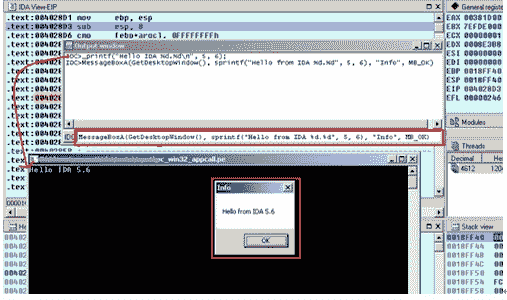

上面的截图显示了如何使用 IDC 语法调用了三个函数：`printf`，`MessageBoxA` 和 `GetDesktopWindow`。

在深入之前，请首先明白一点，本文只是一个简单的介绍，更全面的文章将在后面介绍。

## 快速开始

在开始之前首先要明白使用 IDC 命令调用 Appcall 的时候所接受的参数。

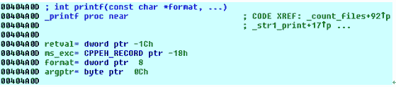

上面的函数可以通过下面的简单代码进行调用：

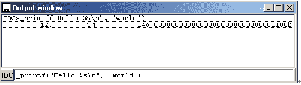

就像你看到的那样我们直接引用 Appcall 函数 `_printf` 就像它是内置的 IDC 函数一样。

如果你的函数名称中存在在 IDC 语法中不能用作标记函数名称的字符或者函数名称存在重复，如下图所示：

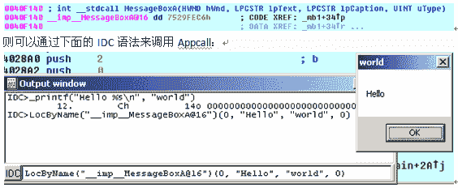

则可以通过下面的 IDC 语法来调用 Appcall：


我们使用 `LocByName` 函数通过传入函数的名称来获取函数的地址（该地址是可以被调用的）。上面的代码同样可以通过下面的多行代码来实现同样的效果：

```c
auto myfunc = LocByName("_my_func@8");

myfunc("hello", "world");
```

需要注意 Appcall 只在当前进程空间中有效，如果你想在另外的一个进程中执行，那么首先要切换到目标进程中。

## Appcall 和 IDC

Appcall 机制可以通过下面的函数在 IDC 中进行调用:

```c
// Call application function
//      ea - address to call
//      type - type of the function to call. can be specified as:
//              - declaration string. example: "int func(void);"
//              - typeinfo object. example: GetTinfo(ea)
//              - zero: the type will be retrieved from the idb
//      ... - arguments of the function to call
// Returns: the result of the function call
// If the call fails because of an access violation or other exception,
// a runtime error will be generated (it can be caught with try/catch)
// In fact there is rarely any need to call this function explicitly.
// IDC tries to resolve any unknown function name using the application labels
// and in the case of success, will call the function. For example:
//      _printf("hello\n")
// will call the application function _printf provided that there is
// no IDC function with the same name.

anyvalue Appcall(ea, type, ...);
```

Appcall IDC 函数需要你传递一个函数的地址，函数类型信息和参数（如果有）。

```c
auto p = LocByName("_printf");

auto ret = Appcall(p, GetTinfo(p), "Hello %s\n", "world");
```

现在我们已经知道如何来调用一个已经知道函数类型的函数，现在假设有另外的一个函数我们不知道函数类型以及参数类型：

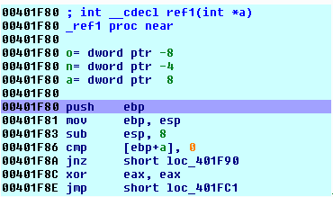

在使用 `Appcall()` 调用这个函数之前，我们首先需要知道函数类型信息（保存在一个类型信息结构中），

```c
auto p = ParseType("long __stdcall FindWindow(const char *cls, const char *wndname)", 0);

Appcall(LocByName("user32_FindWindowA"), p, 0, "Untitled - Notepad");
```

在这里我们使用 `ParseType()` 函数来构建一个类型信息结构体来传递给 `Appcall()` 函数，然而永久的设定一个函数的原型也是可能的，因而可以通过下面的代码来设定一个函数的原型：

```c
SetType(LocByName("user32_FindWindowA"),
"long __stdcall FindWindow(const char *cls, onst char *wndname)");
```

### 通过引用传递参数（Passing arguments by reference）

为了通过引用传递参数，只需要使用 C 语言中的 `&` 符号进行即可。

例如调用下面的函数：

```c
void ref1(int *a)

{
if (a == NULL)
return;

int o = *a;

int n = o + 1;

*a = n;

printf("called with %d and returning %d\n", o, n);

}
```

我们可以在 IDC 中使用下面的代码实现：

```c
auto a = 5;

Message("a=%d", a);

ref1(&a);

Message(", after the call=%d\n", a);
```

调用一个携带了一个字符串参数并且进行修改的函数：

```c
/* C code */
int ref2(char *buf)
{
if (buf == NULL)
return -1;

printf("called with: %s\n", buf);

char *p = buf + strlen(buf);

*p++ = '.';

*p = '\0';

printf("returned with: %s\n", buf);

int n=0;

for (;p!=buf;p--)
n += *p;

return n;

}
```

我们需要创建一个缓冲区并且将它传递给被调用的函数，因为代码如下所示：

```c
auto s = strfill('\x00', 20); // create a buffer of 20 characters

s[0:5] = "hello"; // initialize the buffer

ref2(&s); // call the function and pass the string by reference

if (s[5] != ".")
Message("not dot\n");
else
Message("dot\n");
```

### `__usercall` 调用约定

Appcall 函数可能没有一个标准的调用约定，例如由汇编语言编写的子函数可能需要通过各种寄存器来传递参数等等。

一种方法是通过 `__usercall` 调用约定来描述你的函数：

参考如下的函数原型：

```c
/* C code */
// eax = esi - edi
int __declspec(naked) asm1()
{
__asm
{
mov eax, esi
sub eax, edi
ret
}
}
```

从 IDC 函数中调用将会是下面的代码：

```c
auto p = ParseType("int __usercall asm1<eax>(int a<esi>, int b<edi>);", 0);

auto r = Appcall(LocByName("_asm1"), p, 5, 2);

Message("The result is: %d\n", r);
```

### 不定参数函数（Variable argument functions）

C 代码:

```c
int va_altsum(int n1, ...)
{
va_list va;
va_start(va, n1);

int r = n1;
int alt = 1;

while ((n1 = va_arg(va, int)) != 0 )
{
r += n1*alt;
alt *= -1;
}
va_end(va);
return r;
}
```

IDC 代码：

```c
auto result = va_altsum(5, 4, 2, 1, 6, 9, 0);
```

### 调用函数可能引发异常

在使用 Appcall 的过程中可能会触发异常。为了捕获这些异常你可以在 IDC 程序中使用 `try/catch` 结构：

```c
auto e;
try
{
AppCall(some_func_addr, func_type, arg1, arg2);

// Or equally:
// some_func_name(arg1, arg2);
}
catch (e)
{
// Exception occured .....
}
```

异常结构 `e` 将会包含如下的数据区段：

描述（`description`）：在调试器执行 Appcall 的过程中产生的异常描述信息；

函数（`func`）：发生异常的 IDC 函数的名称；

行号（`line`）：在脚本程序中发生错误行的行号；

错误编号（`qerrno`）：最后一个错误的内部编号。

例如你可能会得到如下的信息：

```
description: "Appcall: The instruction at 0x401F93 referenced memory at 0x5.
The memory could not be read"
file: "<internal>"
func: "___idc0"
line: 4
qerrno: 92
```

在一些条件下异常结构有可能会包含更多的信息。

## Appcall 选项简介

Appcall 可以通过 `SetAppcallOptions()` 函数进行设置，该函数包含如下的选项：

`APPCALL_MANUAL`：仅设置 Appcall 而不运行（在完成之后你需要调用 `CleanupAppcall()` 函数）。可以通过 Manual Appcall 章节来获取更多信息；

`APPCALL_DEBEV`：如果该标志位被设置，那么在执行 appcall 的过程中如果有异常产生则会包含异常的全部信息。可以通过调试异常章节来得到更多的信息。

在实际的过程中可以比较方便的恢复 Appcall 的默认设置，你可以修改它们，然后在把他们修改回来。为了恢复设置只需要简单的调用 `GetAppcallOptions()` 函数即可。

需要注意 Appcall 选项是保存在数据库中的，所以一旦你修改了他们，当再次运行的时候 Appcall 选项将会自动恢复

## Manual Appcall

到这里我们已经看到了如何来调用 Appcall 并且使用脚本来获取执行后的结果，那么如果我们只是想设置环境并且向手工执行函数该怎么办？

此时就要用到 Manual Appcall 功能了。Manual Appcall 架构可以用来保存当前执行代码的上下文，然后在另外的空间中执行另外的一个函数。在执行完成之后我们可以返回到原来的进程空间并且继续从刚才保存的地点继续调试。让我们以现实中的需求来说明这个功能的意义：

1. 你正在调试你的程序

2. 你发现了一个存在 bug 的函数（`foo()`）,当传入特定的参数的时候这个函数会表现的十分怪异 `foo（0xdeadbeef）`

3. 那么我们此时是不是应该继续等待一个特殊的参数来继续触发这个问题函数？其实没有必要那么复杂，我们只需要手工调用 `foo` 函数并且传入特定参数进行跟踪即可。

4. 最后，在执行完成之后只需要执行 `CleanupAppcall()` 来恢复手工调用 appcall 之前异常的内容即可

为了验证效果我们以上文中提到的 `ref1` 函数来进行试验，我们只需要传入一个非法的指针即可：

1. `SetAppcallOptions(APPCALL_MANUAL);` // Set manual Appcall mode

2. `ref1(6);` // call the function with an invalid pointer

在执行完上面的代码之后 IDA 将会转换到调用的函数，到这里我们就可以进行调试了。


在执行到函数末尾的时候代码如下：

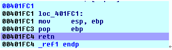

在执行到函数返回之后我们很可能会看到如下的代码：

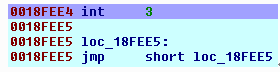

这是我们用来检测 Appcall 函数末尾的控制代码。到这里我们就可以调用 `CleanupAppcall()` 来返回到上一次执行的上下文空间了。

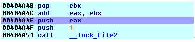

## 捕获调试异常

在上文中我们已经可以捕获 Appcall 调用过程中的异常，但是如果我们想要知道操作系统原生的异常信息这些是远远不够的。

如果我们多多少少的能够从调试器模块中获取到最后的 `debug_event_t` 指令就更好了。`APPCALL_DEBEV` 选项使得我们的想法成为可能。我们通过 `APPCALL_DEBEV` 选项再次来重复上面的例子：

```c
auto e;
try
{
SetAppcallOptions(APPCALL_DEBEV); // Enable debug event capturing
ref1(6);
}
catch (e)
{
// Exception occured. This time "e" is populated with debug_event_t fields (check idd.hpp)
}
```

在这种情况下，如果我们转存异常结构信息，我们将会得到下面的属性：

```
can_cont: 1
code:  C0000005h
ea:    401F93h
eid:    40h (from idd.hpp: EXCEPTION = 0x00000040 Exception)
file: ""
func: "___idc0"
handled: 1
info: "The instruction at 0x401F93 referenced memory at 0x6. The memory could not be read"
line: 4h
pid:  123Ch
ref:  6h
tid:  1164h
```

## Appcall 和 Python

Appcall 的概念和 IDC 与 Python 基本是一致的，然而 Appcall/Python 有着不同的语法，（不同的引用，宽字符等等）。

Appcall 构架是由 `idaapi` 模块提供的，调用一个 Appcall：

```python
Appcall.printf("Hello world!\n");
```

同样可以创建一个 Appcall 函数的引用并且直接调用：

```python
printf = Appcall.printf

# ...later...

printf("Hello world!\n");
```

如果你的函数包含在 Python 中不能用作名称的字符或者存在冲突那么可以通过下面的代码进行调用：

```python
findclose     = Appcall["__imp__FindClose@4"]

getlasterror  = Appcall["__imp__GetLastError@0"]

setcurdir     = Appcall["__imp__SetCurrentDirectoryA@4"]
```

如果你想重新定义已经存在的函数的定义则可以通过调用 `Appcall.proto（func_name、func_ea、prototype_string）` 来实现：


# 传递地址名称，`Appcall.proto()` 将解析它

```
loadlib = Appcall.proto("__imp__LoadLibraryA@4",
"int (__stdcall *LoadLibraryA)(const char *lpLibFileName);")
```

# 传递 EA 而不是名称

```
freelib = Appcall.proto( LocByName("__imp__FreeLibrary@4"),
"int (__stdcall *FreeLibrary)(int hLibModule);")
```

为了传递 Unicode 字符串你需要用到 `Appcall.unicode()` 函数：

```
getmodulehandlew    = Appcall.proto("__imp__GetModuleHandleW@4",
"int (__stdcall *GetModuleHandleW)(LPCWSTR lpModuleName);")

hmod = getmodulehandlew(Appcall.unicode("kernel32.dll"))
```

定义一个函数然后关联到一个地址你同样可以得到一个 `Appcall`：

```
# Create a typed object (no address is associated yet)
virtualalloc = Appcall.typedobj(
"int __stdcall VirtualAlloc(int lpAddress, SIZE_T dwSize, DWORD flAllocationType, DWORD flProtect);")

# Later we have an address, so we pass it:
virtualalloc.ea = LocByName("kernel32_VirtualAlloc")

# Now we can Appcall:
ptr = virtualalloc(0, Appcall.Consts.MEM_COMMIT, 0x1000, Appcall.Consts.PAGE_EXECUTE_READWRITE)
```

在我们得出结论之前（如果你已经认真的读过上面的内容），这里提供了一个小脚本，它可以用来初始化和终止 `Appcall` 通过快捷键。如果你想每次都让脚本自动加载那么就将这个脚本写入到 `idc\ida.idc` 文件中即可：

```
#include <idc.idc>

extern last_cmd, last_opt;

static Appcall_Here()
{
  last_opt = GetAppcallOptions();
  SetAppcallOptions(APPCALL_MANUAL);
  auto t, h;
  t = ParseType("void x(void);", 0);
  h = here;
  Appcall(FirstSeg(), t);
  SetAppcallOptions(last_opt);
  Eip = h;
}

static Appcall_Start()
{
  auto s = AskStr(last_cmd, "Enter Appcall");
  if (s == "")
    return;
  last_cmd = s;
  last_opt = GetAppcallOptions();
  SetAppcallOptions(APPCALL_MANUAL);
  Message(">%s<", s);
  Eval(s);
  SetAppcallOptions(last_opt);
}

static main()
{
  last_cmd = "";
  AddHotkey("Ctrl-Alt-F9",  "Appcall_Start");
  AddHotkey("Ctrl-Alt-F10", "CleanupAppcall");
  AddHotkey("Ctrl-Alt-F4",  "Appcall_Here");
}
```

最后是一个模拟场景：

你正在调试一个程序，但是忽然你发现你需要调试另外的一个函数，并且在执行完成之后需要重新回到原来调试的地方。

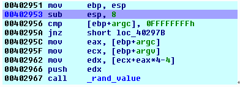

你按 `Ctrl+Alt+F9` 来初始化 `Manual Appcall`，然后你输入需要调试的函数和参数

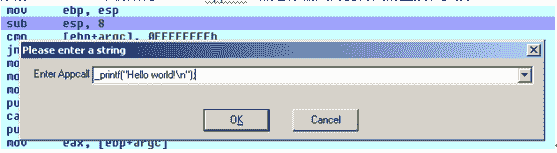

此时调试器将会切换到新的函数并且现在你就可以进行对新函数的调试跟踪了

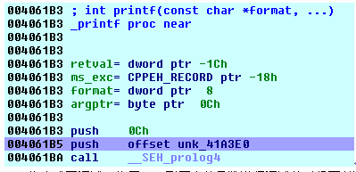

一旦你完成了调试，你需要回到原来的函数进行调试的时候可以通过 `Ctrl+Alt+F10` 快捷键来终结 `Appcall` 回到原来的地方继续调试。

如果你想要临时直接从当前代码开始跟踪调试那么可以直接通过 `Ctrl+Alt+F4` 来激活 `Manual Appcall`。跟踪完成之后通过 `Ctrl+Alt+F10` 回到原代码处。

`Appcall` 能做的事情远比在本文中提到的要多的多，写这篇文章主要是想抛砖引玉，如果大家有什么好的技术还希望能一起交流，欢迎评论。

PDF 下载：

`IDA Pro Appcall 功能浅析.pdf`
