# 浅析 VC++6.0 对整数除以常量的处理

> 原文：[`www.pediy.com/kssd/pediy11/116974.html`](https://www.pediy.com/kssd/pediy11/116974.html)

## 1. 除法相关的数学定义和性质

首先提问，阅读以下 C 语言程序段，并写出结果：

代码:

```
// 代码 1
printf("8 %% -3 = %d\\r\\n", 8 % -3);

// 代码 2
printf("-8 %% -3 = %d\\r\\n", -8 % -3); 

// 代码 3
printf("-8 %% 3 = %d\\r\\n", -8 % 3);
```

如果你的回答是：

`a % b = 2`

`a % b = -2`

`a % b = -2`

太好了，你答对了，可以跳过本节，阅读后面的内容。

如果你不知道自己为什么搞错了，那么请我和一起回顾一下数学知识。

**定义 1**：已知两个因数的积与其中一个因数，求另一个因数的运算，叫做除法。

**定义 2**：在整数的除法中，只有能整除与不能整除两种情况。当不能整除时，就产生余数。

设被除数为 `a`，除数为 `b`，商为 `q`，余数为 `r`，有如下一些重要性质：

**性质 1**：`r < b`

**性质 2**：`a = b*q + r`

**性质 3**：`b =(a - r) / q`

**性质 4**：`q =(a - r) / b`

**性质 5**：`r = a - q*b`

将我们的代码段 1 代入定义和运算性质得：

`q = (a r) / b = (8 - r) / (-3) = -2`

`r = a - q*b = 8 (-2 * -3) = 2`

将我们的代码段 2 代入定义和运算性质得：

`q = (a r) / b = (-8 - r) / (-3) = 2`

`r = a - q*b = -8 (2 * -3) = -2`

将我们的代码段 3 代入定义和运算性质得：

`q = (a r) / b = (-8 - r) / 3 = -2`

`r = a - q*b = -8 (-2 * 3) = -2`

以上就是程序结果的来历。

先附上参考资料：

1. `Concrete Mathematics` - `Ronald L. Graham`
2. `The Art of Computer Programming` - `Donald E. Knuth`
3. `divcnst-pldi94.pdf` (感谢 `forgot` 提供)
4. `The Solver Web Online Help` - ? (`www.thesolver.it/Manuali/Factotum/source/001.htm` 感谢 `bughoho` 提供)

由于本人没学会如何将 word 中的数学公式转换为论坛格式，故以下讨论用抓图表达。

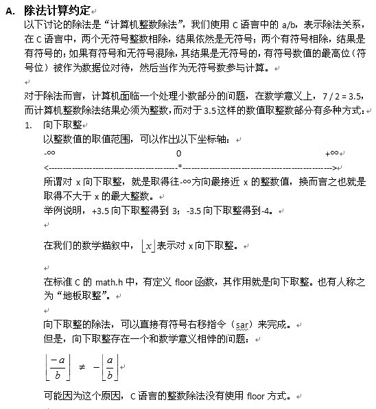

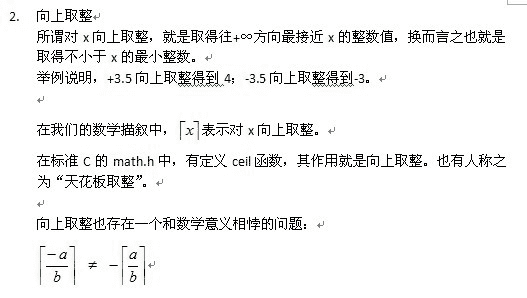

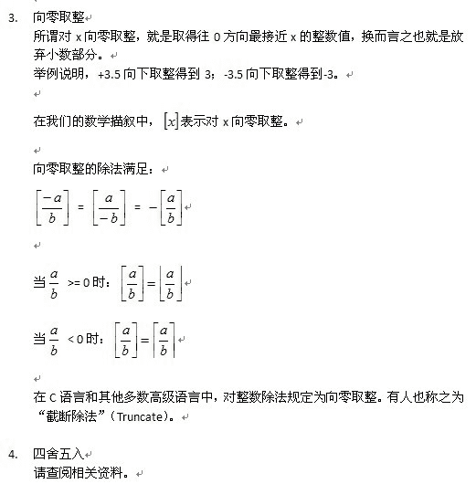

以下数学相关的定义和推导，若已掌握或者暂无兴趣，可跳过本节阅读其后的讨论，在后面的讨论中，涉及到的定义和推导将会以编号形式指出，感兴趣的读者可以回到本节考察相关推论和证明。

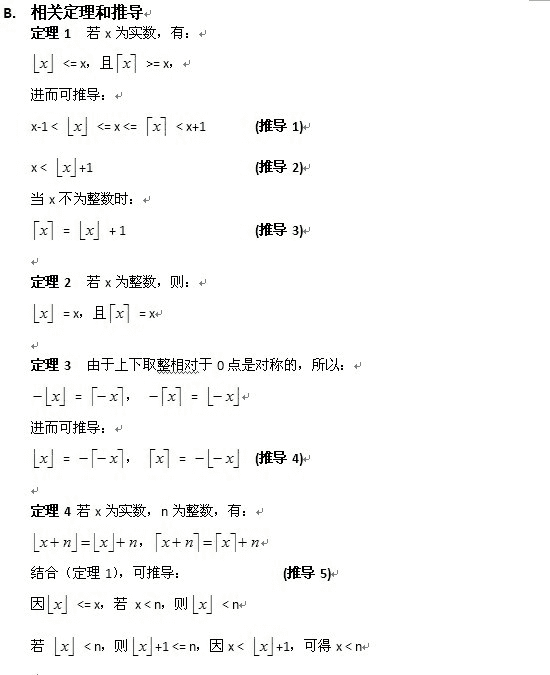

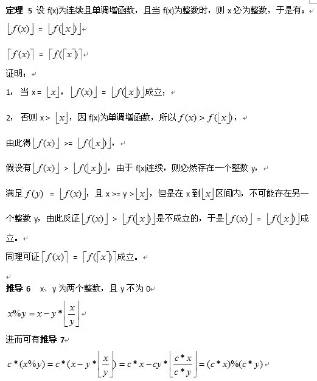

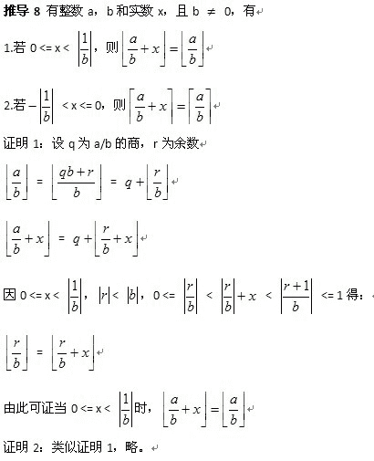

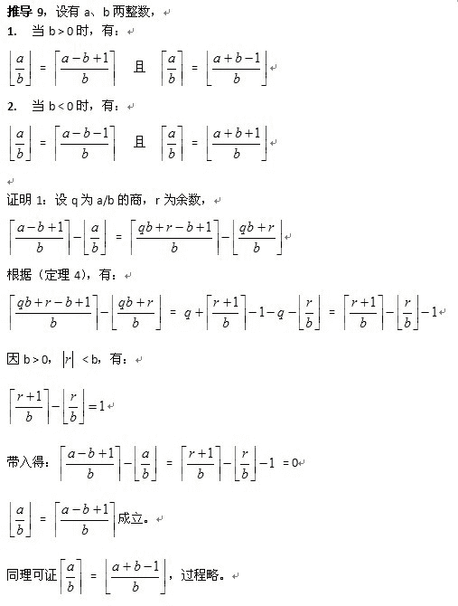

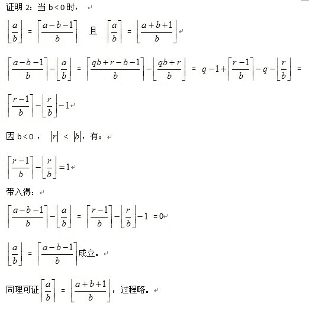

## 3. VC++6.0 对整数除法的优化和论证

### A. VC++6.0 对除以整型常量的各类处理

整数除法运算对应汇编指令分有符号 `idiv`、无符号 `div`。除法是指令中执行周期较长的，因此其效率也是较低的，所以编译器会尽量将除法指令用其它运算指令代替。C++中的除法和数学中的除法不同。在 C++中除法运算不保留余数，有专门提求取余数的运算`%`也称之为取模运算。而且对于整数除法，C++的规则是仅仅保留整数部分，小数部分完全舍弃。

如果除数是变量，则只能使用除法指令。但是如果除数为常量，便有了优化的余地，根据除数值的相关特性，编译器有对应的处理方式。

在本节我们讨论编译其对除数为 2 的次方、非 2 次方、负数等各类情景的处理方式，我们假定整型为 4 字节补码形式。

见代码中实例演示。

各类型除法转换 Debug 调试版

代码:

```
// C++源码说明：除法运算 
// 变量定义
int nVarOne = argc;
int nVarTwo = argc;
// 两变量做除法
printf("nVarOne / nVarTwo = %d", nVarOne / nVarTwo);
// 变量除以常量，常量 2 的 1 次方
printf("nVarOne / 2 = %d", nVarOne / 2);
// 变量除以非二次方数
printf("nVarTwo / 7 = %d", nVarTwo / 7);
// 变量对非二次方数取模
printf("nVarTwo % 7 = %d", nVarTwo % 7);
// 变量除以常量，常量为 2 的 3 次方
printf("nVarOne / 8 = %d", nVarOne / 8);
```

代码:

```
// C++源码于对应汇编代码讲解 
// C++源码对比，变量定义
int nVarOne = argc;
0040B7E8   mov         eax,dword ptr [ebp+8]
0040B7EB   mov         dword ptr [ebp-4],eax
// C++源码对比，变量定义
37:        int nVarTwo = argc;
0040B7EE   mov         ecx,dword ptr [ebp+8]
0040B7F1   mov         dword ptr [ebp-8],ecx
// 除法运算转换特性
// C++源码对比，变量 / 变量
printf("nVarOne / nVarTwo = %d", nVarOne / nVarTwo);
; 取出被除数放入 eax 中
0040B7F4   mov         eax,dword ptr [ebp-4]
; 扩展高位
0040B7F7   cdq
; 两变量相除，直接使用有符号除法指令 idiv
0040B7F8   idiv        eax,dword ptr [ebp-8]
; eax 保存商值，作为参数压栈，调用函数 printf，此函数讲解略
0040B7FB   push        eax
0040B7FC   push        offset string "nVarOne / nVarTwo = %d" (00420034)
0040B801   call        printf (0040b750)
0040B806   add         esp,8
```

代码:

```
// C++源码对比，变量 / 常量（常量值为 2）
printf("nVarOne / 2 = %d", nVarOne / 2);
0040B809   mov         eax,dword ptr [ebp-4]
0040B80C   cdq
; 自身减去扩展高位
0040B80D   sub         eax,edx 
; 和乘法运算类似，乘法是左移，对应的除法为右移
0040B80F   sar         eax,1
; printf 函数说明略…… 
```

代码:

```
// C++源码对比，变量 / 常量（常量值为 2 的 3 次方）
printf("nVarOne / 8 = %d", nVarOne / 8);
; 取出被除数放入 eax
0040B851   mov         eax,dword ptr [ebp-4]
; 扩展 eax 高位到 edx，eax 中为负数则 edx 为 0xFFFFFFFF
0040B854   cdq
; 如果 eax 为负数，则 0xFFFFFFFF & 0x00000007 <==> 0x00000007 反之为 0
0040B855   and         edx,7
; 使用 eax 加 edx，如 eax 为负数则加 7，反之加 0
0040B858   add         eax,edx
; 将 eax 右移 3 位
0040B85A   sar         eax,3
; printf 函数说明略……
```

没有打开 O2 的时候下，以上代码中只有除数为 2 的次方值的前提下，才进行了优化处理。我们先从最为较简单的除以常量 2 的优化开始分析。

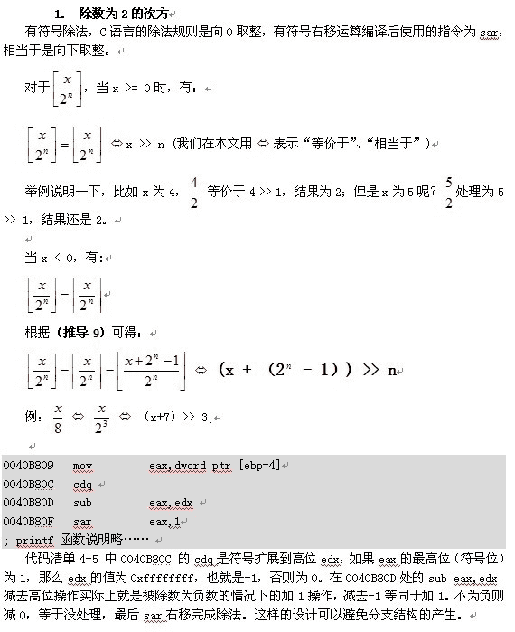

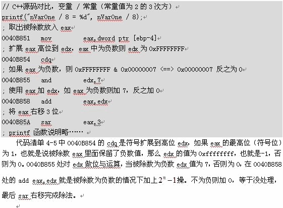

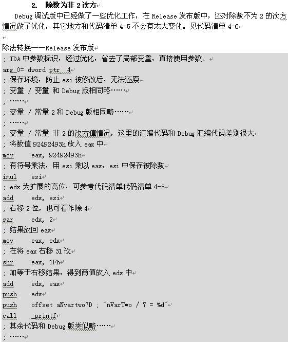

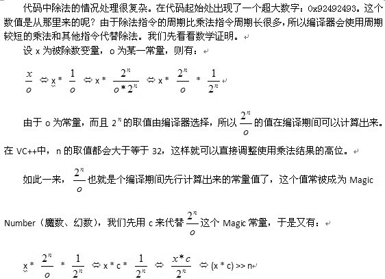

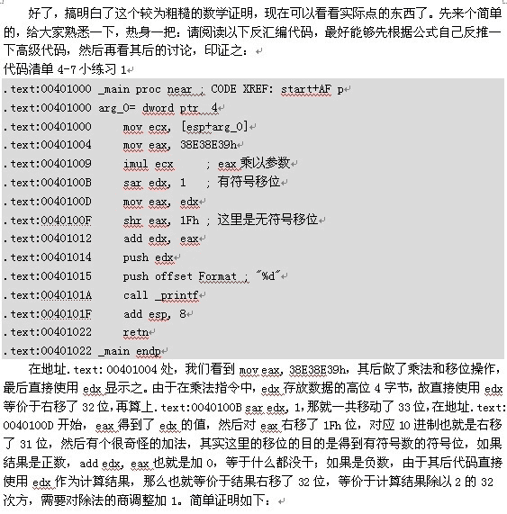

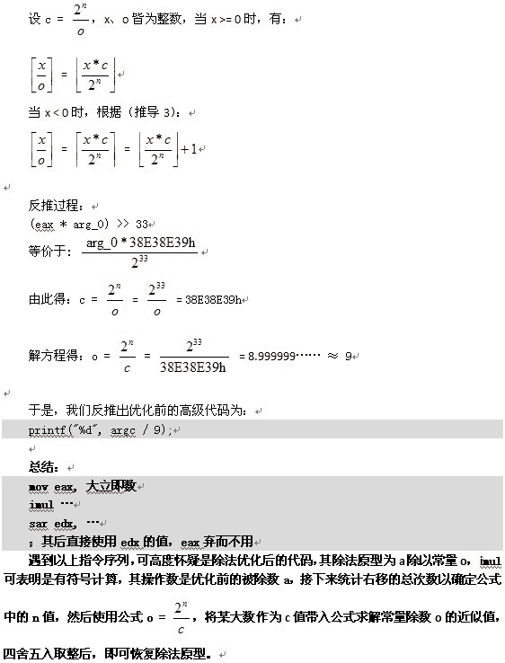

回顾代码清单中的关键部分：

代码:

```
……
; 92492493h 疑似 
.text:004010AA     mov eax, 92492493h
; 这里是流水线优化，esp 和上次调用的 call 指令相关，和除法计算无关，可暂不理会。
.text:004010AF     add esp, 8 
; 有符号乘法，用 esi 乘以 eax，esi 中保存被除数
.text:004010B2     imul esi
; 这里又多出一个诡异的加法
.text:004010B4     add edx, esi
; 右移 2 位，也可看作除 4
.text:004010B6     sar edx, 2
; 结果给 eax
.text:004010B9     mov eax, edx
; 负数调整加 1
.text:004010BB     shr eax, 1Fh
.text:004010BE     add edx, eax
.text:004010C0     push edx
.text:004010C1     push offset aNvartwo7D ; "nVarTwo / 7 = %d"
.text:004010C6     call \_printf 
……
```

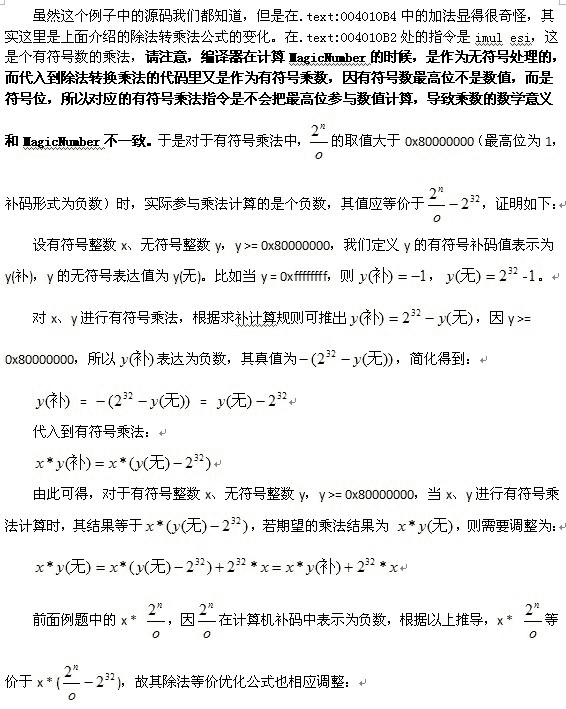

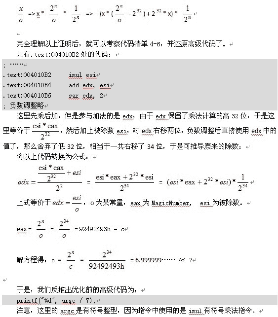

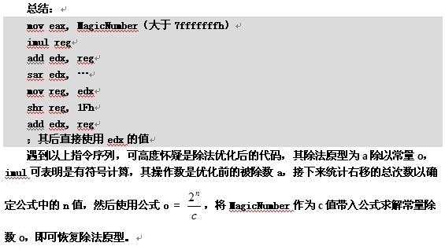

123456

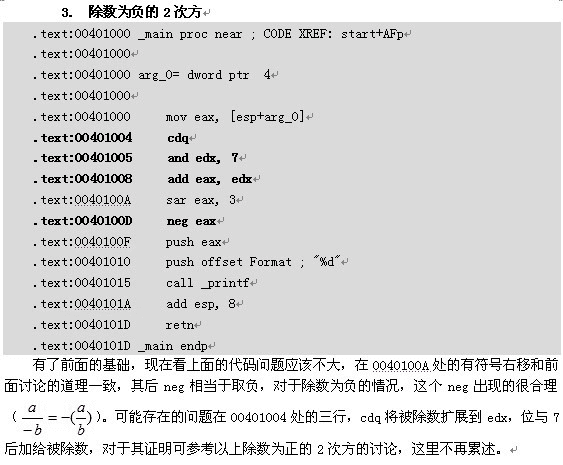

### 4. 除数为负的非二次方（上）

代码:

```
.text:00401000 \_main proc near ; CODE XREF: start+AFp
.text:00401000 arg\_0= dword ptr 4
.text:00401000     mov ecx, [esp+arg\_0]
.text:00401004     mov eax, 99999999h
.text:00401009     imul ecx
.text:0040100B     sar edx, 1
.text:0040100D     mov eax, edx
.text:0040100F     shr eax, 1Fh
.text:00401012     add edx, eax
.text:00401014     push edx
.text:00401015     push offset Format ; "%d\\n"
.text:0040101A     call \_printf
.text:0040101F     add esp, 8
.text:00401022     xor eax, eax
.text:00401024     retn
.text:00401024 \_main endp
```

对于负除数求值过程中，有什么需要注意的呢？我们先看看除法转乘法的过程：

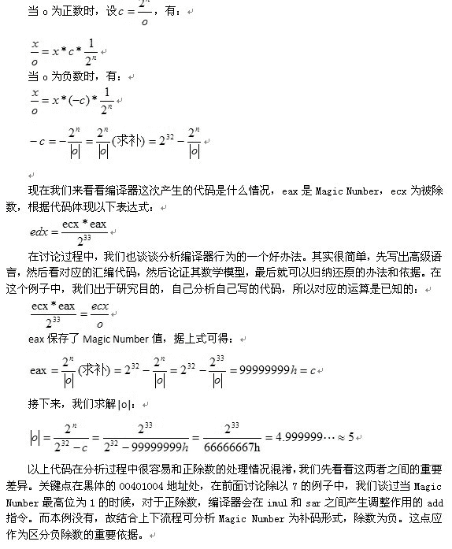

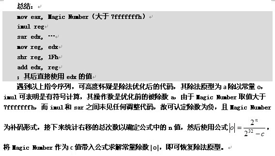

### 5. 除数为负的非二次方（下）

上例中我们讨论了对于 `Magic Number` 大于 `0x7fffffff` 的处理，那么在什么情况下 `Magic Number` 会小于等于 `0x7fffffff`，而且这个时候应该怎么处理呢？请先阅读以下代码：

代码:

```
.text:00401000 \_main proc near ; CODE XREF: start+AFp
.text:00401000 arg\_0= dword ptr 4
.text:00401000     mov ecx, [esp+arg\_0]
.text:00401004     mov eax, 6DB6DB6Dh
.text:00401009     imul ecx
.text:0040100B     sub edx, ecx
.text:0040100D     sar edx, 2
.text:00401010     mov eax, edx
.text:00401012     shr eax, 1Fh
.text:00401015     add edx, eax
.text:00401017     push edx
.text:00401018     push offset Format ; "%d"
.text:0040101D     call \_printf
.text:00401022     add esp, 8
.text:00401025     retn
.text:00401025 \_main endp
```

回忆前面除数等于+7 的讨论，对于正除数，`Magic Number` 大于 `0x7fffffff` 的处理：

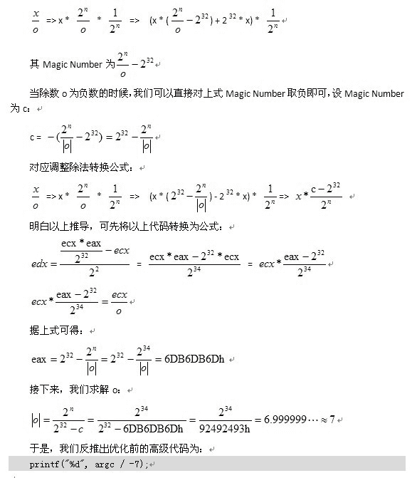

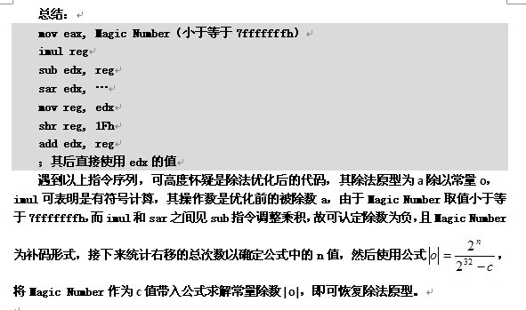

### B. 除法优化的原则(上)

看到这里，大家应该注意到以上讨论并还原除数的结果是近似值，说明了我们的公式给出还不够严格，那么我们可以好好思考一下其值近似但不等的原因，先看看余数是多少。

回忆一下除法和余数的关系，根据（性质 3），有：

`b =(a - r) / q`

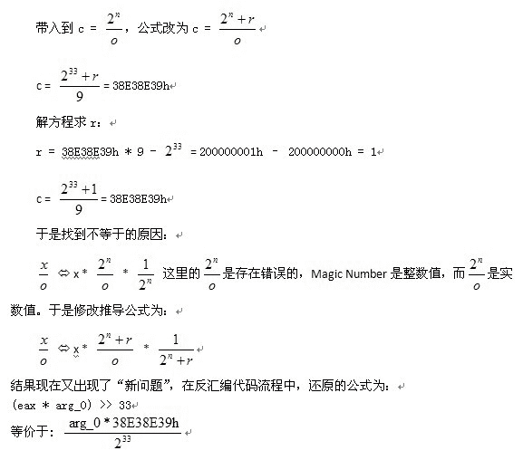

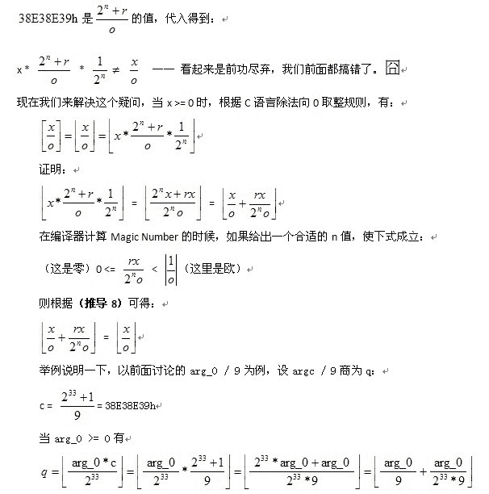

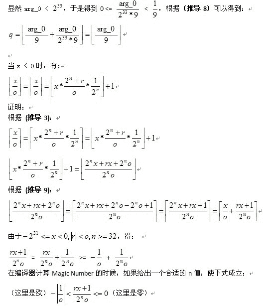

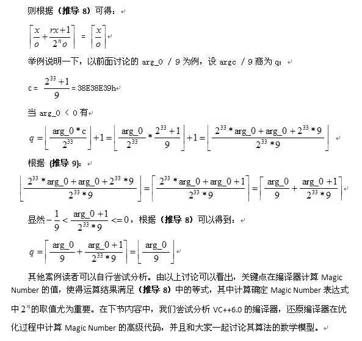

现在分析一下 `VC++6.0` 中计算除法 `MagicNumber` 的过程，大家找到 `VC++6.0` bin 目录下 `c2.dll` (版本 `12.0.9782.0`)，先在 `LoadLibrary` 下断，等 `c2` 加载，其有符号整数除法 `MagicNumber` 的计算过程在 `c2` 的文件偏移 `5FACE` 处，加载后的虚拟地址请读者自行计算，断在此处可以看到有符号整数除法 `MagicNumber` 的推算过程，其汇编代码过长，我就不贴了，自己给出 `F5` 后修改的 C 代码，如下所示：

代码:

```
// 对于除数在 3 到 13 之间，直接查表，表结构如下
struct SignedMagicNumber
{
  int nMagic; 
  int nExpInc;
};

// 对于除数为 2 的幂，有其他处理，故表内无对应值
struct SignedMagicNumber MagicTable[] = {
  {1, 1},            // 0 
  {1, 1},            // 1
  {1, 1},            // 2
  {0x55555556, 0},
  {0, 0},            // 4
  {0x66666667, 1},
  {0x2AAAAAAB, 0},
  {0x92492493, 2},
  {0, 0},            // 8
  {0x38E38E39, 1},
  {0x66666667, 2},
  {0x2E8BA2E9, 1},
  {0x2AAAAAAB, 1}
};
```

代码:


```
#define EXP31 0x80000000

// 以下代码还原修改自 VC++6.0 bin 目录下 c2.dll(版本 12.0.9782.0)，文件偏移 5FACE，
// 原程序的返回值定义为结构体，这里修改为参数返回
int GetMagic(unsigned int nDivC, int *nOutExpInc)
{
//   if ((int)nDivC >= 3 && nDivC < 13)
//   {
//     *nOutExpInc = MagicTable[nDivC].nExpInc;
//     return MagicTable[nDivC].nMagic;
//   }

  unsigned int nAbsDivC = abs(nDivC);
  int nExcBase = 31;

  // t = 2³¹ if nDivC > 0
  // or t = 2³¹ + 1 if nDivC < 0
  unsigned int t = (nDivC >> 31) + EXP31;

  // |nc| = t - 1 - rem(t, |nDivC|)
  unsigned int nLargestMultiple  = t - t % nAbsDivC - 1;
  unsigned int q1 = EXP31 / nLargestMultiple;
  unsigned int r1 = EXP31 - nLargestMultiple * q1;
  unsigned int nMagicNumber = EXP31 / nAbsDivC;
  unsigned int r2 = EXP31 - nAbsDivC * nMagicNumber;

  do
  {
    r1 *= 2;
    q1 *= 2;
    ++nExcBase;
    if ( r1 >= nLargestMultiple )
    {
      ++q1;
      r1 -= nLargestMultiple;
    }
    r2 *= 2;
    nMagicNumber *= 2;
    if ( r2 >= nAbsDivC )
    {
      ++nMagicNumber;
      r2 -= nAbsDivC;
    }
  }
  while ( q1 < nAbsDivC - r2 || q1 == nAbsDivC - r2 && !r1 );

  nMagicNumber++;

  if ( (int)nDivC < 0 )
    nMagicNumber = -(int)nMagicNumber;

  *nOutExpInc = nExcBase - 32;

  return nMagicNumber;
}
```

然后写个程序验证一下看看：

代码:

```
int main(int argc)
{
  int nExpInc;
  int nMagicNumber;


  int nDividend = argc-201; // 这是被除数
  int nDivisor = -100;      // 这是除数
  int nQuotient;            // 这里存放商

  // GetMagic 用来计算 magic number，
  // 第一个参数指定除数，第二个参数 OUT 指数相对 32 的增量
  // 这个例子用来模拟计算 70 / -7 的结果
  do
  {
    nMagicNumber = GetMagic(nDivisor, &nExpInc);
    printf("nMagicNumber = 0x%08x, ExpInc = %d\r\n", nMagicNumber, nExpInc);

    if (nDivisor >= 0)
    {
      __asm
      {
        mov eax, nMagicNumber // 编译器会做成 imm 寻址，nMagicNumber 早已在编译期间算出
        mov esi, nDividend
        imul esi

        // 编译器不会产生这里的跳转，
        // 因为编译阶段就计算出 nMagicNumber 的取值了，
        // 所以编译期间就可以决定是否产生其后的 add 指令,
        // nMagicNumber 小于 0x80000000(负数)则不需增加 add
        test nMagicNumber, 80000000h
        jz NEXT1
        add edx, esi
NEXT1:
        mov ecx, nExpInc
        sar edx, cl
        shr esi, 31
        add edx, esi
        mov nQuotient, edx
      }
    }
    else
    {
      __asm
      {
        mov eax, nMagicNumber
        mov esi, nDividend
        imul esi

        test nMagicNumber, 80000000h
        jnz NEXT2
        sub edx, esi
NEXT2:
        mov ecx, nExpInc
        sar edx, cl
        mov ecx, edx
        shr ecx, 31
        add edx, ecx
        mov nQuotient, edx
      }
    }

    printf("%d / %d = %d\r\n", nDividend, nDivisor, nQuotient);
    printf("%d / %d = %d\r\n", nDividend, nDivisor, nDividend / nDivisor);
    if (nQuotient != nDividend / nDivisor)
    {
      puts("Error");
      break;
    }

    nDivisor++;
    if (nDivisor == 0 || nDivisor == -1 || nDivisor == 1)
    {
      nDivisor = 2;
    }
    nDividend += 10;
  }
  while(nDivisor <= 100);

  return 0;
}
```

见附件

下次讨论此代码的数学推导

上传的附件

 | `SignedDivision.rar`
