# C++类虚函数逆向学习总结

> 原文：[`www.pediy.com/kssd/pediy10/60538.html`](https://www.pediy.com/kssd/pediy10/60538.html)

### [摘要]
受 `menting` 影响,也对 C++也逆向了一把.由于刚刚接触逆向,都是自己学习总结的,又是第一次发贴,因此不免有误解之处,还请各位多多指教,谢谢.

### [正文]
先来看一下 C++类的虚函数的实例:

```cpp
class clsC
{
private:
  int m_c;
public:
  clsC(){m_c=0;}
  ~clsC(){};
  void show(){cout<<"I'm in BaseC Class.";};
  void show2(){cout<<"I'm in BaseC Class2.";}
};

class clsB:public clsC
{
private:
  int m_b;
public:
  clsB(){m_b=0;}
  ~clsB(){};
  virtual void show(){cout<<"I'm in BaseB Class.";}
  virtual void show2(){cout<<"I'm in BaseB Class2.";}
};

class clsA:public clsB
{
private:
  int m_a;
  int m_b;
  int m_c;
public:
  clsA();
  ~clsA(){};
  virtual void show(){cout<<"I'm in sub Class.";}
};

clsA::clsA():m_b(1),m_c(2),m_a(0)
{
}

void main()
{
  clsA a;       //局部实例类,main 函数反汇编代码如下:
  clsB *pb = &a;
  clsC *pc = &a;
  pb->show2();
  pc->show();
}
```

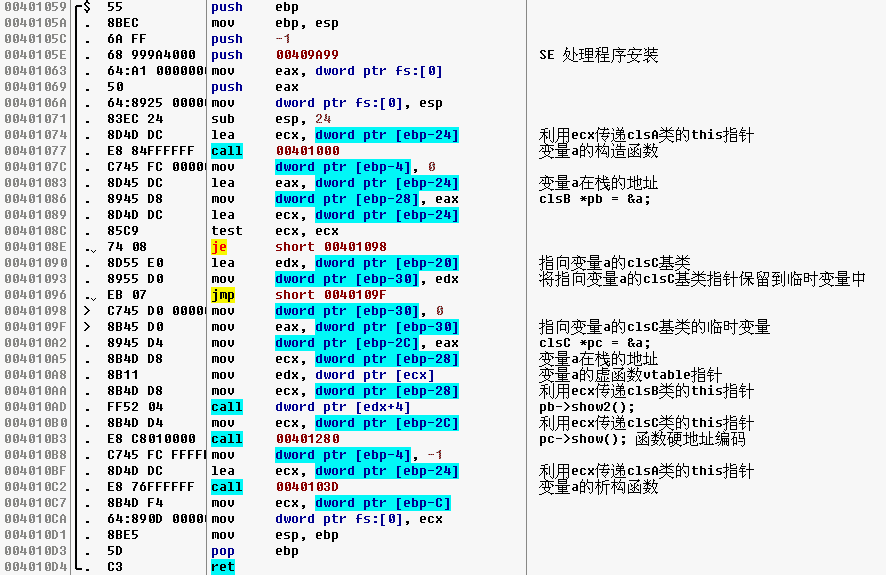

`sub esp,24` 在堆栈中为局部变量 `a` 和指针 `pb`、`pc`、临时指针分配 36 字节.其中 `clsA` 类大小为 24 字节(`clsA` 有 3*4=12 字节成员变量, `clsB` 有 4 字节成员变量, `clsC` 有 4 字节成员变量,虚函数有个指向 `vtable` 的虚函数表指针,占 4 字节.因此一共 12+4+4+4=24)

构造函数反汇编如下:

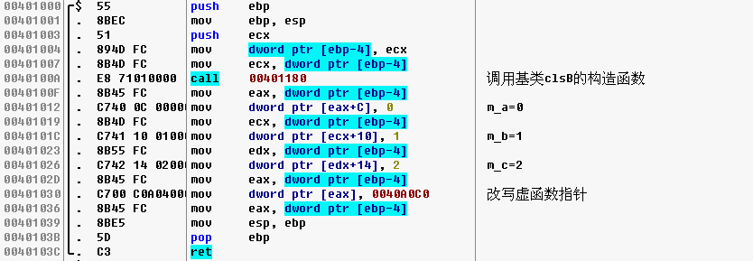

派生类的构造函数首先调用基类的构造函数,基类 `clsB` 的构造函数如下:

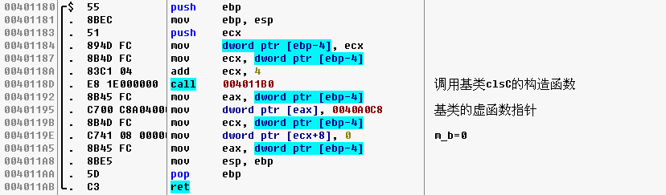

类 `clsB` 的构造函数又调用基类 `clsC` 的构造函数:

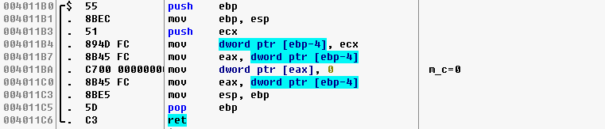

由于顶层基类 `clsC` 无虚函数,因此可见,`clsB` 类的虚函数表 `vtable` 指针也占用类的第 1 个 DWORD 空间.故类的派生结构体系中,如果存在虚函数,则虚函数表 `vtable` 指针一定占用类的第 1 个 DWORD 位置.基类 `clsB` 的构造函数将基类的所有虚函数的地址存放到虚函数地址表 `vtable` 中:

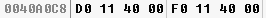
下面看一下这两个地址所指向的汇编代码:

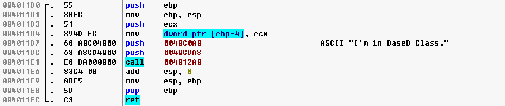


可见基类 `clsB` 的虚函数表指向基类 `clsB` 的虚函数地址 `show()`和 `show2()`

但基类构造完后,派生类的构造函数改写了这个虚函数表 `vtable` 指针.下面看下派生类的虚函数表 `vtable` 指针:


下面看一下这两个地址所指向的汇编代码:

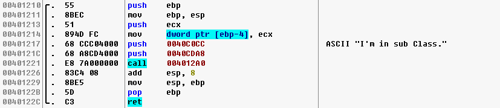


由于派生类无 `show2()`函数,因此可见派生类的虚函数表指向派生类的虚函数地址 `show()`和基类的虚函数 `show2()`.

因此,整个构造函数中,派生类的虚函数表 `vtable` 指针会改写基类的虚函数表 `vtable` 指针来实现虚函数的特性.以后调用虚函数时直接从虚函数表 `vtable` 中获取函数的地址来调用.

如果派生类中没有重写基类的某虚函数,则将在派生类的虚函数表 `vtable` 中使用基类的某虚函数地址.

这里 `pc->show();`的调用由于为非虚函数,因此不再使用虚函数特性.反汇编代码显示在编译时使用了 `clsC:: show()`函数地址的硬编码的调用方式.

最后整个 `clsA` 类在栈的分配结构图如下:

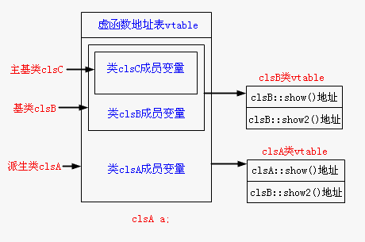

下面继续分析一下虚基类:

```cpp
class w
{
private:
  int m_w1;
  int m_w2;
public:
  w(){m_w1=m_w2=0;}
  ~w(){};
};

class clsB:virtual public w
{
private:
  int m_b;
public:
  clsB(){m_b=0;}
  ~clsB(){};
};

class clsC:virtual public w
{
private:
  int m_c;
public:
  clsC(){m_c=0;}
  ~clsC(){};
};

class clsA:public clsB,public clsC
{
private:
  int m_a;
  int m_b;
  int m_c;
public:
  clsA();
  ~clsA(){};
};

clsA::clsA():m_b(1),m_c(2),m_a(0)
{
}

void main()
{
clsA a;       //局部实例类,main 函数反汇编代码如下:
}
```

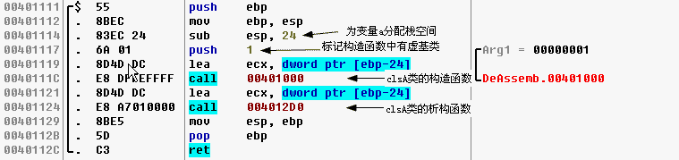

`sub esp,24` 在堆栈中为局部变量 `a` 分配 `clsA` 类大小字节(`clsA` 有 3*4=12 字节成员变量, `clsB` 有 4 字节成员变量+指向虚基类的指针 4 字节, `clsC` 有 4 字节成员变量+指向虚基类的指针 4 字节, `w` 有 2*4=8 字节成员变量.因此一共 12+8+8+8=0x24)空间.

构造函数反汇编如下:

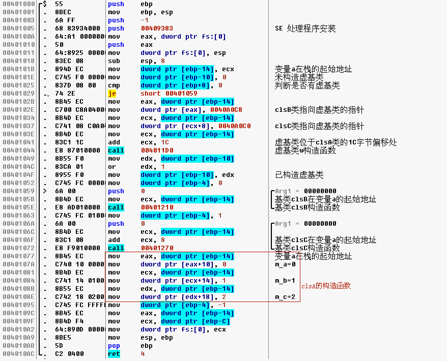

虚基类 `w` 的构造函数:

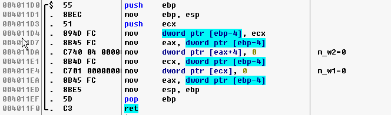

基类 `clsB` 的构造函数:

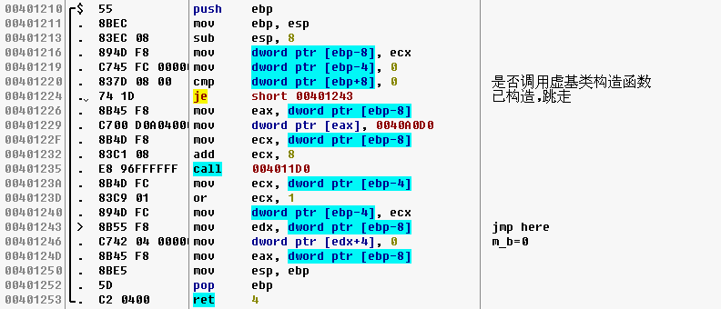

基类 `clsC` 的构造函数:

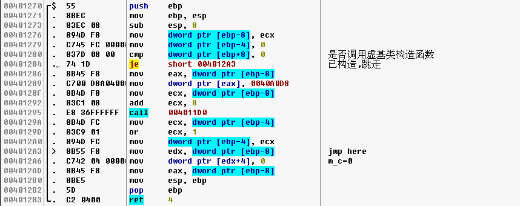

在堆栈中为变量 `a` 分配起始地址为: `0012FF5C`,下图展示 `clsA` 类在栈的分配图:

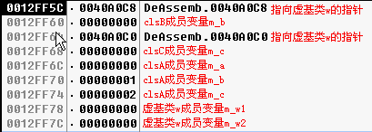

可见前 2 个 DWORD 字节为基类 `clsB` 所占空间, `clsB` 的第一个 DWORD 存放指向基类 W 的描述指针,看下指针指向数据结构:

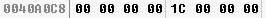
该结构包含 2 个 DWORD 大小,第一个 DWORD 为 0,第 2 个 DWORD 表示基类 `clsB` 的地址至虚基类 `w` 地址的偏移长度(`0012FF5C+1C=0012FF78`)

同理, 在上图的第 3,4 个 DWORD 位置为基类 `clsC` 所占空间, `clsC` 的第一个 DWORD 存放指向基类 W 的描述指针,看下指针指向数据结构:


该结构包含 2 个 DWORD 大小,第一个 DWORD 为 0,第 2 个 DWORD 表示基类 `clsC` 的地址至虚基类 `w` 地址的偏移长度(`0012FF64+14=0012FF78`)

因此,整个 `clsA` 类在栈的分配结构图如下:

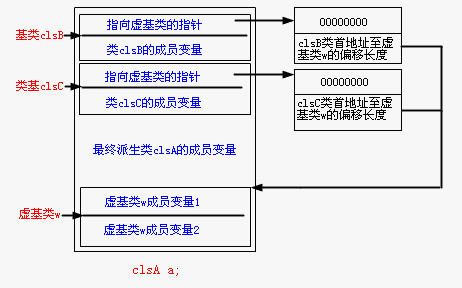

【前言】

受 `linxer` 的提醒，对虚拟继承中有虚函数的情况进行了分析，果然与前两个实例结果太不一样。同时也发现了一个自己不太清楚的问题，希望能得到各位高手解答。

感谢 `combojiang` 的小提示，使我有了初步的认识。

感谢看雪论坛提供了这个平台。把我自己的学习总结拿出来与大家分享，最终发现自己认识的不足，学到了新的知识点。

【正文】

代码:

```cpp
#include <iostream>
using namespace std;

class w
{
private:
    int m_w1;
    int m_w2;
public:
    w(){m_w1=m_w2=0;}
    ~w(){};

    virtual void show(){cout<<"I'm in W Class.";}
    virtual void show2(){cout<<"I'm in W Class2.";}
};

class clsC:virtual public w
{
private:
    int m_c;
public:
    clsC(){m_c=0;}
    ~clsC(){};

    void show(){cout<<"I'm in clsC Class.";};
    void show2(){cout<<"I'm in clsC Class2.";}
};

class clsB:virtual public w
{
private:
    int m_b;
public:
    clsB(){m_b=0;}
    ~clsB(){};

    virtual void show(){cout<<"I'm in clsB Class.";}
    virtual void show2(){cout<<"I'm in clsB Class2.";}
};

class clsA:public clsB,public clsC
{
private:
    int m_a;
    int m_b;
    int m_c;
public:
    clsA();
    ~clsA(){};

    virtual void show(){cout<<"I'm in clsA Class.";}
    virtual void show2(){cout<<"I'm in clsA Class2.";}
};

clsA::clsA():m_b(1),m_c(2),m_a(0)
{

}

void main()
{
    clsA a;
    clsB *pb = &a;
    clsC *pc = &a;

    pb->show();
    pc->clsC::show2();
}
```

先来看一下类的继续关系结构图：

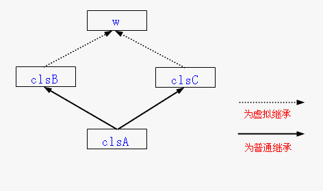

`main` 函数反汇编代码如下:

代码:


# 函数入口分析

```
004010DB  /$  55            push    ebp
004010DC  |.  8BEC          mov     ebp, esp
004010DE  |.  6A FF         push    -1
004010E0  |.  68 169E4000   push    00409E16                     ;  SE 处理程序安装
004010E5  |.  64:A1 0000000>mov     eax, dword ptr fs:[0]
004010EB  |.  50            push    eax
004010EC  |.  64:8925 00000>mov     dword ptr fs:[0], esp
004010F3  |.  83EC 38       sub     esp, 38
004010F6  |.  6A 01         push    1                              ; /Arg1 = 00000001
004010F8  |.  8D4D C8       lea     ecx, dword ptr [ebp-38]        ; |利用 ecx 传递变量 a 的 this 指针
004010FB  |.  E8 00FFFFFF   call    00401000                       ; \\变量 a 的构造函数
00401100  |.  C745 FC 00000>mov     dword ptr [ebp-4], 0
00401107  |.  8D45 C8       lea     eax, dword ptr [ebp-38]        ;  指向变量 a 的 clsB 基类
0040110A  |.  8945 C4       mov     dword ptr [ebp-3C], eax        ;  clsB *pb = &a;
0040110D  |.  8D4D C8       lea     ecx, dword ptr [ebp-38]
00401110  |.  85C9          test    ecx, ecx
00401112  |.  74 08         je      short 0040111C
00401114  |.  8D55 D0       lea     edx, dword ptr [ebp-30]        ;  指向变量 a 的 clsC 基类
00401117  |.  8955 BC       mov     dword ptr [ebp-44], edx        ;  将指向变量 a 的 clsC 基类指针保存到临时变量中
0040111A  |.  EB 07         jmp     short 00401123
0040111C  |>  C745 BC 00000>mov     dword ptr [ebp-44], 0
00401123  |>  8B45 BC       mov     eax, dword ptr [ebp-44]        ;  指向变量 a 的 clsC 基类的临时变量
00401126  |.  8945 C0       mov     dword ptr [ebp-40], eax        ;  clsC *pc = &a;
00401129  |.  8B4D C4       mov     ecx, dword ptr [ebp-3C]        ;  clsB 在在变量 a 的地址
0040112C  |.  8B11          mov     edx, dword ptr [ecx]           ;  指向虚基类的描述指针
0040112E  |.  8B4D C4       mov     ecx, dword ptr [ebp-3C]
00401131  |.  034A 04       add     ecx, dword ptr [edx+4]         ;  ecx 传递 clsA 类 this 指针,但为什么未指向变量 a 在栈的起始地址,而指向虚基类?
00401134  |.  8B45 C4       mov     eax, dword ptr [ebp-3C]
00401137  |.  8B10          mov     edx, dword ptr [eax]
00401139  |.  8B42 04       mov     eax, dword ptr [edx+4]         ;  clsB 类首地址至虚基类 w 的偏移长度
0040113C  |.  8B55 C4       mov     edx, dword ptr [ebp-3C]
0040113F  |.  8B0402        mov     eax, dword ptr [edx+eax]       ;  取虚函数地址表 vtable
00401142  |.  FF10          call    dword ptr [eax]                ;  pb->show();
00401144  |.  8B4D C0       mov     ecx, dword ptr [ebp-40]
00401147  |.  83C1 0C       add     ecx, 0C                         ;  ecx 传递 clsC 类 this 指针,但为什么未指向变量 a 的 clsC 基类地址,而指向 clsA 类的 m_b 变量地址?
0040114A  |.  E8 91020000   call    004013E0                       ;  pc->clsC::show2();  采用硬地址编码调用
0040114F  |.  C745 FC FFFFF>mov     dword ptr [ebp-4], -1
00401156  |.  8D4D C8       lea     ecx, dword ptr [ebp-38]        ;  利用 ecx 传递变量 a 的 this 指针
00401159  |.  E8 A2020000   call    00401400                       ;  变量 a 的析构函数
0040115E  |.  8B4D F4       mov     ecx, dword ptr [ebp-C]
00401161  |.  64:890D 00000>mov     dword ptr fs:[0], ecx
00401168  |.  8BE5          mov     esp, ebp
0040116A  |.  5D            pop     ebp
0040116B  \.  C3            ret
```

`sub esp,38` 在堆栈中为局部变量 `a` 和指针 `pb`、`pc`、临时指针分配 56 字节。其中 `clsA` 类大小为 44 字节（`clsA` 有 3*4=12 字节成员变量，`clsB` 有 4 字节成员变量+指向虚基类的指针 4 字节=8，`clsC` 有 4 字节成员变量+指向虚基类的指针 4 字节=8，虚基类 `w` 有 2*4=8 字节成员变量，虚函数有个指向 `vtable` 的虚函数表指针，占 4 字节，还有 4 个字节是“一个各个子类较虚基类偏转表”（`combojiang` 的解释）。因此一共 12+8+8+8+4+4=44）。

先来看一下变量 `a` 的构造函数：

代码：

```
00401000  /$  55            push    ebp
00401001  |.  8BEC          mov     ebp, esp
00401003  |.  6A FF         push    -1
00401005  |.  68 039E4000   push    00409E03                     ;  SE 处理程序安装
0040100A  |.  64:A1 0000000>mov     eax, dword ptr fs:[0]
00401010  |.  50            push    eax
00401011  |.  64:8925 00000>mov     dword ptr fs:[0], esp
00401018  |.  83EC 08       sub     esp, 8
0040101B  |.  894D EC       mov     dword ptr [ebp-14], ecx      ;  变量 a 在栈的起始地址
0040101E  |.  C745 F0 00000>mov     dword ptr [ebp-10], 0        ;  未构造虚基类
00401025  |.  837D 08 00    cmp     dword ptr [ebp+8], 0         ;  判断是否有虚基类
00401029  |.  74 2E         je      short 00401059               ;  此处未跳转
0040102B  |.  8B45 EC       mov     eax, dword ptr [ebp-14]
0040102E  |.  C700 D0B04000 mov     dword ptr [eax], 0040B0D0    ;  clsB 类指向虚基类的指针
00401034  |.  8B4D EC       mov     ecx, dword ptr [ebp-14]
00401037  |.  C741 08 C8B04>mov     dword ptr [ecx+8], 0040B0C8  ;  clsC 类指向虚基类的指针
0040103E  |.  8B4D EC       mov     ecx, dword ptr [ebp-14]
00401041  |.  83C1 20       add     ecx, 20                       ;  虚基类 w 位于 clsA 类的 20 字节偏移处
00401044  |.  E8 C7010000   call    00401210                     ;  虚基类 w 的构造函数
00401049  |.  8B55 F0       mov     edx, dword ptr [ebp-10]
0040104C  |.  83CA 01       or      edx, 1
0040104F  |.  8955 F0       mov     dword ptr [ebp-10], edx      ;  已构造虚基类
00401052  |.  C745 FC 00000>mov     dword ptr [ebp-4], 0
00401059  |>  6A 00         push    0                              ; /Arg1 = 00000000
0040105B  |.  8B4D EC       mov     ecx, dword ptr [ebp-14]        ; |clsB 类在变量 a 的起始地址
0040105E  |.  E8 BD020000   call    00401320                       ; \\clsB 类的构造函数
00401063  |.  C745 FC 01000>mov     dword ptr [ebp-4], 1
0040106A  |.  6A 00         push    0                              ; /Arg1 = 00000000
0040106C  |.  8B4D EC       mov     ecx, dword ptr [ebp-14]        ; |
0040106F  |.  83C1 08       add     ecx, 8                          ; |clsC 类在变量 a 的起始地址
00401072  |.  E8 29020000   call    004012A0                       ; \\clsC 类的构造函数
00401077  |.  8B45 EC       mov     eax, dword ptr [ebp-14]
0040107A  |.  C740 10 00000>mov     dword ptr [eax+10], 0          ;  m_a=0
00401081  |.  8B4D EC       mov     ecx, dword ptr [ebp-14]
00401084  |.  C741 14 01000>mov     dword ptr [ecx+14], 1          ;  m_b=1
0040108B  |.  8B55 EC       mov     edx, dword ptr [ebp-14]
0040108E  |.  C742 18 02000>mov     dword ptr [edx+18], 2          ;  m_c=2
00401095  |.  8B45 EC       mov     eax, dword ptr [ebp-14]
00401098  |.  8B08          mov     ecx, dword ptr [eax]
0040109A  |.  8B51 04       mov     edx, dword ptr [ecx+4]         ;  clsA 类首地址至虚基类 w 的偏移长度
0040109D  |.  8B45 EC       mov     eax, dword ptr [ebp-14]
004010A0  |.  C70410 C0B040>mov     dword ptr [eax+edx], 0040B0C0  ;  根据至虚基类 w 的偏移长度来定位类的虚函数表指针位置,改写为 clsA 的虚函数表指针
004010A7  |.  8B4D EC       mov     ecx, dword ptr [ebp-14]
004010AA  |.  8B11          mov     edx, dword ptr [ecx]
004010AC  |.  8B42 04       mov     eax, dword ptr [edx+4]         ;  clsA 类首地址至虚基类 w 的偏移长度
004010AF  |.  83E8 20       sub     eax, 20                         ;  这里计算结果为 0,偏移大小为 0?
004010B2  |.  8B4D EC       mov     ecx, dword ptr [ebp-14]
004010B5  |.  8B11          mov     edx, dword ptr [ecx]
004010B7  |.  8B4A 04       mov     ecx, dword ptr [edx+4]         ;  clsA 类首地址至虚基类 w 的偏移长度
004010BA  |.  8B55 EC       mov     edx, dword ptr [ebp-14]
004010BD  |.  89440A FC     mov     dword ptr [edx+ecx-4], eax     ;  clsA 较虚基类偏转表长度为 0?
004010C1  |.  C745 FC FFFFF>mov     dword ptr [ebp-4], -1
004010C8  |.  8B45 EC       mov     eax, dword ptr [ebp-14]
004010CB  |.  8B4D F4       mov     ecx, dword ptr [ebp-C]
004010CE  |.  64:890D 00000>mov     dword ptr fs:[0], ecx
004010D5  |.  8BE5          mov     esp, ebp
004010D7  |.  5D            pop     ebp
004010D8  \.  C2 0400       ret     4
```

虚基类中含有虚函数这种情况下确实与以上两个实例有很大的不同。派生类实例变量 `a` 在栈中的分布并非像实例一中所描述的虚函数地址表 `vtable` 在整个空间的第一个 DWORD 位置。而变量 `a` 的第一个 DWORD 位置存放的是基类 `clsB`（即 `clsB` 类的指向虚基类的指针）。

从反汇编的代码中可见，虚基类 `w` 位于 `clsA` 类的 `0x20` 字节偏移处，而整个类的虚函数地址表 `vtable` 存放在虚基类 `w` 的第一个 DWORD 空间中（即位于 `clsA` 类的 `0x20` 字节偏移处）。从这点上看貌似这个实例是前面介绍的二个实例的结合，但却与前面二个实例的结构有很大的不同。

下面跟进虚基类 `w` 的构造函数看下：

代码：


### 虚基类 w 的构造函数

```
00401210  /$  55             push    ebp
00401211  |.  8BEC           mov     ebp, esp
00401213  |.  51             push    ecx
00401214  |.  894D FC        mov     dword ptr [ebp-4], ecx
00401217  |.  8B45 FC        mov     eax, dword ptr [ebp-4]
0040121A  |.  C700 D8B04000  mov     dword ptr [eax], 0040B0D8        ;  虚基类 w 的虚函数表指针
00401220  |.  8B4D FC        mov     ecx, dword ptr [ebp-4]
00401223  |.  C741 08 00000>mov     dword ptr [ecx+8], 0             ;  m_w2=0
0040122A  |.  8B55 FC        mov     edx, dword ptr [ebp-4]
0040122D  |.  C742 04 00000>mov     dword ptr [edx+4], 0             ;  m_w1=0
00401234  |.  8B45 FC        mov     eax, dword ptr [ebp-4]
00401237  |.  8BE5           mov     esp, ebp
00401239  |.  5D             pop     ebp
0040123A  \.  C3             ret

```

这里的代码很简单，先是写入虚基类 `w` 的虚函数表指针、初始化虚基类成员变量。因此可见虚基类 `w` 的大小为 `0xC` 个字节。位于 `clsA` 类结构的 `0x20` 字节偏移处。

### clsB 类的构造函数

下面是 `clsB` 类的构造函数：

```
00401320  /$  55             push    ebp
00401321  |.  8BEC           mov     ebp, esp
00401323  |.  83EC 08        sub     esp, 8
00401326  |.  894D F8        mov     dword ptr [ebp-8], ecx           ;  clsB 类的起始地址
00401329  |.  C745 FC 00000>mov     dword ptr [ebp-4], 0
00401330  |.  837D 08 00     cmp     dword ptr [ebp+8], 0             ;  判断是否有虚基类
00401334  |.  74 1D          je      short 00401353                   ;  无,跳走
00401336  |.  8B45 F8        mov     eax, dword ptr [ebp-8]
00401339  |.  C700 F8B04000  mov     dword ptr [eax], 0040B0F8
0040133F  |.  8B4D F8        mov     ecx, dword ptr [ebp-8]
00401342  |.  83C1 0C        add     ecx, 0C
00401345  |.  E8 C6FEFFFF    call    00401210
0040134A  |.  8B4D FC        mov     ecx, dword ptr [ebp-4]
0040134D  |.  83C9 01        or      ecx, 1
00401350  |.  894D FC        mov     dword ptr [ebp-4], ecx
00401353  |>  8B55 F8        mov     edx, dword ptr [ebp-8]           ;  jmp here
00401356  |.  8B02           mov     eax, dword ptr [edx]             ;  指向虚基类的描述指针
00401358  |.  8B48 04        mov     ecx, dword ptr [eax+4]           ;  clsB 类首地址至虚基类 w 的偏移长度
0040135B  |.  8B55 F8        mov     edx, dword ptr [ebp-8]
0040135E  |.  C7040A F0B040>mov     dword ptr [edx+ecx], 0040B0F0     ;  根据至虚基类 w 的偏移长度来定位类的虚函数表指针位置,改写为 clsB 的虚函数表指针
00401365  |.  8B45 F8        mov     eax, dword ptr [ebp-8]
00401368  |.  8B08           mov     ecx, dword ptr [eax]
0040136A  |.  8B51 04        mov     edx, dword ptr [ecx+4]           ;  clsB 类首地址至虚基类 w 的偏移长度
0040136D  |.  83EA 0C        sub     edx, 0C                          ;  计算 clsB 类较虚基类偏移长度(相对长度,不包含 clsB 类大小和偏移表结构大小)
00401370  |.  8B45 F8        mov     eax, dword ptr [ebp-8]
00401373  |.  8B08           mov     ecx, dword ptr [eax]
00401375  |.  8B41 04        mov     eax, dword ptr [ecx+4]           ;  clsB 类首地址至虚基类 w 的偏移长度
00401378  |.  8B4D F8        mov     ecx, dword ptr [ebp-8]
0040137B  |.  895401 FC      mov     dword ptr [ecx+eax-4], edx       ;  各个子类较虚基类偏转表.存放上面计算的结果(clsB 至虚基类偏移大小)
0040137F  |.  8B55 F8        mov     edx, dword ptr [ebp-8]
00401382  |.  C742 04 00000>mov     dword ptr [edx+4], 0             ;  m_b=0
00401389  |.  8B45 F8        mov     eax, dword ptr [ebp-8]
0040138C  |.  8BE5           mov     esp, ebp
0040138E  |.  5D             pop     ebp
0040138F  \.  C2 0400        ret     4

```

这里比较复杂。根据汇编注释，从 `00401353` 开始看。首先是获取指向虚基类的描述指针。这个指针所指向的结构内容为：`0040B0D0 | 00 00 00 00 20 00 00 00`

第一个 `DWORD` 为 `0`，第 2 个 `DWORD` 表示基类 `clsB` 的地址至虚基类 `w` 地址的偏移长度为 `0x20` 字节。（从前面汇编代码 `add ecx, 20` 也能看出虚基类至变量 `a` 起始地址长度 `0x20` 字节）

之后根据获得的至虚基类 `w` 的偏移长度来定位类的虚函数表指针位置，并改写为 `clsB` 的虚函数表指针。`clsB` 的虚函数表指针指向 `0040B0F0`，看下 `0040B0F0` 地址的所指向结构的数据：`0040B0F0 | B0 1C 40 00 E0 1C 40 00`（`clsB` 共有 2 个函数（包含继承），这里有两个指针）

看下 `00401CB0` 所指向的汇编代码：

```
00401CB0    .  2B49 FC        sub     ecx, dword ptr [ecx-4]           ;  this 指针减去该子类较虚基类偏转表偏移长度？
00401CB3    .  E9 08000000   jmp     00401CC0
00401CB8        CC            int3
00401CB9        CC            int3
00401CBA        CC            int3
00401CBB        CC            int3
00401CBC        CC            int3
00401CBD        CC            int3
00401CBE        CC            int3
00401CBF        CC            int3
00401CC0  />  55             push    ebp
00401CC1  |.  8BEC           mov     ebp, esp
00401CC3  |.  51             push    ecx
00401CC4  |.  894D FC        mov     dword ptr [ebp-4], ecx
00401CC7  |.  68 D8D04000    push    0040D0D8                          ;  ASCII "I'm in clsB Class."
00401CCC  |.  68 F8DD4000    push    0040DDF8
00401CD1  |.  E8 1AF8FFFF    call    004014F0
00401CD6  |.  83C4 08        add     esp, 8
00401CD9  |.  8BE5           mov     esp, ebp
00401CDB  |.  5D             pop     ebp
00401CDC  \.  C3             ret

```

第一行代码后面再分析，第二行直接 `jmp` 到 `clsB::show()` 函数中

虚函数表下一个指针指向 `00401CE0`，看下所指向的汇编代码：

```
00401CE0    .  2B49 FC        sub     ecx, dword ptr [ecx-4]           ;  this 指针减去该子类较虚基类偏转表偏移长度？
00401CE3    .  E9 08000000   jmp     00401CF0
00401CE8        CC            int3
00401CE9        CC            int3
00401CEA        CC            int3
00401CEB        CC            int3
00401CEC        CC            int3
00401CED        CC            int3
00401CEE        CC            int3
00401CEF        CC            int3
00401CF0  />  55             push    ebp
00401CF1  |.  8BEC           mov     ebp, esp
00401CF3  |.  51             push    ecx
00401CF4  |.  894D FC        mov     dword ptr [ebp-4], ecx
00401CF7  |.  68 ECD04000    push    0040D0EC                          ;  ASCII "I'm in clsB Class2."
00401CFC  |.  68 F8DD4000    push    0040DDF8
00401D01  |.  E8 EAF7FFFF    call    004014F0
00401D06  |.  83C4 08        add     esp, 8
00401D09  |.  8BE5           mov     esp, ebp
00401D0B  |.  5D             pop     ebp
00401D0C  \.  C3             ret

```

同样是 `clsB::show2()` 函数汇编代码。

`clsB` 类改写虚函数表 `vtable` 指针后。下面是与前二个实例与众不同的地方。首先根据指向虚基类的描述指针取出 `clsB` 类首地址至虚基类 `w` 的偏移长度(这里为 `0x20`)，然后减去 `0xC`，后将该值(`0x14`)存放到虚基类 `w` 存储位置的前一个 `DWORD` 空间中。不知这样说大家会不会明白，参照文章最后的结构图就会明白了。这个结构的作用我也不是很明白。`combojiang` 大哥解释是“各个子类较虚基类偏转表”，这里的分析也就使用了这个术语。还请各位 DX 解释一下具体作用。谢谢。

（PS 我简单测试分析了一下，减去的那个 `0xC` 好像是 `clsB` 类大小＋“各个子类较虚基类偏转表”结构大小(`4` 字节)，`8+4＝0xC`。不知道我的解释是否正确，还请各位帮助讲一下）

最后是 `clsB` 类的成员变量初始化赋值操作。`m_b=0`

### clsC 的构造函数

`clsB` 构造函数结束后，接着是 `clsC` 的构造函数：

代码:


```
004012A0  /$  55            push    ebp
004012A1  |.  8BEC          mov     ebp, esp
004012A3  |.  83EC 08       sub     esp, 8
004012A6  |.  894D F8       mov     dword ptr [ebp-8], ecx            ;  clsC 类的起始地址
004012A9  |.  C745 FC 00000>mov     dword ptr [ebp-4], 0
004012B0  |.  837D 08 00    cmp     dword ptr [ebp+8], 0             ;  判断是否有虚基类
004012B4  |.  74 1D         je      short 004012D3                  ;  无,跳走
004012B6  |.  8B45 F8       mov     eax, dword ptr [ebp-8]
004012B9  |.  C700 E8B04000 mov     dword ptr [eax], 0040B0E8
004012BF  |.  8B4D F8       mov     ecx, dword ptr [ebp-8]
004012C2  |.  83C1 0C       add     ecx, 0C
004012C5  |.  E8 46FFFFFF   call    00401210
004012CA  |.  8B4D FC       mov     ecx, dword ptr [ebp-4]
004012CD  |.  83C9 01       or      ecx, 1
004012D0  |.  894D FC       mov     dword ptr [ebp-4], ecx
004012D3  |>  8B55 F8       mov     edx, dword ptr [ebp-8]          ;  jmp here
004012D6  |.  8B02          mov     eax, dword ptr [edx]           ;  指向虚基类的描述指针
004012D8  |.  8B48 04       mov     ecx, dword ptr [eax+4]         ;  clsC 类首地址至虚基类 w 的偏移长度
004012DB  |.  8B55 F8       mov     edx, dword ptr [ebp-8]
004012DE  |.  C7040A E0B040>mov     dword ptr [edx+ecx], 0040B0E0    ;  根据至虚基类 w 的偏移长度来定位类的虚函数表指针位置,改写为 clsC 的虚函数表指针
004012E5  |.  8B45 F8       mov     eax, dword ptr [ebp-8]
004012E8  |.  8B08          mov     ecx, dword ptr [eax]
004012EA  |.  8B51 04       mov     edx, dword ptr [ecx+4]         ;  clsC 类首地址至虚基类 w 的偏移长度
004012ED  |.  83EA 0C       sub     edx, 0C                         ;  计算 clsC 类较虚基类偏移长度(相对长度,不包含 clsC 类大小和偏移表结构大小)
004012F0  |.  8B45 F8       mov     eax, dword ptr [ebp-8]
004012F3  |.  8B08          mov     ecx, dword ptr [eax]
004012F5  |.  8B41 04       mov     eax, dword ptr [ecx+4]         ;  clsC 类首地址至虚基类 w 的偏移长度
004012F8  |.  8B4D F8       mov     ecx, dword ptr [ebp-8]
004012FB  |.  895401 FC     mov     dword ptr [ecx+eax-4], edx      ;  各个子类较虚基类偏转表.存放上面计算的结果(clsC 至虚基类偏移大小)
004012FF  |.  8B55 F8       mov     edx, dword ptr [ebp-8]
00401302  |.  C742 04 00000>mov     dword ptr [edx+4], 0            ;  m_c=0
00401309  |.  8B45 F8       mov     eax, dword ptr [ebp-8]
0040130C  |.  8BE5          mov     esp, ebp
0040130E  |.  5D            pop     ebp
0040130F  \.  C2 0400       ret     4
```

不难看出 `clsC` 的构造函数与 `clsB` 类的构造函数大同小异。同样首先是获取指向虚基类的描述指针。这个指针所指向的结构内容为：`0040B0C8 | 00 00 00 00 18 00 00 00`

第一个 `DWORD` 为 0,第 2 个 `DWORD` 表示基类 `clsC` 的地址至虚基类 `w` 地址的偏移长度为 `0x18` 字节(参照文章后面的类结构图)。之后根据获得的至虚基类 `w` 的偏移长度来定位类的虚函数表指针位置,并改写为 `clsC` 的虚函数表指针。`clsC` 的虚函数表指针指向 `0040B0E0`，看下 `0040B0E0` 地址的所指向结构的数据：`0040B0E0 | 70 1D 40 00 A0 1D 40 00`（`clsC` 共有 2 个函数（包含继承），这里有两个指针）

看下 `00401D70` 所指向的汇编代码：

代码:

```
00401D70   .  2B49 FC       sub     ecx, dword ptr [ecx-4]
00401D73   .  E9 08000000   jmp     00401D80
00401D78      CC            int3
00401D79      CC            int3
00401D7A      CC            int3
00401D7B      CC            int3
00401D7C      CC            int3
00401D7D      CC            int3
00401D7E      CC            int3
00401D7F      CC            int3
00401D80  />  55            push    ebp
00401D81  |.  8BEC          mov     ebp, esp
00401D83  |.  51            push    ecx
00401D84  |.  894D FC       mov     dword ptr [ebp-4], ecx
00401D87  |.  68 28D14000   push    0040D128                        ;  ASCII "I'm in clsC Class."
00401D8C  |.  68 F8DD4000   push    0040DDF8
00401D91  |.  E8 5AF7FFFF   call    004014F0
00401D96  |.  83C4 08       add     esp, 8
00401D99  |.  8BE5          mov     esp, ebp
00401D9B  |.  5D            pop     ebp
00401D9C  \.  C3            ret
```

地址指向 `clsC::show()` 函数中。

虚函数表下一个指针指向 `00401DA0`，看下所指向的汇编代码：

代码:

```
00401DA0   .  2B49 FC       sub     ecx, dword ptr [ecx-4]
00401DA3   .^ E9 38F6FFFF   jmp     004013E0
…
004013E0  /$  55            push    ebp
004013E1  |.  8BEC          mov     ebp, esp
004013E3  |.  51            push    ecx
004013E4  |.  894D FC       mov     dword ptr [ebp-4], ecx
004013E7  |.  68 C4D04000   push    0040D0C4                        ;  ASCII "I'm in clsC Class2."
004013EC  |.  68 F8DD4000   push    0040DDF8
004013F1  |.  E8 FA000000   call    004014F0
004013F6  |.  83C4 08       add     esp, 8
004013F9  |.  8BE5          mov     esp, ebp
004013FB  |.  5D            pop     ebp
004013FC  \.  C3            ret
```

同理是 `clsC::show2()` 函数汇编代码。

`clsC` 类同样改写虚函数表 `vtable` 指针，使其指向类自己的函数。下面同样使用了 `clsC` 类较虚基类偏转长度改写了“各个子类较虚基类偏转表”结构。这里将这个结构改写为 `0xC`（`0x18-0xC`。同样我分析的减去 `0xC` 为 `clsC` 类大小＋“各个子类较虚基类偏转表”结构大小(4 字节) ，`8+4=0xC`。不知道我的解释是否正确，还请各位帮助讲一下）

最后是 `clsC` 类的成员变量初始化赋值操作。`m_c=0`

`clsB` 和 `clsC` 的构造函数结束后，下面回到 `clsA` 的构造函数继续分析：

先是初始化了 `clsA` 类的成员变量（`m_b(1),m_c(2),m_a(0)`），这里强调一下，使用类的构造函数成员初始化列表对成员变量的初始化顺为成员变量在类的定义顺序，而不是初始化列表中的顺序（即顺序为 `m_a`、`m_b`、`m_c`）。而类的继承（`class clsA:public clsB,public clsC`），在类的结构体内的顺序为类声明的先后顺序（即先是 `clsB` 后 `clsC`）。这两点的顺序是不同的。

派生类 `clsA` 最终要改写虚函数地址表 `vtable` 指针（同样根据至虚基类 `w` 的偏移长度来定位类的虚函数表指针位置,改写为 `clsA` 的虚函数表指针），完成最后的虚函数特性。

`clsA` 的虚函数表指针指向 `0040B0C0`，看下 `0040B0C0` 地址的所指向结构的数据：`0040B0C0 | 10 1D 40 00 40 1D 40 00`（`clsA` 共有 2 个函数（包含继承），这里有两个指针）

看下 `00401D10` 所指向的汇编代码：

代码:

```
00401D10   .  2B49 FC       sub     ecx, dword ptr [ecx-4]           ;  this 指针减去该子类较虚基类偏转表偏移长度？
00401D13   .  E9 08000000   jmp     00401D20
00401D18      CC            int3
00401D19      CC            int3
00401D1A      CC            int3
00401D1B      CC            int3
00401D1C      CC            int3
00401D1D      CC            int3
00401D1E      CC            int3
00401D1F      CC            int3
00401D20  />  55            push    ebp
00401D21  |.  8BEC          mov     ebp, esp
00401D23  |.  51            push    ecx
00401D24  |.  894D FC       mov     dword ptr [ebp-4], ecx
00401D27  |.  68 00D14000   push    0040D100                        ;  ASCII "I'm in clsA Class."
00401D2C  |.  68 F8DD4000   push    0040DDF8
00401D31  |.  E8 BAF7FFFF   call    004014F0
00401D36  |.  83C4 08       add     esp, 8
00401D39  |.  8BE5          mov     esp, ebp
00401D3B  |.  5D            pop     ebp
00401D3C  \.  C3            ret
```

地址指向 `clsA::show()` 函数中。

虚函数表下一个指针指向 `00401D40`，看下所指向的汇编代码：

代码:

```
00401D40   .  2B49 FC       sub     ecx, dword ptr [ecx-4]           ;  this 指针减去该子类较虚基类偏转表偏移长度？
00401D43   .  E9 08000000   jmp     00401D50
00401D48      CC            int3
00401D49      CC            int3
00401D4A      CC            int3
00401D4B      CC            int3
00401D4C      CC            int3
00401D4D      CC            int3
00401D4E      CC            int3
00401D4F      CC            int3
00401D50  />  55            push    ebp
00401D51  |.  8BEC          mov     ebp, esp
00401D53  |.  51            push    ecx
00401D54  |.  894D FC       mov     dword ptr [ebp-4], ecx
00401D57  |.  68 14D14000   push    0040D114                        ;  ASCII "I'm in clsA Class2."
00401D5C  |.  68 F8DD4000   push    0040DDF8
00401D61  |.  E8 8AF7FFFF   call    004014F0
00401D66  |.  83C4 08       add     esp, 8
00401D69  |.  8BE5          mov     esp, ebp
00401D6B  |.  5D            pop     ebp
00401D6C  \.  C3            ret
```

同理是 `clsA::show2()` 函数汇编代码。

`clsA` 类最后使用了 `clsA` 类较虚基类偏转长度改写了“各个子类较虚基类偏转表”结构。这里最终将这个结构改写为 `0x0`（`0x20-0x20`。没算明白，请高手指教！＠＃￥％……＆×…）。`clsA` 类较虚基类偏转表偏转长度为 0？

整个类的构造函数分析完了。下面看下这个构造函数对变量 `a` 在栈中的赋值情况：

代码:

```
0012FF48   0040B0D0        |指向虚基类 w 的描述指针
0012FF4C   00000000        |clsB 成员变量 m_b
0012FF50   0040B0C8        |指向虚基类 w 的描述指针
0012FF54   00000000        |clsC 成员变量 m_c
0012FF58   00000000        |clsA 成员变量 m_a
0012FF5C   00000001        |clsA 成员变量 m_b
0012FF60   00000002        |clsA 成员变量 m_c
0012FF64   00000000        |各个子类较虚基类偏转表
0012FF68   0040B0C0        |虚函数地址表 vtable 指针
0012FF6C   00000000        |虚基类 w 成员变量 m_w1
0012FF70   00000000        |虚基类 w 成员变量 m_w2
```

【问题】

这里有三个地方不明白。请大家帮助解释一下

第一：回到 `main` 函数，在地址 `00401142` 处调用 `pb->show();` 时，按理说 `ecx` 寄存器应该保存被调用类的 `this` 指针（这里为 `clsA`），但为什么不是 `0012FF48`,而指向虚基类的地址 `0012FF68`?这里的 `this` 指针难道从虚基类位置开始？


## 第二：回到 main 函数

在地址`00401142`处调用`pb->show();`，转到如下代码处：

```
00401D10 . 2B49 FC sub ecx, dword ptr [ecx-4]
00401D13 . E9 08000000 jmp 00401D20
```

修改了`ecx`指针，因为派生类最后将“各个子类较虚基类偏转表”结构内容赋为`0`，因此这条指令对`ecx`不做修改。我想这条指令可能跟“各个子类较虚基类偏转表”这个结构有关吧。包括构造函数对该结构的赋值。。。还是请高手帮忙给解释一下吧。

## 第三：调用 clsC::show2()

回到`main`函数，在地址`0040114A`处调用`pc->clsC::show2();`时，`ecx`的内容（`this`指针）为什么是`0012FF5C`（即指向`clsA`成员变量`m_b`）？我认为应该是`0012FF50`（指向变量`a`的`clsC`基类）。

## 【总结】

这里的结构（虚基类中包含虚函数）与前二个例子最大的区别主要有二点。

1. 否定了虚函数地址表`vtable`指针在整个类结构的第一个`DWORD`位置。在虚基类中包含虚函数情况下，虚函数地址表`vtable`指针存放在虚基类的第一个`DWORD`位置。
2. 在虚基类中包含虚函数类层次结构中，多了一个“各个子类较虚基类偏转表”这个结构（这个结构我还不是十分了解。还请教各位高手）。这个结构位于派生类和虚基类之间，占`4`字节空间。

最后带着问题，把整个`clsA`类在栈的分配结构图画下来做为这次的学习总结:

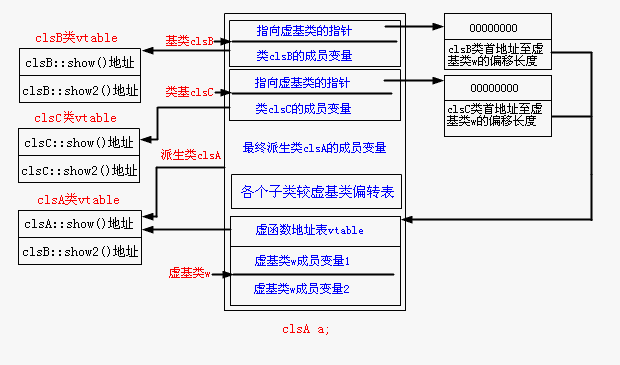
