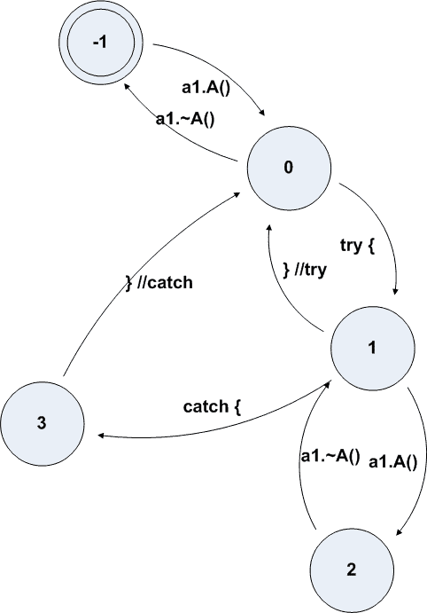

# Reversing MS VC++ Part I: Exception Handling

> 原文：[`www.pediy.com/kssd/pediy08/pediy8-778.htm`](https://www.pediy.com/kssd/pediy08/pediy8-778.htm)

Part I, II done. Word format.

Original link:

<https://www.openrce.org/articles/>

Download link:

<http://www.live-share.com/files/118661/reversing\_microsoft\_visual\_c\_cn.zip.html>

## Reversing MS VC++ Part I: Exception Handling

### 摘要

`MS VC++` 是 `Win32` 平台上最广泛使用的编译器，因此熟悉它的内部工作机制对于 `Win32` 逆向爱好者非常重要。能够理解编译器生成的附加（glue）代码有助于快速理解程序员写的实际代码。同样也有助于恢复程序的高级结构。

在这个两部分组成的系列文章的 Part I 中，我会专注于栈的结构，异常处理和由 `MSVC` 编译出的程序的相关结构。前提是假设你对汇编器，寄存器，调用习惯有一定程度的熟悉。

术语：

*   栈帧：堆栈上由一个函数占用的一段。通常包括函数参数，返回到调用者的地址，保存的寄存器值，局部变量和这个函数中的其它特定数据。在 `X86`（以及其它大多数架构）中调用者和被调用者的栈帧是连续的。
*   帧指针：它是一个寄存器或者变量，指向栈帧内部的一个固定地址。通常栈帧内所有数据都是以相对于这个指针的地址引用的。在 `X86` 上通常是 `ebp`，并且指向返回地址的下一个位置。
*   对象。一个 C++类的实例。
*   可展开对象。由 `auto storage`－class 指示符修饰的局部对象，它分配在栈上，并且当超出域作用范围（scope）时需要析构。
*   栈展开。当发生异常，控制离开对象域作用范围（scope）时会导致对象的自动析构，就是栈展开。

有两种类型的异常可以用在 C 或 C++程序中。

*   `SEH` 异常（Structured Exception Handling）。也被叫做 `Win32` 异常或系统异常。它们已经被著名的 `Matt Pietrek`[1]解释的非常详尽。它们只能被用在 C 程序中。编译器级的支持包括关键字`__try`, `__except`, `__finally` 和其它一些。
*   C++异常（有时候也叫做 `EH`）。它基于 `SEH` 实现，C++异常允许抛出和捕获任意类型的异常。C++的一个非常重要的特点是在异常处理过程中自动的栈展开，并且 `MSVC` 使用了一种非常复杂的底层框架来确保它在任何情况都能正常运作。

在下面的图例中，内存地址从上到下增加，所以栈是“增长”的。这也是 `IDA` 采用的描述栈的方法，但和几乎其它所有描述相反。

### 基本的帧布局

最基本的栈帧布局如下，

```
    ...
    Local variables
    Other saved registers
    Saved ebp
    Return address
    Function arguments
...
```

注意：如果允许了忽略帧指针 (`frame pointer omission`)，则 `saved ebp` 可能不存在。

### SEH

在使用了编译器级 `SEH` (`__try/__except/__finally`)的时候，栈的布局变得有一点复杂。

``

`SEH3` Stack Layout

当在某函数中没有`__except` 块（只有`__finally`）时，不再使用 `saved ebp`。`Scopetable` 是一个记录（record）的数组，每个 `record` 描述了一个`__try` 块，以及块之间的关系。

```
struct _SCOPETABLE_ENTRY {
      DWORD EnclosingLevel;
      void* FilterFunc;
      void* HandlerFunc;
}
```

更多的 `SEH` 实现细节请看[1]。为了恢复 `try` 块，请注意观察 `try` 块的层次变量是如何更新的。每一个 `try` 块都分配了一个唯一的数作为标识，`scopetable` 表中条目（entry）间的关系则描述了 `try` 块的嵌套关系。例如，如果 `scopetable` 的第 `i` 项的 `EnclosingLevel` 等于 `j`，则表示 `try` 块 `j` 包围了 `try` 块 `i`。 函数体自身被认为拥有级别\-1。请参看附录 1 作为例子。

### Buffer Overrun Protection

`Whidbey` (`MSVC2005`)编译器为 `SEH` 帧增加了一些缓冲区溢出（overrun）保护。完整的栈帧布局如下：

``

`SEH4` Stack Layout

`GS cookie` 只有在编译时打开`/GS` 参数才存在。`EH cookie` 总是存在。`SEH4 scopetable` 基本和 `SEH3` 一样，只是加了一个头，

```
    struct _EH4_SCOPETABLE {
        DWORD GSCookieOffset;
        DWORD GSCookieXOROffset;
        DWORD EHCookieOffset;
        DWORD EHCookieXOROffset;
        _EH4_SCOPETABLE_RECORD ScopeRecord[1];
    };

    struct _EH4_SCOPETABLE_RECORD {
        DWORD EnclosingLevel;
        long (*FilterFunc)();
            union {
            void (*HandlerAddress)();
            void (*FinallyFunc)();
        };
    };
```

`GSCookieOffset = -2` 意味着没有使用 `GS cookie`。 `EH cookie` 总是存在。偏移量是相对于 `ebp` 的。检查按照下列方式进行： `(ebp+CookieXOROffset) ^ [ebp+CookieOffset] == _security_cookie`。指向栈中 `scopetable` 的指针同样也和`__security_cookie` 进行了异或。而且，在 `SEH4` 中最外层的级别是\-2，而不是 `SEH3` 的\-1。

### C++异常模块实现

当函数采用 C++异常处理（try/catch）或者有可展开对象时，情形更加复杂。

``

C++ EH Stack Layout

`EH handler` 对每个函数都不相同（`SEH` 正好相反），通常像这样，

```
(VC7+)
    mov eax, OFFSET __ehfuncinfo
    jmp ___CxxFrameHandler
```

`__ehfuncinfo` 是一个类型为 `FuncInfo` 的结构体，它完整地描述了所有 `try/catch` 块和所有可展开对象。

```
    struct FuncInfo {
      // compiler version.
      // 0x19930520: up to VC6, 0x19930521: VC7.x(2002-2003), 0x19930522: VC8 (2005)
      DWORD magicNumber;
      // number of entries in unwind table
      int maxState;
      // table of unwind destructors
      UnwindMapEntry* pUnwindMap;
      // number of try blocks in the function
      DWORD nTryBlocks;
      // mapping of catch blocks to try blocks
      TryBlockMapEntry* pTryBlockMap;
      // not used on x86
      DWORD nIPMapEntries;
      // not used on x86
      void* pIPtoStateMap;
      // VC7+ only, expected exceptions list (function "throw" specifier)
      ESTypeList* pESTypeList;
      // VC8+ only, bit 0 set if function was compiled with /EHs
         int EHFlags;
};
```

`Unwind map` 和 `SHE` 的 `scopetable` 类似，但没有过滤(filter)函数。

```
struct UnwindMapEntry {
      int toState;        // target state
      void (*action)();   // action to perform (unwind funclet address)
};
```

`Try` 块描述子，描述了一个 `try` 块及其相关的 `catch` 块，

```
struct TryBlockMapEntry {
      int tryLow;
      int tryHigh;    // this try {} covers states ranging from tryLow to tryHigh
      int catchHigh;  // highest state inside catch handlers of this try
      int nCatches;   // number of catch handlers
      HandlerType* pHandlerArray; //catch handlers table
};
```

`Catch` 块描述子，描述了一个 `try` 块的某一个 `catch` 块（因为一个 `try` 可以同时有几个 `catch` 块）。

```
struct HandlerType {
  // 0x01: const, 0x02: volatile, 0x08: reference
  DWORD adjectives;
  // RTTI descriptor of the exception type. 0=any (ellipsis)
  TypeDescriptor* pType;
  // ebp-based offset of the exception object in the function stack.
  // 0 = no object (catch by type)
  int dispCatchObj;
  // address of the catch handler code.
  // returns address where to continues execution (i.e. code after the try block)
  void* addressOfHandler;
};
```

可预期异常链表(expected exceptions)（默认情况下，`MSVC` 实现了它但没有打开，可以用`/d1ESrt` 使之生效）。

```
    struct ESTypeList {
      // number of entries in the list
      int nCount;
      // list of exceptions; it seems only pType field in HandlerType is used
      HandlerType* pTypeArray;
};
```

`RTTI` 类型描述子。描述了单个的 C++类型。在这里用它来匹配抛出的异常类型。

```
struct TypeDescriptor {
  // vtable of type_info class
  const void * pVFTable;
  // used to keep the demangled name returned by type_info::name()
  void* spare;
  // mangled type name, e.g. ".H" = "int", ".?AUA@@" = "struct A", ".?AVA@@" = "class A"
  char name[0];
};
```

不似 `SEH`，每个 `try` 块并没有一个与之相关的状态值。编译器不仅在进入和退出 `try` 块时修改状态值，还在每次构造和析构对象时修改。这样它就有可能在发生异常时知道哪个对象需要展开。你仍然可以通过检查与之关联的状态范围和由 `catch handler` 返回的地址来恢复 `try` 块的边界（参看附录 2）。

### 抛出 C++异常

`Throw` 语句被转换为对`_CxxThrowException()`的调用，后者才真正的抛出一个 `Win32` 异常，以及异常代码 `0xE06D7363` ('msc'|0xE0000000)。 可自定义的 `Win32` 异常参数包括指向异常对象的指针，和它的 `ThrowInfo` 结构，使用该结构可以让异常处理程序（handler）检查 `catch` 处理程序（handler）期待的类型和抛出异常的类型是否匹配。

```
    struct ThrowInfo {
      // 0x01: const, 0x02: volatile
      DWORD attributes;
      // exception destructor
      void (*pmfnUnwind)();
      // forward compatibility handler
      int (*pForwardCompat)();
      // list of types that can catch this exception.
      // i.e. the actual type and all its ancestors.
      CatchableTypeArray* pCatchableTypeArray;
    };

    struct CatchableTypeArray {
      // number of entries in the following array
      int nCatchableTypes;
      CatchableType* arrayOfCatchableTypes[0];
};
```

下面描述了一个可以捕获该异常的类型。

```
    struct CatchableType {
      // 0x01: simple type (can be copied by memmove), 0x02: can be caught by reference only, 0x04: has virtual bases
      DWORD properties;
      // see above
      TypeDescriptor* pType;
      // how to cast the thrown object to this type
      PMD thisDisplacement;
      // object size
      int sizeOrOffset;
      // copy constructor address
      void (*copyFunction)();
    };

    // Pointer-to-member descriptor.
    struct PMD {
      // member offset
      int mdisp;
      // offset of the vbtable (-1 if not a virtual base)
      int pdisp;
      // offset to the displacement value inside the vbtable
      int vdisp;
};
```

在下一篇文章中我们会更加深入。

### Prologs and Epilogs

相对于在函数体内生成代码来建立栈帧的方法，编译器可能会选择调用特定的 `prolog` 和 `epilog` 函数。它们有若干变种，每一种用于特定的函数类型。

| **Name** | **Type** | **EH Cookie** | **GS Cookie** | **Catch Handlers** |
|---|---|---|---|---|
| `_SEH_prolog/_SEH_epilog` | `SEH3` | - | - | |
| `_SEH_prolog4/_SEH_epilog4 S` | `EH4` | + | - | |
| `_SEH_prolog4_GS/_SEH_epilog4_GS` | `SEH4` | + | + | |
| `_EH_prolog` | `C++ EH` | - | - | +/- |


| `\_EH\_prolog3/\_EH\_epilog3` | C++ EH | + | - | - |
| `\_EH\_prolog3\_catch/\_EH\_epilog3` | C++ EH | + | - | + |
| `\_EH\_prolog3\_GS/\_EH\_epilog3\_GS` | C++ EH | + | + | - |
| `\_EH\_prolog3\_catch\_GS/\_EH\_epilog3\_catch\_GS` | C++ EH | + | + | + |

### SEH2

显然，在过去它用于 MSVC 1.XX 编译器（由 `crtdll.dll` 导出）。可能会在一些老的 NT 程序中碰到它。

...

```
    Saved edi
    Saved esi
    Saved ebx
    Next SEH frame
    Current SEH handler (\_\_except\_handler2)
    Pointer to the scopetable
    Try level
    Saved ebp (of this function)
    Exception pointers
    Local variables
    Saved ESP
    Local variables
    Callee EBP
    Return address
    Function arguments
```

...

### Appendix I: SEH 样例

让我们思考下面的反汇编代码。

```
func1           proc near

_excCode        = dword ptr -28h
buf             = byte ptr -24h
_saved_esp      = dword ptr -18h
_exception_info = dword ptr -14h
_next           = dword ptr -10h
_handler        = dword ptr -0Ch
_scopetable     = dword ptr -8
_trylevel       = dword ptr -4
str             = dword ptr  8

 push    ebp
 mov     ebp, esp
 push    -1
 push    offset _func1_scopetable
 push    offset _except_handler3
 mov     eax, large fs:0
 push    eax
 mov     large fs:0, esp
 add     esp, -18h
 push    ebx
 push    esi
 push    edi
 ; --- end of prolog ---

 mov     [ebp+_trylevel], 0 ;trylevel -1 -> 0: beginning of try block 0
 mov     [ebp+_trylevel], 1 ;trylevel 0 -> 1: beginning of try block 1
 mov     large dword ptr ds:123, 456
 mov     [ebp+_trylevel], 0 ;trylevel 1 -> 0: end of try block 1
 jmp     short _endoftry1
_func1_filter1:              ; __except() filter of try block 1
 mov     ecx, [ebp+_exception_info]
 mov     edx, [ecx+EXCEPTION_POINTERS.ExceptionRecord]
 mov     eax, [edx+EXCEPTION_RECORD.ExceptionCode]
 mov     [ebp+_excCode], eax
 mov     ecx, [ebp+_excCode]
 xor     eax, eax
 cmp     ecx, EXCEPTION_ACCESS_VIOLATION
 setz    al
 retn
_func1_handler1:             ; beginning of handler for try block 1
 mov     esp, [ebp+_saved_esp]
 push    offset aAccessViolatio ; "Access violation"
 call    _printf
 add     esp, 4
 mov     [ebp+_trylevel], 0 ;trylevel 1 -> 0: end of try block 1
_endoftry1:
 mov     edx, [ebp+str]
 push    edx
 lea     eax, [ebp+buf]
 push    eax
 call    _strcpy
 add     esp, 8
 mov     [ebp+_trylevel], -1 ; trylevel 0 -> -1: end of try block 0
 call    _func1_handler0     ; execute __finally of try block 0
 jmp     short _endoftry0
_func1_handler0:             ; __finally handler of try block 0
 push    offset aInFinally ; "in finally"
 call    _puts
 add     esp, 4
 retn
_endoftry0:
 ; --- epilog ---
 mov     ecx, [ebp+_next]
 mov     large fs:0, ecx
 pop     edi
 pop     esi
 pop     ebx
 mov     esp, ebp
 pop     ebp
 retn

func1           endp

_func1_scopetable
 ;try block 0
 dd -1                    ;EnclosingLevel
 dd 0                     ;FilterFunc
 dd offset _func1_handler0 ;HandlerFunc
 ;try block 1
 dd 0                     ;EnclosingLevel
 dd offset _func1_filter1  ;FilterFunc
 dd offset _func1_handler1 ;HandlerFunc
```

`Try` 块 0 没有 filter，因此它的 handler 是一个 `__finally` 块。`Try` 块 1 的 `EnclosingLevel` 是 0，所以它被置于 try 块 0 内部。考虑到这些，我们就可以试着重构出函数的结构：

```
    void func1 (char* str)
    {
      char buf[12];
      __try // try block 0
      {
         __try // try block 1
         {
           *(int*)123=456;
         }
         __except(GetExceptCode() == EXCEPTION_ACCESS_VIOLATION)
         {
            printf("Access violation");
         }
         strcpy(buf,str);
      }
      __finally
      {
         puts("in finally");
      }
    }
```

### Appendix II: C++异常样例

```
func1           proc near

_a1             = dword ptr -24h
_exc            = dword ptr -20h
e               = dword ptr -1Ch
a2              = dword ptr -18h
a1              = dword ptr -14h
_saved_esp      = dword ptr -10h
_next           = dword ptr -0Ch
_handler        = dword ptr -8
_state          = dword ptr -4

 push    ebp
 mov     ebp, esp
 push    0FFFFFFFFh
 push    offset func1_ehhandler
 mov     eax, large fs:0
 push    eax
 mov     large fs:0, esp
 push    ecx
 sub     esp, 14h
 push    ebx
 push    esi
 push    edi
 mov     [ebp+_saved_esp], esp
 ; --- end of prolog ---

 lea     ecx, [ebp+a1]
 call    A::A(void)
 mov     [ebp+_state], 0          ; state -1 -> 0: a1 constructed
 mov     [ebp+a1], 1             ; a1.m1 = 1
 mov     byte ptr [ebp+_state], 1 ; state 0 -> 1: try {
 lea     ecx, [ebp+a2]
 call    A::A(void)
 mov     [ebp+_a1], eax
 mov     byte ptr [ebp+_state], 2 ; state 2: a2 constructed
 mov     [ebp+a2], 2              ; a2.m1 = 2
 mov     eax, [ebp+a1]
 cmp     eax, [ebp+a2]            ; a1.m1 == a2.m1?
 jnz     short loc_40109F
 mov     [ebp+_exc], offset aAbc  ; _exc = "abc"
 push    offset __TI1?PAD         ; char *
 lea     ecx, [ebp+_exc]
 push    ecx
 call    _CxxThrowException       ; throw "abc";
loc_40109F:
 mov     byte ptr [ebp+_state], 1 ; state 2 -> 1: destruct a2
 lea     ecx, [ebp+a2]
 call    A::~A(void)
 jmp     short func1_try0end

; catch (char * e)
func1_try0handler_pchar:
 mov     edx, [ebp+e]
 push    edx
 push    offset aCaughtS ; "Caught %s\\n"
 call    ds:printf
 add     esp, 8
 mov     eax, offset func1_try0end
 retn

; catch (...)
func1_try0handler_ellipsis:
 push    offset aCaught___ ; "Caught ...\\n"
 call    ds:printf
 add     esp, 4
 mov     eax, offset func1_try0end
 retn

func1_try0end:
 mov     [ebp+_state], 0          ; state 1 -> 0: }//try
 push    offset aAfterTry ; "after try\\n"
 call    ds:printf
 add     esp, 4
 mov     [ebp+_state], -1         ; state 0 -> -1: destruct a1
 lea     ecx, [ebp+a1]
 call    A::~A(void)
 ; --- epilog ---
 mov     ecx, [ebp+_next]
 mov     large fs:0, ecx
 pop     edi
 pop     esi
 pop     ebx
 mov     esp, ebp
 pop     ebp
 retn

func1           endp

func1_ehhandler proc near
 mov     eax, offset func1_funcinfo
 jmp     __CxxFrameHandler
func1_ehhandler endp

func1_funcinfo
 dd 19930520h             ; magicNumber
 dd 4                     ; maxState
 dd offset func1_unwindmap ; pUnwindMap
 dd 1                     ; nTryBlocks
 dd offset func1_trymap   ; pTryBlockMap
 dd 0                     ; nIPMapEntries
 dd 0                     ; pIPtoStateMap
 dd 0                     ; pESTypeList

func1_unwindmap
 dd -1
 dd offset func1_unwind_1tobase ; action
 dd 0                      ; toState
 dd 0                      ; action
 dd 1                      ; toState
 dd offset func1_unwind_2to1 ; action
 dd 0                      ; toState
 dd 0                      ; action

func1_trymap
 dd 1                     ; tryLow
 dd 2                     ; tryHigh
 dd 3                     ; catchHigh
 dd 2                     ; nCatches
 dd offset func1_tryhandlers_0 ; pHandlerArray
 dd 0

func1_tryhandlers_0
dd 0                      ; adjectives
dd offset char * `RTTI Type Descriptor' ; pType
dd -1Ch                   ; dispCatchObj
dd offset func1_try0handler_pchar ; addressOfHandler
dd 0                      ; adjectives
dd 0                      ; pType
dd 0                      ; dispCatchObj
dd offset func1_try0handler_ellipsis ; addressOfHandler

func1_unwind_1tobase proc near
a1 = byte ptr -14h
 lea     ecx, [ebp+a1]
 call    A::~A(void)
 retn
func1_unwind_1tobase endp
```


```
func1_unwind_2to1 proc near

a2 = byte ptr -18h

 lea     ecx, [ebp+a2]
 call    A::~A(void)
 retn

func1_unwind_2to1 endp
```

我们看看能找到些什么。`FuncInfo` 结构的 `maxState` 域是 4，表示我们在 unwind map 中有 4 项，从 0 到 3。通过检查这个 map，我们看到下列动作在栈展开中被执行：

- `state 3 -> state 0 (no action)`
- `state 2 -> state 1 (destruct a2)`
- `state 1 -> state 0 (no action)`
- `state 0 -> state -1 (destruct a1)`

再看看 try map，我们可以推断状态 1 和 2 对应于 try 块，状态 3 对应于 catch 块。这样，从状态 0 转换到 1 指明了 try 块的开始，从 1 到 0 表示 try 块执行完毕。从函数代码，我们也可以看到从 -1 到 0 是构造 `a1`，从 1 到 2 是构造 `a2`。所以状态图应该象这样：



那箭头 1 到 3 从何而来？我们在函数代码中看不到，在 `FuncInfo` 也看不到，因为它是异常 handler 完成的。如果一个异常发生在 try 块内部，异常 handler 首先展开栈到 `tryLow` 表示的状态（这里指状态 1），然后在调用 catch handler 前设置状态值为 `tryHigh+1`（2+1=3）。

这个 try 块有两个 catch handlers。第一个指定了一个期待的异常类型（`char*`），并从栈中获得异常对象 `e`（`-1Ch=e`）。第二个没有指定类型（比如那个省略号）。它们都返回用于恢复执行流的地址，例如，刚好在 try 块后面的那个地址。现在，我们恢复的函数代码如下：

```cpp
    void func1 ()
    {
        A a1;
        a1.m1 = 1;
        try {
            A a2;
            a2.m1 = 2;
            if (a1.m1 == a1.m2) throw "abc";
        }
        catch(char* e)
        {
            printf("Caught %s\n",e);
        }
        catch(...)
        {
            printf("Caught ...\n");
        }
        printf("after try\n");
    }
```

### Appendix III: IDC Helper Script

我写过一个 `IDC` 脚本用于辅助逆向 MSVC 程序。它在整个程序中搜索典型的 `SEH/EH` 代码序列，并标注出所有相关的结构和域。类似于栈变量，异常处理程序，异常类型等等都被标注了出来。它还试图修复有时候会被 IDA 错误判定的函数边界。你可以从这里[下载](https://www.openrce.org/downloads/details/196)。

### Links and References

[1] Matt Pietrek. A Crash Course on the Depths of Win32 Structured Exception Handling.  
[`www.microsoft.com/msj/0197/exception/exception.aspx`](http://www.microsoft.com/msj/0197/exception/exception.aspx)  
Still THE definitive guide on the implementation of SEH in Win32.  

[2] Brandon Bray. Security Improvements to the Whidbey Compiler.  
[`blogs.msdn.com/branbray/archive/2003/11/11/51012.aspx`](http://blogs.msdn.com/branbray/archive/2003/11/11/51012.aspx)  
Short description on changes in the stack layout for cookie checks.  

[3] Chris Brumme. The Exception Model.  
[`blogs.msdn.com/cbrumme/archive/2003/10/01/51524.aspx`](http://blogs.msdn.com/cbrumme/archive/2003/10/01/51524.aspx)  
Mostly about .NET exceptions, but still contains a good deal of information about SEH and C++ exceptions.  

[4] Vishal Kochhar. How a C++ compiler implements exception handling.  
[`www.codeproject.com/cpp/exceptionhandler.asp`](http://www.codeproject.com/cpp/exceptionhandler.asp)  
An overview of C++ exceptions implementation.  

[5] Calling Standard for Alpha Systems. Chapter 5. Event Processing.  
[`www.cs.arizona.edu/computer.help/policy/DIGITAL_unix/AA-PY8AC-TET1_html/callCH5.html`](http://www.cs.arizona.edu/computer.help/policy/DIGITAL_unix/AA-PY8AC-TET1_html/callCH5.html)  
Win32 takes a lot from the way Alpha handles exceptions and this manual has a very detailed description on how it happens.   

Structure definitions and flag values were also recovered from the following sources: 

* VC8 CRT debug information (many structure definitions) 
* VC8 assembly output (`/FAs`) 
* VC8 WinCE CRT source

`4dd466d0e1e0cc123afbe504da2462ca`
