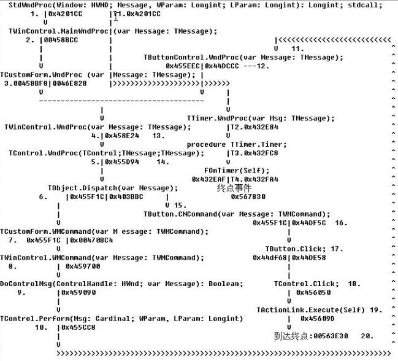

# 疱丁解牛两层 Nag 窗体：`FrameMaster.exe` 相框专家共享版和补丁源码(C#)

> 原文：[`www.pediy.com/kssd/pediy08/pediy8-329.htm`](https://www.pediy.com/kssd/pediy08/pediy8-329.htm)

软件英文名字叫:`FrameMaster.exe`,有两个版本的中文名字.`4.58`版本的`FrameMaster.exe`叫相框专家共享版,`4.88`版本的`FrameMaster.exe`快乐大头贴共享版。

`Borland Delphi 6.0 - 7.0`编译.`4.58`版本的`FrameMaster.exe`中有两个`Nag`(讨厌窗体提示注册)窗体,一个是启动主程序的时候加载第一个`NAG`窗体并延迟几分钟,然后方可点击`button`控件进入主界面.第二个`NAG`出现在软件上功能中,你选择其他共享相框的时候,它会加载阻止!

`4.88`版本的`FrameMaster.exe`只有第一个启动`Nag`窗体,并且与`4.58`版本相同。

本文章针对`4.58`版本二个`Nag`的窗口的,对`4.88`版本也适用的..`4.58`版本的`FrameMaster.exe`相框专家共享版软件在华军下载!

---qiweixue

`Borland Delphi`的`DFM`资源是续列化到`Exe`的`Resouse DATA`节中其中关键的事件如`OnClick`,`OnClose`,`OnCreate`等窗体和控件事件也以这样的字符串命名进入节中并且都赋了事件名,所以要定位这些事件与类很容易一般索引资源就就`ok`,也可以用`dede`反编译。

如果程序对资源节做个手脚,屏蔽了事件名资源那就不爽了,那就需要对`delphi`消息事件分派有所了解,即使不使用`dede`这类反编译,自己也可以根据`VCL`类库定位到想要的事件.

## 分析第一个启动 NAG 窗体

窗体上有四个控件:两个`Button`,一个`Timer`控件,一个`webBorwse`控件.先来破除第一个`NAG`,方法大概有两种,先用`delphi`模拟给大家看看

```
program NAG;

uses
  Forms,TRegForm,TMainForm

{$R \*.res}

begin
  Application.Initialize;
  Application.CreateForm(TRegForm, RegForm);----->创建第一个 Neg 启动窗体
  RegForm.ShowModal-------------->显示模式窗体 RegForm
  Application.CreateForm(TMainForm, MainForm);-------->启动主窗体 TMainForm
  Application.Run;-->启动消息分派
end.
```

看玩以上大体明白了它启动原理,来看`FrameMaster.exe`启动汇编码：

```
00567E12      A1 8C755600   mov     eax, [56758C]----->[56758C]是 TRegForm 类模版
00567E17   .  E8 A45AF0FF   call    0046D8C0--------->Application.CreateForm(TRegForm, RegForm);
00567E1C   .  8B15 D8665700 mov     edx, [5766D8]---------->[5766D8]是 TRegForm 类对象 RegForm 的引用堆地址

00567E22   .  8902          mov     [edx], eax
00567E24   .  A1 D8665700   mov     eax, [5766D8]
00567E29   .  8B00          mov     eax, [eax]
00567E2B   .  8B10          mov     edx, [eax]----->虚表给 edx
00567E2D   .  FF92 EC000000 call    [edx+EC]------>RegForm.ShowModal
00567E33   .  A1 38695700   mov     eax, [576938]----->以后加载 TMainForm 窗体
00567E38   .  8B00          mov     eax, [eax]
```

**方法一**:直接从`TRegForm`直接补丁个跳转指令躲避开`RegForm`的实例化,直接到加载`TMainForm`窗体的加载地址.分析在上边给出了!

**第二中方法是**：

原理是`NAG`窗体启动的时候,修改`NAG`窗体控件的响应时间(1 毫秒够快北)与修改`Timer`控件的事件方法,直接让它跳到主程序界面.自己并没有销毁且还在内存中.

`NAG`窗体设置了一个`15000ms`的记数器如下：

```
00432F2E  |.  6A 00         push    0    ----> imerproc = NULL
00432F30  |.  56           push    esi   --->Timeout=15000ms
00432F31  |.  6A 01        push    1  --->TimerID = 1
00432F33  |.  8B43 34      mov     eax, [ebx+34]
00432F36  |.  50           push    eax  --->hWnd
00432F37  |.  E8 1048FDFF  call    0040774 --->SetTimer
```

`OnTimer`事件响应方法:

```
00567830 > .  53           push    ebx
00567831   .  8BD8         mov     ebx, eax
00567833   .  C605 702B5800>mov    byte ptr [582B70], 1
0056783A   .  B2 01        mov     dl, 1-------->设置 Boolean dl 为真,下边要回复 Button 的 Enabled=true;
0056783C > .  8B83 00030000 mov    eax, [ebx+300]  ----->定位到 Button 控件地址
00567842   .  8B08         mov     ecx, [eax]---->给虚表 ecx
00567844 > .  FF51 64      call    [ecx+64]  ------> 调用虚方法 TButton.SetEnabled(Boolean dl)
00567847   .  33D2         xor     edx, edx----->又一个 Boolean 变量 dl,给 TTimer 的 Enable=false
00567849 > .  8B83 FC020000 mov    eax, [ebx+2FC] --->定位到 Timer1 控件
0056784F > .  E8 30B7ECFF  call    00432F84 --->TTimer.SetEnabled(TTimer;Boolean),自我销毁.
00567854   .  5B           pop     ebx
00567855   .  C3           retn
```

**方法二**,你可以在`OnTimer`事件里补丁个跳转指令直接跳到`TMainForm`窗体并且修改时间为极短.

我用的是第一种绿色方法.

定位`OnTimer`事件地址可以用`dede`来反编译.也可以用`VCL`类库固定模式来分析：

`StdWndProc-->TTimer.WndProc(var Msg: TMessage)->procedure TTimer.Timer->FOnTimer(Self)->FOnTimer(Self)--->终点程序事件响应.`详细看下边的流程图和代码分析.

```
TMessage = packed record
      Msg: Cardinal;
  case Integer of
      0: (
        WParam: Longint;
        LParam: Longint;
        Result: Longint);
      1: (
        WParamLo: Word;
        WParamHi: Word;
        LParamLo: Word;
        LParamHi: Word;
        ResultLo: Word;
        ResultHi: Word);
end;
```

`StdWndProc`这里不做解释,下边有,它直接`TTimer.WndPorc`如下:

`TTimer.WndProc(var Msg: TMessage);`

```
00432E84   .  55           push    ebp
00432E85   .  8BEC         mov     ebp, esp
00432E87   .  51           push    ecx
00432E88   .  53           push    ebx
00432E89   .  56           push    esi
00432E8A   .  57           push    edi
00432E8B   .  8BDA         mov     ebx, edx
00432E8D   .  8945 FC      mov     [ebp-4], eax--------->eax 是 VCL 中的 TTimer 类
00432E90   .  8B33         mov     esi, [ebx]----->[ebx]是 TTMessage 类对象 以上两个寄存器参数是由 StdWndProc 函数传进来的.
00432E92   .  81FE 13010000 cmp    esi, 113---------------->WM_Timer 消息
00432E98   .  75 3F        jnz     short 00432ED9--->不是 WM_Timer 跳
00432E9A   .  33C0        xor     eax, eax
00432E9C   .  55          push    ebp
00432E9D   .  68 BE2E4300 push    00432EBE
00432EA2   .  64:FF30     push    dword ptr fs:[eax]
00432EA5   .  64:8920     mov     fs:[eax], esp
00432EA8   .  8B45 FC     mov     eax, [ebp-4]
00432EAB   .  66:BE EFFF  mov     si, 0FFEF->注意很关键动态方法索引值:EF 是动态发法 TTimer.Timer 动态表占位偏移.
00432EAF   .  E8 A80CFDFF call    00403B5C   ----> CallDynaInst 最终它找到动态方法 TTimer.Timer,
00432EF6   .  C3          retn
```

`mov si ,0Fxx`
`Call 403B5C`

这中动态消息分派方法在`delphi`大量常见,几乎所有的消息事件都是由这种固定模式分派寻找末端的事件方法

从上边的`_CallDynaInst`中它内部又调用`GetDynaMethod(vmt: TClass; selector: Smallint) : Pointer`,这一点与`TObject.Dispatch(var Message)`内部雷同,

它们共同约定的寄存器:`eax`是对象地址,`si`是动态方法索引值,`[eax+vmtDynamicTable]动态方法表`,这比`C++`等其他面向对象多了一个动态函数表格,最终找到事件句柄然后`jmp`进去.

比如:`TButton.Click`,`EB`是它的索引值.用这些索引值找方法是个不错的方式.

`procedure TTimer.Timer;`
`if Assigned(FOnTimer) then FOnTimer(Self);`

```
00432FBC   .  53           push    ebx
00432FBD   .  66:8378 3A 00 cmp    word ptr [eax+3A], 0---->这也是 VCL 固定模式比较 onTimer 事件指针高两位字节是否为空
00432FC2   .  74 0A        je      short 00432FCE--->为空就跳
00432FC4   .  8BD8         mov     ebx, eax
00432FC6   .  8BD0         mov     edx, eax----->Timer 对象地址
00432FC8   .  8B43 3C     mov     eax, [ebx+3C]---->这是什么东东,只是个 self 指针,TObject 类型在这里当然是我们的 TRegFrom 类了.
00432FCB   .  FF53 38     call    [ebx+38]--------->FOnTimer(self)最终跳转到最末端事件方法.就是上边给出那个 OnTimer 事件方法,往上看.
00432FCE   >  5B          pop     ebx
00432FCF   .  C3          retn
```

第一个`Neg`窗体就`over`,空掉了.

## 分析第二个 NAG 窗体

第二个`Neg`登场子了...先说一原由为什么这样分析:第二个`NAG`是功能限制`NAG`,也就是点击窗体的应用功能`Button`(应该是`SpeedButton`,下文的`Buttno`和`SpeedButton`是一个东东)的时候,它会跳出来阻止你到官方网站去注册.

这个关键事件就是`Button(SpeedButton)`类响应的通知单击(`WM_COMMAND`消息`0+`)`Click`事件,在用`dede`的时候没有分析出它们的事件地址,怀疑它对`dede`做了手脚.正是这样的原因才详细分析`VCL`消息分派模型,看看它到底搞了什么东东在里边了.

开始吧。

以下`1-20`个步骤是在分析弹出第二个`Neg`窗口`WM_Command`消息在`VCL`类库中的分派流程,`T1-T2-T3-T4`步骤是第一个`Neg`窗体触发的`WM_Timer`消息在`VCL`类库中的分派流程.当然这个框架也是其他消息在`VCL`类库中分派的流程.



进入第二个`Neg`分析流程,根据流程图中的`WM_Comamnd`消息在`VCL`中分派走.为什么这样做呢?因为开始用`Dede`等反编译的时候,分析不出那两个关键`Button`按钮的事件地址,但是点击它们都有事件响应的,怀疑它反`dede`,所以才

才大废脑细胞分析一二,看看它到底做了什么.开始吧!

`WM_Command`消息分派流程：

`StdWndProc-->TWinControl.MainWndProc--->TCustomForm.WndProc--->TWinControl.WndProc->TControl.WndProc-----`

`--->TObject.Dispatch--->TCustomForm.WMCommand--->TWinControl.WMCommand-->DoControlMsg(父窗体不理会并把控件通知码发向子控件回调函数)--->TControl.Perform---`

`--->TButtonControl.WndProc-->TWinControl.WndProc--->TControl.WndProc--->TObject.Dispatch--->TButton.CNCommand---`

`--->TButton.Click--->TControl.Click--->TButton.CNCommand--->TButton.Click--->TControl.Click;`

注意在跟入分析的时候是逆向反跟踪分析,我这里写出的分析文章是从起点开始分析.

`classes.pas.10958:StdWndProc(Window: HWND; Message, WParam: Longint; LParam: Longint): Longint; stdcall;`

经典的`Stdcall`到`register`调用转化.

```
004201CC  /.  55           push    ebp
004201CD  |.  8BEC         mov     ebp, esp
004201CF  |.  31c0         xor     eax, eax
```


## 004201D1 函数分析

`push eax`

`push dword ptr [ebp+14]` ----> `LParam`

`push dword ptr [ebp+10]` ----> `WParam`

`push dword ptr [ebp+C]` ------> `Message`

`mov edx, esp` ----> 把当前堆栈地址 `esp` 传给 `edx` 好奇怪为什么这么做请看下一个函数

`mov eax, [ecx+4]` ----> 窗口对象指针 `[ecx+4]` 给 `eax`

`call [ecx]` ----> `TWinControl.MainWndProc(var Message: TMessage);`

`add esp, 0C` -----> `Object Pascal` 经典 `register` 调用约定

`pop eax` ----> 返回值放到 `eax`

`pop ebp`

`retn 10`

`Controls.pas.6234`: `TWinControl.MainWndProc(var Message: TMessage);`

```
TMessage = packed record
    Msg: Cardinal;
    case Integer of
        0: (
        WParam: Longint;
        LParam: Longint;
        Result: Longint);
        1: (
        WParamLo: Word;
        WParamHi: Word;
        LParamLo: Word;
        LParamHi: Word;
        ResultLo: Word;
        ResultHi: Word);
end;
```

这个函数中加了两个 `SEH` 异常处理句柄然后跳到各个窗体类重载的 `WndProc`

## 00458BCC 函数分析

`push ebp`

`mov ebp, esp`

`push ecx`

`push ebx`

`push esi`

`push edi`

`mov [ebp-4], eax` ----> `TfrmMain` 对象地址,这里跟踪的是 `TfrmMain` 父窗口类对象

`xor eax, eax`

`push ebp`

`push 00458C24` ------ > 新 `SEH` 处理句柄

`push dword ptr fs:[eax]`

`mov fs:[eax], esp` -----> `SEH` 构造完毕

`xor eax, eax`

`push ebp`

`push 00458C13` ----> 新 `SEH` 处理句柄

`push dword ptr fs:[eax]`

`mov fs:[eax], esp` ---> 新 `SEH` 构造完毕

`mov ebx, [ebp-4]` ---> `TfrmMain` 类对象地址给 `ebx`

`mov eax, [ebx+3C]` -> 又把 `TfrmMain` 类对象地址 `[epx+3C]` 传给 `eax`,下边与很多这样相同的约定.

`call [ebx+38]` ----> `TCustomForm.WndProc(var Message: TMessage)`

`xor eax, eax`

`pop edx`

`pop ecx`

`pop ecx`

`mov fs:[eax], edx` ------------ > 这就是上边函数传递过来的 `edx` 堆栈指针,原来是构造 `SEH`

`push 00458C1A`

`call 004534DC` ---> `Controls.pas.6239:FreeDeviceContexts`

`call 00426D88` ------> `Controls.pas.6240:FreeMemoryContexts`

`retn`

## `TCustomForm.WndProc` 函数分析

`TCustomForm.WndProc(var Message: TMessage)`

没有可处理的消息,把消息分派给父类 `TWinControl.WndProc(var Message: TMessage);`

`eax` 传对象指针,`edx` 传数据消息指针

`mov edx, ebx` -------> `Message` 参数

`mov eax, [ebp-4]` ---> `[ebp-4]` 把 `TfrmMain` 父窗口对象地址给 `eax` 往下传参数

`call 00458E24` --------> `TWinControl.WndProc(var Message: TMessage);`

`pop edi`

`pop esi`

`pop ebx`

`mov esp, ebp`

`pop ebp`

`retn`

`Controls.pas.6309`: `TWinControl.WndProc(var Message: TMessage);`

没有可处理的消息,把消息分派给父类 `TControl.WndProc(TControl;TMessage;TMessage);`

`eax` 传对象指针,`edx` 传数据消息指针

`mov edx, esi` ------> `Message`

`mov eax, ebx` --------> 把 `TfrmMain` 父窗口对象指针给 `eax` 往下传参数

`call 00455D94` ----> `TControl.WndProc(TControl;TMessage;TMessage);`

`add esp, 10`

`pop edi`

`pop esi`

`pop ebx`

`retn`

## `TControl.WndProc` 函数分析

`TControl.WndProc(TControl;TMessage;TMessage);`

同样也没有可处理的消息,把消息再分派给父类 `TObject.Dispatch(var Message);`

约定与前几个消息分派函数一样,都是 `eax` 传对象指针,`edx` 传数据消息指针

`mov edx, ebx` --------> 消息指针 `edx` 存放 `Message` 地址

`mov eax, esi` ----> 对象地址给 `eax`

`mov ecx, [eax]` ------> 虚拟表首地址给 `ecx`

`call [ecx-14]` -------> 虚函数:`TObject.Dispatch(var Message);`

`pop edi`

`pop esi`

`pop ebx`

`mov esp, ebp`

`pop ebp`

## `TObject.Dispatch` 函数分析

`TObject.Dispatch(var Message);`

`TObject.Dispatch` 负责所有的事件方法(在 `delphi IDE` 对象属性面版中的所有事件方法)的分派和动态方法的调用,它是对虚拟方法调用的一种内存资源优化.

`push esi`

`mov si, [edx]` -----> 从 `edx` 消息指针中取走消息给 `si`

`or si, si`

`je short 00403BDC` ----> `si` 如果小于 0 就跳

`cmp si, 0C000`

`jnb short 00403BDC` ----> `si` 如果大于 `C00` 就跳默认消息处理方式

`push eax` ----------------> 保存对象指针

`mov eax, [eax]` ----> 虚函数表给 `eax`

`call 00403B2C` ------> `GetDynaMethod` 索引动态函数指针表

`pop eax` ----------------> 对象指针放到 `eax`

`je short 00403BDC` ----> 如果相等标志为 1 就说明没有相关事件处理方法就跳否则就不跳.

`mov ecx, esi`

`pop esi`

`jmp ecx` ------------> 找到事件句柄,跳到消息处理事件方法

`pop esi`

`mov ecx, [eax]` ----> 对象虚拟表首地址给 `ecx`

`jmp [ecx-10]` -----------> `TControl.DefaultHandler(var Message);`

`retn`

以上消息分派模式是 `VCL` 固定不变,变的是继承对象的多态转换...以上分派模式不光是针对 `WM_COMMAND` 消息,而且还是 `WM_Paint` 等标准 `Window` 分派模式,同样也是控件与父窗体通信的消息分派模式例如 `Win` 标准控件消息(`WM_COMMAND`)和公共控件消息(`WM_NOTIFY`).

由于偶触发了单击 `Buttou` 事件而发出 `Click` 通知给父窗口 `TfrmMain` 类的父窗口,`TfrmMain` 类的父窗口响应 `WM_COMMAND` 消息,看看 `TfrmMain` 类父窗口是否重载处理了 `WM_COMMAND` 事件句柄,当然这也不一定的.之所以分析这么仔细不是做作,因为 `Dede` 分析的 `RCDATA` 节中没有看到任何的 `ButtonClick` 事件名,想必有可能做了某些处理.

继续分析...

## `TCustomForm.WMCommand` 函数分析

`TCustomForm.WMCommand(var Message: TWMCommand)`

注意这个动态事件函数是从父类 `TObject.Dispatch(var Message)` 分派来的,与前面的消息分派函数一样都是 `eax` 传对象指针,`edx` 传数据消息指针

```
TWMCommand = packed record
    Msg: Cardinal;
    ItemID: Word;
    NotifyCode: Word;
    Ctl: HWND;
    Result: Longint;
end;
```

以次检测窗口句柄,和菜单对象

`push ebx`

`push esi`

`mov esi, edx` ----> 消息 `Message` 对象地址给 `esi`.

`mov ebx, eax` --------> `TfrmMain` 类对象指针由 `eax` 传给 `ebx`

`cmp dword ptr [esi+8], 0` ---> `Message.Ctl`

`jnz short 00470BEC` ------> 对象窗口句柄为 0 就跳

`cmp dword ptr [ebx+248], 0` ---> `[ebx+248]` 定位窗口 `TMenu` 对象

`je short 00470BEC` ------> `TMenu` 为空,跳.

`mov dx, [esi+4]` ---> `Message.ItemID` 菜单 ID 号给 `dx`

`mov eax, [ebx+248]` ---> 菜单 `TMenu` 类对象 `[ebx+248]` 传给 `eax`

`call 00468920` ----> `Menu.DispatchCommand(ItemID)`,菜单处理此消息.

`test al, al` ---> 返回 `boolean` 变量给 `al`,`al=1` 成功,`al=0` 失败

`jnz short 00470BF5` ------> 判断 `al` 跳

`mov edx, esi` ----> 消息 `TMessage` 对象给 `edx`


## TWinControl.WMCommand 消息分派

`00470BEE` `. 8BC3` `mov eax, ebx` ------> TfrmMain 对象地址给 eax

`00470BF0` `. E8 0B8BFEFF` `call 00459700` ----------------> TWinControl.WMCommand(var Message: TWMCommand);

`00470BF5` `> 5E` `pop esi`

`00470BF6` `. 5B` `pop ebx`

`00470BF7` `. C3` `retn`

## TWinControl.WMCommand 内部逻辑

`TWinControl.WMCommand(var Message: TWMCommand);`

`00459700` `/$ 53` `push ebx`

`00459701` `|. 56` `push esi`

`00459702` `|. 8BDA` `mov ebx, edx`

`00459704` `|. 8BF0` `mov esi, eax`

`00459706` `|. 8BD3` `mov edx, ebx` ----> 消息 Message 地址 ebx 传给 edx

`00459708` `|. 8B43 08` `mov eax, [ebx+8]` ---> [ebx+8] TMessage 的句柄 Ctl 字段，给 eax 传参数约定

`0045970B` `|. E8 80F9FFFF` `call 00459090` -----> DoControlMsg(ControlHandle: HWnd; var Message): Boolean;

`00459710` `|. 84C0` `test al, al` --------> 返回 boolean 变量给 al，al=1 成功，al=0 失败

`00459712` `|. 75 09` `jnz short 0045971D` ---> 判断 al 跳

`00459714` `|. 8BD3` `mov edx, ebx` ---> 传 Message 给 edx

`00459716` `|. 8BC6` `mov eax, esi` ---> 传 TfrmMain 对象给 eax

`00459718` `|. 8B08` `mov ecx, [eax]` ----> TfrmMain 对象地址给 ecx

`0045971A` `|. FF51 F0` `call [ecx-10]` ------> 还记得它！是哪个虚函数么？在 TObject.Dispatch(var Message) 自己找！

`0045971D` `|> 5E` `pop esi`

`0045971E` `|. 5B` `pop ebx`

`0045971F` `\. C3` `retn`

从上边给出的 VCL `WM_Command` 消息分派路线看出，`TfrmMain` 父窗体没有处理这个消息，只是把它继续传递给下一个消息通道函数。

## DoControlMsg 实现

`DoControlMsg(ControlHandle: HWnd; var Message): Boolean;`

`00459090` `/$ 53` `push ebx`

`00459091` `|. 56` `push esi`

`00459092` `|. 57` `push edi`

`00459093` `|. 8BF2` `mov esi, edx` ----> edx=Message 是传进来的参数把消息又给了 esi

`00459095` `|. 33DB` `xor ebx, ebx` ---> 注意 FindControl 函数的参数是由 eax 传进来的，eax 在上一个函数中已经传进来了

`00459097` `|. E8 A488FFFF` `call 00451940` --------> FindControl(Handle: HWnd): TWinControl;

`0045909C` `|. 8BF8` `mov edi, eax` ----> 返回 TWinControl 类对象在 eax 中，传给 edi。注意我们这里找到这个控件是预知的 Tbutton 类

`0045909E` `|. 85FF` `test edi, edi` ----> 判断 TWinControl 类对象是否为空

`004590A0` `|. 74 1B` `je short 004590BD` 空就跳

`004590A2` `|. 8B46 08` `mov eax, [esi+8]` ---> [esi] 是 TWMCommand 对象 Ctl 域

`004590A5` `|. 50` `push eax`

`004590A6` `|. 8B4E 04` `mov ecx, [esi+4]` ---> [esi] 是 TWMCommand 对象中 ItemID 和 NotifyCode 域

`004590A9` `|. 8B16` `mov edx, [esi]` ---> [esi] 是 TWMCommand 对象中 Msg 域

`004590AB` `|. 81C2 00BC0000` `add edx, 0BC00` ---> Window Notify Message 加上 BC00 就是 VCL FrameWork 内部约定的控件通知消息

`004590B1` `|. 8BC7` `mov eax, edi` ---> 把 Tbutton 类对象地址给 eax，现在开始向 Button 控件发送通知代码了，父 TfrmMain 窗体没有处理 Click 事件通知句柄。

`004590B3` `|. E8 10CCFFFF` `call 00455CC8` ------> TControl.Perform(Msg + CN_BASE, WParam, LParam); CN_BASE=BC00

`004590B8` `|. 8946 0C` `mov [esi+C], eax` ---> [esi+C] 是 TWMCommand 对象的 Result 域

`004590BB` `|. B3 01` `mov bl, 1` ---> DoControlMsg 函数返回成功传 bl=1

`004590BD` `|> 8BC3` `mov eax, ebx` ---> 清零

`004590BF` `|. 5F` `pop edi`

`004590C0` `|. 5E` `pop esi`

`004590C1` `|. 5B` `pop ebx`

`004590C2` `\. C3` `retn`

## TControl.Perform 实现

`TControl.Perform(Msg + CN_BASE, WParam, LParam): Longint;`

`00455CC8` `/$ 55` `push ebp`

`00455CC9` `|. 8BEC` `mov ebp, esp`

`00455CCB` `|. 83C4 F0` `add esp, -10`

`00455CCE` `|. 53` `push ebx`

`00455CCF` `|. 8955 F0` `mov [ebp-10], edx` ----> edx=Msg+CN_BASE，edx 是上一函数传进来

`00455CD2` `|. 894D F4` `mov [ebp-C], ecx` ----> Wparam 同上

`00455CD5` `|. 8B55 08` `mov edx, [ebp+8]` ----------> [ebp+8] 也是从那个函数中传进来的，是 TWMCommand 对象 Ctl 域

`00455CD8` `|. 8955 F8` `mov [ebp-8], edx` ----> TWMCommand 对象 Ctl 域给 [ebp-8]

`00455CDB` `|. 33D2` `xor edx, edx`

`00455CDD` `|. 8955 FC` `mov [ebp-4], edx` ----> Message.Result=0

`00455CE0` `|. 85C0` `test eax, eax` -------------> eax 也是上一个函数传进来的 Tbutton 对象指针

`00455CE2` `|. 74 0B` `je short 00455CEF` 空就跳

`00455CE4` `|. 8D55 F0` `lea edx, [ebp-10]` ----> 由上边构造好的消息类 TMessage 地址给 edx 指针，再传给下边的函数

`00455CE7` `|. 8BD8` `mov ebx, eax` ---> Tbutton 对象指针 eax，传给 ebx

`00455CE9` `|. 8B43 3C` `mov eax, [ebx+3C]` ---> [ebx+3c] 与 eax 同指向一个 Tbutton 对象

`00455CEC` `|. FF53 38` `call [ebx+38]` --> 这个虚函数熟悉不？它在 TWinControl.MainWndProc 中出现过。这里出现了多态了应该调用 TButton.WndProc(var Message: TMessage)

`00455CEF` `|> 8B45 FC` `mov eax, [ebp-4]` ---> 返回值又送到 eax

`00455CF2` `|. 5B` `pop ebx`

`00455CF3` `|. 8BE5` `mov esp, ebp`

`00455CF5` `|. 5D` `pop ebp`

`00455CF6` `\. C2 0400` `retn 4`

到这里应该调用 `TButtonControl.WndProc(var Message: TMessage)` 控件通知分派路线了，检查是否 TButton 类有处理 Click 通知事件处理器！上边已经说了 VCL 消息模式分派是固定的模式所以不用分析了。

它应该与上边 `TCustomForm.WndProc(var Message: TMessage)` 分派路线是相同的，但是终点是不同的。这正是多态对象改变了终点，一个 `TfrmMain` 对象，一个 `TButton` 类。

简单给出与上边相同的分派路线：

## 消息分派路径

`TButtonControl.WndProc(var Message: TMessage)`

`0044DD34` `> \ 8BD7` `mov edx, edi` ----> Message 参数传递给 edx

`0044DD36` `. 8BC3` `mov eax, ebx` --------> TButton 对象指针给 eax

`0044DD38` `. E8 E7B00000` `call 00458E24` ---> TWinControl.WndProc(var Message: TMessage);

`0044DD3D` `> 5F` `pop edi`

`0044DD3E` `. 5E` `pop esi`

`0044DD3F` `. 5B` `pop ebx`

直接给出来，与上边调用地址都相同。

`TWinControl.WndProc(var Message: TMessage)` --> `TControl.WndProc(TControl;TMessage;TMessage)`

--> `TObject.Dispatch(var Message)` ------> 终点到这里分派路线转了，开始发送到 TButton 事件处理器中。还记得我们上边处理 VCL 通知 Click 代码是多少么：(WM_COMMAND+CN_BASE)

`TButton.CNCommand(var Message: TWMCommand);`

`0044DF5C` `. 56` `push esi`

`0044DF5D` `. 66:837A 06 00` `cmp word ptr [edx+6], 0` ---> [edx+6] 存放 Message 的 NotifyCode，0 数值代表 BN_CLICKED 宏。

`0044DF62` `. 75 09` `jnz short 0044DF6D` ---> 不等就跳

`0044DF64` `. 66:BE EBFF` `mov si, 0FFEB` ----> 注意传给 si 的数值应该是 EB 是个关键的动态方法索引值

`0044DF68` `. E8 EF5BFBFF` `call 00403B5C` -> procedure _CallDynaInst; 这个函数根据上边 si 传进来的索引值寻找动态方法它内部调用实现与 TObject.Dispatch(var Message) 相同。

`0044DF6D` `> 5E` `pop esi`

`0044DF6E` `. C3` `retn`

从上边进入 procedure `_CallDynaInst` 而它内部又调用 `GetDynaMethod(vmt: TClass; selector: Smallint) : Pointer`，这一点与 `TObject.Dispatch(var Message)` 内部雷同，

它们共同约定的寄存器：`eax` 是对象地址，`si` 是动态方法索引值，`[eax+vmtDynamicTable]` 动态方法表，这比 C++ 等其他面向对象多了一个动态函数表格，最终找到句柄然后 jmp 进去。

我们这里最终跳到了 `TButton.Click`，由此看出 `EB` 索引的是 `TButton.Click`，当然 VCL 内部动态方法索引值还有很多，仅供参考用，或许有变动。

`TCustomEdit.CNCommand(var Message: TWMCommand);` `B3`

`BeginAutoDrag;ed`

来到 TButton.Click 动态方法中...

## TButton.Click 实现

`0044DE58` `. 53` `push ebx`

`0044DE59` `. 8BD8` `mov ebx, eax` --------> TButton 对象地址由 eax 传给 ebx

`0044DE5B` `. 8BC3` `mov eax, ebx` ----> eax 函数参数 Self

`0044DE5D` `. E8 02E60100` `call 0046C464` ----> GetParentForm(Self)，查找 TButton 父类窗体。

`0044DE62` `. 85C0` `test eax, eax` ---> 空就跳

`0044DE64` `. 74 0C` `je short 0044DE72`

`0044DE66` `. 8B93 14020000` `mov edx, [ebx+214]` -----> [ebx+214] 是 TButton 对象的 ModalResult 字段结果，给 edx 保存

`0044DE6C` `. 8990 4C020000` `mov [eax+24C], edx` -> [eax+24C] 是 TButton 父窗体 TfrmMain 的 ModalResult，它的数值由上边传进来。这是处理模式对话框的时候，当 Button_Click 事件返回的时候是不是要把控件 ID 给父窗体，以便交互约定调用

`0044DE72` `> 8BC3` `mov eax, ebx` ----> TButton 对象地址给 eax，开始调用 TBuuton 的继承父类方法 TControl.Click

`0044DE74` `. E8 D7810000` `call 00456050` ----> TControl.Click

`0044DE79` `. 5B` `pop ebx`

`0044DE7A` `. C3` `retn`

## TControl.Click

关键的 `TControl.Click`

到这里真相大白了...

## Delphi Form 资源定义示例

```
object Button2: TButton
  Left = 288
  Top = 8
  Width = 75
  Height = 25
  Caption = 'demo'
  TabOrder = 5
```


# 事件分析与逆向工程笔记

`OnClick = Button1Click`------->触发的 `TButton` 事件名，并把指针给了 `OnClick` 做了代理，搜 1 下 `Button1Click` 可以定位到其事件入口

```
end
```

用 Dede 反编译没有找出触发 Button 按钮的事件地址，但是点击 Button 的确有注册 Neg 出现来...感觉里边有东东在作梗，终于在这里找出了眉毛来。

仔细看看 `TControl.Click` 里边调用了三个虚函数第一个是 `TAction` 类的 `TAction.OnExecute` 第二是 `TActionLink.Execute`，第三个才是 `TButton.FOnClick(Self)`

看上边的 Delphi Form 资源 `OnClick` 代理的是第三个函数的指针即是:`TButton.FOnClick(Self)` 这也是通常我们需要的 Button 事件。而其它两个被疏忽掉的事件才是真正本片的内幕，它可害苦了我，害的我苦苦遍历了这三个事件。纯熟于个人巧合，在简单的说一下，当用 Dede 编译的时候没有发现 Button 的事件处理地址，但是点击 Button 还出现 Neg，这说明有事件响应了，(后来才知道在 `TfrmMain` 中有个 `TActionList` 控件，它内部的 `Action` 对象代理这个 Button 的事件处理)，开始怀疑是反调试了反 Dede，其实都是这 `TAction` 对象在作梗，害的我掘出 VCL 一点点跟...本片莫非虚构的，若有雷同纯属巧合:=)

```
00456050   $  53             push    ebx
00456051   |.  8BD8          mov     ebx, eax
00456053   |.  66:83BB 22010>cmp     word ptr [ebx+122],0--->先比较 FOnClick 事件地址高二位字节是否为 0,如果为 0 说明没有 TButton.FOnClick(Self)事件
0045605B   |.  74 2D         je      short 0045608A--->TButton.FOnClick(Self)空否,就跳.
0045605D   |.  8BC3         mov     eax, ebx---->TButton 对象指针给 eax
0045605F   |.  8B10         mov     edx, [eax]----->TSpeedButton 虚函数表给 edx
00456061   |.  FF52 3C      call    [edx+3C]---------------------->虚函数 TAction.OnExecute,由 eax 返回 TAction 对象地址
00456064   |.  85C0         test    eax, eax---->空就跳
00456066   |.  74 22        je      short 0045608A
-----------------------------------------------------
00456096   |.  8BD3         mov     edx, ebx--->TSpeedButton 对象地址给 edx
00456098   |.  8B43 6C      mov     eax, [ebx+6C]---->取出 TSpeedButton 内包容对象 SpeedButtonActionLink
0045609B   |.  8B08         mov     ecx, [eax]--->SpeedButtonActionLink 对象虚表给 ecx
0045609D   |.  FF51 18      call    [ecx+18]--------------------虚函数 TActionLink.Execute(Self)这才是真正的事件处理
-----------------------------------------------------
004560A0   |.  EB 18        jmp     short 004560BA
004560A2   |>  66:83BB 22010>cmp     word ptr [ebx+122],>
004560AA   |.  74 0E        je      short 004560BA
004560AC   |.  8BD3         mov     edx, ebx
004560AE   |.  8B83 24010000mov     eax, [ebx+124]
004560B4   |.  FF93 20010000call    [ebx+120]  -------------->TButton.FOnClick(Self)
004560BA   |>  5B          pop     ebx
004560BB   \\.  C3         retn
```

## 终点

看 Delphi Form 资源定义

```
object acApply: TAction
    Caption = #24212#29992#27492#30456#26694
    Hint = #24212#29992#27492#30456#26694
    ImageIndex = 2
    OnExecute = acApplyExecute--------------------->这才是 TSpeedButton 的响应的事件.兜了一个大圈圈出来.
end
```

从上边的分析 `TSpeedButton` 的 `OnClick` 没有被赋值，而是把 `TSpeedButton` 事件加入 `TActionLink` 中关联了一个 `Action` 对象，并且这个 `TAction` 事件名为 `acApplyExecute`。

用 Dede 分析 `TActionLink` 也能得到目标地址。

直接来到 `TAction.OnExecute` 事件处理，也就是 `TSpeedButton` 的事件处理，Neg 窗体就在这个事件中出现了...

```
00563E30   /.  55            push    ebp
00563E31   |.  8BEC          mov     ebp, esp
00563E33   |.  83C4 C0      add     esp, -40---------->看下面提取来关键变量
00563E36   |.  53            push    ebx
00563E37   |.  56            push    esi
00563E38   |.  57            push    edi
00563E39   |.  33C9          xor     ecx, ecx
00563E3B   |.  894D C0      mov     [ebp-40], ecx
00563E3E   |.  894D C8      mov     [ebp-38], ecx
00563E41   |.  894D CC      mov     [ebp-34], ecx
00563E44   |.  894D D0      mov     [ebp-30], ecx
00563E47   |.  894D F4      mov     [ebp-C], ecx
00563E4A   |.  8BD8          mov     ebx, eax
00563E4C   |.  33C0          xor     eax, eax
```

### 提取局部变量

`PChar_[ebp-40]`, `PChar_[ebp-38]`, `pChar_[ebp-34]`, `PChar_[ebp-30]`, `PChar_[ebp-C]`

### 提取关键比较 Boolean 变量

`Boolean_[ebp-20]`, `Boolean_[ebp-21]`

```
00563E4E   |.  55            push    ebp
00563E4F   |.  68 FC415600   push    005641FC ----> 新 SEH 处理句柄
00563E54   |.  64:FF30       push    dword ptr fs:[eax]
00563E57   |.  64:8920       mov     fs:[eax], esp ----->SEH 构造完毕.
00563E5A   |.  C645 E0 00    mov     byte ptr [ebp-20], 0  -----> 初始化 Boolean 变量[ebp-20]:=false
00563E5E   |.  C645 DF 00    mov     byte ptr [ebp-21], 0  -------->初始化 Boolean 变量[ebp-20]:=flase
00563E62   |.  8B83 E0040000mov     eax, [ebx+4E0]  ------> [ebx]为 TfrmMain 类对象的堆地址[ebx+4E0]ImageEnView_ Main 对象
00563E68   |.  E8 170AFDFF   call    00534884 ----->检查 [ebx+4B8]_TImageEnIO
00563E6D   |.  8B80 64010000mov     eax, [eax+164]   ------> 定位到 TIOParamsVals 类对象...
00563E73   |.  8378 0C 00    cmp     dword ptr [eax+C], 0  --> [eax+c] 指向选择的文件名缓冲区指针
00563E77   |.  75 1A         jnz     short 00563E93  -->  如果文件名缓冲空就提示请选择图片对话框
00563E79   |.  6A 00         push    0
00563E7B   |.  B9 0C425600   mov     ecx, 0056420C --> "提示"
00563E80   |.  BA 14425600   mov     edx, 00564214-------->"请先选择图片"
00563E85   |.  A1 38695700   mov     eax, [576938]--------> TApplication 对象指针
00563E8A   |.  8B00          mov     eax, [eax]------>TApplication 虚表
00563E8C   |.  E8 B715F1FF   call    00475448------------>弹出请先选择图片对话框
00563E91   |.  EB 04         jmp     short 00563E97
00563E93   |>  C645 E0 01    mov     byte ptr [ebp-20], 1  -->  Boolean 变量[ebp-20]:=true
00563E97   |>  8B83 60030000mov     eax, [ebx+360]  --> 定位到 TComboBox 类对象对象.
00563E9D   |.  8B10          mov     edx, [eax]   -----> TComboBox 对象地址给 edx,准备取用户选择 CombBox 的索引值
00563E9F   |.  FF92 CC000000call    [edx+CC] ----->  TCustomCombo.GetItemIndex: Integer; SendMessage(Handle, CB_GETCURSEL, 0, 0);
00563EA5   |.  85C0          test    eax, eax      ----->  如果用户选择了大于 1 的 Combox 索引值,下边就提示注册
00563EA7   |.  7E 2B         jle     short 00563ED4   ----->  小于等于 0 就跳
00563EA9   |.  6A 24         push    24
00563EAB   |.  B9 24425600   mov     ecx, 00564224   --> "提示注册信息购买正版..."
00563EB0   |.  BA 34425600   mov     edx, 00564234  ----------> "提示注册信息购买正版..."
00563EB5   |.  A1 38695700   mov     eax, [576938]
00563EBA   |.  8B00          mov     eax, [eax]
00563EBC   |.  E8 8715F1FF   call    00475448  --------> Neg 对话框此时就出现了.上边有两个 Button 控件,
00563EC1   |.  83F8 06       cmp     eax, 6   ---------> 比较两 button ID 号...
00563EC4   |.  75 12         jnz     short 00563ED8  -------> 不等于 6 就跳
00563EC6   |.  BA 28435600   mov     edx, 00564328 ------->ASCII "http://www.softreg.com.cn/...."
00563ECB   |.  8BC3          mov     eax, ebx
00563ECD   |.  E8 96060000   call    00564568  -------->函数调用 Shell32.ShellExecuteA 输出 Soft's Web
00563ED2   |.  EB 04         jmp     short 00563ED8
00563ED4   |>  C645 DF 01    mov     byte ptr [ebp-21], 1  --------> Boolean 变量[ebp-20]:=true
00563ED8   |>  8A45 E0       mov     al, [ebp-20]  -----------> 把 Boolean 变量[ebp-20]给 al
00563EDB   |.  2245 DF       and     al, [ebp-21]
00563EDE   |.  0F84 ED020000je      005641D1  --------------> 这是关键 jump 跳了 game over 与 Boolean[ebp-20]、[ebp-21]有关系
```

## 图片资源结构

在软件目录中包含 `frames` 目录，`frames` 目录又有 0-7 个 8 个图片文件夹，0 包含了以 a,b,c 开头的文件，1 文件夹只包含了 b 开头图片文件，2-7 文件夹是放的是 c 开头的文件。

*   以 a 开头的图片文件(比如 `a1002.jpg` 放在 0 文件夹内),jpg 文件中是黑象素渲染的图片框
*   以 b 开头的图片文件(比如 `b1002.jpg` 放在 1 文件夹内),jpg 文件中是黑象素渲染的图片外框,白象素渲染的图片内框
*   以 c 开头的图片文件(比如 `c1002.jpg` 放在 2-7 文件夹内),jpg 文件中是彩色的渲染的图片外框,同样白象素渲染的图片内框

就形状颜色象素的复杂程度应该是 a<b<c，所以这个软件只处理为数不多的简单的图片，其他复杂的 b,c 类型文件都没有处理也是放在 1-7 下边的文件几乎都不能处理。

注意一点:在 0 文件夹内图片都是通明背景，而其他 1-7 文件夹内图片全是白色背景估计需要用 PhotoShop 等图形处理软件处理 1 下估计才能用。我没有试猜测而已。

### 全局常量

```
const char_[0056439C]=a;
const char_[00564390]=b;
const char_[005643A8]=c;
```

### 局部变量

*   `PChar_[ebp-40]`:存放以 c 开头的文件
*   `PChar_[ebp-38]`:存放以 b 开头的文件
*   `pChar_[ebp-34]`:存放以 a 开头的文件
*   `PChar_[ebp-30]`:存放以 b 开头的文件
*   `PChar_[ebp-C]`:存放文件名与路径全名

### 判断是否以 b 开头的图片文件

```
00563F7B   |.  8D55 D0       lea     edx, [ebp-30]
00563F7E   |.  8B45 F4       mov     eax, [ebp-C] ----> [ebp-C]存放选择的图片路径和名称
00563F81   |.  E8 DE55EAFF   call    00409564      ----> SysUtils.ExtractFileName(AnsiString):AnsiString;提取文件名
```


# 逆向分析与补丁源码

## 汇编代码分析

### 判断以 `b` 开头的图片文件

```
00563F86  |.  8B55 D0       mov     edx, [ebp-30]  ---->  返回文件名放到 PChar_[ebp-30]  
00563F89  |.  B8 90435600   mov     eax, 00564390---->const char_[00564390]=b;  
00563F8E  |.  E8 A50DEAFF   call    00404D38 ---->StrPos(const Str1, Str2: PChar): PChar;比较字符串  
00563F93  |.  48           dec     eax  
00563F94  |.  74 20        je      short 00563FB6---->关键跳  

判断是否以 a 开头的图片文件  

00563F96  |.  8D55 CC       lea     edx, [ebp-34]  
00563F99  |.  8B45 F4       mov     eax, [ebp-C]          
00563F9C  |.  E8 C355EAFF   call    00409564 ---> SysUtils.ExtractFileName(AnsiString):AnsiString;  
00563FA1  |.  8B55 CC       mov     edx, [ebp-34]   ---->  返回文件名放到 PChar_[ebp-30]    
00563FA4  |.  B8 9C435600   mov     eax, 0056439C--->const char_[0056439C]=a;  
00563FA9  |.  E8 8A0DEAFF   call    00404D38  ---->StrPos(const Str1, Str2: PChar): PChar;比较字符串  
00563FAE  |.  85C0         test    eax, eax  
00563FB0  |.  0F8E 2A010000 jle     005640E0---->关键跳  

这个也是判断是否以 b 开头的图片文件  

00563FDB  |.  8D55 C8       lea     edx, [ebp-38]  
00563FDE  |.  8B45 F4       mov     eax, [ebp-C]  
00563FE1  |.  E8 7E55EAFF   call    00409564                 
00563FE6  |.  8B55 C8       mov     edx, [ebp-38]            
00563FE9  |.  B8 90435600   mov     eax, 00564390     
00563FEE  |.  E8 450DEAFF   call    00404D38  
00563FF3  |.  48           dec     eax  
00563FF4  |.  75 0D        jnz     short 00564003  

判断是否以 c 开头的图片文件  

005640E0  |>  \8D55 C0       lea     edx, [ebp-40]  
005640E3  |.  8B45 F4       mov     eax, [ebp-C]    --->AnsiString   
005640E6  >|.  E8 7954EAFF   call    00409564  ---->SysUtils.ExtractFileName(AnsiString):AnsiString;提取文件名  
005640EB  |.  8B55 C0       mov     edx, [ebp-40]--->返回文件名到 PChar_[ebp-40]  
005640EE  |.  B8 A8435600   mov     eax, 005643A8  
005640F3  >|.  E8 400CEAFF   call    00404D38  ————->StrPos(const Str1, Str2: PChar): PChar;比较字符串  
005640F8  |.  48           dec     eax  
005640F9  |.  75 56        jnz     short 00564151------>关键跳  
```

以上关键脉络全部分析完毕了，如果你在动鼠标指点一二就 `OVER` 的时候，不如仔细分析清晰那才受用，也不辜负偶写了这么多东东，在说里边写的 `bug` 多多还需要大家指点三四！

尤其动鼠标就 `over` 它，不如写段程序 `over` 它雅观...

## C# 补丁去除两层 Neg 补丁源代码

```csharp
using System;
using System.Drawing;
using System.ComponentModel;
using System.Windows.Forms;
using System.IO;

namespace Pediy
{
    public class PediyForm : System.Windows.Forms.Form
    {
        private Button button2;
        private Label label1;
        private TextBox textBox1;
        private OpenFileDialog openFileDialog1;
        private LinkLabel linkLabel1;
        private Button button1;
        private ProgressBar progressBar1;
        private Timer timer1;
        private IContainer components;

        public PediyForm()
        {
            this.InitializeComponent();
        }

        private void InitializeComponent()
        {
            this.components = new System.ComponentModel.Container();
            this.button1 = new System.Windows.Forms.Button();
            this.button2 = new System.Windows.Forms.Button();
            this.label1 = new System.Windows.Forms.Label();
            this.textBox1 = new System.Windows.Forms.TextBox();
            this.openFileDialog1 = new System.Windows.Forms.OpenFileDialog();
            this.linkLabel1 = new System.Windows.Forms.LinkLabel();
            this.progressBar1 = new System.Windows.Forms.ProgressBar();
            this.timer1 = new System.Windows.Forms.Timer(this.components);
            this.SuspendLayout();
            //  
            // button1  
            //  
            this.button1.Location = new System.Drawing.Point(380, 12);
            this.button1.Name = "button1";
            this.button1.Size = new System.Drawing.Size(69, 23);
            this.button1.TabIndex = 0;
            this.button1.Text = "Open(&P)";
            this.button1.UseVisualStyleBackColor = true;
            this.button1.Click += new System.EventHandler(this.button1_Click);
            //  
            // button2  
            //  
            this.button2.Location = new System.Drawing.Point(380, 42);
            this.button2.Name = "button2";
            this.button2.Size = new System.Drawing.Size(69, 23);
            this.button2.TabIndex = 1;
            this.button2.Text = "OK(&O)";
            this.button2.UseVisualStyleBackColor = true;
            this.button2.Click += new System.EventHandler(this.button2_Click);
            //  
            // label1  
            //  
            this.label1.AutoSize = true;
            this.label1.Location = new System.Drawing.Point(10, 17);
            this.label1.Name = "label1";
            this.label1.Size = new System.Drawing.Size(35, 12);
            this.label1.TabIndex = 2;
            this.label1.Text = "File:";
            //  
            // textBox1  
            //  
            this.textBox1.Location = new System.Drawing.Point(57, 12);
            this.textBox1.Name = "textBox1";
            this.textBox1.Size = new System.Drawing.Size(305, 21);
            this.textBox1.TabIndex = 4;
            //  
            // openFileDialog1  
            //  
            this.openFileDialog1.FileName = "FrameMaster.exe";
            this.openFileDialog1.Filter = "Open File(*.exe)|*.exe";
            this.openFileDialog1.ReadOnlyChecked = true;
            this.openFileDialog1.RestoreDirectory = true;
            this.openFileDialog1.Title = "<Please select file path....>";
            //  
            // linkLabel1  
            //  
            this.linkLabel1.AutoSize = true;
            this.linkLabel1.Location = new System.Drawing.Point(12, 51);
            this.linkLabel1.Name = "linkLabel1";
            this.linkLabel1.Size = new System.Drawing.Size(53, 12);
            this.linkLabel1.TabIndex = 6;
            this.linkLabel1.TabStop = true;
            this.linkLabel1.Text = "About(&A)";
            this.linkLabel1.LinkClicked += new System.Windows.Forms.LinkLabelLinkClickedEventHandler(this.linkLabel1_LinkClicked);
            //  
            // progressBar1  
            //  
            this.progressBar1.Dock = System.Windows.Forms.DockStyle.Bottom;
            this.progressBar1.Location = new System.Drawing.Point(0, 66);
            this.progressBar1.Name = "progressBar1";
            this.progressBar1.Size = new System.Drawing.Size(461, 23);
            this.progressBar1.TabIndex = 8;
            //  
            // timer1  
            //  
            this.timer1.Tick += new System.EventHandler(this.timer1_Tick);
            //  
            // PediyForm  
            //  
            this.AcceptButton = this.button2;
            this.ClientSize = new System.Drawing.Size(461, 89);
            this.Controls.Add(this.progressBar1);
            this.Controls.Add(this.linkLabel1);
            this.Controls.Add(this.textBox1);
            this.Controls.Add(this.label1);
            this.Controls.Add(this.button2);
            this.Controls.Add(this.button1);
            this.MaximizeBox = false;
            this.MinimizeBox = false;
            this.Name = "PediyForm";
            this.StartPosition = System.Windows.Forms.FormStartPosition.CenterScreen;
            this.Text = "www.pediy.com---qiweixue";
            this.TopMost = true;
            this.Load += new System.EventHandler(this.PediyForm_Load);
            this.ResumeLayout(false);
            this.PerformLayout();
        }

        private void button1_Click(object sender, EventArgs e)
        {
            openFileDialog1.ShowDialog();
            textBox1.Text = openFileDialog1.FileName;
        }
    }
}
```


```csharp
private void linkLabel1_LinkClicked(object sender, LinkLabelLinkClickedEventArgs e)  
{  
    MessageBox.Show("http://www.pediy.com---qiweixue");  
}  

private void button2_Click(object sender, EventArgs e)  
{  
    if (textBox1.Text != "")  
    {  
        byte[] pebuf1 = new Byte[] { 235, 43 };  
        byte[] pebuf2 = new Byte[] { 235, 31, 144, 114, 114 };  
        FileStream fs1 = new FileStream(textBox1.Text, FileMode.Open, FileAccess.ReadWrite);  
        fs1.Seek(1454759, SeekOrigin.Begin);  
        fs1.Write(pebuf1, 0, pebuf1.Length);  
        fs1.Seek(1470994, SeekOrigin.Begin);  
        fs1.Write(pebuf2, 0, pebuf2.Length);  
        fs1.Close();  
        button2.Enabled = false;  
        timer1.Enabled=true;  
    }  
    else  
    {  
        MessageBox.Show("No File's Name...");  
    }  
}  

private void PediyForm_Load(object sender, EventArgs e)  
{  
    progressBar1.Value = 0;  
}  

private void timer1_Tick(object sender, EventArgs e)  
{  
    while (progressBar1.Value<100)  
    {  
        //progressBar1.Value = +10;好象不支持这中语法  
        progressBar1.Value = progressBar1.Value + 10;  
        progressBar1.Refresh();  
    }  
    timer1.Enabled = false;  
}  

}  

public class RunPediyForm  
{  
    [STAThread]  
    public static void Main()  
    {  
        Application.Run(new PediyForm());  
    }  
}  

}
```

感谢指点错误 bug...

附件点击下载  

菩提本无树,明镜亦非台。本来无一物,何处惹尘埃  

`4dd466d0e1e0cc123afbe504da2462ca`
