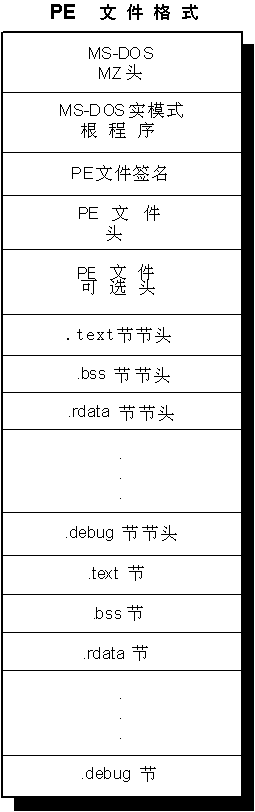
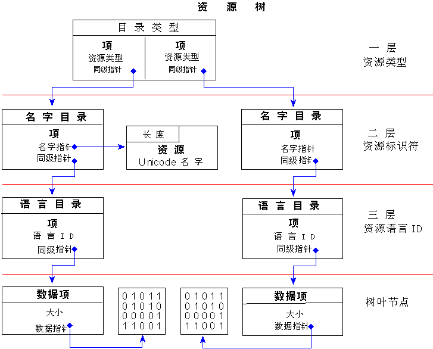
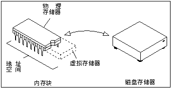

# 可移植的可执行文件格式全接触（附注释）

> 原文：[`www.pediy.com/kssd/pediy08/pediy8-184.htm`](https://www.pediy.com/kssd/pediy08/pediy8-184.htm)

PE 文件格式系列译文之二----  
  
【翻译】可移植的可执行文件格式全接触（附注释）  
（The Portable Executable File Format from Top to Bottom）

\===================================================================  
原著：Randy Kath (微软开发者网络技术组)  
翻译：ah007（沈忠平)

【说明：本译文的所有大小标题序号都是译者添加，以方便大家阅读。圆圈内的数字是注释的编号，注释全部译自网络。另外，本系列译文之一中已有的注释这里就不再重复了。所有注释仅供参考，如有不妥之处，敬请原谅！----译者】

## 一、摘要

`Windows NT 3.1` 版操作系统引进了一种叫做可移植的可执行(PE)文件格式的新文件格式。尽管《可移植的可执行文件格式规范》的内容相当含糊，但公众已可得到了；并且它也已被包括在我们的微软开发者网络 CD（其中的：`Windows NT` 文件格式规范->规范->规范和战略）当中。

不过，对开发者来说，仅此规范一文并不足以提供足够的信息来让他们对 `PE` 文件格式的理解变得容易，哪怕是更合理一点。本文档的目的就是用来解决这个问题的。从本文档之中，你可找到整个 `PE` 文件格式的完整的解释，还有所有必须的结构体的描述以及演示怎样使用这个信息的源代码例子。

出现在本文中的所有源代码例子都是从一个叫 `PEFILE.DLL` 的动态链接库中例举出来的。我写出这个 DLL 的目的就是为了发现包含在一个 `PE` 文件中的重要信息。这个 DLL 和它的源代码也被包含在这个 CD 当中作为 `PE` 文件例子程序的一部分；你可以自由地将这个 DLL 使用在你自己的应用程序之中。同样，你也可以自由地取得这些源代码并在它的基础之上为你的任何目的去构建（程序）。在本文的末尾，你会找到一个从 `PEFILE.DLL` 中导出的简短的函数列表，以及怎样使用它们的解释。我想，你会发现利用这些函数会让你对 `PE` 文件格式的理解要容易一些。

## 二、介绍

最近 `Windows` 操作系统的家族得到了微软® `Windows NT` 操作系统的加入给开发环境带来了很多的变化，并且也给应用程序本身带来了不小的变化。比较重要的变化之一就是对可移植的可执行（`PE`）文件格式的引入。新的 `PE` 文件格式主要源自于 `UNIX` 操作系统常用的 `COFF`(Common Object File Format，通用目标文件格式)规范。不过，为了保持对以前各版的 `MS-DOS`®和 `Windows` 操作系统的兼容性，`PE` 文件格式也保留了大家过去比较熟悉的 `MS-DOS` 的 `MZ` 头。

在本文中，`PE` 文件格式将使用从头到尾的方式来解释。文中将依照你通读文件的内容时文件的每个组成部分出现的顺序来一一讨论它们，开始时是头部并沿着你曾走过的路线全程直到结束。

许多单个的文件组成部分的定义来自于 `WINNT.H` 文件中，这是一个包含在 `Windows NT` 的微软 `Win32`™软件开发工具箱(SDK)中的文件。在这个文件中，你能找到被用来表示文件中各个组成部分、每个文件头和数据目录等的结构类型定义。而其他方面，在文件中 `WINNT.H` 缺少对文件结构的足够的定义。在这些方面，我决定定义我自己的、能被用来访问文件数据的新结构。你将会发现这些结构被定义在 `PEFILE.H` 文件中，而这个文件就是用来建立 `PEFILE.DLL` 的。全套的 `PEFILE.DLL` 开发文件包含在 `PEFILE` 实例应用这一节中。

作为 `PEFILE.DLL` 实例代码的补充，伴随此文的还有一个单独的、名为 `EXEVIEW.EXE` 的基于 `Win32` 的实例程序。此实例的建立基于以下两个目的：第一，我需要一种能检验 `PEFILE.DLL` 功能的方法，在一些情况下这种检验要求同时能查看多个文件----也就是说多重查看的支持。第二，领会 `PE` 文件格式的许多工作都和能交互地看见数据有关。例如，要搞清输入地址名字表是怎样的结构，我得同时查看 `.idata` 节的节头、输入映象文件的数据目录、可选头、以及实际的 `.idata` 节的节身等等。`EXEVIEW.EXE` 就是查看上述信息的最佳人选。

不再罗嗦，我们马上开始。

## 三、PE 文件的结构

`PE` 文件格式被组织为一个线性的数据流。开始的是 `MS-DOS` 头，然后是实模式的程序根，再就是 `PE` 文件签名，紧随其后的便是 `PE` 文件头和可选头。在这之后，出现的是所有的节头，再跟着的就是所有节的节身。文件常以一些其它方面的杂项信息，包括重定位信息、符号表信息、行数信息以及字串表数据等作为结尾。所有这些都可以通过查看图 1 中的图象信息更轻松地被消化吸收。

  
图 1. 一个可移植的可执行文件映像的结构

我们将从 `MS-DOS` 文件头结构开始讲解。以后，`PE` 文件结构的每个组成部分的讨论都将按照它在文件中出现的顺序来进行。这其中的很多讨论是基于那个演示如何到达文件中特定信息的实例代码来的。所有的实例代码都是从 `PEFILE.C` 文件，也就是 `PEFILE.DLL` 的源模块①中提取的。这些实例中的每一个都利用了 `Windows NT` 中最酷的特性之一----内存镜像文件②。内存镜像文件允许使用取消指向的简单指针来访问包含在文件中的数据。实例中的每个程序都使用内存镜像文件来访问 `PE` 文件中的数据。

注意：请参看本文的最后一节以讨论如何使用 `PEFILE.DLL` 文件。

## 四、MS-DOS（实模式）头

如上所述，`PE` 文件的第一个组成部分是 `MS-DOS` 头。`MS-DOS` 头不是 `PE` 文件格式新发明的。它就是那个大约从 `MS-DOS` 操作系统第二版就已有的 `MS-DOS` 头。在 `PE` 文件格式的开头完整地保留这个同样的结构的主要原因就是：以便在你试图将创建的文件载入到 `Windows 3.1` 或以前、或者是 `MS-DOS 2.0` 或以后的各版本上时，操作系统能够读取文件并明白这是不兼容的。换句话说，在你试图在 `MS-DOS 6.0` 版之上运行 `Windows NT` 的可执行文件时，你能得到：“此文件不能运行在 DOS 模式之下。”这样的信息。如果不将 `MS-DOS` 头包括在 `PE` 文件格式的第一部分，操作系统将只会尝试载入文件失败并给出一些完全无用的东西，比如：“认不出指定的文件名是内部还是外部命令，是可操作的程序还是批处理文件。”等等。

`MS-DOS` 头占据 `PE` 文件的头 64(0x40)个字节。反映它的内容的一个结构如下所述：

### WINNT.H

```c
typedef struct _IMAGE_DOS_HEADER {  // DOS 下的.EXE 文件头
    USHORT e_magic;         // 魔数
    USHORT e_cblp;          // 文件最后一页的字节数
    USHORT e_cp;            // 文件的页数
    USHORT e_crlc;          // 重定位
    USHORT e_cparhdr;       // 段中头的大小
    USHORT e_minalloc;      // 需要的最少额外段
    USHORT e_maxalloc;      // 需要的最多额外段
    USHORT e_ss;            // 初始的(相对的)SS 寄存器值
    USHORT e_sp;            // 初始的 SP 寄存器值
    USHORT e_csum;          // 校验和
    USHORT e_ip;            // 初始的 IP 寄存器值
    USHORT e_cs;            // 初始的(相对的)CS 寄存器值
    USHORT e_lfarlc;        // 重定位表在文件中的地址
    USHORT e_ovno;          // 交叠数
    USHORT e_res[4];        // 保留字
    USHORT e_oemid;         // OEM 识别符(用于 e_oeminfo 成员)
    USHORT e_oeminfo;       // OEM 信息; e_oemid 中指定的
    USHORT e_res2[10];      // 保留字
    LONG   e_lfanew;        // 新 exe 头在文件中的地址
  } IMAGE_DOS_HEADER, *PIMAGE_DOS_HEADER;
```

第一个域，`e_magic`，是所谓的魔数，这个域被用来鉴定一个 `MS-DOS` 兼容文件的类型。所有 `MS-DOS` 兼容的可执行文件都把这个值设为 0x54AD，代表 ASCII 码字符 `MZ`。正因为这个原因 `MS-DOS` 头有时也被称为 `MZ` 头。其它的很多域对 `MS-DOS` 操作系统很重要，但对 `Windows NT` 系统，这个结构中实际上只另有一个重要的域，即最后一个域，`e_lfanew`，它是一个 4 字节的、`PE` 文件头被定位到的文件中的偏移量。我们必须使用这个偏移量来定位文件中的文件头。对 `Windows NT` 系统的 `PE` 文件而言，`PE` 文件头在和 `MS-DOS` 头之间仅相隔实模式的根程序之后很快就出现了。

## 五、实模式根程序

实模式根程序指的是当可执行文件被载入后 `MS-DOS` 实际运行的程序。对于一个实际的 `MS-DOS` 可执行映像文件而言，应用程序就从这里开始执行。对于后来的操作系统，包括 `Windows`，`OS/2`®，和 `Windows NT` 等系统来说，一个 `MS-DOS` 根程序放在这里只是为了代替实际的应用程序运行的。典型的情况下，程序只输出一行文字，比如：“此程序需要微软 `Windows v3.1` 或更高的版本支持。”当然，那些创建此应用程序的人可以将他们喜欢的任何根放在这儿，也就是说你可能经常看到诸如：“你不能在 `OS/2` 系统上运行 `Windows NT` 应用程序，很明显的这不可能。”之类的东西。

在我们为 `Windows 3.1` 版构建一个应用程序时，链接器会将一个缺省的叫做 `WINSTUB.EXE` 的根程序链接到你的可执行文件之中。你可以通过用你自己的有效的基于 `MS-DOS` 的程序替换掉原 `WINSTUB` 程序并用 `STUB` 模块定义声明将它指定给链接器的方法来覆盖缺省的链接器行为。为 `Windows NT` 开发的应用程序在链接可执行文件时也可以通过使用 `-STUB：` 链接器选项来实现同样的功能。

## 六、PE 文件头和签名

`PE` 文件头可以通过 `MS-DOS` 头中的 `e_lfanew`(新 exe 头在文件中的地址)域来索引定位。`e_lfanew` 域只是提供在文件中的偏移量，因此要加上文件的内存镜像基址才能确定实际的内存镜像地址。例如：下面的宏③包含在 `PEFILE.H` 源文件中：

### PEFILE.H

```c
#define NTSIGNATURE(a) ((LPVOID)((BYTE *)a +     \
                 ((PIMAGE_DOS_HEADER)a)->e_lfanew))
```

当我操纵 `PE` 文件信息时，我发现有好几个我需要的文件中的位置经常被用到。因为它们只是针对文件中的偏移量，所以用宏来实现是比较容易的，因为宏的表现要比函数的好很多。

注意：这个宏是检索 `PE` 文件签名的位置的，而不是检索 `PE` 文件头的偏移量的。从 `Windows` 和 `OS/2` 的可执行文件开始，`.EXE` 文件将被给出文件签名用来指定预定的目标操作系统。对于 `Windows NT` 的 `PE` 文件格式，这个签名就在 `PE` 文件头结构的前面出现。在各个版本的 `Windows` 和 `OS/2` 系统中，签名常常在文件头的第一个 `word` 单元中。同样，对于 `PE` 文件格式，`Windows NT` 系统也使用一个 `DWORD` 来定义签名。

不管是何种类型的可执行文件，上面展示的宏都会返回其文件签名出现的偏移量。所以根据它是不是一个 `Windows NT` 文件的不同情况，文件头要么是在 `DWORD` 的签名之后，要么就在 `WORD` 的签名之处开始。为解决这个易混淆的问题，我写出了 `ImageFileType` 这个函数（见下面）来返回映像文件的类型：

### PEFILE.C

```c
DWORD  WINAPI ImageFileType (
    LPVOID    lpFile)
{
    /* DOS 文件签名先出现。 */
    if (*(USHORT *)lpFile == IMAGE_DOS_SIGNATURE)
        {
        /* 从 DOS 头开始确定 PE 文件头的位置。 */
        if (LOWORD (*(DWORD *)NTSIGNATURE (lpFile)) ==
                        IMAGE_OS2_SIGNATURE ||
         LOWORD (*(DWORD *)NTSIGNATURE (lpFile)) ==
                        IMAGE_OS2_SIGNATURE_LE)
            return (DWORD)LOWORD(*(DWORD *)NTSIGNATURE (lpFile));
        else if (*(DWORD *)NTSIGNATURE (lpFile) ==
                       IMAGE_NT_SIGNATURE)
            return IMAGE_NT_SIGNATURE;
        else
            return IMAGE_DOS_SIGNATURE;
        }
    else
        /* 未知的文件类型。 */
        return 0;
}
```

上面的代码很快地就显示出了 `NTSIGNATURE` 宏变得多么有用。这个宏使得比较不同文件的类型变得非常容易并为每个特定文件类型返回一个合适的类型。`WINNT.H` 中定义的四种不同的文件类型分别是：

### WINNT.H

```c
#define IMAGE_DOS_SIGNATURE        0x5A4D      // MZ
#define IMAGE_OS2_SIGNATURE        0x454E      // NE
#define IMAGE_OS2_SIGNATURE_LE     0x454C      // LE
#define IMAGE_NT_SIGNATURE         0x00004550  // PE00
```

开始时你会觉得奇怪：`Windows` 的文件类型怎么没有出现在这个列表中呢。但是，只要你稍加研究，原因是很清楚的：`Windows` 的可执行文件和 `OS/2` 的可执行文件之间除了操作系统的版本规格不同之外真的没有区别，这两种操作系统共享相同的可执行文件结构。

请将我们的注意力再次转回到 `Windows NT` 的 `PE` 文件格式上来，我们发现一旦我们找到了文件签名的位置，`PE` 文件（头）就跟在此后的四个字节之后。下一个宏是用来识别 `PE` 文件头的：

### PEFILE.C

```c
#define PEFHDROFFSET(a) ((LPVOID)((BYTE *)a +  \
    ((PIMAGE_DOS_HEADER)a)->e_lfanew + SIZE_OF_NT_SIGNATURE))
```

这个宏和前面的一个宏的唯一区别在于这个宏加入了常量 `SIZE_OF_NT_SIGNATURE`。说起来悲哀，这个常量不是 `WINNT.H` 中所定义的，但却是我在 `PEFILE.H` 中为一个 `DWORD` 的大小而定义的。

因为我们已经知道 `PE` 文件头的位置，我们只需简单地将这个位置赋值给如下例所示的一个结构就能检测出这个头中的数据了：

`PIMAGE_FILE_HEADER   pfh;`  
`pfh = (PIMAGE_FILE_HEADER)PEFHDROFFSET (lpFile);`

在这个例子中，`lpFile` 代表一个指向内存镜像的可执行文件的基址的指针，那里就有内存镜像文件的入口。没有文件的 I/O 需要执行，只需将 `pfh` 指针原来的对访问文件中的信息的指向取消就行了。`PE` 文件头结构的定义如下：

### WINNT.H

```c
typedef struct _IMAGE_FILE_HEADER {
    USHORT  Machine;                //机器
    USHORT  NumberOfSections;       //节数
    ULONG   TimeDateStamp;          //时间日期戳
    ULONG   PointerToSymbolTable;   //符号表指针
    ULONG   NumberOfSymbols;        //符号数
    USHORT  SizeOfOptionalHeader;   //可选头的大小
    USHORT  Characteristics;        //特性
} IMAGE_FILE_HEADER, *PIMAGE_FILE_HEADER;
```


# 七、PE 的可选头

```c
} IMAGE_FILE_HEADER, *PIMAGE_FILE_HEADER;  

 #define IMAGE_SIZEOF_FILE_HEADER             20         //定义一个常量  
```

注意：文件头结构的大小被方便地定义在这个包含文件之中。这使得取得这个结构的大小非常简单，但我发觉对这个结构本身而言使用 `sizeof` 函数会更加简单，因为这样除了要记住 `IMAGE_FILE_HEADER`（映像文件的文件头）这个结构名之外，我就不必再去记住 `IMAGE_SIZEOF_FILE_HEADER`（映像文件的文件头大小）这个常量的名字了。另一方面，要记住所有结构的名字（对我来说）实际上已经具有挑战性了，特别是这些结构中没有一个是除了在 `WINNT.H` 这个包含文件中有记载外，在别的地方还有记载的。

## PE 文件头信息

PE 文件中的信息本来就是那些让系统或者是应用程序决定怎样处理此文件的高级信息。其中的第一个域（`Machine`）是用来指出此可执行文件是设计运行在何种机器之上的，例如：DEC® Alpha, MIPS R4000, Intel® x86, 或者其他的处理器等。系统在进一步处理其余的文件数据之前可以利用这个信息来确定该怎样来处理这个文件。

### 特性（Characteristics）

特性（`Characteristics`）域定义了文件的特殊特性。例如：考虑一下怎样为一个可执行文件管理单独的调试文件。将调试信息从 PE 文件中剥离出去并将其储存在给调试器使用的一个调试文件(`.DBG`)中是可能的。要做到这点，调试器需要知道是不是要在一个单独的文件中查找调试信息，以及调试信息是否已被从文件中剥离等等。一个调试器也可以通过深入可执行文件的内部寻找调试信息来找出它所需的东西，但为了避免调试器必须搜寻整个文件，一个指明文件已经被剥离(`IMAGE_FILE_DEBUG_STRIPPED`)的文件特性被创造进来了。这样调试器就可通过查看 PE 文件头来快速地确定调试信息是否就在文件中了。

`WINNT.H` 文件中定义了好几个其他的标示文件头信息的标志，它比上例中所标出的方式要多得多。我将把这个问题留给读者作为查找这些标志的练习，以让你们看看它们之中是否还有有意义的东西。它们就位于 `WINNT.H` 文件中、上面所述的 `IMAGE_FILE_HEADER` 结构之后。

### 节数（NumberOfSections）

PE 文件头结构中另一个有用的项就是节数（`NumberOfSections`）域。事实上你需要知道文件有多少个节----更准确地说是，多少个节头和节身----以便容易地提取出信息。每一个节头和节身都依次地被放到了文件当中，所以需要节的数量来确定节头和节身到哪里结束。下面的函数可从 PE 文件头中提取出节的数量：

`PEFILE.C`

```c
 int   WINAPI NumOfSections (
     LPVOID    lpFile)
 {
     /* 文件头中标示的节的数量。 */
     return (int)((PIMAGE_FILE_HEADER)
                 PEFHDROFFSET (lpFile))->NumberOfSections);
 }
```

正如你所见到的，`PEFHDROFFSET` 以及其他的宏都可以很方便的得到。

## 可执行文件中此后的 224 个字节构成 PE 的可选头

尽管它的名字叫“可选头”，但我可以肯定在 PE 可执行文件中它并不是一个可选的项。指向可选头的指针可以用 `OPTHDROFFSET` 宏来获得：

`PEFILE.H`

```c
 #define OPTHDROFFSET(a) ((LPVOID)((BYTE *)a           + \
     ((PIMAGE_DOS_HEADER)a)->e_lfanew + SIZE_OF_NT_SIGNATURE + \
     sizeof (IMAGE_FILE_HEADER)))
```

可选头中包含和可执行映像文件有关的大多数有用的信息，比如：初始栈大小、程序入口点位置、优先的基地址、操作系统版本号、节对齐信息、等等。`IMAGE_OPTIONAL_HEADER`（可选头）结构描绘的可选头如下所示：

`WINNT.H`

```c
 typedef struct _IMAGE_OPTIONAL_HEADER {
     //
     //标准域
     //
     USHORT  Magic;                    //魔数
     UCHAR   MajorLinkerVersion;       //链接器主版本号
     UCHAR   MinorLinkerVersion;       //链接器小版本号
     ULONG   SizeOfCode;               //代码大小
     ULONG   SizeOfInitializedData;    //已初始化数据大小
     ULONG   SizeOfUninitializedData;  //未初始化数据大小
     ULONG   AddressOfEntryPoint;      //入口点地址
     ULONG   BaseOfCode;              //代码基址
     ULONG   BaseOfData;              //数据基址
     //
     //NT 增加的域
     //
     ULONG   ImageBase;                //映像文件基址
     ULONG   SectionAlignment;         //节对齐
     ULONG   FileAlignment;            //文件对齐
     USHORT  MajorOperatingSystemVersion;//操作系统主版本号
     USHORT  MinorOperatingSystemVersion;//操作系统小版本号
     USHORT  MajorImageVersion;        //映像文件主版本号
     USHORT  MinorImageVersion;        //映像文件小版本号
     USHORT  MajorSubsystemVersion;    //子系统主版本号
     USHORT  MinorSubsystemVersion;    //子系统小版本号
     ULONG   Reserved1;               //保留项 1
     ULONG   SizeOfImage;             //映像文件大小
     ULONG   SizeOfHeaders;           //所有头的大小
     ULONG   CheckSum;               //校验和
     USHORT  Subsystem;              //子系统
     USHORT  DllCharacteristics;      //DLL 特性
     ULONG   SizeOfStackReserve;       //保留栈的大小
     ULONG   SizeOfStackCommit;        //指定栈的大小
     ULONG   SizeOfHeapReserve;        //保留堆的大小
     ULONG   SizeOfHeapCommit;         //指定堆的大小
     ULONG   LoaderFlags;             //加载器标志
     ULONG   NumberOfRvaAndSizes;      //RVA 的数量和大小
     IMAGE_DATA_DIRECTORY DataDirectory  [IMAGE_NUMBEROF_DIRECTORY_ENTRIES];   //数据目录数组
 } IMAGE_OPTIONAL_HEADER, *PIMAGE_OPTIONAL_HEADER;
```

正如你所见到的，这个结构中的域的列表相当长。为了不使你对所有这些域的描述感到厌烦，我将只讨论其中有用的域----也就是说，那些对探索 PE 文件格式的背景有用的域。

## （一）、标准域

首先，请注意一下：这个结构是被分成“标准域”和“NT 增加的域”（两组）的。所谓标准域就是那些常见于通用目标文件格式(`COFF`)中的项，大多数 UNIX 可执行文件都使用这些项。尽管标准域保留了 `COFF` 中定义的名字，但 Windows NT 实际上是为了别的目的来使用其中的一些域的，因此这些域使用别的名字可能会表达得更好。

*   `Magic`（魔数）。我没能追查到此域的实际用途。就 `EXEVIEW.EXE` 这个例子程序而言，此值为 `0x010B` 或 `267`。
*   `MajorLinkerVersion`（链接器主版本号）, `MinorLinkerVersion`（链接器小版本号）。指出链接此映像文件的链接器的版本号。初期的、和 Windows NT 的 build 438 版一起发行的 Windows NT 软件开发工具箱[`Software Development Kit (SDK)`]中，包含的链接器版本为 `2.39` (`2.27` 十六进制)。
*   `SizeOfCode`（代码大小）。可执行文件代码的大小。
*   `SizeOfInitializedData`（已初始化数据大小）。 已初始化数据的大小。
*   `SizeOfUninitializedData`（未初始化数据大小）。未初始化数据的大小。
*   `AddressOfEntryPoint`（入口点地址）。在标准域当中，入口点地址域对 PE 文件格式是最有用的。此域指出了应用程序入口点的位置以及，也许对系统黑客更重要的，输入地址表 (`Import Address Table`，`IAT`)结束的位置。下面的函数演示了怎样从可选头中检索出 Windows NT 可执行映像文件的入口点。

    `PEFILE.C`

    ```c
        LPVOID  WINAPI GetModuleEntryPoint (
            LPVOID    lpFile)
        {
            PIMAGE_OPTIONAL_HEADER   poh;
            poh = (PIMAGE_OPTIONAL_HEADER)OPTHDROFFSET (lpFile);
            if (poh != NULL)
                return (LPVOID)poh->AddressOfEntryPoint;
            else
                return NULL;
        }
    ```

*   `BaseOfCode`（代码基址）。 已载入的映像文件中代码（`.text`节）的相对偏移量。
*   `BaseOfData`（数据基址）。 已载入的映像文件中未初始化数据（`.bss`节）的相对偏移量。

## （二）、Windows NT 增加的域

Windows NT 的 PE 文件格式中新增的增加域提供了加载器对许多 Windows NT 特有的处理行为的支持。下面是对这些域的一个小结。

*   `ImageBase`（映像文件基址）。是将可执行文件镜像到的、一个进程④地址空间中的优先的基地址。Windows NT 的微软 Win32 SDK 将这个地址默认为 `0x00400000`，但是你可以用`-BASE:`链接器开关来改变这个默认值。
*   `SectionAlignment`（节对齐）。每个节都被依次地载入一个进程的地址空间，开始时的是 `ImageBase`（映像文件基址）。 节对齐（`SectionAlignment`）则指出了在已被载入后一个节能拥有的最小的空间数量----也就是说，节是按照节对齐（`SectionAlignment`）数的边界来对齐的。

    节对齐数不能小于页的大小(在 x86 平台上目前是 `4096` 字节)并且必须是 Windows NT 的虚拟地址管理器（virtual memory manager）⑤的状态所设定的页大小的倍数。 `4096` 字节是 x86 链接器默认的，但此值能使用`-ALIGN:` 链接器开关来重新设定。

*   `FileAlignment`（文件对齐）。是载入前，映像文件中信息块的最小的间隔尺寸。例如：链接器会用零填充节身（一个的节的原始数据）到文件中最近的文件对齐（`FileAlignment`）数的边界。前面提到的 `2.39` 版的链接器将按照 `0x200` 字节的间隔尺寸来对齐映像文件。此值被限定为 `512` 和 `65,535` 之间的一个 2 的幂的值。
*   `MajorOperatingSystemVersion`（操作系统主版本号）。指出 Windows NT 操作系统的主版本号，目前对于 Windows NT 1.0 版此值被设为 `1`。
*   `MinorOperatingSystemVersion`（操作系统小版本号）。指出 Windows NT 操作系统的小版本号，目前对于 Windows NT 1.0 版此值被设为 `0`。
*   `MajorImageVersion`（映像文件主版本号）。被用来指出应用程序的主版本号；对微软的 Excel 4.0 版，此值被设为 `4`。
*   `MinorImageVersion`（映像文件小版本号）。被用来指出应用程序的小版本号；对微软的 Excel 4.0 版，此值被设为 `0`。
*   `MajorSubsystemVersion`（子系统主版本号）。指出 Windows NT Win32 子系统的主版本号，目前对于 Windows NT 3.10 版来说此值被设为 `3`。
*   `MinorSubsystemVersion`（子系统小版本号）。指出 Windows NT Win32 子系统的小版本号，目前对于 Windows NT 3.10 版来说此值被设为 `10`。
*   `Reserved1`（保留项 1）。目的不清楚，目前系统不使用它，链接器将它设为 `0`。
*   `SizeOfImage`（映像文件大小）。指出在地址空间中为载入的可执行映像文件保留的地址空间数量。此值主要受节对齐（`SectionAlignment`）的值的影响。例如：假设一个系统的页为固定大小的 `4096` 字节。假如你有一个 `11` 个节的可执行文件，并且每节都小于 `4096` 字节，如果你按照 `65,536` 字节边界对齐，映像文件大小（`SizeOfImage`）域将被设为 `11 * 65,536 = 720,896` (`176` 页)。同样的文件在按 `4096` 字节边界对齐链接时映像文件大小（`SizeOfImage`）域的结果将为 `11 * 4096 = 45,056` (`11` 页) 。这是在每个节需求的内存数都小于一页时的简单例子。实际使用中，链接器会通过计算每个节的单独的大小来确定映像文件大小（`SizeOfImage`）的值。它首先确定一个节需要多少字节，并舍入到最近的下一个页边界的值，最后将页数也舍入到最近的节对齐（`SectionAlignment`）边界时的值。总数就是每个节单独需要的数量和。
*   `SizeOfHeaders`（所有头的大小）。此域指出使用多少文件空间来描述所有的文件头，包括 MS-DOS 头、PE 文件头、PE 可选头、和 PE 节头等。在文件中节身将从这个位置开始。
*   `CheckSum`（校验和）。一个校验和的值是用来在载入时验证可执行文件的。此值由链接器来设定和检验。设定此校验和值的算法是（微软）私人拥有的信息，不会被发表出来的。
*   `Subsystem`（子系统）。此域是用来为可执行文件鉴定目标子系统的。在 `WINNT.H` 文件中，每个可能的子系统值都被列在了可选头（`IMAGE_OPTIONAL_HEADER`）结构之后。
*   `DllCharacteristics`（DLL 特性）。是被用来指出一个 DLL 映像文件中是否包含进程入口点以及线程的初始化和终止等信息的一系列标志的。
*   `SizeOfStackReserve`（保留栈的大小）, `SizeOfStackCommit`（指定栈的大小）, `SizeOfHeapReserve`（保留堆的大小）, `SizeOfHeapCommit`（指定堆的大小）。这些域控制了为栈和缺省堆保留和指定的地址空间的数量。栈和堆两项的缺省值都是 `1` 页的指定值和 `16` 页的保留值。这些值也可以通过链接器的`-STACKSIZE:` 和`-HEAPSIZE:`开关来设定。
*   `LoaderFlags`（加载器标志）。告诉加载器是否在载入时中断、是否在载入时调试、或者是缺省设置，这些都是为了让它正常地运行。
*   `NumberOfRvaAndSizes`（RVA 的数量和大小）。此域标示跟在后面的数据目录（`DataDirectory`）数组的长度。特别需要注意的是：此域是用来标示这个数组的大小的，而不是数组中有效项的数量的。
*   `DataDirectory`（数据目录）。数据目录标出在文件中的什么地方能找到可执行文件的其他重要组成部分的信息。它除了位于可选头结构尾部的数据目录（`IMAGE_DATA_DIRECTORY`）结构之外没有别的东西。目前的 PE 文件格式定义了 `16` 个可能的数据目录，现在只使用了其中的 `11` 个。

## （三）、数据目录

正如 `WINNT.H` 定义的那样，数据目录有：

`WINNT.H`

```c
// 各个目录项
// 输出目录
```


`#define IMAGE_DIRECTORY_ENTRY_EXPORT` `0`

// 输入目录

`#define IMAGE_DIRECTORY_ENTRY_IMPORT` `1`

// 资源目录

`#define IMAGE_DIRECTORY_ENTRY_RESOURCE` `2`

// 异常目录

`#define IMAGE_DIRECTORY_ENTRY_EXCEPTION` `3`

// 安全目录

`#define IMAGE_DIRECTORY_ENTRY_SECURITY` `4`

// 基址重定位表

`#define IMAGE_DIRECTORY_ENTRY_BASERELOC` `5`

// 调试目录

`#define IMAGE_DIRECTORY_ENTRY_DEBUG` `6`

// 描述字符串

`#define IMAGE_DIRECTORY_ENTRY_COPYRIGHT` `7`

// 机器值(MIPS GP)

`#define IMAGE_DIRECTORY_ENTRY_GLOBALPTR` `8`

// TLS（线程本地存储）⑥目录

`#define IMAGE_DIRECTORY_ENTRY_TLS` `9`

// 载入配置目录

`#define IMAGE_DIRECTORY_ENTRY_LOAD_CONFIG` `10`

每个数据目录基本上都是一个被定义为`IMAGE_DATA_DIRECTORY`（数据目录）的结构体。并且尽管各个数据目录项本身都是相同的，但每一个特定的目录类型都是完全唯一的。每个已定义的数据目录的定义将在本文后面的“预定义的节”这一节中讲解。

`WINNT.H`

```
typedef struct _IMAGE_DATA_DIRECTORY {
    ULONG   VirtualAddress;       //虚拟地址
    ULONG   Size;                 //大小
} IMAGE_DATA_DIRECTORY, *PIMAGE_DATA_DIRECTORY;
```

每个数据目录项都指定了相应目录的大小和相对虚拟地址。要定位一个特定的目录，你可先通过可选头中的数据目录数组来确定它的相对地址。然后，利用这个相对地址来确定这个目录位于哪个节中。一旦你确定了在哪个节包含了这个目录，那个节的节头就被用来寻找这个数据目录的准确的文件偏移量的位置。

因此，要找到一个数据目录，首先你需要了解节的知识，这就是我们下一步将要讲解的内容。一个介绍如何定位数据目录的例子将附在这个讨论内容的后面。

## 八、PE 文件的节

PE 文件规范由本文前面已定义的各种头和一个叫做节的一类东西所组成。节包含着文件中的内容，包括：代码、数据、资源和其他可执行的信息。每个节都有一个头和一个身（原始数据）。节头将在下面讲述，但是节身却没有一个固定的文件结构。只要节头中填有能够解读数据的足够的信息，节身几乎可以被链接器组织为任何它所想组织的形式。

### （一）、节头

在 PE 文件格式中，各个节头紧接在可选头之后依次地排列。每个节头都是 40 字节，并且相互之间没有任何填充。节头被定义为下面的这种结构形式：

`WINNT.H`

```
#define IMAGE_SIZEOF_SHORT_NAME           8       //定义一个常量
typedef struct _IMAGE_SECTION_HEADER {
    UCHAR   Name[IMAGE_SIZEOF_SHORT_NAME];         //名字数组
    union {                                       //共用体标志
        ULONG   PhysicalAddress;                   //物理地址
        ULONG   VirtualSize;                       //虚拟大小
    } Misc;
    ULONG   VirtualAddress;                        //虚拟地址
    ULONG   SizeOfRawData;                         //原始数据的大小
    ULONG   PointerToRawData;                      //原始数据指针
    ULONG   PointerToRelocations;                  //重定位指针
    ULONG   PointerToLinenumbers;                  //行数指针
    USHORT  NumberOfRelocations;                   //重定位数目
    USHORT  NumberOfLinenumbers;                   //行数数目
    ULONG   Characteristics;                       //特征
} IMAGE_SECTION_HEADER, *PIMAGE_SECTION_HEADER;
```

你该怎样来找到一个特定节的节头信息呢？因为节头没有按照一种特定的顺序被依次地组织起来，所以节头就必须用名字来定位。下面的函数将显示在给定节的名字时如何从一个 PE 映像文件中检索到它的节头：

`PEFILE.C`

```
BOOL    WINAPI GetSectionHdrByName (
    LPVOID                  lpFile,
    IMAGE_SECTION_HEADER    *sh,
    char                    *szSection)
{
    PIMAGE_SECTION_HEADER   psh;
    int                     nSections = NumOfSections (lpFile);
    int                     i;
    if ((psh = (PIMAGE_SECTION_HEADER)SECHDROFFSET (lpFile)) !=
        NULL)
        {
        /* 按名字寻找节 */
        for (i=0; i<nSections; i++)
            {
            if (!strcmp (psh->Name, szSection))
                {
                /* copy data to header */
                CopyMemory ((LPVOID)sh,
                            (LPVOID)psh,
                            sizeof (IMAGE_SECTION_HEADER));
                return TRUE;
                }
            else
                psh++;
            }
        }
    return FALSE;
}
```

此函数先是简单地通过`SECHDROFFSET`宏来定位第一节的节头。然后，函数就在每个节中循环，用它所寻找的节的名字来和每个节的名字一一比较，直到它找到了正确的名字。当找到那个节后，函数将从内存镜像文件中复制所需的数据到函数所传进来的结构体中。此时`IMAGE_SECTION_HEADER`（节头）结构体中的各个域就可以从这个结构体中直接访问了。

### （二）、节头的域

*   `Name`（名字）。每个节头都有一个最长可达 8 个字符的名字域，其第一个字符必须为句点。（这里的描述不准确----译者）
*   `PhysicalAddress`（物理地址）或 `VirtualSize`（虚拟大小）。第二个域是一个共用体域，目前未使用。
*   `VirtualAddress`（虚拟地址）。此域标示的是进程中的、节被载入到的地址空间中的虚拟地址。通过使用此域中的值并加上可选头结构中的映像文件基址（`ImageBase`）域中的虚拟地址就可以得到实际的地址。不过请记住：如果这个映像文件代表的是一个 DLL 文件，那么就无法保证 DLL 文件能被载入到所要求的映像文件基址（`ImageBase`）位置。因此，一旦此文件被载入到一个进程当中时，实际的映像文件基址（`ImageBase`）值应该使用 `GetModuleHandle`（取得模块句柄）函数逐个程序地纠正。
*   `SizeOfRawData`（原始数据大小）。此域指出节身的、和文件对齐（`FileAlignment`）相关的大小。节身的实际大小将小于或等于文件中的文件对齐（`FileAlignment`）的某个倍数。映像文件一旦被载入到一个进程的地址空间之中时，节身的大小就会小于或等于节对齐（`SectionAlignment`）的某个倍数。
*   `PointerToRawData`（原始数据指针）。这是一个位于文件中的节身的位置的偏移量。
*   `PointerToRelocations`（重定位指针），`PointerToLinenumbers`（行数指针），`NumberOfRelocations`（重定位数），`NumberOfLinenumbers`（行数数）。在 PE 文件格式中，这些域都没有使用。
*   `Characteristics`（特征）。 定义节的特征。这些值在 `WINNT.H` 文件和本 CD 的可移植的可执行格式规范一节中均可找到。

    | 值 | 定义 |
    | :--- | :--- |
    | `0x00000020` | 代码节 |
    | `0x00000040` | 已初始化数据节 |
    | `0x00000080` | 未初始化数据节 |
    | `0x04000000` | 不可缓存节 |
    | `0x08000000` | 不可分页节 |
    | `0x10000000` | 共享节 |
    | `0x20000000` | 可执行节 |
    | `0x40000000` | 可读节 |
    | `0x80000000` | 可写节 |

### （三）、定位数据目录

数据目录存在于它们相应节的节身之中。典型地，数据目录是节身当中的第一个结构体，但这并不是出于必须的原因。也正因为这个原因，你得同时从节头和可选头二者之中检索信息来定位一个特定的数据目录。

为使这个过程容易一点，特写出下列的函数来定位 `WINNT.H` 中定义的任意一个数据目录：

`PEFILE.C`

```
LPVOID  WINAPI ImageDirectoryOffset (
        LPVOID    lpFile,
        DWORD     dwIMAGE_DIRECTORY)
{
    PIMAGE_OPTIONAL_HEADER    poh;
    PIMAGE_SECTION_HEADER     psh;
    int                       nSections = NumOfSections (lpFile);
    int                       i = 0;
    LPVOID                    VAImageDir;
    /* 一直到(NumberOfRvaAndSizes-1)都必须为 0。 */
    if (dwIMAGE_DIRECTORY >= poh->NumberOfRvaAndSizes)
        return NULL;
    /* 检索出节头和可选头的偏移量。 */
    poh = (PIMAGE_OPTIONAL_HEADER)OPTHDROFFSET (lpFile);
    psh = (PIMAGE_SECTION_HEADER)SECHDROFFSET (lpFile);
    /* 定位映像文件目录的相对虚拟地址。 */
    VAImageDir = (LPVOID)poh->DataDirectory
                            [dwIMAGE_DIRECTORY].VirtualAddress;
    /* 定位包含映像文件目录的节。 */
    while (i++<nSections)
        {
        if (psh->VirtualAddress <= (DWORD)VAImageDir &&
            psh->VirtualAddress +
              psh->SizeOfRawData > (DWORD)VAImageDir)
            break;
        psh++;
        }
    if (i > nSections)
        return NULL;
    /* 返回映像文件输入目录的偏移量。 */
    return (LPVOID)(((int)lpFile +
                    (int)VAImageDir. psh->VirtualAddress) +
                    (int)psh->PointerToRawData);
}
```

此函数开始先验证所求数据目录项的数字。然后检索可选头和第一个节头的指针。从可选头开始算起，函数确定数据目录的虚拟地址，接着它利用这个值来确定数据目录位于哪一个节身之中。一旦合适的节身被识别出来之后，就可通过转换数据目录与文件中的一个特定地址的相对虚拟地址来找到数据目录的特定位置。

### （四）、预定义的节

一个 Windows NT 的应用程序典型情况下会有九个预定义的节，它们的名字分别为：`.text`、`.bss`、`.rdata`、`.data`、`.rsrc`、`.edata`、`.idata`、`.pdata` 以及 `.debug` 等。有些应用程序并不需要所有这么多的节，而另一些则会还需定义更多的节以适合它们的特殊需要。这种行为与 MS-DOS 以及 Windows 3.1 版下的代码段和数据段是很相似的。事实上，一个应用程序定义一个独一无二的节的方法就是利用标准编译器的用来给代码段和数据段命名的指令，或者是利用名字段编译器的-NT 选项----而这正是 Windows 3.1 版下应用程序定义独一无二的代码段和数据段名字时所使用的同样的方法。

下面是在典型的 Windows NT PE 文件常见的、一些比较有意义的节的讨论。

#### 1.可执行代码节：.text

Windows 3.1 版和 Windows NT 之间的一个区别就在于：在 Windows NT 中默认的行为就是将所有的代码段（在 Windows 3.1 版中它们就是这样被引用的）合并为一个单独的、名为`.text`的节。因为 Windows NT 使用一种基于页的虚拟内存管理系统，所以将代码分开为几个截然不同的代码段就没有任何优势了。因此，使用一个大的代码段对操作系统和应用程序开发者俩者来说都更易于管理。

`.text` 节也含有先前提到的入口点。IAT 也存在于`.text` 节中、模块入口点正前面。（将 IAT 放在`.text` 节中是明智的，因为这个表实际上就是一系列的跳转指令，跳往的特定位置就是已改正的地址。）当 Windows NT 的可执行映像文件被载入到一个进程的地址空间后，IAT 就被用每个输入函数的物理地址的位置改正过来。为了找到`.text` 节中的 IAT，加载器只是定位一下模块的入口点，并完全的依赖 IAT 就在入口点前面出现这个事实。又因为每个入口都是同样的大小，所以在这个表中往回走来找到它的开始处就容易了。

#### 2.数据节：.bss, .rdata, .data

`.bss` 节代表的是应用程序的未初始化的数据，包括一个函数或者源模块中所有声明为静态的变量。

`.rdata` 节代表的是只读数据，比如：字符串、常量以及调试目录信息等。

所有其他的变量（除了自动变量，它只出现在栈中）都存储在`.data` 节中。这些基本上都是应用程序和模块的全局变量。

#### 3.资源节：.rsrc

`.rsrc` 节包含一个模块的资源信息。像大多数其他节一样它也以一个资源目录结构开始，但是这个节的数据又进一步构造为一个资源树。如下所示的 `IMAGE_RESOURCE_DIRECTORY`（资源目录）结构体，形成了树的根和节点。

`WINNT.H`

```
typedef struct _IMAGE_RESOURCE_DIRECTORY {
    ULONG   Characteristics;         //特征
    ULONG   TimeDateStamp;           //时间日期戳
    USHORT  MajorVersion;            //主版本号
```


USHORT MinorVersion; //小版本号
USHORT NumberOfNamedEntries; //已命名项的数目
USHORT NumberOfIdEntries; //ID 项的数目
} IMAGE_RESOURCE_DIRECTORY, *PIMAGE_RESOURCE_DIRECTORY;

光看这个目录结构，你将找不到任何指向下一个节点的指针。取而代之的是，两个域：`NumberOfNamedEntries`（已命名项的数量）和 `NumberOfIdEntries`（ID 项的数量）,被用来指出有多少项和目录连在一起。已命名的项按照字母表增加的顺序首先出现，后面跟着按照数字增加的顺序排列的 ID 项。

一个目录项由两个域组成，就像下面的 `IMAGE_RESOURCE_DIRECTORY_ENTRY`（资源目录项）结构体所描述的这样:

```
WINNT.H

typedef struct _IMAGE_RESOURCE_DIRECTORY_ENTRY {
    ULONG   Name;                //名字
    ULONG   OffsetToData;        //数据偏移量
} IMAGE_RESOURCE_DIRECTORY_ENTRY, *PIMAGE_RESOURCE_DIRECTORY_ENTRY;
```

这两个域根据它们在树结构中所处的层级不同分别用于不同的东西。名字（`Name`）域用于标示是资源类型、资源名字还是资源的语言 ID 号。数据偏移量（`OffseTtoData`）总是用于指向树中同一层的同级项，无论它是在一个目录节点还是在一个树叶节点。

树叶节点是资源树中的最低级的节点。它们定义了实际资源数据的大小和位置。每个树叶节点都被使用下面的 `IMAGE_RESOURCE_DATA_ENTRY`（资源数据项）结构体来表示：

```
WINNT.H

typedef struct _IMAGE_RESOURCE_DATA_ENTRY {
    ULONG   OffsetToData;        //数据偏移量
    ULONG   Size;                //大小
    ULONG   CodePage;            //代码页
    ULONG   Reserved;            //保留的
} IMAGE_RESOURCE_DATA_ENTRY, *PIMAGE_RESOURCE_DATA_ENTRY;
```

数据偏移量（`OffsetToData`）和大小（`Size`）两个域指出实际资源数据的位置和大小。因为这个信息主要是由应用程序已被载入后的函数所使用，将数据偏移量（`OffsetToData`）域作为一个相对虚拟地址是更明智的，而事实也正是这样的。相当有趣的是，所有其他的偏移量，比如从目录项到其他目录的各种指针，都是相对于根节点中位置的偏移量。

为使这一切稍为清晰一点，请考虑一下图 2。



图 2.一个简单的资源树结构

图 2 描述了一个非常简单的只包含两个资源对象（一个菜单、一个字符串表）的资源树。另外，菜单和字符串表也分别只有一个项。不过，即使是通过资源如此少的资源树，你也应能看出资源树可能变成怎样复杂的资源树。

在一个树的根部，第一个目录将为文件中包含的每一个资源类型都建立一个项，而不管每个类型有多少分类。在图 2 中，从根分出来的有两项，一个是菜单项，一个是字串表。如果文件中还包含有一个或几个对话框资源，根节点就会增加另一个项，并相应地拥有另一个有关对话框资源的分支。

基本的资源类型在 `WINUSER.H` 文件中有分类，下面就是它的列表:

```
WINUSER.H

/*
 * 预定义的资源类型
 */
#define RT_CURSOR           MAKEINTRESOURCE(1)  //光标
#define RT_BITMAP           MAKEINTRESOURCE(2)  //位图
#define RT_ICON             MAKEINTRESOURCE(3)  //图标
#define RT_MENU             MAKEINTRESOURCE(4)  //菜单
#define RT_DIALOG           MAKEINTRESOURCE(5)  //对话框
#define RT_STRING           MAKEINTRESOURCE(6)  //字符串
#define RT_FONTDIR          MAKEINTRESOURCE(7)  //字体目录）
#define RT_FONT             MAKEINTRESOURCE(8)  //字体
#define RT_ACCELERATOR      MAKEINTRESOURCE(9)  //加速键
#define RT_RCDATA           MAKEINTRESOURCE(10) //资源数据
#define RT_MESSAGETABLE     MAKEINTRESOURCE(11) //信息框表
```

在树的最高层，上面列出的 `MAKEINTRESOURCE`（将资源变为整数）值将被置于每个类型项的名字（`Name`）域中，用于以类型来鉴别不同的资源。

根目录中的每一个项都指向树的第二层中的一个同级的节点。这些节点也都是目录，每个都有它们自己的项。在这一层中，各个目录都被用来鉴别一个给定的类型中每个资源的名字。如果你的应用程序中定义了多层的菜单，那么在树的第二层这里它们中的每一个都会分别有一个项。

也许正如你已知道的，资源可以按照名字或者整数来区分。在树的这一层中它们是通过目录结构中的名字域来区分的。如果名字域的最重要位被置为 1，那么它的其他 31 位就被用做指向 `IMAGE_RESOURCE_DIR_STRING_U`（UNICODE 的资源目录字符串）结构的偏移量。

```
WINNT.H

typedef struct _IMAGE_RESOURCE_DIR_STRING_U {
    USHORT  Length;                              //长度
    WCHAR   NameString[ 1 ];                     //元素个数为 1 个的名字字符串数组
} IMAGE_RESOURCE_DIR_STRING_U, *PIMAGE_RESOURCE_DIR_STRING_U;
```

这个结构体只是一个 2 字节的长度（`Length`）域后面跟着长度（`Length`）个 UNICODE 字符。

另一方面，如果名字域的最重要位被置为 0，那么它的低 31 位就被用来表示资源的整数 ID 号。图 2 中显示的菜单资源是作为一个已命名的资源的，而字符表是作为一个 ID 资源的。

如果有两个菜单资源，一个以名字识别，一个以资源识别，那么它们两个都将有紧跟在菜单资源目录后的项。已命名的资源项会先出现，跟在后面的就是以整数识别的资源。目录的已命名项数（`NumberOfNamedEntries`）域和 ID 项数（`NumberOfIdEntries`）域各自都将含有值 1，以指明存在着一个项。

二层的下面，资源树就不再再分支了。一层分支为代表每个资源类型的目录，二层分支为代表以识别符识别的每个资源的目录。三层只映射单独识别的资源和它们各自的语言 ID 之间的一对一的对应关系。要标示一个资源的 ID，目录项结构的名字域被用来同时标示资源的主语言和子语言 ID 号两者。`Windows NT` 的 `Win32 SDK` 中列出了缺省值的各个资源名。对于 `0x0409` 来说，`0x09` 代表的是主语言为 `LANG_ENGLISH`（英语），`0x04` 则被定义为子语言中的 `SUBLANG_ENGLISH_CAN`（加拿大英语）。全套的语言 ID 号被定义在 `WINNT.H` 文件中，并被包含为 `Windows NT` 中 `Win32 SDK` 的一部分。

因为语言 ID 节点是资源树的最后的目录节点，此项结构中的数据偏移量域就是树叶节点----前面提到的 `IMAGE_RESOURCE_DATA_ENTRY`（资源数据项）结构的一个偏移量。

再回过头来参看图 2，你会看到每个语言目录项都对应一个数据项。这个节点只是简单地标示资源数据的大小以及资源数据被定位到的相对虚拟地址。

资源数据节（`.rsrc`）拥有这么多结构体的一个好处就是：你可以不用访问资源本身就可从节中一点点地收集到大量的信息。例如：你可以找出每种资源都有多少个、哪种资源----如果有的话----使用了一个特定的语言 ID、一种特定的资源是不是存在、以及单种资源的大小等。为演示怎样使用这个信息，下列函数就显示了怎样确定一个文件种包含的各种不同的资源类型：

```
PEFILE.C

int     WINAPI GetListOfResourceTypes (
    LPVOID    lpFile,
    HANDLE    hHeap,
    char      **pszResTypes)
{
    PIMAGE_RESOURCE_DIRECTORY           prdRoot;
    PIMAGE_RESOURCE_DIRECTORY_ENTRY     prde;
    char                               *pMem;
    int                                nCnt, i;

    /* 取得资源树的根目录。 */
    if ((prdRoot = PIMAGE_RESOURCE_DIRECTORY)ImageDirectoryOffset
        (lpFile, IMAGE_DIRECTORY_ENTRY_RESOURCE)) == NULL)
        return 0;

    /* 从堆种分配足够的空间以覆盖所有的类型。 */
    nCnt = prdRoot->NumberOfIdEntries * (MAXRESOURCENAME + 1);
    *pszResTypes = (char *)HeapAlloc (hHeap,
                                      HEAP_ZERO_MEMORY,
                                      nCnt);

    if ((pMem = *pszResTypes) == NULL)
        return 0;

    /* 设置指向第一个资源类型项的指针。 */
    prde = (PIMAGE_RESOURCE_DIRECTORY_ENTRY)((DWORD)prdRoot +
              sizeof (IMAGE_RESOURCE_DIRECTORY));

    /* 在所有的资源目录项类型种循环。 */
    for (i=0; i<prdRoot->NumberOfIdEntries; i++)
        {
        if (LoadString (hDll, prde->Name, pMem, MAXRESOURCENAME))
            pMem += strlen (pMem) + 1;
        prde++;
        }

    return nCnt;
}
```

此函数将返回一列以 `pszResTypes`（资源类型）来区分的字串形式的、资源类型的名字。请注意：在这个函数的中心处，是使用每个资源类型目录项的名字域作为字符串 ID 来调用 `LoadString` 函数的。如果你到 `PEFILE.RC` 文件中看一下，你将发现我所定义的一系列资源类型的字符串，它们的 ID 号是被用和目录项中的类型定义符相同的方式定义的。`PEFILE.DLL` 文件中也有一个函数将返回 `.rsrc` 节中资源对象的总数。在这些函数的基础上扩展功能或者编写从这个节中提取其它信息的新函数都是相当容易的事情。

## 4.输出数据节：.edata

`.edata` 节包含一个应用程序或者 `DLL` 文件的输出数据。当它出现时，这个节中就包含有一个用于到达输出信息的输出目录。

```
WINNT.H

typedef struct _IMAGE_EXPORT_DIRECTORY {
    ULONG   Characteristics;          //特征
    ULONG   TimeDateStamp;           //时间日期戳
    USHORT  MajorVersion;            //主版本号
    USHORT  MinorVersion;            //小版本号
    ULONG   Name;                    //名字
    ULONG   Base;                    //基址
    ULONG   NumberOfFunctions;       //函数数
    ULONG   NumberOfNames;           //名字数
    PULONG  *AddressOfFunctions;      //函数的地址
    PULONG  *AddressOfNames;         //名字的地址
    PUSHORT *AddressOfNameOrdinals;  //名字序数的地址
} IMAGE_EXPORT_DIRECTORY, *PIMAGE_EXPORT_DIRECTORY;
```

输出目录中的名字域标示可执行模块的名字。函数数域和名字数域则指出模块中有多少函数和函数名字被输出了。

函数地址域是一列输出函数入口点的列表的偏移量。名字地址域则是以 0 分开的一列输出函数名字列表的开始处偏移量的地址。名字序数地址域是一列同样的输出函数的序数值（每个 2 字节长）列表的偏移量。

三个“...地址”域都是当模块被载入后一个进程地址空间中的相对虚拟地址。一旦模块被载入，相对虚拟地址就应该被加上模块基址以获得在进程地址空间中的准确位置。不过，在文件被载入前，这个地址能通过从给定的区域地址中减去节头的虚拟地址(`VirtualAddress`)，再加上从节身的原始数据指针(`PointerToRawData`)中得到一个结果，然后使用这个值作为映像文件内的偏移量。下面的例子描述了这个技术：

```
PEFILE.C

int  WINAPI GetExportFunctionNames (
    LPVOID    lpFile,
    HANDLE    hHeap,
    char      **pszFunctions)
{
    IMAGE_SECTION_HEADER        sh;
    PIMAGE_EXPORT_DIRECTORY     ped;
    char                       *pNames, *pCnt;
    int                         i, nCnt;

    /* 为.edata 节取得节头和数据目录的指针。 */
    if ((ped = (PIMAGE_EXPORT_DIRECTORY)ImageDirectoryOffset
         (lpFile, IMAGE_DIRECTORY_ENTRY_EXPORT)) == NULL)
        return 0;

    GetSectionHdrByName (lpFile, &sh, ".edata");

    /* 确定输出函数名字的偏移量。 */
    pNames = (char *)((* (int *)((int)ped->AddressOfNames -
                                  (int)sh.VirtualAddress   +
                                  (int)sh.PointerToRawData +
                                  (int)lpFile)    -
                      (int)sh.VirtualAddress   +
                      (int)sh.PointerToRawData +
                      (int)lpFile);

    /* 计算所有字符串需分配多少内存。 */
    pCnt = pNames;
    for (i=0; i<(int)ped->NumberOfNames; i++)
        while (*pCnt++);

    nCnt = (int)(pCnt. pNames);

    /* 从堆中为函数名字分配内存。 */
```


```
 *pszFunctions = HeapAlloc (hHeap, HEAP_ZERO_MEMORY, nCnt);

 /* 复制所有字符串到缓存区中。 */

 CopyMemory ((LPVOID)*pszFunctions, (LPVOID)pNames, nCnt);

 return nCnt;

 }
```

请注意：在这个函数中，变量 `pNames` 是通过先确定偏移量的地址，再确定实际的偏移位置来赋值的。偏移量的地址以及偏移量本身都是相对虚拟地址并必须在使用前转换的，就像函数演示的那样。你当然也可以编写一个类似的函数来确定序数值和函数的入口点，但是我已经为你做好了你又何必麻烦呢？`GetNumberOfExportedFunctions`、`GetExportFunctionEntryPoints` 和 `GetExportFunctionOrdinals` 等三个函数也存在于 `PEFILE.DLL` 文件之中。

### 5. 输入数据节：.idata

`.idata` 节是输入数据，包括输入目录和输入地址名字表。尽管已定义了一个 `IMAGE_DIRECTORY_ENTRY_IMPORT`（输入目录项）目录，但 `WINNI.H` 文件中却没有包含相关的输入目录结构。相反的，却有好几个分别叫做 `IMAGE_IMPORT_BY_NAME`、`IMAGE_THUNK_DATA`、以及 `IMAGE_IMPORT_DESCRIPTOR` 的其它结构。就我个人而言，我就不能理解这些结构和 `.idata` 节是怎样被设置为相互关联的，因此我花了好几个小时去解读 `.idata` 节的节身并得出一个相当简单的结构。我将这个结构命名为 `IMAGE_IMPORT_MODULE_DIRECTORY`（输入模块目录）。

`PEFILE.H`

```
typedef struct tagImportDirectory
   {
   DWORD    dwRVAFunctionNameList;      //函数名字列表的 RVA
   DWORD    dwUseless1;                //未用 1
   DWORD    dwUseless2;                //未用 2
   DWORD    dwRVAModuleName;           //模块名字的 RVA
   DWORD    dwRVAFunctionAddressList;   //函数地址列表的 RVA
   }IMAGE_IMPORT_MODULE_DIRECTORY,
    * PIMAGE_IMPORT_MODULE_DIRECTORY;
```

不象其它节的数据目录，这个目录为文件中的每个输入模块一个又一个地重复着。请把它理解为一列模块数据目录的一个入口，而不是整个节数据的一个数据目录。每个入口都是一个特定模块的输入信息的目录。

`IMAGE_IMPORT_MODULE_DIRECTORY`（输入模块目录）结构中有一个域叫做 `dwRVAModuleName`（模块名字的 RVA），它是指向模块名字的一个相对虚拟地址。结构中也有两个 `dwUseless`（未用）的参数，作为填充以使此结构在节内保持正确对齐，PE 文件格式规范提到了有关输入标志的事情，亦即一个时间/日期戳、以及主/小版本号，但是这两个域在我所做的实验中始终保持为空，所以我仍然认为它是无用的。

在这个结构定义的基础之上，你可以检索出一个可执行文件需输入的每个模块的模块名以及所有的函数。下面的函数演示了怎样检索一个特定的 PE 文件中输入的所有模块的名字：

`PEFILE.C`

```
int  WINAPI GetImportModuleNames (
    LPVOID    lpFile,
    HANDLE    hHeap,
    char      **pszModules)
{
    PIMAGE_IMPORT_MODULE_DIRECTORY  pid;
    IMAGE_SECTION_HEADER            idsh;
    BYTE                            *pData;
    int                             nCnt = 0, nSize = 0, i;
    char                            *pModule[1024];
    char                            *psz;
    pid = (PIMAGE_IMPORT_MODULE_DIRECTORY)ImageDirectoryOffset
          (lpFile, IMAGE_DIRECTORY_ENTRY_IMPORT);
    pData = (BYTE *)pid;
    /* 定位“.idata”节的节头。 */
    if (!GetSectionHdrByName (lpFile, &idsh, ".idata"))
        return 0;
    /* 提取所有的输入模块。 */
    while (pid->dwRVAModuleName)
        {
        /* 为字符串的绝对偏移量分配缓冲区。 */
        pModule[nCnt] = (char *)(pData +
             (pid->dwRVAModuleName-idsh.VirtualAddress));
        nSize += strlen (pModule[nCnt]) + 1;
        /* 增量到下一个输入目录项。*/
        pid++;
        nCnt++;
        }
    /* 复制所有字符串到堆内存的一个块当中。 */
    *pszModules = HeapAlloc (hHeap, HEAP_ZERO_MEMORY, nSize);
    psz = *pszModules;
    for (i=0; i<nCnt; i++)
        {
        strcpy (psz, pModule[i]);
        psz += strlen (psz) + 1;
        }
    return nCnt;
}
```

这个函数是非常易懂的。但是，有一件事值得指出来----在循环时要当心。这个循环在 `pid->dwRVAModuleName` 为 0 时才终止。这里暗示的就是：在 `IMAGE_IMPORT_MODULE_DIRECTORY`（映像文件输入模块目录）结构列表的结尾是一个至少其 `dwRVAModuleName` 域的值为 0 的空结构。这就是我在做文件实验时所观察到的行为，并且后来也被 PE 文件格式规范所证实了的。

这个结构中的第一个域，`dwRVAFunctionNameList`（函数名字列表的 RVA），是一个指向一个每项分别指向文件中的函数名的相对虚拟地址列表的相对虚拟地址。如下面数据所显示的那样，所有输入模块的模块和函数名都列出在 `.idata` 节的数据之中：

```
 E6A7 0000 F6A7 0000  08A8 0000 1AA8 0000  ................
 28A8 0000 3CA8 0000  4CA8 0000 0000 0000  (...<...L.......
 0000 4765 744F 7065  6E46 696C 654E 616D  ..GetOpenFileNam
 6541 0000 636F 6D64  6C67 3332 2E64 6C6C  eA..comdlg32.dll
 0000 2500 4372 6561  7465 466F 6E74 496E  ..%.CreateFontIn
 6469 7265 6374 4100  4744 4933 322E 646C  directA.GDI32.dl
 6C00 A000 4765 7444  6576 6963 6543 6170  l...GetDeviceCap
 7300 C600 4765 7453  746F 636B 4F62 6A65  s...GetStockObje
 6374 0000 D500 4765  7454 6578 744D 6574  ct....GetTextMet
 7269 6373 4100 1001  5365 6C65 6374 4F62  ricsA...SelectOb
 6A65 6374 0000 1601  5365 7442 6B43 6F6C  ject....SetBkCol
 6F72 0000 3501 5365  7454 6578 7443 6F6C  or..5.SetTextCol
 6F72 0000 4501 5465  7874 4F75 7441 0000  or..E.TextOutA..
```

上面的数据是从 `EXEVIEW.EXE` 例子应用程序的 `.idata` 节中提取出的一部分数据。这个特定的节代表了输入模块和函数名的列表的开始。如果你正开始检查数据在节中的正确部分，你就可认出非常熟悉的 Win32 API 函数名以及它们可从中发现的模块名。从上读到下，你会得到 `GetOpenFileNameA` 函数名，后面跟着模块名 `COMDLG32.DLL`。紧随其后，你还会得到 `CreateFontIndirectA` 函数名，后面跟着模块名 `GDI32.DLL`，然后是函数名 `GetDeviceCaps`、 `GetStockObject`、 `GetTextMetrics`、等等、等等。

这种样式在 `.idata` 节中从头至尾地重复着。第一个模块名是 `COMDLG32.DLL`，第二个是 `GDI32.DLL`。请注意：从第一个模块中只输入了一个函数，而从第二个模块中输入了很多函数。在这两种情况下，函数名以及它们所属的模块名都是按照一个函数名出现在前，后面跟着模块名，接着再跟着其余的函数名（如果有的话）这样的顺序排列的。

下面的函数演示了怎样检索一个特定模块的函数名：

`PEFILE.C`

```
int  WINAPI GetImportFunctionNamesByModule (
    LPVOID    lpFile,
    HANDLE    hHeap,
    char      *pszModule,
    char      **pszFunctions)
{
    PIMAGE_IMPORT_MODULE_DIRECTORY  pid;
    IMAGE_SECTION_HEADER     idsh;
    DWORD                    dwBase;
    int                      nCnt = 0, nSize = 0;
    DWORD                    dwFunction;
    char                     *psz;
    /* 定位“.idata”节的节头。 */
    if (!GetSectionHdrByName (lpFile, &idsh, ".idata"))
        return 0;
    pid = (PIMAGE_IMPORT_MODULE_DIRECTORY)ImageDirectoryOffset
          (lpFile, IMAGE_DIRECTORY_ENTRY_IMPORT);
    dwBase = ((DWORD)pid. idsh.VirtualAddress);
    /* 找出模块的 pid。 */
    while (pid->dwRVAModuleName &&
           strcmp (pszModule,
             (char *)(pid->dwRVAModuleName+dwBase)))
        pid++;
    /* 如果找不到模块则退出。 */
    if (!pid->dwRVAModuleName)
        return 0;
    /* 计算函数名的数量以及字符串的长度。 */
    dwFunction = pid->dwRVAFunctionNameList;
    while (dwFunction                 &&
           *(DWORD *)(dwFunction + dwBase) &&
           *(char *)((*(DWORD *)(dwFunction + dwBase)) +
     dwBase+2))
        {
        nSize += strlen ((char *)((*(DWORD *)(dwFunction +
            dwBase)) + dwBase+2)) + 1;
        dwFunction += 4;
        nCnt++;
        }
    /* 为函数名在堆中分配内存。 */
    *pszFunctions = HeapAlloc (hHeap, HEAP_ZERO_MEMORY, nSize);
    psz = *pszFunctions;
    /* 复制函数名到内存指针。 */
    dwFunction = pid->dwRVAFunctionNameList;
    while (dwFunction                 &&
           *(DWORD *)(dwFunction + dwBase) &&
           *((char *)((*(DWORD *)(dwFunction + dwBase)) +
     dwBase+2))
        {
        strcpy (psz, (char *)((*(DWORD *)(dwFunction + dwBase)) +
             dwBase+2));
        psz += strlen((char *)((*(DWORD *)(dwFunction + dwBase))+
             dwBase+2)) + 1;
        dwFunction += 4;
        }
    return nCnt;
}
```

和 `GetImportModuleNames` 函数一样，这个函数也依赖每列信息的结尾有一个 0 项。此时，函数名列表以一个为 0 的项结束。

最后一个域，`dwRVAFunctionAddressList`（函数地址列表的 RVA），是一个指向一个当文件被载入时它的值将被加载器在节数据中设置的虚拟地址列表的相对虚拟地址。但是，在文件被载入前，这些虚拟地址将会被和函数名列表直接对应的相对虚拟地址替换掉。因此在文件被载入前，是有两个独立的相对虚拟地址列表指向输入函数名的。

### 6. 调试信息节：.debug

调试信息被初始地置于 `.debug` 节中。PE 文件格式也支持独立的调试文件（通常用 `.DBG` 扩展名标识）作为一种在一个集中的位置收集调试信息的方法。调试节包含有调试信息，但是调试目录位于前面提到的 `.rdata` 节中。这些目录中的每个都指向 `.debug` 节中调试信息。调试目录结构被定义为一个 `IMAGE_DEBUG_DIRECTORY`（调试目录）结构，如下所示：

`WINNT.H`

```
typedef struct _IMAGE_DEBUG_DIRECTORY {
    ULONG   Characteristics;            //特征
    ULONG   TimeDateStamp;              //时间日期戳
    USHORT  MajorVersion;              //主版本号
    USHORT  MinorVersion;              //小版本号
    ULONG   Type;                      //类型
    ULONG   SizeOfData;                //数据大小
    ULONG   AddressOfRawData;          //原始数据地址
    ULONG   PointerToRawData;          //原始数据指针
} IMAGE_DEBUG_DIRECTORY, *PIMAGE_DEBUG_DIRECTORY;
```

这个节被分开为代表不同类型的调试信息的独立的数据区域。每个区域都有一个上面所描述的调试目录。不同类型的调试信息如下所列：

`WINNT.H`

```
#define IMAGE_DEBUG_TYPE_UNKNOWN          0             //不明的调试信息
```


## 调试信息定义

```c
#define IMAGE_DEBUG_TYPE_COFF         1       //COFF 的调试信息
#define IMAGE_DEBUG_TYPE_CODEVIEW     2       //CODERVIEW⑦的调试信息
#define IMAGE_DEBUG_TYPE_FPO          3       //FPO⑧的调试信息
#define IMAGE_DEBUG_TYPE_MISC         4       //杂项的调试信息
```

每个目录的类型（`Type`）域表明此目录代表何种类型的调试信息。如你在上面的列表中所看到的一样，`PE` 文件格式支持很多不同类型的调试信息，还有一些其它的信息域。在这些当中，`IMAGE_DEBUG_TYPE_MISC`（杂项的调试信息）信息是独一无二的。这个信息被加进来以标示有关可执行映像文件的那些不能被加入到 `PE` 文件中的任何一个比较结构化了的、数据节中的杂项信息。这也是映像文件中映像文件名肯定会出现的唯一的位置。如果一个映像文件输出了信息，输出数据节也将包含该映像文件名。

每种类型的调试信息都有它自己的定义其数据的头结构。每个头结构都被列出在 `WINNT.H` 文件中。关于 `IMAGE_DEBUG_DIRECTORY`（调试目录）结构的一个较好的事情就是它含有两个标示调试信息的域。其中的第一个，`AddressOfRawData`（原始数据地址），是当文件被载入时数据的相对虚拟地址。另一个，`PointerToRawData`（原始数据指针），则是 `PE` 文件内、数据被定位到的实际的偏移量。这样做使得定位特定的调试信息变得容易了。

作为最后一个例子，思考一下下面的函数，它将从 `IMAGE_DEBUG_MISC` 结构中提取映像文件名：

`PEFILE.C`

```c
int    WINAPI RetrieveModuleName (
    LPVOID    lpFile,
    HANDLE    hHeap,
    char      **pszModule)
{
    PIMAGE_DEBUG_DIRECTORY    pdd;
    PIMAGE_DEBUG_MISC         pdm = NULL;
    int                       nCnt;
    if (!(pdd = (PIMAGE_DEBUG_DIRECTORY)ImageDirectoryOffset
                (lpFile, IMAGE_DIRECTORY_ENTRY_DEBUG)))
        return 0;
    while (pdd->SizeOfData)
        {
        if (pdd->Type == IMAGE_DEBUG_TYPE_MISC)
            {
            pdm = (PIMAGE_DEBUG_MISC)
                ((DWORD)pdd->PointerToRawData + (DWORD)lpFile);
            nCnt = lstrlen (pdm->Data)*(pdm->Unicode?2:1);
            *pszModule = (char *)HeapAlloc (hHeap,
                                            HEAP_ZERO_MEMORY,
                                            nCnt+1;
            CopyMemory (*pszModule, pdm->Data, nCnt);
            break;
            }
        pdd ++;
        }
    if (pdm != NULL)
        return nCnt;
    else
        return 0;
}
```

如你所见，调试目录的结构使得定位调试信息中一个特定的类型变得相对容易一些。你一旦定位到了 `IMAGE_DEBUG_MISC`（杂项的调试信息）结构，提取映像文件名就跟调用 `CopyMemory` 函数一样简单。

如上所述，调试信息能被分离到单独的 `.DBG` 文件中去。`Windows NT` 的 `SDK` 中含有一个叫做 `REBASE.EXE` 的实用程序，它就是为此目的服务的。例如：在下面的声明中，一个名为 `TEST.EXE` 的可执行映像文件就被分离出了调试信息：

```
rebase -b 40000 -x c:\samples\testdir test.exe
```

调试信息将被放在一个叫做 `TEST.DBG` 的新文件中，此文件将位于指定的路径中，在上例中是 `c:\samples\testdir`。该文件的开头是一个单一的 `IMAGE_SEPARATE_DEBUG_HEADER`（单独的调试信息头）结构，后面跟着一份原存在于被分离的可执行映像文件中的节头的拷贝，然后是节头后面的 `.debug` 节数据。因此，就在节头之后便是一系列的 `IMAGE_DEBUG_DIRECTORY`（调试目录）结构以及和它们相连的数据。调试信息本身也保留了和如上所述的、正常的映像文件的调试信息同样的结构。

## 九、PE 文件格式的总结

`Windows NT` 的 `PE` 文件格式引入了一个对熟悉 `Windows` 和 `MS-DOS` 环境的开发者来说是全新的一个结构。然而熟悉 `UNIX` 环境的开发者将会发现 `PE` 文件格式和，如果不是基于的话，`COFF` 规范十分相似。

全部的格式包括：一个 `MS-DOS` 的 `MZ` 头、后面跟着一个实模式的根程序、`PE` 文件签名、`PE` 文件头、`PE` 可选头、所有的节头、最后的就是所有的节身。

可选头以一个数据目录项数组结束，而这些数据目录项都是包含在节身当中的数据目录的相对虚拟地址。每个数据目录标示出一个特定的节身的数据是怎样被组织在一起的。

`PE` 文件格式有十一个预定义的节，它们都是在 `Windows NT` 的应用程序常见的，但每个应用程序也可为它的代码和数据定义自己的独一无二的节。

`.debug` 预定义节也能被从文件中分离出去形成一个独立的调试文件。如果是这样的话，一个特别的调试头将被用来分析调试文件的语法，并且 `PE` 文件头中的一个标志位也将被设置用以指明调试数据已经被分离出去了。

## 十、PEFILE.DLL 的函数描述

`PEFILE.DLL` 主要是由：要么是检索一个给定的 `PE` 文件中的一个偏移量、要么是复制一部分文件数据到一个特定的结构中去的函数所组成的 。每个函数都只有一个条件----即第一个参数必须是指向 `PE` 文件开头的指针。也就是说，该文件必须被先内存镜像到你的进程的地址空间中去，并且文件镜像的基址位置必须是你传过来作为每个函数的第一个参数的 `lpFile` 的值。

所有函数名本意就是不解自明的，并且每个函数还列出了一个描述其目的的简短的注释。如果在你读完函数列表后，你还不能确定一个函数有何用处，请参见 `EXEVIEW.EXE` 的例子应用程序以找到一个演示函数怎样使用的例子。下面的函数原形列表也可在 `PEFILE.H` 文件中找到：

`PEFILE.H`

```c
/* 检索 MS-DOS 的 MZ 头的指针的偏移量。 */
BOOL WINAPI GetDosHeader (LPVOID, PIMAGE_DOS_HEADER);

/* 确定一个.EXE 文件的类型。 */
DWORD WINAPI ImageFileType (LPVOID);

/* 检索 PE 文件头的指针的偏移量。 */
BOOL WINAPI GetPEFileHeader (LPVOID, PIMAGE_FILE_HEADER);

/* 检索 PE 文件可选头的指针的偏移量。*/
BOOL WINAPI GetPEOptionalHeader (LPVOID,
                                 PIMAGE_OPTIONAL_HEADER);

/* 返回模块入口点的地址。 */
LPVOID WINAPI GetModuleEntryPoint (LPVOID);

/* 返回文件中节数的数字。 */
int  WINAPI NumOfSections (LPVOID);

/* 返回文件在被载入到一个进程的地址空间中时它所希望的可执行文件的基址。 */
LPVOID WINAPI GetImageBase (LPVOID);

/* 确定一个特定的映像文件的数据目录在文件中的位置。  */
LPVOID WINAPI ImageDirectoryOffset (LPVOID, DWORD);

/* 函数将检索文件中所有节的名字。 */
int WINAPI GetSectionNames (LPVOID, HANDLE, char **);

/* 复制一个特定节的节头信息。 */
BOOL WINAPI GetSectionHdrByName (LPVOID,
                                 PIMAGE_SECTION_HEADER, char *);

/* 取得输入模块名字的 0 分割的列表。 */
int WINAPI GetImportModuleNames (LPVOID, HANDLE, char  **);

/* 取得一个模块输入函数的 0 分割的列表。*/
int WINAPI GetImportFunctionNamesByModule (LPVOID, HANDLE,
                                          char *, char  **);

/* 取得输出函数名字的 0 分割的列表。 */
int WINAPI GetExportFunctionNames (LPVOID, HANDLE, char **);

/* 取得输出函数的数量。 */
int WINAPI GetNumberOfExportedFunctions (LPVOID);

/* 取得输出函数虚拟地址入口点的列表。 */
LPVOID WINAPI GetExportFunctionEntryPoints (LPVOID);

/* 取得输出函数序数值的列表。 */
LPVOID WINAPI GetExportFunctionOrdinals (LPVOID);

/* 确定资源对象的总数。 */
int WINAPI GetNumberOfResources (LPVOID);

/* 返回文件中所使用的所有资源对象类型的列表。 */
int WINAPI GetListOfResourceTypes (LPVOID, HANDLE, char **);

/* 确定调试信息是否已被从文件中去除。 */
BOOL WINAPI IsDebugInfoStripped (LPVOID);

/* 取得映像文件的名字。 */
int WINAPI RetrieveModuleName (LPVOID, HANDLE, char **);

/* 函数将确定文件是不是一个有效的调试文件。 */
BOOL WINAPI IsDebugFile (LPVOID);

/* 函数将从调试文件中返回调试头。 */
BOOL WINAPI GetSeparateDebugHeader(LPVOID,
                                   PIMAGE_SEPARATE_DEBUG_HEADER);
```

除了上面列出的函数外，本文中早先提到的宏也被定义在 `PEFILE.H` 文件当中。全部的列表如下所示：

```c
/* PE 文件签名的偏移量。  */
#define NTSIGNATURE(a) ((LPVOID)((BYTE *)a        +  \
                     ((PIMAGE_DOS_HEADER)a)->e_lfanew))

/* MS-OS 头标示出 NT 的 PE 文件签名的 dword；
   PE 文件头就存在于那个 dword 之后。  */
#define PEFHDROFFSET(a) ((LPVOID)((BYTE *)a       +  \
                     ((PIMAGE_DOS_HEADER)a)->e_lfanew +  \
                          SIZE_OF_NT_SIGNATURE))

/* PE 可选头就在 PE 文件头的后面。   */
#define OPTHDROFFSET(a) ((LPVOID)((BYTE *)a       +  \
                     ((PIMAGE_DOS_HEADER)a)->e_lfanew +  \
                          SIZE_OF_NT_SIGNATURE    +  \
                          sizeof (IMAGE_FILE_HEADER)))

/* 节头就在 PE 可选头的后面。  */
#define SECHDROFFSET(a) ((LPVOID)((BYTE *)a       +  \
                     ((PIMAGE_DOS_HEADER)a)->e_lfanew +  \
                          SIZE_OF_NT_SIGNATURE    +  \
                          sizeof (IMAGE_FILE_HEADER) +  \
                          sizeof (IMAGE_OPTIONAL_HEADER)))
```

要使用 `PEFILE.DLL` 文件，只需简单地包含上它的头文件 `PEFILE.H` 并将这个 `DLL` 文件链接到你的应用程序当中就行了。所有的函数都是互斥的函数，但也有一些写出来就是既要它们提供的信息，同样也要它支持别的函数。例如：函数 `GetSectionNames` 对获取所有节的准确名字非常有用。然而为了能检索出一个独一无二的节名（一个由应用程序开发者在编译时定义的名字）的节头，你将先要获得名字的列表，然后才能调用 `GetSectionHeaderByName` 函数取得该节的准确名字。享受它的乐趣吧！

`1997 Microsoft Corporation. All rights reserved. Legal Notices`

【译后记】：

1.由于时间等因素，遗漏、重复、不准确甚至错误等情况在所难免，敬请各位批评、指正！

2.本文是有关 `PE` 文件结构的经典文章之一，在网络上几乎可以和因写作《Windows 内核》（`Windows Internals`）而闻名的 `Matt Pietrek` 所写的三篇（实际上是两篇）`PE` 文件结构的经典文章齐名，希望会有人喜欢。但有一点正如 `BigBoote` 在《编写你自己的加壳程序》（`Writing Your Own Packer`）一文中所说的一样，此文的讲解并不完全准确，敬请各位自己判别。

3.`BTW`：做个广告，下一篇我计划翻译 `Russ Osterlund` 所著的《Windows 2000 内部发生了什么：解释加载器的秘密》（`What Goes On Inside Windows 2000: Solving the Mysteries of the Loader`）一文，敬请关注。

`沈忠平 2006.03 于陋室之所`

---

|注释：|

---

①模块(`module`)：（1）在软件中，一个模块就是一个程序的一部分。程序在未链接之前是由一个或以上独立开发的、尚未合并的模块所组成的。一个单独的模块可能含有一个或几个例程。本文中的模块指的就是内存映像文件，和大家平时编程时所说的模块是有区别的。

（2）在硬件中，一个模块就是一个独立的元件。


## 内存镜像文件
**内存镜像文件**（`memory-mapped file`）：指微软的 `Windows` 系列操作系统等当中使用的一种虚拟内存存储机制下的内存中的可执行文件。因为这时内存中的文件和磁盘中的文件之间的关系跟我们现实生活中的照镜子有相似之处，所以英语将它称为 `image`。在我们常见到的字典和汉译文章中，它有内存镜像文件、内存映像文件、映像文件、图像文件、存储变换文件...等等众多的汉语称呼，而在英语中，这些称呼对应的都是同一个单词：“`image`”，也就是“图像”的意思。大家在汉译时尽管注意到了这种特殊的称呼与真正图像之间的区别而避免了一些读者的误会，但这样翻译实在是有违此名词的原设计者的那种形象直观的用意了。既然在英语中，人们没有因为这个词原来是“图象”的含义而产生误会，在汉译时如能继续保持此种原味，我觉得既更能体现出原设计师的聪明才智来，也不至于导致在汉译中出现如此众多的对应词，而使初学者摸不着头脑了。以上是我个人的一点想法，请众位注意保管好自己的大牙，掉了可不要找我哟！

## 宏
**宏**（`macro`）：
1. 是代表一系列命令、行为或者击键等的一个符号、名字或者按键。许多程序允许你创建宏，以便你可以只需键入一个字符或者一个单词就可执行一整套的行为。
    - 例如：假如你正在编辑一个文件并希望每隔三行缩进五个空格。如果你的字处理软件支持宏的话，你就可以创建一个包含下面所有击键的宏：
      - 将光标移到行首
      - 将光标下移一行
      - 将光标下移一行
      - 将光标下移一行
      - 插入 5 个空格
    - 现在你只需键入宏的名字，字处理软件将立即执行所有这些命令。
    - 你还可以使用宏来键入你经常使用的单词或词组。
    - 宏在某些方面很象一个简单的程序或者批处理文件。还有一些应用程序支持复杂的宏，甚至允许你使用变量以及象循环一样的流程控制等。
2. 在 `dBASE` 程序中，一个宏就是一个指向另一个数据实际存储在的变量的变量。在其它大部分应用程序中，这将被称作一个链接。

## 进程与线程
**进程**（`process`）：就是一个运行中的程序。这个术语常被不严谨地用作任务的同义词。

**线程**（`thread`）：指一个程序中可独立于其它部分而单独运行的一部分。

## 虚拟地址管理器
**虚拟地址管理器**（`virtual memory manager`）：就是操作系统中用来管理虚拟地址的系统功能模块或者程序。

虚拟地址就是一些操作系统（例如：`Windows` 而非 `DOS`）支持的、和硬件相关的一个象征的内存区域。你可以把虚拟地址想象成内存地址的替代品。程序使用这些虚拟地址而不是真实地址来存储指令和数据。当程序在实际运行时，虚拟地址将被转换成真实的存储地址。

虚拟地址的目的是为了扩大一个程序能使用的地址集的地址空间。例如：虚拟地址中可能包含有主存储器两倍的地址量。所以，一个使用全部虚拟存储器的程序将不能一次全部都安装进主存储器。不过，计算机仍能通过在执行时的任何时间点上将程序所需的那些部分复制进主存储器来执行这样的程序。

为方便复制虚拟存储器到真实存储器，操作系统将虚拟存储器分割为一个个的页，每个页包含一固定数量的地址。每个页在需要前都是存储在磁盘上的。当需要某个页时，操作系统就将它复制到主存储器上，并转换虚拟地址为真实地址。



## 线程本地存储区
**TLS**（线程本地存储区）：同一个进程中的各个正在执行的线程常常共享同样的全局数据空间。但有时，可能需要每个线程都拥有它自己的一些本地存储区（来存储全局变量）。例如：比如说（全局）变量 `i` 在每个线程中都需要成为局部变量时。在这种情况下，每个线程都将获得一个私有的 `i` 的拷贝。每当一个特定的线程正在运行时，它自己私有的 `i` 拷贝将被自动地激活。在 `Windows NT` 中使用线程本地存储区（`TLS`）机制来达到这个目的。（“本地”、“局部”又是另一个汉译时对同一个英文单词的两种不同的译法，本人以为统一使用“本地”一词较好。）

在这里我再补充一点，`TLS` 的使用是一种比使用堆栈来处理同样的工作来得简便的存储机制。因为大家都知道，`Windows` 是个多线程、多任务的操作系统，它可以同时管理一个进程的多个线程，又因为一个进程中常会含有为每个模块或/及线程服务的全局变量，而各个线程在运行时又不可能完全同步地运行，所以当一个线程对一个全局变量进行存储操作时将导致别的线程发生错误。为避免这种情况的发生，`TLS` 机制被引入了，它将这时的全局变量在线程内部本地化存储，以减少出现冲突的可能。

详情请参见 `http://www.windowsitlibrary.com/Content/356/11/5.html` 以及 `http://neoragex2002.cnblogs.com/archive/2004/12/10/75329.aspx` 等等资料。

## 开发工具与调试选项
**CODERVIEW**：是微软的 `MASM`、`Quick Basic` 等 `DOS` 环境下开发工具中的一个调试程序/工具。它所产生的单独的调试文件的后缀常为 `.cv4`。

**FPO**：是 `Frame Pointer Omission`（帧指针省略）的首字母缩写，它也是在这种情况下形成的单独的调试文件的后缀名。它的意思是：当你的代码在编译时，帧指针（在 `EBP` 寄存器中）将不压入堆栈中。这会使函数的调用更快并使 `EBP` 寄存器又可作为一个临时寄存器而可用。

`4dd466d0e1e0cc123afbe504da2462ca`
