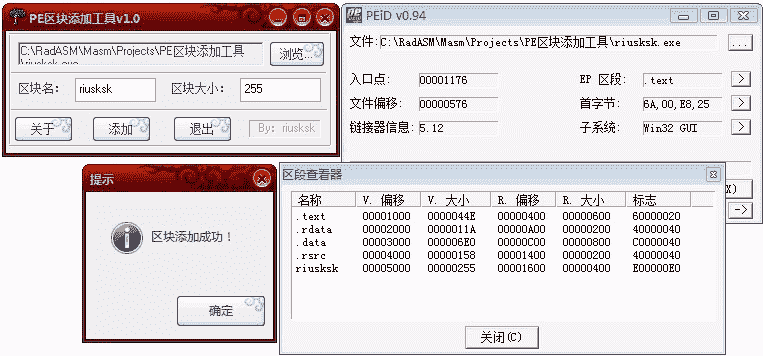

# PE 区块添加工具

> 原文：[`www.pediy.com/kssd/pediy10/100004.html`](https://www.pediy.com/kssd/pediy10/100004.html)

标题：【原创】PE 区块添加工具 v1.0

作者：riusksk

主页：`http://riusksk.blogbus.com`

操作环境：`windows vista sp1`, `RadASM`

本工具主要是向 PE 文件中添加一个节块，参考了玩命版主的代码而写成的，效果图如下：



源码如下：

**xTiNt**

```asm
00000: .386
00001: .model flat, stdcall  ;32 bit memory model
00002: option casemap :none  ;case sensitive
00003: 
00004: include windows.inc
00005: include kernel32.inc
00006: include user32.inc
00007: include comdlg32.inc
00008: include SkinH.inc
00009: 
00010: includelib kernel32.lib
00011: includelib user32.lib
00012: includelib SkinH.lib
00013: includelib comdlg32.lib
00014: 
00015: _PEAlign   proto   dwTarNum : DWORD, dwAlignTo : DWORD
00016: _AddSection   proto   pMem : LPVOID, pSectionName : LPVOID, dwSectionSize : DWORD
00017: DlgProc    proto  :HWND,:UINT,:WPARAM,:LPARAM
00018: 
00019: .const
00020: 
00021: IDD_DIALOG1     equ 101
00022: IDC_FILENAME     equ 1001
00023: IDC_OPEN     equ 1002
00024: IDC_SECTIONNAME     equ 1003
00025: IDC_SECTIONSIZE     equ 1004
00026: IDC_ABOUT     equ 1005
00027: IDC_ADD        equ 1006
00028: IDC_EXIT     equ 1007
00029: ICO_MAIN         equ 1010
00030: 
00031: ;#########################################################################
00032: .data
00033: szSHE     db  'china.she',0
00034: szAboutCaption    db  '关于',0
00035: szAbout     db  'PE 区块添加工具 v1.0',0dh,0ah
00036:       db  '作者：riusksk(泉哥)',0dh,0ah
00037:       db  'QQ: 444748653',0dh,0ah
00038:       db  'E-mail: riousksk@qq.com',0dh,0ah
00039:       db  'Blog: http://riusksk.blogbus.com',0dh,0ah
00040:       db  '鸣谢: 玩命、eASYSCt、moonife',0
00041: lpstrFilter    db  'Exe Files(*.exe)',0,'*.exe',0
00042:       db  'All Files(*.*)',0,'*.*',0,0
00043: szErr     db  '错误',0
00044: szAlert     db  '提示',0
00045: szSuccess    db  '区块添加成功！',0
00046: szOpenFileFailed  db  '文件打开失败！',0
00047: szGetFileSizeFailed     db   '获取文件大小失败!',0   
00048: szCreateMapFailed       db   '创建文件映射失败! ',0
00049: szMapFileFailed    db  '映射文件到内存失败！',0
00050: szInvalidPE    db  '无效 PE 文件',0
00051: lpstrFile    db  255 dup (0)
00052: lpSectionName    db  20 dup (0)
00053: lpSectionSize    db  20 dup (0)
00054: bError     db  0
00055: dwNewSectionSize  dd  0
00056: ;#########################################################################
00057: 
00058: .data?
00059: 
00060: hInstance     dd ?
00061: 
00062: ;#########################################################################
00063: 
00064: 
00065: .code
00066: 
00067: start:
00068: 
00069:   invoke GetModuleHandle,NULL
00070:   mov  hInstance,eax
00071:   invoke DialogBoxParam,hInstance,IDD_DIALOG1,NULL,addr DlgProc,NULL
00072:   invoke ExitProcess,0
00073: 
00074: ;########################################################################
00075: _CryptFile proc szFname : LPSTR,szSectionName:LPSTR,dwSectionSize:DWORD
00076:      LOCAL hFile : HANDLE
00077:      LOCAL hMap : HANDLE
00078:      LOCAL pMem : LPVOID
00079:      LOCAL dwOrigFileSize : DWORD
00080:      LOCAL dwNTHeaderAddr : DWORD
00081: 
00082:      xor eax, eax
00083:      mov bError, al    ;错误标志
00084:      mov eax, dwSectionSize
00085:      mov dwNewSectionSize, eax
00086: 
00087:      ;打开 PE 文件
00088:       invoke CreateFile, szFname,\
00089:                      GENERIC_WRITE + GENERIC_READ,\
00090:                      FILE_SHARE_WRITE + FILE_SHARE_READ,\
00091:                      NULL,\
00092:                      OPEN_EXISTING,\
00093:                      FILE_ATTRIBUTE_NORMAL,\
00094:                      0
00095:      .if   eax == INVALID_HANDLE_VALUE
00096:             jmp OpenFileFailed                
00097:      .endif
00098:      mov hFile, eax  
00099:      invoke GetFileSize, hFile, NULL
00100:      .IF eax == 0
00101:         invoke CloseHandle, hFile   
00102:         jmp GetFileSizeFailed
00103:      .ENDIF
00104:      mov dwOrigFileSize, eax     ;原始 PE 文件大小
00105: 
00106:      add eax,2000h
00107:      xchg eax, ecx
00108:      xor ebx, ebx     
00109:      invoke CreateFileMapping, hFile, ebx, PAGE_READWRITE, ebx, ecx, ebx    ;创建内存映射
00110:      .if eax == 0
00111:         invoke CloseHandle, hFile
00112:         jmp CreateMapFailed                
00113:      .endif
00114:      mov hMap, eax
00115:      
00116:      ;将文件映射到内存中
00117:      invoke MapViewOfFile, hMap,
00118:                      FILE_MAP_WRITE+FILE_MAP_READ+FILE_MAP_COPY,  
00119:                      ebx, ebx, ebx
00120:      .if eax == 0
00121:         invoke CloseHandle, hMap
00122:         invoke CloseHandle, hFile
00123:         jmp MapFileFailed
00124:      .endif
00125:      mov pMem, eax                                                
00126:      ;检测文件是否为 PE 格式
00127:      xchg eax, esi
00128:      assume esi : ptr IMAGE_DOS_HEADER
00129:      .if [esi].e_magic != 'ZM'
00130:         invoke UnmapViewOfFile, pMem
00131:         invoke CloseHandle, hMap
00132:         invoke CloseHandle, hFile
00133:         jmp InvalidPE          
00134:      .endif        
00135:      add esi, [esi].e_lfanew     ;PE 头指针
00136:      assume esi : ptr IMAGE_NT_HEADERS    
00137:      .if word ptr [esi].Signature != 'EP'
00138:         invoke UnmapViewOfFile, pMem
00139:         invoke CloseHandle, hMap
00140:         invoke CloseHandle, hFile
00141:         jmp InvalidPE          
00142:      .endif
00143:      mov dwNTHeaderAddr, esi     
00144:      invoke _AddSection, pMem,szSectionName,dwNewSectionSize  ;添加 PE 节块的关键函数
00145:      push eax
00146:      mov esi, dwNTHeaderAddr
00147:      assume esi : ptr IMAGE_NT_HEADERS
00148: 
00149: LogicShellExit:
00150:      ;关闭句柄
00151:      invoke UnmapViewOfFile, pMem
00152:      invoke CloseHandle, hMap
00153:      invoke CloseHandle, hFile
00154:      .if bError == 0
00155:         invoke MessageBox, NULL, offset szSuccess, offset szAlert, MB_ICONINFORMATION  ;提示成功
00156:      .endif          
00157:      ret
00158: ;提示错误  
00159: OpenFileFailed:
00160:      lea eax,szOpenFileFailed
00161:      jmp ShowErr
00162: GetFileSizeFailed:
00163:      lea eax, szGetFileSizeFailed
00164:      jmp ShowErr     
00165: CreateMapFailed:
00166:      lea eax, szCreateMapFailed
00167:      jmp ShowErr
00168: MapFileFailed:
00169:      lea eax,szMapFileFailed
00170:      jmp ShowErr          
00171: InvalidPE:           
00172:      lea eax,szInvalidPE
00173:      jmp ShowErr    
00174: ShowErr:
00175:      invoke MessageBox, NULL, eax, offset szErr, MB_ICONERROR
00176:      mov al, 1
00177:      mov bError, al  ;设置错误标志
00178:      jmp LogicShellExit
00179: 
00180: _CryptFile endp  
00181: 
00182: _AddSection proc uses ebx ecx edx esi edi, pMem : LPVOID,
00183:                          pSectionName : LPVOID,
00184:                          dwSectionSize : DWORD
00185:                          
00186:    ;添加 PE 节块，返回值 eax 为新加节块的文件偏移地址
00187:    LOCAL dwNTHeader : LPVOID
00188:    LOCAL dwLastSecTbl : LPVOID     
00189:    LOCAL dwFileAlig : DWORD
00190:    LOCAL dwSecAlig : DWORD
00191: 
00192:    mov esi, pMem
00193:    add esi, dword ptr [esi+3ch]  ;PE 头地址
00194:    mov dwNTHeader, esi   
```


```asm
00195:     assume esi : ptr IMAGE_NT_HEADERS  

00196:     ;更改节块数目  

00197:     mov cx, word ptr [esi].FileHeader.NumberOfSections  

00198:     movzx ecx, cx  

00199:     inc word ptr [esi].FileHeader.NumberOfSections  ;节块数目加 1  

00200:     push dword ptr [esi].OptionalHeader.FileAlignment  ;文件对齐值  

00201:     pop dwFileAlig  

00202:     push dword ptr [esi].OptionalHeader.SectionAlignment  ;节块对齐值  

00203:     pop dwSecAlig          

00204:     add esi, sizeof IMAGE_NT_HEADERS    ;令 esi 指向节块表 section table  

00205:     mov eax, sizeof IMAGE_SECTION_HEADER  ;节块大小  

00206:     mov ebx, ecx  ;节块数目  

00207:     imul ebx    ;指向最后一块节块  

00208:     add esi, eax  ;esi 为原始最后一节块结尾处的文件偏移地址  

00209:     push esi  

00210:     sub esi, sizeof IMAGE_SECTION_HEADER    ; esi 为原始最后一节块起始处的文件偏移地址  

00211:     mov dwLastSecTbl, esi  

00212:     pop esi  

00213:     assume esi : ptr IMAGE_SECTION_HEADER  

00214:     ;设置节块名  

00215:     push esi  

00216:     lea edi, [esi].Name1  

00217:     mov esi, pSectionName  

00218: CopySectionNameLoop:   

00219:     lodsb  

00220:     test al, al  

00221:     jz EndCopySectionNameLoop  

00222:     stosb  

00223:     jmp CopySectionNameLoop  

00224: EndCopySectionNameLoop:   

00225:     pop esi   

00226: 

00227:     push 0E00000E0h    ;设置节块属性为可读可写可执行  

00228:     pop dword ptr [esi].Characteristics  

00229: 

00230:     push dwSectionSize    ;设置内存中节块大小  

00231:     pop dword ptr [esi].Misc.VirtualSize  

00232: 

00233:     invoke _PEAlign,dwSectionSize,dwFileAlig  ;设置新增节块进行文件对齐后的大小  

00234:     mov dword ptr [esi].SizeOfRawData, eax  

00235:     

00236:     ; 新节的内存偏移 = 上一节的内存偏移 + 上一节经过节对齐后的长度  

00237:     ; 新节的文件偏移 = 上一节的文件偏移 + 上一节进过文件对齐后的长度  

00238:     mov eax, dwLastSecTbl                      

00239:     assume eax : ptr IMAGE_SECTION_HEADER  

00240:     mov ecx, dword ptr [eax].VirtualAddress    ; 新增节块的相对虚拟地址  

00241:     add ecx, dword ptr [eax].Misc.VirtualSize         

00242:     mov ebx, dword ptr [eax].PointerToRawData    ; 新增节块的文件偏移地址  

00243:     add ebx, dword ptr [eax].SizeOfRawData           

00244:     invoke _PEAlign, ecx, dwSecAlig    ;设置新增节块进行节块对齐后的偏移地址  

00245:     mov dword ptr [esi].VirtualAddress, eax  

00246:     invoke _PEAlign, ebx,dwFileAlig    ;设置新增节块进行文件对齐后的偏移地址   

00247:     mov dword ptr [esi].PointerToRawData, eax   

00248: 

00249:     mov eax, dword ptr [esi].VirtualAddress  

00250:     add eax, dword ptr [esi].Misc.VirtualSize  

00251:     invoke _PEAlign, eax,dwSecAlig    ;设置新增节块进行块对齐后的大小+内存偏移  

00252:     mov edx, dwNTHeader  

00253:     assume edx : ptr IMAGE_NT_HEADERS  

00254:     mov dword ptr [edx].OptionalHeader.SizeOfImage, eax  ;修改 PE 文件的映射大小  

00255:     push dword ptr [esi].PointerToRawData    ;PE 文件中最后节块的文件偏移  

00256:     pop edi  

00257:     add edi, pMem  

00258:     

00259:     ;清零工作  

00260:     mov ecx, dwSectionSize  

00261:     xor eax, eax  

00262:     cld  

00263:     rep stosb  

00264: 

00265:     mov eax, esi  ;返回值为新增节表的文件偏移  

00266:     assume esi : nothing  

00267:     assume eax : nothing  

00268:     assume edx : nothing  

00269:     ret  

00270: _AddSection endp  

00271: 

00272: _PEAlign proc uses ecx edx, dwTarNum : DWORD, dwAlignTo : DWORD  

00273:     ; 用于计算节对齐后的大小   

00274:     ; Algorithms:  

00275:     ; $1 = dwTarNum / dwAlignTo  

00276:     ; if remain != 0  

00277:     ; $r = $1 + 1 * dwAlignTo  

00278:     ; return $r  

00279:     mov ecx, dwAlignTo  

00280:     mov eax, dwTarNum  

00281:     xor edx, edx  

00282:     div ecx  

00283:     cmp edx, 0  

00284:     jz AlreadyAligned  

00285:     inc eax  

00286: AlreadyAligned:  

00287:     mul ecx       

00288:     ret  

00289: 

00290: _PEAlign endp   

00291: 

00292: 

00293: _WindowCenter    proc    hWnd:DWORD  

00294:         local    @stRectDeskTop:RECT,@stRectWin:RECT  

00295:         local    @dwWidth:DWORD,@dwHeight:DWORD  

00296: 

00297:         invoke    GetWindowRect,hWnd,addr @stRectWin  

00298:         invoke    GetDesktopWindow  

00299:         mov        ebx,eax  

00300:         invoke    GetWindowRect,ebx,addr @stRectDeskTop  

00301: 

00302:         mov    eax,@stRectWin.bottom  

00303:         sub    eax,@stRectWin.top  

00304:         mov    @dwHeight,eax  

00305:         mov    eax,@stRectWin.right  

00306:         sub    eax,@stRectWin.left  

00307:         mov    @dwWidth,eax  

00308: 

00309:         mov    ebx,@stRectDeskTop.bottom  

00310:         sub    ebx,@dwHeight  

00311:         shr    ebx,1  

00312:         mov    ecx,@stRectDeskTop.right  

00313:         sub    ecx,@dwWidth  

00314:         shr    ecx,1  

00315: 

00316:         invoke    MoveWindow,hWnd,ecx,ebx,@dwWidth,@dwHeight,FALSE  

00317:         ret  

00318: 

00319: _WindowCenter      endp  

00320: 

00321: _LpstrToHex proc uses esi edi ecx edx ebx, lpstr:LPSTR  

00322: 

00323:     LOCAL dwM:DWORD  

00324:     mov ebx,10h  

00325:     mov edi,lpstr  

00326:     mov dwM,0  

00327:     invoke lstrlen,lpstr  

00328:     mov esi,eax  

00329: looop3:   

00330:         .if esi>0  

00331:         mov al,byte ptr [edi]  

00332:                 .if al>=30h  

00333:               .if al<=39h  

00334:             sub al,30h  

00335:                 jmp looop  

00336:               .elseif al>=61h  

00337:                 .if al<=66h  

00338:             sub al,61h  

00339:             add al,0ah  

00340:             jmp looop  

00341: 

00342:                 .elseif al>=41h  

00343:                     .if al<=46h  

00344:                 sub al,41h  

00345:                 add al,0ah  

00346:                 jmp looop  

00347:                 .endif  

00348:                 .endif  

00349:           .endif  

00350:         looop:   

00351:             movzx eax,al  

00352:         mov ecx,esi  

00353:         dec ecx  

00354:         looop2: 

00355:                 .if ecx>0  

00356:             mul ebx  

00357:             dec ecx  

00358:             jmp looop2  

00359:         .endif  

00360:         add dwM,eax  

00361:         inc edi  

00362:         dec esi  

00363:         jmp looop3  

00364:         .endif  

00365:     .endif  

00366:     mov eax,dwM  

00367:     ret  

00368: 

00369: _LpstrToHex endp  

00370: DlgProc proc hWin:HWND,uMsg:UINT,wParam:WPARAM,lParam:LPARAM  

00371:   LOCAL   stOFN:OPENFILENAME  

00372:   

00373:   mov    eax,uMsg  

00374:   .if eax==WM_INITDIALOG  

00375:     invoke  SkinH_AttachEx,addr szSHE,0  

00376:     invoke  LoadIcon,hInstance,ICO_MAIN  

00377:     invoke  SendMessage,hWin,WM_SETICON,ICON_BIG,eax  

00378:     invoke  _WindowCenter,hWin  ;将对话框设置在窗口中心  

00379:     

00380:   .elseif eax==WM_COMMAND  

00381:     mov  eax,wParam  

00382:     .if  ax == IDC_OPEN  

00383:       invoke RtlZeroMemory,addr stOFN,sizeof stOFN  

00384:       push hWin  

00385:       pop stOFN.hwndOwner  

00386:       mov stOFN.lStructSize,sizeof stOFN  

00387:       mov eax,offset lpstrFilter  

00388:       mov stOFN.lpstrFilter,eax  

00389:       mov eax,offset lpstrFile  

00390:       mov stOFN.lpstrFile,eax  

00391:       mov stOFN.nMaxFile,sizeof lpstrFile  

00392:       mov stOFN.Flags,OFN_FILEMUSTEXIST or OFN_PATHMUSTEXIST  

00393:       invoke  GetOpenFileName,addr stOFN  

00394:       .if   eax == 1  

00395:         invoke  SetDlgItemText,hWin,IDC_FILENAME,stOFN.lpstrFile  

00396:       .endif  

00397:     .elseif  ax == IDC_ABOUT  

00398:       invoke MessageBox,hWin,addr szAbout,addr szAboutCaption,MB_OK or MB_ICONINFORMATION  

00399:     .elseif  ax == IDC_ADD  
```


```asm
00400:       invoke GetDlgItemText,hWin,IDC_FILENAME,offset lpstrFile,255

00401:       invoke GetDlgItemText,hWin,IDC_SECTIONNAME,offset lpSectionName,8

00402:       invoke GetDlgItemText,hWin,IDC_SECTIONSIZE,offset lpSectionSize,8

00403:       invoke _LpstrToHex,offset lpSectionSize    ;十进制数转换成十六进制数

00404:       invoke _CryptFile,offset lpstrFile,offset lpSectionName,eax

00405:     .elseif ax == IDC_EXIT

00406:       invoke EndDialog,hWin,0

00407:     .endif

00408:   .elseif eax==WM_CLOSE

00409:     invoke EndDialog,hWin,0

00410:   .else

00411:     mov    eax,FALSE

00412:     ret

00413:   .endif

00414:   mov    eax,TRUE

00415:   ret

00416:

00417: DlgProc endp

00418:

00419: end start
```

附件下载：`PE 区块添加工具.rar`
