# 输入数据输入函数表之二：`.rdata` 节的输入函数

> 原文：[`www.pediy.com/kssd/pediy07/pediy7-711.htm`](https://www.pediy.com/kssd/pediy07/pediy7-711.htm)

## `.rdata` 节的输入函数

（对上个篇输入函数文章的补充）

原文：caracol
译文：声声慢
致谢：谢谢 fly, tianwei 以及看雪的朋友们.

### 前言

离我开始收集材料为了补充上输入函数表的文章已经一个月了.

实际上, 在一篇文章, 我只是满足于指出: 不总是只有一个 `.idata` 节为了储存输入表数据信息.

在第一篇文章出炉之后, 我发现了一些朋友却遇到了加壳软件将输入函数储存在 `.rdata` 节里的疑难.

在这种情况下遇到的主要难题是: 哪些输入函数表的数值必须交给 `pe` `header`, 为了获得一个可执行的文件? 怎样去求取这些数值?

这也就是发布一篇关于输入表文章的续集主意来源, 也借同一机会, 将一些难点弄清楚, 或者, 用另一个角度来陈述一下同样的问题 (希望这次会更清楚一点)

为了以下的分析更为具象化, 我在这篇文章里增加了实践操作的部分. (两个加壳后, 输入表里包含 `.rdata` 节的程序: `ACDSEE3.0` 法文版和 `AVOLUME3.1`)

在很长的一段休息后, 我重整勇气 (特别我的时间) 去完成这篇文章.

我希望它能给大家带来一些益处.

好了, 开始!

## 在 `.idata` 和 `.rdata` 节里的函数表

大部分时候, 在一个执行程序里, 所有的关于输入函数表的信息都存放在一个命名为: `.idata` 的节里.

但是有些编程工具/linker/complilator 会将这些信息存放在一个名为 `.rdata` 的节里, 与其他数据混在一起.

我注意到那些将输入函数表存在 `.rdata` 里的通常是一些由 microsoftde 的工具 (c++, viiisual c++ 等...) 编写的程序.

无论我们遇到什么情况, 它的输入函数表的逻辑, 组织, 结构... 除了一些小的细节外, 基本上与包含有 `.idata` 节的程序一致.

### 总结重温一下在 `.idata` 节里, 在一个程序里的输入表的组织结构的信息

(`.idata` 节)

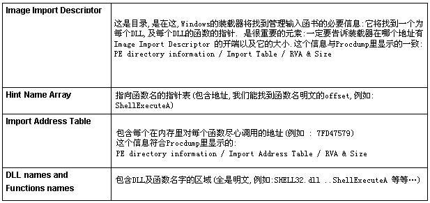

图 01.

当然, 要是您已经阅读过我的上一篇关于输入函数表的文章, 或者您对输入函数很熟悉, 您应该能认出 Microsoft 的类型!

我不再重提 Borland 的例子, 是一样的, 但比较简单: 没有符合输入表的那个块段的数据.

Microsoft 的类型比 Borland 的要复杂, 我们来讲解 Microsoft 的, 这样一来, 下次遇到 Borland 的, 那就是白送给您的礼物.

无论是在硬盘 (文件里) 上, 还是被 windows 的装载器装载在内存里, 这 4 个区域的内存, (image import descriptor, hint name array, import address table, DLL names 和 functions names) 构成一个的连续的块段.

这个内存的块段也就是 `.idata` 节.

当那些输入函数处于 `.rdata` 的节时, 我们将遇到这 4 个区域的内存, 但不一定以一样的顺序, 和处于连续的一个块段中.

在小结后, 我们来看一下.

### 对在 Image Import Descriptor 里, 每个 DLL 的入口格式的简单小结

在 image import descriptor 区域的每个入口符合一个 DLL

每个 DLL 占用 5 个 `Dword` (双词)

对我们来说, 最重要的 `Dword` 是:

Microsoft 类型: `Dword 1`, `Dword 4`, `Dword 5`

Borland 类型: `Dword 4`, `Dword 5`

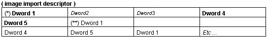

图 02.

(\*) Entrée pour la DLL n°1 (例子 : `KERNEL32.dll`)

(\*\*) Entrée pour la DLL n°2 (例子 : `SHELL32.dll`)

`Dword1`:

它指向表格的第一个 dword.

这个表包含 `Dword 4` 指向的 DLL 的所有的有关函数的指针.

这个表是 ‘Hint Name Array’ 内存块段的一部分.

`Dword 5`:

它指向表格的第一个 dword.

这个表, 包含在 ‘Hint Name Array‘ 里的函数的所有调用地址. 它与 `Hint Name Array` 并行.

这个表格是 ‘Import Address Table’ 内存块段的一部分.

在这, 最有用的是 `Dword 4`, 能帮助我们在 `.rdata` 节里找到我们的小朋友们 :

`Dword 4` 包含 DLL 明文名字的地址 (Raw Virtual Address).

比如:

符合 `KERNEL32.dll` 的入口.

假设 `dword 4` 含有‘8A 65 01 00’的值, 就是表示它指向’00 01 65 8A’的地址.

要是 `Raw Offset` 与 `Virtual Offset` 相等 (也就是说在硬盘上的地址与内存里的地址相符), 我们将在 offset ’00 01 65 8A’ (在文件) 找到‘KERNEL32.dll’的字串.

## 在 `.rdata` 节内, 输入函数组织的例子

注意, 这只是一个例子, 只是我有幸观察过几个包含 `.rdata` 节的程序后的结果.

因此, 我不敢担保所有的 `.rdata` 节都与此相同.

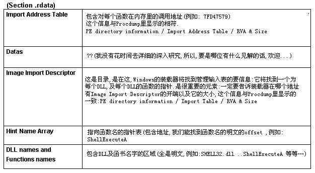

图 03.

您看到了吗? 除了 import address table 的块段现在处于 `.rdata` 节的开端, 跟在一段数据块后, 其它基本上是一样的.

唯一的盲点对我们来说是, `Image Import Descriptor` 的块不处在 rdata 节的开端.

因此, 当我们遇到象被 `ASPack` 或 `ASProtect` 加壳的程序, 并且我们成功的 `DUMP` 出脱壳程序, 我们还要用可靠快捷的方法成功辨认出这个块段 (地址的开端及其大小), 为了将这些信息交给 `PE header`.

由此, 我们可以得到一个可运行的程序, 并且具有输入函数表的反编代码.

## 怎样找回内存里包含 Image Import Descriptor 信息的区域, 当在 PE header 没有具备这些信息时

我们在上面看到过了, 最有用的是 `Dword 4`, 能帮助我们在 `.rdata` 节里找回我们的小朋友们.

事实上, 因为 `dword 4` 指向 DLL 名字的明文. 只要找出在 rdata 节 DLL 的名字 (跟在与之有关的函数名后), 记下 offset, 然后在 rdata 寻找与之相应的 offset 值.

一旦我们找到, 就是说在目录 image import descriptor 里.

剩下的就是判断出这个区域的开端和结尾.

`REGMON.EXE` 例子的节选

```
section rdata : 0000A000 - 0000C000

RVA Import table = A624

Size Import table = 008C
```

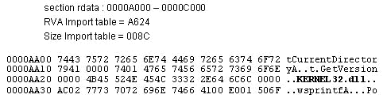

图 04.

‘KERNEL32.dll’在 offset ‘00 00 AA 22’ (文件里) 里找到.

这表示 image import descriptor, 应该有一个 `dword 4` 包含‘22AA 0000’的值, 符合 `KERNEL32.dll` 的入口.

只需要在 rdata 节里寻找这个 hexa 的值, 以进入 image import descriptor.

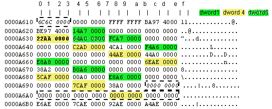

图 05.

从这个标记开始 (在 `0000A630`, 符合 `dword4` 目录表的一个入口), 生米已煮成熟饭!

剩下要做的就是在这个内存的区域内, 往上或往下移, 边数着这些 `dword` , 边看看它们的内容是否正确.

例如 : 我们看见 `dword1` 由需线及斜体表示, 含有在 `.rdata` 区域外的地址, 第一个有效的 `dword1` 处于: ‘0000A624’.

这是 image import descriptor 的开端.

image import descriptor 的结尾, 在视觉上, 能被连续的 ’00 00 00 00’ 所提示.

有时, 没有这些连续的’00 00 00 00’, 那么就要使用别的方法.

例如, 看到 `dword 4` 不包含有效的地址 (我们看 `0000A6A0` 的那行 !)

一旦我们辩认出这个内存区域的开端和结尾, 我们就可以计算它的大小.

这个区域的开头是在 ‘000A624’ ; 结尾在 ‘0000A6B0‘ 因而, 大小 = ‘0000008C’ (`A6B0` - `A624`)

这两个信息是用来放在 `PE directory information / Import Table / RVA & Size` 里的.

(我知道我在不断的在重复...)

## 这两个信息 (Image Import Descriptor 的开端和大小) 对 windows 的装载器来说足够了.

对, 对, 我向你保证!... 无须再指出 `Import Adress Table` 的值, 因为这些信息都包含在每个入口的 `dword1`.

另外, 我们可以用以下的方法测试一下:

借助 `PROCDUMP.EXE` (再次感谢 `G-Rom`, `Lorian` & `Stone` !!), 删除程序 ‘REGMON.EXE’ 或 ‘NOTEPAD.EXE’ 的 `PE directory information / Import AddressTable` 里显示的信息.

我们会看到对这些程序的运行不带来任何的影响… &;-)

## 在实际操作前的总结

逻辑上, 在 `.rdata` 节里, 输入表的组织, 结构与我们在 idata 节遇到的基本一致.

唯一的盲点对我们来说是, `Image Import Descriptor` (目录表) 的块段不处在 rdata 节的开端.

我们要利用一个 DLL 的名字 (最常用的是 `KERNEL32.dll’`), 来找出这个块段的位置, 然后, 正确判断出 `Image Import Descriptor` 开头的地址和整个块段的大小.

这两个信息将被放在 `PE directory information / Import Table / RVA & Size`.

在实际操作中, 我将演示带有一个 `.rdata` 接段的两个加壳程序.

* `ASPack` 加壳的 `ACDSee 3.0` 法文版 (不去管它的版本...)

* `ASProtect` 确加壳的 `volume 3.1` , (这个也是, 它的版本没有什么关系... 听说是 `0.9` 版)

为什么特别选择这两个例子?

* `ACDsee 3.0 fr` : 很简单, 是因为一天, 有朋友在手动脱壳后, 叫我帮忙找回要放进 `PE directory information` 里的正确数值, 在这, 唯一难的是我们将要对付一个包含 `.rdata` 的节.

* `Zvolume 3.1` : 是因为不久前有一篇关于这个程序的解文, 并且文中提出这是关于 `ASProtect` 的一个新版本. 我想要看看是怎么样的, 可我很惊奇的在里面发现了一个 rdata 的节…我就把它用于这篇文章里.

在 `Zvolume 3.1` 的例子里, 获得一个能运行的脱壳程序, 就是自动删除了 `ASProtect` 对程序设置的各种保护措施. (特别是对 checksum 的检验).

### `ASPack` 与 `ASProtect` 间有什么不同?

在这方面已经有不少文章, `Christal` 肯定是第一个带头研究的, 并且指出这两个产品的区别和近似之处.

`ASxxxx` 就是 `Alexei Solodovnikov`.

`ASPack` 仅仅是一个压缩/解压的壳, 它只修改一部分的输入函数, 不包含别的附加保护措施.

`ASProtect` 却是一个做好了的保护措施程序, 它除了用 `ASPack` 的压缩算法, 还有别的东西.

也就是一个包含别的附加保护措施的 `ASPack`, 如: anti-softice, checksum, time-limit 等等...

在 `ASPack.com` 的网址上, `Alexei Solodvnikov` 指出他的产品也包含 anti-procdump.

« counteraction to dumping application memory with the tool like ProcDump »

« API for interaction between application and protection routines »

我不知道它所谓的 anti-procdump 是什么含义 : 是让 dump 无法进行 (也就是说这个程序无法被 DUMP), 还是 DUMP 是可以的, 可是被 DUMP 出来的执行文件将无法运行? (比如, 在输入函数方面做了手脚...)

无论如何, 在实际操作部分您将看到, 我们将不会遇到这种麻烦, 因为我们要对输入函数下点工夫.

在实际操作部分的目标是: 获得执行文件的原件, 也就是说, 在它被防盗的保护措施修改前.

得到的程序将是可反编译的 (当然包含输入函数!), 还有就是, 要是我们愿意, 可对它进行修改.

这要靠 `Icedump` 和 `Procdump` 对它手动 `DUMP` 来取得.

好了, 说了很多, 我们来点实际行动吧!

### 第一个实际操作的目标: `ACDSEE 3.0 fr`

( 被 `ASPack` 传染的 )

我们先借助 `Procdump` 对 `PE header` 进行观察. (再次感谢 `G-Rom Lorian & Stone` !)

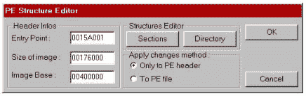

图 06.

`Entry point` 让我们来到 `ASPack` 节.

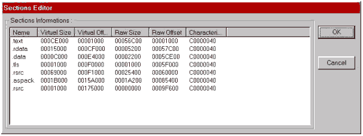

图 07.

这里很清楚, 我们对付的是 `ASPack` !

哪个版本? 无关紧要的!

哎! 没有 `.idata` 节, 这次输入函数都在 `.rdata` 节.

这不要紧, 您刚才看见了这对我们重新找回我们的小朋友们没有什么困难的.

为了有一个好的开始, 只须找到一个好的定点, 然后一切就会水到渠成.

我们继续对 PE 里的信息进行观察.

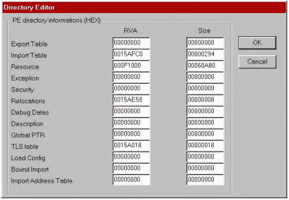

图 08.

import image descriptor 的地址是 ‘15AFC0’ (也就是说在 ASPack 节正里面.)

要把这个地址修改为指向原来程序的 import image descriptor, 即 `.rdata` 节. (在 `CF000` 与 `E3FFF` 之间) .

还要修改它的大小, 为了 windows 的装载器能重新找回它的小朋友们, 以免死机.

我们留意到没有任何输入地址表里的信息 (包含内存里每个函数的调用地址 (举例: `7FD47579`))

我们面对的是一份 Borland 类型的输入表吗? (其实不是的, 但我们慢慢的意识到这点.)

总之, 我们已经说过: 这些信息对 windows 的装载器没有什么作用 .

以下是为了得到一个有效的脱壳后可执行文件的几个步骤:

* DUMP 出 rdata 节, 当它被 ASPack 解压, 还是'干净'时.

* 找出被解压程序的入口处 entry point , 并手动 DUMP 出程序.

* 将 DUMP 出的. rdata 节的文件插入解压后的程序, 并找出 Image Import Descriptor 的区域.

* 用 Entry Point 的值, 输入表的开端的地址, 及大小为 PE header 升级.

## 第一步, DUMP 出 `.rdata` 节, 当它被 `ASPack` 解压, 还是'干净'时.

嗯 !… 怎样才算是'干净 '?

当然, 在这, 我们不能以检测 import image descriptor 或 输入表的地址是否正确为乐, 因为我们连它们的内存区域也不清楚...

那么, 我们要找出比较有代表性, 简单的一个定点, 它将向我们指出在某时某刻, 输入表的信息将被解压, 还原, 而且是正确的...

我们现在已经知道, 只需在 `.rdata` 节里, 寻找当前函数的名字.

例如 `KERNEL32`.

一旦我们看见这个 DLL 名字的明文, (已及与其相应的函数名), 我们就可以 DUMP. rdata 节.

然后, 我们可以慢慢的检查输入表里的信息, 和找回我们的小朋友.

来 ! 一等 .rdata 节解压, 我们来 Dump 它.

(`.rdata` 节从 `4CF000` 到 `4E3FFF` , 有 `15000` 字节.)

在对 `.text` 节的属性修改成 `E0…..20` 后, 我们用 `WinIce` 的 `symbol loader` 装载程序. (感谢 `Numega` !)

`Break due to Symbol Loader`

`0177:0055A001 60 PUSHAD`

`:bpm cs:4cf000 W <`-- 这样一来, 每次 ASPack 的 loader 要对 `.rdata` 节进行写入时, 我们就会有一个截停.

`:x <`-- 我们让 ASPack 完成任务它的任务: 分块给程序解压.

`POP` ! (ASPack 刚在 `.rdata` 段写入了 !)


# Break due to BPMB #0177:004CF000 W DR3 (ET=296.47 milliseconds)

```
0177:0055A2C0 F3A5 REPZ MOVSD
```
:u cs:55a2c0 <-- 让我们来看看这段代码里有什么.

```
0177:0055A2C0 F3A5 REPZ MOVSD <-- 写在区域
0177:0055A2C2 8BC8 MOV ECX,EAX
0177:0055A2C4 83E103 AND ECX,03
0177:0055A2C7 F3A4 REPZ MOVSB <-- 写完了.
0177:0055A2C9 5E POP ESI <-- 这我们不会到很远.我们来检测 rdata 节,看是否 OK,我们来 dump.
```

:d cs:4cf000 <-- 我们来看一眼被解压的区域的开头.

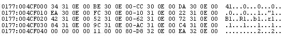

图 09.

啊.. 您不觉得这有点象指针表?

:d cs:4e3fd0 <-- 我们看一眼被解压的区域的结尾.

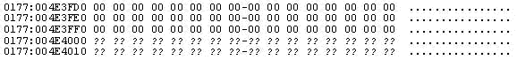

图 10.

OK, 我们的 `rdata` 节直到结尾也被填满了.

现在,我们来看是否能找出 DLL `KERNEL32` 的名字 ,和在 `rdata` 节,与之相关的那些函数名 : (4CF000 到 4E3FFF)

```
:s cs:4cf000 l ffffffff 'KERNEL32'
```

Pattern found at 0177:004D7E9C (00008E9C) <-- 这? 可是什么函数名也没有,没意思,继续找...

```
:s
```

Pattern found at 0177:004E1DC2 (00012DC2)

```
:d cs:4e1dc2
```
<-- 中奖 ! 我们正处于 `DLL names & Functions names` 区域.

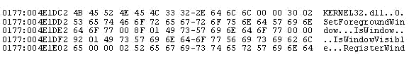

图 11.

嗯...接着的函数不属于 `Kernel32`.

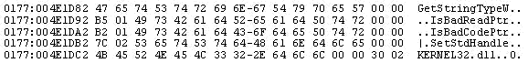

图 12.

对,对...真的是 `Kernel32.dll` 的函数们,这个表从底到高处读.这是一个 `Microsoft` 类型的输入表.

另外,我们这有证据 (`DUMP` 出的 `ACDsee 3.0 fr` 文件的节选) :

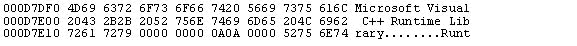

图 13.

好了,我们用 `IceDump` 来 `DUMP` 这个节(谢谢 `Ice` !)

```
:pagein d cs:4cf000 15000 c:\rdata\_acdsee3.dmp
```

### 第二步:找出真正的 entry point, 然后对程序来个 dump full .

```
:bd*
```
<-- 使 `bpm` 失效

```
:bpr cs:401000 cs:4cefff RW
```
<-- 一种在 90%情况下有效的方法.真的是最快,最有直接的. (但谁有更好的方法,我接纳!)

```
:x
```

Break due to BPR #0177:00401000 #0177:004CEFFF RW <-- 我对您说什么来着?

:u cs:4a2aaf <-- 让我们看一下这段代码的开头.

```
0177:004A2AAF 55 PUSH EBP <-- 呵呵...是 original entry point.
0177:004A2AB0 8BEC MOV EBP,ESP
0177:004A2AB2 6AFF PUSH FF
0177:004A2AB4 68B0794D00 PUSH 004D79B0
0177:004A2AB9 681C6F4A00 PUSH 004A6F1C
0177:004A2ABE 64A100000000 MOV EAX,FS:[00000000]
0177:004A2AC4 50 PUSH EAX
0177:004A2AC5 64892500000000 MOV FS:[00000000],ESP
```

```
:bd*
```
<-- 使所有断点失效.

```
:a eip
```
<-- 修改代码,为了方便手动 `DUMP`.

```
0177:004A2AAF jmp eip <-- 我们把程序'冻结'在一个循环里.
0177:004A2AB1
```

:u cs:4a2aaf

```
0177:004A2AAF EBFE JMP 004A2BAF <-- 我们得到这个.
0177:004A2AB1 EC IN AL,DX
0177:004A2AB2 6AFF PUSH FF
```

```
:x
```
<-- 我们运行我们的无限循环.

然后借助 `Procdump` ( 总是它), 在现运行程序表里选择 `ACDSee`,鼠标右点, `dump Full`.

注意 :

在 `DUMP` 前,我建议您如下修改选项:

- `recompute object` (YES)
- `optimize` (NO) 为得到 `raw offset = virtual offset` (以后比较容易阅读)
- `don't rebuild import table` 因为,反正我们要用 `DUMP` 出的文件来覆盖. (`rdata` 节的 `DUMP`).

把 `DUMP FULL` 存盘为 `ACD3fr_FullDmp.exe`,然后 `kill task`.

### 第三步:将 rdata 节的 DUMP 插进被解压的程序里,并定位出 Image Import Descriptor 的区域.

为了完成这些,我们使用 `Hexworks` (谢谢 `BreakPoint Software` !)

注意,为了'冻结'程序,我们把 `entry point` 改在: 0177:004A2AAF .现在要把它修改回来.

用 `Hexworks` ,只要来到 `offset A2AAF`,将 `EB FE` (`jmp 004A2BAF`) 改为 `55 8B` (`push EBP` 等等…)

将 `DUMP` 出的 `rdata` 节插入 :

- 装载 `DUMP` 出的文件 `c:\rdata\_acdsee3.dmp`
- 来个 `edit / goto CF000` ,为了在 `rdata` 节的第一字节就位.

`CF000` : 因为 `raw offset` 跟 `virtual offset` 一致.(多亏我们 `DUMP` 前的选项)

- 选择块段 , `size = 15000` (hexa) ,然后 删除.
- 在 `rdata_acdsee3.dmp` 文件,同样的步骤为了选择 15000 的块段 ,然后复制.
- 激活 `ACD3fr_FullDmp.exe` 的窗户,然后粘贴上.

找出 `Image Import Descriptor` 区域 的位置:

只要按着这篇文章的开头那样去做,您会找到几个,不过,只有这个是好的:(因为被函数名围着).

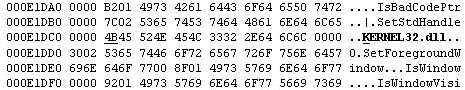

图 14.

这个表示在 `image import descriptor`,应该有一个 `dword 4`,包含 ‘C21D 0E00’ 的值,符合 `KERNEL32.dll`.入口.

只要在 `rdata` 节里找出这个 `hexa` 的值, 就会降落到 `image import descriptor`.

我们在 `000E08A4` 找到.

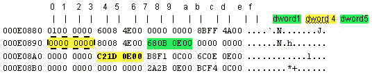

图 15.

由于我们看见在 `000E0890` 的 `dword 4` 无效,我们很快找出它的开头!`Image Import Descriptor` 的开头是在 `000C0898` ( 在 `KERNEL32.dll` 开端的 `dword1` ).

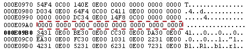

图 16.

我们也很容易的认出 `image Import descriptor` 的结尾 ! 跃到眼前不是?

`image Import descriptor` 的结尾在 `000E09B0`,大小等于 `0118`.

两个要记下的信息是:

`Import Table RVA = 000E09B0 & Size = 00000118`

好了,最难的过了, 只剩下用 `Procdump` 来修改一些正确的数值.

### 第四步:在 directory Import table 中,升级 entry point 及一些地址.

利用 `Procdump` :

- 输入解压程序的 `entry point` .

`004A2AAF - 00400000 = 000A2AAF` (在 `SoftIce` 里显示的值 - `image base`)

- 修改 `.CODE` 节里的属性为 `E0…..20`,为取得一份能用 `Wdasm` 反编译的代码,并且带有输入函数.(有很多 !)
- 在 `PE directory information` 里,修改输入表的信息 `RVA = 000C0898 & Size = 00000118`

要是中途您没有迷路,现在您就有一个有效的可执行文件,脱壳了,而且能反编译,带有输入函数表,要是您愿意的,还能对它进行修改.

好了,我们来第二部分的实践? 开始..您会发现并不难.另外,这篇文章的目的并不是给您介绍复杂的东西.(两个例子总比一个好…)

## 第二个实践目标程序:Zvolume 3.1

(被 `ASProtect version 0.9` ?传染 )

象往常一样,我们先借助 `Procdump` 来观察一下它的 `pe header` (再次感谢 `G-Rom Lorian & Stone` !)

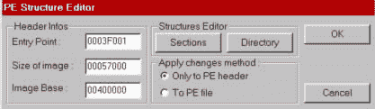

图 17.

`entry point` 让我们降落到 `.data` 节中...有点奇怪,对不?

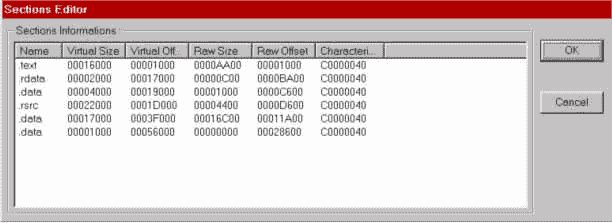

图 18.

可是,为什么不? `ASPack` 允许将节命名为 `.aspack` 外的名称.

这里,我们没有任何对软件保护措施的信息提示,唯一能引起我们注意的是:程序被加壳了.

Houps! 也没有 `.idata` 的节.( 很正常,正因为这样,这个程序才成为我们的实践目标! )

输入函数表的信息再次处于 `.rdata` 节.

继续我们对 `PE` 信息进行的观察.

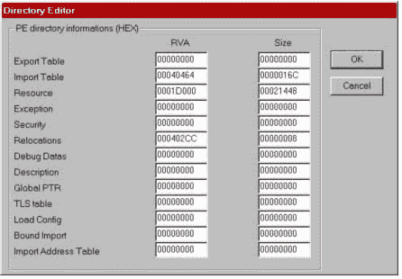

图 19.

`import image descriptor` 的地址在 ‘00040464’ (即在倒数第二个 `.data` 节里)

这里有第一个与上个练习相似的地方.

对我来说,寻找相似点停止在这.我相信第一个告诉我这是 `d'ASProtect version 0.9` 版的人.

需要把这个地址的值改一下,让指针指向原来程序的 `import image descriptor`,也就是说在 `.rdata` 节,(即 17000 到 18FFF) .

也要把 `size` 大小修改一下,为了让装载器重新找回它的小朋友们,以免死机.

我们发现在输入地址表里什么信息也没有 (包含为每个函数在内存中的调用地址,(如 : 7FD47579))

这次我们是否遇上 `Borland` 型的输入表呢? 不是的,迟点我们将看到,我们再次面对的是一个由 `Microsoft Visual C++` 编译出的程序.

**以下是我们为获取一个有效,可执行的脱壳程序的几个步骤:**

- `DUMP` 出 `rdata` 节,当它被 `ASPack` 解压和在它还是"干净"的时候.
- 找出解压程序的 `entry point`,手动 `DUMP` 出程序.
- 把 `DUMP` 出的 `.rdata` 节的文件插入解压后的程序里,并找出 `Image Import Descriptor` 的区域.
- 用 `entry point`, 输入表的开端地址,大小将 `PE header` 升级.

### 第一步:DUMP 出 rdata 节,当它被 ASPack 解压和当它还是"干净"的时候.

我们利用刚才的方法:在每个对 `rdata` 区段的写入后,找出一个 `DLL` 名字的明文.

一旦我们看见这个 `DLL` 名字(还有于之相关的函数名),我们就可以将这个 `rdata` 节 `DUMP` 出.

然后我们就可以悠闲的察看输入表的有关信息,找回我们的小朋友.

好,我们来 `DUMP` 出 `.rdata` 节,当它被解压时.

(`.rdata` 节从 417000 到 418FFF ,有 2000 字节.)

这里,我们将不要修改 `.text` 节的属性,因为我们知道 `ASProtect` 将检测这种修改.

我们将采用别的方法来进行:

```
:bpx getprocaddress
```
<-- 我们试着对输入函数的处理进行截断.

然后我们运行 `Zvolume`

POP ! 好,开始...

Break due to BPX KERNEL32!GetProcAddress (ET=7.02 seconds)

F12 回到 `Zvolume` 的代码领空.

```
:bd*
```
<-- 取消 `bpx`

```
:d cs:417000
```
<-- 我们检查 `rdata` 节还没有被动过.

```
0177:00417000 ?? ?? ?? ?? ?? ?? ?? ??-?? ?? ?? ?? ?? ?? ?? ?? ................
0177:00417010 ?? ?? ?? ?? ?? ?? ?? ??-?? ?? ?? ?? ?? ?? ?? ?? ................
0177:00417020 ?? ?? ?? ?? ?? ?? ?? ??-?? ?? ?? ?? ?? ?? ?? ?? ................
```

```
:bpm cs:417000 W
```
<-- 这样一来, 每次 `ASProtect` 的装载器对 `rdata` 节进行写入,我们就会有一个截断.

```
:x
```
<-- 我们让 `ASPack` 完成它的任务 : 将程序分块解压.

POP ! (`ASProtect` 刚在 `.rdata` 节写入了 !)

Break due to BPMB #0177:00417000 W DR3 (=276.81 milliseconds)

```
0177:004908B7 F3A5 REPZ MOVSD
```

:u eip <-- 让我们来看看这段代码里有什么.

```
0177:004908B7 F3A5 REPZ MOVSD <-- 写在区域
0177:004908B9 89C1 MOV ECX,EAX
0177:004908BB 83E103 AND ECX,03
0177:004908BE F3A4 REPZ MOVSB <-- 写完
0177:004908C0 5F POP EDI <-- 这里,我们不会走的太远,我们检查 rdata,要是 OK, 我们 DUMP.
```

:d cs:417000 <-- 我们来看一眼解压的区域的开头.

```
0177:00417000 44 83 01 00 56 83 01 00-86 83 01 00 30 83 01 00 D...V.......0...
0177:00417010 74 83 01 00 64 83 01 00-98 83 01 00 00 00 00 00 t...d...........
0177:00417020 11 00 00 80 18 7B 01 00-00 7B 01 00 00 00 00 00 .....{...{......
0177:00417030 34 82 01 00 42 82 01 00-52 82 01 00 68 82 01 00 4...B...R...h...
0177:00417040 76 82 01 00 86 82 01 00-9A 82 01 00 A8 82 01 00 v...............
```

恩...这有点像一个指针表,是吧?

现在我们来看看是否能找出 `KERNEL32` 这个 `DLL` 的名字,还有在 `rdata` 节 :(417000 到 418FFF)它的那些函数名.

```
:s cs:417000 l ffffffff 'KERNEL32'
```

Pattern found at 0177:004173B4 (000003B4) <-- 这? 可是,什么函数名也没有...没有意思,我们继续找...

```
:s
```

Pattern found at 0177:00417D60 (00000D60)

```
:d cs:417d40
```
<-- 中奖 !我们在 `DLL names & Functions names` 的区域.

```
0177:00417D40 7A 65 00 00 F7 00 47 65-74 43 75 72 72 65 6E 74 ze....GetCurrent
0177:00417D50 50 72 6F 63 65 73 73 00-96 02 53 6C 65 65 70 00 Process...Sleep.
0177:00417D60 4B 45 52 4E 45 4C 33 32-2E 64 6C 6C 00 00 BE 01 KERNEL32.dll....
0177:00417D70 4D 65 73 73 61 67 65 42-6F 78 41 00 14 02 53 65 MessageBoxA...Se
0177:00417D80 6E 64 4D 65 73 73 61 67-65 41 00 00 26 02 53 65 ndMessageA..&.Se
```


`0177:00417D90 74 43 75 72 73 6F 72 00`
`-9A 01 4C 6F 61 64 43 75`
`tCursor...LoadCu`

这个表由低到高处读,这是个 Microsoft 类型的表.另外,要是您在 DUMP 了的 Zvolume 文件里搜索一下,您能看到`« Microsoft Visual C++ »`的字样.

好,来!我们用`IceDump` DUMP 出这个节`IceDump` (谢谢 Ice !)

```
:bd*
```

```
:pagein d cs:417000 2000 c:\zvol-rdata.dmp
```

**第二步:找出真正的入口处,然后对程序来个 `dump full`.**

```
:bd* <-- 使所有的 breakpoint 失效
:bpr cs:401000 cs:416fff R <-- 总是一样的方法
:x
```

`Break due to BPR #0177:00401000 #0177:00416FFF R` <-- 我对您说什么来着?

```
:u eip <-- 我们来看看这段代码.
```

```
0177:00498C63 321A XOR BL,[EDX]
0177:00498C65 C1E808 SHR EAX,08
0177:00498C68 2E33049D758C4900 XOR EAX,CS:[EBX*4+00498C75]
0177:00498C70 42 INC EDX
0177:00498C71 E2ED LOOP 00498D60 <-- 哎 ! 我们在一个循环里...
0177:00498C73 5B POP EBX
0177:00498C74 C3 RET
```

Oups ! 我们可能掉进了一个将对程序进行 checksum 的地方?

我们取消我们的 breakpoints ,我们放一个`BPX`在循环后:

```
:bd *
:bpx cs:498c73
:x <-- 运行
```

`Break due to BPX #0177:00498C73 (ET=3.08 milliseconds)`

```
0177:00498C73 5B POP EBX
:bd * <-- 我们使所有的 breakpoints 失效
:be 03 <-- 我们重新激活 bpr cs:401000 cs:416fff R
:x
```

`Break due to BPR #0177:00401000 #0177:00416FFF R`

```
0177:0041046D 55 PUSH EBP
:u eip <-- 我们来看这段代码.
```

```
0177:0041046D 55 PUSH EBP <-- 呵呵...就是 original entry point
0177:0041046E 8BEC MOV EBP,ESP
0177:00410470 6AFF PUSH FF
0177:00410472 68E0724100 PUSH 004172E0
0177:00410477 68F02D4100 PUSH 00412DF0
0177:0041047C 64A100000000 MOV EAX,FS:[00000000]
0177:00410482 50 PUSH EAX
0177:00410483 64892500000000 MOV FS:[00000000],ESP
:bd* <-- 我们使所有的 breakpoints 失效
:a eip <-- 修改代码,为了进行手动 DUMP.
```

```
0177:0041046D jmp eip <-- 我们把程序 ‘冻结’在一个无限循环里.
0177:0041046F

:u eip
```

```
0177:0041046D EBFE JMP 0041056D <-- 我们得到这个. 
0177:004A2AB1 EC IN AL,DX
0177:004A2AB2 6AFF PUSH FF
:x <-- 我们运行我们的无限循环.
```

注意到 :

尽管是`ASProtect`, 我们没有遇到 `anti-SoftIce` ! 也就是说这个产品允许设置和选择保护措施? 要是谁有这方面有关的信息...

然后,借助`Procdump` (还是它,总是它!) 在运行程序中选择 `ZVolume` ,然后,鼠标右点,来个`dump Full`.

注意 :

在 Dump 前, 我建议您设置以下选项 :

\- `recompute object` (YES)
\- `optimize` (NO)为了获取 `raw offset` = `virtual offset` (以后比较容易读)
\- `don’t rebuild import table` 因为,反正我们会用我们 DUMP 出的文件 (DUMP 出的 rdata 节)来覆盖它.

将`dump full`存盘为：`ZVol_FullDmp.exe` ，然后`kill task`.

** 第三步：将ＤＵＭＰ出的 rdata 节插入解压的程序里，给 Image Import Descriptor 区域定位．**

为了所有这些步骤，我们将使用 `Hexworks 3.0` (再次感谢 `BreakPoint Software` !)

注意, 为了 « 冻结 »程序，我们将程序的入口处代码修改为 `0177:0041046D` . 需要还原原来的代码．

用 `Hexworks 3.0`，只要到 `offset 1046D` 修改字节 `EB FE` ( `jmp 0041056D` ) 为 `55 8B` ( `push EBP` 等等…)

将ＤＵＭＰ出的 rdata 节插入 :

\- 打开ＤＵＭＰ出的文件 `ZVol_FullDmp.exe`
\- 来个 `edit / goto 17000` 为了将我们带到 rdata 节的第一个字节．.

`17000` : 因为 `raw offset` 与 `virtual offset` 一致 (多亏我们在ＤＵＭＰ前设置的选项)

\- 选择这个块段 , `size = 2000` ( `hexa`) 然后删除．
\- 在 `c:\zvol-rdata.dmp` 文件里，做同样的步骤，为了选择 2000 字节的块段，然后复制．
\- 激活 `ZVol_FullDmp.exe` 的窗户，然后粘贴．

** 给 Image Import Descriptor 区段定位．**

您将找到好一些，但仅仅这个是对的 (因为由函数名围着).

```
00017D40 7A65 0000 F700 4765 7443 7572 7265 6E74 ze....GetCurrent
00017D50 5072 6F63 6573 7300 9602 536C 6565 7000 Process...Sleep.
00017D60 4B45 524E 454C 3332 2E64 6C6C 0000 BE01 KERNEL32.dll....
00017D70 4D65 7373 6167 6542 6F78 4100 1402 5365 MessageBoxA...Se
00017D80 6E64 4D65 7373 6167 6541 0000 2602 5365 ndMessageA..&.Se
```

在 `offset ‘00 01 7D 60’` 找到 `‘KERNEL32.dll’`

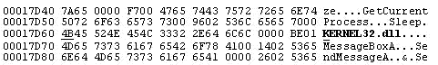

图 20.

这个表示，在 `image import descriptor` 里，应该有一个 `dword 4` 包含 `‘607D 0100’` 的值，符合 `KERNEL32.dll` 的入口．.

为了降落在 `image import descriptor`, 只要在 rdata 节寻找这个 `hexa` 值.

我们在 `000177BC` 找到．

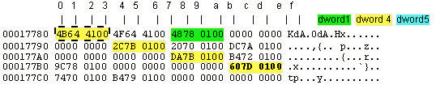

图 21.

我们快速的找出开头，很明显，因为在 `00017780` 的 `dword 4` 无效！所以 `Image Import Descriptor` 的开头是在 `00017788` ( `KERNEL32.dll` 入口的 `dword1` ).

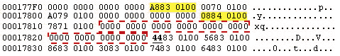

图 22.

我们也很容易的认出了 `image Import descriptor` 的结尾！这个很明显，对吗？

`Image Import Descriptor` 的结尾是在 `00017828`，大小是 `17788 -17828 = 00A0`.

两个要记下的信息是：

输入表 `RVA = 00017788` & `Size = 000000A0`

最难的已经过去了，剩下的，我们只要借助 `Procdump` 把正确的值输入就可以了.

** 第四步：在 directory Import table 里,将 entry point ,地址升级．**

用 `Procdump` :

· 将解压程序的 `entry point` 的值输入．

`0041046D - 00400000 = 0001046D` ( `SoftIce` 里显示的地址 - `image base`)

· 修改 `.CODE` 节的属性为 `« E0…..20 »`，为了获取一份用 `Wdasm` 反编译后带输入函数的代码.

· 在 `PE directory information`, `Import Table RVA = 00017788` & `Size = 000000A0`

要是您在中途没有迷路,您现在就有一个有效的可执行文件,脱壳了,而且能反编译,带有输入函数表,要是您愿意的,还能对它进行修改.

还有,我们再也没有任何 `ASProtect` 程序的软件保护措施,因为我们不运行任何 `ASProtect` 的代码..

** 结束语:**

我知道,这只是很微小的奉献,但是最重要不在于大小而是心意!

当我第一次在联网上,发现了一个有很多破解文章的网站,我真的很兴奋(也很惊奇)...所有这些免费的,不求回报的文字...

希望有一天,我们中这些受益的人中能有一些,接受有一天,他们也来尽一点力,贡献一点前人已经开始了的:无私,不求回报地传授知识.

趁着联网还没有掉进那些垄断网络的大鲨鱼手中.

不管您是怎么样的水平(但只要我们付出时间阅读和实践,水平就会提高),不要犹豫的拿起您的笔...噢...对不起,您的鼠标!

遵守一个准则:保持虚心和尊重(没有必要很粗鲁的说:`''这个他妈的软件''`,`''肮脏的 Nag''`,`''F\*CK protection''`....等等)

> `4dd466d0e1e0cc123afbe504da2462ca`
