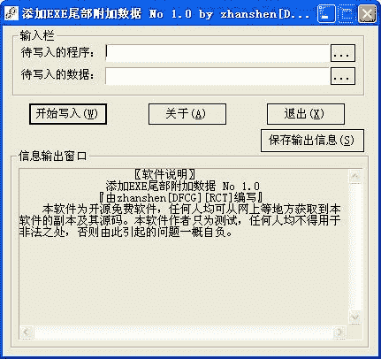

# Exe 程序尾部附加数据添加程序(含源码)

> 原文：[`www.pediy.com/kssd/pediy11/117209.html`](https://www.pediy.com/kssd/pediy11/117209.html)


/\*\*\*\*\*\*\*\*\*\*\*\*\*\*\*\*\*\*\*\*\*\*\*\*\*\*\*\*\*\*\*\*\*\*\*\*\*\*\*\*\*\*\*\*\*\*\*\*\*\*\*\*\*\*\*\*\*\*\*\*\*\*\*\*\*\*\*\*\*\*\*\*\*\*\*\*\*\*\*\*\*\*\*\*\*  

〖软件说明〗  

添加 EXE 尾部附加数据 No 1.0  

by zhanshen\[DFCG\]\[RCT\]  

这个程序是在我处理一个有附加数据程序时有感而写的。原来我在处理 Exe 程序的尾部附加程序时，一般都是先用 `WinHex` 或其它 Hex 十六进制编辑器打开原程序，再将附加数据拷出来写入到目标程序中，一次二次还好，n 次以上就觉得烦了。所以就写下了一个程序自动添加尾部附加数据。  

这个程序操作很简单：选择两个文件，然后点击【开始写入】按钮就行了。这个程序除了可以直接输入文件名和浏览文件取得程序文件名外，还支持直接将文件拖到文本框中。  

这个程序的写入方式有：  

1、选取两个 exe 文件，一个要写入附加数据的目标 exe 文件，一个原 有附加数据的 exe 文件，该软件可以直接取出附加数据添加到目标程序中。  

2、选取目标 exe 文件，另一个选择一个\*.bin 文件，该程序将会将这个整个\*.bin 文件直接写入目标 exe 程序的尾部。  

3、其它的方式就由用户自行摸索（众：好像没有了吧？作者：-\_-!，转身偷逃。众：哪里跑）  

附：本软件为开源免费软件，用户可以任意使用本软件，任何人均可从网上等地方获取到本软件的副本及其源码。用户如若转载，请保持本文档的完整，谢谢！本软件作者只为测试，任何人均不得将程序用于非法之处，否则由此引起 的问题一概由用户自负。  

\*\*\*\*\*\*\*\*\*\*\*\*\*\*\*\*\*\*\*\*\*\*\*\*\*\*\*\*\*\*\*\*\*\*\*\*\*\*\*\*\*\*\*\*\*\*\*\*\*\*\*\*\*\*\*\*\*\*\*\*\*\*\*\*\*\*\*\*\*\*\*\*\*\*\*\*\*\*\*\*\*\*\*\*\*  

  

**附件下载**  

`WriteOverlay.rar`  

```
/* WriteOverlay.cpp file */

#include "WriteOverlay.h"

int WINAPI WinMain(IN HINSTANCE hInstance,
             IN HINSTANCE hPrevInstance,
             IN LPSTR lpCmdLine,
             IN int nShowCmd )
{
  g_hInstance = hInstance;
  g_lpszCmdLine = lpCmdLine;
  DialogBox(hInstance,(char *)DLG_MAIN,0,(DLGPROC)MainDlgProc);
  return 0;
}

LRESULT CALLBACK MainDlgProc(HWND hDlg, UINT uMsg, WPARAM wParam, LPARAM lParam)
{
  HWND l_hEdit = 0;
  OPENFILENAME l_stOFN;
  void *l_pBuff = NULL;
  int l_nStrLen;
  HANDLE l_hWriteFile;
  char l_szFileName[CHAR_MAX],l_szPatchFileName[CHAR_MAX],l_szOverlayFileName[CHAR_MAX];
  switch(uMsg)
  {
  case WM_INITDIALOG:
    g_hDlgMain = hDlg;
    g_hMainIcon = LoadIcon(g_hInstance,(char *)ICON_MAIN);
    SendMessage(hDlg,WM_SETICON,ICON_SMALL,(LPARAM)g_hMainIcon);
    l_hEdit = GetDlgItem(hDlg,EDIT_PATCH_TO_EXE);
    SetWindowLong(l_hEdit,GWL_USERDATA,GetWindowLong(l_hEdit,GWL_WNDPROC));
    SetWindowLong(l_hEdit,GWL_WNDPROC,(UINT)EditsProc);
    l_hEdit = GetDlgItem(hDlg,EDIT_DATA_TO_PATCH);
    SetWindowLong(l_hEdit,GWL_USERDATA,GetWindowLong(l_hEdit,GWL_WNDPROC));
    SetWindowLong(l_hEdit,GWL_WNDPROC,(UINT)EditsProc);
    g_hHandCur = LoadCursor(g_hInstance,(char *)CUR_HAND);
    l_hEdit = GetDlgItem(hDlg,EDIT_PRINTS);
    g_hPrintfEdit = l_hEdit;
    StringAdd(l_hEdit,lpszCopyRight);
    break;
  case WM_COMMAND:
    switch((WORD)wParam)
    {
    case BTN_PATHC_TO_EXE_OPEN:
      InitOpenFileName(0,hDlg,&l_stOFN,l_szFileName,sizeof(l_szFileName));
      l_stOFN.lpstrFilter = "exe files(\*.exe)\\0\*.exe\\0all files(\*.\*)\\0\*.\*\\0\\0";
      if (GetOpenFileName(&l_stOFN))
        SetDlgItemText(hDlg,EDIT_PATCH_TO_EXE,l_szFileName);
      break;
    case BTN_DATA_TO_PATHC_OPEN:
      InitOpenFileName(0,hDlg,&l_stOFN,l_szFileName,sizeof(l_szFileName));
      l_stOFN.lpstrFilter = "exe files(\*.exe)\\0\*.exe\\0bin files(\*.bin)\\0\*.bin\\0all files(\*.\*)\\0\*.\*\\0\\0";
      if (GetOpenFileName(&l_stOFN))
        SetDlgItemText(hDlg,EDIT_DATA_TO_PATCH,l_szFileName);
      break;
    case BTN_START_WRITE:
      if (!g_IsStartWrite)
      {
        SetWindowText(g_hPrintfEdit,"");
        g_IsStartWrite = TRUE;
      }
      ZeroMemory(&l_szPatchFileName,sizeof(l_szPatchFileName));
      ZeroMemory(&l_szOverlayFileName,sizeof(l_szOverlayFileName));
      if (!GetDlgItemText(hDlg,EDIT_PATCH_TO_EXE,l_szPatchFileName,sizeof(l_szPatchFileName)))
      {
        StringAdd(g_hPrintfEdit,"错误!，要添加尾部附加数据这一栏不能为空!!\\r\\n");
        return TRUE;
      }
      if (!GetDlgItemText(hDlg,EDIT_DATA_TO_PATCH,l_szOverlayFileName,sizeof(l_szOverlayFileName)))
      {
        StringAdd(g_hPrintfEdit,"错误!，要写入的尾部数据这一栏不能为空!!\\r\\n");
        return TRUE;
      }
      if (StartWriteOverlay(l_szPatchFileName,l_szOverlayFileName))
        StringAdd(g_hPrintfEdit,"Exe 尾部附加数据写入成功!!\\r\\n");
      else
        StringAdd(g_hPrintfEdit,"写入失败!!，详细信息请看信息输出窗口\\r\\n");
      break;
    case BTN_SAVE_LOG:
      if (!g_IsStartWrite)
      {
        StringAdd(g_hPrintfEdit,"信息窗口内容为空，不用保存!\\r\\n");
        return TRUE;
      }
      ZeroMemory(&l_szFileName,sizeof(l_szFileName));
      InitOpenFileName(0,hDlg,&l_stOFN,l_szFileName,sizeof(l_szFileName));
      l_stOFN.lpstrFilter = "txt files(\*.txt)\\0\*.txt\\0all files(\*.\*)\\0\*.\*\\0\\0";
      if (GetSaveFileName(&l_stOFN))
      {
        l_nStrLen = StringAdd(g_hPrintfEdit,"");
        l_pBuff = malloc(l_nStrLen+4);
        ZeroMemory(l_pBuff,l_nStrLen+4);
        l_nStrLen = GetWindowText(g_hPrintfEdit,(char *)l_pBuff,l_nStrLen+4);
        l_hWriteFile = MyCreateFile(l_szFileName,OPEN_ALWAYS);
        if (l_hWriteFile == INVALID_HANDLE_VALUE)
        {
          StringAdd(g_hPrintfEdit,"创新或打开文件失败!!\\r\\n");
          free(l_pBuff);
          return TRUE;
        }
        SetFilePointer(l_hWriteFile,0,0,FILE_END);
        if (MyWriteFile(l_hWriteFile,l_pBuff,l_nStrLen))
          StringAdd(g_hPrintfEdit,"保存文件成功!!\\r\\n");
        else
          StringAdd(g_hPrintfEdit,"保存文件失败!!\\r\\n");
        CloseHandle(l_hWriteFile);
        free(l_pBuff);
        return TRUE;
      }
      break;
    case BTN_ABOUT:
      DialogBox(g_hInstance,(char *)DLG_ABOUT,hDlg,(DLGPROC)AboutDlgProc);
      break;
    case BTN_EXIT:
      PostMessage(hDlg,WM_CLOSE,0,NULL);
      break;
    }
    break;
  case WM_CLOSE:
    EndDialog(hDlg,FALSE);
    break;
  default:
    return FALSE;
  }
  return TRUE;
}

LRESULT CALLBACK EditsProc(HWND hEdit,UINT uMsg, WPARAM wParam, LPARAM lParam)
{
  int l_uNumFiles = 0;
  char l_szFilesName[CHAR_MAX];
  int i;
  switch(uMsg)
  {
  case WM_DROPFILES:
    l_uNumFiles = DragQueryFile((HDROP)wParam,-1,l_szFilesName,sizeof(l_szFilesName));
    for (i =0; i < l_uNumFiles; i++)
    {
      DragQueryFile((HDROP)wParam,i,l_szFilesName,sizeof(l_szFilesName));
      SetWindowText(hEdit,l_szFilesName);
    }
    DragFinish((HDROP)wParam);
    break;
  default:
    return CallWindowProc((WNDPROC)GetWindowLong(hEdit,GWL_USERDATA),hEdit,uMsg,wParam,lParam);
  }
  return TRUE;
}

LRESULT CALLBACK StaticProc(HWND hStatic, UINT uMsg, WPARAM wParam, LPARAM lParam)
{
  switch(uMsg)
  {
  case WM_NCHITTEST:
    return (LRESULT)TRUE;
    break;
  case WM_SETCURSOR:
    SetCursor(g_hHandCur);
    break;
  case WM_LBUTTONUP:
    switch(GetDlgCtrlID(hStatic))
    {
    case STATIC_BBS_PEDIY:
      ShellExecute(0,NULL,"http://bbs.pediy.com",NULL,NULL,0);
      break;
    case STATIC_BBS_DEBUGMAN:
      ShellExecute(0,NULL,"http://www.debugman.com",NULL,NULL,0);
      break;
    }
    break;
  default:
}
```


```c
    return **CallWindowProc**((WNDPROC)**GetWindowLong**(hStatic,GWL\_USERDATA),hStatic,uMsg,wParam,lParam);  

  }  

  return TRUE;  

}  

BOOL StartWriteOverlay(IN char \*lpszPatchFileName, IN char \*lpszOverlayFileName)  

{  

  HANDLE l\_hPatchFile, l\_hOverlayFile,l\_hPatchMap,l\_hOverlayMap;  

  void \*l\_lpPatchBuff, \*l\_lpOverlayBuff,\*l\_lpPeOverlayBuff;  

  char l\_szMsgBuff\[CHAR\_MAX\];  

  int l\_uFileSize,l\_uOverSize;  

  BOOL l\_bIsWrite = FALSE;  

  if (IsFiles(g\_hPrintfEdit,lpszPatchFileName) && IsFiles(g\_hPrintfEdit,lpszOverlayFileName))  

  {  

    StringAdd(g\_hPrintfEdit,"\\r\\n 开始添加 EXE 尾部附加数据......\\r\\n");  

    **ZeroMemory**(&l\_szMsgBuff,sizeof(l\_szMsgBuff));  

    **wsprintf**(l\_szMsgBuff,"正在打开%s 文件......\\r\\n",lpszPatchFileName);  

    StringAdd(g\_hPrintfEdit,l\_szMsgBuff);  

    l\_hPatchFile = MyCreateFile(lpszPatchFileName,OPEN\_EXISTING);  

    if (l\_hPatchFile == INVALID\_HANDLE\_VALUE)  

    {  

      **ZeroMemory**(&l\_szMsgBuff,sizeof(l\_szMsgBuff));  

      **wsprintf**(l\_szMsgBuff,"错误!无法打开%s 文件!!\\r\\n",lpszPatchFileName);  

      StringAdd(g\_hPrintfEdit,l\_szMsgBuff);  

      return FALSE;  

    }  

    **ZeroMemory**(&l\_szMsgBuff,sizeof(l\_szMsgBuff));  

    **wsprintf**(l\_szMsgBuff,"正在创建%s 文件映像......\\r\\n",lpszPatchFileName);  

    StringAdd(g\_hPrintfEdit,l\_szMsgBuff);  

    l\_uFileSize = **GetFileSize**(l\_hPatchFile,NULL);  

    l\_hPatchMap = MyCreateMapFile(l\_hPatchFile);  

    if (l\_hPatchMap)  

    {  

      l\_lpPatchBuff = MyMapViewOfFile(l\_hPatchMap);  

      if (l\_lpPatchBuff)  

      {  

        if (!IsPeFile(l\_lpPatchBuff))  

        {  

          **ZeroMemory**(&l\_szMsgBuff,sizeof(l\_szMsgBuff));  

          **wsprintf**(l\_szMsgBuff,"错误!%s 文件必须是 PE 文件!!\\r\\n",lpszPatchFileName);  

          StringAdd(g\_hPrintfEdit,l\_szMsgBuff);  

          **UnmapViewOfFile**(l\_lpPatchBuff);  

          **CloseHandle**(l\_hPatchMap);  

          **CloseHandle**(l\_hPatchFile);  

          return FALSE;  

        }  

        if ((int)GetPeOverlay(l\_lpPatchBuff) - (int)l\_lpPatchBuff != l\_uFileSize)  

        {  

          StringAdd(g\_hPrintfEdit,"该程序已有尾部附加数据，是否继续添加数据『Y/N』!!\\r\\n");  

          if (**MessageBox**(0,"该程序已有尾部附加数据，是否继续添加数据","添加提示",MB\_YESNO) != IDYES)  

          {  

            StringAdd(g\_hPrintfEdit,"『N』用户中止\\r\\n");  

            **UnmapViewOfFile**(l\_lpPatchBuff);  

            **CloseHandle**(l\_hPatchMap);  

            **CloseHandle**(l\_hPatchFile);  

            return FALSE;  

          }  

          StringAdd(g\_hPrintfEdit,"『Y』用户继续...\\r\\n");  

        }  

        **UnmapViewOfFile**(l\_lpPatchBuff);  

      }  

    }else  

    {  

      **ZeroMemory**(&l\_szMsgBuff,sizeof(l\_szMsgBuff));  

      **wsprintf**(l\_szMsgBuff,"错误!无法创建%s 文件映像!!\\r\\n",lpszPatchFileName);  

      StringAdd(g\_hPrintfEdit,l\_szMsgBuff);  

      **CloseHandle**(l\_hPatchFile);  

      return FALSE;  

    }  

    **CloseHandle**(l\_hPatchMap);  

    **ZeroMemory**(&l\_szMsgBuff,sizeof(l\_szMsgBuff));  

    **wsprintf**(l\_szMsgBuff,"%s 文件验效完成!!\\r\\n\\r\\n",lpszPatchFileName);  

    StringAdd(g\_hPrintfEdit,l\_szMsgBuff);  

    **ZeroMemory**(&l\_szMsgBuff,sizeof(l\_szMsgBuff));  

    **wsprintf**(l\_szMsgBuff,"正在打开%s 文件......\\r\\n",lpszOverlayFileName);  

    StringAdd(g\_hPrintfEdit,l\_szMsgBuff);  

    l\_hOverlayFile = MyCreateFile(lpszOverlayFileName,OPEN\_EXISTING);  

    if (l\_hOverlayFile == INVALID\_HANDLE\_VALUE)  

    {  

      **ZeroMemory**(&l\_szMsgBuff,sizeof(l\_szMsgBuff));  

      **wsprintf**(l\_szMsgBuff,"错误!无法打开%s 文件!!\\r\\n",lpszOverlayFileName);  

      StringAdd(g\_hPrintfEdit,l\_szMsgBuff);  

      **CloseHandle**(l\_hPatchFile);  

      return FALSE;  

    }  

    **ZeroMemory**(&l\_szMsgBuff,sizeof(l\_szMsgBuff));  

    **wsprintf**(l\_szMsgBuff,"正在创建%s 文件映像......\\r\\n",lpszOverlayFileName);  

    StringAdd(g\_hPrintfEdit,l\_szMsgBuff);  

    l\_uFileSize = **GetFileSize**(l\_hOverlayFile,NULL);  

    if (!l\_uFileSize)  

    {  

      **ZeroMemory**(&l\_szMsgBuff,sizeof(l\_szMsgBuff));  

      **wsprintf**(l\_szMsgBuff,"错误!%s 文件大小不能为零!!\\r\\n",lpszOverlayFileName);  

      StringAdd(g\_hPrintfEdit,l\_szMsgBuff);  

      **CloseHandle**(l\_hOverlayFile);  

      **CloseHandle**(l\_hPatchFile);  

      return FALSE;  

    }  

    l\_hOverlayMap = MyCreateMapFile(l\_hOverlayFile);  

    if (l\_hOverlayMap)  

    {  

      l\_lpOverlayBuff = MyMapViewOfFile(l\_hOverlayMap);  

      if (l\_lpOverlayBuff)  

      {  

        if (IsPeFile(l\_lpOverlayBuff))  

        {  

          l\_lpPeOverlayBuff = GetPeOverlay(l\_lpOverlayBuff);  

          if ((int)l\_lpPeOverlayBuff - (int)l\_lpOverlayBuff == l\_uFileSize)  

          {  

            StringAdd(g\_hPrintfEdit,"错误!该程序没有尾部附加数据，是否继续添加数据\\r\\n");  

            StringAdd(g\_hPrintfEdit,"如果继续添加，将会将整个 exe 文件添加进去。『Y/N』!!\\r\\n");  

            if (**MessageBox**(0,"该程序没有尾部附加数据，是否继续添加数据\\r\\n 如果继续添加，将会将整个 exe 文件添加进去。","添加提示",MB\_YESNO) != IDYES)  

            {  

              StringAdd(g\_hPrintfEdit,"『N』用户中止\\r\\n");  

              **UnmapViewOfFile**(l\_lpOverlayBuff);  

              **CloseHandle**(l\_hOverlayMap);  

              **CloseHandle**(l\_hOverlayFile);  

              **CloseHandle**(l\_hPatchFile);  

              return FALSE;  

            }else  

            {  

              StringAdd(g\_hPrintfEdit,"『Y』用户继续...\\r\\n");  

              l\_lpPeOverlayBuff = l\_lpOverlayBuff;  

              l\_uOverSize = l\_uFileSize;  

            }  

          }else  

            l\_uOverSize = l\_uFileSize - ((int)l\_lpPeOverlayBuff - (int)l\_lpOverlayBuff);  

        }else  

        {  

          l\_lpPeOverlayBuff = l\_lpOverlayBuff;  

          l\_uOverSize = l\_uFileSize;  

        }  

      }  

    }else  

    {  

      **ZeroMemory**(&l\_szMsgBuff,sizeof(l\_szMsgBuff));  

      **wsprintf**(l\_szMsgBuff,"错误!无法创建%s 文件映像!!\\r\\n",lpszOverlayFileName);  

      StringAdd(g\_hPrintfEdit,l\_szMsgBuff);  

      **CloseHandle**(l\_hOverlayFile);  

      **CloseHandle**(l\_hPatchFile);  

      return FALSE;  

    }  

    **ZeroMemory**(&l\_szMsgBuff,sizeof(l\_szMsgBuff));  

    **wsprintf**(l\_szMsgBuff,"%s 文件验效完成!!\\r\\n\\r\\n",lpszOverlayFileName);  

    StringAdd(g\_hPrintfEdit,l\_szMsgBuff);  

    StringAdd(g\_hPrintfEdit,"正在写入尾部附加数据...\\r\\n");  

    **SetFilePointer**(l\_hPatchFile,0,0,FILE\_END);  

    if (MyWriteFile(l\_hPatchFile,l\_lpPeOverlayBuff,l\_uOverSize))  

      l\_bIsWrite = TRUE;  

    **UnmapViewOfFile**(l\_lpOverlayBuff);  

    **CloseHandle**(l\_hOverlayMap);  

    **CloseHandle**(l\_hOverlayFile);  

    **CloseHandle**(l\_hPatchFile);  

  }  

  return l\_bIsWrite;  

}  

LPOPENFILENAME InitOpenFileName(IN HINSTANCE hInstance,  

                IN HWND hOwner,  

                OUT LPOPENFILENAME lpstOFN,  

                OUT char \*lpszFileNameBuff,  

                IN int nFileNameBuffSize)  

{  

  if (lpstOFN)  

  {  

    **ZeroMemory**(lpstOFN,sizeof(OPENFILENAME));  

    **ZeroMemory**(lpszFileNameBuff,nFileNameBuffSize);  

    lpstOFN->lStructSize = sizeof(OPENFILENAME);  

    lpstOFN->hInstance = hInstance;  

    lpstOFN->hwndOwner = hOwner;  

    lpstOFN->lpstrFile = lpszFileNameBuff;  

    lpstOFN->nMaxFile = nFileNameBuffSize;  

    lpstOFN->lpstrFilter = "all Files(\*.\*)\\0\*.\*\\0\\0";  

    lpstOFN->Flags = OFN\_FILEMUSTEXIST | OFN\_PATHMUSTEXIST;  

  }  

  return lpstOFN;  

}  

LRESULT CALLBACK AboutDlgProc(HWND hDlg, UINT uMsg, WPARAM wParam, LPARAM lParam)  

{  

  HWND l\_hStatic;  

  switch(uMsg)  

  {  

  case WM\_INITDIALOG:  

    l\_hStatic = **GetDlgItem**(hDlg,STATIC\_BBS\_PEDIY);  

    **SetWindowLong**(l\_hStatic,GWL\_USERDATA,**GetWindowLong**(l\_hStatic,GWL\_WNDPROC));  

    **SetWindowLong**(l\_hStatic,GWL\_WNDPROC,(UINT)StaticProc);  
```


`l_hStatic` = `GetDlgItem`(hDlg,STATIC_BBS_DEBUGMAN);  

`SetWindowLong`(l_hStatic,GWL_USERDATA,`GetWindowLong`(l_hStatic,GWL_WNDPROC));  

`SetWindowLong`(l_hStatic,GWL_WNDPROC,(UINT)StaticProc);  

`AnimateShow`(hDlg);  

`break`;  

`case` WM_LBUTTONDOWN:  

`SendMessage`(hDlg,WM_CLOSE,0,0);  

`break`;  

`case` WM_CTLCOLORSTATIC:  

`if` ((`GetDlgCtrlID`((HWND)lParam) == STATIC_BBS_PEDIY) || (`GetDlgCtrlID`((HWND)lParam) == STATIC_BBS_DEBUGMAN))  

`return` (LRESULT)`DrawStatic`((HDC)wParam,(HWND)lParam);  

`return` (LRESULT)FALSE;  

`case` WM_CLOSE:  

`EndDialog`(hDlg,FALSE);  

`break`;  

`default`:  

`return` (LRESULT)FALSE;  

}  

`return` TRUE;  

}  

`int` `StringAdd`(IN HWND hWnd,IN char \*lpszBuff)  

{  

`int` l_index;  

`int` l_nSelStart,l_uLineLen;  

`if` (hWnd && lpszBuff)  

{  

l_index = `SendMessage`(hWnd,EM_GETLINECOUNT,0,0);  

`if` (!(`SendMessage`(hWnd,EM_LINELENGTH,`SendMessage`(hWnd,EM_LINEINDEX,l_index-1,0),0)))  

l_index--;  

`if` (l_index)  

{  

l_nSelStart = `SendMessage`(hWnd,EM_LINEINDEX,l_index,0);  

`if` (l_nSelStart == -1)  

{  

l_nSelStart = `SendMessage`(hWnd,EM_LINEINDEX,l_index-1,0);  

`if` (l_nSelStart == -1)  

`return` 0;  

l_uLineLen = `SendMessage`(hWnd,EM_LINELENGTH,l_nSelStart,0);  

`if` (!l_uLineLen)  

`return` 0;  

l_nSelStart += l_uLineLen;  

}  

`SendMessage`(hWnd,EM_SETSEL,l_nSelStart,l_nSelStart);  

`SendMessage`(hWnd,EM_REPLACESEL,0,(UINT)lpszBuff);  

}else  

`SendMessage`(hWnd,EM_REPLACESEL,0,(UINT)lpszBuff);  

`return` l_nSelStart;  

}  

`return` 0;  

}  

`HBRUSH` `DrawStatic`(IN HDC hDc, IN HWND hStatic)  

{  

HFONT l_hFontOut;  

LOGFONT l_stFont;  

l_hFontOut = (HFONT)`SendMessage`(hStatic,WM_GETFONT,0,0);  

`GetObject`(l_hFontOut,sizeof(LOGFONT),&l_stFont);  

l_stFont.lfUnderline = FALSE;  

l_hFontOut = `CreateFontIndirect`(&l_stFont);  

`SelectObject`(hDc,l_hFontOut);  

`SetTextColor`(hDc,0xff0000);  

`SetBkColor`(hDc,`GetSysColor`(COLOR_BTNFACE));  

`DeleteObject`((HGDIOBJ)l_hFontOut);  

`return` (HBRUSH)`GetStockObject`(NULL_BRUSH);  

}  

`BOOL` `IsPeFile`(IN void \*lpFileModule)  

{  

PIMAGE_DOS_HEADER l_lpstDosHeader;  

PIMAGE_NT_HEADERS l_lpstNtHeaders;  

l_lpstDosHeader = (PIMAGE_DOS_HEADER)lpFileModule;  

`if` (l_lpstDosHeader->e_magic == IMAGE_DOS_SIGNATURE)  

{  

l_lpstNtHeaders = (PIMAGE_NT_HEADERS)((UINT)lpFileModule + l_lpstDosHeader->e_lfanew);  

`if` (l_lpstNtHeaders->Signature == IMAGE_NT_SIGNATURE)  

`return` TRUE;  

}  

`return` FALSE;  

}  

`HANDLE` `MyCreateFile`(IN char \*lpszFileName,UINT uOpenFlag)  

{  

`return` `CreateFile`(lpszFileName,  

GENERIC_READ | GENERIC_WRITE,  

FILE_SHARE_READ,  

NULL,  

uOpenFlag,  

0,  

NULL);  

}  

`HANDLE` `MyCreateMapFile`(IN HANDLE hFile)  

{  

`return` `CreateFileMapping`(hFile,NULL,PAGE_READWRITE,0,0,NULL);  

}  

`ULONG` `MyReadFile`(IN HANDLE hFile,OUT void \*lpBuff,IN int nNumToRead)  

{  

ULONG nNumOfRead = 0;  

`if` (`ReadFile`(hFile,lpBuff,nNumToRead,&nNumOfRead,NULL))  

`return` nNumOfRead;  

`return` 0;  

}  

`ULONG` `MyWriteFile`(IN HANDLE hFile,IN void \*lpBuff,IN int nNumToWrite)  

{  

ULONG nNumOfWrite;  

`if` (`WriteFile`(hFile,lpBuff,nNumToWrite,&nNumOfWrite,NULL))  

`return` nNumOfWrite;  

`return` 0;  

}  

`void` \*`MyMapViewOfFile`(IN HANDLE hMap)  

{  

`return` `MapViewOfFile`(hMap,FILE_MAP_READ | FILE_MAP_WRITE,0,0,0);  

}  

`BOOL` `IsFiles`(IN HWND hEdit,IN char \*lpszFileName)  

{  

HANDLE l_hFile;  

HANDLE l_hMap;  

void \*l_lpFileBuff;   

char l_szMsgBuff\[CHAR_MAX\];  

`ZeroMemory`(&l_szMsgBuff,sizeof(l_szMsgBuff));  

l_hFile = `MyCreateFile`(lpszFileName,OPEN_EXISTING);  

`if` (l_hFile == INVALID_HANDLE_VALUE)  

{  

`wsprintf`(l_szMsgBuff,"打开%s 文件出错!!\r\n",lpszFileName);  

`StringAdd`(hEdit,l_szMsgBuff);  

`return` FALSE;  

}  

l_hMap = `MyCreateMapFile`(l_hFile);  

`if` (!l_hMap)  

{  

`StringAdd`(hEdit,"打开文件映射出错!!\r\n");  

`CloseHandle`(l_hFile);  

`return` FALSE;  

}  

l_lpFileBuff = `MyMapViewOfFile`(l_hMap);  

`if` (!l_lpFileBuff)  

{  

`StringAdd`(hEdit,"打开文件映射缓冲出错!!\r\n");  

`CloseHandle`(l_hMap);  

`CloseHandle`(l_hFile);  

`return` FALSE;  

}  

`if` (`IsPeFile`(l_lpFileBuff))  

{  

`ZeroMemory`(&l_szMsgBuff,sizeof(l_szMsgBuff));  

`wsprintf`(l_szMsgBuff,"%s 是有效的 PE 文件!\r\n",lpszFileName);  

`StringAdd`(hEdit,l_szMsgBuff);  

}else  

{  

`ZeroMemory`(&l_szMsgBuff,sizeof(l_szMsgBuff));  

`wsprintf`(l_szMsgBuff,"%s 不是一个 PE 文件!\r\n",lpszFileName);  

`StringAdd`(hEdit,l_szMsgBuff);  

}  

`UnmapViewOfFile`(l_lpFileBuff);  

`CloseHandle`(l_hMap);  

`CloseHandle`(l_hFile);  

`return` TRUE;  

}  

`void` `AnimateShow`(IN HWND hWnd)  

{  

RECT l_stRC;  

HRGN l_hRgn;  

`int` i,x,y;  

`ShowWindow`(hWnd,SW_HIDE);  

`GetWindowRect`(hWnd,&l_stRC);  

x = (l_stRC.right - l_stRC.left) / 2;  

y = (l_stRC.bottom - l_stRC.top) / 2;  

`for` (i = 0; i < l_stRC.right / 2; i++)  

{  

l_hRgn = `CreateRectRgn`(x-i,y-i,x+i,y+i);  

`SetWindowRgn`(hWnd,l_hRgn,TRUE);  

`ShowWindow`(hWnd,SW_SHOW);  

`DeleteObject`(l_hRgn);  

}  

}  

`void` \*`GetPeOverlay`(IN void \*lpPeBuff)  

{  

PIMAGE_DOS_HEADER l_lpstDosHeader;  

PIMAGE_NT_HEADERS l_lpstNtHeaders;  

PIMAGE_SECTION_HEADER l_lpstSecHeader;  

`int` l_uSecSize;  

l_lpstDosHeader = (PIMAGE_DOS_HEADER)lpPeBuff;  

l_lpstNtHeaders = (PIMAGE_NT_HEADERS)((UINT)lpPeBuff + l_lpstDosHeader->e_lfanew);  

l_lpstSecHeader = (PIMAGE_SECTION_HEADER)((UINT)l_lpstNtHeaders + sizeof(IMAGE_NT_HEADERS));  

l_uSecSize = l_lpstNtHeaders->FileHeader.NumberOfSections;  

l_lpstSecHeader = (PIMAGE_SECTION_HEADER)((UINT)l_lpstSecHeader + (sizeof(IMAGE_SECTION_HEADER) * (l_uSecSize-1)));  

`return` (void \*)((UINT)lpPeBuff + (l_lpstSecHeader->PointerToRawData + l_lpstSecHeader->SizeOfRawData));  

}  

/\*\*\*\*\*\*\*\*\*\*\*\*\*\*\*\*\*\*\*\*\*\*\*\*\*\*\*\*\*\*\*\*\*\*\*\*\*\*\*\*\*\*\*\*\*\*\*\*\*\*\*\*\*\*\*\*\*\*\*\*\*\*\*\*\*\*\*\*\*\*\*\*\*\*\*\*\*\*\*\*\*\*\*\*\*  

 \*\*\*\*\*\*\*\*\*\*\*\*\*\*\*\*\*\*\*\*\*\*\*\*\*\*\*\*\*\*\*\*\*\*\*\*\*\*\*\*\*\*\*\*\*\*\*\*\*\*\*\*\*\*\*\*\*\*\*\*\*\*\*\*\*\*\*\*\*\*\*\*\*\*\*\*\*\*\*\*\*\*\*\*\*  

 \*\*\*\*\*\*\*\*\*\*\*\*\*\*\*\*\*\*\*\*\*\*\*\*\*\*\*\*\*\*\*\*\*\*\*\*\*\*\*\*\*\*\*\*\*\*\*\*\*\*\*\*\*\*\*\*\*\*\*\*\*\*\*\*\*\*\*\*\*\*\*\*\*\*\*\*\*\*\*\*\*\*\*\*\*/  

/\* `WriteOverlay.h` File \*/  

#ifndef \_WRITE\_OVERLAY\_  

#define \_WRITE\_OVERLAY\_  

#include <windows.h>  

#include <winnt.h>  

#include "resource.h"  

#define CHAR_MAX 0xff  

LRESULT CALLBACK `MainDlgProc`(HWND hDlg, UINT uMsg, WPARAM wParam, LPARAM lParam);  

LRESULT CALLBACK `EditsProc`(HWND hEdit,UINT uMsg, WPARAM wParam, LPARAM lParam);  

LRESULT CALLBACK `AboutDlgProc`(HWND hDlg, UINT uMsg, WPARAM wParam, LPARAM lParam);  

LRESULT CALLBACK `StaticProc`(HWND hStatic, UINT uMsg, WPARAM wParam, LPARAM lParam);  

LPOPENFILENAME `InitOpenFileName`(IN HINSTANCE hInstance,  

IN HWND hOwer,  

OUT LPOPENFILENAME lpstOFN,  

OUT char \*lpszFileNameBuff,  

IN int nFileNameBuffSize);  

`BOOL` `StartWriteOverlay`(IN char \*lpszPatchFileName,  

IN char \*lpszOverlayFileName);  

`int` `StringAdd`(IN HWND hWnd,IN char \*lpszBuff);  

`HBRUSH` `DrawStatic`(IN HDC hDc, IN HWND hStatic);  


```c
HANDLE MyCreateFile(IN char *lpszFileName,UINT uOpenFlag);

HANDLE MyCreateMapFile(IN HANDLE hFile);

ULONG MyReadFile(IN HANDLE hFile,OUT void *lpBuff,IN int nNumToRead);

ULONG MyWriteFile(IN HANDLE hFile,IN void *lpBuff,IN int nNumToWrite);

void *MyMapViewOfFile(IN HANDLE hMap);

BOOL IsPeFile(IN void *lpFileModule);

BOOL IsFiles(IN HWND hEdit,IN char *lpszFileName);

void AnimateShow(IN HWND hWnd);

void *GetPeOverlay(IN void *lpPeBuff);
```

```c
HINSTANCE g_hInstance;

LPSTR g_lpszCmdLine;

HCURSOR g_hHandCur;

HWND g_hDlgMain;

HWND g_hPrintfEdit;

BOOL g_IsStartWrite;

HICON g_hMainIcon;
```

```c
char *lpszCopyRight =

"              〖软件说明〗\r\n\

            添加 EXE 尾部附加数据 No 1.0 \r\n\

            『由 zhanshen[DFCG][RCT]编写』\r\n\

    本软件为开源免费软件，任何人均可从网上等地方获取到本\r\n\

软件的副本及其源码。本软件作者只为测试，任何人均不得用于\r\n\

非法之处，否则由此引起的问题一概自负。\r\n";

#endif
```

本代码的着色效果由 `xTiNt` 自动完成

下载 `xTiNt` `http://211.90.75.84/web/kanaun/download/xTiNt.rar`
