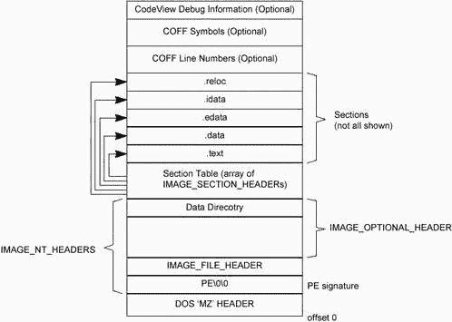

# PE 文件之旅(C 语言描述)

> 原文：[`www.pediy.com/kssd/pediy06/pediy7006.htm`](https://www.pediy.com/kssd/pediy06/pediy7006.htm)

无论是作为一名或者立志成为一名拥有真正技术的 Top Cracker(当然我是属于后者啦，哈)，对 PE 文件格式的熟悉绝对是必须要研究通透和掌握的技术，这一点相信应该没有什么争议吧(当然如果不研究 Windows 平台下解密那就另说了)？看过网上好多的 PE 文件教程，理论居多，只是看好象都明白，到了应用的时候，比如脱壳，对于 IAT 表在脑海中仍然是稀里糊涂一片(呵呵，至少我是这样 D，菜啊~)，学习就是这样，只是学习原理，而没有去实践，好象是懂了，到真正去做的时候，却不知道从何下手。尤其是计算机这门实践性很强的学科，必须要辅以实践才能真正把知识学到手。这里要感谢 MengLong\[DFCG\]，他的《PE 知识学习》从编程实践的角度剖析 PE 文件格式，同时也让我有了研究下去的想法。

好了，罗嗦了这么多，忘了说了，纯属菜鸟教程，让高手贻笑大方了。

*   平台：windows XP SP1
*   编译器：VC++6.0
*   时间：2004.12 -- 2005.01
*   参考资料：看雪《加密解密(第二版)》，MengLong\[DFCG\]《PE 知识学习》，《Matt Pietrek's PE Tutorial》.
*   Coded by: prince
*   E-mail : Cracker\_prince@163.com

## PE 文件之旅 第一篇 Sections
## PE 文件之旅 第二篇 DLL 的秘密 -- 输出表
## PE 文件之旅 第三篇 加壳与脱壳的战场 输入表
## PE 文件之旅 源码下载

### 1 PE 文件之旅(C 语言描述) -- 第一篇 Sections

首先请大家直观地看一下 PE 文件格局。这也是 PE 文件存放在磁盘上的格局。



我们由 `IMAGE_DOS_HEADER.e_lfanew` 得到 PE 文件头在 PE 文件中的偏移，即 `IMAGE_NT_HEADERS` 结构，如下：

```c
typedef struct _IMAGE_NT_HEADERS {
      DWORD Signature;                 /** PE 文件标识 "PE",0,0
      IMAGE_FILE_HEADER FileHeader;      /** 映像文件头 (其中的 NumberOfSections 成员指定了 Sections 的个数)
      IMAGE_OPTIONAL_HEADER32 OptionalHeader;  /** 映像可选头
    } IMAGE_NT_HEADERS32, *PIMAGE_NT_HEADERS32;
```

核心代码：

```c
IMAGE_DOS_HEADER myDosHeader;
LONG e_lfanew;
FILE *pFile;
pFile = fopen("文件路径", r+b);

fread(&myDosHeader, sizeof(IMAGE_DOS_HEADER), 1, pFile);   // pFile 为打开的文件指针
e_lfanew = myDosHeader.e_lfanew;                            // 保存 PE 文件头偏移

IMAGE_FILE_HEADER myFileHeader;
int nSectionCount;                                          

fseek(pFile, (e_lfanew + sizeof(DWORD)), SEEK_SET);
fread(&myFileHeader, sizeof(IMAGE_FILE_HEADER), 1, pFile);
nSectionCount = myFileHeader.NumberOfSections;               // 保存 Section 个数

// 过了 IMAGE_NT_HEADERS 结构就是 IMAGE_SECTION_HEADER 结构数组了，注意是结构数组，有几个 Section 该结构就有几个元素
// 这里动态开辟 NumberOfSections 个内存来存储不同的 Section 信息
IMAGE_SECTION_HEADER *pmySectionHeader = (IMAGE_SECTION_HEADER *)calloc(nSectionCount, sizeof(IMAGE_SECTION_HEADER));
fseek(pFile, (e_lfanew + sizeof(IMAGE_NT_HEADERS)), SEEK_SET);
fread(pmySectionHeader, sizeof(IMAGE_SECTION_HEADER), nSectionCount, pFile);

// 打印 Sections 信息
for (int i = 0; i < nSectionCount; i++, pmySectionHeader++)
{
  printf("Name: %s\n", pmySectionHeader->Name);
  printf("union_PhysicalAddress: %08x\n", pmySectionHeader->Misc.PhysicalAddress);
  printf("union_VirtualSize: %04x\n", pmySectionHeader->Misc.VirtualSize);
  printf("VirtualAddress: %08x\n", pmySectionHeader->VirtualAddress);
  printf("SizeOfRawData: %08x\n", pmySectionHeader->SizeOfRawData);
  printf("PointerToRawData: %04x\n", pmySectionHeader->PointerToRawData);
  printf("PointerToRelocations: %04x\n", pmySectionHeader->PointerToRelocations);
  printf("PointerToLinenumbers: %04x\n", pmySectionHeader->PointerToLinenumbers);
  printf("NumberOfRelocations: %04x\n", pmySectionHeader->NumberOfRelocations);
  printf("NumberOfLinenumbers: %04x\n", pmySectionHeader->NumberOfLinenumbers);
  printf("Charateristics: %04x\n", pmySectionHeader->Characteristics);
}

// 恢复指针
pmySectionHeader -= m_nSectionCount;

if (pmySectionHeader != NULL)           // 释放内存
{
  free(pmySectionHeader);
  pmySectionHeader = NULL;
}

// 最后不要忘记关闭文件
fclose(pFile);
```

我将以上代码改写了一个 Win32 程序，可以很方便地查看 PE 文件的 Section 信息。本人菜鸟，错误及不妥之处难免存在，如果大家发现有什么问题，不要吝啬啊，请告之。那么关于 PE 文件格式 Section 的 C 语言描述到此就结束了，下一篇将继续我们的 PE 文件研究，DLL 的秘密 -- 输出表。

### 2 PE 文件之旅(C 语言描述) 第二篇 DLL 的秘密 -- 输出表

大家好，现在继续我们的 PE 文件之旅第二篇， DLL 的秘密 -- 输出表。

首先看一下预备知识。输出表在《加密解密 II》等资料中并没有太多的笔墨，居我的接触，它确实比较直观，没有象输入表那样复杂的结构，所以这也可能是介绍的少的缘故。关于输出表的结构可以参考《Matt Pietrek's PE Tutorial》。

首先定位输出表。在 `IMAGE_OPTIONAL_HEADER.DataDirectory` 结构数组中，注意这也是个结构数组。它的每一个元素都是 `IMAGE_DATA_DIRECTORY` 结构。该结构定义如下：

```c
typedef struct _IMAGE_DATA_DIRECTORY {
      DWORD   VirtualAddress;
      DWORD   Size;
  } IMAGE_DATA_DIRECTORY, *PIMAGE_DATA_DIRECTORY;
```

`DataDirectory` 结构数组的第一个元素描述的就是输出表，第二个元素描述的是输入表，呵呵，这个是我们下一篇研究对象。所以，这里的 `VirtualAddress` 就是输出表的偏移地址，`Size` 就不用说了，输出表的大小。

注意：以下代码的一些变量在前一篇文章《PE 文件之旅 -- Sections》中已经定义过，这里不再重新定义，请大家参考前面的文章。

核心代码：

```c
// 首先定位 IMAGE_OPTIONAL_HEADER32 结构
IMAGE_OPTIONAL_HEADER32 myOptionalHeader;
fseek(pFile, (e_lfanew + sizeof(DWORD) + sizeof(IMAGE_FILE_HEADER)), SEEK_SET);     // 如此定位的原因请参考 PE 文件结构图
fread(&myOptionalHeader, sizeof(IMAGE_OPTIONAL_HEADER32), 1, pFile);

// 数据目录表的第一个元素为输出表
printf("输出表的偏移地址：%08x\n", myOptionalHeader.DataDirectory[0].VirtualAddress);
printf("输出表的大小：%04x\n", myOptionalHeader.DataDirectory[0].Size);

DWORD dwFileOffset;
if (myOptionalHeader.DataDirectory[0].VirtualAddress != 0)
{
  // OnConvertVAToRawA()函数是进行 VirtualAddress 到文件偏移转换的函数，具体代码见下面
  dwFileOffset = OnConvertVAToRawA(myOptionalHeader.DataDirectory[0].VirtualAddress);
  if (-1 == dwFileOffset)
  {
    printf("输出表定位错误\n");
  }
  else
  {
    printf("输出表的文件偏移为：%08x\n", dwFileOffset);

    // ------------------ 这里已经获得了输出表的文件偏移，输出表是由 IED 数组开始 ------------------ //
    int nNumberOfFunctions = 0;
    int nNumberOfNames     = 0;
    // 由输出表的偏移(VA)计算出文件偏移(RawAddress),然后定位到这里就是输出表了
    // 输出表由 IMAGE_EXPORT_DIRECTORY 结构开始，
    IMAGE_EXPORT_DIRECTORY *pIED = (IMAGE_EXPORT_DIRECTORY *)malloc(sizeof(IMAGE_EXPORT_DIRECTORY)); // Memory 17
    fseek(pFile, dwFileOffset, SEEK_SET);
    fread(pIED, sizeof(IMAGE_EXPORT_DIRECTORY), 1, pFile);

    printf("IMAGE_EXPORT_DIRECTORY 结构如下: \n");
    printf("Characteristics：%08x(没有用途，总是为 0)\n", pIED->Characteristics);
    printf("TimeDateStamp：%08x(文件被产生时刻)\n", pIED->TimeDateStamp);
    printf("MajorVersion：%08x(没有用途，总是为 0)\n", pIED->MajorVersion);
    printf("MinorVersion：%08x(没有用途，总是为 0)\n", pIED->MinorVersion);
    printf("Name：%08x(RVA，指向一个 DLL 文件名称)\n", pIED->Name);

    // 读取 DLL 名称
    char chDllName[64] = {0};   // 这里多留点空间给函数名字，防止出错，我所见过的函数名称最长也就 30 个 char，呵呵
    // 将指向 DLL 文件名称的 VA 转化为文件偏移
    DWORD dwTemp = OnConvertVAToRawA(pIED->Name);
    // 读取 DLL 文件名称
    fseek(pFile, dwTemp, SEEK_SET);
    fread(chDllName, 64, 1, pFile);
    printf("DLL 文件名称为：%s\n", chDllName);

    printf("Base：%08x(起始序号)\n", pIED->Base);
    // 被此模块输出的函数的起始序号
    WORD wBase = (WORD)pIED->Base;

    printf("NumberOfFunctions：%d(输出函数个数)\n", pIED->NumberOfFunctions);
    // AddressOfFunctions 数组（稍后描述）中的元素个数。此值同时也是输出函数的个数。
    // 通常这个值和 NumberOfNames 字段相同，但也可以不同。
    nNumberOfFunctions = pIED->NumberOfFunctions;

    printf("NumberOfNames：%d(以名称输出的函数个数)\n", pIED->NumberOfNames);
    // AddressOfNames 数组（稍后描述）中的元素个数。此值表示以名称输出的函数个数。
    // 通常（但不总是）和输出函数的总数相同。
    nNumberOfNames = pIED->NumberOfNames;

    // 这是一个 RVA （Relative Virtual Address ）值，指向一个由函数地址所构成的数组。
    // 我所谓的函数地址是指此一模块中的每一个输出函数的进入点的 RVA 值。
    printf("AddressOfFunctions：%08x(RVA, 指向一个由函数地址构成的数组)\n", pIED->AddressOfFunctions);
    // 这里将其转化为文件的偏移地址
    DWORD dwAddressOfFunctions = OnConvertVAToRawA(pIED->AddressOfFunctions);

    // 这是一个 RVA 值，指向一个由字符串指针所构成的数组。
    // 字符串的内容是此一模块中的每一个"以名称输出的输出函数"的名称
    printf("AddressOfNames：%08x(RVA, 指向一个由字符串指针所构成的数组)\n", pIED->AddressOfNames);
    // 转化为文件偏移地址
```


这段代码展示了PE文件中导出表（Export Table）的解析过程，包括内存分配、数据读取、地址转换（VA转RAW）以及资源释放。以下是经过排版和标注的代码：

```c
DWORD dwNameAddressOfFunctions = OnConvertVAToRawA(pIED->AddressOfNames);

// 这是一个 RVA 值，指向一个 WORD 数组。
// WORD 的内容是此一模块中的每一个"以名称输出的输出函数"的序号。别忘了要加上 Base 字段中的起始序号。
printf("AddressOfNameOrdinals：%08x(RVA, 指向一个 DWORD 数组)\\n", pIED->AddressOfNameOrdinals);

// 转化为文件偏移地址
DWORD dwAddressOfNameOrdinals = OnConvertVAToRawA(pIED->AddressOfNameOrdinals);

if (pIED != NULL)                 // release Memory 17
{
  free(pIED);
  pIED = NULL;
}

// 动态开辟内存用来存储函数的 VirtualAddress
DWORD *pdwAddressOfFunctions = (DWORD *)calloc(nNumberOfFunctions, sizeof(DWORD));     // Memory 18
fseek(pFile, dwAddressOfFunctions, SEEK_SET);
fread(pdwAddressOfFunctions, sizeof(DWORD), nNumberOfFunctions, pFile);

// 动态开辟内存用来存储函数的 RawAddress
DWORD *pRowAddressOfFunctions = (DWORD *)calloc(nNumberOfFunctions, sizeof(DWORD));    // Memory 19
for (int i = 0; i < nNumberOfFunctions; i++, pdwAddressOfFunctions++, pRowAddressOfFunctions++)
{
  *pRowAddressOfFunctions = OnConvertVAToRAwA(*pdwAddressOfFunctions);
}

// 恢复指针
pdwAddressOfFunctions  -= nNumberOfFunctions;
pRowAddressOfFunctions -= nNumberOfFunctions;

// 动态开辟内存用来存储函数名称地址
DWORD *pdwNameAddressOfFunctions = (DWORD *)calloc(nNumberOfNames, sizeof(DWORD));    // Memory 20
fseek(pFile, dwNameAddressOfFunctions, SEEK_SET);
fread(pdwNameAddressOfFunctions, sizeof(DWORD), nNumberOfNames, pFile);

// VA TO RAWA
for (i = 0; i < nNumberOfNames; i++, pdwNameAddressOfFunctions++)
{
  *pdwNameAddressOfFunctions = OnConvertVAToRowA(*pdwNameAddressOfFunctions);
}

// 恢复指针
pdwNameAddressOfFunctions -= nNumberOfNames;

// 二重指针，用来存储函数名称指针，因为函数个数不固定
DWORD **pFunctionsName = (DWORD **)calloc(nNumberOfNames, sizeof(char *));           // Memory 21
for (i = 0; i < nNumberOfNames; i++, pFunctionsName++)
{
  // 这块内存是用来存放函数名称的
  char *pchFunctionName = (char *)malloc(sizeof(char) * 64);
  *pFunctionsName = (DWORD *)pchFunctionName;
}

// 恢复指针
pFunctionsName -= nNumberOfNames;

// 读出函数名称
for (i = 0; i < nNumberOfNames; i++, pdwNameAddressOfFunctions++, pFunctionsName++)
{
  fseek(pFile, *pdwNameAddressOfFunctions, SEEK_SET);
  fread(*pFunctionsName, 64, 1, pFile);
}

// 恢复指针
pdwNameAddressOfFunctions -= nNumberOfNames;
pFunctionsName            -= nNumberOfNames;

if (pdwNameAddressOfFunctions != NULL)             // release Memory 20
{
  free(pdwNameAddressOfFunctions);
  pdwNameAddressOfFunctions = NULL;
}

// 读出函数的序号
WORD *pwFunctionsOrdinals = (WORD *)calloc(nNumberOfNames, sizeof(WORD));            // Memory 22
fseek(pFile, dwAddressOfNameOrdinals, SEEK_SET);
for (i = 0; i < nNumberOfNames; i++, pwFunctionsOrdinals++)
{
  fread(pwFunctionsOrdinals, sizeof(WORD), 1, pFile);
}

// 恢复指针
pwFunctionsOrdinals -= nNumberOfNames;

//      这里需要注意的是 AddressOfFunctions 所指的数组。这是一个 DWORD 数组，每一个 DWORD 都是
// 一个输出函数的 RVA 地址。每一个输出函数的序号都与函数在此数组中的位置一致。假使起始序号
// 为 1，那么输出序号为 1 者其函数地址在此数组中排在第一个位置。输出序号为 2 者其函数地址在此
// 函数地址中则排在第二个位置，依次类推。

// 由以上可知，我们必须对 AddressOfNameOrdinals 所指向的 WORD 数组进行升序排序，同时进行的还有
// 函数名称存放位置的排序，因为 Ordinals 和函数名称存放的位置是对应的。

// 这里采用效率较高的快速排序(详细代码见下面)
QuickSort(pwFunctionsOrdinals, pFunctionsName, nNumberOfNames);

// 打印信息
for (i = 0; i < nNumberOfNames; i++, pwFunctionsOrdinals++, pFunctionsName++, pRowAddressOfFunctions++, pdwAddressOfFunctions++)
{
  printf("Ordinals: %04x\\n", *pwFunctionsOrdinals + wBase);
  printf("函数%d: %s\\n", i + 1, *pFunctionsName);
  printf("RowAddress: %08x\\n", *pRowAddressOfFunctions);
  printf("VirtulAddress: %08x\\n", *pdwAddressOfFunctions);
}

// 恢复指针
pwFunctionsOrdinals    -= nNumberOfNames;
pFunctionsName         -= nNumberOfNames;
pRowAddressOfFunctions -= nNumberOfNames;
pdwAddressOfFunctions  -= nNumberOfNames;

if (pdwAddressOfFunctions != NULL)          // release Memory 18
{
  free(pdwAddressOfFunctions);
  pdwAddressOfFunctions = NULL;
}

if (pRowAddressOfFunctions != NULL)         // release Memory 19
{
  free(pRowAddressOfFunctions);
  pRowAddressOfFunctions = NULL;
}

for (i = 0; i < nNumberOfNames; i++, pFunctionsName++)    // release Memory 21
{
  if (*pFunctionsName != NULL)
  {
    free(*pFunctionsName);
    *pFunctionsName = NULL;
  }
}
pFunctionsName -= nNumberOfNames;

if (pFunctionsName != NULL)                   // release prince 21
{
  free(pFunctionsName);
  pFunctionsName = NULL;
}

if (pwFunctionsOrdinals != NULL)              // release prince 22
{
  free(pwFunctionsOrdinals);
  pwFunctionsOrdinals = NULL;
}
  }
}
else
{
  printf("此文件无输出表\\n");
}

// VA 到 RAWA 的转换程序(原理请参考<<加密解密 II>>中关于输出表的部分)
DWORD OnConvertVAToRawA(DWORD dwFileOffset)
{
  IMAGE_SECTION_HEADER *pmySectionHeader = (IMAGE_SECTION_HEADER *)calloc(nSectionCount, sizeof(IMAGE_SECTION_HEADER)); // prince 14
  fseek(pFile, (e_lfanew + 4 + sizeof(IMAGE_FILE_HEADER) + sizeof(IMAGE_OPTIONAL_HEADER32)), SEEK_SET);
  fread(pmySectionHeader, sizeof(IMAGE_SECTION_HEADER), nSectionCount, pFile);

  DWORD dwFilePos;
  DWORD dwOffset;
  DWORD *pdwVA   = (DWORD *)malloc(sizeof(DWORD) * nSectionCount);   // prince 15
  DWORD *pdwRowA = (DWORD *)malloc(sizeof(DWORD) * nSectionCount);   // prince 16
  for (int i = 0; i < nSectionCount; i++, pmySectionHeader++, pdwVA++, pdwRowA++)
  {
    *pdwVA   = pmySectionHeader->VirtualAddress;
    *pdwRowA = pmySectionHeader->PointerToRawData;
  }

  pmySectionHeader -= nSectionCount;

  pdwVA      -= nSectionCount;
  pdwRowA      -= nSectionCount;

  for (i = 0; i < nSectionCount; i++, pdwVA++, pdwRowA++)
  {
    if ((dwFileOffset >= *pdwVA) && (dwFileOffset < *(pdwVA + 1)))
    {
      dwOffset  = *pdwVA - *pdwRowA;
      dwFilePos = dwFileOffset - dwOffset;

      pdwVA   -= i;
      pdwRowA -= i;
      if (pdwVA != NULL)             // release prince 15
      {
        free(pdwVA);
        pdwVA = NULL;
      }
      if (pdwRowA != NULL)           // release prince 16
      {
        free(pdwRowA);
        pdwRowA = NULL;
      }

      if (pmySectionHeader != NULL)      // release prince 14
      {
        free(pmySectionHeader);
        pmySectionHeader = NULL;
      }

      return dwFilePos;
    }
  }
  pdwVA   -= nSectionCount;
  pdwRowA -= nSectionCount;

  if (pmySectionHeader != NULL)      // release prince 14
  {
    free(pmySectionHeader);
    pmySectionHeader = NULL;
  }

  if (pdwVA != NULL)             // release prince 15
  {
    free(pdwVA);
    pdwVA = NULL;
  }

  if (pdwRowA != NULL)           // release prince 16


```c
    free(pdwRowA);
    pdwRowA = NULL;
}

return -1;
}

void QuickSort(WORD *pwSourceData1, DWORD **pdwSourceData2, int nNumberOfArray)
{
    SortRun(pwSourceData1, pdwSourceData2, 0, nNumberOfArray - 1);
}

void SortRun(WORD *pwSourceData1, DWORD **pdwSourceData2, int nLeft, int nRight)
{
    WORD wMiddle, wTemp;
    DWORD *pdwTemp;
    int i, j;

    wMiddle  = pwSourceData1[(nLeft + nRight) / 2];
    i = nLeft;
    j = nRight;

    while (i < j)
    {
        while ((pwSourceData1[i] < wMiddle) && (i < j))
        {
            i++;
        }
        while ((pwSourceData1[j] > wMiddle) && (j > i))
        {
            j--;
        }

        if (i <= j)
        {
            wTemp = pwSourceData1[i];
            pwSourceData1[i] = pwSourceData1[j];
            pwSourceData1[j] = wTemp;

            pdwTemp = *(pdwSourceData2 + i);
            *(pdwSourceData2 + i) = *(pdwSourceData2 + j);
            *(pdwSourceData2 + j) = pdwTemp;

            i++;
            j--;
        }
    }

    // 如果左边还有元素，对左边进行快速排序
    if (nLeft < j)
    {
        SortRun(pwSourceData1, pdwSourceData2, 0, j);
    }

    // 如果右边还有元素，对右边进行快速排序
    if (nRight > i)
    {
        SortRun(pwSourceData1, pdwSourceData2, i, nRight);
    }
}
```

呼~，好累啊！也感谢你坚持看完。接下来的一篇就是大家最关心，也是最重要的输出表了，敬请关注下一篇：PE 文件之旅 -- 加壳与脱壳的战场 输入表。

### 3 PE 文件之旅 -- 第三篇 加壳与脱壳的战场 输入表(俯源码)

PE 文件之旅(C 语言描述) 第三篇 -- 加壳与脱壳的战场 输出表

呼~，终于到输入表了，No Wasting Time, Let's Go!
还是讲原理先。输入表较前一篇的输出表稍微复杂一些，所谓复杂，在 C 语言里，无非就是多了
几重指针，通过多重指针找啊找的才能访问到想要的东西。就好象你拿着钱找绑匪(`T`)，到了 `T` 指定的地点
，接了个电话，`T` 又指定了一个新的地点，于是你到了 `T` 指定的新的地点... 呵呵，开个玩笑。上一篇我们
在 `IMAGE_OPTIONAL_HEADER32.DataDirectory` 的第一个数组里面找到了输出表，第二个元素描述的就是输
入表的信息。大家还记得这个 `DataDirectory` 结构数组吧？它是 `IMAGE_DATA_DIRECTORY` 结构，有必要再重
申一下它的定义：

```c
typedef struct _IMAGE_DATA_DIRECTORY {
        DWORD   VirtualAddress;
         DWORD   Size;
     } IMAGE_DATA_DIRECTORY, *PIMAGE_DATA_DIRECTORY;
```

想起来了吧，`ViretualAddress` 就指向输出表(接到绑匪电话了，呵呵)。还等什么？我们开始吧！

核心代码：

```c
// 首先定位 IMAGE_OPTIONAL_HEADER32 结构
IMAGE_OPTIONAL_HEADER32 myOptionalHeader;
fseek(pFile, (e_lfanew + sizeof(DWORD) + sizeof(IMAGE_FILE_HEADER)), SEEK_SET);     // 如此

定位的原因请参考 PE 文件结构图
fread(&myOptionalHeader, sizeof(IMAGE_OPTIONAL_HEADER32), 1, pFile);

// 将输入表的 VA 转换为文件偏移
dwFileOffset = OnConvertVAToRawA(myOptionalHeader.DataDirectory[1].VirtualAddress);
if (dwFileOffset != -1)
{
  printf("输入表的文件偏移为：%08x\n", dwFileOffset);
  // 输入表由 IMAGE_IMPORT_DESCRIPTOR 结构数组开始，每一个被隐式调用的 DLL 文件都会有一个

对应的 IID 结构数组
  // 但是没有字段指明 IID 数组的个数，也就是引入的 DLL 文件个数，但是这个 IID 数组的最后一个

元素全为 0，
  // 通过这一点可以计算出引入的 DLL 文件的个数，也就是 IID 结构数组的元素个数。
  // IMAGE_IMPORT_DESCRIPTOR 结构定义：
  // typedef struct _IMAGE_IMPORT_DESCRIPTOR {
        // union {
        // DWORD   Characteristics;           // 0 for terminating null import

descriptor
        // DWORD   OriginalFirstThunk;              // RVA to original unbound IAT

(PIMAGE_THUNK_DATA)
    // };
    // DWORD   TimeDateStamp;               // 0 if not bound,
                                        // -1 if bound, and real date\timestamp

                                        // in IMAGE_DIRECTORY_ENTRY_BOUND_IMPORT

(new BIND)
                                        // O.W. date/time stamp of DLL bound to

(Old BIND)

    // DWORD   ForwarderChain;              // -1 if no forwarders
    // DWORD   Name;
    // DWORD   FirstThunk;                  // RVA to IAT (if bound this IAT has

actual addresses)
  // } IMAGE_IMPORT_DESCRIPTOR;
  // 现在已经获得了输入表的文件偏移，所以从这里开始就是输入表的 IID 数组了
  IMAGE_IMPORT_DESCRIPTOR IID;
  fseek(pFile, dwFileOffset, SEEK_SET);
  fread(&IID, sizeof(IMAGE_IMPORT_DESCRIPTOR), 1, pFile);
  // 得到 IID 数组个数先
  int nDllCount = 0;
  while ((0 != IID.Characteristics) || (0 != IID.FirstThunk) || (0 !=

IID.ForwarderChain) || (0 != IID.Name) || (0 != IID.OriginalFirstThunk) || (0 !=

IID.TimeDateStamp) )
  {
    nDllCount++;
    fread(&IID, sizeof(IMAGE_IMPORT_DESCRIPTOR), 1, pFile);
  }
  printf("导入的 DLL 个数为：%d\n", nDllCount);

  // 已经得到了导入的 DLL 个数，现在把他们读出来
  IMAGE_IMPORT_DESCRIPTOR *pIID = (IMAGE_IMPORT_DESCRIPTOR *)calloc(nDllCount, sizeof

(IMAGE_IMPORT_DESCRIPTOR)); // prince 01
  fseek(pFile, dwFileOffset, SEEK_SET);
  fread(pIID, sizeof(IMAGE_IMPORT_DESCRIPTOR), nDllCount, pFile);

  // IID.Name 中存放的就是 DLL 文件的名称的地址，注意是地址而不是以 Zero 结尾的字符串.
  // --------------------- 通过 IID.Name 的 RVA 读出 DLL 的名称 ----------------------- //
  DWORD *pNameFileOffset = (DWORD *)malloc(sizeof(DWORD) * nDllCount); // prince 02
  // 取出这些 Name 的 VA 转化为 FileOffset 存在 pNamefileOffset 中
  for (int i = 0; i < nDllCount; i++, pNameFileOffset++, pIID++)
  {
    *pNameFileOffset = OnConvertVAToRowA(pIID->Name);
  }
  // 恢复指针
  pIID            -= nDllCount;
  pNameFileOffset -= nDllCount;

  // 动态开辟指针数组 pName,*pName 指向存着 DLL Name 的 pchName
  DWORD *pName = (DWORD *)calloc(nDllCount, sizeof(DWORD));  // prince 03 必须和 04 一起

释放
  for (i = 0; i < nDllCount; i++, pName++)
  {
    // 每次开辟一个 chName[16]用于存放 Name
    char *pchName = (char *)malloc(sizeof(char) * 16);     // prince 04 必须和 03

一起释放
    // 将本次申请的内存的地址保存到*pName 中
    *pName = (DWORD)pchName;
  }
  // 恢复指针
  pName -= nDllCount;
  // 以上动态分配内存的部分实际上是二重指针，这里这样分配好理解一些，下面再遇见同样的

问题就直接声明多重指针了
  // 读取 Name
  for (i = 0; i < nDllCount; i++, pNameFileOffset++, pName++)
  {
    DWORD dwDllName = *pNameFileOffset;
    fseek(pFile, dwDllName, SEEK_SET);
    char chTemp[16] = {0};
    fread((void *)*pName, 16, 1, pFile);
  }
  pNameFileOffset -= nDllCount;
  pName           -= nDllCount;

  if (pNameFileOffset != NULL)        // release prince 02
  {
    free(pNameFileOffset);
    pNameFileOffset = NULL;
  }
  // ---------------- pName 中就是每个 DLL 文件名称的文件偏移地址 ------------------- //

  // 读取 IMAGE_IMPORT_DESCRIPTOR 的 OriginalFirstThunk(或 Characteristics)的值，该值指向

IMAGE_THUNK_DATA 结构数组,
  // IMAGE_THUNK_DATA 数组的每一个指针都指向 IMAGE_IMPORT_BY_NAME 结构
  // 动态开辟空间用来保存每个 DLL 的 FistThunk 值(文件偏移值)
  DWORD *pFirstThunkOfFileOffset = (DWORD *)calloc(nDllCount, sizeof(DWORD));  //

prince 05
  char *pbByIndex = (char *)calloc(nDllCount, sizeof(char));                   //

prince 06
  for (i = 0; i < nDllCount; i++, pbByIndex++)
  {
    *pbByIndex = 0;
  }
  pbByIndex -= nDllCount;  // 用来判断是否函数引入的标志

  // 读出 OriginalFirstThunk 所指向的值，该值高位的两个字节如果是 0x8000，则说明该函数是

以序号引入。
  // 低位的两个字节即为引入序号，比如该值为：0x80001234，那么就说明引入的是该 DLL 文件的

第 1234h 号函数。
  DWORD *pdwRowAddressOfOriginalFirstThunk = (DWORD *)malloc(sizeof(DWORD));      //

prince 23
  for (i = 0; i < nDllCount; i++, pIID++, pFirstThunkOfFileOffset++, pbByIndex++)
  {
    DWORD dwTemp = OnConvertVAToRawA(pIID->OriginalFirstThunk);
    fseek(pFile, dwTemp, SEEK_SET);
    fread(pdwRowAddressOfOriginalFirstThunk, sizeof(DWORD), 1, pFile);
    if (0 != *pdwRowAddressOfOriginalFirstThunk)
    {
      struct HightBit
      {
        int nHightBit : 1;
```


```c
}
Bit;

Bit.nHightBit = *pdwRowAddressOfOriginalFirstThunk >> 31;
if (0 != Bit.nHightBit)  // 按序号引入函数
{
    *pbByIndex = 1;
    *pFirstThunkOfFileOffset = OnConvertVAToRawA(pIID-
    >OriginalFirstThunk);
}
else                     // 按名称引入函数
{
    *pFirstThunkOfFileOffset = OnConvertVAToRawA(pIID-
    >OriginalFirstThunk);
}
```

```c
}
else
{
    *pFirstThunkOfFileOffset = OnConvertVAToRawA(pIID->FirstThunk);
}
}

// 恢复指针
pIID               -= nDllCount;
pFirstThunkOfFileOffset -= nDllCount;
pbByIndex              -= nDllCount;

if (pdwRowAddressOfOriginalFirstThunk != NULL)         // release prince 23
{
    free(pdwRowAddressOfOriginalFirstThunk);
    pdwRowAddressOfOriginalFirstThunk = NULL;
}

if (pIID != NULL)                  // release prince 01
{
    free(pIID);
    pIID = NULL;
}

// ------------------- pFirstThunkOfFileOffset 中是每个 DLL 入口的文件偏移值 --------

// ----------- //

// 同样，IMAGE_THUNK_DATA 结构数组也是以全 0 作为结束，用这一点来计算出每个 DLL 文件的函

数个数
// --------------------------------- 读取每个 DLL 的函数的个数 ----------------------

// --------- //
int *pnFunctionCountPerDll = (int *)calloc(nDllCount, sizeof(int));

// prince 07
IMAGE_THUNK_DATA *pITD = (IMAGE_THUNK_DATA *)malloc(sizeof(IMAGE_THUNK_DATA));

// prince 08
for (i = 0; i < nDllCount; i++, pnFunctionCountPerDll++, pFirstThunkOfFileOffset++)
{
    fseek(pFile, *pFirstThunkOfFileOffset, SEEK_SET);
    fread(pITD, sizeof(IMAGE_THUNK_DATA), 1, pFile);
    int nFunctionCount = 0;
    while ((pITD->u1.ForwarderString != 0) || (pITD->u1.Function != 0) || (pITD
    ->u1.Ordinal != 0) || (pITD->u1.AddressOfData != 0))
    {
        nFunctionCount++;
        fread(pITD, sizeof(IMAGE_THUNK_DATA), 1, pFile);
    }
    *pnFunctionCountPerDll = nFunctionCount;
}
if (pITD != NULL)                 // release prince 08
{
    free(pITD);
    pITD = NULL;
}

pFirstThunkOfFileOffset -= nDllCount;
pnFunctionCountPerDll  -= nDllCount;
// ---------------- pnFunctionCountPerDll 中存放的就是每个 DLL 中引入的函数个数 ------

// --------- //

// 由于 DLL 文件的个数，每个 DLL 文件的函数个数都是不固定的，所以这里我用了三重指针。
// 也许用了三重指针使下面的程序难懂了一些，但是我认为这是最好的方法了。
// ------------------------------ 读取每个 DLL 文件中函数的名称 --------------------

// --------- //
DWORD ****pdwFunctionOfDll = (DWORD ***)calloc(nDllCount, sizeof(DWORD**));

      // prince 09 必须和 10，11 一起释放
for (i = 0; i < nDllCount; i++, pdwFunctionOfDll++, pnFunctionCountPerDll++)
{
    DWORD **pdwFileOffsetOfFunction = (DWORD **)calloc(*pnFunctionCountPerDll,

    sizeof(char*));  // prince 10 必须和 09，11 一起释放
    *pdwFunctionOfDll = pdwFileOffsetOfFunction;
    for (int j = 0; j < *pnFunctionCountPerDll; j++, pdwFileOffsetOfFunction++)
    {
        char *pchFunctionName = (char *)malloc(sizeof(char) * 64);

                 // prince 11 必须和 09，10 一起释放
        *pdwFileOffsetOfFunction = (DWORD *)pchFunctionName;
    }
}
pdwFunctionOfDll    -= nDllCount;
pnFunctionCountPerDll  -= nDllCount;

// ----------------------- 确定哪几个 DLL 文件是序号引入 ----------------------------

//
int nByIndexDllCount     = 0;
for (i = 0; i < nDllCount; i++, pbByIndex++)
{
    if (0 != *pbByIndex)
    {
        nByIndexDllCount++;
    }
}
pbByIndex -= nDllCount;
// ----------------------- 有 nByIndexDllCount 个 DLL 文件是由序号引入的 --------------

// ----- //

// ----------------------- 再求出每个由序号引入的 DLL 的函数个数 --------------------

// -- //
int *pnByIndexDllFunctionsCount = (int *)calloc(nByIndexDllCount, sizeof(int));

      // prince 24
for (i = 0; i < nDllCount; i++, pbByIndex++, pnFunctionCountPerDll++)
{
    if (0 != *pbByIndex)
    {
        *pnByIndexDllFunctionsCount = *pnFunctionCountPerDll;
        pnByIndexDllFunctionsCount++;
    }
}
pbByIndex           -= nDllCount;
pnFunctionCountPerDll     -= nDllCount;
pnByIndexDllFunctionsCount -= nByIndexDllCount;
// ------------------- pnByIndexDllFunctionsCount 所指向的就是每个由序号引入的 DLL 文件

的函数个数 ---------------- //

// ------------------ 动态开辟内存用来保存由序号引入的函数序号 --------------------

// ---- //
DWORD **pdwFunctionIndex = (DWORD **)calloc(nByIndexDllCount, sizeof(DWORD *));

       // prince 25
for (i = 0; i < nByIndexDllCount; i++, pnByIndexDllFunctionsCount++,

pdwFunctionIndex++)
{
    DWORD *pdwFunctionIndexTmp = (DWORD *)calloc(*pnByIndexDllFunctionsCount,

    sizeof(DWORD));    // prince 26
    *pdwFunctionIndex = pdwFunctionIndexTmp;
}
pnByIndexDllFunctionsCount -= nByIndexDllCount;
pdwFunctionIndex           -= nByIndexDllCount;
// --------------------------------------------------------------------------------

// ------//

for (i = 0; i < nDllCount; i++, pFirstThunkOfFileOffset++, pnFunctionCountPerDll++,

pdwFunctionOfDll++, pbByIndex++)
{
    IMAGE_THUNK_DATA *pITD = (IMAGE_THUNK_DATA *)calloc(*pnFunctionCountPerDll,

    sizeof(IMAGE_THUNK_DATA)); // prince 12
    fseek(pFile, *pFirstThunkOfFileOffset, SEEK_SET);
    fread(pITD, sizeof(IMAGE_THUNK_DATA), *pnFunctionCountPerDll, pFile);
    DWORD dwFileOffsetOfFunction;
    if (0 == *pbByIndex)
    {
        for (int j = 0; j < *pnFunctionCountPerDll; j++, pITD++)
        {
            dwFileOffsetOfFunction = OnConvertVAToRowA((DWORD)pITD-
            >u1.AddressOfData);
            fseek(pFile, dwFileOffsetOfFunction + 2, SEEK_SET);
            fread((void *)**pdwFunctionOfDll, 64, 1, pFile);
            strText.Format("%s", **pdwFunctionOfDll);
            (*pdwFunctionOfDll)++;
        }
        pITD -= *pnFunctionCountPerDll;
        *pdwFunctionOfDll -= *pnFunctionCountPerDll;
    }
    else
    {
        for (int j = 0; j < *pnByIndexDllFunctionsCount; j++, pITD++,

        (*pdwFunctionIndex)++)
        {
            **pdwFunctionIndex = (DWORD)pITD->u1.AddressOfData;
        }
        pITD -= *pnByIndexDllFunctionsCount;
        *pdwFunctionIndex -= *pnByIndexDllFunctionsCount;
        pnByIndexDllFunctionsCount++;
        pdwFunctionIndex++;
    }

    if (pITD != NULL)                    // release prince 12
    {
        free(pITD);
        pITD = NULL;
    }

}

if (nByIndexDllCount != 0)
{
    pnByIndexDllFunctionsCount -= nByIndexDllCount;
    pdwFunctionIndex           -= nByIndexDllCount;
}

pdwFunctionOfDll    -= nDllCount;
pFirstThunkOfFileOffset -= nDllCount;
pnFunctionCountPerDll   -= nDllCount;
pbByIndex               -= nDllCount;

if (pFirstThunkOfFileOffset != NULL)       // release prince 05
{
    free(pFirstThunkOfFileOffset);
    pFirstThunkOfFileOffset = NULL;
}
// -------------------------- 三重指针 pdwFunctionOfDll 最终指向函数名称 ------------

// ---------------- //

// --------------------- 处理由序号引入的函数的序号 --------------------------------

//


```
  for (i = 0; i < nDllCount; i++, pName++, pnFunctionCountPerDll++,
pdwFunctionOfDll++, pbByIndex++)
  {
    prince("DLL %d 名字：%s\n", (i + 1), *pName);
    prince("调用函数个数：%d\n", *pnFunctionCountPerDll);
    if (0 == *pbByIndex)
    {
      for (int j = 0; j < *pnFunctionCountPerDll; j++,
(*pdwFunctionOfDll)++)
      {
        prince("%s\n", **pdwFunctionOfDll);
      }
      *pdwFunctionOfDll -= *pnFunctionCountPerDll;
    }
    else
    {
      prince("此 DLL 文件中函数由序号引入!");
      for (int j = 0; j < *pnByIndexDllFunctionsCount; j++,
(*pdwFunctionIndex)++)
      {
        prince("引入序号: %04x\n", (**pdwFunctionIndex) & 0xffff);
      // 取 0x80000000 的后两个字节
        m_ListBox1.AddString(strText);
      }
      *pdwFunctionIndex -= *pnByIndexDllFunctionsCount;
      pnByIndexDllFunctionsCount++;
      pdwFunctionIndex++;
    }
  }

  // 恢复指针
  pName           -= nDllCount;
  pnFunctionCountPerDll -= nDllCount;
  pdwFunctionOfDll     -= nDllCount;
  pbByIndex         -= nDllCount;

  pnByIndexDllFunctionsCount -= nByIndexDllCount;
  pdwFunctionIndex           -= nByIndexDllCount;

  for (i = 0; i < nDllCount; i++, pName++)               // release prince 04
  {
    if (*pName != NULL)
    {
      free((void *)*pName);
      *pName = NULL;
    }
  }
  pName -= nDllCount;
  if (pName != NULL)                               // release prince 03
  {
    free(pName);
    pName = NULL;
  }

  if (pbByIndex != NULL)    // release prince 06
  {
    free(pbByIndex);
    pbByIndex = NULL;
  }

  for (i = 0; i < nDllCount; i++, pdwFunctionOfDll++, pnFunctionCountPerDll++)  //
release prince 11
  {
    for (int j = 0; j < *pnFunctionCountPerDll; j++, (*pdwFunctionOfDll)++)
    {
      if (**pdwFunctionOfDll != NULL)
      {
        free((void **)**pdwFunctionOfDll);
        **pdwFunctionOfDll = NULL;
      }
    }
    *pdwFunctionOfDll -= *pnFunctionCountPerDll;
  }
  pnFunctionCountPerDll -= nDllCount;
  pdwFunctionOfDll      -= nDllCount;

  for (i = 0; i < nDllCount; i++, pdwFunctionOfDll++)   // release prince 10
  {
    if (*pdwFunctionOfDll != NULL)
    {
      free(*pdwFunctionOfDll);
      *pdwFunctionOfDll = NULL;
    }
  }
  pdwFunctionOfDll -= nDllCount;

  if (pdwFunctionOfDll != NULL)                  // release prince 09
  {
    free(pdwFunctionOfDll);
    pdwFunctionOfDll = NULL;
  }


  if (pnFunctionCountPerDll != NULL)    //
release prince 07
  {
    free(pnFunctionCountPerDll);
    pnFunctionCountPerDll = NULL;
  }

  if (pnByIndexDllFunctionsCount != NULL)            // release prince 24
  {
    free(pnByIndexDllFunctionsCount);
    pnByIndexDllFunctionsCount = NULL;
  }

  for (i = 0; i < nByIndexDllCount; i++, pdwFunctionIndex++)  // release prince 26
  {
    if (*pdwFunctionIndex != NULL)
    {
      free(*pdwFunctionIndex);
      *pdwFunctionIndex = NULL;
    }
  }
  pdwFunctionIndex -= nByIndexDllCount;

  if (pdwFunctionIndex != NULL)                     // release prince 25
  {
    free(pdwFunctionIndex);
    pdwFunctionIndex = NULL;
  }
}
else
{
  printf("输入表定位错误！");
}


// 计算 VA 到文件偏移的子程序
DWORD OnConvertVAToRawA(DWORD dwFileOffset)
{
  IMAGE_SECTION_HEADER *pmySectionHeader = (IMAGE_SECTION_HEADER *)calloc
(m_nSectionCount, sizeof(IMAGE_SECTION_HEADER)); // prince 14
  fseek(pFile, (e_lfanew + 4 + sizeof(IMAGE_FILE_HEADER) + sizeof
(IMAGE_OPTIONAL_HEADER32)), SEEK_SET);
  fread(pmySectionHeader, sizeof(IMAGE_SECTION_HEADER), m_nSectionCount, pFile);

  DWORD dwFilePos;
  DWORD dwOffset;
  DWORD *pdwVA   = (DWORD *)malloc(sizeof(DWORD) * m_nSectionCount);   // prince 15
  DWORD *pdwRowA = (DWORD *)malloc(sizeof(DWORD) * m_nSectionCount);   // prince 16
  for (int i = 0; i < m_nSectionCount; i++, pmySectionHeader++, pdwVA++, pdwRowA++)
  {
    *pdwVA   = pmySectionHeader->VirtualAddress;
    *pdwRowA = pmySectionHeader->PointerToRawData;
  }

  pmySectionHeader -= m_nSectionCount;

  pdwVA      -= m_nSectionCount;
  pdwRowA      -= m_nSectionCount;

  for (i = 0; i < m_nSectionCount; i++, pdwVA++, pdwRowA++)
  {
    if ((dwFileOffset >= *pdwVA) && (dwFileOffset < *(pdwVA + 1)))
    {
      dwOffset  = *pdwVA - *pdwRowA;
      dwFilePos = dwFileOffset - dwOffset;

      pdwVA   -= i;
      pdwRowA -= i;
      if (pdwVA != NULL)                 // release prince 15
      {
        free(pdwVA);
        pdwVA = NULL;
      }
      if (pdwRowA != NULL)               // release prince 16
      {
        free(pdwRowA);
        pdwRowA = NULL;
      }

      if (pmySectionHeader != NULL)      // release prince 14
      {
        free(pmySectionHeader);
        pmySectionHeader = NULL;
      }

      return dwFilePos;
    }
  }
  pdwVA   -= m_nSectionCount;
  pdwRowA -= m_nSectionCount;

  if (pmySectionHeader != NULL)      // release prince 14
  {
    free(pmySectionHeader);
    pmySectionHeader = NULL;
  }

  if (pdwVA != NULL)                 // release prince 15
  {
    free(pdwVA);
    pdwVA = NULL;
  }

  if (pdwRowA != NULL)               // release prince 16
  {
    free(pdwRowA);
    pdwRowA = NULL;
  }

  return -1;
}


 PE 文件之旅全部系列到此就告一段落了。在将近一个月的时间里通过对 `PE` 文件格式的研究让我从正向的角度全面的了解了 `EXE` 文件执行的有关细节，同时对我自己而言也是得到了锻炼和提高，无奈编程水平有限，这篇堆砌起来的垃圾代码还有着严重的不雅和缺陷，希望高手看了之后能腾出宝贵的时间对我指点一二；同时也希望对我有着很大帮助和提高的这几篇小小的心得能让广大和我一样渴求知识和追求软件技术的小菜们得到自己真正想要的东西。

 还是那句老话，抛砖引玉，我是就着《《`PE` 知识学习》》写下去的。接下去我会继续研究 `PE` 文件的资源，看看资源的压缩原理，也就是压缩壳的原理，等有了成果再和大家分享。在这里希望大家在学习知识的同时继续把思维发展下去，真正在技术的层面上提高自己。

 现将全部 `VC` 源代码发布，希望同大家进行技术交流，程序写的较烂，请指教。

`4dd466d0e1e0cc123afbe504da2462ca`
