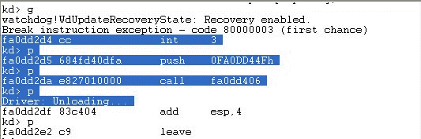

# 内核级 SEH 异常处理分析调试分析

> 原文：[`www.pediy.com/kssd/pediy11/123660.html`](https://www.pediy.com/kssd/pediy11/123660.html)

前一段时间在论坛里发了一篇《下定决心好好学习内核驱动编程》被老大评为关注，也算是对像我一样准备学习驱动的驱动文盲们的一种鼓励吧`！最近一直在研究驱动编程，本来想找看雪上的各位大牛们请教请教，也给其中的几位牛人发了邮件，不过都石沉大海，也许是那些大牛们都比较忙吧！算了，不管怎么样日子总还得过下去，对吧~~没关系，没人教就没人教，大不了自学嘛，反正以前也都是自学，也没人教，在说每一位伟大的黑客都是自学而来的，呵呵~~（受伤了，自我安慰一下啦！）

经过这一个多月的埋头苦干，从驱动不知何物，感到很神秘，到现在总算是找到了一点点的感觉，也不敢在各位驱动达人面前妄称入门了，正在努力中！这一段时间，学会了一些简单的驱动的编写，学会了怎样使用`WinDbg`，以前一直用`OD`和`IDA pro`，现在改用`WinDbg`，感觉唯一的区别就是配置不一样，命令不一样吧了，也没多大差别，调试的本质还是一样的，`WinDbg`可以动态调试`Sys`类的驱动文件，`OD`和`IDA pro`不能，但`IDA pro`的强大的静态反汇编能力对于学习反汇编的同学真是方便了不少，`OD`不用说用于调试应用层的程序绝对比`WinDbg`要简单实用，至少界面比`WinDbg`要友好一点，呵呵（完全个人观点）~~

**总结：**学习总不能老指望别人，有时候可能别人真的很忙或其它原因~~不管怎么样，在当今如些强大的互联网时代，只要你有一颗持之以恒不断学习的心，还有什么学不会的呢？

每次给大家写文章之前，总会扯一大堆废话！不爱听的以后前面的一段就不用看了，免得浪费您保贵的时间，以后我尽量不说了，其实说这么多只是想大家在学习技术的同时，更重要的是学到一种做人的态度！现在很多人学习静不下心来，心浮气燥，我想说的是：临渊羡鱼，不能退而结网！每个人都有擅长的和不擅长的，做自己最擅长的事就行了，不要总是喜欢和别人去比~~那样你会活的很累的~~

好了，话止，进入正题！

记得自己来看雪第一次被老大评为精华的帖子就是关于`SEH`异常处理的，在看雪期间自己的能力有了一个飞跃，从以前的小白菜，变得了一颗大白菜，呵呵~~

`SEH`异常处理分为两类：

用户层的`SEH`，作用：主要是为了防止程序出现异常时不会崩溃！

内核层的`SEH`，作用：主要是为了防止系统出现异常时不会蓝屏！

（我不知道我这样的解释对不对，反正我是这样理解的！）

上次主要是给大家讲了一个用户层`SEH`调试的技巧，被一些牛人笑话了~~这篇文章给大家讲讲内核层的`SEH`，不过`SEH`真的是太强大了，我菜鸟一个，研究再三也不能领语到其中的真谛，如果有哪位达人愿意给各位菜鸟们一点分享，欢迎跟贴！还可以参考--`A Crash Course on the Depths of Win32`、《加密与解密》第三版，老罗的`Win32`汇编

编程工具：`RadAsm`

调试工具：`WinDbg`

编程语言：`Win32`汇编

先用`RadAsm`建立`Driver`类型的工程`seh`，然后会生成`seh.inc`和`seh.asm`两个文件

`seh.inc`的源代码如下：

```
_SEH STRUCT
  SafeEip dd ? ;The offset where it's safe to continue execution
  PrevEsp dd ? ;The previous value of esp
  PrevEbp dd ? ;The previous value of ebp
_SEH ends

SEH_SafePlaceCounter = 0
SEH_INSTALLED = 0

;@CurSeg---The name of the current segment(text macro)
SEH_CurrentSegmentName TEXTEQU @CurSeg

;@SizeStr---Macro function that returns the length of the given string.Returns an integer
SEH_CurrentSegmentNameLenght TEXTEQU %@SizeStr(%@CurSeg)

;%---Treats the value of expression in a macro argument as text

.data?
  _seh _SEH <>

@CurSeg ENDS

IF SEH_CurrentSegmentNameLenght NE 0
  SEH_CurrentSegmentName SEGMENT
ENDIF

;:::::::::::::::::::::::::::::::::::::::::::::::::::::::::::::::::::::::::::::::::::::::::::::::::::
_try MACRO SafePlace, xHandler:=<DefaultExceptionHandler>
  local sp_lbl
  IF SEH_INSTALLED GT 0
    echo ERROR!: Nested SEH-frames are not supported
    .ERR
  ELSE
    SEH_INSTALLED = SEH_INSTALLED + 1
  ENDIF
  PUSHCONTEXT ASSUMES
  assume fs:nothing
  push offset xHandler
  push fs:[0] ; address of next ERR structure
  mov fs:[0], esp ;设置 SEH ; give FS:[0] the ERR address just made
  POPCONTEXT ASSUMES
  IFB <SafePlace>
    sp_lbl TEXTEQU @CatStr(<SEH_SafePlace>, %(SEH_SafePlaceCounter))
    mov _seh.SafeEip, offset sp_lbl
  ELSE
    mov _seh.SafeEip, offset SafePlace
  ENDIF
  mov _seh.PrevEbp, ebp
  mov _seh.PrevEsp, esp
ENDM

;:::::::::::::::::::::::::::::::::::::::::::::::::::::::::::::::::::::::::::::::::::::::::::::::::::
_finally MACRO
  local sp_lbl
  IF SEH_INSTALLED EQ 0
    echo ERROR!: _finally without _try
    .ERR
  ELSE
    SEH_INSTALLED = SEH_INSTALLED - 1
  ENDIF
  sp_lbl TEXTEQU @CatStr(<SEH_SafePlace>, %(SEH_SafePlaceCounter)) ;Macro function that concatenates one or more strings.Returns a string
  SEH_SafePlaceCounter = SEH_SafePlaceCounter + 1
  sp_lbl:
  PUSHCONTEXT ASSUMES
  assume fs:nothing
  pop fs:[0] ; restore next ERR structure to FS:[0]
  add esp, sizeof DWORD ; throw away rest of ERR structure
  POPCONTEXT ASSUMES
ENDM

;:::::::::::::::::::::::::::::::::::::::::::::::::::::::::::::::::::::::::::::::::::::::::::::::::::
.code
;:::::::::::::::::::::::::::::::::::::::::::::::::::::::::::::::::::::::::::::::::::::::::::::::::::
DefaultExceptionHandler proc C pExcept:DWORD, pFrame:DWORD, pContext:DWORD, pDispatch:DWORD ;默认的异常处理
  mov eax, pExcept
  invoke DbgPrint, $CTA0("Exception: %08X at address: %08X\n"), \
         [eax][EXCEPTION_RECORD.ExceptionCode], \
         [eax][EXCEPTION_RECORD.ExceptionAddress]
  lea eax, _seh
     push (_SEH PTR [eax]).SafeEip
     push (_SEH PTR [eax]).PrevEsp
     push (_SEH PTR [eax]).PrevEbp
  mov eax, pContext
     pop (CONTEXT PTR [eax]).regEbp
     pop (CONTEXT PTR [eax]).regEsp
     pop (CONTEXT PTR [eax]).regEip
  ; reload context & continue execution
     xor eax, eax ; return ExceptionContinueExecution
     ret
DefaultExceptionHandler endp
```

上面的代码主要定义了两个宏，然后定义了一个默认的异常处理函数！我简单介绍一个，如果还有不清楚的，请参考--`MASMReference`

```
_SEH STRUCT
  SafeEip dd ? ;The offset where it's safe to continue execution
  PrevEsp dd ? ;The previous value of esp
  PrevEbp dd ? ;The previous value of ebp
_SEH ends
```

先自定义一个`SEH`结构体，因为这个程序用到了`SEH`异常处理链表，所以在这里定义数据结构供以后方便使用！

```
;@CurSeg---The name of the current segment(text macro)
SEH_CurrentSegmentName TEXTEQU @CurSeg

;@SizeStr---Macro function that returns the length of the given string.Returns an integer
;%---Treats the value of expression in a macro argument as text
SEH_CurrentSegmentNameLenght TEXTEQU %@SizeStr(%@CurSeg)

.data?
  _seh _SEH <>

@CurSeg ENDS

IF SEH_CurrentSegmentNameLenght NE 0
  SEH_CurrentSegmentName SEGMENT
ENDIF
```

定义了当前段的段名与段的长度！

下面接下来是两个宏的定义，主要用于设置异常处理，并进行异常处理的判断！

最后用一个`DefaultExceptionHandler`来定义最后默认的异常处理，其实我是这样理解的，就样`Switch`结构,可以看作是链表结构，一直`Case`，最后一个`Default`来结束！

`seh.asm`的源代码如下：

```
.386
.model flat,stdcall
option casemap:none
include D:\RadASM\masm32\include\w2k\ntstatus.inc ;根据自己安装的 RadASM 的路径进行设置
include D:\RadASM\masm32\include\w2k\ntddk.inc
includelib D:\RadASM\masm32\lib\w2k\ntoskrnl.lib
include D:\RadASM\masm32\include\w2k\ntoskrnl.inc
include D:\RadASM\masm32\macros\Strings.mac
include seh.inc ;包含自定义的宏和默认的异常处理函数

SEH STRUCT ;定义一个 SEH 相关的数据结构
  SafeEip dd ? ; The offset where it's safe to continue execution
  PrevEsp dd ? ; The previous value of esp
  PrevEbp dd ? ; The previous value of ebp
SEH ENDS

.data?
seh SEH <>

.code

BuggyReader proc
  xor eax, eax
  mov eax, [eax] ; !!!读地址的异常，如果没有 SEH 就会蓝屏
  ret
BuggyReader endp

BuggyWriter proc
  mov eax, MmUserProbeAddress
  mov eax, [eax]
  mov eax, [eax]
  mov byte ptr [eax], 0 ; !!!写地址的异常，如果没有 SEH 就会蓝屏
  ret
BuggyWriter endp

DriverUnload proc pDriverObject:PDRIVER_OBJECT ;卸载驱动
  int 3 ;用于调试
  invoke DbgPrint, $CTA0("Driver: Unloading...\n") ;驱动被正常卸载
  ret
DriverUnload endp

ExceptionHandler proc C uses esi pExcept:DWORD, pFrame:DWORD, pContext:DWORD, pDispatch:DWORD
  mov esi, pExcept
  invoke DbgPrint, $CTA0("\nSEH: An exception %08X has occured\n"), \
         [esi][EXCEPTION_RECORD.ExceptionCode]
  .if [esi][EXCEPTION_RECORD.ExceptionCode] == 0C0000005h ; 判断发生异常的类型
        ;尝试读写没有可读写属性的地址
    invoke DbgPrint, $CTA0("     Access violation at address: %08X\n"), \
         [esi][EXCEPTION_RECORD.ExceptionAddress]
    .if [esi][EXCEPTION_RECORD.ExceptionInformation][0] ;判断是读异常还是写异常
```


# SEH 异常处理驱动调试与分析

## 异常处理代码逻辑

以下代码展示了在汇编语言中处理 `SEH`（Structured Exception Handling）异常的逻辑，包括异常的捕获、调试输出以及清理工作。

```asm
invoke DbgPrint, $CTA0(" The code tried to write to address %08X\n\n"), \
        [esi][EXCEPTION_RECORD.ExceptionInformation][4]
.else
  invoke DbgPrint, $CTA0(" The code tried to read from address %08X\n\n"), \
        [esi][EXCEPTION_RECORD.ExceptionInformation][4]
.endif
.endif
  lea eax, seh
        push (SEH PTR [eax]).SafeEip                       ;保存 SEH 的结构的相关数据
      push (SEH PTR [eax]).PrevEsp
      push (SEH PTR [eax]).PrevEbp
  mov eax, pContext
      pop (CONTEXT PTR [eax]).regEbp                    
      pop (CONTEXT PTR [eax]).regEsp
      pop (CONTEXT PTR [eax]).regEip
    xor eax, eax      ; 执行下一个异常处理
    ret

ExceptionHandler endp
```

## 驱动程序入口点 `DriverEntry`

`DriverEntry` 是驱动程序加载时执行的入口点。此处手动设置了 `SEH` 框架，并注册了异常处理程序。

```asm
DriverEntry proc pDriverObject:PDRIVER_OBJECT, pusRegistryPath:PUNICODE_STRING
  int 3                                                 ;用于调试
  invoke DbgPrint, $CTA0("\nSEH: Entering DriverEntry\n")
  ;::::::::::::::::::::::::::::
  ; Manually set/remove seh-frame :
  ;::::::::::::::::::::::::::::
  assume fs:nothing
  push offset ExceptionHandler
  push fs:[0]
  mov fs:[0], esp                     ;设定 SEH
  assume fs:error                       
  mov seh.SafeEip, offset SafePlace        ;设置 SEH 结构的相关数据
  mov seh.PrevEbp, ebp
  mov seh.PrevEsp, esp
  invoke BuggyReader                   ;这里将发生异常调用异常处理函数之后进入到 SafePlace

SafePlace:
  ; Remove seh-frame  
  assume fs:nothing
  pop fs:[0]
  add esp, sizeof DWORD
  assume fs:error
  ;:::::::::::::::::::::::::::::::::::
  ; SEH works using macro. It's a bit easier ;-) :
  ;:::::::::::::::::::::::::::::::::::
  _try
  invoke BuggyWriter                ;这里发生异常会调用那个默认的异常处理！
  _finally
  invoke DbgPrint, $CTA0("\nSEH: Leaving DriverEntry\n")   ;这里完成 DriverEntry 的相关工作
  ; Unload Driver
  mov eax,pDriverObject
  assume eax:ptr DRIVER_OBJECT
  mov [eax].DriverUnload,offset DriverUnload       ;定义卸载驱动的函数          
  assume eax:nothing
  mov eax,STATUS_SUCCESS
  ret

DriverEntry endp
```

编译链接后生成驱动程序 `seh.sys`。

源代码参考了 `Four-F` 的代码，并做了少量修改以方便调试。由于使用 `KmdManager` 安装和卸载时出现参数错误提示，进行了相应调整，并在 `DriverEntry` 和 `Unload Driver` 下增加了 `int 3` 指令，以便在调试器中断点处逐步调试。

*(注：代码中使用了较多宏，优点是简化了 `Win32` 汇编程序中在 `inc` 头文件定义字符串的繁琐过程，缺点是错误排查较困难。)*

## `WinDbg` 调试环境配置

`WinDbg` 是内核调试的重要工具。首先在虚拟机中加载并卸载驱动，使用 `DebugView` 或 `WinDbg` 可观察以下输出：

```text
SEH: Entering DriverEntry

SEH: An exception C0000005 has occured
    Access violation at address: FA0B72C1
    The code tried to read from address 00000000
Exception: C0000005 at address: FA0B72CD

SEH: Leaving DriverEntry

Driver:Unloading...
```

### 调试步骤

1. 启动虚拟机并运行 `WinDbg`。
2. 虚拟机挂起在 `int 3` 断点处（如 `f9ff02d4 cc int 3`），在 `Command` 框输入 `G` 或 `g` 启动调试器。
3. 将 `seh.sys` 拖入虚拟机，使用 `KmdManager` 加载驱动。`WinDbg` 会在 `DriverEntry` 的 `int 3` 处中断。
4. 使用 `Alt+7` 打开反汇编窗口，或结合 `IDA Pro` 进行静态分析。
5. 单步调试指令：
   - `t`: 相当于 `F7`，单步遇 `Call` 进入。
   - `p`: 相当于 `F8`，单步遇 `Call` 不进入。

### 调试过程分析

1. **执行 `p` (Step Over)**：
   观察到将地址 `0F9FF0519h` 处的值压栈。通过 `Alt+F5` 打开内存窗口查看该地址内容，发现是字符串 `\nSEH: Entering DriverEntry\n`。

2. **继续单步 `p`**：
   到达设置 `SEH` 异常处理指令处：
   ```asm
   f9ff0375 68e602fff9      push    0F9FF02E6h   (push offset SEHHandler)
   f9ff037a 64ff3500000000  push    dword ptr fs:[0]
   f9ff0381 64892500000000  mov     dword ptr fs:[0],esp
   ```

3. **跟踪函数调用**：
   单步至 `fa0dd39e`，发现 `call fa0dd2bf`。使用 `T` 进入该函数查看内部操作：
   ```asm
   fa0dd2bf 33c0           xor     eax,eax
   fa0dd2c1 8b00           mov     eax,dword ptr [eax]    ;这里发生异常
   fa0dd2c3 c3             ret
   ```
   此处为读地址异常，调用 `SEH` 处理。`EXCEPTION_ACCESS_VIOLATION` 错误代码为 `0C0000005h`，对应内存读写异常。

4. **第二次异常处理**：
   继续单步至 `fa0dd3d6`，调用 `fa0dd2c4`。进入查看代码：
   ```asm
   fa0dd2c4 b824d40dfa     mov     eax,0FA0DD424h
   fa0dd2c9 8b00          mov     eax,dword ptr [eax]
   fa0dd2cb 8b00          mov     eax,dword ptr [eax]
   fa0dd2cd c60000        mov     byte ptr [eax],0         ;写异常
   fa0dd2d0 c3            ret
   ```
   此处为写地址异常。`WinDbg` 输出 `Exception: C0000005 at address:FA0DD2CD`。

5. **结束处理**：
   继续单步至 `fa0dd3e5`，执行 `push 0FA0DD537h` 后调用 `fa0dd406`。`Command` 窗口显示 `SEH: Leaving DriverEntry`。

### 卸载驱动调试

1. 按 `G` 让调试器运行。
2. 按 `Stop` 按钮，调试器停留在 `DriverUnload` 开头的 `int 3` 断点处。
3. 反汇编窗口显示 `DriverUnload` 中的相关指令：
   ```asm
   fa0dd2d4 cc            int     3
   fa0dd2d5 684fd40dfa    push    0FA0DD44Fh
   fa0dd2da e827010000    call    fa0dd406
   fa0dd2df 83c404        add     esp,4
   fa0dd2e2 c9            leave
   fa0dd2e3 c20400        ret     4
   ```

调试完成后，输入 `Q` 退出 `WinDbg`。`WinDbg` 与 `OD` 类似，区别在于 `WinDbg` 调试内核，`OD` 调试用户层程序。




