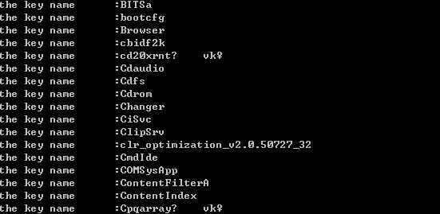

# 简单认识下注册表的 HIVE 文件格式

> 原文：[`www.pediy.com/kssd/pediy10/64000.html`](https://www.pediy.com/kssd/pediy10/64000.html)

---

标题: 【原创】简单认识下注册表的 HIVE 文件格式

作者: Sysnap

---

目录

1. 用 `windbg` 简单认识下 `HIVE` 文件
2. 用 `ZwSaveKey` 生成一个 `HIVE` 文件
3. `ring3` 来简单解释这个 `HIVE` 文件

## 1 用 windbg 简单认识下 HIVE 文件

### 物理上的 HIVE 文件

1. 注册表是由许多个 `HIVE` 文件组成的
2. 一个 `HIVE` 文件由许多个 `BIN` 组成,一般一个 `HIVE` 文件的开头会有一个文件头,用与描述这个 `HIVE` 文件的一些全局信息
3. 一个 `BIN` 由许多个 `CELL` 组成

而 `CELL` 有好几种类型

比如 `key cell`(`cm_key_node`) `value cell`(`CM_KEY_VALUE`) `subbkey-list cell`,`value-list cell` 等

### 一个 HIVE 文件的结构

```
--------------- |
_HBASE_BLOCK   |
_BIN0          |
_BIN1          |
_BIN2          |
:              |
:              |
_BINx          |
---------------
```

一般自己映射 `HIVE` 文件,得到映射的基地址,这个基地址加上 1 页的大小就来到第一个 `BIN` 了,`BIN` 也是一个数据结构,里面也包含了一些描述这个 `BIN` 的信息,我们称之为 `BIN` 头,一个 `BIN` 头的大小一般是 `0X20`,所以一个 `BIN` 后的 `0X20` 开始就是我们的第一个 `CELL` 了,怎样把一个键及其下面的子键保存为 `HIVE` 文件,微软提供了 API `RegSaveKey`,建议学习的时候用这个 API 来生成一个简单的 `HIVE` 文件,然后用 `WINHEX` 之类的工具查看该 `HIVE` 文件的内部,知道个大概

### 注册表相关的函数

- 用户态的 `regxxx`
- 内核的 `NT` 和 `CM` 系列(关于 `CM` 系列的,一般都是没有导出的,如果想使用可以靠导出的获取没导出的方法)

### 实验:

0. 用 `winHex` 打开一个 `HIVE` 文件,看看其里面的内容
1. 了解与注册表有关的几个结构

用命令 `dt nt!*cm*`

这样就会列出一大堆数据结构出来,关于每个数据结构是怎样的,自己再 `dt` 看

比较重要的有

(`HBASE_BLOCK`)

- `NT!_CMHIVE`
- `NT!_CMHIVE`
- `NT!_CM_KEY_HASH`
- `NT!_CM_KEY_BODY`
- `NT!_CM_KEY_NODE`
- `NT!_CM_KEY_VALUE`
- `NT!_CM_KEY_SECURITY`
- `NT!_CM_KEY_CONTROL_BLOCK`

2. 一个简单的实验

```
lkd> !reg dumppool
...略,这里会列出许多的 HIVE
dumping hive at e1022b60 (NONAME)
Stable Length = 1000
1/1 pages present
Volatile Length = 1000
can't read HMAP_ENTRY at e1b16000
0/1 pages present
Total pages present = 4311 / 14680
```

用 `!reg baseblock` 查看这个 `HIVE` 的基块

```
lkd> !reg baseblock e1022b60
FileName : NONAME
Signature: HBASE_BLOCK_SIGNATURE
Sequence1: 1
Sequence2: 1
TimeStamp: 0 0
Major    : 1
Minor    : 3
Type     : HFILE_TYPE_PRIMARY
Format   : HBASE_FORMAT_MEMORY
RootCell : 20
Length   : 0
Cluster  : 1
CheckSum : 0
```

用 `!reg openkeys` 列出 `HIVE` 文件所有打开的键

```
lkd> !reg openkeys e1022b60
Index 48: 1cbf04a8 kcb=e1035a70 cell=00000188 f=00200004 \\REGISTRY\\USER
Index 1b8: dc72ea09 kcb=e3fefb48 cell=80000020 f=00300008
\\REGISTRY\\USER\\S-1-5-18
Index 595: d936a631 kcb=e1035008 cell=00000020 f=002c0000 \\REGISTRY
Index 698: bd68092e kcb=e1035248 cell=00000120 f=00200004
\\REGISTRY\\MACHINE
```

用 `!reg cellindex` 查看一下打开键的 `CELL` 单元.它是一个 `_cm_key_node` 结构

```
kd> !reg cellindex e1022b60 0x120
Map = e1022bc0 Type = 0 Table = 0 Block = 0 Offset = 120
MapTable     = e1033000
BlockAddress = e1032000
pcell: e1032124
```

得到 `CELL` 的地址 `pcell: e1032124` 后,接着

```
lkd> dt _cm_key_node e1032124
nt!_CM_KEY_NODE
   nt!_CM_KEY_NODE
   +0x000 Signature        : 0x6b6e
   +0x002 Flags            : 0x20
   +0x004 LastWriteTime    : _LARGE_INTEGER 0x1c8a59a`913acf5a
   +0x00c Spare            : 0
   +0x010 Parent           : 0x20
   +0x014 SubKeyCounts     : [2] 5
   +0x01c SubKeyLists      : [2] 0x448
   +0x024 ValueList        : _CHILD_LIST
   +0x01c ChildHiveReference : _CM_KEY_REFERENCE
   +0x02c Security         : 0x78
   +0x030 Class            : 0xffffffff
   +0x034 MaxNameLen       : 0x10
   +0x038 MaxClassLen      : 0
   +0x03c MaxValueNameLen  : 0
   +0x040 MaxValueDataLen  : 0
   +0x044 WorkVar          : 0
   +0x048 NameLength       : 7
   +0x04a ClassLength      : 0
   +0x04c Name             : [1] 0x414d
```

我们来解读这里的信息:

1. `+0x000 Signature        : 0x6b6e` `0x6b6e` 表示 `NK`,`_cm_key_node` 结构的标识符
2. `+0x014 SubKeyCounts     : [2] 5` 表示该键有 5 个子键
3. `+0x01c SubKeyLists      : [2] 0x448` 表示子键列表单元的单元索引为 `0x448`
4. `+0x024 ValueList        : _CHILD_LIST` 表示本键键值单元的索引

### 注册表的组织

这里我们首先了解一个概念,单元索引

**单元索引**:是一个 `CELL` 在 `HIVE` 文件上的偏移量

看一下 `_CM_KEY_NODE` 这个结构,我们以 `HKEY_LOCAL_MACHINE\\SYSTEM\\ControlSet001\\Services\\6to4` 这个键为例,你可以把它及其子键保存为 `HIVE` 文件,然后观察

```
lkd> dt _CM_KEY_NODE
nt!_CM_KEY_NODE
   +0x000 Signature        : Uint2B
   +0x002 Flags            : Uint2B
   +0x004 LastWriteTime    : _LARGE_INTEGER
   +0x00c Spare            : Uint4B
   +0x010 Parent           : Uint4B
   +0x014 SubKeyCounts     : [2] Uint4B
   +0x01c SubKeyLists      : [2] Uint4B
   +0x024 ValueList        : _CHILD_LIST
   +0x01c ChildHiveReference : _CM_KEY_REFERENCE
   +0x02c Security         : Uint4B
   +0x030 Class            : Uint4B
   +0x034 MaxNameLen       : Uint4B
   +0x038 MaxClassLen      : Uint4B
   +0x03c MaxValueNameLen  : Uint4B
   +0x040 MaxValueDataLen  : Uint4B
   +0x044 WorkVar          : Uint4B
   +0x048 NameLength       : Uint2B
   +0x04a ClassLength      : Uint2B
   +0x04c Name             : [1] Uint2B
```

**A 键值**

`HKEY_LOCAL_MACHINE\\SYSTEM\\ControlSet001\\Services\\6to4` 这个键就是一个 `_CM_KEY_NODE` 结构,`ValueList` 的值就是一个单元索引了,由这个"单元索引"我们可以找到 `6to4` 这个键的"键值列表单元",有了"键值列表单元",我们就可以找到"键值单元",有了键值单元,我们就可以找到数据了

一般就是下面这条线

```
----------------------------------------------------------------------------
键单元----键值列表单元单元索引---键值列表单元--键值单元--数据单元
----------------------------------------------------------------------------
```

**B 子键**

`HKEY_LOCAL_MACHINE\\SYSTEM\\ControlSet001\\Services\\6to4` 下面还有三个子键,怎么找,请看 `_CM_KEY_NODE` 里面的俩个成员

`+0x014 SubKeyCounts     : [2] Uint4B`

`+0x01c SubKeyLists      : [2] Uint4B`

`SubKeyCounts` 表示这个键单元有多少个子键,`SubKeyLists` 是子键列表单元的单元索引

所以一般 `SubKeyCounts` 是用于控制遍历子键的一个变量,这里我们应该知道怎么找到一个键单元的子键了

```
----------------------------------------
SubKeyLists----子键列表单元-----子键单元
----------------------------------------
```

一个键可能有多个子键,由 `SubKeyCounts` 标识

## 2 用 ZwSaveKey 生成一个 HIVE 文件

这里我们用驱动程序,不过用户程序也是可以的,很简单,就是获得 `ZwSaveKey` 所需要的句柄,这里我们用了 `ZwOpenKey` 和 `ZwCreateFile`,我们把 `\\REGISTRY\\MACHINE\\SYSTEM\\ControlSet001\\Services` 这个键极其子键保存为一个 `HIVE` 文件.这个 `HIVE` 文件的路径是 `C:\my.dat`

```c
NTSTATUS DriverEntry(IN PDRIVER_OBJECT theDriverObject,
               IN PUNICODE_STRING theRegistryPath)
{
  HANDLE keyhandle,filehandle;
  IO_STATUS_BLOCK iostatus;
  OBJECT_ATTRIBUTES keyoa ,fileoa;
  UNICODE_STRING  keypath,filepath;
  RtlInitUnicodeString(&keypath,L"\\REGISTRY\\MACHINE\\SYSTEM\\ControlSet001\\Services");
    RtlInitUnicodeString(&filepath,L"\\Device\\HarddiskVolume1\\my.dat");
  InitializeObjectAttributes(
    &keyoa,
  &keypath,
    OBJ_CASE_INSENSITIVE,
    0,
    0
    );
  InitializeObjectAttributes(
    &fileoa,
  &filepath,
    OBJ_CASE_INSENSITIVE| OBJ_KERNEL_HANDLE,
    0,
    0
    );
  ZwOpenKey(&keyhandle,
        KEY_ALL_ACCESS,
      &keyoa);
  ZwCreateFile(
            &filehandle,
              FILE_ALL_ACCESS,
              &fileoa,
              &iostatus,
              NULL,
              FILE_ATTRIBUTE_NORMAL,
              FILE_SHARE_READ|FILE_SHARE_WRITE,
              FILE_CREATE| FILE_OPEN | FILE_OVERWRITE_IF,
              FILE_SYNCHRONOUS_IO_NONALERT,
              NULL,
              NULL
          );
  ZwSaveKey(keyhandle,
        filehandle );
  theDriverObject->DriverUnload = OnUnload;
  return STATUS_SUCCESS;
}
```

## 3 ring3 来简单解释这个 HIVE 文件

好了,到了这一步我们已经有了一个 `HIVE` 文件,接着我们就是解释它

首先把这个 `HIVE` 文件读入内存,基地址加上一个页的大小就来到了第一个 `BIN`,`BIN` 头大小是 `0X20` 我们不用理,加上 `0X20` 后我们就来到了第一个 `CELL`...即 `ROOTCELL`...接着就是开始解释这个 `HIVE` 文件了

```c
void ListValue( PCHAR keypath,  PCM_KEY_NODE KeyNode )
{
    char *SubKeyName=keypath;
  PCHAR val;
  memcpy(keypath,&KeyNode->KeyName,KeyNode->KeyName);
  keypath+=KeyNode->KeyName_len;
  printf("the key name      :%s\n",   SubKeyName);
}

void ListSubKeys( PCHAR keypath,  PCM_KEY_NODE KeyNode )
{
```


```
RootBin=(PCHAR)KeyNode-0x20;

PCM_KEY_FAST_INDEX dirKey = (PCM_KEY_FAST_INDEX)(RootBin+KeyNode->Subkeys_offset);

for(ULONG index1=0;index1<dirKey->NumberOfKeys;index1++)

{
    PCM_KEY_FAST_INDEX subkey = (PCM_KEY_FAST_INDEX)((&dirKey->ValueData_Offset)[index1]+RootBin);
    if(dirKey->Signature[1]=='f')
    {
        ListValue(keypath,(PCM_KEY_NODE)((&dirKey->ValueData_Offset)[index1*2]+RootBin));
    }
    else
    for(ULONG index2=0;index2<subkey->NumberOfKeys;index2++)
    {
        ListValue(keypath,(PCM_KEY_NODE)((&subkey->ValueData_Offset)[index2]+RootBin));
    }
}
}
```

后注:在 `dump hive` 时,正常是没有问题的...但如果使用了 `combojiang` 那篇隐藏注册表里面的那个驱动程序来隐藏注册表...比如它里面隐藏了 `Services` 键下的子键 `Beep`,,,那我们在 `dump Services` 时就会失败....也不知道是什么原因,,应该是被什么干扰了吧...不过你可以自己复制原始的 `HIVE` 文件,在解释它...这个程序再改改应该可以...不过到了这里你应该对 `HIVE` 文件有个大概的理解了..



上传的附件

|  | | `hive.rar` |
|---|---|---|
