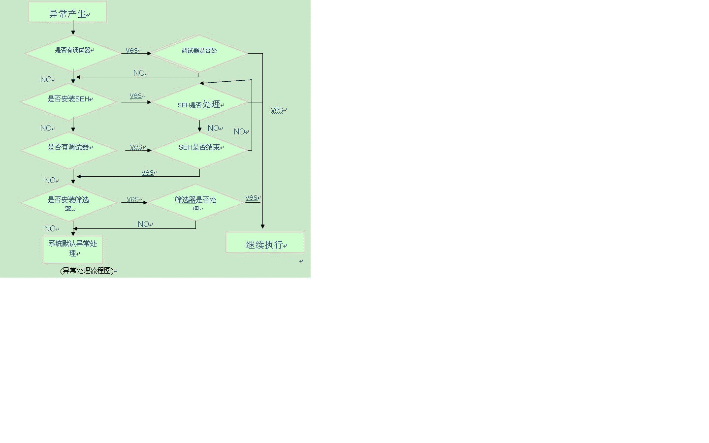
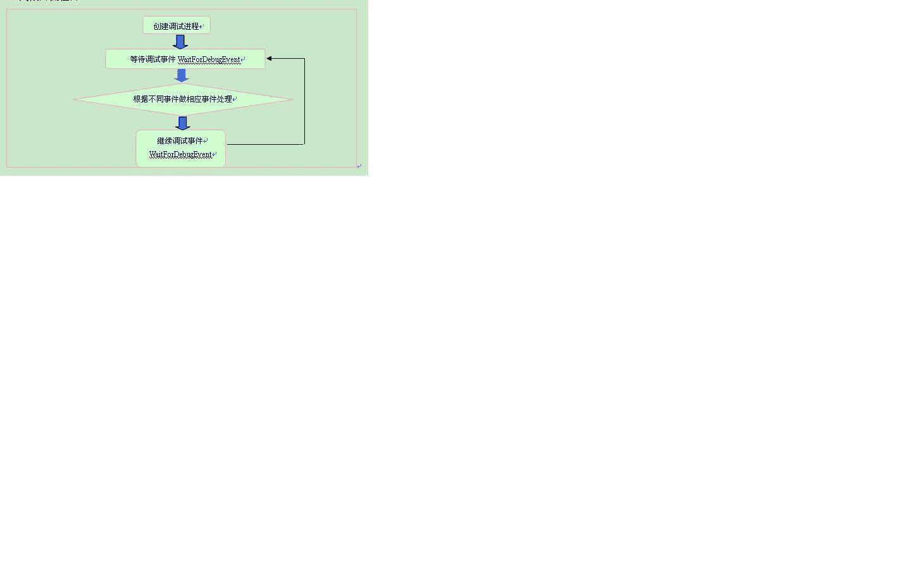
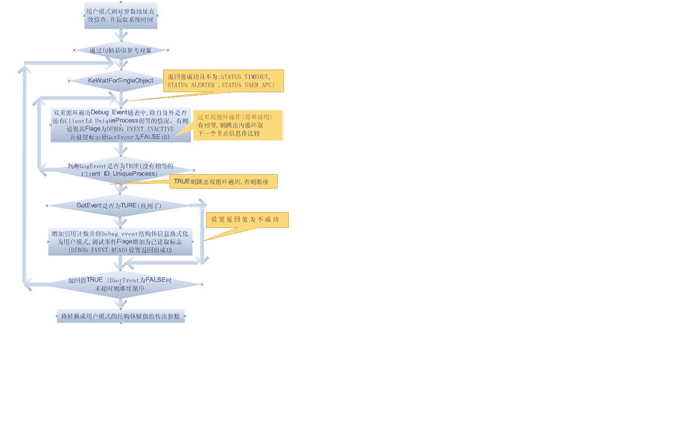
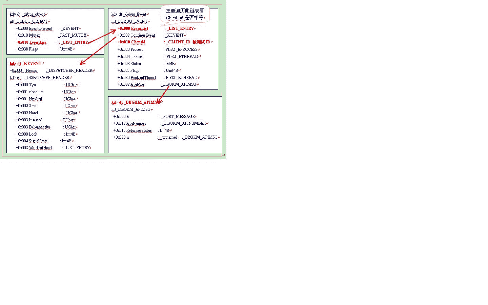
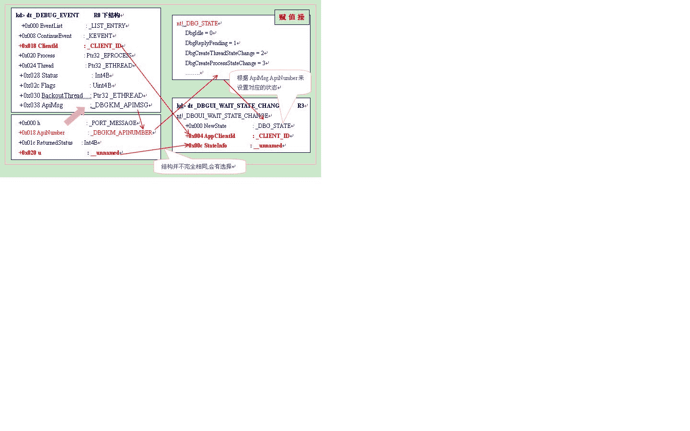
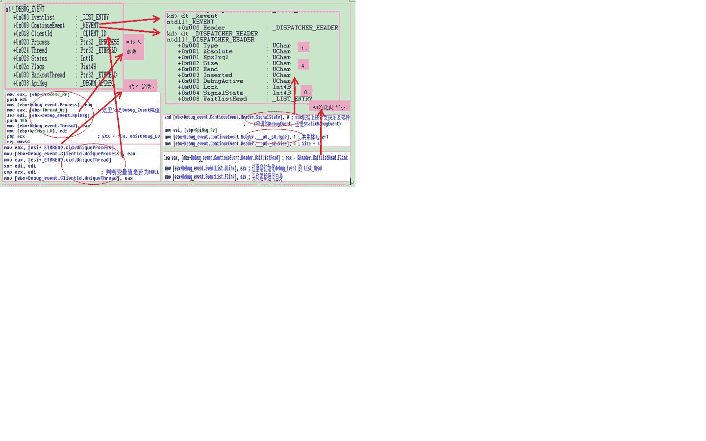

# 科锐 3 阶段项目：异常分发

> 原文：[`www.pediy.com/kssd/pediy11/114945.html`](https://www.pediy.com/kssd/pediy11/114945.html)

## 一：R3 调试器流程

**基础知识：**

异常处理发生的处理大概过程如下：

1. 系统查看产生异常的进程是否正在被调试，是则向调试器发送 `Exception_Debug_Event` 事件；
2. 如果进程没有被调试或调试不处理此异常，那么系统检查异常所处的线程，并在这个线程的环境中查看 `FS:[0]` 来确定是否安装了 SEH 异常处理回调函数，有则调用；
3. 回调函数尝试处理此异常，可以正确处理则修正错误并将返回值设置为 `ExceptionContinueExceution`，系统结束整个查找过程；
4. 如果回调函数返回 `ExceptionContinueSearch`（说明无法处理，继续搜索），则根据 SHE 链中的下一个回调函数去尝试执行，直到 `0xFFFFFFFF`（SEH 结束）还未有处理，退出异常处理链；
5. 系统再次检测进程是否正在被调试，如果被调试则再发一次给调试器处理；
6. 调试器不处理或没有调试器，系统检查是否有安装筛选器回调函数，有安装则调用处理，返回值时，系统默认的异常处理根据返回值做相应的动作；
7. 没有处理则直接调用系统默认的异常处理函数处理。（终止进程，调错误提示）



R3 调试器的一般流程

在写 R3 调试时，`CreateProcess` 创建进程时，`dwCreationFlags` 参数使用 `DEBUG_ONLY_THIS_PROCESS| DEBUG_PROCESS` 调试方式创建调试进程，这样在调试循环结构中通过 `WaitForDebugEvent` 函数捕获异常，根据需要对异常事件作处理（是已处理继续执行还是未处理抛出）。

```
1.0 CreateProcess             //创建调试进程
    参数 creation flags 选择 debug 类型
2.0 调试循环结构
for(;;)
{                 //出自 MSDN
    WaitForDebugEvent(&DebugEv, INFINITE);
    switch (DebugEv.dwDebugEventCode)                   //调试异常代码(异常的类别)
    {
        case EXCEPTION_DEBUG_EVENT:            //调试异常事件
            switch (DebugEv.u.Exception.ExceptionRecord.ExceptionCode)
            {
                case EXCEPTION_ACCESS_VIOLATION:       //访问异常
                case EXCEPTION_BREAKPOINT:             //断点异常
                case EXCEPTION_DATATYPE_MISALIGNMENT:
                case EXCEPTION_SINGLE_STEP:            //单步
                case DBG_CONTROL_C:
               }
        case CREATE_THREAD_DEBUG_EVENT:          // 线程创建
        case CREATE_PROCESS_DEBUG_EVENT:                   //进程创建
        case EXIT_THREAD_DEBUG_EVENT:
        case EXIT_PROCESS_DEBUG_EVENT:
        case LOAD_DLL_DEBUG_EVENT:                           //载入 DLL
        case UNLOAD_DLL_DEBUG_EVENT:              //卸载 DLL
        case OUTPUT_DEBUG_STRING_EVENT:
    }
    ContinueDebugEvent(DebugEv.dwProcessId,
        DebugEv.dwThreadId, dwContinueStatus);
}
```

**主要部分：**

- `CREATE_PROCESS_DEBUG_EVENT`: 创建进程时再异常地址下断点，即 OEP 处
- `LOAD_DLL_DEBUG_EVENT`: 在载入 DLL 可以获取模块地址信息，以便解析函数
- `EXCEPTION_ACCESS_VIOLATION`: 内存断点处理部分，根据异常异常类型地址判断是否命中
- `EXCEPTION_BREAKPOINT`: 软中断（`0xCC`）处理部分，注意系统的 `int3` 即第一次不处理
- `EXCEPTION_SINGLE_STEP`: 最重要且复杂的部分，处理单步，恢复之前异常的有效性等。

大概的流程为：



**那么 `WaitForDebugEvent` 中获取 `Debug_Event` 调试事件信息是从哪里获取的？**

**备注：**

关于 R3 下调试的实现，可以参考科锐学员发的相关帖子，这里引用 "超然" 写的调试器供参考！

<http://www.kanxue.com/showthread.php?t=111876>

## 二：WaitForDebugEvent 哪里获取 Debug_Event 信息

调试异常事件结构体：

```
typedef struct _DEBUG_EVENT {         //出自 MSDN
  DWORD dwDebugEventCode;         //异常代码
  DWORD dwProcessId;          //PID
  DWORD dwThreadId;
  union {
      EXCEPTION_DEBUG_INFO Exception;                    //调试异常结构体信息
      CREATE_THREAD_DEBUG_INFO CreateThread;        //创建线程结构体信息
      CREATE_PROCESS_DEBUG_INFO CreateProcessInfo; //创建进程结构体信息
      EXIT_THREAD_DEBUG_INFO ExitThread;            //退出线程
      EXIT_PROCESS_DEBUG_INFO ExitProcess;         //退出进程
      LOAD_DLL_DEBUG_INFO LoadDll;                  //载入 DLL
      UNLOAD_DLL_DEBUG_INFO UnloadDll;        //卸载 DLL
      OUTPUT_DEBUG_STRING_INFO DebugString;
      RIP_INFO RipInfo;
  } u;
} DEBUG_EVENT, *LPDEBUG_EVENT;
```

主要函数的调用过程：`WaitForDebugEvent` -> `DbgUiWaitStateChange` -> `NtWaitForDebugEvent`

`DbgUiWaitStateChange` 传入要获取异常事件的结构体地址、等待时间及调试对象等信息调用 `NtWaitForDebugEvent` 进入 R0，调用代码如下：

```
.text:7C975E0A      push [ebp+pDebug_Event]         ;要传出调试异常信息的结构体
.text:7C975E0D      mov eax, large fs:_TEB.NtTib.Self       ; 获取 TEB
.text:7C975E13      push [ebp+seconds]
.text:7C975E16      push 1
.text:7C975E18      push [eax+(_TEB.DbgSsReserved+4)]   ; _teb.DbgSsReserved[1]保存 Debug_Object
.text:7C975E1E      call _NtWaitForDebugEvent@16        ; 获取 Debug_Evnet 结构体信息
```

`NtWaitForDebugEvent` 主要完成获取 R0 下的 `Debug_Event` 结构体信息并转换成用户下的结构

1) 获取 R0 下的 `Debug_Event` 结构体信息

   关键过程，通过 `KeWaitForSingleObject` 返回值判断来判断要进行遍历异常事件链表的操作，在循环中判断调试对象的标志不是结束调试进程，则进行遍历 `Debug_Object.EventList` 中的 `Debug_Event` 链表信息。

   遍历过程：取出 `Debug_Evnt` 一成员判断是否结束，不结束判断调试对象标志是否为 `DEBUG_EVENT_READ|DEBUG_EVENT_INACTIVE`，不是则用取出的成员与 `EventList` 其他不同节点的 PID 作比较，有相等的（说明不是唯一）则修改 `Debug_Event` 的状态信息及局部标志值，没有相同的就转换成用户模式下的结构体，也就是 `WaitForDebugEvent` 的参数 `Debug_Event` 结构体。

   ; 根据 `KeWaitForSingleObject` 的返回值，决定是否需要做遍历动作。如果返回值小于 0，或者为 `STATUS_TIMEOUT` 或为 `STATUS_ALERTED` 或者是 `STATUS_USER_APC` 则结束循环遍历过程。



代码：

```
PAGE:005905E0      call _KeWaitForSingleObject@20      ; KeWaitForSingleObject(x,x,x,x,x)
PAGE:005905E5      mov ebx, eax
PAGE:005905E7      cmp ebx, esi                      ; if(返回值 EAX >= 0) 就继续循环
PAGE:005905E9      jl  END_WHILE_LOOP                ; 函数返回值如果是<0，则退出循环结构
PAGE:005905EF      jmp short BEGIN_WHILE_LOOP
WHILE_NEXT_LOOP:                
PAGE:005905F1      xor esi, esi                      ; ESI 清零
BEGIN_WHILE_LOOP:                                      
PAGE:005905F3      cmp ebx, STATUS_TIMEOUT
PAGE:005905F9      jz  END_WHILE_LOOP          ; {  执行循环体，否则跳出循环 }                            
PAGE:005905FF      cmp ebx, STATUS_ALERTED
PAGE:00590605      jz  END_WHILE_LOOP
PAGE:0059060B      cmp ebx, STATUS_USER_APC      ;这里也是判断函数返回值,成立就结束循环
PAGE:00590611      jz  END_WHILE_LOOP
PAGE:00590617      mov [ebp+isGotEvent_LV], 0           ; 局部标志变量清零
PAGE:0059061B      lea ecx, [edi+_DEBUG_OBJECT.Mutex]                      
PAGE:0059061E      call @ExAcquireFastMutex@4          ; 请求互斥对象
PAGE:00590623                     ; 1 ==> 直到调试对象被删除
PAGE:00590623                     ; 2 ==> 结束关闭所有调试进程
PAGE:00590623      test byte ptr [edi+_DEBUG_OBJECT.Flags], 1 ; if(DebugObject->Flags == 1)   
PAGE:00590627      jnz short RealseFastMutex           
```

; 取出调试事件 list 的头节点，`Debug_Evnt` 首成员为 `ListEntry` 保存的前后节点指针

代码：


## 代码分析

```asm
;GE:00590629     lea eax, [edi+_DEBUG_OBJECT.EventList] ; eax = &pDebug_Object->EventList
PAGE:0059062C     mov ecx, [eax]   ; 取下一个 List_Entry 到 ecx ( ecx = pDebug_Ob->EventList.Flink )
PAGE:0059062E     jmp short IS_LIST1_IS_END
LIST1_NOT_END: 
PAGE:00590630     mov esi, ecx          ; ;esi = debug_object.EventList.Flink
;DEBUG_EVENT_READ|DEBUG_EVENT_INACTIVE  1|4 = 5
PAGE:00590632      test byte ptr [ecx+Debug_event.Flags], 5 ; 
PAGE:00590636     jnz short  EQU_EventRead_OR_EventInactive ; 取下一个 DebugEvent
 PAGE:00590638     mov [ebp+isGotEvent_LV], 1          ; 局部标志值 = 1
PAGE:0059063C     jmp short IS_LIST2_IS_END
LIST2_IS_NOT_END:         
PAGE:0059063E     mov edx, [esi+Debug_event.ClientId.UniqueProcess]
PAGE:00590641     cmp edx, [eax+Debug_event.ClientId.UniqueProcess]
PAGE:00590644     jz  short UniquePRocess_EQU   ; 如果进程相等,跳去做点活,也就结束的 List2 的遍历
IS_LIST2_IS_END:             
PAGE:00590646     mov eax, [eax+Debug_event.EventList.Flink]
PAGE:00590648     cmp eax, ecx        ; if(pDebug_ob->Event.Flink != pDebug_ob->Event.Flink )
PAGE:0059064A     jnz short LIST2_IS_NOT_END           ; 这是 Entry2 的下一个循环判断
PAGE:0059064C     jmp short LOOP2_IS_END
PAGE:0059064E
 UniquePRocess_EQU:               
PAGE:0059064E     or  [esi+Debug_event.Flags], DEBUG_EVENT_INACTIVE ; 
PAGE:00590652     and [esi+Debug_event.BackoutThread], 0 ;  清零
PAGE:00590656     mov [ebp+isGotEvent_LV], 0          ; 标志设置为 0 用来判断是否唯一进程
LOOP2_IS_END:               
PAGE:0059065A    cmp [ebp+isGotEvent_LV], 0 ; GotEvent = 1 ==> 遍历 List2 时没有相等的 UniqueProcess
PAGE:0059065A                          ; GotEvent = 0 ==> 有 UniqueProcess 相等的情况
PAGE:0059065E     jnz short GOT_EVENT_NOT_EQU_0
PAGE:00590660
 EQU_EventRead_OR_EventInactive:         
PAGE:00590660     mov ecx, [ecx+Debug_event.EventList.Flink] ; 取下一个 DebugEvent 结构体地址
PAGE:00590662     lea eax, [edi+_DEBUG_OBJECT.EventList] ; 取 EventList 的头地址
PAGE:00590665
IS_LIST1_IS_END:                             
PAGE:00590665    cmp ecx, eax     ; 判断 pDebug_Ob-Event.Flink != &Debug_Ob->Event 即是否遍历完
PAGE:00590667     jnz short LIST1_NOT_END           ; List 没有结束,则继续
PAGE:00590669     cmp [ebp+isGotEvent_LV], 0     ; 判断局部标志是否为 0 
PAGE:0059066D     jz  short GOT_EVENT_EQU_0   ; GotEvent = 1 ==> 遍历 List2 时没有相等的 UniqueProcess
PAGE:0059066D                               ; GotEvent = 0 ==> 有 UniqueProcess 相等的情况

```

主要操作就是遍历 `Debug_Object` 里 `EventList` 保存的异常事件链表，查找 `UniqueProcess` 是否唯一，参考如下图示。



代码:

```asm
GOT_EVENT_NOT_EQU_0:         
PAGE:0059066F     mov ebx, [esi+Debug_event.Process]
PAGE:00590672     mov [ebp+Process_LV], ebx
PAGE:00590675     mov ecx, [esi+Debug_event.Thread]; 将 Debug_event 中进程和线程保存到局部变量中
PAGE:00590678     mov [ebp+Thread_LV], ecx
PAGE:0059067B     call @ObfReferenceObject@4           ; ECX 传参，增加线程对像的引用计数
PAGE:00590680     mov ecx, ebx                         ; Object
PAGE:00590682     call @ObfReferenceObject@4           ; 增加进程的引用计数
PAGE:00590687     push esi                             ; DebugEvent
PAGE:00590688     lea eax, [ebp+tWaitStateChange_LV]
PAGE:0059068E     push eax                             ; WaitStateChange
;DbgkpConvertKernelToUserStateChange 将 R0 的转成 R3 的 Debug_Event 结构体信息
PAGE:0059068F     call _DbgkpConvertKernelToUserStateChange@8 ; 
PAGE:00590694     or  [esi+Debug_event.Flags], DEBUG_EVENT_READ

```

### 2)：`DbgkpConvertKernelToUserStateChange`

将 `R0` 下和 `R3` 下的 `Debug_event` 调试异常结构体成员不同需要转换成用户需要的格式。根据异常类型对不同的异常类型的结构体信息作信息填充，结构体赋值给传出参数。

对应操作，如下图简单标示



根据 `ApiNumber` 对应的异常类型作相应的赋值处理。

代码:

```asm
PAGE:00590443     mov edx, [ebp+DebugEvent]
PAGE:00590446     mov ecx, [edx+Debug_event.ClientId.UniqueProcess]
PAGE:00590449     mov eax, [ebp+WaitStateChange]

 ; 将 R0 的 AppClientId 保存到 R3 下的结构中
PAGE:0059044C     mov [eax+_DBG_UI_WAIT_STATE_CHANGE.AppClientId.UniqueProcess], ecx 
PAGE:0059044F     mov ecx, [edx+Debug_event.ClientId.UniqueThread]
 ; 转存线程信息
PAGE:00590452     mov [eax+_DBG_UI_WAIT_STATE_CHANGE.AppClientId.UniqueThread], ecx 
PAGE:00590455     mov ecx, [edx+Debug_event.ApiMsg.ApiNumber] ;根据 Msg 类型作处理
PAGE:00590458     sub ecx, 0
PAGE:0059045B     push esi
PAGE:0059045C     push edi
PAGE:0059045D     jz  short DbgKmExceptionApi_0       ; 异常信息结构体
PAGE:0059045F     dec ecx
PAGE:00590460     jz  short DbgKmCreateThreadApi_1    ; 创建线程
PAGE:00590462     dec ecx
PAGE:00590463     jz  short DbgKmCreateProcessApi_2   ; 创建进程
PAGE:00590465     dec ecx
PAGE:00590466     jz  short DbgKmExitThreadApi_3      ; 退出线程
PAGE:00590468     dec ecx
PAGE:00590469     jz  short DbgKmExitProcessApi_4     ; 退出进程
PAGE:0059046B     dec ecx
PAGE:0059046C     jz  short DbgKmLoadDllApi_5         ; 载入 DLL
PAGE:0059046E     dec ecx
PAGE:0059046F     jnz DEFAULT_7                       ; 为 0 则是第 6 个为 UnLoadDll
PAGE:00590475     mov [eax+_DBG_UI_WAIT_STATE_CHANGE.NewState], 0Ah ; DbgUnloadDllStateChange
PAGE:0059047B     jmp short DbgKmUnloadDllApi_6       ; 卸载 DLL
PAGE:0059047D ; ---------------------------------------------------------------------------

```

    ；根据异常信息类型，对相应的消息结构体作赋值处理，设置新的状态值，保存 `ApiMsg` 的信息等操作，下面是只列出 `LoadDll` 操作，其他消息类型操作类似。

代码:

```asm
DbgKmLoadDllApi_5:   
PAGE:0059047D     add edx, 58h                        ; 偏移到 ApiMsg 的共同体
PAGE:00590480     push 5
;9 = DbgLoadDllStateChange
PAGE:00590482 mov [eax+_DBG_UI_WAIT_STATE_CHANGE.NewState], 9 ; 
PAGE:00590488     lea edi, [eax+_DBG_UI_WAIT_STATE_CHANGE.StateInfo]
PAGE:0059048B     pop ecx
PAGE:0059048C     mov esi, edx          ; esi = &Debug_Event.ApiMsg
PAGE:0059048E     rep movsd        ; Debug_Wait_State_Change.StateInfo = Debug_Event.ApiMsg
PAGE:00590490     and [edx+_DBGKM_UNLOAD_DLL.BaseAddress], 0
PAGE:00590493     jmp short DEFAULT_7

```

**那么调试对象 `Debug_Object` 中的调试事件信息 `Debug_Event` 又是什么时候添加进的呢？**

备注：

关于调试对象的创建等相关信息，请参考其人的分析

## 三：`R0` 下 `EventList` 又是什么时候添加的?

### 1）在创建调试线程中添加异常事件信息

调用过程 `PspCreateThread` --> `PspUserThreadStartup`(初始化线程的参数) -->  `DbgkCreateThread` (这里格式化 `ApiMsg` 作派发消息的参数) -->  `DbgkpSendApiMessage`

**备注**

这里只关心的 `DbgkpSendApiMeassage` 函数的处理过程， 关于创建进程、创建调试对象(`NtCreateDebugObject`)，创建线程及调试线程等信息请参考其他分析。

`DbgkCreateThread` 函数

获取当前的相关信息，如果调试端口不为 `NULL`，则根据状态来格式化 `ApiMsg` 结构体信息，调用消息派发函数，传入参数为标志值决定是否需要挂起进程及 `ApiMsg` 结构体的指针，也是要添加到调试对象异常链中的成员信息。

代码:

```asm
PAGE:00591478     push ebx                          ; 参数，决定是否要挂起进程
PAGE:00591479     lea eax, [ebp+DBGKM_APIMSG]      ; 取赋相应值的 ApiMsg 结构体地址
PAGE:0059147F     push eax
PAGE:00591480     call _DbgkpSendApiMessage@8      ; DbgkpSendApiMessage(x,x)

```

`DbgkpSendApiMeassage`

根据传入的标志值来决定是否要挂起进程，`ApiMsg` 信息是用来填充 `Debug_Event` 结构体信息, 添加到;`Debug_Object.EventList` 中主要通过 `DbgkpQueueMessage` 来实现。

代码:

```asm
PAGE:00591008     mov ecx, [ebp+pApiMsg]
PAGE:0059100B     mov eax, large fs:_ETHREAD.Tcb.UserAffinity
PAGE:00591011    mov [ecx+DBGKM_APIMSG.ReturnedStatus], 103h ; 返回标志为: STATUS_PENDING
PAGE:00591018     mov eax, [eax+_ETHREAD.Tcb.___u6.ApcState.Process] ;
PAGE:0059101B     xor edx, edx
PAGE:0059101D     inc edx                         ; edx = 1
PAGE:0059101E     lea esi, [eax+_ETHREAD.CrossThreadFlags] ;获取标志地址
PAGE:00591024     lock or [esi], edx                  ;修改 Flages = 1
PAGE:00591027     push ebx                        ; TargetDebugObject  NULL
PAGE:00591028     push ebx                        ; Flags     NULL
PAGE:00591029     push ecx                        ; ApiMsg  传入参数 ApiMsg 的地址
PAGE:0059102A     push large dword ptr fs:_KPCR.PrcbData.CurrentThread ; Thread 结构体首地址
PAGE:00591031     push eax                        ; Process 结构体地址
PAGE:00591032     call _DbgkpQueueMessage@20       ; 添加链表操作在这里完成

```

`DbgkpQueueMessage`

完善结构信息后添加 `Debug_Event` 到 `Debug_Object.EventList` 链表的尾节点

    `Debug_Event` 结构体赋值操作主要如下图所示。




代码:

```
PAGE:0058FD6F     mov esi, [ebp+FunUseThisReAs_LocalValue_pDebugObject]
PAGE:0058FD72     mov [ebp+Flages_LV], esi            ; 将标志值保存到局部变量中
PAGE:0058FD75     and [ebp+Flages_LV], 2               ; DEBUG_EVENT_NOWAIT = 2
PAGE:0058FD79     jz  short NOT_DEBUG_EVENT_NOWAIT    ;
    ;Flag=2 则申请内核空间,这里省略
NOT_DEBUG_EVENT_NOWAIT:                
PAGE:0058FDC3     mov ecx, offset _DbgkpProcessDebugPortMutex ; FastMutex   
PAGE:0058FDC8     lea ebx, [ebp+StaticDebugEvent_var_B8_LV] ;  DebugEvent = &StaticDebugEvent;
PAGE:0058FDCE     mov [ebp+var_8C], esi        ; 修改结构体成员标识  DebugEvent->Flags = Flags;
PAGE:0058FDD4     call @ExAcquireFastMutex@4     
PAGE:0058FDD9     mov eax, [ebp+Process_Re]
```

;取调试端口保存到变量中, 取出 ApiNumber，根据不同类型的序号作相应的处理  

typedef enum _DBGKM_APINUMBER {            //对应的序号  

    DbgKmExceptionApi,  

    DbgKmCreateThreadApi,  

    DbgKmCreateProcessApi,  

    DbgKmExitThreadApi,  

    DbgKmExitProcessApi,  

    DbgKmLoadDllApi,  

    DbgKmUnloadDllApi,  

    DbgKmMaxApiNumber  

} DBGKM_APINUMBER;  

代码:

```
PAGE:0058FDDC    mov eax, [eax+_EPROCESS.DebugPort]  ; 取出进程的调试端口
PAGE:0058FDE2     mov [ebp+FunUseThisReAs_LocalValue_pDebugObject], eax ; 调试端口保存到局部变量中
PAGE:0058FDE5     mov eax, [ebp+ApiMsg_Re]            ; 去参数所指向的地址值
PAGE:0058FDE8     mov eax, [eax+DBGKM_APIMSG.ApiNumber] ; 取 ApiMsg 的序号
PAGE:0058FDEB     cmp eax, 1             ; ApiNumber 是否为 1  DbgKmCreateThreadApi=1
PAGE:0058FDEE     jz  short CREATE_THREAD
PAGE:0058FDF0     cmp eax, 2            ; ApiNumber 是否为 2   DbgKmCreateProcessApi=2
PAGE:0058FDF3     jnz short NOT_CREATE_PROCESS        ;               
CREATE_THREAD:                
PAGE:0058FDF5     mov ecx, [ebp+Thread_Re] 
;80 = PS_CROSS_THREAD_FLAGS_SKIP_CREATION_MSG
PAGE:0058FDF8     test byte ptr [ecx+_ETHREAD.CrossThreadFlags], 80h ;
PAGE:0058FDFF     jz  short NOT_CREATE_PROCESS       ;不为 80 跳走
PAGE:0058FE01     and [ebp+FunUseThisReAs_LocalValue_pDebugObject], 0 ;变量=NULL
NOT_CREATE_PROCESS:   
PAGE:0058FE05     cmp eax, 3                   ; 3 = DbgKmExitThreadApi
PAGE:0058FE08     jz  short EXIT_THREAD
PAGE:0058FE0A     cmp eax, 4                   ; 4 = DbgKmExitProcessApi
PAGE:0058FE0D     jnz short DEBUG_EVENT_NOWAIT_END
PAGE:0058FE0F
EXIT_THREAD:              
PAGE:0058FE0F     mov eax, [ebp+Thread_Re] 
; 1 = PS_CROSS_THREAD_FLAGS_SKIP_CREATION_MSG
PAGE:0058FE12     test byte ptr [eax+(_ETHREAD.CrossThreadFlags+1)], 1 
PAGE:0058FE19     jz  short  DEBUG_EVENT_NOWAIT_END
PAGE:0058FE1B     and [ebp+FunUseThisReAs_LocalValue_pDebugObject], 0 ;
DEBUG_EVENT_NOWAIT_END:       
PAGE:0058FE1F     and [ebx+Debug_event.ContinueEvent.Header.SignalState], 0 ; ebx = &Debug_Evnt
PAGE:0058FE23     mov esi, [ebp+ApiMsg_Re]
PAGE:0058FE26     mov [ebx+Debug_event.ContinueEvent.Header.___u0._s0.Type], 1 ; 共用体 Type=1
PAGE:0058FE2A     mov [ebx+Debug_event.ContinueEvent.Header.___u0._s2.Size], 4 ; Size = 4
PAGE:0058FE2E     lea eax, [ebx+Debug_event.ContinueEvent.Header.WaitListHead] ;
                ;前后指针指向相同的地址,为初始化单节点为双向链表节点
PAGE:0058FE31     mov [eax+Debug_event.EventList.Blink], eax ; 这里是初始化 debug_Event 的 List_Head
PAGE:0058FE34     mov [eax+Debug_event.EventList.Flink], eax ; 头和尾都指向自身
PAGE:0058FE36     mov eax, [ebp+Process_Re]
PAGE:0058FE39     push edi
PAGE:0058FE3A     mov [ebx+Debug_event.Process], eax     ；保存 Process
PAGE:0058FE3D     mov eax, [ebp+Thread_Re]     
                
;DebugEvent.ApiMsg = ApiMsg(传入参数)
PAGE:0058FE40     lea edi, [ebx+Debug_event.ApiMsg]    ;目标地址
PAGE:0058FE43     push 1Eh                ;给 ecx 准备值
PAGE:0058FE45     mov [ebx+Debug_event.Thread], eax      ;保存 Thread
PAGE:0058FE48     mov [ebp+ApiMsg_LV], edi        ;目标地址保存在局部变量中
PAGE:0058FE4B     pop ecx                 ; ECX = 1EH, edi(Debug_Event->ApiMsg) <- esi(ApiMsg)
PAGE:0058FE4C     rep movsd        ;ApiMsg 的赋值，esi 为传入的 ApiMsg,
    ;完成 Debug_Event.ClientId = Ethread.cid (包含进程和线程)
PAGE:0058FE4E     mov ecx, [ebp+FunUseThisReAs_LocalValue_pDebugObject]
PAGE:0058FE51     mov esi, eax             ;eax = thread
PAGE:0058FE53     mov eax, [esi+_ETHREAD.cid.UniqueProcess]
PAGE:0058FE59     mov [ebx+Debug_event.ClientId.UniqueProcess], eax   
PAGE:0058FE5C     mov eax, [esi+_ETHREAD.cid.UniqueThread]
PAGE:0058FE62     xor edi, edi
PAGE:0058FE64     cmp ecx, edi                 ; 判断变量值是否为 NULL
PAGE:0058FE66     mov [ebx+Debug_event.ClientId.UniqueThread], eax 
                ;以上主要赋值操作如前图所示
PAGE:0058FE69     jnz short pDEBUG_OBJECT_NOT_QEU_0   ; 判断标志是否为 0，有跳过则设置为 NULL
PAGE:0058FE6B     mov [ebp+Thread_Re], 0C0000353h    ; STATUS_PORT_NOT_SET
PAGE:0058FE72     jmp short EQU_0_END
pDEBUG_OBJECT_NOT_QEU_0:              
PAGE:0058FE74     add ecx, 10h                ; FastMutex
PAGE:0058FE77     mov [ebp+TargetDebugObject_Re], ecx
PAGE:0058FE7A     call @ExAcquireFastMutex@4          ; ExAcquireFastMutex(x)
PAGE:0058FE7F     mov edx, [ebp+FunUseThisReAs_LocalValue_pDebugObject]
PAGE:0058FE82     test byte ptr [edx+_DEBUG_OBJECT.Flags], 1 ; 1 = DEBUG_OBJECT_DELETE_PENDING
PAGE:0058FE86     jnz short IS_NOT_DELETE_PENDING     ;用来判断是否被调试
        ; if ((Flages_LV=(Flages_Re& DEBUG_EVENT_NOWAIT)) == 0)
PAGE:0058FE88     cmp [ebp+Flages_LV], edi      
        ;完成添加 Debug_Event 到 Debug_Object.EventList 尾部操作
PAGE:0058FE8B     lea eax, [edx+_DEBUG_OBJECT.EventList] ; eax = &Debug_Object->EventLsit
PAGE:0058FE8E     mov ecx, [eax+Debug_event.EventList.Blink] ; EventList(Flink)偏移 4 是她的第一个成员 Blink
; debug_event->EventList.Flink = &Debug_object->EventList.Flink
PAGE:0058FE91     mov [ebx+Debug_event.EventList.Flink], eax 
;debug_Event->EventList.Blink = Debug_object->EventList.Blink
PAGE:0058FE93     mov [ebx+Debug_event.EventList.Blink], ecx ; 
PAGE:0058FE96     mov [ecx+Debug_event.EventList.Flink], ebx ; 
PAGE:0058FE98     mov [eax+(_DEBUG_OBJECT.EventList.Blink-30h)], ebx
PAGE:0058FE9B     jnz short FLAGES_NOT_EQU_0         ;
; SetEvent()函数设置一个事件对象的信号状态去发信号, 并试图满足尽可能多的等待，之前的事件对象状态作为返回值返回
PAGE:0058FE9D     push edi                        ; Wait    = FALSE
PAGE:0058FE9E     push edi                        ; Increment = 0
PAGE:0058FE9F     push edx                        ; Event pDebug_Object   这个没理解
PAGE:0058FEA0     call _KeSetEvent@12              ; KeSetEvent(x,x,x)
PAGE:0058FEA5
FLAGES_NOT_EQU_0:     
 ; thread_re = STATUS_SUCCESS = 0 这里又用函数参数作局部变量使用
PAGE:0058FEA5     mov [ebp+Thread_Re], edi       
PAGE:0058FEA8     jmp short REALSE_FASE_MUTEX
IS_NOT_DELETE_PENDING:   
PAGE:0058FEAA     mov [ebp+Thread_Re], 0C0000354h     ; STATUS_DEBUGGER_INACTIVE = 354
```

## 中断异常添加的异常信息

被调试进程产生异常时，内核异常处理对应接口 `KiTrap` 捕获异常进行处理。部分信息如下

### X86 异常及中断号

| 中断号 | 异常 | 对应函数 |
| :--- | :--- | :--- |
| 0 | 除零错误 | `_KiTrap00` |
| 1 | 调试陷阱 | `_KiTrap01` |
| 3 | 断点 | `_KiTrap03` |
| ... | | |

这里仅简述 `_kiTrap03` 主要处理过程

`kiTrap03`: 为当前发生异常建立一个 `TrapFrame`，保存寄存器，当前的状态，发生异常时的处理模式，然后调用 `CommonDispatchException`

代码:

```
CommonDispatchException: 
    mov esi, ecx                    ; Ethread
    mov edi, edx                    ; 调试端口
    mov edx, eax
    mov ebx, [ebp+_KTRAP_FRAME._Eip]
    dec ebx                         ; ebx = EIP - 1
    mov ecx, 3
    mov eax, 80000003h             ; Int3 断点
    call CommonDispatchException
```

`CommonDispatchException` 函数主要完成 `Exception_Record` 结构体的赋值，然后调用 `KiDispatchException`

代码:


### CommonDispatchExceptioin 异常记录构建

```asm
CommonDispatchExceptioin:
    mov [esp+EXCEPTION_RECORD.ExceptionCode], eax ; 参数 eax = ExceptioinCode   创建异常代码
    xor eax, eax
    mov [esp+EXCEPTION_RECORD.ExceptionFlags], eax ; 设置异常标志
    mov [esp+EXCEPTION_RECORD.ExceptionRecord], eax ; 设置副异常代码
    mov [esp+EXCEPTION_RECORD.ExceptionAddress], ebx ; 参数 ebx = EIP  (TRAP3  EIP-1)  异常地址
    mov [esp+EXCEPTION_RECORD.NumberParameters], ecx ; 参数 ecx ErNumberParameters   ( TRAP3 = 3 )
    cmp ecx, 0                      ; 这里传入参数为 3
    jz  short ParameNumber_EQU_0
    lea ebx, [esp+EXCEPTION_RECORD.ExceptionInformation] ; Exception_Record.ExceptionInformation 是个数组
    mov [ebx+(EXCEPTION_RECORD.ExceptionInformation-14h)], edx ; 外面 eax 的值,可能为 0
    mov [ebx+4], esi                ; EThread 地址  ExcptionInfo[1] = Ethread
    mov [ebx+8], edi                ; ExceptionInfo[2] = edi
ParameNumber_EQU_0:         mov ecx, esp
    test byte ptr [ebp+(_KTRAP_FRAME.EFlags+2)], 2
    jz  short NOT_VM
    mov eax, 0FFFFh
    jmp short de20                  ; 处理模式
NOT_VM:         
mov eax, [ebp+_KTRAP_FRAME.SegCs]
de20:                 
    and eax, 1                      ; eax 保存之前的模式
    push 1                          ; 是否第一次
    push eax                        ; 之前的模式
    push ebp                        ; TrapFrame
    push 0                          ; ExceptionFrame  X86 不是用为 NULL
    push ecx                        ; 异常记录(传入参数)
    call _KiDispatchException@20     
```

`KiDispatchException` 完成异常记录的信息格式，`DbgkForwardException` 完成异常信息的添加，还是通过调用 `DbgkpSendApiMessage` 来完成。这里主要简述用户模式调试异常的分发。

代码:

```asm
    mov eax, [esi+_EXCEPTION_RECORD.ExceptionCode]
    cmp eax, 80000003h
    jz  short STATUS_BREAKPOINT   ; 是断点就修改正 EIP，即 EIP = EIP - 1；
    cmp eax, 10000004h           ; KI_EXCEPTION_ACCESS_VIOLATION (KI_EXCEPTION_INTERNAL | 0x4)
    jnz short END_EXCEPTION_BLOCK       
    mov [esi+_EXCEPTION_RECORD.ExceptionCode], 0C0000005h ; 异常代码： 访问异常
    cmp byte ptr [ebp+PreviousMode], 1  ; 判断是否 UseMode
    jnz short END_EXCEPTION_BLOCK       ; 不是用户模式就跳出
    lea eax, [ebp+ContextFrame]
    push eax                        ; Context
    push esi                        ; ExceptionRecord
    call _KiCheckForAtlThunk@8     ; 决定一个访问异常被提起由于一个试图执行一个 ATL thunk 在非执行非栈区
                                    ; 如果是这样，thunk 将效仿继续执行
    test al, al                     ; 返回值：TRUE => Context 进行了更新，以反映效仿的 ATL 的 thunk，恢复执行。
    jnz Handled1                    ; 返回值是 TRUE，则跳到 HANDLE1 去
    cmp byte ptr ds:0FFDF0280h, 1       ; SharedUserData->ProcessorFeatures[PF_NX_ENABLED] = TRUE
jnz short END_EXCEPTION_BLOCK
; ExceptionInfo[0] = 8 = EXCEPTION_EXECUTE_FAULT
    cmp [esi+_EXCEPTION_RECORD.ExceptionInformation], 8 
    jnz short END_EXCEPTION_BLOCK       ; 不是执行出错就跳出
    mov eax, _KeFeatureBits             ; KeFeatureBits = 0
    test eax, 40000000h                 ; KF_GLOBAL_32BIT_EXECUTE = 40...全局 32 位可执行
    jnz short SET_EXCPTIONINFO_EQU_0    
    mov ecx, large fs:_KPCR.PrcbData.CurrentThread
    mov ecx, [ecx+_KTHREAD.__u6.ApcState.Process]
test [ecx+_EPROCESS.Pcb.__u25.Flags.field_0], 2 ; ExecuteEnable bit1 位置,所以是否为 0,
    jnz short SET_EXCPTIONINFO_EQU_0
test eax, eax                       ; eax&KF_GLOBAL_32BIT_NOEXECUTE     
    js  short END_EXCEPTION_BLOCK       ; 符号位为负  eax&800   就看高位有没有了
    mov eax, large fs:_KPCR.PrcbData.CurrentThread
    mov eax, [eax+_ETHREAD.Tcb.__u6.ApcState.Process]
    test [eax+_EPROCESS.Pcb.__u25.Flags.field_0], 1 ; ExecuteDisable bit0
    jnz short END_EXCEPTION_BLOCK

SET_EXCPTIONINFO_EQU_0:           ; CODE XREF: KiDispatchException(x,x,x,x,x)+C6 j
                                    ; KiDispatchException(x,x,x,x,x)+D6 j
    and [esi+_EXCEPTION_RECORD.ExceptionInformation], 0
    jmp short END_EXCEPTION_BLOCK


STATUS_BREAKPOINT:                 ; CODE XREF: KiDispatchException(x,x,x,x,x)+83 j
    dec [ebp+ContextFrame._Eip]         ; 断点的话就需要把 EIP 向前移一个字节
END_EXCEPTION_BLOCK:                ; CODE XREF: KiDispatchException(x,x,x,x,x)+8A j
```

根据是什么模式，调试接口是否 NULL 来决定是内核处理，还是用户方式处理, 这里仅列出了用户的处理流程

代码:

```asm
   cmp byte ptr [ebp+PreviousMode], 0  ; 判断是否为 KernelMode
   jnz short NOT_KERNEL_MODE
    
    ;判断是第几次处理，要使用 DebugPort 还是 ExceptionProt，然就调用对应的下面三种方式;
NOT_KERNEL_MODE:                    
    cmp [ebp+FirstChance], 1           ;是否是第一次机会
    jnz NOT_FIRST_CHANCE_       ;不是则是去第二次分发地方处理
    
;有异常调系统首先发给调试器处理(前提是有调试), 如果调试器没有处理，系统还有机会派发第二次给调试器处理。
;第一次机会，调试端口
    push 0                          ; 不是第二次
    push 1                          ; DebugException
    push esi                        ; 异常记录
call _DbgkForwardException@12       ; DbgkForwardException(x,x,x)
;如果调试器第一次没有处理还会有第二次机会接受到系统派发的异常处理信息给调试器处理。
;第二次机会，调试端口
    push 1                          ; 这里就是第二次机会了
    push 1                          ; 调试端口
    push esi                        ; ExceptionRecord
call _DbgkForwardException@12       ; DbgkForwardException(x,x,x)
;如果派发 2 次给调试器处理，都没处理的话就会发异常端口来处理异常。 
;第二次机会，异常端口
    push 1                          ; 第二次机会
    push 0                          ; 不是调试端口
    push esi                        ; ExceptionRecord
    call _DbgkForwardException@12       ; 根据传入的 DebugException 来决定调用哪种接口处理信息
```

`DbgkForwardException` 根据传入参数来决定是第几次机会，发送什么端口及异常记录信息

`DbgkForwardException(pExceptionRecord, isDebugException, isSecondChance)`

- `pExceptionRecord`：异常记录结构体指针
- `isDebugException`：是否是调试异常，是则发送调试端口
- `isSecondChance`：是否是第二次

代码:


```
mov eax, large fs:\_KPCR.PrcbData.CurrentThread
push ebx
mov ebx, \[ebp+DebugException\]       ; DebugPort = TRUE   ExceptionPort = FALSE
test bl, bl
mov \[ebp+ApiMsg\], 78005Ch           ; 这部分是格式化 ApiMsg、
mov \[ebp+ZeroInit\], 8
mov eax, \[eax+\_ETHREAD.Tcb.\_\_\_u6.ApcState.Process\]
jz  short DebugException\_EQU\_FALSE  ; DebugException = FALSE  则是使用 ExceptionPort
mov ecx, large fs:\_KPCR.PrcbData.CurrentThread
test byte ptr \[ecx+\_ETHREAD.CrossThreadFlags\], 4 ; PS\_CROSS\_THREAD\_FLAGS\_HIDEFROMDBG
jz  short NOT\_CROSS\_THREAD\_FLAGES
xor eax, eax                          ; eax = NULL
jmp short NOT\_CROSS\_THREAD\_FLAGES\_END\_IfElse ; dl = FALSE
NOT\_CROSS\_THREAD\_FLAGES: 
mov eax, \[eax+\_EPROCESS.DebugPort\]  ; DebugException = TRUE 时使用 DebugPort
NOT\_CROSS\_THREAD\_FLAGES\_END\_IfElse:   
xor dl, dl                            ; DL= FALSE
jmp short debugException\_EQU\_FALSE\_END\_IfElse
DebugException\_EQU\_FALSE:            
mov eax, \[eax+\_EPROCESS.ExceptionPort\] ; DebugException = FALSE  则是使用 ExceptionPort
mov \[ebp+ZeroInit\], 7               ; LPC\_EXCEPTION
mov dl, 1                             ; DL= TRUE
debugException\_EQU\_FALSE\_END\_IfElse:   
test eax, eax                         ; 判断调试端口是否为 NULL
jz  short END\_FUN\_SET\_RETURN\_VALUE
push esi
mov esi, \[ebp+ExceptionRecord\]
push edi
push 14h
pop ecx                               ; ECX = 14H
lea edi, \[ebp+var\_58\]               ; \[ebp+var\_58\] = \[ebp+ExceptioinRecord\]   共复制 14H 个字节
rep movsd
xor ecx, ecx                          ; ECX = 0
cmp \[ebp+SecondChance\], cl          ; 判断是否是第一次机会 0 是第一次，1 是第二次
pop edi                               ; 恢复前面压栈保存的寄存器
setz cl                               ; Set byte if zero (ZF=1)  如果 zf 标志位 1,设置一个 1 字节寄存器为 1
test dl, dl                           ; dl 是个标志,主要看使用 ExceptionPort 还是 DebugPort
                                      ; ExcepP =>dl = 1      DebugP => dl = 0
pop esi                               ;
push ebx                              ; SuspendProcess   BOOL 值决定哪种端口使用哪种端口
mov \[ebp+FirstChance\], ecx    ; ecx = !(SecondChance)
                                   ; 在 SecondChance 为 0 的情况下才会 SetZ 使 cl=>1
                                   ; 也就是 SecondChance=0 =>\[var\_8\]=1    SecondChance=1 =>\[var\_8\]=0
jz  short DEBUG\_PORT
push eax                              ; Port
lea eax, \[ebp+ApiMsg\]
push eax                              ; ApiMsg
call \_DbgkpSendApiMessageLpc@12     ; DbgkpSendApiMessageLpc(x,x,x)
jmp short DEBUG\_PORT\_END\_IfElse
DEBUG\_PORT:                         
lea eax, \[ebp+ApiMsg\]
push eax                              ; pApiMsg
call \_DbgkpSendApiMessage@8         ; DbgkpSendApiMessage(x,x)
DEBUG\_PORT\_END\_IfElse:            
test eax, eax               ; 判断 DbgkpSendApiMsg 是否成功,返回值又是函数中处理信息的函数的返回值
jl  short END\_FUN\_SET\_RETURN\_VALUE
test bl, bl                   ; 决定使用哪种 Port 的标志值
jz  short IS\_DEUBG\_PORT     ; 
```

说明：

这里只简单的分析了主要的模块，还有很多函数没分析。又水平确实有限，不足和错误地方难免，还望各位不吝指出或帮忙补充。
