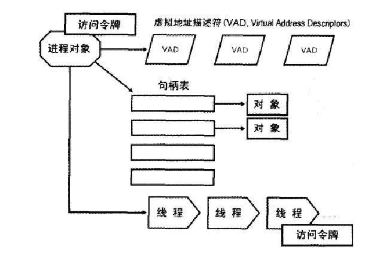
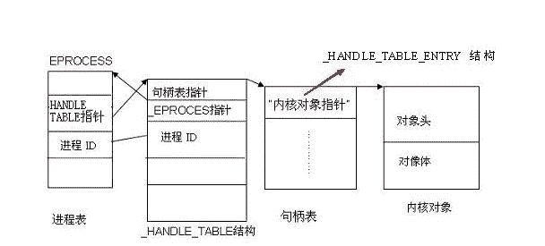
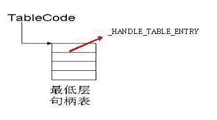
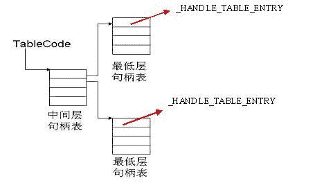
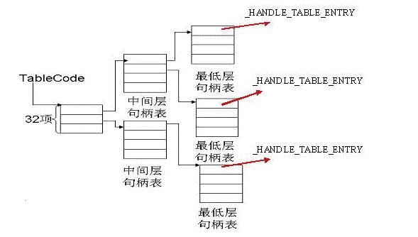
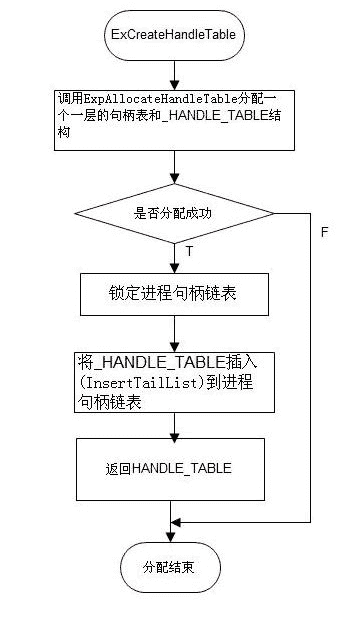
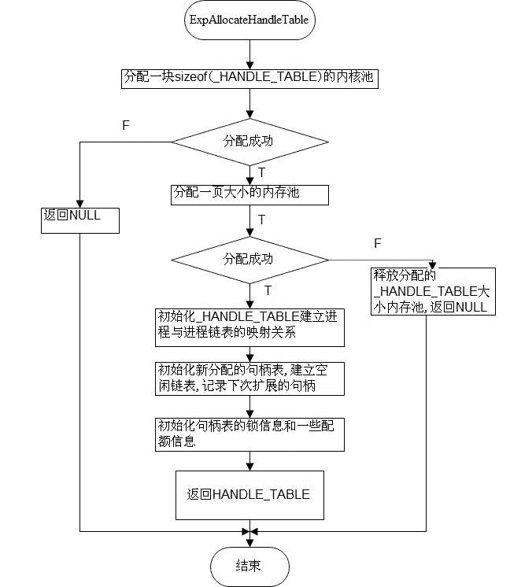

# 科锐 3 阶段项目-CreateProcess 分析之进程句柄表

> 原文：[`www.pediy.com/kssd/pediy11/114820.html`](https://www.pediy.com/kssd/pediy11/114820.html)

进程句柄表与创建句柄表

我们编写 Windows 程序中经常使用到内核对象，特别是句柄这个概念，通过句柄可以对内核对象进行访问，那句柄到底是什么?本文将会从内核来说明这个概念。

Windows 采取了面向对象设计,内核中有一个的模块来管理内核对象,有很多资料都是说是“对象管理器”，本文也采用这个概念。对象管理器用来管理内核对象信息和记录内核对象的使用情况，包括引用计数。

每个进程都要创建一个句柄列表，这些句柄指向各种系统资源，比如信号量，线程，和文件等，进程中的所有线程都可以访问这些资源性)，如下图所示，进程和资源：



## 1. 进程与句柄表数据关系

在用户模式下如果调用 `CloseHanele()` 表示不再使用这个对象，在内核中进程便会删除句柄(释放对象引用)；对象管理器也会将内核对象的引用计数也会减一,当对象的句柄引用为 0 时,对象管理器便会释放这个对象。

句柄表最基本作用就是句柄与目标对象之间的映射表,下图是进程与句柄的简化模型图(有些数据域要经过处理):



`_HANDLE_TABLE` 是句柄表的信息的结构体,在内核中句柄是句柄表中表项的索引,在这里可以简单的理解,由索引(句柄)在句柄表中查找到进程引用的内核对象.

在 Windbg 中查看 `_HANDLE_TABLE`(这里例出部分有意义的项)

```
kd> dt _HANDLE_TABLE

nt!_HANDLE_TABLE

   +0x000 TableCode        : Uint4B    //指向第一层局部表,并记录层数
   +0x004 QuotaProcess     : Ptr32 _EPROCESS  //指向进程_EPROCESS 块
   +0x008 UniqueProcessId  : Ptr32 Void      //进程 ID
+0x03c HandleCount      : Int4B    //句柄计数,当前使用句柄个数

kd> dt _EPROCESS    //进程_EPROCESS 块信息

nt!_EPROCESS

   +0x084 UniqueProcessId  : Ptr32 Void    //进程 ID
   +0x0c4 ObjectTable : Ptr32 _HANDLE_TABLE  //指向_HANDLE_TABLE 结构
```

## 2. 句柄的数据结构

内核与 SDK 中定义句柄都为: `typedef void *HANDLE;` 表明句柄是一个无符号整数,实际上有效句柄的值是有范围的,大家想想如果采用数组来存储句柄需要耗费很大的内存,Windows 句柄表使用了稀疏数组.

### 2.1 XP/2003 句柄表项

先看下句柄表中存放的是什么?句柄表主要是存放的是对象的地址与属性信息,当然还要存放句柄表相关一些信息（审计，空闲项），每个句柄表项是由 `_HANDLE_TABLE_ENTRY` 描述的，`_HANDLE_TABLE_ENTRY` 占 8 字节，定义如下：

```
kd> dt _HANDLE_TABLE_ENTRY

nt!_HANDLE_TABLE_ENTRY

   +0x000 Object           : Ptr32 Void   //对象指针
   +0x000 ObAttributes     : Uint4B
   +0x000 InfoTable        : Ptr32 _HANDLE_TABLE_ENTRY_INFO
   +0x000 Value            : Uint4B
   +0x004 GrantedAccess    : Uint4B
   +0x004 GrantedAccessIndex : Uint2B
   +0x006 CreatorBackTraceIndex : Uint2B
   +0x004 NextFreeTableEntry : Int4B
```

由于 `_HANDLE_TABLE_ENTRY` 有些联合体,不好理解,源码定义如下:

```c
typedef struct _HANDLE_TABLE_ENTRY {
 union {
   PVOID Object;      //对象指针
   ULONG ObAttributes;    //对象属性
   PHANDLE_TABLE_ENTRY_INFO InfoTable;
     ULONG_PTR Value;    //值
   };
union {
   union {
      ACCESS_MASK GrantedAccess;  //访问掩码
        struct {
            USHORT GrantedAccessIndex;
            USHORT CreatorBackTraceIndex;
            };
        };
     LONG NextFreeTableEntry;//下一个空闲的句柄表项,空闲链表索引
  };
} HANDLE_TABLE_ENTRY, *PHANDLE_TABLE_ENTRY;
```

表示的意义:

1. 对象指针 `Object` 有效则第二个域为访问掩码 `GrantedAccess`
2. 第一个域为 0,第二个域可能是 `NextFreeTableEntry`,也可能为审计,后面会有相关算法用到这个域,要根据上下文来判断。

这里的 `Object` 并不是“真正”的对象指针，而是包括了对象的指针域对象的属性域，由于在内核中对象总是 8 字节对齐的，那么指向对象的指针最低 3 位总是 0，微软把这 3 位也利用上，`Object` 的最低 3 位做为对象的属性，看下面的一组宏定义：

`#define OBJ_HANDLE_ATTRIBUTES (OBJ_PROTECT_CLOSE | OBJ_INHERIT | OBJ_AUDIT_OBJECT_CLOSE)`

第 0 位 `OBJ_PROTECT_CLOSE`:句柄表项是否被锁定,1 锁定，0 未锁定

第 1 位 `OBJ_INHERIT`:指向该进程所创建的子进程是否可以继承该句柄,既是否将该句柄项 拷贝到它的句柄表中

第 2 位 `OBJ_AUDIT_OBJECT_CLOSE`:关闭该对象时是否产生一个审计事件

### 2.2 XP/2003 句柄表项

Windows 为了节省空间采用动态扩展结构,类似于页表结构,最大可扩展 3 层表.`_HANDLE_TABLE.TableCode` 存放了第一层局部表的基址指针和层数,微软在这里设计很精妙,由于效率 32 位地址都以 4 对齐,最低 2 位为 0，微软把 `_HANDLE_TABLE.TableCode` 的最低两位作为句柄表层数的纪录,即 00 一层表, 01 二层表 10 三层表.句柄表的结构图如下:

一层表结构:



两层表结构:



三层表结构:



有上图所示,最低层局部表都是是存放着 `_HANDLE_TABLE_ENTRY` 结构,中间层和最高层都是存放着页表指针,当句柄增加时,便会判断是否需要扩展。

### 2.3 XP/2003 句柄表表项计数

句柄表是动态扩展，当引用资源足够多时，句柄的数目也在增加，当到一定数目时，句柄表便会扩展，扩展的标准是什么？下面一系列宏给出了定义

#### (1) 最低层存放句柄表项数

每个最底层页表存放的是 `_HANDLE_TABLE_ENTRY` 结构, 即 `4096/8 = 512`,其中第一项做审计用,最多有 511 个有效项

`#define LOWLEVEL_COUNT (TABLE_PAGE_SIZE / sizeof(HANDLE_TABLE_ENTRY))`

#### (2) 中间层可以存放的项数

中间层存放的页表指针,最多有 `4028 / 4 =1024`

`#define MIDLEVEL_COUNT (PAGE_SIZE / sizeof(PHANDLE_TABLE_ENTRY))`

#### (3) 可分配的最大句柄值,不是我们想象的无符号整数最大值

`#define MAX_HANDLES (1<<24) //224`

#### (4) 最高层最大项数

`#define HIGHLEVEL_COUNT MAX_HANDLES / (LOWLEVEL_COUNT * MIDLEVEL_COUNT)`

即 `224/(1024*512) = 25 =32`,在句柄表结构图已经说明 3 层表第一层表最大有 32 项

通过上面计算:二级表最大可以存放 `511 * 1024 = 523264` 个对象引用,没有特殊情况一般来说已经够了,所以我们一般只能观察到一层,两层句柄表

## 3. nt!PspCreateProcess 中创建进程句柄表

### 3.1 在创建进程时初始化进程对象并创建进程句柄表

创建进程时先创建进程对象,再创建进程句柄表,即 `nt!PspCreateProcess->nt!ObInitProcess->nt!ExCreateHandleTable`,创建句柄表的核心流程图如下:



分配进程句柄表例程步骤:

1. 调用 `ExpAllocateHandleTable` 分配句柄表及 `_HANDLE_TABLE` 结构
2. 插入到进程句柄表链表

函数描述:

```
; Routine Description:
;     This function allocate and initialize a new new handle table
;     这个例程分配并初始化一个新的句柄表(_HANDLE_TABLE)

; Arguments:
;     Process - Supplies an optional pointer to the process against which quota
;     will be charged.
;     提供一个将要记录相关信息(对象)的进程的指针

; Return Value:
;     If a handle table is successfully created, then the address of the
;     handle table is returned as the function value. Otherwise, a value
;     NULL is returned.
;     如果成功函数返回 handle table 的地址,负责返回 0
```

`_HANDLE_TABLE *__stdcall ExCreateHandleTable(_EPROCESS *pProcess)`

核心算法分析:

由于进程句柄表是一个双向链表结构,是系统很重要的数据结构,所以必须考虑同步问题,只有在加锁的情况下才能修改

通过 `ExpAllocateHandleTable` 分配进程句柄表:

```asm
push 1 ; DoInit
push [ebp+pProcess] ; pProcess
call _ExpAllocateHandleTable@8 ; 创建句柄表例程
mov ebx, eax
test ebx, ebx ; 判断 ExpAllocateHandleTable 是否成功
jz  short ALLOC_HANDLE_TABLE_UNSUCCESS
```

句柄表是进程句柄链表是内核重要结构,有同步问题存在,这里给句柄表上锁

```asm
mov eax, 0
; 系统句柄链表的改变必须要实现同步操作,所以要使用锁
mov ecx, offset _HandleTableListLock
lock bts [ecx], eax ; 加锁
```

加入进程句柄表链表

```asm
mov ecx, _HandleTableListHead.Blink
lea eax, [ebx+_HANDLE_TABLE.HandleTableList.Flink
;取_Handle_TABLE.HandleTableList 的 Flink 指针
mov [eax+_LIST_ENTRY.Flink], ecx
;_HANDLE_TABLE.HandleTableList.Flink= HADLETABLELIST.BLINK
mov dword ptr [eax], offset _HandleTableListHead.Flink HandleTalbeListHead
; 取得句柄表链表头节点的头指针地址
mov [ecx], eax
mov _HandleTableListHead.Blink, eax
;设置,HandleTableListHead.BLink =_HANDLE_TABLE.HandleTableList.Flink
```

`nt!ExpAllocateHandleTable` 的核心流程:



`ExpAllocateHandleTable` 例程:

1. 分配 `_HANDLE_TABLE` 内存池与分配一页内存池作为第一层句柄表
2. 初始化句柄表
3. 建立进程与句柄表的映射关系

函数描述:

```
; Routine Description:

;     This worker routine will allocate and initialize a new handle table
;     structure.  The new structure consists of the basic handle table
;     struct plus the first allocation needed to store handles.  This is
;     really one page divided up into the top level node, the first mid
;     level node, and one bottom level node.
;     例程分配并初始化一个新的句柄表结构,加入一些存储句柄的必要的基本结构信息

;     到新分配的句柄表结构中.这里准备一个页内存分割给高层节点,第一个中间层节点和一个
;    低层节点

; Arguments:
;     Process - Optionally supplies the process to charge quota for the
;           handle table
;              提供审计配额信息的进程(并不是指当前进程)的指针

;     DoInit - If FALSE then we are being called by duplicate and we don't need
;              the free list built for the caller
;     如果 FALSE(copy)时同样会被调用,并且调用者不需要释放创建建的表

; Return Value:
;     A pointer to the new handle table or NULL if unsuccessful at getting
;     pool.
;     一个指向句柄表(HANDLE_TABLE)的指针,如果 NULL 表示获取内核内存池失败
```

`_HANDLE_TABLE *__stdcall ExpAllocateHandleTable(_EPROCESS *pProcess, char DoInit)`

核心算法分析:

分配 `_HANDLE_TABLE` 结构内存池:

```asm
push  6274624Fh   ; Tag
push  44h         ; sizeof(_HANDLE_TABLE)
push  1           ; PoolType
call  _ExAllocatePoolWithTag@12 ;分配一个大小为 sizeof(HANDLE_TABLE)的内核内存池
mov   esi, eax
xor   ebx, ebx
cmp   esi, ebx    ; 判断内存池是否分配成功
jz    short AllOC_POOL_UNSUCCESS
```

分配一页内存池作为第一层句柄表

```asm


```
push  edi
push  11h
pop   ecx
push  1000h       ; 一个页表大小
push  [ebp+pProcess] ; _ERPOCESS 指针
xor   eax, eax
mov   edi, esi
rep stosd         ; 分配一页内存
call  _ExpAllocateTablePagedPoolNoZero@8 ; 分配一页内存池,作为第一级句柄表
cmp   eax, ebx    ; 判断是否分配成功
jnz   short AllOC_PAGE_SUCCESS ; 判断 DoInit 参数是否为 FALSE
push  ebx         ; TagToFree
push  esi         ; P
call  _ExFreePoolWithTag@8 ; 释放内存分配的内存池
cmp   [ebp+DoInit], bl ; 判断 DoInit 参数是否为 FALSE
mov   [esi+_HANDLE_TABLE.TableCode], eax ; 将分配的页表基地址赋值给
;HANDLT_TABLE 第一项 TableCode,建立一级表的映射关系 
```

初始句柄表,设置空闲句柄链表:  

代码:

```
mov   dword ptr [eax+_HANDLE_TABLE_ENTRY.NextFreeTableEntry], 0FFFFFFFEh 
; 句柄页表的第一个句柄项作为审计用,
; NextFreeTableEntry 设置为 EX_ADDITIONAL_INFO_SIGNATURE 标志
mov   [eax+_HANDLE_TABLE_ENTRY.___u0.Value], ebx ; 设置第一项 Value 为 0
mov   edx, 800h
jz    short DOINIT_FALSE
push  8
pop   ecx         ; ecx = 8
push  4
add   eax, 8      ; 指向第二项 HANDLE_TABLE_ENTRY 指针
pop   edi         ; 记录空闲项链表,当前为第二项 HANDLE_TABLE_ENTRY 值为 4

END_LOOP:     
; 设置当前项的下一个空闲句柄索引
mov   [eax+_HANDLE_TABLE_ENTRY.___u1.NextFreeTableEntry], ecx   mov   [eax+_HANDLE_TABLE_ENTRY.___u0.Value], ebx ; 设置句柄值为 0
add   ecx, edi    ; sizeof(HANDLE_TABLE_ENTRY) = 8,步长为 8
add   eax, 8      ; 指向下个 HANDLE_TABLE_ENTRY 项
cmp   ecx, edx    ; 判断是否到页表倒数第二项
jb    short END_LOOP ; 设置当前项的下一个空闲句柄索引
mov   [eax], ebx
; 页表的最后一项 NextFreeTableEntry 设置为 0，即无下一个空闲句柄
mov   [eax+_HANDLE_TABLE_ENTRY.___u1.NextFreeTableEntry], ebx   mov   [esi+_HANDLE_TABLE.FirstFree], edi   ;设置当前项的下一个空闲项 
```

建立进程与句柄表的映射关系  

代码:

```
mov   eax, [ebp+pProcess]
;初始化 HANDLE_TABLE 的 QuotaProcess 为传入的 EPROCESS 指针
mov   [esi+_HANDLE_TABLE.QuotaProcess], eax 
mov   eax, large fs:124h   ; 获取当前线程指针
;设置 NextHandleNeedingPool 句柄表扩展的起始页句柄索,
; NextHandleNeedingPool 记录的是以页为单位
mov [esi+_HANDLE_TABLE.NextHandleNeedingPool],edx
;获取到当前进程 EPROCESS 指针
mov   eax, [eax+_KTHREAD.___u6.ApcState.Process]
mov   eax, [eax+_EPROCESS.UniqueProcessId] ; 获取进程 ID
mov   [esi+_HANDLE_TABLE.UniqueProcessId], eax ; 填充 HADLE_TABLE 的 UniqueProcessId 域
xor   eax, eax
mov   [esi+_HANDLE_TABLE.___u12.Flags], ebx ; 设置标记为 0  
```

下图是调试时初始化的句柄表的结果:  

``

大家可以自己调试一下

### 4.1 查看 3 层表  

`TestThread` 是我编写的一个小程序,为了让大家熟悉句柄表结构,让大家见识下 3 层句柄表.  

运行 `TestThread`，还是继续等待,泡壶茶,验证奇迹的时刻就要来到.  

`kd> !Process 0 0` 命令查找到断下来的进程信息:  

``

句柄计数:1050601>511*1024 = 523264,现在应该是 3 层表结构,下面验证一下:  

``

`TableCode` 最低 2 位为 10，则是三层表:

第一层表结构:  

``

第二层表结构:  

``

第三层表结构  

``

如果有的看不懂逆向代码的,可以说一声,我把注释的源码发出来

上传的附件

|  || 进程句柄表与创建句柄表.doc  

 |

|  || TestThread.rar  

 |
