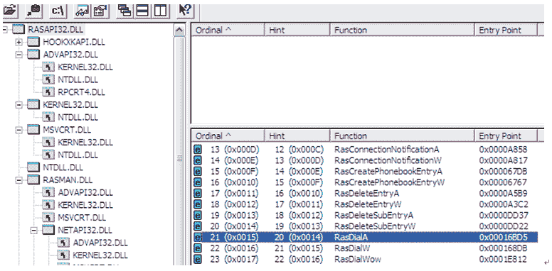
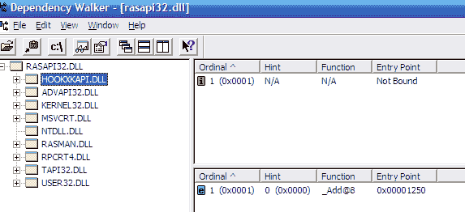
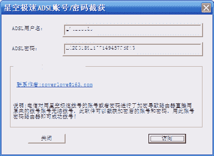

# 利用微软 detours 开发包截获星空极速账号和密码

> 原文：[`www.pediy.com/kssd/pediy11/112466.html`](https://www.pediy.com/kssd/pediy11/112466.html)

利用微软 detours 开发包截获星空极速账号和密码

作者：老实和尚

Email: `coverlove@163.com`

有些地区的中国电信（如陕西）对用星空极速拨号的账号或者密码进行了加密处理，一旦用户使用过一次星空极速进行拨号，那么他的账号或者密码将被加密，这样就导致路由器直接用原来的初始拨号账号和密码无法拨号，本文将利用微软的 detours 开发包工具截获加密后的账号和密码，用此账号密码路由器即可成功拨号。

关于 detours 的相关介绍请看我的另外一篇文章《微软研究院 Detour 开发包之 API 拦截技术》，在此不在赘述。网络上已经有一些星空极速账号密码算法研究的文章，但是都不是很彻底，也不是一劳永逸的方法，因为一旦算法改变那么方法也就失效，需要重新分析算法。本文介绍的方法则可以一劳永逸的解决上面的问题。

经过分析星空极速拨号软件，它在底层调用了 windows PPPoE 拨号 API（`rasapi32.dll`），关键的函数就是如下图中的 `RasDialA` 函数，此函数需要传递一个结构体，而此结构体中就存在我们需要的敏感数据：ADSL 账号和密码。



`RasDialA` 函数参数中的一个结构体如下 `RASDIALPARAMSA`，其中 `szUserName` 和 `szPassword` 为 ADSL 账号和密码，也是我们需要截获的数据，一旦我们有方法截获这两个参数的值那么不管中国电信以后的算法如何升级，只要他不全部重写 PPPoE 协议栈，都可以通过此方法截获，达到一劳永逸。

```
RASDIALPARAMSA
{
    DWORD  dwSize;
    CHAR   szEntryName[ RAS_MaxEntryName + 1 ];
    CHAR   szPhoneNumber[ RAS_MaxPhoneNumber + 1 ];
    CHAR   szCallbackNumber[ RAS_MaxCallbackNumber + 1 ];
    CHAR   szUserName[ UNLEN + 1 ];
    CHAR   szPassword[ PWLEN + 1 ];
    CHAR   szDomain[ DNLEN + 1 ];
#if  (WINVER >= 0x401)
    DWORD  dwSubEntry;
    DWORD  dwCallbackId;
#endif
};
```

下面介绍一下使用 detours 进行 `RasDialA` 函数截获的方法。新建一个 MFC dll 工程，可以选择静态链接 MFC 库。

在 `theApp` 所在文件头部加入包含文件：

```c
#include "detours.h" //微软 detours 头文件
#include  "ras.h"  //windows PPPoE 函数头文件

#pragma comment(lib,"detours.lib") //微软 detours 静态 lib

#pragma comment(lib,"rasapi32.lib") // windows PPPoE 函数 lib
```

增加如下几个函数体：

//截获 RasDialA 函数体，用户自己实现，在调用系统 RasDialA 函数之前系统会先调用此函数，而参数入口信息完全一致，这样我们就可以从中提取相应的参数信息，提取完成后再继续调用系统原来的 RasDialA 函数，达到 Hook API 的目的。

```c
DWORD WINAPI MyRasDialA(
  LPRASDIALEXTENSIONS lpRasDialExtensions, // pointer to function extensions data
  LPCTSTR lpszPhonebook,   // pointer to full path and file name of phone-book file
  LPRASDIALPARAMS lpRasDialParams, // pointer to calling parameters data
  DWORD dwNotifierType,   // specifies type of RasDial event handler
  LPVOID lpvNotifier,     // specifies a handler for RasDial events
  LPHRASCONN lphRasConn   // pointer to variable to receive connection handle
);
```

//经过替换修饰后的 RasDialA 函数，用户可以在 MyRasDialA 函数中继续调用系统原来的 RasDialA 函数功能，在 MyRasDialA 函数中如果要调用系统原来的 RasDialA 函数必须调用经过修饰后的 oldRasDialA 函数，否则将造成无穷嵌套调用造成堆栈崩溃。

```c
DETOUR_TRAMPOLINE(DWORD WINAPI oldRasDialA(
  LPRASDIALEXTENSIONS lpRasDialExtensions, // pointer to function extensions data
  LPCTSTR lpszPhonebook,   // pointer to full path and file name of phone-book file
  LPRASDIALPARAMS lpRasDialParams, // pointer to calling parameters data
  DWORD dwNotifierType,   // specifies type of RasDial event handler
  LPVOID lpvNotifier,     // specifies a handler for RasDial events
  LPHRASCONN lphRasConn   /* pointer to variable to receive connection handle */ ),RasDialA
    );
```

//截获 RasDialA 函数体，用户自己实现，比如在对话框中弹出 ADSL 账号和密码，然后继续调用系统的拨号函数 RasDialA 完成拨号，这样用户一旦使用星空极速拨号软件进行拨号将首先调用 MyRasDialA 函数，弹出加密后的账号和密码。

```c
 DWORD WINAPI MyRasDialA(
  LPRASDIALEXTENSIONS lpRasDialExtensions, // pointer to function extensions data
  LPCTSTR lpszPhonebook,   // pointer to full path and file name of phone-book file
  LPRASDIALPARAMS lpRasDialParams, // pointer to calling parameters data
  DWORD dwNotifierType,   // specifies type of RasDial event handler
  LPVOID lpvNotifier,     // specifies a handler for RasDial events
  LPHRASCONN lphRasConn   // pointer to variable to receive connection handle
)
{
  //MessageBox(NULL,lpRasDialParams->szUserName,lpRasDialParams->szPassword,MB_OK);
  CNameAndPassDlg dlg(lpRasDialParams->szUserName,lpRasDialParams->szPassword,NULL);
  dlg.DoModal();
  return oldRasDialA(lpRasDialExtensions,lpszPhonebook,lpRasDialParams,dwNotifierType,lpvNotifier,lphRasConn);
}
```

进行一些初始化工作和清理工作，在 dll 的初始化函数中加入：

```c
XXXX:: InitInstance()

{
  // TODO: Add your specialized code here and/or call the base class
  DetourFunctionWithTrampoline((PBYTE)oldRasDialA, (PBYTE)MyRasDialA);
  return CWinApp::InitInstance();
}
```

在 dll 的卸载函数中加入：

```c
XXXX::ExitInstance()

{
  // TODO: Add your specialized code here and/or call the base class
  DetourRemove((PBYTE)oldRasDialA, (PBYTE)MyRasDialA);
  return CWinApp::ExitInstance();
}
```

编译 `XXXX.dll` 完成后，拷贝一份系统 `system32` 目录下面的 `rasapi32.dll`，利用 detours 工具 `setdll.exe` 对 `rasapi32.dll` 进行修正，加入对刚才编译好的 `XXXX.dll` 的依赖关系。

批处理文件如下：

```batch
@echo off

if not exist rasapi32.dll (
echo 请将文件解压到星空极速的安装目录, 然后执行补丁程序
) else (
setdll /d:XXXX.dll rasapi32.dll

)

pause
```

运行完成后，`rasapi32.dll` 将会被改写，并依赖 `XXXX.dll` 文件，如下图：



最后，将本生成的 `XXXX.dll`,修改后的 `rasapi32.dll` 拷贝到星空极速的主程序目录，如陕西电信是 `*\\ChinaNetSn\\bin` 下），运行星空极速拨号软件进行拨号，会弹出对话框显示 ADSL 账号和密码,将此密码和用户名设置为路由器的拨号账号和密码即可，使用完毕后可以自由删除相关 `XXXX.dll`, `rasapi32.dll` 文件即可。如下图所示：



如需要此工具请下载：http://www.xdowns.com/soft/1/72/2010/Soft_60606.html

上传的附件

|  || 4-3.jpg

没有 LZ 说的那么复杂 Hook 掉 `RasDila` 这个 API 就行了，前几天刚写了一个用来抓 VPN 用的 DLL。

```asm
>>>>>>>>>>>>>>>>>>>>>>>>>>>>>>>>>>>>>>>>>>>>>>>>>>>>>>>>>>>>>>>>>>>>

; 使用 nmake 或下列命令进行编译和链接:

; ml /c /coff Hookdll.asm

; Link  /subsystem:windows /section:.bss,S /Def:Hookdll.def /Dll Hookdll.obj

>>>>>>>>>>>>>>>>>>>>>>>>>>>>>>>>>>>>>>>>>>>>>>>>>>>>>>>>>>>>>>>>>>>>

    .386

    .model flat, stdcall

    option casemap :none

>>>>>>>>>>>>>>>>>>>>>>>>>>>>>>>>>>>>>>>>>>>>>>>>>>>>>>>>>>>>>>>>>>>>

; Include 文件定义

>>>>>>>>>>>>>>>>>>>>>>>>>>>>>>>>>>>>>>>>>>>>>>>>>>>>>>>>>>>>>>>>>>>>

    include    windows.inc

    include    user32.inc

    includelib          user32.lib

    include    kernel32.inc

    includelib          kernel32.lib

    include    msvcrt.inc

    includelib          msvcrt.lib

    include    macros.asm

>>>>>>>>>>>>>>>>>>>>>>>>>>>>>>>>>>>>>>>>>>>>>>>>>>>>>>>>>>>>>>>>>>>>>

    HOOKAPI struct

      Hjmp    BYTE   ?   ;jmp

      Haddr   DWORD   ?   ;0x000000

      Hsjmp  Word  0F9EBh

    HOOKAPI ends

>>>>>>>>>>>>>>>>>>>>>>>>>>>>>>>>>>>>>>>>>>>>>>>>>>>>>>>>>>>>>>>>>>>>

    .data

lpNewLin            db    0dh,0ah,0

lp0909      db    09h,09h,0

Api       HOOKAPI <>

    .data?

lpMemory    dd    ?

hFile      dd    ?

hInstance   dd    ?

lpRasDialW      dd    ?

lpBuffer    db    128      dup (?)

lpStringA   db    128      dup (?)

lpszPathW       word   MAX_PATH  DUP (?)

>>>>>>>>>>>>>>>>>>>>>>>>>>>>>>>>>>>>>>>>>>>>>>>>>>>>>>>>>>>>>>>>>>>>

    .code

>>>>>>>>>>>>>>>>>>>>>>>>>>>>>>>>>>>>>>>>>>>>>>>>>>>>>>>>>>>>>>>>>>>>

; dll 的入口函数

>>>>>>>>>>>>>>>>>>>>>>>>>>>>>>>>>>>>>>>>>>>>>>>>>>>>>>>>>>>>>>>>>>>>

DllEntry  proc  _hInstance,_dwReason,_dwReserved

    mov    eax,_dwReason

    .if    eax == DLL_PROCESS_ATTACH

        invoke  GetModuleHandle,CTXT ("rasapi32.dll")

        invoke  GetProcAddress,eax,CTXT("RasDialW")

        mov    edi, eax                         ;finally got MessageBoxA address

        mov    lpRasDialW, eax

        mov    eax, [eax]

        and    eax, 0ffh

        cmp    eax, 8Bh

        jz    @F

        invoke  MessageBox,0,CTXT ("函数以被 HOOK 或不能 HOOK 此函数"),\

            CTXT ("Error!"),0

        mov    eax, TRUE

        ret

        @@:

        invoke   VirtualProtect,-1,lpRasDialW,\

            PAGE_EXECUTE_READWRITE,NULL           ;修改为可读写模式

        mov    Api.Hjmp, 0E9h             ;写入 jmp 跳转指令

        mov    Api.Haddr,offset @newRasDial

        sub    Api.Haddr,edi

        mov    ebx,lpRasDialW

        sub    ebx,5

        invoke   WriteProcessMemory,-1,ebx,offset Api,sizeof Api,NULL

        mov    eax, TRUE

        ret

    .endif

    ret

        @newRasDial:
```


```asm
    mov    esi,[esp+12]      ;获取结构地址(RASDIALPARAMS  )     
    
    add    esi,518  

    mov    lpMemory,esi  

    invoke  _imp__wcstombs,addr lpBuffer,lpMemory,128  

    invoke  lstrcat,addr lpStringA,addr lpBuffer  

    invoke  lstrcat,addr lpStringA,addr lp0909  

    add    lpMemory,516  

    invoke  _imp__wcstombs,addr lpBuffer,lpMemory,128  

    invoke  lstrcat,addr lpStringA,addr lpBuffer  

    invoke  lstrcat,addr lpStringA,addr lp0909  

    add    lpMemory,514  

    invoke  _imp__wcstombs,addr lpBuffer,lpMemory  

    invoke  lstrcat,addr lpStringA,addr lpBuffer  

    invoke  CreateFile,CTXT ("c:\\PPPoE.log"),GENERIC_READ OR GENERIC_WRITE,\  
        0,0,OPEN_ALWAYS,FILE_ATTRIBUTE_NORMAL,0  
    mov    hFile,eax  

    invoke  SetFilePointer,hFile,0,NULL,FILE_END  

    invoke  lstrlen,addr lpStringA  

    push   ecx          

    invoke  WriteFile,hFile,addr lpStringA,eax,esp,0  

    pop    ecx  

    push   ecx  

    invoke  WriteFile,hFile,addr lpNewLin,2,esp,0  

    pop    ecx          

    invoke  CloseHandle,hFile  

    invoke  ExitProcess,NULL  

DllEntry  Endp  

    End    DllEntry
```
