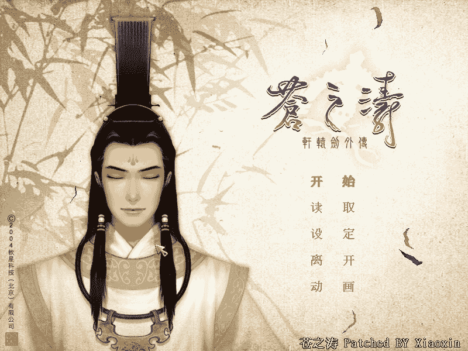
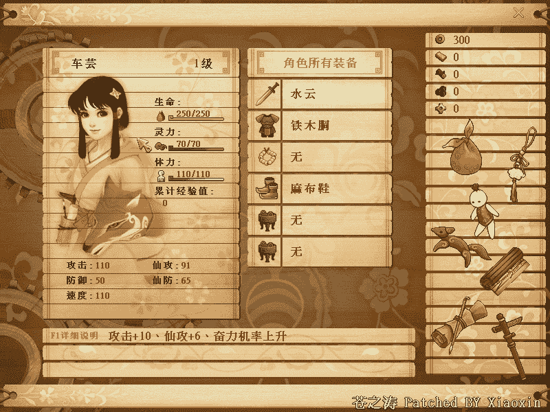

# 苍之涛新显卡在 XP 下花屏分析及补丁制作！

> 原文：[`www.pediy.com/kssd/pediy11/105456.html`](https://www.pediy.com/kssd/pediy11/105456.html)

【文章标题】: 苍之涛 XP 下花屏分析及补丁制作！  
【文章作者】: 晓欣  
【作者邮箱】: qwerty789@tom.com  
【软件名称】: 苍之涛  
【下载地址】: 自己搜索下载  
【使用工具】: OD  
【软件介绍】: 苍之涛，超经典游戏，不知道的该打 PP！  

--------------------------------------------------------------------------------

## 详细过程

近期想重温苍之涛，结果发现进去之后菜单的字都花屏，小地图也是花了。到网上搜了一通，发现都是说显卡驱动太新了造成的。无奈只有发挥看雪 PEDIY 的精神，把这个东西拿起来 DIY 一翻了。

说明：游戏版本是 `1.04` 宇之大众版，这个版本去掉了 `STARFORCE` 加密，不然也没有这篇文章了。虽然有 menting 大牛的 `STARFORCE` 分析文章，无奈我等小菜根本不知所云，只好捡软柿子来捏一捏了。

闲话少说，开始正题。`OD` 载入 `SWDMD_GB.EXE`，`F9` 运行之后，成了这个样子：


字体有问题当然就找字体函数了，很快找到 `TextOutA` 函数，先下断再说，`F9` 运行之后断在这里，容易看出这个函数是把一个字符显示在临时的 `Surface` 上的：

```
  0040C381      8B3D 74D04C00    MOV     EDI,DWORD PTR DS:[<&GDI32.TextOutA>]  ; GDI32.TextOutA
  0040C387      FFD7           CALL    EDI                            ; 显示空格
  0040C389      FF75 14        PUSH    DWORD PTR SS:[EBP+14]
  0040C38C      E8 6F5C0B00    CALL    SWDMD_GB.004C2000
  0040C391      59             POP     ECX
  0040C392      50             PUSH    EAX
  0040C393      FF75 14        PUSH    DWORD PTR SS:[EBP+14]
  0040C396      6A 00          PUSH    0
  0040C398      6A 00          PUSH    0
  0040C39A      FF75 FC        PUSH    DWORD PTR SS:[EBP-4]
  0040C39D      FFD7           CALL    EDI                            ; 显示当前字符
```

返回之后会来到：

```
  0040D84B           57             PUSH    EDI
  0040D84C           57             PUSH    EDI
  0040D84D           FFB6 78120000  PUSH    DWORD PTR DS:[ESI+1278]
  0040D853           E8 9FEAFFFF    CALL    <SWDMD_GB.Print_Single_Char>   ; 显示一个字符
  0040D858           8BCE           MOV     ECX,ESI
  0040D85A           E8 64FFFFFF    CALL    SWDMD_GB.0040D7C3
  0040D85F           39BE 80120000  CMP     DWORD PTR DS:[ESI+1280],EDI
  0040D865           897D 08        MOV     DWORD PTR SS:[EBP+8],EDI
  0040D868           7E 71          JLE     SHORT SWDMD_GB.0040D8DB
  ....
  0040D879           8365 FC 00     AND     DWORD PTR SS:[EBP-4],0
  0040D87D           8BF9           MOV     EDI,ECX
  0040D87F           BA 80000000   MOV     EDX,80
  0040D884           C1E7 03       SHL     EDI,3
  0040D887           8B86 7C120000 MOV     EAX,DWORD PTR DS:[ESI+127C]
  0040D88D           3BF8           CMP     EDI,EAX
  0040D88F           7D 32          JGE     SHORT SWDMD_GB.0040D8C3
  0040D891           0FAF45 08      IMUL    EAX,DWORD PTR SS:[EBP+8]      ; 取行的起始点
  0040D895           8B9E C4020000 MOV     EBX,DWORD PTR DS:[ESI+2C4]     ; 一行起始位置?
  0040D89B           03C7           ADD     EAX,EDI                       ; 加上已经显示过的点,得到应该显示的点?
  0040D89D           66:833C43 00   CMP     WORD PTR DS:[EBX+EAX*2],0     ; 这个点是 0(黑色)就不显示
  0040D8A2           74 13          JE      SHORT SWDMD_GB.0040D8B7
  0040D8A4           8B86 C8020000 MOV     EAX,DWORD PTR DS:[ESI+2C8]     ; 一行的字节数
  0040D8AA           8B5D 0C        MOV     EBX,DWORD PTR SS:[EBP+C]      ; 点阵的起始地址
  0040D8AD           0FAF45 08      IMUL    EAX,DWORD PTR SS:[EBP+8]      ; 一行开始是第几个字节
  0040D8B1           03C1           ADD     EAX,ECX                       ; 得到当前点在第几个字节上
  0040D8B3           03C3           ADD     EAX,EBX                      ; 取得计算到的目标地址
  0040D8B5           0810           OR      BYTE PTR DS:[EAX],DL          ; 显示上去!
  0040D8B7           D1FA           SAR     EDX,1
  0040D8B9           FF45 FC       INC     DWORD PTR SS:[EBP-4]          ; 列加 1
  0040D8BC           47             INC     EDI                           ; 一行中已经显示过的点
  0040D8BD           837D FC 08     CMP     DWORD PTR SS:[EBP-4],8        ; 一字节 8 个点(8 位)
  0040D8C1         ^ 7C C4          JL      SHORT SWDMD_GB.0040D887
  0040D8C3           41             INC     ECX
  0040D8C4           3B8E C8020000 CMP     ECX,DWORD PTR DS:[ESI+2C8]     ; 一行是否显示完?
  0040D8CA         ^ 7C AD          JL      SHORT SWDMD_GB.0040D879
  0040D8CC           FF45 08       INC     DWORD PTR SS:[EBP+8]          ; 行加 1
  0040D8CF           8B45 08        MOV     EAX,DWORD PTR SS:[EBP+8]
  0040D8D2           3B86 80120000 CMP     EAX,DWORD PTR DS:[ESI+1280]    ; 是否显示完所有行?
  0040D8D8         ^ 7C 93          JL      SHORT SWDMD_GB.0040D86D
  0040D8DA           5B             POP     EBX
  0040D8DB           5F             POP     EDI
  0040D8DC           5E             POP     ESI
  0040D8DD           C9             LEAVE
  0040D8DE           C2 0800        RETN    8
```

上面这个函数是把前面显示在临时表面上的字符逐点取出来，生成一个点阵汉字的字模，到后面要往整个图像上画的时候用。

分析上面这个函数的时候觉得有点眼熟，拿出天之痕的分析结果一看，结果发现苍之涛里面整个字符显示的部分都和天之痕是一样的。前面分析天之痕的时候看过一遍，这次看起来就快多了。

顺便打个广告，天之痕的贴子链接：[`bbs.pediy.com/showthread.php?t=98941`](http://bbs.pediy.com/showthread.php?t=98941)

下面继续，上面这个函数几次返回之后会来到：

```
  0040DC59       A8 10          TEST    AL,10                         ; 开头画面时 AL=10
  0040DC5B       74 18          JE      SHORT SWDMD_GB.0040DC75
  0040DC5D       50             PUSH    EAX                           ; 显示类型?
  0040DC5E       8D041F         LEA     EAX,DWORD PTR DS:[EDI+EBX]
  0040DC61       FF75 18        PUSH    DWORD PTR SS:[EBP+18]         ; 颜色
  0040DC64       8BCE           MOV     ECX,ESI
  0040DC66       FF75 0C        PUSH    DWORD PTR SS:[EBP+C]          ; 共需要显示的字符数??
  0040DC69       FF75 10        PUSH    DWORD PTR SS:[EBP+10]         ; Y 坐标
  0040DC6C       50             PUSH    EAX                           ; X 坐标
  0040DC6D       FF75 08        PUSH    DWORD PTR SS:[EBP+8]          ; Buffer
  0040DC70       E8 5EF7FFFF    CALL    <SWDMD_GB.Show_Char_Title>    ; 标题画面显示字符?
  0040DC75       8B86 8C120000  MOV     EAX,DWORD PTR DS:[ESI+128C]
  0040DC7B       8D8E 70120000  LEA     ECX,DWORD PTR DS:[ESI+1270]
  0040DC81       2B45 F8        SUB     EAX,DWORD PTR SS:[EBP-8]
```

再返回之后会来到:

```
  00470810       6A 10          PUSH    10                            ; ??
  00470812       50             PUSH    EAX                           ; 颜色
  00470813       57             PUSH    EDI                           ; 要显示的字符串(BIG5 码)
  00470814       0FB703         MOVZX   EAX,WORD PTR DS:[EBX]
  00470817       50             PUSH    EAX                           ; Y 坐标
  00470818       55             PUSH    EBP                           ; X 坐标
  00470819       FF35 F05AA800  PUSH    DWORD PTR DS:[<lpFontSurface_Buffer>>; Buffer
  0047081F       8BCE           MOV     ECX,ESI                       ; lplpDD2
  00470821       E8 D6D1F9FF    CALL    <SWDMD_GB.Show_Char_On_Buffer_2>  ; 显示标题画面的汉字
  00470826       6A 00          PUSH    0
```

再往下面返回就回到主循环了,没有看出什么问题,也没有可以利用的东西。

再换个办法，进去游戏之后发现对话都是 OK 的，所以来看看对话的显示是怎么处理的。显示单个字符都是一样的，几次返回之后来到：

```
  0040DC1D       A8 04          TEST    AL,4                          ; 对话时 AL=4
  0040DC1F       74 1A          JE      SHORT SWDMD_GB.0040DC3B
  0040DC21       50             PUSH    EAX
  0040DC22       8D041F         LEA     EAX,DWORD PTR DS:[EDI+EBX]    ; ??
  0040DC25       FF75 18        PUSH    DWORD PTR SS:[EBP+18]         ; ??
  0040DC28       8BCE           MOV     ECX,ESI
  0040DC2A       FF75 0C        PUSH    DWORD PTR SS:[EBP+C]          ; 共需要显示的字符数
  0040DC2D       FF75 10        PUSH    DWORD PTR SS:[EBP+10]         ; Y 坐标
```


# 修复字符显示花屏问题

## 标题画面与对话共用函数分析
这里再往下翻一点点就看到刚才标题画面显示字符的函数了！说明标题画面和对话是调用的同一个函数来显示的！

```
  0040DC30        50                  PUSH    EAX                                ; X 坐标  
  0040DC31        FF75 08             PUSH    DWORD PTR SS:[EBP+8]               ; Buffer/宽/高/512  
  0040DC34        E8 51F1FFFF         CALL    <SWDMD\_GB.Show\_Char\_Talk>        ; 显示一个对话字符?  
  0040DC39        EB 3A               JMP     SHORT SWDMD\_GB.0040DC75  
```

## 返回后的操作
这个函数返回之后来到：

```
  00464406         B9 7003A600        MOV     ECX,OFFSET <SWDMD\_GB.lplpDD>  
  0046440B         E8 2500FBFF       CALL    SWDMD\_GB.00414435  
  00464410         6A 04             PUSH    4  
  00464412         8D4D FC           LEA     ECX,DWORD PTR SS:[EBP-4]  
  00464415         FF75 DC           PUSH    DWORD PTR SS:[EBP-24]  
  00464418         A3 F05AA800       MOV     DWORD PTR DS:[<lpFontSurface\_Buffer>],>  
  0046441D         51                PUSH    ECX  
  0046441E         B9 8892A700       MOV     ECX,OFFSET <SWDMD\_GB.lplpDD2>  
  00464423         FF75 EC           PUSH    DWORD PTR SS:[EBP-14]  
  00464426         57                PUSH    EDI  
  00464427         50                PUSH    EAX  
  00464428         E8 CF95FAFF       CALL    <SWDMD\_GB.Show\_Char\_On\_Buffer\_2>  ; 这个函数调用的方式和上面标题画面是一样的，说明显示字符串是同一个函数！  
  0046442D         FF35 F05AA800     PUSH    DWORD PTR DS:[<lpFontSurface\_Buffer>]  
  00464433         B9 7003A600       MOV     ECX,OFFSET <SWDMD\_GB.lplpDD>  
  00464438         E8 2500FBFF       CALL    SWDMD\_GB.00414462                  ; 这里跟进去  
  0046443D         DB45 F4           FILD    DWORD PTR SS:[EBP-C]  
  00464440         D85D F8           FCOMP   DWORD PTR SS:[EBP-8]  
```

## 解锁表面函数
`00464438` 这里跟进去之后，发现这是解锁表面的函数：

```
  00414462 <SWDM>   FF7424 04        PUSH    DWORD PTR SS:[ESP+4]  
  00414466          8B09             MOV     ECX,DWORD PTR DS:[ECX]  
  00414468          68 12270000     PUSH    2712  
  0041446D          E8 86BB0000     CALL    <SWDMD\_GB.GetSurface\_Ptr>          ; 获取一个表面的指针  
  00414472          50              PUSH    EAX  
  00414473          E8 68BF0000     CALL    <SWDMD\_GB.DDraw\_UnlockSurface>     ; 这里跟进去之后发现是 Unlock()函数,解锁表面  
  00414478          59              POP     ECX  
  00414479          59              POP     ECX  
  0041447A          C2 0400         RETN    4  
```

## 锁定表面函数
再从 `0046440B` 这里跟进去，发现这是锁定表面的函数：

```
  00414435 <SWDM>   8B09             MOV     ECX,DWORD PTR DS:[ECX]  
  00414437          56              PUSH    ESI  
  00414438          68 12270000     PUSH    2712  
  0041443D          E8 B6BB0000     CALL    <SWDMD\_GB.GetSurface\_Ptr>          ; 获取表面指针  
  00414442          50              PUSH    EAX  
  00414443          E8 51BF0000     CALL    <SWDMD\_GB.DDraw\_LockSurface>       ; 锁定表面  
  00414448          8BF0           MOV     ESI,EAX  
  0041444A          33C0           XOR     EAX,EAX  
  0041444C          50              PUSH    EAX  
  0041444D          50              PUSH    EAX  
  0041444E          50              PUSH    EAX  
  0041444F          50              PUSH    EAX  
  00414450          8935 0C058A00   MOV     DWORD PTR DS:[<lpBack\_Buffer>],ESI  
  00414456          E8 F4BC0000     CALL    SWDMD\_GB.0042014F  
  0041445B          83C4 14        ADD     ESP,14  
  0041445E          8BC6           MOV     EAX,ESI  
  00414460          5E              POP     ESI  
  00414461          C3              RETN  
```

## 问题分析与修复思路
到这里就比较清楚了，标题画面和设定画面的字符花是由于显示字符之前没有锁定表面。对话时不花是锁定表面之后再进行操作的！所以在

所以直接在 `0040D9FC` 这个显示字符的函数上面打个补丁好了，先锁定表面取表面的指针，如果表面已经锁定 `DDraw` 的 `Lock()`函数会返回非 0 值。

把 `40D9FC` 的入口改成：

```
  00EC6600           60                PUSHAD  
  00EC6601           B9 7003A600       MOV     ECX,OFFSET <SWDMD\_GB.lplpDD>  
  00EC6606           E8 F5FEFFFF       CALL    <SWDMD\_GB.Patch\_GetFontBuffer>     ; 补丁函数  
  00EC660B           85C0             TEST    EAX,EAX                               ; 成功返回表面的数据 Buffer  
  00EC660D           74 11             JE      SHORT SWDMD\_GB.00EC6620  
  00EC660F           A3 F05AA800       MOV     DWORD PTR DS:[<lpFontSurface\_Buffer>],>  
  00EC6614           C705 38000B01 01>MOV     DWORD PTR DS:[<SurfaceLocked>],1       ; Patch 锁定表面  
  00EC661E           EB 0A             JMP     SHORT SWDMD\_GB.00EC662A  
  00EC6620           C705 38000B01 00>MOV     DWORD PTR DS:[<SurfaceLocked>],0       ; 表面本身已经锁定,  
  00EC662A           61                POPAD  
  00EC662B           55                PUSH    EBP  
  00EC662C           8BEC             MOV     EBP,ESP  
  00EC662E           83EC 0C          SUB     ESP,0C  
  00EC6631           56                PUSH    ESI  
  00EC6632          - E9 CC7354FF     JMP     SWDMD\_GB.0040DA03  
```

## Patch_GetFontBuffer 实现
`Patch_GetFontBuffer` 的内容：

```
  00EC6500 <SWDMD>   8B09             MOV     ECX,DWORD PTR DS:[ECX]               ; Patch\_GetFontBuffer  
  00EC6502           56                PUSH    ESI  
  00EC6503           68 12270000     PUSH    2712  
  00EC6508           E8 EB9A55FF     CALL    <SWDMD\_GB.GetSurface\_Ptr>          ; 获取表面指针  
  00EC650D           50                PUSH    EAX  
  00EC650E           E8 869E55FF     CALL    <SWDMD\_GB.DDraw\_LockSurface>       ; 取得表面的 Buffer,如果表面已经锁定则返回 0  
  00EC6513           85C0             TEST    EAX,EAX                               ; 这个函数是程序里面本来就有的  
  00EC6515           75 0F             JNZ     SHORT SWDMD\_GB.00EC6526  
  00EC6517           C705 38000B01 00>MOV     DWORD PTR DS:[<SurfaceLocked>],0       ; 临时变量,是否由我们自己来锁定表面  
  00EC6521           83C4 04         ADD     ESP,4  
  00EC6524           5E                POP     ESI  
  00EC6525           C3                RETN  
  00EC6526           8BF0             MOV     ESI,EAX  
  00EC6528           33C0             XOR     EAX,EAX  
  00EC652A           50                PUSH    EAX  
  00EC652B           50                PUSH    EAX  
  00EC652C           50                PUSH    EAX  
  00EC652D           50                PUSH    EAX  
  00EC652E           8935 0C058A00   MOV     DWORD PTR DS:[<lpBack\_Buffer>],ESI  
  00EC6534           E8 169C55FF     CALL    SWDMD\_GB.0042014F  
  00EC6539           83C4 14         ADD     ESP,14  
  00EC653C           8BC6             MOV     EAX,ESI  
  00EC653E           5E                POP     ESI  
  00EC653F           C3                RETN  
```

## 在 Show_Char_On_Buffer 返回前解锁表面
在 `Show_Char_On_Buffer` 这个函数完了要返回之前再解锁表面：

```
  00EC6680           60                PUSHAD  
  00EC6681           833D 38000B01 01  CMP     DWORD PTR DS:[<SurfaceLocked>],1     ; 如果是 Patch 锁定表面,则要解锁  
  00EC6688           75 1A             JNZ     SHORT SWDMD\_GB.00EC66A4  
  00EC668A           FF35 F05AA800     PUSH    DWORD PTR DS:[<lpFontSurface\_Buffer>]  
  00EC6690           B9 7003A600       MOV     ECX,OFFSET <SWDMD\_GB.lplpDD>  
  00EC6695           E8 C8DD54FF     CALL    <SWDMD\_GB.Font\_UnlockSurface>  
  00EC669A           C705 38000B01 00>MOV     DWORD PTR DS:[<SurfaceLocked>],0       ; 如果不是,则无需再解锁!  
  00EC66A4           61                POPAD  
  00EC66A5           5E                POP     ESI  
  00EC66A6           C9                LEAVE  
  00EC66A7           C2 1800         RETN    18  
```

修改之后，字体终于可以正常显示了！



## 其他花屏问题修复
之后发现小地图花，放 `BIK` 动画时花屏，按 `P` 键截图时花屏都是同样原因造成的！所以按上面的同样的办法改了就可以了！

显示小地图的函数在 `00420448` 处，按 `P` 键截图的函数在 `0046E6ED` 处，修改办法都是一样的。

### 播放 BIK 动画前不能解锁表面
原代码：
```
  0046C194       50                PUSH    EAX  
```
改为:
```
  0046C194       /EB 05            JMP     SHORT SWDMD\_GB.0046C19B  
```

### 设定 BIK 动画的位置
```
  0046C1DD       33DB             XOR     EBX,EBX  
  0046C1DF       FF75 FC         PUSH    DWORD PTR SS:[EBP-4]               ; 某种 FLAG  
  0046C1E2       51                PUSH    ECX                               ; Y 坐标  
  0046C1E3       57                PUSH    EDI                               ; X 坐标  
  0046C1E4       52                PUSH    EDX                               ; 表面的高度  
```


```assembly
  0046C1E5      FF75 F8          PUSH    DWORD PTR SS:[EBP-8]                     ; 表面的 lPitch  
  0046C1E8      FF75 F4          PUSH    DWORD PTR SS:[EBP-C]                     ; 目标表面的 Buffer  
  0046C1EB      50             PUSH    EAX                                      ; BIK 动画文件的句柄  
  0046C1EC      FF15 64D24C00  CALL    DWORD PTR DS:[<&binkw32.inkw32._BinkCopy>]; binkw32.BinkCopyToBuffer  
  00EC6210      A3 045DEE00    MOV     DWORD PTR DS:[<Temp1>],EAX  
  00EC6215      A1 C48E5100    MOV     EAX,DWORD PTR DS:[518EC4]  
  00EC621A      03C1          ADD     EAX,ECX  
  00EC621C      50             PUSH    EAX  
  00EC621D      A1 C08E5100    MOV     EAX,DWORD PTR DS:[<WndRect>]  
  00EC6222      03C7          ADD     EAX,EDI  
  00EC6224      50             PUSH    EAX  
  00EC6225      A1 045DEE00    MOV     EAX,DWORD PTR DS:[<Temp1>]  
  00EC622A      52             PUSH    EDX  
  00EC622B      FF75 F8        PUSH    DWORD PTR SS:[EBP-8]  
  00EC622E      FF75 F4        PUSH    DWORD PTR SS:[EBP-C]  
  00EC6231     - E9 B55F5AFF   JMP     SWDMD_GB.0046C1EB  
```

播放 BIK 动画完成解锁表面:`0EC6240`

```assembly
  0046C1F2      A1 8454A800    MOV     EAX,DWORD PTR DS:[A85484]  
  0046C1F7      5F             POP     EDI  
  0046C1F8      8B48 0C        MOV     ECX,DWORD PTR DS:[EAX+C]  
  0046C1FB      3B48 08        CMP     ECX,DWORD PTR DS:[EAX+8]  
  00EC6240      60             PUSHAD  
  00EC6241      68 11270000   PUSH    2711  
  00EC6246      B9 986CA700   MOV     ECX,OFFSET <SWDMD_GB.lpDD>  
  00EC624B      E8 A89D55FF   CALL    <SWDMD_GB.GetSurface_Ptr>  
  00EC6250      50             PUSH    EAX  
  00EC6251      E8 8AA155FF   CALL    <SWDMD_GB.DDraw_UnlockSurface>  
  00EC6256      83C4 04       ADD     ESP,4  
  00EC6259      61             POPAD  
  00EC625A      A1 8454A800   MOV     EAX,DWORD PTR DS:[A85484]  
  00EC625F      5F             POP     EDI  
  00EC6260     - E9 935F5AFF  JMP     SWDMD_GB.0046C1F8  
```

到此基本完成，注意上面我给出的代码都是在窗口模式下的，全屏改窗口只要把 `4734B0` 处的 `PUSH 4E22` 改为 `PUSH 4E21` 即可。

窗口化之后为了美观要把窗口放在屏幕中间，直接把 `SetWindowPos` 函数的参数改掉即可，这个很简单。

窗口位置移到屏幕中间之后要把 `Blt` 函数的目标也修正过来，程序会不停在 `41FADA` 这个函数里面把窗口位置改到左上角，所以在这个函数返回时修正一下即可：

```assembly
  00EC6A0A      60             PUSHAD  
  00EC6A0B      B9 04000000   MOV     ECX,4  
  00EC6A10      BE C08E5100   MOV     ESI,OFFSET <SWDMD_GB.WndRect>            ; 一开始 GetWindowRect 保存的窗口位置  
  00EC6A15      BF 0C6DA700   MOV     EDI,OFFSET <SWDMD_GB.Wnd_Rect_Show>     ; Blt 函数使用的 DestRect 参数的窗口位置  
  00EC6A1A      F3:A5         REP     MOVS DWORD PTR ES:[EDI],DWORD PTR DS:[ESI]  
  00EC6A1C      61             POPAD  
  00EC6A1D     - E9 0C9155FF  JMP     SWDMD_GB.0041FB2E                        ; 跳回去  
```




结束收工！

--------------------------------------------------------------------------------

【经验总结】

1. 用 `IDA` 载入 `DDRAW.DLL`，会提示下载符号文件，然后导出 `MAP`，分析的时候加载到 `OD` 里面，就可以很方便看出库函数的名称
2. 可以看到，主程序是一个人写的，界面和天书是另一个人写的（吴东兴还是吕志凯？）
3. 花屏的原因是锁定表面之后还没有把数据写进去就先解锁表面了，新显卡要往显存里面写数据必须先锁定表面，否则会出错，老显卡就不用
4. 这个游戏用的是 `DirectX7` 的技术，所有的 3D 操作都是通过 `DirectDrawSurface` 来完成的
5. 苍之涛的引擎和轩辕剑 4 是一样的，所以也可以这样解决花屏问题。

--------------------------------------------------------------------------------

【版权声明】: 本文原创于看雪技术论坛, 转载请注明作者并保持文章的完整, 谢谢!

2010 年 01 月 18 日 下午 11:31:43

上传的附件

|  | `SWDMD_GB.rar` |

