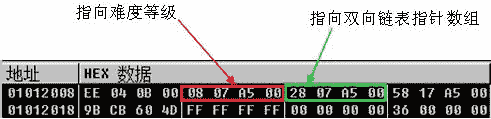
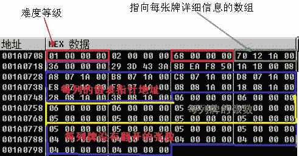
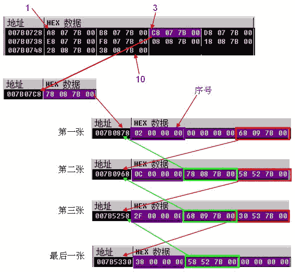
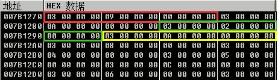
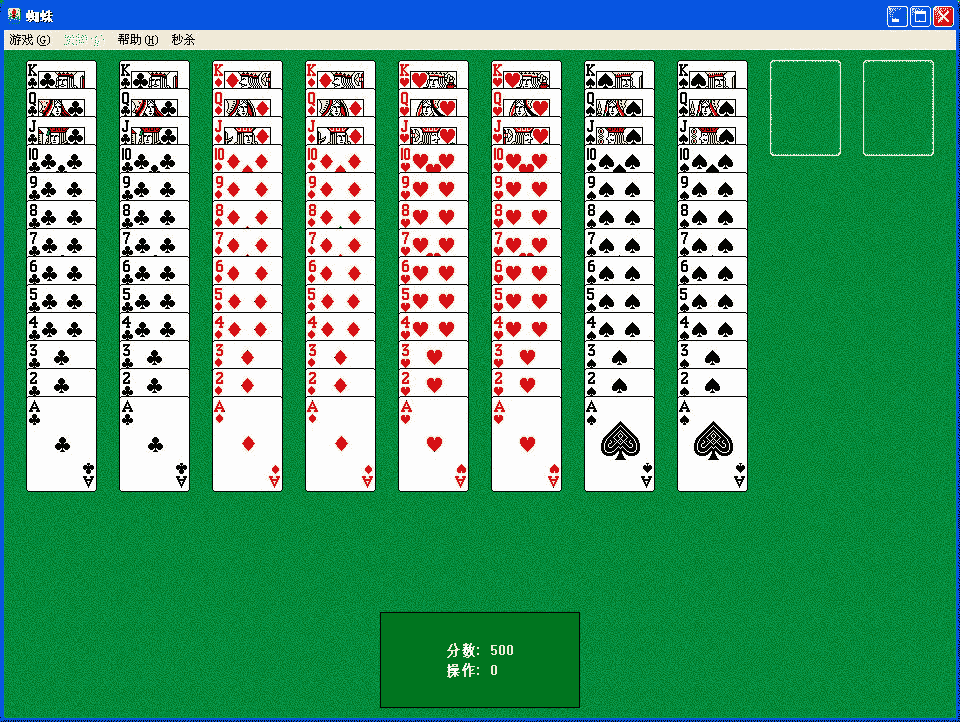

# 蜘蛛纸牌 DIY 秒杀功能

> 原文：[`www.pediy.com/kssd/pediy12/129704.html`](https://www.pediy.com/kssd/pediy12/129704.html)

看了第六期精华中的 `xdkui` <<蜘蛛纸牌分析与简单 DIY>>  

及 `hearmecryle` 写的<<蜘蛛纸牌底牌数据结构图及辅助代码利用>>  

（链 接: `http://bbs.pediy.com/showthread.php?t=129478`）  

对蜘蛛纸牌进行了一次 DIY 实践。  

通过分析，程序一开始就保存了一个内存的基址：  

```
0100FE5F   .  B9 08200101   mov ecx,01012008    ;  设置基址的地方  
0100FE64   .  E8 6D58FFFF   call 010056D6  
0100FE69   .  68 7AFE0001   push 0100FE7A  
0100FE6E   .  E8 9B94FFFF   call 0100930E  
0100FE73   .  59             pop ecx  
0100FE74   .  C3             retn  
```

`01012008` 是一个基址  

里面保存的是游戏窗口的句柄，很多地方要使用的。  

`+4` 的地方保存一个地址，指向难度值。  

`+8` 的地方保存一个地址，指向一个有 10 个元素的数组，每个元素代表每一列的一个双向链表的指针地址，指针中保存的是链表的第一张牌的位置。  

`+14h` 与 `+18h` 这两个地方保存的是两列牌之间的空隙的宽度值，在 `sendmessage` 时，计算坐标要用到的。  

`+58h` 的地方保存发牌的次数  

  

`[01012008+4]+0Ch` 指向每张牌的信息  

  

以一次游戏过程中的第三列数据为例：  

  

每张牌的信息：  

  

利用本程序消息循环的特征指令，可以在程序中定位到处理菜单消息的地方：  

```
movzx eax,word ptr ss:[ebp+10]  ; Case 111 (WM_COMMAND) of switch 01007BF5
```

利用 `reshack` 增加一个菜单：  

```
101 MENU  

LANGUAGE LANG_CHINESE, 0x2  

{  

POPUP "游戏(&G)"  

{  

  MENUITEM "开局(&N)\tF2",  40005  

  MENUITEM "重新开局(&R)",  40006,  GRAYED  

  MENUITEM SEPARATOR  

  MENUITEM "撤销(&U)\tCtrl+Z",  40010,  GRAYED  

  MENUITEM "新一轮发牌(&D)\tD",  40007,  GRAYED  

  MENUITEM "显示可行的操作(&M)\tM",  40013,  GRAYED  

  MENUITEM SEPARATOR  

  MENUITEM "难易级别(&I)...\tF3",  40017  

  MENUITEM "战况(&T)...\tF4",  40014  

  MENUITEM "选项(&P)...\tF5",  40015  

  MENUITEM SEPARATOR  

  MENUITEM "保存本次游戏(&S)\tCtrl+S",  40011,  GRAYED  

  MENUITEM "打开上次保存的游戏(&O)\tCtrl+O",  40012  

  MENUITEM SEPARATOR  

  MENUITEM "退出(&X)",  40004  

}  

MENUITEM "发牌(&D)",  40016,  GRAYED  

POPUP "帮助(&H)"  

{  

  MENUITEM "目录(&C)\tF1",  40003  

  MENUITEM SEPARATOR  

  MENUITEM "关于蜘蛛(&A)...",  40002  

}  

MENUITEM "秒杀",  40020  

}  
```

原程序中移动牌的地方：  

```
01004C98   |> \FF75  FC                 PUSH [LOCAL.1]  ;目的列的第几张  
01004C9B   |.  8B4E 08                 MOV ECX,DWORD PTR DS:[ESI+8];指向 listarray  
01004C9E   |.  FF75 10                 PUSH [ARG.3]     ;目的列  
01004CA1   |.  FF75 0C                 PUSH [ARG.2]  
01004CA4   |.  57                      PUSH EDI             ;   
01004CA5   |.  E8 50320000             CALL 01007EFA         ;  移动牌的函数  
```

考虑到代码要多次修改，并且增加的比较多，因此采用了增加一个 DLL 导入函数的方法对程序进行补丁，利用 `loadPE` 增加，并记下其 RVA 地址。  

原来的程序，主窗口菜单消息过程，判断是什么菜单  

```
01006C3F  |.  0FB745 10     movzx eax,word ptr ss:[ebp+10]  
01006C43  |.  05 BE63FFFF   add eax,FFFF63BE                  ;  Switch (cases 9C42..9C51)  
01006C48  |.  83F8 0F       cmp eax,0F  
```

对原程序进行修改：  

```
01006C43    /E9 08A00000       jmp 01010C50  
```

并在后面的空白处写入新加菜单的处理代码：  

```
01010C50      60             pushad  
01010C51      3D 549C0000   cmp eax,9C54  
01010C56      75 06         jnz short 01010C5E  
01010C58      FF15 1D700801 call dword ptr ds:[108701D]  ; 调用新加的功能函数  
01010C5E      61             popad  
01010C5F      05 BE63FFFF   add eax,FFFF63BE  
01010C64      E9 DF5FFFFF   jmp 01006C48  
```

新加函数的主要功能：  

1. 调用发牌函数，把所有的牌全部发完；  
2. 把后面两列的牌调整到前面 8 列，使每列均为 13 张；  
3. 修改每列的双向链表中的牌的序号；  
4. 修改保存每张牌详细的数组，使每列牌按 `K--A` 的顺序排列；  
5. 修改每列没有翻开的张数；  
6. 发送鼠标消息，完成自动移牌。  

完工的蜘蛛纸牌如下：  

  

dll 代码如下：  

```asm
.386  

.model flat, stdcall      ; 32 bit memory model  
option casemap :none      ; case sensitive  

include windows.inc  

include masm32.inc  

include user32.inc  

includelib masm32.lib  

includelib user32.lib  

DllEntry    proto hInstance:DWORD, dwFunction:DWORD, lpReserve:DWORD  

crackspider   proto  

.data?  

dwEasyLevel      dd  ?  ;保存难度等级，初级为 1，中级为 2，高级为 4，数值正好为牌的花色数量  
dwListArray      dd  ?  ;保存每列链表的指针数组的起始地址  
dwCardArray      dd  ?  ;保存牌的信息数组的起始地址  
dwCardNumArray     dd  ?  ;保存每列牌的张数的数组地址  
dwUnShowNumArray   dd  ?  ;保存每列没有翻开的张数的数组地址  

;//////////////////////////////////////////////////////////////////  

.const  

lpMoveCard     equ    01007EFAh  ;移动牌的函数入口  

lpSendCard     equ    010069B2h  ;发牌的函数入口  

dwBaseMemAdd   equ    01012008h  ;内存基址，并在这里保存了主窗口的句柄  

;//////////////////////////////////////////////////////////////////  

.code  

align 4  

DllEntry proc hInstance:DWORD, dwFunction:DWORD, lpReserve:DWORD  

 xor eax, eax  

 inc eax  

 ret  

DllEntry endp  

;//////////////////////////////////////////////////////////////////  

AdjustTen2Eight proc dwOut,dwIn1,dwIn2,dwIn3,dwIn4  ;把 dwOut 列分到后面的 4 个列中，前两个分两个元素，后两个分三个元素  

 mov ecx,dwListArray  

 mov ebx,lpMoveCard  

 push 0ah    ;目的列的现有张数  

 push dwIn1    ;目的列，列是从 0 计算的  

 push 8      ;源列的第几张牌开始移动，从 0 计算的  

 push dwOut    ;源列，列是从 0 计算的  

 call ebx  

 mov ecx,dwListArray  

 mov ebx,lpMoveCard  

 push 0ah    ;目的列的现有张数  

 push dwIn2    ;目的列，列是从 0 计算的  

 push 6      ;源列的第几张牌开始移动，从 0 计算的  

 push dwOut    ;源列，列是从 0 计算的  

 call ebx  

 mov ecx,dwListArray  

 mov ebx,lpMoveCard  

 push 9      ;目的列的现有张数  

 push dwIn3    ;目的列，列是从 0 计算的  

 push 3      ;源列的第几张牌开始移动，从 0 计算的  

 push dwOut    ;源列，列是从 0 计算的  

 call ebx  

 mov ecx,dwListArray  

 mov ebx,lpMoveCard  

 push 9      ;目的列的现有张数  

 push dwIn4    ;目的列，列是从 0 计算的  

 push 0      ;源列的第几张牌开始移动，从 0 计算的  

 push dwOut    ;源列，列是从 0 计算的  

 call ebx  

 ret  

AdjustTen2Eight endp  

MoveCardCol proc dwCol  

 LOCAL @hWnd  

 LOCAL @width  

 ;取得游戏的窗口句柄，其值是保存在 dwBaseMemAdd 中  

 mov eax,dword ptr ds:[dwBaseMemAdd]  

 mov @hWnd,eax  

 ;取得列与列之间的间隙宽度  

 mov eax,dword ptr ds:[dwBaseMemAdd+14h]  

 mov @width,eax  

 mov eax,47h  

 add eax,@width  

 mov ecx,dwCol  

 imul eax,ecx  

 add eax,@width  

 add eax,23h  

 mov ebx,1bh  

 shl  ebx,16  

 add eax,ebx  

 invoke PostMessage,@hWnd,WM_LBUTTONDOWN,1,eax  

 mov eax,47h  

 add eax,@width  

 mov ecx,8  

 imul ecx  

 add eax,@width  

 mov ecx,eax  

 mov eax,1bh  

 shl eax,16  

 add eax,ecx  

 push eax  

 invoke PostMessage,@hWnd,WM_MOUSEMOVE,1,eax  

 pop eax  

 invoke PostMessage,@hWnd,WM_LBUTTONUP,0,eax  

 ret  

MoveCardCol endp  

crackspider proc  

 LOCAL @index  

 LOCAL @dwNum  

 LOCAL @dwTemp  

 LOCAL @dwCardValue  

 ;取得每列牌的链表指针数组地址  

 mov edx,dword ptr ds:[dwBaseMemAdd+8]  

 mov dwListArray,edx  

 ;取得每列没有翻开的牌的张数的数组地址  

 add edx,28h  

 mov dwCardNumArray,edx  

 add edx,28h  

 mov dwUnShowNumArray,edx  

 ;取得保存张牌信息的数组地址及难度级别  

 mov edx,dword ptr ds:[dwBaseMemAdd+4]  

 mov esi,[edx]  

 mov dwEasyLevel,esi  

 add edx,0Ch  

 mov esi,[edx]  

 mov dwCardArray,esi  

 ;;;;;;;;;;;发完所有的牌;;;;;;  

 mov eax,dword ptr ds:[dwBaseMemAdd+58h]  ;该地址保存已发牌的次数  

 mov @index,eax  

 .while @index<5  

 mov ecx,dwBaseMemAdd  ;过程需要此参数  

 mov eax,lpSendCard  ;发牌的过程入口  

 call eax  

 inc @index  

 .endw  

 ;;;;;;;;;;;;;;;;;;;;;  

 .if eax  

 ;发牌出错时，中止后面的工作  

 ret  

 .endif  

 ;;设置每张牌为翻开的状态  

 mov @index,0  

 mov esi,dwCardArray  

 .while @index<68h  

 mov eax,@index  

 mov ebx,0Ch  

 imul eax,ebx  

 mov dword ptr ds:[esi+eax+8],1  

 inc @index  

 .endw  

 ;;设置每列没有翻开的牌的张数为 0  

 ;;游戏中是以这个没有翻开的张数来设置每张牌露在外面的高度  

 mov @index,0  

 mov esi,dwUnShowNumArray  

 .while @index<0Ah  

 mov dword ptr ds:[esi],0  

 add esi,4  

 inc @index  

 .endw  

 ;;;只保留 8 列在窗口中，  

 ;把最后两列分到前面几列中，使每列有 13 张牌  

 invoke AdjustTen2Eight,8,0,1,4,5  

 invoke AdjustTen2Eight,9,2,3,6,7  

 ;;;修改每一列牌的顺序  

 mov @index,0  

 mov @dwNum,0  

 .while @index<8  

 mov esi,dwListArray  

 mov eax,@index  

 mov ebx,4  

 imul eax,ebx  

 mov esi,dword ptr ds:[esi+eax]  

 mov eax,dword ptr ds:[esi]    ;eax 指向第一张牌了  

 .while eax  

 mov ebx,@dwNum  

 mov dword ptr ds:[eax],ebx  
```


```
mov eax,dword ptr ds:[eax+8]

inc @dwNum

.endw

inc @index

.endw

;;;对牌的数组进行重写，从 K 到 A，在内存中重写

push dwEasyLevel

pop @index    ;牌的花色

xor edx,edx

mov eax,104

mov ecx,13

div ecx

xor edx,edx

mov ecx,@index

div ecx

mov edi,eax

mov esi,dwCardArray

.while @index>0

  mov edx,4

  sub edx,@index  ;牌的花色

  mov @dwNum,edi

  .while @dwNum>0

    mov @dwCardValue,0Ch  ;牌的点数

    mov @dwTemp,0

    .while @dwTemp<13

      mov dword ptr ds:[esi],edx    ;牌的花色

      mov ecx,@dwCardValue

      mov dword ptr ds:[esi+4],ecx  ;牌的点数

      add esi,12

      inc @dwTemp

      dec @dwCardValue

    .endw

    dec @dwNum

  .endw

  dec @index

.endw

;取得游戏的窗口句柄，其值是保存在 dwBaseMemAdd 中

mov eax,dword ptr ds:[dwBaseMemAdd]

;重绘窗口内容

invoke InvalidateRect,eax,NULL,TRUE

;移动第 1-8 列到第 9 列

mov @dwNum,0

.while @dwNum<8

  invoke MoveCardCol,@dwNum

  inc @dwNum

.endw

ret

crackspider endp

;///////////////////////////////////////////////////////////////////
end DllEntry
```

`patch_dil.rar`


