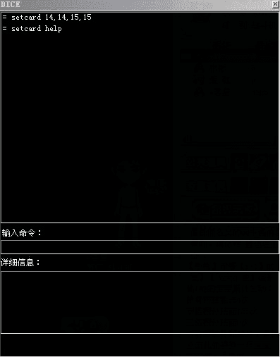
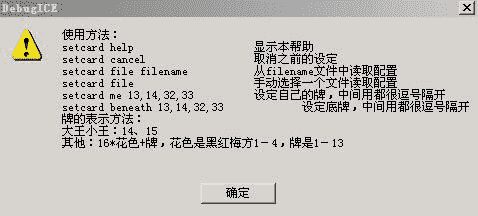

# `qqgame` 升级的秘密\[1 楼、36 楼更新\]（已失效）

> 原文：[`www.pediy.com/kssd/pediy11/115677.html`](https://www.pediy.com/kssd/pediy11/115677.html)

## 背景

工作累了，有时会打两把拖拉机，今天无意想把默认发言改改，比如“快点吧，我等得花儿也谢了”改成“出牌慢的是猪”。

于是用 `od` 打开 `newsjrpg.exe`，超级字串参考，可以找到该字符串，在 `0047a620`，改好后，运行还是原字符串，郁闷，于是打开 `C:\Program Files\Tencent\QQGame\NewsjRpg` 文件夹看看，无意中发现有个 `DebugICE.dll`，这好像是个调试文件啊。

于是在 `NewsjRpg.exe` 里搜索调用 `DebugICE.dll` 的函数，然后就顺藤摸瓜的来到如下代码：

```
00431E6E  /.  55             PUSH EBP
00431E6F  |.  8BEC           MOV EBP,ESP
00431E71  |.  6A FF          PUSH -1
00431E73  |.  68 FBB84600    PUSH NewsjRpg.0046B8FB                    ;  SE 处理程序安装
00431E78  |.  64:A1 0000000> MOV EAX,DWORD PTR FS:[0]
............
00432065  |.  817A 04 00010> CMP DWORD PTR DS:[EDX+4],100      ;100 是 WM_KEYDOWN 消息
0043206C  |.  75 65          JNZ SHORT NewsjRpg.004320D3
0043206E  |.  8B45 08        MOV EAX,DWORD PTR SS:[EBP+8]
00432071  |.  8B48 08        MOV ECX,DWORD PTR DS:[EAX+8]
00432074  |.  898D ECF5FFFF  MOV DWORD PTR SS:[EBP-A14],ECX
0043207A  |.  83BD ECF5FFFF> CMP DWORD PTR SS:[EBP-A14],3           ；3 暂时还没找到对应键
00432081  |.  74 49          JE SHORT NewsjRpg.004320CC
00432083  |.  83BD ECF5FFFF> CMP DWORD PTR SS:[EBP-A14],1B         ；1B 对应 ESC 键
0043208A  |.  74 28          JE SHORT NewsjRpg.004320B4
0043208C  |.  83BD ECF5FFFF> CMP DWORD PTR SS:[EBP-A14],7A        ；7A 对应 F11 键
00432093  |.  74 02          JE SHORT NewsjRpg.00432097
00432095  |.  EB 3C          JMP SHORT NewsjRpg.004320D3
00432097  |>  6A 01          PUSH 1
00432099  |.  FF15 34E04600 CALL DWORD PTR DS:[<&DebugICE.DICEShowWi>;  DebugICE.DICEShowWindow
0043209F  |.  83C4 04        ADD ESP,4
004320A2  |.  6A 01          PUSH 1
004320A4  |.  FF15 30E04600 CALL DWORD PTR DS:[<&DebugICE.DICETopmos>;  DebugICE.DICETopmost
004320AA  |.  83C4 04        ADD ESP,4
004320AD  |.  B8 01000000   MOV EAX,1
.......
0043211D  |.  5F             POP EDI
0043211E  |.  8BE5          MOV ESP,EBP
00432120  |.  5D             POP EBP
00432121  \\.  C2 0400       RETN 4
```

经过试验发现这是一窗口处理过程，并且在接受到键盘输入消息后，如果字符码为 `7A`，会调出 `DEBUG` 窗口，可惜我试了所有键都没发现有 `7A` 的，这个本来是“z”，可是前面会将小写改为大写，所以输入“z”，最后得到的是 `5A`，于是将原 `0043208C` 代码 `CMP DWORD PTR SS:[EBP-A14],7A` 改为 `CMP DWORD PTR SS:[EBP-A14],11`（`11` 为 `CTRL` 键）保存退出。

## 调试窗口操作

呵呵，现在进入游戏，按下 `CTRL`，弹出一 `DICE` 窗口，如下图



可以输入 `help`

其中最有意思的命令是 `setcard`，可以输入 `setcard help` 查看帮助，如下图



看看最后我发到的牌，呵呵

大家玩玩就算了，别用来干坏事哦，如果因此而被封号，我概不负责哈


上传的附件

|  || `NewsjRpg.rar` |

## 进阶：`setcard file` 研究

上次说到可以用 `setcard me` 拿到自己想要的牌，可是另外三家的牌也受影响，按顺序发了，会引起别人的注意是否是作弊，让我们再看看，`setcard help` 里有个 `setcard file`，从文件里读取牌局信息，就让我们来研究研究。

用 `od` 载入，搜索超级字符串，然后很顺利的来到如下代码：

```
004585D0  |> \68 18E54700   PUSH NewsjRpg.0047E518                    ; /file
004585D5  |.  8D85 30FFFFFF LEA EAX,DWORD PTR SS:[EBP-D0]             ; |
004585DB  |.  50            PUSH EAX                                   ; |s1
004585DC  |.  E8 650B0000   CALL <JMP.&MSVCRT.strcmp>                 ; \strcmp
004585E1  |.  83C4 08       ADD ESP,8
004585E4  |.  85C0          TEST EAX,EAX
004585E6  |.  0F85 F7020000 JNZ NewsjRpg.004588E3
004585EC  |.  0FBE8D 74FFFF> MOVSX ECX,BYTE PTR SS:[EBP-8C]
004585F3  |.  85C9          TEST ECX,ECX
004585F5  |.  0F85 F7000000 JNZ NewsjRpg.004586F2
004585FB  |.  8D8D 70F5FFFF LEA ECX,DWORD PTR SS:[EBP-A90]
00458601  |.  E8 56050000   CALL <JMP.&MFC42.#??0CString@@QAE@XZ_540>
00458606  |.  C645 FC 02    MOV BYTE PTR SS:[EBP-4],2
0045860A  |.  68 20E54700   PUSH NewsjRpg.0047E520                    ;  PaiDat | \*.pai||
0045860F  |.  8D8D 70F5FFFF LEA ECX,DWORD PTR SS:[EBP-A90]
00458615  |.  E8 F8060000   CALL <JMP.&MFC42.#??4CString@@QAEABV0@PB>
0045861A  |.  6A 00         PUSH 0
0045861C  |.  8D8D 70F5FFFF LEA ECX,DWORD PTR SS:[EBP-A90]
00458622  |.  E8 4999FAFF   CALL NewsjRpg.00401F70
00458627  |.  50            PUSH EAX
00458628  |.  68 00180000   PUSH 1800
0045862D  |.  6A 00         PUSH 0
0045862F  |.  6A 00         PUSH 0
00458631  |.  6A 01         PUSH 1
00458633  |.  8D8D 74F5FFFF LEA ECX,DWORD PTR SS:[EBP-A8C]
00458639  |.  E8 640A0000   CALL <JMP.&MFC42.#??0CFileDialog@@QAE@HP>
0045863E  |.  C645 FC 03    MOV BYTE PTR SS:[EBP-4],3
00458642  |.  C785 04F6FFFF> MOV DWORD PTR SS:[EBP-9FC],NewsjRpg.0047>;  请选择配牌信息
0045864C  |.  8D8D 74F5FFFF LEA ECX,DWORD PTR SS:[EBP-A8C]
00458652  |.  E8 450A0000   CALL <JMP.&MFC42.#?DoModal@CFileDialog@@>
```

从上面看出读取的文件为 `PaiDat` 类型，扩展名为 `*.pai`。

让我们新建一文件 `a.pai`，随便输入几个数字如 `14`，在 `00458652` 下个断点。

然后调出控制台输入 `setcard file`，断下，`F8`，弹出选择文件对话框，选中 `a.pai` 文件，一路跟踪下去来到如下代码：


```
0045781F   /$   55              PUSH EBP
00457820   |.   8BEC            MOV EBP,ESP
00457822   |.   83EC 10         SUB ESP,10
00457825   |.   894D F0         MOV DWORD PTR SS:\[EBP-10\],ECX
00457828   |.   68 94DC4700     PUSH NewsjRpg.0047DC94                     ; /r
0045782D   |.   8B45 0C         MOV EAX,DWORD PTR SS:\[EBP+C\]             ; |
00457830   |.   50              PUSH EAX                                    ; |path
00457831   |.   FF15 40E74600   CALL DWORD PTR DS:\[<&MSVCRT.fopen>\]      ; \\fopen
00457837   |.   83C4 08         ADD ESP,8
0045783A   |.   8945 F8         MOV DWORD PTR SS:\[EBP-8\],EAX
0045783D   |.   837D F8 00      CMP DWORD PTR SS:\[EBP-8\],0
00457841   |.   75 1D           JNZ SHORT NewsjRpg.00457860
00457843   |.   68 98DC4700     PUSH NewsjRpg.0047DC98                     ; /r
00457848   |.   8B4D 0C         MOV ECX,DWORD PTR SS:\[EBP+C\]             ; |
0045784B   |.   51              PUSH ECX                                    ; |path
0045784C   |.   FF15 40E74600   CALL DWORD PTR DS:\[<&MSVCRT.fopen>\]      ; \\fopen
00457852   |.   83C4 08         ADD ESP,8
00457855   |.   85C0            TEST EAX,EAX
00457857   |.   75 07           JNZ SHORT NewsjRpg.00457860
00457859   |.   33C0            XOR EAX,EAX
0045785B   |.   E9 D4000000     JMP NewsjRpg.00457934
00457860   |>   8B55 08         MOV EDX,DWORD PTR SS:\[EBP+8\]
00457863   |.   52              PUSH EDX
00457864   |.   68 9CDC4700     PUSH NewsjRpg.0047DC9C                     ; |%d;
00457869   |.   8B45 F8         MOV EAX,DWORD PTR SS:\[EBP-8\]             ; |
0045786C   |.   50              PUSH EAX                                    ; |stream
0045786D   |.   FF15 B0E64600   CALL DWORD PTR DS:\[<&MSVCRT.fscanf>\]     ; \\fscanf
00457873   |.   83C4 0C         ADD ESP,0C
00457876   |.   8B4D 08         MOV ECX,DWORD PTR SS:\[EBP+8\]
00457879   |.   83C1 04         ADD ECX,4
0045787C   |.   51              PUSH ECX
0045787D   |.   68 A0DC4700     PUSH NewsjRpg.0047DCA0                     ; |%d;
00457882   |.   8B55 F8         MOV EDX,DWORD PTR SS:\[EBP-8\]             ; |
00457885   |.   52              PUSH EDX                                    ; |stream
00457886   |.   FF15 B0E64600   CALL DWORD PTR DS:\[<&MSVCRT.fscanf>\]     ; \\fscanf
0045788C   |.   83C4 0C         ADD ESP,0C
0045788F   |.   8B45 08         MOV EAX,DWORD PTR SS:\[EBP+8\]
00457892   |.   83C0 08         ADD EAX,8
00457895   |.   50              PUSH EAX
00457896   |.   68 A4DC4700     PUSH NewsjRpg.0047DCA4                     ; |%d;
0045789B   |.   8B4D F8         MOV ECX,DWORD PTR SS:\[EBP-8\]             ; |
0045789E   |.   51              PUSH ECX                                    ; |stream
0045789F   |.   FF15 B0E64600   CALL DWORD PTR DS:\[<&MSVCRT.fscanf>\]     ; \\fscanf
004578A5   |.   83C4 0C         ADD ESP,0C
004578A8   |.   C745 FC 00000>  MOV DWORD PTR SS:\[EBP-4\],0
004578AF   |.   EB 09           JMP SHORT NewsjRpg.004578BA
004578B1   |>   8B55 FC         /MOV EDX,DWORD PTR SS:\[EBP-4\]
004578B4   |.   83C2 01         |ADD EDX,1
004578B7   |.   8955 FC         |MOV DWORD PTR SS:\[EBP-4\],EDX
004578BA   |>   837D FC 06      CMP DWORD PTR SS:\[EBP-4\],6               ;大循环 6 次
004578BE   |.   7D 62           |JGE SHORT NewsjRpg.00457922
004578C0   |.   8B45 FC         |MOV EAX,DWORD PTR SS:\[EBP-4\]
004578C3   |.   8B4D 08         |MOV ECX,DWORD PTR SS:\[EBP+8\]
004578C6   |.   8D5481 0C       |LEA EDX,DWORD PTR DS:\[ECX+EAX\*4+C\]
004578CA   |.   52              |PUSH EDX
004578CB   |.   68 A8DC4700     |PUSH NewsjRpg.0047DCA8                    ; |%d;
004578D0   |.   8B45 F8         |MOV EAX,DWORD PTR SS:\[EBP-8\]           ; |
004578D3   |.   50              |PUSH EAX                                  ; |stream
004578D4   |.   FF15 B0E64600   |CALL DWORD PTR DS:\[<&MSVCRT.fscanf>\]    ; \\fscanf
004578DA   |.   83C4 0C         |ADD ESP,0C
004578DD   |.   C745 F4 00000>  |MOV DWORD PTR SS:\[EBP-C\],0
004578E4   |.   EB 09           |JMP SHORT NewsjRpg.004578EF
004578E6   |>   8B4D F4         |/MOV ECX,DWORD PTR SS:\[EBP-C\]
004578E9   |.   83C1 01         ||ADD ECX,1
004578EC   |.   894D F4         ||MOV DWORD PTR SS:\[EBP-C\],ECX
004578EF   |>   837D F4 3C      | CMP DWORD PTR SS:\[EBP-C\],3C            ；小循环 3C=60 次
004578F3   |.   7D 2B           ||JGE SHORT NewsjRpg.00457920
004578F5   |.   8B55 FC         ||MOV EDX,DWORD PTR SS:\[EBP-4\]
004578F8   |.   69D2 F0000000   ||IMUL EDX,EDX,0F0
004578FE   |.   8B45 08         ||MOV EAX,DWORD PTR SS:\[EBP+8\]
00457901   |.   8D4C10 24       ||LEA ECX,DWORD PTR DS:\[EAX+EDX+24\]
00457905   |.   8B55 F4         ||MOV EDX,DWORD PTR SS:\[EBP-C\]
00457908   |.   8D0491          ||LEA EAX,DWORD PTR DS:\[ECX+EDX\*4\]
0045790B   |.   50              ||PUSH EAX
0045790C   |.   68 ACDC4700     ||PUSH NewsjRpg.0047DCAC                   ; |%d;
00457911   |.   8B4D F8         ||MOV ECX,DWORD PTR SS:\[EBP-8\]           ; |
00457914   |.   51              ||PUSH ECX                                  ; |stream
00457915   |.   FF15 B0E64600   ||CALL DWORD PTR DS:\[<&MSVCRT.fscanf>\]   ; \\fscanf
0045791B   |.   83C4 0C         ||ADD ESP,0C
0045791E   |.^  EB C6          |\\JMP SHORT NewsjRpg.004578E6
00457920   |>^ EB 8F          \\JMP SHORT NewsjRpg.004578B1
00457922   |>   8B55 F8         MOV EDX,DWORD PTR SS:\[EBP-8\]
00457925   |.   52              PUSH EDX                                    ; /stream
00457926   |.   FF15 4CE74600   CALL DWORD PTR DS:\[<&MSVCRT.fclose>\]     ; \\fclose
0045792C   |.   83C4 04         ADD ESP,4
0045792F   |.   B8 01000000     MOV EAX,1
00457934   |>   8BE5            MOV ESP,EBP
00457936   |.   5D              POP EBP
00457937   \\.  C2 0800         RETN 8
```

调试发现，它是先取出头三个数字，从第四个数字开始是 6 个牌局情况，结构为牌的个数+60 个牌面数据，其中 1,2,3,4 牌局分别是如下图位置的四家所分发的牌，5 和 6 暂时不知道什么用处，另外这个牌面数据与帮助里的规则不同，见下面代码，将数据进行了转换


代码:


```
00458442   /$  55              PUSH EBP
00458443   |.  8BEC             MOV EBP,ESP
00458445   |.  83EC 10          SUB ESP,10
00458448   |.  C645 FC 00       MOV BYTE PTR SS:[EBP-4],0
0045844C   |.  C645 F4 00       MOV BYTE PTR SS:[EBP-C],0
00458450   |.  C645 F8 00       MOV BYTE PTR SS:[EBP-8],0
00458454   |.  8B45 08          MOV EAX,DWORD PTR SS:[EBP+8]
00458457   |.  25 FF000000      AND EAX,0FF
0045845C   |.  83F8 35          CMP EAX,35          ；35h 即 53
0045845F   |.  75 06            JNZ SHORT NewsjRpg.00458467
00458461   |.  C645 FC 0E       MOV BYTE PTR SS:[EBP-4],0E    ；还记得我们用 `setcard me 14` 即为小王
00458465   |.  EB 70            JMP SHORT NewsjRpg.004584D7
00458467   |>  8B4D 08          MOV ECX,DWORD PTR SS:[EBP+8]
0045846A   |.  81E1 FF000000    AND ECX,0FF
00458470   |.  83F9 36          CMP ECX,36          ；36h 即 54    到这里基本可以猜到这两个数据应该是大小王
00458473   |.  75 06            JNZ SHORT NewsjRpg.0045847B
00458475   |.  C645 FC 0F       MOV BYTE PTR SS:[EBP-4],0F     ；15 即为大王
00458479   |.  EB 5C            JMP SHORT NewsjRpg.004584D7
0045847B   |>  8B45 08          MOV EAX,DWORD PTR SS:[EBP+8]
0045847E   |.  25 FF000000      AND EAX,0FF
00458483   |.  83C0 0C          ADD EAX,0C          ；取出数据+12
00458486   |.  99               CDQ
00458487   |.  B9 0D000000      MOV ECX,0D         
0045848C   |.  F7F9             IDIV ECX            ；除以 13，很容易猜到是取牌色
0045848E   |.  8845 F4          MOV BYTE PTR SS:[EBP-C],AL
00458491   |.  8B45 08          MOV EAX,DWORD PTR SS:[EBP+8]
00458494   |.  25 FF000000      AND EAX,0FF
00458499   |.  99               CDQ
0045849A   |.  B9 0D000000      MOV ECX,0D
0045849F   |.  F7F9             IDIV ECX
004584A1   |.  85D2             TEST EDX,EDX
004584A3   |.  74 15            JE SHORT NewsjRpg.004584BA
004584A5   |.  8B45 08          MOV EAX,DWORD PTR SS:[EBP+8]
004584A8   |.  25 FF000000      AND EAX,0FF
004584AD   |.  99               CDQ
004584AE   |.  B9 0D000000      MOV ECX,0D         
004584B3   |.  F7F9             IDIV ECX            
004584B5   |.  8955 F0          MOV DWORD PTR SS:[EBP-10],EDX  ；除以 13，取余数得到牌点
004584B8   |.  EB 07            JMP SHORT NewsjRpg.004584C1
004584BA   |>  C745 F0 0D000>   MOV DWORD PTR SS:[EBP-10],0D
004584C1   |>  8A55 F0          MOV DL,BYTE PTR SS:[EBP-10]
004584C4   |.  8855 F8          MOV BYTE PTR SS:[EBP-8],DL
004584C7   |.  0FBE45 F4        MOVSX EAX,BYTE PTR SS:[EBP-C]
004584CB   |.  C1E0 04          SHL EAX,4
004584CE   |.  0FBE4D F8        MOVSX ECX,BYTE PTR SS:[EBP-8]
004584D2   |.  03C1             ADD EAX,ECX
004584D4   |.  8845 FC          MOV BYTE PTR SS:[EBP-4],AL
004584D7   |>  8A45 FC          MOV AL,BYTE PTR SS:[EBP-4]
004584DA   |.  8BE5             MOV ESP,EBP
004584DC   |.  5D               POP EBP
004584DD   \.  C3               RETN
```

从上面可以看出，文件里用的数据是将牌按黑红梅方大小王排列的大小为 54 的数组里的索引，经过上面这段代码的转换，变成符合帮助里规则的数据，如大小王 `53,54`-->`14,15`,黑桃 `A` `01`-->`17`

现在让我们先构造一家的牌如下

`01 02 03 25 53 53 54 54 01 01 02 02 14 14 15 15 27 27 28 28 40 40 41 41 13 13 12 12 11 00 00 00 00 00 00 00 00 00 00 00 00 00 00 00 00 00 00 00 00 00 00 00 00 00 00 00 00 00 00 00 00 00 00`

前面三个数暂时不知啥用，`25` 为牌个数，后面为 `25` 张牌，紧接着用 `0` 补齐，必须凑够 `60` 个数据

后面的任务就是把剩余的 `108-25=83` 张牌乱序，然后取出 `25` 张构造第二家数据，依次类推，记得最后牌局个数至少要 `6` 个，也就是总的数据至少要 `3+（1+60）*6`

随知道原理，但编程功底太弱，希望大家能写一个程序，输入自己想要的 `25` 张牌，自动生成一个 `pai` 文件

附上一个我做好的 `pai` 文件

`a.rar`

顺便说下控制台里有个命令为 `playmusic`,通过跟踪可以发现如下代码

代码:

```
0045822F   /.  55             PUSH EBP
00458230   |.  8BEC           MOV EBP,ESP
00458232   |.  6A 00          PUSH 0
00458234   |.  6A 00          PUSH 0
00458236   |.  6A 00          PUSH 0
00458238   |.  68 78E34700    PUSH NewsjRpg.0047E378            ;  c:\\a.mp3
0045823D   |.  6A 00          PUSH 0
0045823F   |.  E8 7CC2FAFF    CALL NewsjRpg.004044C0
00458244   |.  8BC8           MOV ECX,EAX
00458246   |.  E8 25B2FAFF    CALL NewsjRpg.00403470
0045824B   |.  50             PUSH EAX                ; |hWnd
0045824C   |.  FF15 DCE74600  CALL DWORD PTR DS:[<&SHELL32.ShellExecut>; \ShellExecuteA
00458252   |.  5D             POP EBP
00458253   \.  C3             RETN
```

也就是它只能播放 `c:\\a.mp3`，可以将自己喜欢的播放列表文件改为 `a.m3u` 放到 `C` 盘下，然后将 `0047e378` 改为 `c:\\a.m3u`,呵呵，现在在控制台输入 `playmusic`,呵呵，是不是有声音了，而且不带播放器的，爽吧

刚才看了下进程，发现说错了，它还是启用了播放器 `wmplayer`，只是在后台，没有窗口而已。。。。。
