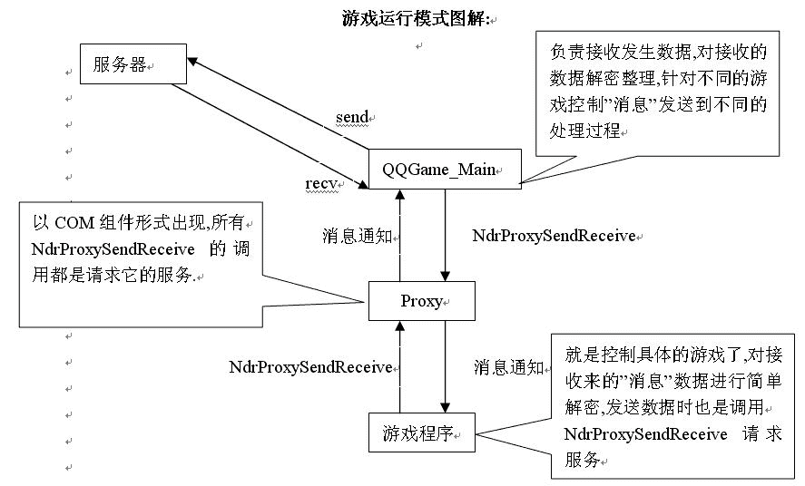
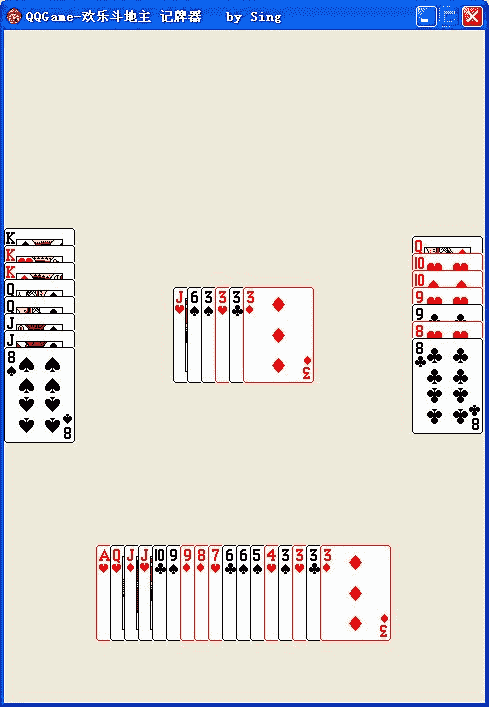

# QQGame 浅析系列 - 多开大厅刷分你也可以

> 原文：[`www.pediy.com/kssd/pediy10/63266.html`](https://www.pediy.com/kssd/pediy10/63266.html)

## QQGame 浅析系列 (1) -- 多开大厅刷分你也可以

**本系列仅以学习交流使用，非法使用者，后果自负。**

最近闲来无聊就陪朋友一起打打牌，是 `QQ` 游戏斗地主游戏，我们通常在一个桌 (`Table`) 打牌，这样配合胜率会高一点。有一次他正在和别人打牌，四人已满，我就不能和他一起打了，就随便点了一下发现能进得此桌，原来游戏提供了"旁观"的功能，不过是当时才知道的。于是我就一个个地"旁观"别人的牌，将牌符告诉我的朋友，他果然"运筹帷幄,决胜千里",呵呵....

于是想到了一个"坏点子"：自己开两个号打牌，一个用来旁观，另一个用来打牌，岂不是很容易就取胜？当我兴冲冲地准备"作祟"时，发现 `QQGame` 并不能同时运行两个实例，所以我上述的想法就暂时不能实现了。要想实现，就要突破这一关，于是抱着试试看的心理分析下"QQGame 不能同时运行两个实例"的原理。

程序实现只能运行一个实例的原理通常是使用互斥元、临界区、信号量等机制。

于是用 OD 载入，下断：

```
bp CreateMutexA
```

F9 运行，中断，再次 F9......若干次后会看到堆栈提示：

```
0013FE90   100118DF  /CALL 到 CreateMutexA 来自 Utility.100118D9
0013FE94   00000000  |pSecurity = NULL
0013FE98   00000001  |InitialOwner = TRUE
0013FE9C   00F88700  \MutexName = "QQGame\_Mutex03/01/2003"
```

**`MutexName` 为 "QQGame\_Mutex03/01/2003" 的就是我们所关心的.**

如果知道了这一点，那么要想绕过 "QQGame 不能同时运行两个实例" 就很简单了，我这里采用的是在不破坏原程序完整性的方法，现介绍如下：

`MutexName` 为 "QQGame\_Mutex03/01/2003" 的串存放在一个叫做 `MainLogi.dll` 文件中，在游戏安装目录下的 `Logic` 文件夹里。如果每次运行游戏程序 `MutexName` 与上次的都不相同，不就可以绕过了吗？也就是每次运行程序前偷偷地改变 `MainLogi.dll` 文件中的 `MutexName`。具体实现见代码及分析：

```
program QQgameSpy;

uses
  windows, dialogs, sysutils, classes, graphics, shellapi , registry;

var
reg : TRegistry;

strPath : string;
strFileName : string;
strNewFile : string;
strGameFile : string;
strMutex : string;
i : integer;
hMutex : DWORD;
hFile : DWORD;
dwBytesOfRW : Cardinal;
buffer : BYTE;
DstFile : TFileStream;
hwnd : DWORD;

{$r QQgameSpy.RES}

function   RenameFile ( hdl : THandle ; lpOrgName , lpNewName : PAnsichar ) : boolean ;
var
        shf : TSHFILEOPSTRUCT ;
begin
        try
          FillChar ( shf , SizeOf ( shf ) , 0 ) ;
          shf . Wnd      := hdl ;
          shf . wFunc    := FO_RENAME ;
          shf . pFrom    := lpOrgName ;
          shf . pTo      := lpNewName ;
          shf . fFlags   := FOF_NOCONFIRMATION + FOF_SILENT ;
          Result := ( 0 = SHFileOperation ( shf ) ) ;
        except
                Result := false ;
        end ;
end ;

{ 主程序开始 }
begin
        reg :=  TRegistry . Create ;
        reg . RootKey := HKEY_CURRENT_USER ;
        if  reg . OpenKeyReadOnly ( '\\Software\\Tencent\\QQGame\\SYS' ) =  false  then
                exit ;
        strPath := reg . ReadString ( 'GameDirectory' ) ;
        //showmessage ( strPath ) ;
        reg . CloseKey ;
        reg . Free ;
        strFileName := strPath + 'Logic\\MainLogi.dll' ;
        strMutex := 'QQGame\_Mutex03/01/2000' ;
        for  i := 0  to  3  do begin
                hMutex := CreateMutex ( nil , false , pchar ( strMutex ) ) ;
                if  hMutex = 0  then
                        continue ;
                if  GetLastError <> ERROR_ALREADY_EXISTS  then
                        break ;
                Inc (  strMutex [ Length ( strMutex ) ]  ) ;
        end ;
        //showmessage ( strMutex ) ;
        buffer := BYTE ( strMutex [ Length ( strMutex ) ] ) ;
        if  hMutex = 0  then
                exit ;
        CloseHandle ( hMutex ) ;
        //DstFile := TFileStream . Create ( strFileName , fmOpenReadWrite ) ;
        //DstFile . Seek ( $581C1 , FILE_BEGIN ) ;
        //DstFile . WriteBuffer ( buffer , sizeof ( buffer ) ) ;
        for  i := 0  to  2  do begin
                strNewFile := strFileName + inttostr ( i ) ;
                DeleteFile ( strNewFile ) ;
        end ;
        for  i := 0  to  2  do begin
                strNewFile := strFileName + inttostr ( i ) ;
                if  FileExists ( strNewFile ) = false  then
                        break ;
        end ;
        RenameFile ( 0 , pchar ( strFileName ) , pchar ( strNewFile ) ) ;
        CopyFile ( pchar ( strNewFile ) , pchar ( strFileName ) , true ) ;
        hFile := CreateFile ( pchar ( strFileName ) , GENERIC_WRITE  or  GENERIC_READ , FILE_SHARE_WRITE  or  FILE_SHARE_READ ,
                            nil , OPEN_EXISTING , FILE_ATTRIBUTE_NORMAL , 0 ) ;
        if  hFile = INVALID_HANDLE_VALUE  then
                exit ;
        SetFilePointer ( hFile , $581C1 , nil , FILE_BEGIN ) ;
        WriteFile ( hFile , buffer , sizeof ( buffer ) , dwBytesOfRW , nil ) ;
        CloseHandle ( hFile ) ;
        strGameFile := strPath + 'QQGame.exe' ;
        //showmessage ( strGameFile ) ;
        ShellExecute ( 0 , 'Open' , pchar ( strGameFile ) , nil , nil , SW_SHOWNORMAL ) ;
end .
```

解释：当程序运行时通过注册表查询 `QQGame` 的安装目录，进而获取 `MainLogi.dll` 文件的完整文件名。由于 `QQ` 游戏一般来说没桌最多不超过四人，所以每次运行前首先查看 `MutexName` 为：

'QQGame\_Mutex03/01/2000';
'QQGame\_Mutex03/01/2001';
'QQGame\_Mutex03/01/2002';
'QQGame\_Mutex03/01/2000';

的互斥元是否存在，如果遇到有不存在的，说明可以以此互斥元名运行 `QQ` 游戏，就改写原 `MainLogi.dll` 文件名为其他，复制一份 `MainLogi.dll` 文件并更换其中的 `MutexName`，最后 `ShellExecute` `QQ` 游戏，这样当 `QQ` 游戏运行检测时就会使用我们更改过的 `MutexName`，由于我们实现已经检测过这个 `MutexName` 还没有被使用，当然可以成功运行了。

这里你可能很诧异：`MainLogi.dll` 文件被游戏加载过一次，下次还能被改名吗？我试过了，删除此文件不可以，但是可以对其重命名。上面声明的 `RenameFile` 就是实现更改文件名功能的。

运行后，可以开 N 个大厅，于是乎狂玩了一下午，很快刷到了 600 多分，胜负率高达 60%以上啊！不过也就是当时一会的劲头，再后来就没有玩过了，现在将此方法公布与大家分享一下，希望玩得愉快！

说明：在我欲发此贴时，`QQGame` 有所更新，使用上述方法不行了，如果不给出一个新的解决方法，总感觉不甚完美，于是重新又跟了一次。思路如下：

如果已有一个登录窗体运行了，那么再运行实例会给那个已运行的实例一个焦点，让用户知道“你已经运行啦”，然后退出。

于是：

```
Bp FindWindowA
Bp FindWindowExA
```

F9 运行，中断一个，看堆栈提示：

```
0013FE7C   100119A3  /CALL 到 FindWindowExA 来自 Utility.1001199D
0013FE80   00000000  |hParent = NULL
0013FE84   00000000  |hAfterWnd = NULL
0013FE88   01069BD0  |Class = "QQGame\_MainFrame"
0013FE8C   00000000  \Title = NULL
```

返回到调用的过程：

《Utility 领空》

```
1001199D    FF15 18920110   call    dword ptr [<&USER32.FindWindowEx>; USER32.FindWindowExA
100119A3    8BF8            mov     edi, eax
100119A5    57              push    edi
100119A6    FF15 78920110   call    dword ptr [<&USER32.IsWindow>]   ; USER32.IsWindow
100119AC    85C0            test    eax, eax
100119AE    74 0E           je      short 100119BE
100119B0    53              push    ebx
100119B1    53              push    ebx
100119B2    FF76 50         push    dword ptr [esi+50]
100119B5    57              push    edi
100119B6    FF15 7C920110   call    dword ptr [<&USER32.PostMessageA>; USER32.PostMessageA
100119BC    EB 10           jmp     short 100119CE
100119BE    83C6 14         add     esi, 14
100119C1    68 1CE70110     push    1001E71C
100119C6    56              push    esi
100119C7    E8 4A4FFFFF     call    10006916
100119CC    59              pop     ecx
100119CD    59              pop     ecx
100119CE    5F              pop     edi
100119CF    5E              pop     esi
100119D0    5B              pop     ebx
100119D1    C3              retn
```

执行流程是这样的，检测是否已有窗体运行了，如果有找到它，给它发个消息（这个消息估计就是让那个窗体拥有焦点的）然后退出。

我们由此过程再次返回，发现是：

```
100118F5    E8 92000000     call    1001198C
```

调用的上述过程，前后浏览一下代码：

《Utility 领空》

```
10011846    55              push    ebp
10011847    8BEC            mov     ebp, esp
10011849    51              push    ecx
1001184A    8B45 18         mov     eax, dword ptr [ebp+18]
1001184D    8365 FC 00      and     dword ptr [ebp-4], 0
10011851    53              push    ebx
10011852    56              push    esi
10011853    8BF1            mov     esi, ecx
10011855    57              push    edi
10011856    BB 00010000     mov     ebx, 100
1001185B    8946 54         mov     dword ptr [esi+54], eax
1001185E    8B45 14         mov     eax, dword ptr [ebp+14]
10011861    8DBE 58010000   lea     edi, dword ptr [esi+158]
10011867    8946 50         mov     dword ptr [esi+50], eax
1001186A    85FF            test    edi, edi
1001186C    74 21           je      short 1001188F
1001186E    837D 10 00      cmp     dword ptr [ebp+10], 0
```


```
10011872    74 1B           je      short 1001188F  

10011874    53              push    ebx  

10011875    8D4E 45         lea     ecx, dword ptr [esi+45]  

10011878    FF75 10         push    dword ptr [ebp+10]  

1001187B    E8 16050000     call    10011D96  

10011880    85C0            test    eax, eax  

10011882    74 0B           je      short 1001188F  

10011884    FF75 10         push    dword ptr [ebp+10]  

10011887    57              push    edi  

10011888    E8 19580000     call    <jmp.&MSVCRT.strcpy>  

1001188D    59              pop     ecx  

1001188E    59              pop     ecx  

1001188F    8D7E 58         lea     edi, dword ptr [esi+58]  

10011892    85FF            test    edi, edi  

10011894    74 21           je      short 100118B7  

10011896    837D 0C 00      cmp     dword ptr [ebp+C], 0  

1001189A    74 1B           je      short 100118B7  

1001189C    53              push    ebx  

1001189D    8D4E 45         lea     ecx, dword ptr [esi+45]  

100118A0    FF75 0C         push    dword ptr [ebp+C]  

100118A3    E8 EE040000     call    10011D96  

100118A8    85C0            test    eax, eax  

100118AA    74 0B           je      short 100118B7  

100118AC    FF75 0C         push    dword ptr [ebp+C]  

100118AF    57              push    edi  

100118B0    E8 F1570000     call    <jmp.&MSVCRT.strcpy>  

100118B5    59              pop     ecx  

100118B6    59              pop     ecx  

100118B7    837D 08 00      cmp     dword ptr [ebp+8], 0  

100118BB    74 5F           je      short 1001191C  

100118BD    FF75 08         push    dword ptr [ebp+8]  

100118C0    E8 E7570000     call    <jmp.&MSVCRT.strlen>  

100118C5    F7D8            neg     eax  

100118C7    1BC0            sbb     eax, eax  

100118C9    59              pop     ecx  

100118CA    40              inc     eax  

100118CB    8945 10         mov     dword ptr [ebp+10], eax  

100118CE    75 4C           jnz     short 1001191C  

100118D0    FF75 08         push    dword ptr [ebp+8]  

100118D3    6A 01           push    1  

100118D5    5F              pop     edi  

100118D6    57              push    edi  

100118D7    6A 00           push    0  

100118D9    FF15 E8900110   call    dword ptr [<&KERNEL32.CreateMutexA>]   ; kernel32.CreateMutexA  

100118DF    85C0            test    eax, eax  

100118E1    8946 4C         mov     dword ptr [esi+4C], eax  

100118E4    74 24           je      short 1001190A  

100118E6    FF15 AC900110   call    dword ptr [<&KERNEL32.GetLastError>]   ; ntdll.RtlGetLastWin32Error  

100118EC    3D B7000000     cmp     eax, 0B7  

100118F1    8BCE            mov     ecx, esi  

100118F3    75 07           jnz     short 100118FC  

100118F5    E8 92000000     call    1001198C  

100118FA    EB 2A           jmp     short 10011926  

100118FC    E8 64010000     call    10011A65  

10011901    85C0            test    eax, eax  

10011903    74 21           je      short 10011926  

10011905    897D FC         mov     dword ptr [ebp-4], edi  

10011908    EB 1C           jmp     short 10011926  

1001190A    83C6 14         add     esi, 14  

1001190D    68 F8E60110     push    1001E6F8  

10011912    56              push    esi  

10011913    E8 FE4FFFFF     call    10006916  

10011918    59              pop     ecx  

10011919    59              pop     ecx  

1001191A    EB 0A           jmp     short 10011926  

1001191C    8BCE            mov     ecx, esi  

1001191E    E8 42010000     call    10011A65  

10011923    8945 FC         mov     dword ptr [ebp-4], eax  

10011926    8B45 FC         mov     eax, dword ptr [ebp-4]  

10011929    5F              pop     edi  

1001192A    5E              pop     esi  

1001192B    5B              pop     ebx  

1001192C    C9              leave  

1001192D    C2 1400         retn    14  
```

在运行到：

```
100118D9    FF15 E8900110   call    dword ptr [<&KERNEL32.CreateMutexA>]   ; kernel32.CreateMutexA
```

一句时，`MutexName`没有变，就是和我们之前的分析是一样的，只是多了一个对窗口的检测，呵呵，好对付。

再次返回：

### 《MainLogi 领空》

```
00F6714E    56              push    esi  
00F6714F    8BF1            mov     esi, ecx  
00F67151    57              push    edi  
00F67152    83BE A8010000 0>cmp     dword ptr [esi+1A8], 0  
00F67159    75 25           jnz     short 00F67180  
00F6715B    E8 BF0F0100     call    00F7811F  
00F67160    85C0            test    eax, eax  
00F67162    74 1C           je      short 00F67180  
00F67164    8B10            mov     edx, dword ptr [eax]  
00F67166    68 02900004     push    4009002  
00F6716B    68 8440F800     push    00F84084                  ; ASCII "Utility.dll"  
00F67170    56              push    esi  
00F67171    8BC8            mov     ecx, eax  
00F67173    FF52 08         call    dword ptr [edx+8]  
00F67176    85C0            test    eax, eax  
00F67178    74 06           je      short 00F67180  
00F6717A    8986 A8010000   mov     dword ptr [esi+1A8], eax  
00F67180    8B86 A8010000   mov     eax, dword ptr [esi+1A8]  
00F67186    8BD6            mov     edx, esi  
00F67188    F7DA            neg     edx  
00F6718A    8D48 04         lea     ecx, dword ptr [eax+4]  
00F6718D    8D7E 04         lea     edi, dword ptr [esi+4]  
00F67190    1BD2            sbb     edx, edx  
00F67192    6A 00           push    0  
00F67194    8B01            mov     eax, dword ptr [ecx]  
00F67196    23D7            and     edx, edi  
00F67198    52              push    edx  
00F67199    FF10            call    dword ptr [eax]  
00F6719B    8B8E A8010000   mov     ecx, dword ptr [esi+1A8]  
00F671A1    68 5E100000     push    105E  
00F671A6    68 861F0000     push    1F86  
00F671AB    68 1887F800     push    00F88718                  ; ASCII "QQGame_MainFrame"  
00F671B0    8B01            mov     eax, dword ptr [ecx]  
00F671B2    68 EC80F800     push    00F880EC                  ; ASCII "QQGame"  
00F671B7    68 0087F800     push    00F88700                  ; ASCII "QQGame_Mutex03/01/2003"  

00F671BC    FF50 0C         call    dword ptr [eax+C]          ; 进  
00F671BF    8BF8            mov     edi, eax  

00F671C1    83C6 08         add     esi, 8  
00F671C4    57              push    edi  
00F671C5    68 C886F800     push    00F886C8                  ; ASCII "Logout_Optimize CheckMultiInstanceRunning() return [%d]"  
00F671CA    56              push    esi  

00F671CB    E8 EEF1FEFF     call    00F563BE  

00F671D0    83C4 0C         add     esp, 0C  

00F671D3    8BC7            mov     eax, edi  
00F671D5    5F              pop     edi  
00F671D6    5E              pop     esi  
00F671D7    C3              retn  
```

再次返回

### 《QQGame 领空》

```
004010CE  .|  FF50 38       call    dword ptr [eax+38]        ; 进  
004010D1  .|  85C0          test    eax, eax  
004010D3  .|  74 13         je      short 004010E8  
```

注意这个返回值就很重要了，如果暴力一点的话就将`004010D3 je short 004010E8` Nop 掉就 OK 了。

更新的版本主要是多了一个对窗口的检测，标志值存放在`eax`里，如果想跟踪的话就关键看对`eax`的修改即可，我就不跟了。

不过这样有一个缺陷，那就是如果程序中增加了文件校验就会发现程序被修改而拒绝执行，不过“兵来将挡，水来土掩”，知道了这个机理解决办法还是不少的。


### 《“无法显示网页”是由于我没有联网》

### 《QQGame 浅析系列 (2) 从哪里开始》

我选择的是对”欢乐斗地主”进行分析，当时我的想法是三人斗地主总比四人斗地主要好分析的，实际上这是个错误的决定。在我具体分析时才知道三人斗地主的限制是多么的多，例如游戏玩家要受“欢乐豆”数量的限制，程序还有检测响应时间的机制，如果你在 OD 里时间过长，再返回到程序时就不能再玩了，一切还得重来。然而在四人斗地主里则没有上述两点的限制。我既然选择了对”欢乐斗地主”进行分析，那就不能回头了，一如既往！

让我们先理清一下玩家进行”欢乐斗地主”的过程:

1. 运行 QQGame 登录程序
2. 进入大厅
3. 选择”欢乐斗地主”游戏
4. 进入某个房间(Room)
5. 选择某个桌子(Table)坐下(sit down)
6. 准备
7. 当前桌子的玩家齐全且都为准备状态时，游戏开始，进入游戏 LOOP
8. 游戏结束
9. 玩家可以离开此桌(stand up)回到房间，也可以退出此房间重新选择……


总之大致过程是这样的，我没有分析得很细，因为我们并不从这里切入，那要从哪里入手呢？要知道游戏整个过程都在不停地与服务器交换数据(`send` and `recv`)，这些数据的流向才是我们所关心的。所以第一步应该截获网络数据，但是你千万不要使用什么网络数据截获(或者分析)之类的工具，那个对我们没有什么用处。我们这里要确切地知道数据的流向，而那些工具仅仅提供给我们冗余的数据(当然与游戏有关的数据也在其中，但都是加了密的)，甚至还要误导我们思路。自己动手丰衣足食，下面开始分析数据的接受过程。

与网络数据发送有关的几个重要函数：`send`，`recv`，`WSASend`，`WSARecv`。所以我们的断点应该是：`bp send`，`bp recv`，`bp WSASend`，`bp WSARecv`。下完这四个断点后下一步是确定其中哪个与数据的接收发送有关。

### 相关知识点：如何对 `recv` 和 `WSARecv` 断点分析

首先讲 `recv`，中断这里后在堆栈窗口对 `buffer` 进行数据窗口跟随。按 `CTRL+F9`，发现内存中有了接收的数据，然后在数据的第一个字节下读硬件中断，继续按 `F9` 运行，很快会中断到读取内存的地方。

一个实例，下面是欲调用 `recv` 时的堆栈提示，可以看清参数序列。

```
0393D628 03BD4606 /CALL 到 recv 来自 NetMod.03BD4600
0393D62C 00000534 |Socket = 534
0393D630 0393D648 |Buffer = 0393D648
0393D634 00002800 |BufSize = 2800 (10240.)
0393D638 00000000 \Flags = 0
```

在 `Buffer` 处右键“数据窗口中跟随”，这个 `Buffer` 就是数据的地址，没有什么复杂的结构，直接写硬件访问断点就 OK，`F9` 运行后就能观察哪里的代码使用了这里的数据。

然后是 `WSARecv`，`WSARecv` 的 `buffer` 是个结构指针，第一个双字是 `buffer` 大小，后面的才是数据，按 `CTRL+F9`，发现接收数据，要在第 5 个字节地方下硬件访问中断，然后 `F9` 运行观看哪里的代码使用了这里的数据。

一个实例，下面是欲调用 `WSARecv` 时的堆栈提示，可以看清参数序列。

```
0013FB08 71A42EA3 /CALL 到 WSARecv 来自 WSOCK32.71A42E9E
0013FB0C 000000BC |Socket = BC
0013FB10 0013FB28 |pBuffers = 0013FB28
0013FB14 00000001 |nBuffers = 1
0013FB18 0013FB40 |pReceivedCount = 0013FB40
0013FB1C 0013FB3C |pFlags = 0013FB3C
0013FB20 00000000 |pOverlapped = NULL
0013FB24 00000000 \Callback = NULL
```

数据窗口中跟随 `pBuffers`，要对其第五个字节开始的地方下硬件访问中断。

以上是需要知道的知识点，下面我们来确定游戏使用了上述的哪个函数，还是两个都使用了。下完所有断点，开始游戏，发现只有 `send` 和 `recv` 函数被中断下来。现在只分析接受数据，`send` 中断暂且不理。按照上述知识点，完成对接收数据的硬件访问中断后 `F9`，中断在：

```
03C54682 |. 57 |push edi ; /n
03C54683 |. 51 |push ecx ; |src
03C54684 |. 50 |push eax ; |dest
03C54685 |. 8946 10 |mov dword ptr [esi+10]， eax ; |
03C54688 |. E8 65110000 |call <jmp.&MSVCRT.memcpy> ; \memcpy
03C5468D |. 56 |push esi
03C5468E |. FF75 E8 |push dword ptr [ebp-18]
03C54691 |. FF75 E4 |push dword ptr [ebp-1C]
03C54694 |. E8 E6000000 |call 03C5477F
```

这里是 `NetMod` 领空，看看所在的子过程吧：

#### `NetMod` 核心代码

```
03C54410 /. 55 push ebp
03C54411 |. 8BEC mov ebp， esp
03C54413 |. B8 38290000 mov eax， 2938
03C54418 |. E8 23140000 call 03C55840
03C5441D |. 53 push ebx
03C5441E |. 56 push esi
03C5441F |. 8B75 08 mov esi， dword ptr [ebp+8]
03C54422 |. 57 push edi
03C54423 |. 8D7D E4 lea edi， dword ptr [ebp-1C]
03C54426 |. FF75 08 push dword ptr [ebp+8]
03C54429 |. A5 movs dword ptr es:[edi]， dword ptr [e>
03C5442A |. A5 movs dword ptr es:[edi]， dword ptr [e>
03C5442B |. A5 movs dword ptr es:[edi]， dword ptr [e>
03C5442C |. A5 movs dword ptr es:[edi]， dword ptr [e>
03C5442D |. E8 38030000 call 03C5476A
03C54432 |. 33DB xor ebx， ebx
03C54434 |. 33C0 xor eax， eax
03C54436 |. 8D7D D6 lea edi， dword ptr [ebp-2A]
03C54439 |. 66:895D D4 mov word ptr [ebp-2C]， bx
03C5443D |. AB stos dword ptr es:[edi]
03C5443E |. AB stos dword ptr es:[edi]
03C5443F |. 59 pop ecx
03C54440 |. AB stos dword ptr es:[edi]
03C54441 |. 53 push ebx ; /Protocol => IPPROTO\_IP
03C54442 |. 6A 01 push 1 ; |Type = SOCK\_STREAM
03C54444 |. 6A 02 push 2 ; |Family = AF\_INET
03C54446 |. 66:AB stos word ptr es:[edi] ; |
03C54448 |. FF15 1461C503 call dword ptr [<&WS2\_32.#23>] ; \\socket
03C5444E |. 8B7D EC mov edi， dword ptr [ebp-14]
03C54451 |. FF75 F0 push dword ptr [ebp-10] ; /NetShort
03C54454 |. 8BF0 mov esi， eax ; |
03C54456 |. 66:C745 D4 02>mov word ptr [ebp-2C]， 2 ; |
03C5445C |. 8975 08 mov dword ptr [ebp+8]， esi ; |
03C5445F |. 897D D8 mov dword ptr [ebp-28]， edi ; |
03C54462 |. FF15 4061C503 call dword ptr [<&WS2\_32.#9>] ; \\ntohs
03C54468 |. 66:8945 D6 mov word ptr [ebp-2A]， ax
03C5446C |. 8B45 E4 mov eax， dword ptr [ebp-1C]
03C5446F |. 3958 08 cmp dword ptr [eax+8]， ebx
03C54472 |. 0F85 C4020000 jnz 03C5473C
03C54478 |. 8B1D 4C61C503 mov ebx， dword ptr [<&WS2\_32.#12>] ; WS2\_32.inet\_ntoa
03C5447E |. 57 push edi
03C5447F |. FFD3 call ebx ; <&WS2\_32.#12>
03C54481 |. 50 push eax
03C54482 |. 68 BC85C503 push 03C585BC ; ASCII "socketthread start connect ip %s!"，LF
03C54487 |. 56 push esi
03C54488 |. E8 3B030000 call 03C547C8
03C5448D |. 83C4 0C add esp， 0C
03C54490 |. 8D45 D4 lea eax， dword ptr [ebp-2C]
03C54493 |. 6A 10 push 10 ; /AddrLen = 10 (16.)
03C54495 |. 50 push eax ; |pSockAddr
03C54496 |. 56 push esi ; |Socket
03C54497 |. FF15 1861C503 call dword ptr [<&WS2\_32.#4>] ; \\connect
03C5449D |. 83F8 FF cmp eax， -1
03C544A0 |. 57 push edi
03C544A1 |. 75 17 jnz short 03C544BA
03C544A3 |. FFD3 call ebx
03C544A5 |. 50 push eax
03C544A6 |. 68 9885C503 push 03C58598 ; ASCII "socketthread connect ip %s failed!"，LF
03C544AB |. 56 push esi
03C544AC |. E8 17030000 call 03C547C8
03C544B1 |. 83C4 0C add esp， 0C
03C544B4 |. 8365 FC 00 and dword ptr [ebp-4]， 0
03C544B8 |. EB 18 jmp short 03C544D2
03C544BA |> FFD3 call ebx
03C544BC |. 50 push eax
03C544BD |. 68 7485C503 push 03C58574 ; ASCII "socketthread connect ip %s success!"
03C544C2 |. 56 push esi
03C544C3 |. E8 00030000 call 03C547C8
03C544C8 |. 83C4 0C add esp， 0C
03C544CB |. C745 FC 01000>mov dword ptr [ebp-4]， 1
03C544D2 |> 8B45 E4 mov eax， dword ptr [ebp-1C]
03C544D5 |. 8378 08 00 cmp dword ptr [eax+8]， 0
03C544D9 |. 0F85 5D020000 jnz 03C5473C
03C544DF |. 6A 18 push 18
03C544E1 |. 8970 04 mov dword ptr [eax+4]， esi
03C544E4 |. E8 63020000 call 03C5474C
03C544E9 |. 8BF8 mov edi， eax
03C544EB |. 59 pop ecx
03C544EC |. 85FF test edi， edi
03C544EE |. 0F84 4F020000 je 03C54743
03C544F4 |. 6A 18 push 18 ; /n = 18 (24.)
03C544F6 |. 6A 00 push 0 ; |c = 00
03C544F8 |. 57 push edi ; |s
03C544F9 |. E8 A8120000 call <jmp.&MSVCRT.memset> ; \\memset
03C544FE |. 8B45 FC mov eax， dword ptr [ebp-4]
03C54501 |. 57 push edi
03C54502 |. FF75 E8 push dword ptr [ebp-18]
03C54505 |. 8947 04 mov dword ptr [edi+4]， eax
03C54508 |. FF75 E4 push dword ptr [ebp-1C]
03C5450B |. E8 6F020000 call 03C5477F
03C54510 |. 83C4 18 add esp， 18
03C54513 |. 837D FC 00 cmp dword ptr [ebp-4]， 0
03C54517 |. 0F84 26020000 je 03C54743
03C5451D |. 33C0 xor eax， eax
03C5451F |. 8D7D F6 lea edi， dword ptr [ebp-A]
03C54522 |. 66:AB stos word ptr es:[edi]
03C54524 |. 8D45 F4 lea eax， dword ptr [ebp-C]
03C54527 |. 6A 04 push 4 ; /DataSize = 4
03C54529 |. 50 push eax ; |Data
03C5452A |. 68 80000000 push 80 ; |Option = SO\_LINGER
03C5452F |. 68 FFFF0000 push 0FFFF ; |Level = SOL\_SOCKET
03C54534 |. 56 push esi ; |Socket
03C54535 |. 66:C745 F4 01>mov word ptr [ebp-C]， 1 ; |
03C5453B |. 66:C745 F6 03>mov word ptr [ebp-A]， 3 ; |
03C54541 |. FF15 1C61C503 call dword ptr [<&WS2\_32.#21>] ; \\setsockopt
03C54547 |. 80A5 C8D6FFFF>and byte ptr [ebp-2938]， 0
03C5454E |. B9 FF090000 mov ecx， 9FF
03C54553 |. 33C0 xor eax， eax
03C54555 |. 8DBD C9D6FFFF lea edi， dword ptr [ebp-2937]
03C5455B |. F3:AB rep stos dword ptr es:[edi]
03C5455D |. 66:AB stos word ptr es:[edi]
03C5455F |. AA stos byte ptr es:[edi]
03C54560 |. 8365 FC 00 and dword ptr [ebp-4]， 0
03C54564 |. 6A 40 push 40
03C54566 |. 59 pop ecx
03C54567 |. 33C0 xor eax， eax
03C54569 |. 8DBD CCFEFFFF lea edi， dword ptr [ebp-134]
03C5456F |. F3:AB rep stos dword ptr es:[edi]
03C54571 |. 8D7D D0 lea edi， dword ptr [ebp-30]
03C54574 |. AB stos dword ptr es:[edi]
03C54575 |. 2145 CC and dword ptr [ebp-34]， eax
03C54578 |. C745 D0 F4010>mov dword ptr [ebp-30]， 1F4
03C5457F |> 8D45 CC /lea eax， dword ptr [ebp-34]
03C54582 |. 8D8D C8FEFFFF |lea ecx， dword ptr [ebp-138]
03C54588 |. 50 |push eax ; /pTimeout
03C54589 |. 33C0 |xor eax， eax ; |
03C5458B |. 50 |push eax ; |Exceptfds => NULL
03C5458C |. 50 |push eax ; |Writefds => NULL
```


03C5458D |. 51 |`push ecx` ; `Readfds`

03C5458E |. 50 |`push eax` ; `nfds => 0`

03C5458F |. 89B5 CCFEFFFF |`mov dword ptr [ebp-134]， esi` ;

03C54595 |. C785 C8FEFFFF>|`mov dword ptr [ebp-138]， 1` ;

03C5459F |. FF15 2061C503 |`call dword ptr [<&WS2_32.#18>]` **; `\select`**

03C545A5 |. 33FF |`xor edi， edi`

03C545A7 |. 83F8 FF |`cmp eax， -1`

03C545AA |. 897D F8 |`mov dword ptr [ebp-8]， edi`

03C545AD |. 74 20 |`je short 03C545CF`

03C545AF |. 8D85 C8FEFFFF |`lea eax， dword ptr [ebp-138]`

03C545B5 |. 50 |`push eax`

03C545B6 |. 56 |`push esi`

03C545B7 |. E8 7E100000 |`call <jmp.&WS2_32.#151>`

03C545BC |. 85C0 |`test eax， eax`

03C545BE |. 75 1E |`jnz short 03C545DE`

03C545C0 |. 8B45 E4 |`mov eax， dword ptr [ebp-1C]`

03C545C3 |. 8B40 08 |`mov eax， dword ptr [eax+8]`

03C545C6 |. 85C0 |`test eax， eax`

03C545C8 |. 8945 FC |`mov dword ptr [ebp-4]， eax`

03C545CB |.^ 74 B2 |`je short 03C5457F`

03C545CD |. EB 74 |`jmp short 03C54643`

03C545CF |> 68 6485C503 |`push 03C58564` ; ASCII "select error"

03C545D4 |. 56 |`push esi`

03C545D5 |. E8 EE010000 |`call 03C547C8`

03C545DA |. 59 |`pop ecx`

03C545DB |. 59 |`pop ecx`

03C545DC |. EB 65 |`jmp short 03C54643`

03C545DE |> BF 00280000 |`mov edi， 2800`

03C545E3 |. 8D85 C8D6FFFF |`lea eax， dword ptr [ebp-2938]`

03C545E9 |. 57 |`push edi` ; `/n => 2800 (10240.)`

03C545EA |. 6A 00 |`push 0` ; `/c = 00`

03C545EC |. 50 |`push eax` ; `/s`

03C545ED |. E8 B4110000 |`call <jmp.&MSVCRT.memset>` ; `\memset`

03C545F2 |. 83C4 0C |`add esp， 0C`

03C545F5 |. 8D85 C8D6FFFF |`lea eax， dword ptr [ebp-2938]`

03C545FB |. 6A 00 |`push 0` ; `/Flags = 0`

03C545FD |. 57 |`push edi` ; `/BufSize`

03C545FE |. 50 |`push eax` ; `/Buffer`

03C545FF |. 56 |`push esi` ; `/Socket`

03C54600 |. FF15 2861C503 |`call dword ptr [<&WS2_32.#16>]` **; `\recv`**

03C54606 |. 8BF8 |`mov edi， eax`

03C54608 |. FF15 4861C503 |`call dword ptr [<&WS2_32.#111>]` ; `[WSAGetLastError`

03C5460E |. 8B4D E4 |`mov ecx， dword ptr [ebp-1C]`

03C54611 |. 8945 F8 |`mov dword ptr [ebp-8]， eax`

03C54614 |. 8379 08 00 |`cmp dword ptr [ecx+8]， 0`

03C54618 |. 74 1D |`je short 03C54637`

03C5461A |. FF75 EC |`push dword ptr [ebp-14]`

03C5461D |. FFD3 |`call ebx`

03C5461F |. 50 |`push eax`

03C54620 |. 68 3C85C503 |`push 03C5853C` ;** ASCII "socketthread connect ip %s notify exit!"**

03C54625 |. 56 |`push esi`

03C54626 |. E8 9D010000 |`call 03C547C8`

03C5462B |. 83C4 0C |`add esp， 0C`

03C5462E |. C745 FC 01000>|`mov dword ptr [ebp-4]， 1`

03C54635 |. EB 0C |`jmp short 03C54643`

03C54637 |> 83FF FF |`cmp edi， -1`

03C5463A |. 75 07 |`jnz short 03C54643`

03C5463C |. 3D 4C270000 |`cmp eax， 274C`

03C54641 |. 74 5C |`je short 03C5469F`

03C54643 |> 6A 18 |`push 18`

03C54645 |. E8 02010000 |`call 03C5474C`

03C5464A |. 8BF0 |`mov esi， eax`

03C5464C |. 59 |`pop ecx`

03C5464D |. 85F6 |`test esi， esi`

03C5464F |. 0F84 DD000000 |`je 03C54732`

03C54655 |. 6A 18 |`push 18` ; `/n = 18 (24.)`

03C54657 |. 6A 00 |`push 0` ; `/c = 00`

03C54659 |. 56 |`push esi` ; `/s`

03C5465A |. E8 47110000 |`call <jmp.&MSVCRT.memset>` ; `\memset`

03C5465F |. 83C4 0C |`add esp， 0C`

03C54662 |. 85FF |`test edi， edi`

03C54664 |. 7E 4A |`jle short 03C546B0`

03C54666 |. 837D FC 00 |`cmp dword ptr [ebp-4]， 0`

03C5466A |. 75 42 |`jnz short 03C546AE`

03C5466C |. 57 |`push edi`

03C5466D |. C746 08 01000>|`mov dword ptr [esi+8]， 1`

03C54674 |. 897E 14 |`mov dword ptr [esi+14]， edi`

03C54677 |. E8 D0000000 |`call 03C5474C`

03C5467C |. 8D8D C8D6FFFF |`lea ecx， dword ptr [ebp-2938]`

03C54682 |. 57 |`push edi` ; `/n`

03C54683 |. 51 |`push ecx` ; `/src`

03C54684 |. 50 |`push eax` ; `/dest`

03C54685 |. 8946 10 |`mov dword ptr [esi+10]， eax` ;

03C54688 |. E8 65110000 |`call <jmp.&MSVCRT.memcpy>` **; `\memcpy`**

03C5468D |. 56 |`push esi`

03C5468E |. FF75 E8 |`push dword ptr [ebp-18]`

03C54691 |. FF75 E4 |`push dword ptr [ebp-1C]`

`03C54694 |. E8 E6000000 |call 03C5477F ;` `向窗体发送消息`

03C54699 |. 8B75 08 |`mov esi， dword ptr [ebp+8]`

03C5469C |. 83C4 1C |`add esp， 1C`

03C5469F |> 837D FC 00 |`cmp dword ptr [ebp-4]， 0`

03C546A3 |.^ 0F84 D6FEFFFF |\`je 03C5457F`

03C546A9 |. E9 87000000 |`jmp 03C54735`

03C546AE |> 85FF |`test edi， edi`

03C546B0 |> FF75 D8 |`push dword ptr [ebp-28]`

03C546B3 |. 75 24 |`jnz short 03C546D9`

03C546B5 |. FFD3 |`call ebx`

03C546B7 |. FF75 D6 |`push dword ptr [ebp-2A]` ; `/NetShort`

03C546BA |. 8BF8 |`mov edi， eax` ;

03C546BC |. FF15 2C61C503 |`call dword ptr [<&WS2_32.#15>]` ; `\ntohs`

03C546C2 |. 0FB7C0 |`movzx eax， ax`

03C546C5 |. 50 |`push eax`

03C546C6 |. 57 |`push edi`

03C546C7 |. 68 FC84C503 |`push 03C584FC`

03C546CC |. FF75 08 |`push dword ptr [ebp+8]`

03C546CF |. E8 F4000000 |`call 03C547C8`

03C546D4 |. 83C4 10 |`add esp， 10`

03C546D7 |. EB 25 |`jmp short 03C546FE`

03C546D9 |> FFD3 |`call ebx`

03C546DB |. FF75 F8 |`push dword ptr [ebp-8]`

03C546DE |. 8BF8 |`mov edi， eax`

03C546E0 |. FF75 D6 |`push dword ptr [ebp-2A]` ; `/NetShort`

03C546E3 |. FF15 2C61C503 |`call dword ptr [<&WS2_32.#15>]` ; `\ntohs`

03C546E9 |. 0FB7C0 |`movzx eax， ax`

03C546EC |. 50 |`push eax`

03C546ED |. 57 |`push edi`

03C546EE |. 68 C084C503 |`push 03C584C0`

03C546F3 |. FF75 08 |`push dword ptr [ebp+8]`

03C546F6 |. E8 CD000000 |`call 03C547C8`

03C546FB |. 83C4 14 |`add esp， 14`

03C546FE |> 6A 01 |`push 1`

03C54700 |. 58 |`pop eax`

03C54701 |. 56 |`push esi`

03C54702 |. 8946 08 |`mov dword ptr [esi+8]， eax`

03C54705 |. FF75 E8 |`push dword ptr [ebp-18]`

03C54708 |. 8946 0C |`mov dword ptr [esi+C]， eax`

03C5470B |. FF75 E4 |`push dword ptr [ebp-1C]`

03C5470E |. E8 6C000000 |`call 03C5477F`

03C54713 |. 83C4 0C |`add esp， 0C`

03C54716 |. FF75 F8 |`push dword ptr [ebp-8]`

03C54719 |. FF75 FC |`push dword ptr [ebp-4]`

03C5471C |. FF75 EC |`push dword ptr [ebp-14]`

03C5471F |. FFD3 |`call ebx`

03C54721 |. 50 |`push eax`

03C54722 |. 68 7C84C503 |`push 03C5847C`

03C54727 |. FF75 08 |`push dword ptr [ebp+8]`

03C5472A |. E8 99000000 |`call 03C547C8`

03C5472F |. 83C4 14 |`add esp， 14`

03C54732 |> 8B75 08 |`mov esi， dword ptr [ebp+8]`

03C54735 |> 8B45 E4 |`mov eax， dword ptr [ebp-1C]`

03C54738 |. 8348 04 FF |`or dword ptr [eax+4]， FFFFFFFF`

03C5473C |> 56 |`push esi` ; `/Socket`

03C5473D |. FF15 3061C503 |`call dword ptr [<&WS2_32.#3>]` **; `\closesocket`**

03C54743 |> 5F |`pop edi`

03C54744 |. 5E |`pop esi`

03C54745 |. 33C0 |`xor eax， eax`

03C54747 |. 5B |`pop ebx`

03C54748 |. C9 |`leave`

03C54749 |\. C2 0400 |`retn 4`

相信不用我多做解释也能弄清这断代码的功能：

`socket- connect- … - recv- memcpy- call sub_03C5477F  closesocket`

**创建套接字，连接，进入数据接收 Loop，每接收到数据后把数据 copy 到另一个地方，进入 `sub_03C5477F` 过程进行处理，最后是关闭套接字。**

进入 `sub_03C5477F` 后会发现向窗体发送了自定义消息:

```
03C5477F /$ 8B4424 04 mov eax， dword ptr [esp+4]
03C54783 |. 56 push esi
03C54784 |. 8B7424 10 mov esi， dword ptr [esp+10]
03C54788 |. FF7424 0C push dword ptr [esp+C] ; /hWnd = 0023020E
('TCPModuleWindow_6_4088_9563609'，class='TCPModuleWindow_6_4088_9563609')
03C5478C |. 8B40 10 mov eax， dword ptr [eax+10] ;
03C5478F |. 8906 mov dword ptr [esi]， eax ;
03C54791 |. FF15 CC60C503 call dword ptr [<&USER32.IsWindow>] ; \IsWindow
03C54797 |. 85C0 test eax， eax
03C54799 |. 74 16 je short 03C547B1
03C5479B |. 6A 00 push 0 ; /lParam = 0
03C5479D |. 56 push esi ; /wParam
03C5479E |. 68 D3050000 push 5D3 ; /Message = MSG(5D3)
03C547A3 |. FF7424 18 push dword ptr [esp+18] ; /hWnd
03C547A7 |. FF15 D060C503 call dword ptr [<&USER32.PostMessageA>] ; \PostMessageA
03C547AD |. 85C0 test eax， eax
03C547AF |. 75 15 jnz short 03C547C6
03C547B1 |> 8B46 10 mov eax， dword ptr [esi+10]
03C547B4 |. 85C0 test eax， eax
03C547B6 |. 74 07 je short 03C547BF
03C547B8 |. 50 push eax
03C547B9 |. E8 ACFFFFFF call 03C5476A
03C547BE |. 59 pop ecx
03C547BF |> 56 push esi
03C547C0 |. E8 A5FFFFFF call 03C5476A
03C547C5 |. 59 pop ecx
03C547C6 |> 5E pop esi
03C547C7 \. C3 retn
```


# 堆栈提示

```
07FDD608 0023020E |hWnd = 23020E
07FDD60C 000005D3 |Message = MSG**(5D3)**
07FDD610 015FFD48 |wParam = 15FFD48
07FDD614 00000000 \lParam = 0
```

我们关心的是：

**`0887D614 001D0248 \hWnd = 001D0248`**

**`('TCPModuleWindow_11_2944_15526921'，class='TCPModuleWindow_11_2944_15526921')`**

然而这个窗体在哪里呢？不好找啊，毕竟它是隐藏的，于是做做测试。

> 见楼下.......

## QQGame 浅析系列 (2) 从哪里开始

<续楼上.....>

以下是我做的测试数据（使用“窗体列举”相关的工具检测窗体）：

### 在大厅时

```
TCPModuleWindow_7_4036_16977640
TCPModuleWindow_4_4036_16912296
TCPModuleWindow_2_4036_16870093
```

### 进入 [欢乐斗地主] 房间或者开始打牌

```
TCPModuleWindow_11_4036_17906562
TCPModuleWindow_10_4036_17902812
TCPModuleWindow_4_4036_16912296
TCPModuleWindow_2_4036_16870093
```

当从房间里退出到大厅时，`TCPModuleWindow_10_4036_17902812` 消失。

```
TCPModuleWindow_11_4036_17906562
TCPModuleWindow_4_4036_16912296
TCPModuleWindow_2_4036_16870093
```

当又要进入房间时，`TCPModuleWindow_11_4036_17906562` 消失。

### 第二次进入房间

```
TCPModuleWindow_16_4036_18422968
TCPModuleWindow_15_4036_18417375
TCPModuleWindow_4_4036_16912296
TCPModuleWindow_2_4036_16870093
```

### 退出至大厅然后第三次进入房间

```
TCPModuleWindow_18_4036_18633906
TCPModuleWindow_17_4036_18605203
TCPModuleWindow_4_4036_16912296
TCPModuleWindow_2_4036_16870093
```

...

至此可以确定的是：与游戏相关的是后来出现的那两个，但不知具体是哪一个。

确定方法：在大厅时下断 `bp RegisterClassA`，双击某个节点（选择某一场）准备进入房间，中断。

## 堆栈提示

```
0013CA98 039C1468 /CALL 到 RegisterClassA 来自 SocialUI.039C1462
0013CA9C 0013CAA4 \pWndClass = 0013CAA4
```

数据跟随 `pWndClass`：

```
0013CAA4 00000000
0013CAA8 039C146E SocialUI.039C146E
0013CAAC 00000000
0013CAB0 00000000
0013CAB4 039C0000 SocialUI.039C0000
0013CAB8 00000000
0013CABC 00000000
0013CAC0 01900010
0013CAC4 00000000
0013CAC8 039CC010 ASCII "ANIMATE20051224"
```

不是我们需要的，`F9`，第二次中断：

```
0013D30C 03BC3B2B /CALL 到 RegisterClassA 来自 NetMod.03BC3B25
0013D310 0013D318 \pWndClass = 0013D318
```

数据跟随 `pWndClass`：

```
0013D318 00000000
0013D31C 03BC37C9 NetMod.03BC37C9
0013D320 00000000
0013D324 00000000
0013D328 00000000
0013D32C 00000000
0013D330 00000000
0013D334 00000000
0013D338 00000000
0013D33C 0013D358 ASCII "TCPModuleWindow_6_2880_388140"
```

这个是我们需要的，记下 `lpfnWndProc`：`03BC37C9`（`F9` 继续，第 3、4、5... 中断，不是我们需要的。之后很多都不是，有点厌倦。但是最后我还是发现了第二个 `TCPModuleWindow`... 窗口与第一个的回调处理函数地址相同）。

转到地址：`03BC37C9`

```
03BC37C9 /. 55 push ebp
03BC37CA |. 8BEC mov ebp, esp
03BC37CC |. 817D 0C D3050>cmp dword ptr [ebp+C], 5D3
03BC37D3 |. 75 22 jnz short 03BC37F7
03BC37D5 |. 56 push esi
03BC37D6 |. BE 789CBC03 mov esi, 03BC9C78
03BC37DB |. 56 push esi ; /pCriticalSection => NetMod.03BC9C78
03BC37DC |. FF15 1860BC03 call dword ptr [<&KERNEL32.EnterCriti>; \EnterCriticalSection
03BC37E2 |. FF75 10 push dword ptr [ebp+10]
03BC37E5 |. B9 689CBC03 mov ecx, 03BC9C68
03BC37EA |. E8 1E000000 call 03BC380D
03BC37EF |. 56 push esi ; /pCriticalSection
03BC37F0 |. FF15 1C60BC03 call dword ptr [<&KERNEL32.LeaveCriti>; \LeaveCriticalSection
03BC37F6 |. 5E pop esi
03BC37F7 |> FF75 14 push dword ptr [ebp+14] ; /lParam
03BC37FA |. FF75 10 push dword ptr [ebp+10] ; |wParam
03BC37FD |. FF75 0C push dword ptr [ebp+C] ; |Message
03BC3800 |. FF75 08 push dword ptr [ebp+8] ; |hWnd
03BC3803 |. FF15 F460BC03 call dword ptr [<&USER32.DefWindowPro>; \DefWindowProcA
03BC3809 |. 5D pop ebp
03BC380A \. C2 1000 retn 10
```

看见没有？这里就是消息处理过程了，很容易就发现了 `5D3`，那就是我们需要的。看下代码就知道：只处理自定义消息 `5D3`，其他的就交给 `DefWindowProcA` 默认处理。我们主要看 `sub_03BC380D`，此过程需要传递来的 `wParam` 参数作为参数。

`03BC37E2 |. FF75 10 push dword ptr [ebp+10]` 一句就是引用了 `wParam` 参数，进入 `sub_03BC380D`：

```
03BC380D /$ 8BC1 mov eax, ecx
03BC380F |. 56 push esi
03BC3810 |. 8B7424 08 mov esi, dword ptr [esp+8]
03BC3814 |. 57 push edi
03BC3815 |. 8B50 04 mov edx, dword ptr [eax+4]
03BC3818 |. 8B0E mov ecx, dword ptr [esi]
03BC381A |. 8B02 mov eax, dword ptr [edx]
03BC381C |> 3BC2 /cmp eax, edx
03BC381E |. 74 37 |je short 03BC3857
03BC3820 |. 3B48 08 |cmp ecx, dword ptr [eax+8]
03BC3823 |. 74 04 |je short 03BC3829
03BC3825 |. 8B00 |mov eax, dword ptr [eax]
03BC3827 |.^ EB F3 \jmp short 03BC381C
03BC3829 |> 837E 08 00 cmp dword ptr [esi+8], 0
03BC382D |. 75 10 jnz short 03BC383F
03BC382F |. 33C0 xor eax, eax
03BC3831 |. 3946 04 cmp dword ptr [esi+4], eax
03BC3834 |. 0F94C0 sete al
03BC3837 |. 50 push eax
03BC3838 |. E8 57070000 call 03BC3F94
03BC383D |. EB 18 jmp short 03BC3857
03BC383F |> 837E 0C 00 cmp dword ptr [esi+C], 0
03BC3843 |. 74 07 je short 03BC384C
03BC3845 |. E8 0F080000 call 03BC4059
03BC384A |. EB 0B jmp short 03BC3857
03BC384C |> FF76 14 push dword ptr [esi+14]
03BC384F |. FF76 10 push dword ptr [esi+10]
03BC3852 |. E8 B9070000 call 03BC4010
03BC3857 |> E8 0C1F0000 call 03BC5768
03BC385C |. 8BF8 mov edi, eax
03BC385E |. 85FF test edi, edi
03BC3860 |. 74 17 je short 03BC3879
03BC3862 |. 8B46 10 mov eax, dword ptr [esi+10]
03BC3865 |. 85C0 test eax, eax
03BC3867 |. 74 08 je short 03BC3871
03BC3869 |. 8B17 mov edx, dword ptr [edi]
03BC386B |. 50 push eax
03BC386C |. 8BCF mov ecx, edi
03BC386E |. FF52 0C call dword ptr [edx+C]
03BC3871 |> 8B07 mov eax, dword ptr [edi]
03BC3873 |. 56 push esi
03BC3874 |. 8BCF mov ecx, edi
03BC3876 |. FF50 0C call dword ptr [eax+C]
03BC3879 |> 5F pop edi
03BC387A |. 5E pop esi
03BC387B \. C2 0400 retn 4
```

`03BC3810 |. 8B7424 08 mov esi, dword ptr [esp+8]` 一句引用了参数，从

```
03BC384C |> FF76 14 push dword ptr [esi+14]
03BC384F |. FF76 10 push dword ptr [esi+10]
03BC3852 |. E8 B9070000 call 03BC4010
```

可以看出这个参数应该是一个结构指针，把重要的字段压栈调用 `sub_03BC4010`：

```
03BC4010 /$ 56 push esi
03BC4011 |. 8BF1 mov esi, ecx
03BC4013 |. FF7424 0C push dword ptr [esp+C]
03BC4017 |. 68 EC82BC03 push 03BC82EC ; ASCII "OnRead %d", LF
03BC401C |. 56 push esi
03BC401D |. E8 67FEFFFF call 03BC3E89
03BC4022 |. 8B46 30 mov eax, dword ptr [esi+30]
03BC4025 |. 83C4 0C add esp, 0C
03BC4028 |. 83F8 03 cmp eax, 3
03BC402B |. 74 14 je short 03BC4041
03BC402D |. 83F8 04 cmp eax, 4
03BC4030 |. 74 0F je short 03BC4041
03BC4032 |. 50 push eax
03BC4033 |. 68 CC82BC03 push 03BC82CC ; ASCII "status error to onread : %d", LF
03BC4038 |. 56 push esi
03BC4039 |. E8 82FEFFFF call 03BC3EC0
03BC403E |. 83C4 0C add esp, 0C
03BC4041 |> 8B4E 14 mov ecx, dword ptr [esi+14]
03BC4044 |. 5E pop esi
03BC4045 |. 85C9 test ecx, ecx
03BC4047 |. 74 0D je short 03BC4056
03BC4049 |. FF7424 08 push dword ptr [esp+8]
03BC404D |. 8B01 mov eax, dword ptr [ecx]
03BC404F |. FF7424 08 push dword ptr [esp+8]
03BC4053 |. FF50 0C call dword ptr [eax+C]
03BC4056 \\> C2 0800 retn 8
```

有个提示：`"OnRead %d"`，说明这里开始读取接收到的数据。注意了，中间有个 `"status error to onread : %d"` 提示，上面有两个跳转是**跳过** `"status error to onread : %d"` 的，说明那两个跳是跳到正确的地方处理，直接从 `03BC4041` 地址向下看。由于离子程序结束还有一个 `call`，所以一定很重要，跟进。

```
02D22022 55 push ebp
02D22023 8BEC mov ebp, esp
02D22025 51 push ecx
02D22026 53 push ebx
02D22027 56 push esi
02D22028 57 push edi
02D22029 8B7D 0C mov edi, dword ptr [ebp+C]
02D2202C 8BF1 mov esi, ecx
02D2202E 57 push edi
02D2202F 68 88F3D302 push 02D3F388 ; ASCII "Begin OnReceived is invoked length=%d"
02D22034 8D5E 14 lea ebx, dword ptr [esi+14]
02D22037 53 push ebx
02D22038 895D FC mov dword ptr [ebp-4], ebx
02D2203B E8 878D0000 call 02D2ADC7
02D22040 8B86 D0060000 mov eax, dword ptr [esi+6D0]
02D22046 83C4 0C add esp, 0C
02D22049 8D0C38 lea ecx, dword ptr [eax+edi]
02D2204C 81F9 00000100 cmp ecx, 10000
02D22052 0F8F A1000000 jg 02D220F9
02D22058 57 push edi
02D22059 8D8430 D6060200 lea eax, dword ptr [eax+esi+206D6] ; 数据 copy 到这里
02D22060 FF75 08 push dword ptr [ebp+8]
02D22063 50 push eax
```


```
02D22064 E8 9D590100 call <jmp.&MSVCRT.memcpy>
02D22069 83C4 0C add esp, 0C
02D2206C 01BE D0060000 add dword ptr [esi+6D0], edi ; 数据大小保存在这里
02D22072 8D45 08 lea eax, dword ptr [ebp+8]
02D22075 8365 0C 00 and dword ptr [ebp+C], 0
02D22079 50 push eax
02D2207A 8365 08 00 and dword ptr [ebp+8], 0
02D2207E 8D45 0C lea eax, dword ptr [ebp+C]
02D22081 8D9E D6060200 lea ebx, dword ptr [esi+206D6] ; 数据地址
02D22087 50 push eax
02D22088 8D4E FC lea ecx, dword ptr [esi-4]
02D2208B FFB6 D0060000 push dword ptr [esi+6D0] ; 数据大小
02D22091 53 push ebx ; 数据地址
02D22092 E8 D6010000 call 02D2226D
02D22097 8BF8 mov edi, eax
02D22099 85FF test edi, edi
02D2209B 7E 1D jle short 02D220BA
02D2209D 8B86 D0060000 mov eax, dword ptr [esi+6D0]
02D220A3 2BC7 sub eax, edi
02D220A5 50 push eax
02D220A6 8D043B lea eax, dword ptr [ebx+edi]
02D220A9 50 push eax
02D220AA 53 push ebx
02D220AB FF15 C8A0D302 call dword ptr [<&MSVCRT.memmove>] ; MSVCRT.memmove
02D220B1 83C4 0C add esp, 0C
02D220B4 29BE D0060000 sub dword ptr [esi+6D0], edi
02D220BA 837D 0C 00 cmp dword ptr [ebp+C], 0
02D220BE 74 26 je short 02D220E6
02D220C0 FF75 08 push dword ptr [ebp+8]
02D220C3 8D4E FC lea ecx, dword ptr [esi-4]
02D220C6 FF75 0C push dword ptr [ebp+C]
02D220C9 E8 F7020000 call 02D223C5
02D220CE 8B5D 0C mov ebx, dword ptr [ebp+C]
02D220D1 E8 BA580100 call 02D37990
02D220D6 85C0 test eax, eax
02D220D8 74 0C je short 02D220E6
02D220DA 85DB test ebx, ebx
02D220DC 74 08 je short 02D220E6
02D220DE 8B10 mov edx, dword ptr [eax]
02D220E0 53 push ebx
02D220E1 8BC8 mov ecx, eax
02D220E3 FF52 0C call dword ptr [edx+C]
02D220E6 85FF test edi, edi
02D220E8 7E 1C jle short 02D22106
02D220EA 83BE D0060000 0>cmp dword ptr [esi+6D0], 0
02D220F1 ^ 0F8F 7BFFFFFF jg 02D22072
02D220F7 EB 0D jmp short 02D22106
02D220F9 68 70F3D302 push 02D3F370 ; ASCII "Receivebuffer overflow!"
02D220FE 53 push ebx
02D220FF E8 25D90000 call 02D2FA29
02D22104 59 pop ecx
02D22105 59 pop ecx
02D22106 68 60F3D302 push 02D3F360 ; ASCII "End OnReceived"
02D2210B FF75 FC push dword ptr [ebp-4]
02D2210E E8 B48C0000 call 02D2ADC7
02D22113 59 pop ecx
02D22114 59 pop ecx
02D22115 5F pop edi
02D22116 5E pop esi
02D22117 5B pop ebx
02D22118 C9 leave
02D22119 C2 0800 retn 8
```

整体浏览一下就会发现这里是进一步处理接受数据的，`02D22029`地址往下使用格式串`"Begin OnReceived is invoked length=%d"`，很明显参数`[ebp+C]`是数据大小。

跟进`sub_02D2ADC7`后，分析这个子过程不是我们所关心的。

------------------------------------------------------------------------------------------------------------------------

`后面还有很多类似的带有字符串提示的子过程，其实都不需要跟进，估计是调试需要`

------------------------------------------------------------------------------------------------------------------------初步判断：

`02D22092 E8 D6010000 call 02D2226D ; 进入解密`

`02D220C9 E8 F7020000 call 02D223C5 ; 明文派发`

为什么会有这样的结论呢？看看上下文的字符串提示，以及夹在中间的`memmove`，可以这样假想：进入`sub_02D2226D`解密，解密完成之后把数据`copy`到一个地址，然后进入`sub_02D223C5`进一步对数据处理。当然这里只是猜测，还不一定对。

`02D2204C 81F9 00000100 cmp ecx, 10000`是判断接受的数据大小是否太大的。然后使用`memcpy`将数据内容`copy`到一个地址中。然后进入`sub_02D2226D`处理，跟进：

```
02D2226D 55 push ebp
02D2226E 8BEC mov ebp, esp
02D22270 51 push ecx
02D22271 51 push ecx
02D22272 53 push ebx
02D22273 56 push esi
02D22274 8BF1 mov esi, ecx
02D22276 57 push edi
02D22277 68 8CF4D302 push 02D3F48C ; ASCII "Begin OnReadPackage"
02D2227C 8D7E 18 lea edi, dword ptr [esi+18]
02D2227F 57 push edi
02D22280 897D FC mov dword ptr [ebp-4], edi
02D22283 E8 3F8B0000 call 02D2ADC7
02D22288 8B5D 08 mov ebx, dword ptr [ebp+8]
02D2228B 33C0 xor eax, eax
02D2228D 59 pop ecx
02D2228E 3BD8 cmp ebx, eax
02D22290 59 pop ecx
02D22291 8945 F8 mov dword ptr [ebp-8], eax
02D22294 0F84 FA000000 je 02D22394
02D2229A 3945 0C cmp dword ptr [ebp+C], eax
02D2229D 0F8E F1000000 jle 02D22394
02D222A3 3986 C8060000 cmp dword ptr [esi+6C8], eax
02D222A9 0F84 E5000000 je 02D22394
02D222AF 8D7E 5C lea edi, dword ptr [esi+5C]
02D222B2 68 18010000 push 118
02D222B7 50 push eax
02D222B8 57 push edi
02D222B9 E8 4E570100 call <jmp.&MSVCRT.memset>
02D222BE 8B8E C8060000 mov ecx, dword ptr [esi+6C8]
02D222C4 8365 08 00 and dword ptr [ebp+8], 0
02D222C8 83C4 0C add esp, 0C
02D222CB 66:C707 1801 mov word ptr [edi], 118
02D222D0 8B7D 0C mov edi, dword ptr [ebp+C]
02D222D3 8B01 mov eax, dword ptr [ecx]
02D222D5 57 push edi
02D222D6 53 push ebx
02D222D7 FF50 0C call dword ptr [eax+C]
02D222DA 83FF 02 cmp edi, 2
02D222DD 0F8C A2000000 jl 02D22385
02D222E3 8B8E C8060000 mov ecx, dword ptr [esi+6C8]
02D222E9 8D55 08 lea edx, dword ptr [ebp+8]
02D222EC 52 push edx
02D222ED 8B01 mov eax, dword ptr [ecx]
02D222EF FF50 1C call dword ptr [eax+1C]
02D222F2 8B45 08 mov eax, dword ptr [ebp+8]
02D222F5 0FB7C8 movzx ecx, ax
02D222F8 3BF9 cmp edi, ecx
02D222FA 7C 77 jl short 02D22373
02D222FC FFB6 C8060000 push dword ptr [esi+6C8]
02D22302 894D F8 mov dword ptr [ebp-8], ecx
02D22305 8BCE mov ecx, esi
02D22307 66:8946 5E mov word ptr [esi+5E], ax
02D2230B E8 31E10000 call 02D30441
02D22310 8B8E C8060000 mov ecx, dword ptr [esi+6C8]
02D22316 8B01 mov eax, dword ptr [ecx]
02D22318 FF50 24 call dword ptr [eax+24]
02D2231B 0FB77D 08 movzx edi, word ptr [ebp+8]
02D2231F 03D8 add ebx, eax
02D22321 2BF8 sub edi, eax
02D22323 F646 70 01 test byte ptr [esi+70], 1
02D22327 74 11 je short 02D2233A
02D22329 FF75 14 push dword ptr [ebp+14]
02D2232C 8BCE mov ecx, esi
02D2232E FF75 10 push dword ptr [ebp+10]
02D22331 57 push edi
02D22332 53 push ebx
02D22333 E8 74E10000 call 02D304AC
02D22338 EB 24 jmp short 02D2235E
02D2233A 57 push edi
02D2233B 8D4E 49 lea ecx, dword ptr [esi+49]
02D2233E FF75 10 push dword ptr [ebp+10]
02D22341 E8 560D0000 call 02D2309C
02D22346 85C0 test eax, eax
02D22348 74 14 je short 02D2235E
02D2234A 8B45 10 mov eax, dword ptr [ebp+10]
02D2234D 57 push edi
02D2234E 53 push ebx
02D2234F FF30 push dword ptr [eax]
02D22351 E8 B0560100 call <jmp.&MSVCRT.memcpy>
02D22356 8B45 14 mov eax, dword ptr [ebp+14]
02D22359 83C4 0C add esp, 0C
02D2235C 8938 mov dword ptr [eax], edi
02D2235E FF75 F8 push dword ptr [ebp-8]
02D22361 68 6CF4D302 push 02D3F46C ; ASCII "Dispatch one package length=%d"
02D22366 FF75 FC push dword ptr [ebp-4]
02D22369 E8 598A0000 call 02D2ADC7
02D2236E 83C4 0C add esp, 0C
02D22371 EB 12 jmp short 02D22385
02D22373 51 push ecx
02D22374 57 push edi
02D22375 68 48F4D302 push 02D3F448 ; ASCII "Not enougth to be one package %d<%d"
02D2237A FF75 FC push dword ptr [ebp-4]
02D2237D E8 458A0000 call 02D2ADC7
02D22382 83C4 10 add esp, 10
02D22385 8BB6 C8060000 mov esi, dword ptr [esi+6C8]
02D2238B 8BCE mov ecx, esi
02D2238D 8B06 mov eax, dword ptr [esi]
02D2238F FF50 10 call dword ptr [eax+10]
02D22392 EB 18 jmp short 02D223AC
02D22394 FFB6 C8060000 push dword ptr [esi+6C8]
02D2239A FF75 0C push dword ptr [ebp+C]
02D2239D 53 push ebx
02D2239E 68 30F4D302 push 02D3F430 ; ASCII "param error %p %d %p"
02D223A3 57 push edi
02D223A4 E8 80D60000 call 02D2FA29
02D223A9 83C4 14 add esp, 14
02D223AC 68 1CF4D302 push 02D3F41C ; ASCII "End OnReadPackage"
02D223B1 FF75 FC push dword ptr [ebp-4]
02D223B4 E8 0E8A0000 call 02D2ADC7
02D223B9 8B45 F8 mov eax, dword ptr [ebp-8]
02D223BC 59 pop ecx
02D223BD 59 pop ecx
02D223BE 5F pop edi
02D223BF 5E pop esi
02D223C0 5B pop ebx
02D223C1 C9 leave
02D223C2 C2 1000 retn 10
```


# QQGame浅析系列(3) --- 山重水复疑无路（上）

整体浏览一下发现这里是解读封包参数的。如果有 `call` 到 `Utility` 领空的都不需要跟进，那里是解密的过程，否则就一去不能回了（主要是在代码的海洋里很容易晕的）。例如在 `Utility` 领空有这样的字符串提示：

- `"DecodeInt16 %p"`，`LF`
- `"DecodeBuffer 0x%p %d"`，`LF`
- `"Param Error!"`，`LF`
- `ASCII "Read to end!"`，`LF`
- ……

所以可以暂时认为 `sub_02D2226D` 是解读数据参数的，下一步跟进：

```
02D220C9 E8 F7020000 call 02D223C5

02D423C5 B8 4C7DD502 mov eax, 02D57D4C
02D423CA E8 11560100 call 02D579E0
02D423CF 83EC 24 sub esp, 24
02D423D2 56 push esi
02D423D3 8BF1 mov esi, ecx
02D423D5 8365 E4 00 and dword ptr [ebp-1C], 0
02D423D9 8D4D F3 lea ecx, dword ptr [ebp-D]
02D423DC 8B46 58 mov eax, dword ptr [esi+58]
02D423DF 51 push ecx
02D423E0 8D4D E4 lea ecx, dword ptr [ebp-1C]
02D423E3 51 push ecx
02D423E4 50 push eax
02D423E5 8D4D D0 lea ecx, dword ptr [ebp-30]
02D423E8 E8 D3020000 call 02D426C0
02D423ED 8B46 50 mov eax, dword ptr [esi+50]
02D423F0 8365 FC 00 and dword ptr [ebp-4], 0
02D423F4 8B08 mov ecx, dword ptr [eax]
02D423F6 3BC8 cmp ecx, eax
02D423F8 894D EC mov dword ptr [ebp-14], ecx
02D423FB 74 23 je short 02D42420
02D423FD 57 push edi
02D423FE 33FF xor edi, edi
02D42400 8B45 EC mov eax, dword ptr [ebp-14]
02D42403 8B4D D4 mov ecx, dword ptr [ebp-2C]
02D42406 8B40 0C mov eax, dword ptr [eax+C]
02D42409 89040F mov dword ptr [edi+ecx], eax
02D4240C 8D4D EC lea ecx, dword ptr [ebp-14]
02D4240F E8 0F050000 call 02D42923
02D42414 8B46 50 mov eax, dword ptr [esi+50]
02D42417 83C7 04 add edi, 4
02D4241A 3945 EC cmp dword ptr [ebp-14], eax
02D4241D ^ 75 E1 jnz short 02D42400
02D4241F 5F pop edi
02D42420 837D D4 00 cmp dword ptr [ebp-2C], 0
02D42424 74 60 je short 02D42486
02D42426 8B45 D8 mov eax, dword ptr [ebp-28]
02D42429 8BC8 mov ecx, eax
02D4242B 2B4D D4 sub ecx, dword ptr [ebp-2C]
02D4242E F7C1 FCFFFFFF test ecx, FFFFFFFC
02D42434 74 50 je short 02D42486
02D42436 8B48 FC mov ecx, dword ptr [eax-4]
02D42439 83C0 FC add eax, -4
02D4243C 894D E8 mov dword ptr [ebp-18], ecx
02D4243F 50 push eax
02D42440 8D4D D0 lea ecx, dword ptr [ebp-30]
02D42443 E8 11050000 call 02D42959
02D42448 8D45 E8 lea eax, dword ptr [ebp-18]
02D4244B 8D4E 4C lea ecx, dword ptr [esi+4C]
02D4244E 50 push eax
02D4244F 8D45 E0 lea eax, dword ptr [ebp-20]
02D42452 50 push eax
02D42453 E8 91040000 call 02D428E9
02D42458 8B45 E0 mov eax, dword ptr [ebp-20]
02D4245B 3B46 50 cmp eax, dword ptr [esi+50]
02D4245E ^ 74 C0 je short 02D42420
02D42460 8B4D E8 mov ecx, dword ptr [ebp-18]
02D42463 85C9 test ecx, ecx
02D42465 ^ 74 B9 je short 02D42420
02D42467 FF75 0C push dword ptr [ebp+C]
02D4246A 8B01 mov eax, dword ptr [ecx]
02D4246C FF75 08 push dword ptr [ebp+8]
02D4246F FF50 14 call dword ptr [eax+14]
02D42472 85C0 test eax, eax
02D42474 ^ 74 AA je short 02D42420
02D42476 8B4D E8 mov ecx, dword ptr [ebp-18]
02D42479 FF75 0C push dword ptr [ebp+C]
02D4247C 8B01 mov eax, dword ptr [ecx]
02D4247E FF75 08 push dword ptr [ebp+8]
02D42481 FF50 10 call dword ptr [eax+10] ; 进
02D42484 ^ EB 9A jmp short 02D42420
02D42486 834D FC FF or dword ptr [ebp-4], FFFFFFFF
02D4248A 8D4D D0 lea ecx, dword ptr [ebp-30]
02D4248D E8 7E020000 call 02D42710 ; 善后处理
02D42492 8B4D F4 mov ecx, dword ptr [ebp-C]
02D42495 5E pop esi
02D42496 64:890D 0000000> mov dword ptr fs:[0], ecx
02D4249D C9 leave
02D4249E C2 0800 retn 8
```

分析的结果反应在注释里，我们跟进：

```
02D42481 call dword ptr [eax+10]
```

这时从 `BaseProt` 领空进入了 `ScatProt` 领空。

从 `BaseProt` 领空进入 `ScatProt` 领空：

```
043F60B7 . 56 push esi
043F60B8 . 57 push edi
043F60B9 FF7424 10 push dword ptr [esp+10] ; 数据大小
043F60BD . 8BF1 mov esi, ecx ; |
043F60BF . FF7424 10 push dword ptr [esp+10] ; |Arg1
043F60C3 E8 1268FFFF call 043EC8DA ; \\ScatProt.1000C8DA
043F60C8 . 8BF8 mov edi, eax
043F60CA B8 44D04004 mov eax, 0440D044 ; ASCII "sucessfully"
043F60CF . 85FF test edi, edi
043F60D1 . 75 05 jnz short 043F60D8
043F60D3 . B8 3CD04004 mov eax, 0440D03C ; ASCII "failed"
043F60D8 > 50 push eax
043F60D9 . 83C6 14 add esi, 14
043F60DC . 68 28D04004 push 0440D028 ; ASCII "Package decoded %s"
043F60E1 . 56 push esi
043F60E2 . E8 C2290000 call 043F8AA9
043F60E7 . 83C4 0C add esp, 0C
043F60EA . 8BC7 mov eax, edi
043F60EC . 5F pop edi
043F60ED . 5E pop esi
043F60EE . C2 0800 retn 8
```

看到那个 `"sucessfully"` 串提示了吗？说明前面一个 `call 043EC8DA` 完成了解密工作。当然要跟进了。

```
043EC8DA /$ 55 push ebp
043EC8DB |. 8BEC mov ebp, esp
043EC8DD |. 83EC 10 sub esp, 10
043EC8E0 |. 53 push ebx
043EC8E1 |. 8B5D 0C mov ebx, dword ptr [ebp+C]
043EC8E4 |. 56 push esi
043EC8E5 |. 8BF1 mov esi, ecx
043EC8E7 |. 57 push edi
043EC8E8 |. 53 push ebx
043EC8E9 |. 8B4E 4C mov ecx, dword ptr [esi+4C]
043EC8EC |. FF75 08 push dword ptr [ebp+8]
043EC8EF |. 895E 60 mov dword ptr [esi+60], ebx
043EC8F2 |. 8B01 mov eax, dword ptr [ecx]
043EC8F4 |. FF50 0C call dword ptr [eax+C]
043EC8F7 |. 66:8365 F0 00 and word ptr [ebp-10], 0
043EC8FC |. 33C0 xor eax, eax
043EC8FE |. 8D7D F2 lea edi, dword ptr [ebp-E]
043EC901 |. 8BCE mov ecx, esi
043EC903 |. AB stos dword ptr es:[edi]
043EC904 |. AB stos dword ptr es:[edi]
043EC905 |. AB stos dword ptr es:[edi]
043EC906 |. 66:AB stos word ptr es:[edi]
043EC908 |. 8D45 F0 lea eax, dword ptr [ebp-10]
043EC90B |. 50 push eax
043EC90C |. FF76 4C push dword ptr [esi+4C]
043EC90F |. E8 2573FFFF call 043E3C39
043EC914 |. 8B4E 4C mov ecx, dword ptr [esi+4C]
043EC917 |. 8365 0C 00 and dword ptr [ebp+C], 0
043EC91B |. 8BF8 mov edi, eax
043EC91D |. 8D55 0C lea edx, dword ptr [ebp+C]
043EC920 |. 8B01 mov eax, dword ptr [ecx]
043EC922 |. 52 push edx
043EC923 |. FF50 1C call dword ptr [eax+1C]
043EC926 |. 395D 0C cmp dword ptr [ebp+C], ebx
043EC929 |. 7F 21 jg short 043EC94C
043EC92B |. 8B4E 4C mov ecx, dword ptr [esi+4C]
043EC92E |. 836D 0C 02 sub dword ptr [ebp+C], 2
043EC932 |. 8B1E mov ebx, dword ptr [esi]
043EC934 |. 8B01 mov eax, dword ptr [ecx]
043EC936 |. FF50 30 call dword ptr [eax+30]
043EC939 50 push eax
043EC93A 8D45 F0 lea eax, dword ptr [ebp-10]
043EC93D |. FF75 0C push dword ptr [ebp+C]
043EC940 8BCE mov ecx, esi
043EC942 |. 57 push edi
043EC943 |. 50 push eax
043EC944 |. FF76 4C push dword ptr [esi+4C]
043EC947 |. FF53 24 call dword ptr [ebx+24] ; 进
043EC94A |. EB 37 jmp short 043EC983
043EC94C |> 8D7E 14 lea edi, dword ptr [esi+14]
043EC94F |. 68 D0D04004 push 0440D0D0 ; ASCII LF, LF, "*******************************"
043EC954 |. 57 push edi
043EC955 |. E8 2D91FFFF call 043E5A87
043EC95A |. 59 pop ecx
043EC95B |. 59 pop ecx
043EC95C |. 68 90D04004 push 0440D090 ; ASCII "Length specified in package is bigger than total package size"
043EC961 |. 57 push edi
043EC962 |. E8 2091FFFF call 043E5A87
043EC967 |. 59 pop ecx
043EC968 |. 59 pop ecx
043EC969 |. 68 78D04004 push 0440D078 ; ASCII "Package is discarded!"
043EC96E |. 57 push edi
043EC96F |. E8 1391FFFF call 043E5A87
043EC974 |. 59 pop ecx
043EC975 |. 59 pop ecx
043EC976 |. 68 50D04004 push 0440D050 ; ASCII "*******************************, LF, LF"
043EC97B |. 57 push edi
043EC97C |. E8 0691FFFF call 043E5A87
043EC981 |. 59 pop ecx
043EC982 |. 59 pop ecx
043EC983 |> 8B4E 4C mov ecx, dword ptr [esi+4C]
043EC986 |. 8B01 mov eax, dword ptr [ecx]
043EC988 |. FF50 10 call dword ptr [eax+10] ; 过
043EC98B |. 6A 01 push 1
043EC98D |. 58 pop eax
043EC98E |. 5F pop edi
043EC98F |. 5E pop esi
```


`043EC990 |. 5B pop ebx`  

`043EC991 |. C9 leave`  

`043EC992 \. C2 0800 retn 8`  

跟进 `043EC947 |. FF53 24 call dword ptr [ebx+24]`：

`043ED50A /. 55 push ebp`  

`043ED50B |. 8BEC mov ebp， esp`  

`043ED50D |. 56 push esi`  

`043ED50E |. 57 push edi`  

`043ED50F |. 8B7D 0C mov edi， dword ptr [ebp+C]`  

`043ED512 |. 8BF1 mov esi， ecx`  

`043ED514 |. 66:837F 02 02 cmp word ptr [edi+2]， 2`  

`043ED519 0F85 08010000 jnz 043ED627`  

`043ED51F |. 0FBF07 movsx eax， word ptr [edi]`  

`043ED522 |. 83E8 7D sub eax， 7D ; ; Switch (cases 7D..AF)`  

`043ED525 0F84 E1000000 je 043ED60C`  

`043ED52B |. 83E8 03 sub eax， 3`  

`043ED52E |. 0F84 B8000000 je 043ED5EC`  

`043ED534 |. 48 dec eax`  

`043ED535 |. 0F84 91000000 je 043ED5CC`  

`043ED53B |. 48 dec eax`  

`043ED53C |. 48 dec eax`  

`043ED53D |. 74 70 je short 043ED5AF`  

`043ED53F |. 83E8 09 sub eax， 9`  

`043ED542 |. 74 4E je short 043ED592`  

`043ED544 |. 83E8 1D sub eax， 1D`  

`043ED547 |. 74 29 je short 043ED572`  

`043ED549 |. 83E8 06 sub eax， 6`  

`043ED54C |. 0F85 D5000000 jnz 043ED627`  

`043ED552 |. 8D46 14 lea eax， dword ptr [esi+14] ; ; Case AF of switch 043ED522`  

`043ED555 |. 68 E8DB4004 push 0440DBE8`  

`; ; ASCII "Receive notify game avatar event item message package"`  

`043ED55A |. 50 push eax`  

`043ED55B |. E8 49B50000 call 043F8AA9`  

`043ED560 |. 59 pop ecx`  

`043ED561 |. 59 pop ecx`  

`043ED562 |. FF75 08 push dword ptr [ebp+8] ; /Arg2`  

`043ED565 |. 8BCE mov ecx， esi ; |`  

`043ED567 |. 57 push edi ; |Arg1`  

`043ED568 |. E8 F9080000 call 043EDE66 ; \ScatProt.1000DE66`  

`043ED56D |. E9 B5000000 jmp 043ED627`  

`043ED572 |> 8D46 14 lea eax， dword ptr [esi+14] ; ; Case A9 of switch 043ED522`  

`043ED575 |. 68 B4DB4004 push 0440DBB4`  

`; ; ASCII "Receive notify update game avatar message package"`  

`043ED57A |. 50 push eax`  

`043ED57B |. E8 29B50000 call 043F8AA9`  

`043ED580 |. 59 pop ecx`  

`043ED581 |. 59 pop ecx`  

`043ED582 |. FF75 08 push dword ptr [ebp+8] ; /Arg2`  

`043ED585 |. 8BCE mov ecx， esi ; |`  

`043ED587 |. 57 push edi ; |Arg1`  

`043ED588 |. E8 FD070000 call 043EDD8A ; \ScatProt.1000DD8A`  

`043ED58D |. E9 95000000 jmp 043ED627`  

`043ED592 |> 8D46 14 lea eax， dword ptr [esi+14] ; ; Case 8C of switch 043ED522`  

`043ED595 |. 68 8CDB4004 push 0440DB8C`  

`; ; ASCII "Receive notify system message package"`  

`043ED59A |. 50 push eax`  

`043ED59B |. E8 09B50000 call 043F8AA9`  

`043ED5A0 |. 59 pop ecx`  

`043ED5A1 |. 59 pop ecx`  

`043ED5A2 |. FF75 08 push dword ptr [ebp+8] ; /Arg2`  

`043ED5A5 |. 8BCE mov ecx， esi ; |`  

`043ED5A7 |. 57 push edi ; |Arg1`  

`043ED5A8 |. E8 49070000 call 043EDCF6 ; \ScatProt.1000DCF6`  

`043ED5AD |. EB 78 jmp short 043ED627`  

`043ED5AF |> 8D46 14 lea eax， dword ptr [esi+14] ; ; Case 83 of switch 043ED522`  

`043ED5B2 |. 68 64DB4004 push 0440DB64`  

`; ; ASCII "Receive notify invite to play package"`  

`043ED5B7 |. 50 push eax`  

`043ED5B8 |. E8 ECB40000 call 043F8AA9`  

`043ED5BD |. 59 pop ecx`  

`043ED5BE |. 59 pop ecx`  

`043ED5BF |. FF75 08 push dword ptr [ebp+8] ; /Arg2`  

`043ED5C2 |. 8BCE mov ecx， esi ; |`  

`043ED5C4 |. 57 push edi ; |Arg1`  

`043ED5C5 |. E8 AE060000 call 043EDC78 ; \ScatProt.1000DC78`  

`043ED5CA |. EB 5B jmp short 043ED627`  

`043ED5CC |> 8D46 14 lea eax， dword ptr [esi+14] ; ; Case 81 of switch 043ED522`  

`043ED5CF |. 68 3CDB4004 push 0440DB3C`  

`; ; ASCII "Receive notify table message package"`  

`043ED5D4 |. 50 push eax`  

`043ED5D5 |. E8 CFB40000 call 043F8AA9`  

`043ED5DA |. 59 pop ecx`  

`043ED5DB |. 59 pop ecx`  

`043ED5DC |. FF75 14 push dword ptr [ebp+14]`  

`043ED5DF |. 8BCE mov ecx， esi`  

`043ED5E1 |. FF75 08 push dword ptr [ebp+8]`  

`043ED5E4 |. 57 push edi`  

`043ED5E5 |. E8 3D050000 call 043EDB27`  

`043ED5EA |. EB 3B jmp short 043ED627`  

`043ED5EC |> 8D46 14 lea eax， dword ptr [esi+14] ; ; Case 80 of switch 043ED522`  

`043ED5EF |. 68 18DB4004 push 0440DB18`  

`; ; ASCII "Receive notify room message package"`  

`043ED5F4 |. 50 push eax`  

`043ED5F5 |. E8 AFB40000 call 043F8AA9`  

`043ED5FA |. 59 pop ecx`  

`043ED5FB |. 59 pop ecx`  

`043ED5FC |. FF75 14 push dword ptr [ebp+14]`  

`043ED5FF |. 8BCE mov ecx， esi`  

`043ED601 |. FF75 08 push dword ptr [ebp+8]`  

`043ED604 |. 57 push edi`  

`043ED605 |. E8 D4030000 call 043ED9DE`  

`043ED60A |. EB 1B jmp short 043ED627`  

`043ED60C 8D46 14 lea eax， dword ptr [esi+14]`  

`043ED60F |. 68 F4DA4004 push 0440DAF4 ; ; ASCII "Receive notify room event package"`  

`043ED614 |. 50 push eax`  

`043ED615 |. E8 8FB40000 call 043F8AA9`  

`043ED61A |. 59 pop ecx`  

`043ED61B |. 59 pop ecx`  

`043ED61C |. FF75 08 push dword ptr [ebp+8]`  

`043ED61F |. 8BCE mov ecx， esi`  

`043ED621 |. 57 push edi`  

`043ED622 |. E8 45000000 call 043ED66C`  

`043ED627 |> 5F pop edi ; ; Default case of switch 043ED522`  

`043ED628 |. 5E pop esi`  

`043ED629 |. 5D pop ebp`  

`043ED62A \. C2 1400 retn 14`  

跟进 `043ED622 |. E8 45000000 call 043ED66C`：

`043ED66C /$ 55 push ebp`  

`043ED66D |. 8BEC mov ebp， esp`  

`043ED66F |. B8 9C510000 mov eax， 519C`  

`043ED674 |. E8 271F0100 call 043FF5A0`  

`043ED679 |. 53 push ebx`  

`043ED67A |. 56 push esi`  

`043ED67B |. 894D FC mov dword ptr [ebp-4]， ecx`  

`043ED67E |. 57 push edi`  

`043ED67F |. 33DB xor ebx， ebx`  

`043ED681 |. 8B75 0C mov esi， dword ptr [ebp+C]`  

`043ED684 |. B9 64140000 mov ecx， 1464`  

`043ED689 |. 33C0 xor eax， eax`  

`043ED68B |. 8DBD 66AEFFFF lea edi， dword ptr [ebp+FFFFAE66]`  

`043ED691 |. 66:899D 64AEF>mov word ptr [ebp+FFFFAE64]， bx`  

`043ED698 |. F3:AB rep stos dword ptr es:[edi]`  

`043ED69A |. 8D8D 64AEFFFF lea ecx， dword ptr [ebp+FFFFAE64]`  

`043ED6A0 |. 66:AB stos word ptr es:[edi]`  

`043ED6A2 |. 8B06 mov eax， dword ptr [esi]`  

`043ED6A4 |. 51 push ecx`  

`043ED6A5 |. 8BCE mov ecx， esi`  

`043ED6A7 |. FF50 1C call dword ptr [eax+1C]`  

`043ED6AA |. 8B06 mov eax， dword ptr [esi]`  

`043ED6AC |. 8D8D 66AEFFFF lea ecx， dword ptr [ebp+FFFFAE66]`  

`043ED6B2 |. 51 push ecx`  

`043ED6B3 |. 8BCE mov ecx， esi`  

`043ED6B5 |. FF50 1C call dword ptr [eax+1C]`  

`043ED6B8 |. 66:8B85 66AEF>mov ax， word ptr [ebp+FFFFAE66]`  

`043ED6BF |. 66:3D 5A00 cmp ax， 5A`  

`043ED6C3 |. 66:8985 66AEF>mov word ptr [ebp+FFFFAE66]， ax`  

`043ED6CA |. 7C 09 jl short 043ED6D5`  

`043ED6CC |. 66:C785 66AEF>mov word ptr [ebp+FFFFAE66]， 5A`  

`043ED6D5 |> 66:399D 66AEF>cmp word ptr [ebp+FFFFAE66]， bx`  

`043ED6DC |. 895D 0C mov dword ptr [ebp+C]， ebx`  

`043ED6DF |. 0F8E CA020000 jle 043ED9AF`  

`043ED6E5 |. 8DBD F6AEFFFF lea edi， dword ptr [ebp+FFFFAEF6]`  

`043ED6EB |> 8B06 /mov eax， dword ptr [esi]`  

`043ED6ED |. 8D8F 72FFFFFF |lea ecx， dword ptr [edi-8E]`  

`043ED6F3 |. 51 |push ecx`  

`043ED6F4 |. 8BCE |mov ecx， esi`  

`043ED6F6 |. FF50 18 |call dword ptr [eax+18]`  

`043ED6F9 |. 8B06 |mov eax， dword ptr [esi]`  

`043ED6FB |. 8D8F 76FFFFFF |lea ecx， dword ptr [edi-8A]`  

`043ED701 |. 51 |push ecx`  

`043ED702 |. 8BCE |mov ecx， esi`  

`043ED704 |. FF50 1C |call dword ptr [eax+1C]`  

`043ED707 |. 8B06 |mov eax， dword ptr [esi]`  

`043ED709 |. 8D8F 78FFFFFF |lea ecx， dword ptr [edi-88]`  

`043ED70F |. 51 |push ecx`  

`043ED710 |. 8BCE |mov ecx， esi`  

`043ED712 |. FF50 1C |call dword ptr [eax+1C]`  

`043ED715 |. 8B06 |mov eax， dword ptr [esi]`  

`043ED717 |. 8D8F 7AFFFFFF |lea ecx， dword ptr [edi-86]`  

`043ED71D |. 51 |push ecx`  

`043ED71E |. 8BCE |mov ecx， esi`  

`043ED720 |. FF50 14 |call dword ptr [eax+14]`  

`043ED723 |. 8B16 |mov edx， dword ptr [esi]`  

`043ED725 |. 8D87 7BFFFFFF |lea eax， dword ptr [edi-85]`  

`043ED72B |. 50 |push eax`  

`043ED72C |. 8BCE |mov ecx， esi`  

`043ED72E |. FF52 14 |call dword ptr [edx+14]`  

`043ED731 |. 8B06 |mov eax， dword ptr [esi]`  

`043ED733 |. 8D9F 7CFFFFFF |lea ebx， dword ptr [edi-84]`  

`043ED739 |. 53 |push ebx`  

`043ED73A |. 8BCE |mov ecx， esi`  

`043ED73C |. FF50 1C |call dword ptr [eax+1C]`  

`043ED73F |. 66:8B03 |mov ax， word ptr [ebx]`  

`043ED742 |. 66:3D 1000 |cmp ax， 10`  

`043ED746 |. 73 05 |jnb short 043ED74D`  

`043ED748 |. 0FBFC0 |movsx eax， ax`  

`043ED74B |. EB 03 |jmp short 043ED750`


```
043ED74D |> 6A 10 |push 10
043ED74F |. 58 |pop eax
043ED750 |> 66:85C0 |test ax, ax
043ED753 |. 66:8903 |mov word ptr [ebx], ax
043ED756 |. 7E 12 |jle short 043ED76A
043ED758 |. 8B16 |mov edx, dword ptr [esi]
043ED75A |. 8BCE |mov ecx, esi
043ED75C |. 0FBFC0 |movsx eax, ax
043ED75F |. 50 |push eax
043ED760 |. 8D87 7EFFFFFF |lea eax, dword ptr [edi-82]
043ED766 |. 50 |push eax
043ED767 |. FF52 20 |call dword ptr [edx+20]
043ED76A |> 8A87 7BFFFFFF |mov al, byte ptr [edi-85]
043ED770 |. 3C 30 |cmp al, 30 ; Switch (cases 1..30)
043ED772 |. 0F85 AB000000 |jnz 043ED823
043ED778 |. 8B06 |mov eax, dword ptr [esi] ; Case 30 of switch 043ED770
043ED77A |. 8D4F FA |lea ecx, dword ptr [edi-6]
043ED77D |. 51 |push ecx
043ED77E |. 8BCE |mov ecx, esi
043ED780 |. FF50 18 |call dword ptr [eax+18]
043ED783 |. 8B06 |mov eax, dword ptr [esi]
043ED785 |. 8D4F FE |lea ecx, dword ptr [edi-2]
043ED788 |. 51 |push ecx
043ED789 |. 8BCE |mov ecx, esi
043ED78B |. FF50 1C |call dword ptr [eax+1C]
043ED78E |. 8B06 |mov eax, dword ptr [esi]
043ED790 |. 57 |push edi
043ED791 |. 8BCE |mov ecx, esi
043ED793 |. FF50 1C |call dword ptr [eax+1C]
043ED796 |. 8B06 |mov eax, dword ptr [esi]
043ED798 |. 8D4F 02 |lea ecx, dword ptr [edi+2]
043ED79B |. 51 |push ecx
043ED79C |. 8BCE |mov ecx, esi
043ED79E |. FF50 1C |call dword ptr [eax+1C]
043ED7A1 |. 8B5D FC |mov ebx, dword ptr [ebp-4]
043ED7A4 |. 8D47 04 |lea eax, dword ptr [edi+4]
043ED7A7 |. 6A 10 |push 10
043ED7A9 |. 50 |push eax
043ED7AA |. 56 |push esi
043ED7AB |. 8BCB |mov ecx, ebx
043ED7AD |. E8 641B0100 |call 043FF316
043ED7B2 |. 8D47 14 |lea eax, dword ptr [edi+14]
043ED7B5 |. 6A 14 |push 14
043ED7B7 |. 50 |push eax
043ED7B8 |. 56 |push esi
043ED7B9 |. 8BCB |mov ecx, ebx
043ED7BB |. E8 561B0100 |call 043FF316
043ED7C0 |. 8D47 28 |lea eax, dword ptr [edi+28]
043ED7C3 |. 6A 14 |push 14
043ED7C5 |. 50 |push eax
043ED7C6 |. 56 |push esi
043ED7C7 |. 8BCB |mov ecx, ebx
043ED7C9 |. E8 481B0100 |call 043FF316
043ED7CE |. 8D47 3C |lea eax, dword ptr [edi+3C]
043ED7D1 |. 6A 14 |push 14
043ED7D3 |. 50 |push eax
043ED7D4 |. 56 |push esi
043ED7D5 |. 8BCB |mov ecx, ebx
043ED7D7 |. E8 3A1B0100 |call 043FF316
043ED7DC |. 8B06 |mov eax, dword ptr [esi]
043ED7DE |. 8D4F 50 |lea ecx, dword ptr [edi+50]
043ED7E1 |. 51 |push ecx
043ED7E2 |. 8BCE |mov ecx, esi
043ED7E4 |. FF50 1C |call dword ptr [eax+1C]
043ED7E7 |. 8B06 |mov eax, dword ptr [esi]
043ED7E9 |. 8D4F 52 |lea ecx, dword ptr [edi+52]
043ED7EC |. 51 |push ecx
043ED7ED |. 8BCE |mov ecx, esi
043ED7EF |. FF50 14 |call dword ptr [eax+14]
043ED7F2 |. 8B06 |mov eax, dword ptr [esi]
043ED7F4 |. 8D4F 53 |lea ecx, dword ptr [edi+53]
043ED7F7 |. 51 |push ecx
043ED7F8 |. 8BCE |mov ecx, esi
043ED7FA |. FF50 14 |call dword ptr [eax+14]
043ED7FD |. 8B06 |mov eax, dword ptr [esi]
043ED7FF |. 8D4F 54 |lea ecx, dword ptr [edi+54]
043ED802 |. 51 |push ecx
043ED803 |. 8BCE |mov ecx, esi
043ED805 |. FF50 14 |call dword ptr [eax+14]
043ED808 |. 8B06 |mov eax, dword ptr [esi]
043ED80A |. 8D4F 55 |lea ecx, dword ptr [edi+55]
043ED80D |. 51 |push ecx
043ED80E |. 8BCE |mov ecx, esi
043ED810 |. FF50 14 |call dword ptr [eax+14]
043ED813 |. 8B06 |mov eax, dword ptr [esi]
043ED815 |. 8D4F 56 |lea ecx, dword ptr [edi+56]
043ED818 |. 51 |push ecx
043ED819 |. 8BCE |mov ecx, esi
043ED81B |. FF50 14 |call dword ptr [eax+14]
043ED81E |. E9 73010000 |jmp 043ED996
043ED823 |> 3C 01 |cmp al, 1
043ED825 |. 0F85 F8000000 |jnz 043ED923
043ED82B |. 8B06 |mov eax, dword ptr [esi] ; Case 1 of switch 043ED770
043ED82D |. 8D4F 8E |lea ecx, dword ptr [edi-72]
043ED830 |. 51 |push ecx
043ED831 |. 8BCE |mov ecx, esi
043ED833 |. FF50 18 |call dword ptr [eax+18]
043ED836 |. 8B06 |mov eax, dword ptr [esi]
043ED838 |. 8D4F 92 |lea ecx, dword ptr [edi-6E]
043ED83B |. 51 |push ecx
043ED83C |. 8BCE |mov ecx, esi
...
...
043ED923 |> 3C 0B |cmp al, 0B
043ED925 |. 75 6F |jnz short 043ED996
043ED927 |. 8B06 |mov eax, dword ptr [esi] ; Case B of switch 043ED770
043ED929 |. 8D4F C2 |lea ecx, dword ptr [edi-3E]
043ED92C |. 51 |push ecx
043ED92D |. 8BCE |mov ecx, esi
043ED92F |. FF50 18 |call dword ptr [eax+18]
043ED932 |. 8B06 |mov eax, dword ptr [esi]
043ED934 |. 8D4F C6 |lea ecx, dword ptr [edi-3A]
043ED937 |. 51 |push ecx
043ED938 |. 8BCE |mov ecx, esi
043ED93A |. FF50 18 |call dword ptr [eax+18]
043ED93D |. 8B06 |mov eax, dword ptr [esi]
043ED93F |. 8D4F CA |lea ecx, dword ptr [edi-36]
043ED942 |. 51 |push ecx
043ED943 |. 8BCE |mov ecx, esi
043ED945 |. FF50 18 |call dword ptr [eax+18]
043ED948 |. 8B06 |mov eax, dword ptr [esi]
043ED94A |. 8D4F CE |lea ecx, dword ptr [edi-32]
043ED94D |. 51 |push ecx
043ED94E |. 8BCE |mov ecx, esi
043ED950 |. FF50 18 |call dword ptr [eax+18]
043ED953 |. 8B06 |mov eax, dword ptr [esi]
043ED955 |. 8D4F D2 |lea ecx, dword ptr [edi-2E]
043ED958 |. 51 |push ecx
043ED959 |. 8BCE |mov ecx, esi
043ED95B |. FF50 18 |call dword ptr [eax+18]
043ED95E |. 8B06 |mov eax, dword ptr [esi]
043ED960 |. 8D4F BD |lea ecx, dword ptr [edi-43]
043ED963 |. 51 |push ecx
043ED964 |. 8BCE |mov ecx, esi
043ED966 |. FF50 14 |call dword ptr [eax+14]
043ED969 |. 8B06 |mov eax, dword ptr [esi]
043ED96B |. 8D4F BE |lea ecx, dword ptr [edi-42]
043ED96E |. 51 |push ecx
043ED96F |. 8BCE |mov ecx, esi
043ED971 |. FF50 14 |call dword ptr [eax+14]
043ED974 |> 8B06 |mov eax, dword ptr [esi]
043ED976 |. 8D5F D6 |lea ebx, dword ptr [edi-2A]
043ED979 |. 53 |push ebx
043ED97A |. 8BCE |mov ecx, esi
043ED97C |. FF50 1C |call dword ptr [eax+1C]
043ED97F |. 66:8B1B |mov bx, word ptr [ebx]
043ED982 |. 66:85DB |test bx, bx
043ED985 |. 7E 0F |jle short 043ED996
043ED987 |. 8B06 |mov eax, dword ptr [esi]
043ED989 |. 0FBFCB |movsx ecx, bx
043ED98C |. 51 |push ecx
043ED98D |. 8D4F D8 |lea ecx, dword ptr [edi-28]
043ED990 |. 51 |push ecx
043ED991 |. 8BCE |mov ecx, esi
043ED993 |. FF50 20 |call dword ptr [eax+20]
043ED996 |> 0FBF85 66AEFF> |movsx eax, word ptr [ebp+FFFFAE66] ; Default case of switch 043ED770
043ED99D |. FF45 0C |inc dword ptr [ebp+C]
043ED9A0 |. 81C7 E8000000 |add edi, 0E8
043ED9A6 |. 3945 0C |cmp dword ptr [ebp+C], eax
043ED9A9 |.^ 0F8C 3CFDFFFF \ |jl 043ED6EB
043ED9AF |> 8D85 64AEFFFF |lea eax, dword ptr [ebp+FFFFAE64]
043ED9B5 |. 8B4D FC |mov ecx, dword ptr [ebp-4]
043ED9B8 |. 8945 F8 |mov dword ptr [ebp-8], eax
043ED9BB |. 8B45 08 |mov eax, dword ptr [ebp+8]
043ED9BE |. 66:8B40 0A |mov ax, word ptr [eax+A]
043ED9C2 |. 66:8945 0C |mov word ptr [ebp+C], ax
043ED9C6 |. FF75 0C |push dword ptr [ebp+C]
043ED9C9 |. 8D45 F8 |lea eax, dword ptr [ebp-8]
043ED9CC |. 50 |push eax
043ED9CD |. 68 9A1E3E04 |push 043E1E9A
043ED9D2 |. E8 C4050000 |call 043EDF9B
043ED9D7 |. 5F |pop edi ; 0013FA94
043ED9D8 |. 5E |pop esi
043ED9D9 |. 5B |pop ebx
043ED9DA |. C9 |leave
043ED9DB \. C2 0800 |retn 8
```

这里有很多的 `call`，单步跟踪时只要显示是到 `Utility` 领空的均步过，

跟进 `043ED9D2 |. E8 C4050000 |call 043EDF9B`：

`《ScatProt》`

```
043EDF9B /$ B8 BC044004 |mov eax, 044004BC
043EDFA0 |. E8 BB150100 |call 043FF560
043EDFA5 |. 83EC 14 |sub esp, 14
043EDFA8 |. 8A45 13 |mov al, byte ptr [ebp+13]
043EDFAB |. 56 |push esi
043EDFAC |. 57 |push edi
043EDFAD |. 33F6 |xor esi, esi
043EDFAF |. 8BF9 |mov edi, ecx
043EDFB1 |. 56 |push esi
043EDFB2 |. 56 |push esi
043EDFB3 |. 8D4D E0 |lea ecx, dword ptr [ebp-20]
043EDFB6 |. 8845 E0 |mov byte ptr [ebp-20], al
043EDFB9 |. E8 7837FFFF |call 043E1736 ; new
```


043EDFBE |. 8945 E4 mov dword ptr [ebp-1C], eax  
043EDFC1 |. 8975 E8 mov dword ptr [ebp-18], esi  
043EDFC4 |. 8D45 E0 lea eax, dword ptr [ebp-20]  
043EDFC7 |. 8BCF mov ecx, edi  
043EDFC9 |. 50 push eax  
043EDFCA |. 8975 FC mov dword ptr [ebp-4], esi  
043EDFCD |. E8 13430000 call 043F22E5 ; 过  
043EDFD2 |. 8975 EC mov dword ptr [ebp-14], esi  
043EDFD5 |. 8975 F0 mov dword ptr [ebp-10], esi  
043EDFD8 |> 3975 E8 /cmp dword ptr [ebp-18], esi  
043EDFDB |. 74 2E |je short 043EE00B  
043EDFDD |. 8D45 F0 |lea eax, dword ptr [ebp-10]  
043EDFE0 |. 8BCF |mov ecx, edi  
043EDFE2 |. 50 |push eax  
043EDFE3 |. 8D45 EC |lea eax, dword ptr [ebp-14]  
043EDFE6 |. 50 |push eax  
043EDFE7 |. 8D45 E0 |lea eax, dword ptr [ebp-20]  
043EDFEA |. 50 |push eax  
043EDFEB |. E8 166DFFFF |call 043E4D06 ; 过  
043EDFF0 |. 84C0 |test al, al  
043EDFF2 |.^ 74 E4 |je short 043EDFD8  
043EDFF4 |. 66:8B45 F0 |mov ax, word ptr [ebp-10]  
043EDFF8 |. 66:3B45 10 |cmp ax, word ptr [ebp+10]  
043EDFFC |.^ 75 DA |jnz short 043EDFD8  
043EDFFE |. 8B45 0C |mov eax, dword ptr [ebp+C]  
043EE001 |. 8B4D EC |mov ecx, dword ptr [ebp-14]  
043EE004 |. FF30 |push dword ptr [eax]  
`043EE006 |. FF55 08 |call dword ptr [ebp+8]`  
043EE009 |.^ EB CD \jmp short 043EDFD8  
043EE00B |> 834D FC FF or dword ptr [ebp-4], FFFFFFFF  
043EE00F |. 8D4D E0 lea ecx, dword ptr [ebp-20]  
043EE012 |. E8 A134FFFF call 043E14B8  
043EE017 |. 8B4D F4 mov ecx, dword ptr [ebp-C]  
043EE01A |. 5F pop edi  
043EE01B |. 5E pop esi  
043EE01C |. 64:890D 00000>mov dword ptr fs:[0], ecx  
043EE023 |. C9 leave  
043EE024 \\. C2 0C00 retn 0C  

应该从 `043EE006 |. FF55 08 |call dword ptr [ebp+8]` 跟进：  

便从 `ScatProt` 领空进入了 `GRoom` 领空 (因为我跟的只是处理 `Room` 的消息的，`Game` 消息不在这里.先分析 `Room` 消息)。

### QQGame浅析系列(3) --- 山重水复疑无路（下）

从 `ScatProt` 领空进入了 `GRoom` 领空，下面一段是部分 `GRoom` 模块里的代码：  

```
05AB749E 57 push edi ; 以下 edi 作为重要数据的地址  
05AB749F 8BCE mov ecx, esi  
05AB74A1 E8 42010000 call 05AB75E8  

; "ProcessUserEnterEvent : User[UIN = %u, playerId = %u] entered"  

05AB74A6 E9 FD000000 jmp 05AB75A8  

05AB74AB 57 push edi  
05AB74AC 8BCE mov ecx, esi  
05AB74AE E8 BE020000 call 05AB7771  

; "ProcessUserLeaveEvent : Player[PlayerID=%u] leaves"  

05AB74B3 E9 F0000000 jmp 05AB75A8  

05AB74B8 57 push edi  
05AB74B9 8BCE mov ecx, esi  
05AB74BB E8 95030000 call 05AB7855  

; "ProcessUserSitDownEvent : Player[PlayerID=%d] will sits on Table[%d] Seat[%d]"  

05AB74C0 E9 E3000000 jmp 05AB75A8  

05AB74C5 57 push edi  
05AB74C6 8BCE mov ecx, esi  
05AB74C8 E8 B7040000 call 05AB7984  

; "ProcessUserStandUpEvent : Player[PlayerID=%d] stand up from Table[%d]"  

05AB74CD E9 D6000000 jmp 05AB75A8  

05AB74D2 57 push edi  
05AB74D3 8BCE mov ecx, esi  
05AB74D5 E8 C7050000 call 05AB7AA1  

; "ProcessUserReadyEvent : Player[PlayerID=%d] ready on Table[%d] Seat[%d]"  

05AB74DA E9 C9000000 jmp 05AB75A8  

05AB74DF 57 push edi  
05AB74E0 8BCE mov ecx, esi  
05AB74E2 E8 83060000 call 05AB7B6A  

; "ProcessUserLockTableEvent : Table[%d] was locked"  

05AB74E7 E9 BC000000 jmp 05AB75A8  

05AB74EC 57 push edi  
05AB74ED 8BCE mov ecx, esi  
05AB74EF E8 CB060000 call 05AB7BBF  

; "ProcessUserSpectatingEvent : Player[PlayerID=%d] spectates on Table[%d] Seat[%d]"  

05AB74F4 E9 AF000000 jmp 05AB75A8  

05AB74F9 57 push edi  
05AB74FA 8BCE mov ecx, esi  
05AB74FC E8 AB070000 call 05AB7CAC  

; "ProcessUserStopSpectatingEvent : Player[PlayerID=%d] stops spectating on Table[%d] Seat[%d]"  

05AB7501 E9 A2000000 jmp 05AB75A8  

05AB7506 57 push edi  
05AB7507 8BCE mov ecx, esi  
05AB7509 E8 BD080000 call 05AB7DCB  

; "ProcessGameStartEvent : Table[%d]'s Game Starts"  

05AB750E E9 95000000 jmp 05AB75A8  

05AB7513 57 push edi  
05AB7514 8BCE mov ecx, esi  
05AB7516 E8 BA000000 call 05AB75D5  

; "Process Null Event"  

05AB751B E9 88000000 jmp 05AB75A8  

05AB7520 57 push edi  
05AB7521 8BCE mov ecx, esi  
05AB7523 E8 A6090000 call 05AB7ECE  

; "ProcessGameEndEvent : Table[%d]'s Game Ends"  

05AB7528 EB 7E jmp short 05AB75A8
```

注释部分(是我分析后加上的)表示与相应的处理有关，注意在 `GRoom` 里有与界面处理相关的过程，出来后跟进: `call dword ptr [eax+40]` 我这里是: `sub_05AD7B15` 跟进去之后，里面有一个 `sub` 调用是处理 `UI` 的(进入 `MainUI` 领空了).在 `MainUI` 里追....有个 `IsWindow` API 调用，查看堆栈提示:  

```
\hWnd = 003A02B4 (class='Afx:16e0000:0', parent=001C0394)
```

使用个句柄检测工具，可以确定这个是与”房间”有关的窗体，也就是说对房间的处理我们已经分析完毕了.这些消息包括，进入房间后会下载该房间所有玩家的状态，和所有 `Table` 的状态.举个例子：  

回到 `043ED615 |. E8 8FB40000 call 043F8AA9` 处(参考串: `ASCII "Receive notify room event package"` )跟进这个 `call`(注意：这里我重新载入了一次，所以地址不一样，但是 `RVA` 是相同的，相信你可以看出来)。

```
042F8AA9 /$ 55 push ebp  
042F8AAA |. 8BEC mov ebp, esp  
042F8AAC |. 81EC 00040000 sub esp, 400  
042F8AB2 |. 53 push ebx  
042F8AB3 |. 8B5D 08 mov ebx, dword ptr [ebp+8]  
042F8AB6 |. 56 push esi  
042F8AB7 |. BE 00040000 mov esi, 400  
042F8ABC |. 3973 0C cmp dword ptr [ebx+C], esi  
042F8ABF |. 7C 46 jl short 042F8B07  
042F8AC1 |. 80A5 00FCFFFF>and byte ptr [ebp-400], 0  
042F8AC8 |. 57 push edi  
042F8AC9 |. B9 FF000000 mov ecx, 0FF  
042F8ACE |. 33C0 xor eax, eax  
042F8AD0 |. 8DBD 01FCFFFF lea edi, dword ptr [ebp-3FF]  
042F8AD6 |. F3:AB rep stos dword ptr es:[edi]  
042F8AD8 |. 66:AB stos word ptr es:[edi]  
042F8ADA |. AA stos byte ptr es:[edi]  
042F8ADB |. 8D45 10 lea eax, dword ptr [ebp+10]  
042F8ADE |. 50 push eax ; /arglist  
042F8ADF |. 8D85 00FCFFFF lea eax, dword ptr [ebp-400] ; |  
042F8AE5 |. FF75 0C push dword ptr [ebp+C] ; |format  
042F8AE8 |. 68 FF030000 push 3FF ; |count = 3FF (1023.)  
042F8AED |. 50 push eax ; |buffer  
042F8AEE |. FF15 4C303004 call dword ptr [&MSVCRT._vsnprintf] ; \_vsnprintf  
042F8AF4 |. 83C4 10 add esp, 10  
042F8AF7 |. 8D85 00FCFFFF lea eax, dword ptr [ebp-400]  
042F8AFD |. 8BCB mov ecx, ebx  
042F8AFF |. 50 push eax  
042F8B00 |. 56 push esi  
042F8B01 |. E8 4C240000 call 042FAF52  
042F8B06 |. 5F pop edi  
042F8B07 |> 5E pop esi  
042F8B08 |. 5B pop ebx  
042F8B09 |. C9 leave  
042F8B0A \\. C3 retn
```

分析 `vsnprintf` 函数调用之后的那个 `call`，压入了两个参数，一个是串，一个是数据大小(整个数据大小)跟进:

```
042FAF52 /$ 56 push esi  
042FAF53 |. 57 push edi  
042FAF54 |. 8BF1 mov esi, ecx  
042FAF56 |. 33FF xor edi, edi  
042FAF58 |. E8 01450000 call 042FF45E  
042FAF5D |. 85C0 test eax, eax  
042FAF5F |. 74 23 je short 042FAF84  
042FAF61 |. 8B4E 14 mov ecx, dword ptr [esi+14]  
042FAF64 |. 85C9 test ecx, ecx  
042FAF66 |. 75 06 jnz short 042FAF6E  
042FAF68 |. 8B0D 20303004 mov ecx, dword ptr [&MSVCP60.`std::>; MSVCP60.`std::basic_string<char,std::char_traits<char>,std::allocator<char> >::_Nullstr'::`2'::_C  
042FAF6E |> FF7424 0C push dword ptr [esp+C]  
042FAF72 |. 8B10 mov edx, dword ptr [eax]  
042FAF74 |. FF7424 14 push dword ptr [esp+14]  
042FAF78 |. 51 push ecx  
042FAF79 |. 8BC8 mov ecx, eax  
042FAF7B |. FF76 04 push dword ptr [esi+4]  
`042FAF7E |. FF52 08 call dword ptr [edx+8]`  
042FAF81 |. 6A 01 push 1  
042FAF83 |. 5F pop edi  
042FAF84 |> 8BC7 mov eax, edi  
042FAF86 |. 5F pop edi  
042FAF87 |. 5E pop esi  
042FAF88 \\. C2 0800 retn 8
```

只有两个 `call`：  

```
042FAF58 |. E8 01450000 call 042FF45E  
`042FAF7E |. FF52 08 call dword ptr [edx+8]`
```

第一个 `call` 不研究，研究第二个 `call`，堆栈提示的参数：  

```
0013F65C 00000036  
0013F660 04D947E9 ASCII "[#IRegisterPlayerProtocolHandler#] ----- "  
0013F664 0013F68C ASCII "IProtocolHandlerImpl : IsInCommandScope MsgID = 125"  
0013F668 00000200
```

在这里能看到好多数据，如:  

```
0013A38C 00000040  
0013A390 04CF8A71 ASCII "[#IRoomPlayerCollection [ServerID=529, RoomID=9]#] ----- "
```


`0013A394 0013A3BC ASCII "Save player [ID=7730， UIN=365762962， nick=梧桐雨， status=3， tableId=970， seatId=1]"`

`0013A398 00000400`

`0013A3F8 0000003F`

`0013A3FC 04CF2051 ASCII "[#IRoomEventDispatcher [ServerID=529，RoomID=9]#] ----- "`

`0013A400 0013A428 ASCII "** Begin Processing Room Event Bundle [Event Count = 3]"`

`0013A404 00000400`

`0013A3C0 0000003F`

`0013A3C4 04CF2051 ASCII "[#IRoomEventDispatcher [ServerID=529，RoomID=9]#] ----- "`

`0013A3C8 0013A3F0 ASCII "ProcessUserSitDownEvent : Player[PlayerID=13937] will sits on Table[984] Seat[1]"`

`0013A3CC 00000400`

还记得 ScatProt 领空的那句代码吗?

```
043EE006  .  FF55 08  |call dword ptr [ebp+8]
```

跟进之后:

```
043E1E9A  .  8B01 mov eax， dword ptr [ecx] ; MGRoom.05B11B4C
043E1E9C  .  FF60 04  jmp dword ptr [eax+4]
```

也就是说由此进入了`GRoom`领空，例如

`<GRoom>`

```
05ABF2DF 8B49 0C  mov ecx， dword ptr [ecx+C]
05ABF2E2 85C9  test ecx， ecx
05ABF2E4 74 09  je short 05ABF2EF
05ABF2E6 8B01  mov eax， dword ptr [ecx]
05ABF2E8 FF7424 04  push dword ptr [esp+4]
05ABF2EC FF50 04  call dword ptr [eax+4]  ; MGRoom.05AB7297
05ABF2EF C2 0400  retn 4
```

`==================================================================`

由于只有一个 call，跟进:

```
05AB72F2 68 94510000  push 5194
05AB72F7 8D7E 04  lea edi， dword ptr [esi+4]
05AB72FA FF75 08  push dword ptr [ebp+8]
05AB72FD 57  push edi
05AB72FE E8 0FA60400  call <jmp.&MSVCRT.memcpy>
05AB7303 83C4 0C  add esp， 0C
05AB7306 8BCB  mov ecx， ebx
05AB7308 E8 85E2FFFF  call 05AB5592
05AB730D 8B10  mov edx， dword ptr [eax]
05AB730F 8BC8  mov ecx， eax
05AB7311 FF52 04  call dword ptr [edx+4]
05AB7314 66:8B0F  mov cx， word ptr [edi]
05AB7317 66:3B48 02  cmp cx， word ptr [eax+2]
05AB731B 74 16  je short 05AB7333
05AB731D 81C6 6CFFFFFF  add esi， -94
05AB7323 68 7480B205  push 05B28074  ; ASCII "Room events received，  but is not mine"
05AB7328 56  push esi
05AB7329 E8 8D9E0100  call 05AD11BB
05AB732E E9 8A000000  jmp 05AB73BD
05AB7333 0FBF4E 06  movsx ecx， word ptr [esi+6]
05AB7337 8D86 6CFFFFFF  lea eax， dword ptr [esi-94]
05AB733D 51  push ecx
05AB733E 68 3880B205  push 05B28038
; ASCII "** Begin Processing Room Event Bundle [Event Count = %d]"
05AB7343 50  push eax
05AB7344 8945 EC  mov dword ptr [ebp-14]， eax
05AB7347 E8 17B7FCFF  call 05A82A63
05AB734C 8365 08 00  and dword ptr [ebp+8]， 0
05AB7350 83C4 0C  add esp， 0C
05AB7353 66:837E 06 00  cmp word ptr [esi+6]， 0
05AB7358 7E 1D  jle short 05AB7377
05AB735A 8D7E 08  lea edi， dword ptr [esi+8]
05AB735D 57  push edi
05AB735E 8BCB  mov ecx， ebx
05AB7360 E8 61000000  call 05AB73C6
05AB7365 0FBF46 06  movsx eax， word ptr [esi+6]
05AB7369 FF45 08  inc dword ptr [ebp+8]
05AB736C 81C7 E8000000  add edi， 0E8
05AB7372 3945 08  cmp dword ptr [ebp+8]， eax
05AB7375 ^ 7C E6  jl short 05AB735D
05AB7377 0FBF46 06  movsx eax， word ptr [esi+6]
05AB737B 50  push eax
05AB737C 68 0080B205  push 05B28000  
; ASCII "** End Processing Room Event Bundle [Event Count = %d]"
```

`==================================================================`

在串提示: `"** Begin Processing Room Event Bundle [Event Count = %d]"`和`"** End Processing Room Event Bundle [Event Count = %d]"`之间的 `05AB7360 call 05AB73C6` 是处理部分，应该跟进。不断追下去就能追到 `MainUI` 领空了，那里对”房间”界面的处理。

`QQGame`浅析系列(4)柳暗花明又一村

**理一下思路**

`==================================================================`

**NetMod**

首先是 `TCPModul...` 的窗体回调过程接收到 `5D3` 消息后调用：`sub_03BE380D`，`sub_03BE380D` 调用子过程 `sub_03BE4010(lpdata, size)`进行数据的解密工作，`sub_03BE4010` 里没有错误发生则调用 `sub_dword ptr [eax+C]`。我这里的地址是：`02D42022`，注意每次可能都不一样，进入了 `BaseProt` 领空。

`==================================================================`

**BaseProt**

`sub_02D42022` 有提示接收数据的串：`ASCII "Begin OnReceived is invoked length=%d"`

和接收结束的串：`ASCII "End OnReceived"`。当执行到 `02D420AB call dword ptr [<&MSVCRT.memmove>] ; MSVCRT.memmove` 这一句时说明数据已经 copy 完毕，下面就调用 `sub_02D423C5(lpdata, size)`开始解密了。`sub_02D423C5` 调用:`sub_dword ptr [eax+10]`进行解密，我这时是:`sub_043F60B7`，进入 `ScatProt` 领空。

`==================================================================`

**ScatProt**

`sub_043F60B7` 调用 `sub_043EC8DA(lpdata, size)`进行解密，其中可见提示串:

`ASCII "Package decoded %s"`

`ASCII "sucessfully"`

`ASCII "failed"`

`sub_043EC8DA` 调用 `Utility` 中的函数进行解码，我们不必关心。

最后调用 `sub_dword ptr [ebx+24]`，我这时显示是：`sub_043ED50A`

`sub_043ED50A` 里有个 case 表: `Switch (cases 7D..AF)`

串提示:

`ASCII "Receive notify game avatar event item message package"`

`ASCII "Receive notify update game avatar message package"`

`ASCII "Receive notify system message package"`

`ASCII "Receive notify invite to play package"`

`ASCII "Receive notify table message package"`

`ASCII "Receive notify room message package"`

`ASCII "Receive notify room event package"`

我们先跟进 `7D` 的情况，有串提示是：`ASCII "Receive notify room event package"`

`case 7D :call sub_043ED66C(p1, p3)`，`sub_043ED66C` 真够强大(代码很多)!!!!!!!

首先是调用 `Utility` 解密数据，然后是一个巨大的 case，我都不知道该怎么办，先不管，对每个 call 都埋上"雷"(F2 下断)（最后发现都是在调用 `Utility` 中的函数，不关心）。

先追着...`call sub_043EDF9B`

`sub_043EDF9B` 过程里有个`call dword ptr [ebp+8]`很特殊(是对不同消息处理的岔路口)：

```
043E1E9A  .  8B01 mov eax， dword ptr [ecx] ; MGRoom.05B11B4C
043E1E9C  .  FF60 04  jmp dword ptr [eax+4]
```

`==================================================================`

这样分析，我们只了解到了 Room 消息的流向，但是没有跟踪到 Game 消息.那就开一局游戏玩啊，跟着数据流向分析。

从 `sub_dword ptr [ebx+24]`跟进来到:

```
043EE397  /.  55  push  ebp
043EE398  |.  8BEC  mov  ebp， esp
043EE39A  |.  B8 28A00000  mov  eax， 0A028
043EE39F  |.  E8 FC110100  call  043FF5A0
043EE3A4  |.  8B45 0C  mov  eax， dword ptr [ebp+C]
043EE3A7  |.  894D FC  mov  dword ptr [ebp-4]，  ecx
043EE3AA  |.  66:8378 02 02  cmp  word ptr [eax+2]，  2
043EE3AF  |.  0F85 F5000000  jnz  043EE4AA
043EE3B5  |.  56  push  esi
043EE3B6  |.  57  push  edi
043EE3B7  |.  83C1 14  add  ecx， 14
043EE3BA  |.  68 20DC4004  push  0440DC20  ;ASCII "Receive notify game event package"
043EE3BF  |.  51  push  ecx
043EE3C0  |.  E8 E4A60000  call  043F8AA9
043EE3C5  |.  66:83A5 D85FF> and  word ptr [ebp+FFFF5FD8]，  0
043EE3CD  |.  59  pop  ecx
043EE3CE  |.  59  pop  ecx
043EE3CF  |.  8B75 08  mov  esi， dword ptr [ebp+8]
043EE3D2  |.  B9 08280000  mov  ecx， 2808
043EE3D7  |.  33C0  xor  eax， eax
043EE3D9  |.  8DBD DA5FFFFF  lea  edi， dword ptr [ebp+FFFF5FDA]
043EE3DF  |.  F3:AB  rep  stos  dword ptr es:[edi]
043EE3E1  |.  8D8D DA5FFFFF  lea  ecx， dword ptr [ebp+FFFF5FDA]
043EE3E7  |.  66:AB  stos  word ptr es:[edi]
043EE3E9  |.  8B06  mov  eax， dword ptr [esi]
043EE3EB  |.  51  push  ecx
043EE3EC  |.  8BCE  mov  ecx， esi
043EE3EE  |.  FF50 1C  call  dword ptr [eax+1C]
043EE3F1  |.  8B06  mov  eax， dword ptr [esi]
043EE3F3  |.  8D8D D85FFFFF  lea  ecx， dword ptr [ebp+FFFF5FD8]
043EE3F9  |.  51  push  ecx
043EE3FA  |.  8BCE  mov  ecx， esi
043EE3FC  |.  FF50 1C  call  dword ptr [eax+1C]
043EE3FF  |.  66:8B85 D85FF> mov  ax， word ptr [ebp+FFFF5FD8]
043EE406  |.  66:3D 5A00  cmp  ax， 5A
043EE40A  |.  66:8985 D85FF> mov  word ptr [ebp+FFFF5FD8]，  ax
043EE411  |.  7C 09  jl  short 043EE41C
043EE413  |.  66:C785 D85FF> mov  word ptr [ebp+FFFF5FD8]，  5A
043EE41C  |>  8365 08 00  and  dword ptr [ebp+8]，  0
043EE420  |.  66:83BD D85FF> cmp  word ptr [ebp+FFFF5FD8]，  0
043EE428  |.  7E 56  jle  short 043EE480
043EE42A  |.  8DBD E05FFFFF  lea  edi， dword ptr [ebp+FFFF5FE0]
043EE430  |>  8B06 /mov  eax， dword ptr [esi]
043EE432  |.  8D4F FC  |lea  ecx， dword ptr [edi-4]
043EE435  |.  51  |push  ecx
043EE436  |.  8BCE  |mov  ecx， esi
043EE438  |.  FF50 18  |call  dword ptr [eax+18]
043EE43B  |.  8B06  |mov  eax， dword ptr [esi]
043EE43D  |.  57  |push  edi
043EE43E  |.  8BCE  |mov  ecx， esi
043EE440  |.  FF50 1C  |call  dword ptr [eax+1C]
043EE443  |.  66:8B07  |mov  ax， word ptr [edi]
043EE446  |.  66:3D 0028  |cmp  ax， 2800
043EE44A  |.  0FBFC0  |movsx  eax， ax
043EE44D  |.  7C 05  |jl  short 043EE454
043EE44F  |.  B8 00280000  |mov  eax， 2800
```


# 反汇编代码分析

## 主函数返回逻辑

```
043EE454 |> 66:85C0 test ax, ax
043EE457 |. 66:8907 mov word ptr [edi], ax
043EE45A |. 7E 0F |jle short 043EE46B
043EE45C |. 8B16 |mov edx, dword ptr [esi]
043EE45E |. 8BCE |mov ecx, esi
043EE460 |. 0FBFC0 |movsx eax, ax
043EE463 |. 50 |push eax
043EE464 |. 8D47 02 |lea eax, dword ptr [edi+2]
043EE467 |. 50 |push eax
043EE468 |. FF52 20 |call dword ptr [edx+20]
043EE46B |> 0FBF85 D85FFF>|movsx eax, word ptr [ebp+FFFF5FD8]
043EE472 |. FF45 08 |inc dword ptr [ebp+8]
043EE475 |. 81C7 08280000 |add edi, 2808
043EE47B |. 3945 08 |cmp dword ptr [ebp+8], eax
043EE47E |.^ 7C B0 |jl short 043EE430
043EE480 |> 8D85 D85FFFFF lea eax, dword ptr [ebp+FFFF5FD8]
043EE486 |. 8B4D FC mov ecx, dword ptr [ebp-4]
043EE489 |. 8945 08 mov dword ptr [ebp+8], eax
043EE48C |. 8B45 0C mov eax, dword ptr [ebp+C]
043EE48F |. 66:8B40 0A mov ax, word ptr [eax+A]
043EE493 |. 66:8945 0C mov word ptr [ebp+C], ax
043EE497 |. FF75 0C push dword ptr [ebp+C]
043EE49A |. 8D45 08 lea eax, dword ptr [ebp+8]
043EE49D |. 50 push eax
043EE49E |. 68 9A1E3E04 push 043E1E9A
043EE4A3 |. E8 14000000 call 043EE4BC
043EE4A8 |. 5F pop edi
043EE4A9 |. 5E pop esi
043EE4AA |> C9 leave
043EE4AB \. C2 1400 retn 14
```

看见那个 `ASCII "Receive notify game event package"` 提示了吧。

跟进最后一个 `043EE4A3 |. E8 14000000 call 043EE4BC`：

## 字符串处理与调用

```
043EE4BC /$ B8 48054004 mov eax, 04400548
043EE4C1 |. E8 9A100100 call 043FF560
043EE4C6 |. 83EC 14 sub esp, 14
043EE4C9 |. 8A45 13 mov al, byte ptr [ebp+13]
043EE4CC |. 56 push esi
043EE4CD |. 57 push edi
043EE4CE |. 33F6 xor esi, esi
043EE4D0 |. 8BF9 mov edi, ecx
043EE4D2 |. 56 push esi
043EE4D3 |. 56 push esi
043EE4D4 |. 8D4D E0 lea ecx, dword ptr [ebp-20]
043EE4D7 |. 8845 E0 mov byte ptr [ebp-20], al
043EE4DA |. E8 5732FFFF call 043E1736
043EE4DF |. 8945 E4 mov dword ptr [ebp-1C], eax
043EE4E2 |. 8975 E8 mov dword ptr [ebp-18], esi
043EE4E5 |. 8D45 E0 lea eax, dword ptr [ebp-20]
043EE4E8 |. 8BCF mov ecx, edi
043EE4EA |. 50 push eax
043EE4EB |. 8975 FC mov dword ptr [ebp-4], esi
043EE4EE |. E8 F23D0000 call 043F22E5
043EE4F3 |. 8975 EC mov dword ptr [ebp-14], esi
043EE4F6 |. 8975 F0 mov dword ptr [ebp-10], esi
043EE4F9 |> 3975 E8 /cmp dword ptr [ebp-18], esi
043EE4FC |. 74 2E |je short 043EE52C
043EE4FE |. 8D45 F0 |lea eax, dword ptr [ebp-10]
043EE501 |. 8BCF |mov ecx, edi
043EE503 |. 50 |push eax
043EE504 |. 8D45 EC |lea eax, dword ptr [ebp-14]
043EE507 |. 50 |push eax
043EE508 |. 8D45 E0 |lea eax, dword ptr [ebp-20]
043EE50B |. 50 |push eax
043EE50C |. E8 F567FFFF |call 043E4D06
043EE511 |. 84C0 |test al, al
043EE513 |.^ 74 E4 |je short 043EE4F9
043EE515 |. 66:8B45 F0 |mov ax, word ptr [ebp-10]
043EE519 |. 66:3B45 10 |cmp ax, word ptr [ebp+10]
043EE51D |.^ 75 DA |jnz short 043EE4F9
043EE51F |. 8B45 0C |mov eax, dword ptr [ebp+C]
043EE522 |. 8B4D EC |mov ecx, dword ptr [ebp-14]
043EE525 |. FF30 |push dword ptr [eax]
043EE527 |. FF55 08 |call dword ptr [ebp+8]
043EE52A |.^ EB CD \jmp short 043EE4F9
043EE52C |> 834D FC FF or dword ptr [ebp-4], FFFFFFFF
043EE530 |. 8D4D E0 lea ecx, dword ptr [ebp-20]
043EE533 |. E8 802FFFFF call 043E14B8
043EE538 |. 8B4D F4 mov ecx, dword ptr [ebp-C]
043EE53B |. 5F pop edi
043EE53C |. 5E pop esi
043EE53D |. 64:890D 00000>mov dword ptr fs:[0], ecx
043EE544 |. C9 leave
043EE545 \. C2 0C00 retn 0C
```

很眼熟啊，应该跟进 `call dword ptr [ebp+8]`

## 消息分发逻辑

```
043E1E9A . 8B01 mov eax, dword ptr [ecx] ; MGRoom.03391B44
043E1E9C . FF60 04 jmp dword ptr [eax+4]
```

看见没有，对于不同的消息处理将从这里分道扬镳，跳到:

```
0333F2DF 8B49 0C mov ecx, dword ptr [ecx+C]
0333F2E2 85C9 test ecx, ecx
0333F2E4 74 09 je short 0333F2EF
0333F2E6 8B01 mov eax, dword ptr [ecx]
0333F2E8 FF7424 04 push dword ptr [esp+4]
0333F2EC FF50 04 call dword ptr [eax+4]
0333F2EF C2 0400 retn 4
```

只有一个 call，跟进来到 MGRoom 领空:

## MGRoom 模块分析

```
03329344 55 push ebp
03329345 8BEC mov ebp, esp
03329347 81EC C0040000 sub esp, 4C0
0332934D 53 push ebx
0332934E 56 push esi
0332934F 57 push edi
03329350 8BF9 mov edi, ecx
03329352 68 94703A03 push 033A7094 ; ASCII "Receive notify game event package"
03329357 8DB7 64FFFFFF lea esi, dword ptr [edi-9C]
0332935D 56 push esi
0332935E E8 C3700100 call 03340426
03329363 8365 FC 00 and dword ptr [ebp-4], 0
03329367 59 pop ecx
03329368 59 pop ecx
03329369 8D45 FC lea eax, dword ptr [ebp-4]
0332936C 50 push eax
0332936D 8D8F 50FFFFFF lea ecx, dword ptr [edi-B0]
03329373 E8 8EAFFEFF call 03314306
03329378 85C0 test eax, eax
0332937A 0F84 C8000000 je 03329448
03329380 8B5D 08 mov ebx, dword ptr [ebp+8]
03329383 8B4B 0A mov ecx, dword ptr [ebx+A]
03329386 0FBF43 08 movsx eax, word ptr [ebx+8]
0332938A 85C9 test ecx, ecx
0332938C 75 22 jnz short 033293B0
0332938E 8B4D FC mov ecx, dword ptr [ebp-4]
03329391 83C3 0E add ebx, 0E
03329394 83C0 FC add eax, -4
03329397 53 push ebx
03329398 8B11 mov edx, dword ptr [ecx]
0332939A 50 push eax
0332939B FF52 4C call dword ptr [edx+4C]
0332939E 68 78703A03 push 033A7078 ; ASCII "Game event is sent to game"
033293A3 56 push esi
033293A4 E8 7D700100 call 03340426
033293A9 59 pop ecx
033293AA 59 pop ecx
033293AB E9 98000000 jmp 03329448
033293B0 83F9 01 cmp ecx, 1
033293B3 0F84 8F000000 je 03329448
033293B9 83F9 02 cmp ecx, 2
033293BC 0F85 86000000 jnz 03329448
033293C2 80A5 40FBFFFF 0>and byte ptr [ebp-4C0], 0
033293C9 8D50 FC lea edx, dword ptr [eax-4]
033293CC B9 2E010000 mov ecx, 12E
033293D1 33C0 xor eax, eax
033293D3 8DBD 44FBFFFF lea edi, dword ptr [ebp-4BC]
033293D9 81FA B0040000 cmp edx, 4B0
033293DF 8955 08 mov dword ptr [ebp+8], edx
033293E2 F3:AB rep stos dword ptr es:[edi]
033293E4 76 0D jbe short 033293F3
033293E6 68 94653A03 push 033A6594
; ASCII " PupleMessage, but the message is too long"
033293EB 56 push esi
033293EC E8 CA7D0200 call 033511BB
033293F1 ^ EB B6 jmp short 033293A9
033293F3 68 5C703A03 push 033A705C ; ASCII "send PupleMessage to game"
033293F8 56 push esi
033293F9 E8 28700100 call 03340426
033293FE BE BC040000 mov esi, 4BC
03329403 8D85 40FBFFFF lea eax, dword ptr [ebp-4C0]
03329409 56 push esi
0332940A 6A 00 push 0
0332940C 50 push eax
0332940D E8 FA840500 call <jmp.&MSVCRT.memset>
03329412 8B45 08 mov eax, dword ptr [ebp+8]
03329415 83C3 0E add ebx, 0E
03329418 8985 48FBFFFF mov dword ptr [ebp-4B8], eax
0332941E 50 push eax
0332941F 8D85 4CFBFFFF lea eax, dword ptr [ebp-4B4]
03329425 53 push ebx
03329426 50 push eax
03329427 C685 40FBFFFF 3>mov byte ptr [ebp-4C0], 31
0332942E E8 DF840500 call <jmp.&MSVCRT.memcpy>
03329433 8B4D FC mov ecx, dword ptr [ebp-4]
03329436 83C4 20 add esp, 20
03329439 8D95 40FBFFFF lea edx, dword ptr [ebp-4C0]
0332943F 8B01 mov eax, dword ptr [ecx]
03329441 52 push edx
03329442 56 push esi
03329443 6A 31 push 31
03329445 FF50 54 call dword ptr [eax+54]
03329448 5F pop edi
03329449 5E pop esi
0332944A 5B pop ebx
0332944B C9 leave
0332944C C2 0400 retn 4
```

看见那个 `ASCII "Game event is sent to game"` 串了吗?说明上面那个 call 是把消息发送给 game 的，跟进此 call：

## 后续调用链

```
0331272C 56 push esi
0331272D 8BF1 mov esi, ecx
0331272F 57 push edi
03312730 8B06 mov eax, dword ptr [esi]
03312732 FF50 44 call dword ptr [eax+44]
03312735 8BF8 mov edi, eax
03312737 85FF test edi, edi
03312739 74 3A je short 03312775
0331273B 8B7C24 10 mov edi, dword ptr [esp+10]
0331273F 0FB607 movzx eax, byte ptr [edi]
03312742 50 push eax
03312743 8D46 14 lea eax, dword ptr [esi+14]
03312746 FF7424 10 push dword ptr [esp+10]
```


# QQGame 浅析系列 (5) 斗地主记牌器的实现 副

## 钩子应用举例二--斗地主记牌器的实现

本文也是呼应《钩子应用举例一--屏幕劫图(关于素材提取的几种方法)》一贴的，因为这上次介绍的是钩挂 `API HOOK`，这次是钩挂用户子过程的，然实质上一样。本人对这个 `HOOK.dll` 的评价是“一个吃里爬外的家伙”。

### Three_Rpg（三人斗地主重要数据解析）

1. 地址 `004AF510` 处存放的是 `ChairMe`，即你的角色所在的座位号.

0331274A 68 E0573A03 push 033A57E0

`; ASCII "Send game message to game [ len = %d ****，**** BufferID = %d]"`

0331274F 50 push eax

`03312750 E8 0E03FFFF call 03302A63`

03312755 8B8E C0000000 mov ecx， dword ptr [esi+C0]

0331275B 83C4 10 add esp， 10

0331275E 8B01 mov eax， dword ptr [ecx]

03312760 57 push edi

03312761 FF7424 10 push dword ptr [esp+10]

03312765 FF50 10 call dword ptr [eax+10]

03312768 8BF8 mov edi， eax

0331276A 85FF test edi， edi

0331276C 75 07 jnz short 03312775

0331276E 8B06 mov eax， dword ptr [esi]

03312770 8BCE mov ecx， esi

03312772 FF50 40 call dword ptr [eax+40]

03312775 8BC7 mov eax， edi

03312777 5F pop edi

03312778 5E pop esi

03312779 C2 0800 retn 8

`call 03302A63` 执行之后:

001350D8 001350F4 ASCII "Send game message to game [ len = 45 ， BufferID = 54]"

**跟进 `call dword ptr [eax+10]`:**

039511A0 56 push esi

039511A1 8BF1 mov esi， ecx

039511A3 837E 60 00 cmp dword ptr [esi+60]， 0

039511A7 75 22 jnz short 039511CB

039511A9 6A 01 push 1

039511AB 6A 00 push 0

039511AD FF15 30409503 call dword ptr [<&KERNEL32.IsBadReadPtr>] ; `kernel32.IsBadReadPtr`

039511B3 85C0 test eax， eax

039511B5 75 14 jnz short 039511CB

039511B7 83C6 14 add esi， 14

039511BA 68 50609503 push 03956050 `; ASCII "SendGameMessageToGame m_pGame is invalid"`

039511BF 56 push esi

039511C0 E8 97160000 call 0395285C

039511C5 59 pop ecx

039511C6 33C0 xor eax， eax

039511C8 59 pop ecx

039511C9 EB 1A jmp short 039511E5

039511CB FF7424 0C push dword ptr [esp+C]

039511CF 8B76 60 mov esi， dword ptr [esi+60]

039511D2 FF7424 0C push dword ptr [esp+C]

039511D6 8B06 mov eax， dword ptr [esi]

039511D8 56 push esi

039511D9 FF50 10 call dword ptr [eax+10] `; GInterop.03BC2A1E`

039511DC 33C9 xor ecx， ecx

039511DE 85C0 test eax， eax

039511E0 0F9DC1 setge cl

039511E3 8BC1 mov eax， ecx

039511E5 5E pop esi

039511E6 C2 0800 retn 8

**跟进 `call dword ptr [eax+10]` 后来到 `GInterop` 领空:**

`03BC2A1E` 55 push ebp

03BC2A1F 8BEC mov ebp， esp

03BC2A21 6A FF push -1

03BC2A23 68 F048BC03 push 03BC48F0

03BC2A28 68 2011BC03 push <jmp.&MSVCRT.\_except\_handler3>

03BC2A2D 64:A1 00000000 mov eax， dword ptr fs:[0]

03BC2A33 50 push eax

03BC2A34 64:8925 0000000>mov dword ptr fs:[0]， esp

03BC2A3B 81EC 18010000 sub esp， 118

03BC2A41 53 push ebx

03BC2A42 56 push esi

03BC2A43 57 push edi

03BC2A44 8965 E8 mov dword ptr [ebp-18]， esp

03BC2A47 33DB xor ebx， ebx

03BC2A49 895D FC mov dword ptr [ebp-4]， ebx

03BC2A4C 6A 04 push 4

03BC2A4E 68 E046BC03 push 03BC46E0

03BC2A53 8D85 0CFFFFFF lea eax， dword ptr [ebp-F4]

03BC2A59 50 push eax

03BC2A5A 8D85 E0FEFFFF lea eax， dword ptr [ebp-120]

03BC2A60 50 push eax

03BC2A61 FF75 08 push dword ptr [ebp+8]

03BC2A64 FF15 6C40BC03 call dword ptr [<&RPCRT4.NdrProxyInitialize>] ; `RPCRT4.NdrProxyInitialize`

03BC2A6A 395D 10 cmp dword ptr [ebp+10]， ebx

03BC2A6D 75 0B jnz short 03BC2A7A

03BC2A6F 68 F4060000 push 6F4

03BC2A74 FF15 6840BC03 call dword ptr [<&RPCRT4.RpcRaiseException>] ; `RPCRT4.RpcRaiseException`

03BC2A7A C745 FC 0100000>mov dword ptr [ebp-4]， 1

03BC2A81 C785 20FFFFFF 0>mov dword ptr [ebp-E0]， 8

03BC2A8B 8B75 0C mov esi， dword ptr [ebp+C]

03BC2A8E 89B5 48FFFFFF mov dword ptr [ebp-B8]， esi

03BC2A94 BF C047BC03 mov edi， 03BC47C0

03BC2A99 57 push edi

03BC2A9A FF75 10 push dword ptr [ebp+10]

03BC2A9D 8D85 0CFFFFFF lea eax， dword ptr [ebp-F4]

03BC2AA3 50 push eax

03BC2AA4 FF15 6440BC03 call dword ptr [<&RPCRT4.NdrConformantArrayBufferSiz>]; `RPCRT4.NdrConformantArrayBufferSize`

03BC2AAA 8D85 0CFFFFFF lea eax， dword ptr [ebp-F4]

03BC2AB0 50 push eax

03BC2AB1 FF75 08 push dword ptr [ebp+8]

03BC2AB4 FF15 6040BC03 call dword ptr [<&RPCRT4.NdrProxyGetBuffer>] ; `RPCRT4.NdrProxyGetBuffer`

03BC2ABA 8B85 10FFFFFF mov eax， dword ptr [ebp-F0]

03BC2AC0 8930 mov dword ptr [eax]， esi

03BC2AC2 8385 10FFFFFF 0>add dword ptr [ebp-F0]， 4

03BC2AC9 89B5 48FFFFFF mov dword ptr [ebp-B8]， esi

03BC2ACF 57 push edi

03BC2AD0 FF75 10 push dword ptr [ebp+10]

03BC2AD3 8D85 0CFFFFFF lea eax， dword ptr [ebp-F4]

03BC2AD9 50 push eax

03BC2ADA FF15 5C40BC03 call dword ptr [**<&RPCRT4.NdrConformantArrayMarshall>**]; `RPCRT4.NdrConformantArrayMarshall`

03BC2AE0 8D85 0CFFFFFF lea eax， dword ptr [ebp-F4]

03BC2AE6 50 push eax

03BC2AE7 FF75 08 push dword ptr [ebp+8]

03BC2AEA FF15 5840BC03 call dword ptr [**<&RPCRT4.NdrProxySendReceive>**] ; `RPCRT4.NdrProxySendReceive`

03BC2AF0 8B85 E4FEFFFF mov eax， dword ptr [ebp-11C]

03BC2AF6 25 FFFF0000 and eax， 0FFFF

03BC2AFB 83F8 10 cmp eax， 10

03BC2AFE 74 12 je short 03BC2B12

03BC2B00 68 9A47BC03 push 03BC479A

03BC2B05 8D85 0CFFFFFF lea eax， dword ptr [ebp-F4]

03BC2B0B 50 push eax

03BC2B0C FF15 AC40BC03 call dword ptr [<&RPCRT4.NdrConvert>] ; `RPCRT4.NdrConvert`

03BC2B12 8B85 10FFFFFF mov eax， dword ptr [ebp-F0]

03BC2B18 8B00 mov eax， dword ptr [eax]

03BC2B1A 8985 DCFEFFFF mov dword ptr [ebp-124]， eax

03BC2B20 8385 10FFFFFF 0>add dword ptr [ebp-F0]， 4

03BC2B27 895D FC mov dword ptr [ebp-4]， ebx

03BC2B2A E8 02000000 call 03BC2B31

03BC2B2F EB 3F jmp short 03BC2B70

03BC2B31 8D85 0CFFFFFF lea eax， dword ptr [ebp-F4]

03BC2B37 50 push eax

03BC2B38 FF75 08 push dword ptr [ebp+8]

03BC2B3B FF15 5040BC03 call dword ptr [<&RPCRT4.NdrProxyFreeBuffer>] ; `RPCRT4.NdrProxyFreeBuffer`

03BC2B41 C3 retn

执行过 `03BC2AEA FF15 5840BC03 call dword ptr [<&RPCRT4.NdrProxySendReceive>]`

`; RPCRT4.NdrProxySendReceive` 一句后就"运行"了。我追到这里也糊涂了，不知道数据哪里去了，后来翻阅资料才知道这个叫 RPC。原来是将某些个处理封装成组件的形式了，而且我在追踪过程中也发现了一个 `CoCreateInstance` 的函数。这个函数比较好定位，就在“坐下某个桌子”开始加载窗口时，会调用 `CoCreateInstance` 来创建（`bp CoCreateInstance` 会追到相应的 `CLSID`）。由于组件技术已经超出了我的能力范围了，这个就不再追了。

`bp NdrConformantArrayMarshall` 就能搞定很多的数据内容，为什么要选择这个函数呢？看看它的原型：

```
RPCRTAPI unsigned char* RPC_ENTRY NdrConformantArrayMarshall(
PMIDL_STUB_MESSAGE *pStubMsg, unsigned char **pMemory,
PFORMAT_STRING *pFormat
);
```

其中参数 2 就是数据来源，只要在这里读取就行了，而且大部分数据都已经解密了。如我截获的一些信息：

《消息类型为 `Game_OneType`》1

```
0013F6A8 .........玩家懂你在 3 秒内没有响
0013F6C8 应，可能已经断线！........
```

《消息类型为 `Game_AnotherType`》2

```
00135A52 00000033
00135A56 00000000
00135A5A 00001100
00135A5E 00000000
00135A62 27293500
00135A66 240A0C0D
00135A6A 2E082230
00135A6E 2C20132D
00135A72 00000310
```

《消息类型为 `Game_AnotherType`》3

```
00135A52 00000136
00135A56 00000100
00135A5A 00000400
```

《消息类型为 `Game_AnotherType`》4

```
00135A52 00000036
00135A56 00000200
00135A5A 00331900
00135A5E 00000000
00135A62 00000000
00135A66 00000000
00135A6A 00000000
00135A6E 00000000
00135A72 00000100
```

也许你看得懂第一个消息内容，因为那是很明显的字符串，对于后面三个消息则不好理解。现在我告诉你，后面三个是与出牌相关的，《消息类型为 `Game_AnotherType`》2 显示的是开局时发的牌，加了密的形式。

注意下过断点后返回到调用它的过程（姑且称为 `sub_CallProxy`），则 `sub_CallProxy` 有三个参数，可以写为：`sub_CallProxy(pInstance, iSize, pData)`，第一个参数与接口有关（我不太懂就不多说了），第二个参数是数据大小，第三个是数据地址。注意，类似于 `sub_CallProxy` 的函数有很多个。也就是说，对于不同类型的“消息”会被派发到不同的 `sub_CallProxy` 过程。

但是我们所关心的仅仅是出牌的消息(如果你想写一个记牌器的话)，对于诸如:

“.........玩家懂你在 3 秒内没有响应，可能已经断线！........”以及 `Room` 消息我们是不关心的。那么我们就关注与出牌相关的 `sub_CallProxy` 就行了，这个地址当前是 `03BC2A1E`，然而需要注意的是 `GInterop` 模块是作为 `dll` 加载进来的，也就是说每次程序运行它的加载地址不一定相同。但是我们可以计算它相对于 OEP 的 `RVA`，`GInterop.dll` 的入口点 `RVA` 是 `11D7`，

则此函数相对于入口的 `RVA` 是: `2A1E-11D7=1847`

**结论：`bp NdrConformantArrayMarshall` 搞定一切！无论是从数据接收方还是数据发送方都会有此函数，一旦断下来此函数，就可以不断返回到上层调用而得知数据的何去何从。**




2. `0042C366 call dword ptr [edx+84]` 调用 `sub_00431110` 对玩家“出牌”进行处理，跟进此过程会有收获。

3. `sub_00430AA6` 是处理刚开局时“发牌”的，跟进可以获取到数据。

4. `sub_0042FF1E` 是处理玩家“明牌”的，跟进可以获取到数据。

5. 对“牌”进行解密的过程是：`sub_004400B1`，调用形式：

```
call sub_004400B1(pDst, cCard)
```

解密代码如下：

```
004400B1   $  55           push    ebp
004400B2   .  8BEC         mov     ebp, esp
004400B4   .  83EC 0C      sub     esp, 0C
004400B7   .  53           push    ebx
004400B8   .  56           push    esi
004400B9   .  57           push    edi
004400BA   .  894D F4      mov     dword ptr [ebp-C], ecx
004400BD   .  EB 04        jmp     short 004400C3
004400BF      EB           db      EB
004400C0      05           db      05
004400C1   .  3919         cmp     dword ptr [ecx], ebx
004400C3   >  0FBE45 0C    movsx   eax, byte ptr [ebp+C]
004400C7   .  83F8 01      cmp     eax, 1
004400CA   .  7C 09        jl      short 004400D5
004400CC   .  0FBE4D 0C    movsx   ecx, byte ptr [ebp+C]
004400D0   .  83F9 36      cmp     ecx, 36
004400D3   .  7E 0C        jle     short 004400E1
004400D5   >  C645 F9 00   mov     byte ptr [ebp-7], 0
004400D9   .  8A55 F9      mov     dl, byte ptr [ebp-7]
004400DC   .  8855 F8      mov     byte ptr [ebp-8], dl
004400DF   .  EB 4D        jmp     short 0044012E
004400E1   >  0FBE45 0C    movsx   eax, byte ptr [ebp+C]
004400E5   .  83F8 34      cmp     eax, 34
004400E8   .  7E 10        jle     short 004400FA
004400EA   .  C645 F8 00   mov     byte ptr [ebp-8], 0
004400EE   .  0FBE4D 0C    movsx   ecx, byte ptr [ebp+C]
004400F2   .  83E9 27      sub     ecx, 27
004400F5   .  884D F9      mov     byte ptr [ebp-7], cl
004400F8   .  EB 34        jmp     short 0044012E
004400FA   >  0FBE45 0C    movsx   eax, byte ptr [ebp+C]
004400FE   .  99           cdq
004400FF   .  B9 0D000000 mov     ecx, 0D
00440104   .  F7F9        idiv    ecx
00440106   .  8845 F8      mov     byte ptr [ebp-8], al
00440109   .  0FBE45 0C    movsx   eax, byte ptr [ebp+C]
0044010D   .  99           cdq
0044010E   .  B9 0D000000 mov     ecx, 0D
00440113   .  F7F9        idiv    ecx
00440115   .  8855 F9      mov     byte ptr [ebp-7], dl
00440118   .  0FBE55 F9   movsx   edx, byte ptr [ebp-7]
0044011C   .  85D2        test    edx, edx
0044011E   .  75 06       jnz     short 00440126
00440120   .  C645 F9 0D   mov     byte ptr [ebp-7], 0D
00440124   .  EB 08       jmp     short 0044012E
00440126   >  8A45 F8      mov     al, byte ptr [ebp-8]
00440129   .  04 01        add     al, 1
0044012B   .  8845 F8      mov     byte ptr [ebp-8], al
0044012E   >  C745 FC 00000 mov   dword ptr [ebp-4], 0
00440135   .  8B4D 08      mov     ecx, dword ptr [ebp+8]
00440138   .  8B55 F8      mov     edx, dword ptr [ebp-8]
0044013B   .  8911         mov     dword ptr [ecx], edx
0044013D   .  8B45 FC      mov     eax, dword ptr [ebp-4]
00440140   .  8941 04      mov     dword ptr [ecx+4], eax
00440143   .  8B45 08      mov     eax, dword ptr [ebp+8]
00440146   .  5F           pop     edi
00440147   .  5E           pop     esi
00440148   .  5B           pop     ebx
00440149   .  8BE5        mov     esp, ebp
0044014B   .  5D           pop     ebp
0044014C   .  C2 0800      retn    8
```

你别看很长，其实用高级语言还原就几句话，从后面我贴的源代码就可以看出原型。

牌信息存储形式如下：

| Address | Hex Value | Description |
| :--- | :--- | :--- |
| `0123A108` | `00000136` | `01` 代表 `chair`；`36` (`unkonw`) |
| `0123A10C` | `00000200` | `02` 代表打出的牌数 |
| `0123A110` | `002F0800` | `08` 开始是牌符 |
| `0123A114` | `00000000` | |
| `0123A118` | `00000000` | |
| `0123A11C` | `00000000` | |

下面是我实现的记牌器，可以记录每个玩家已出的牌信息（牌花色和牌符），而且座位号顺序也是对的。同样可以应用到四人斗地主，只不过四人斗地主我没有深入跟下去，所以目前没有得到 `ChairMe`。换句话说，玩家的牌能获取且可以显示，只不过顺序不对，需要旋转显示。



`Dll` 里的主要代码：`FuncType.Pas`；`ShareMemType.pas`；`HookClass.pas`。

其中 `HookClass.pas` 我在《《钩子应用举例一--屏幕劫图(关于素材提取的几种方法)》》中已经贴出，这里不再重复贴出了。

```pascal
unit ShareMemType;

interface

uses
  windows, messages, ExtCtrls;

const
  MappingFileName = 'QQGAMESPYHLDDZ';

const
  WM_GETCARDS = WM_USER + 102;

const
  WM_HOSEEXIT = WM_USER + 103;

type
  TShareMem = record
    hMainWnd: DWORD;
    Chair: DWORD;
    CardsNum: integer;
    buffer: array [0..128] of char;
  end;

  PShareMem = ^TShareMem;

implementation

end.

======================================================================

unit FuncType;

interface

uses
  windows, dialogs, SysUtils, ExtCtrls, HookClass, ShareMemType;

const
  fDealCards = 0;
  fShowCards = 1;
  fShareCards = 2;

// 注意:一定要加上 stdcall...
procedure StartHook(hMain: DWORD; dwThreadId: Cardinal); stdcall;
procedure StopHook();

var
  i: integer;
  hhk: HHOOK;
  Hook: array [fDealCards..fShareCards] of THookClass; {API HOOK 类}
  hMappingFile: THandle;
  pShMem: PShareMem;

implementation

{
procedure DealCards(lpData: Pointer); stdcall;
type
  TDealCard = procedure (lpData: Pointer); stdcall;

begin
  Hook.Restore;
  TDealCard(Hook.OldFunction)(lpData);
  showmessage('dealcards');
  Hook.Change;
end;
}

procedure ShowCards(lpData: Pointer); stdcall;
type
  TShowCards = procedure (lpData: Pointer); stdcall;
begin
  Hook[fShowCards].Restore;
  TShowCards(Hook[fShowCards].OldFunction)(lpData);
  pShMem^.Chair := DWORD((Pointer(DWORD(lpData) + 1))^);
  pShMem^.CardsNum := DWORD((Pointer(DWORD(lpData) + 5))^);
  MoveMemory(@pShMem^.buffer, Pointer(DWORD(lpData) + 9), pShMem^.CardsNum);
  PostMessage(pShMem^.hMainWnd, WM_GETCARDS, fShowCards, 0);
  Hook[fShowCards].Change;
end;

{
procedure ShareCards(lpData: Pointer); stdcall;
type
  TShareCards = procedure (lpData: Pointer); stdcall;

begin
  Hook[fShareCards].Restore;
  TShareCards(Hook[fShareCards].OldFunction)(lpData);
  showmessage('ShareCards');
  Hook[fShareCards].Change;
end;
}

//--------------------------------------------------------------------------------

function MouseProc(nCode: integer; wParam: Cardinal; lParam: Cardinal): DWORD;
begin
  result := CallNextHookEx(hhk, nCode, wParam, lParam);
end;

procedure StartHook(hMain: DWORD; dwThreadId: Cardinal); stdcall;
begin
  pShMem^.hMainWnd := hMain;
  hhk := SetWindowsHookEx(WH_MOUSE, @MouseProc, HInstance, dwThreadId);
end;

procedure StopHook();
begin
  if hhk <> 0 then
  begin
    UnhookWindowsHookEx(hhk);
    hhk := 0;
  end;
end;

initialization
  hMappingFile := OpenFileMapping(FILE_MAP_WRITE, False, MappingFileName);

  if hMappingFile = 0 then
    hMappingFile := CreateFileMapping($FFFFFFFF, nil, PAGE_READWRITE, 0, SizeOf(TShareMem), MappingFileName)
  else //可以打开映像说明这一次是注射到了目标程序中
  begin
    Hook[fShowCards] := THookClass.Create(Pointer($00431110), @ShowCards);
    Hook[fShowCards].Change;
  end;

  if hMappingFile = 0 then
    Exception.Create('不能建立共享内存!');

  pShMem := MapViewOfFile(hMappingFile, FILE_MAP_WRITE or FILE_MAP_READ, 0, 0, 0);

  if pShMem = nil then
  begin
    CloseHandle(hMappingFile);
    Exception.Create('不能映射共享内存!');
  end;

finalization
  for i := low(Hook) to high(hook) do
    if Hook[i] <> nil then
      Hook[i].Destroy;

  PostMessage(pShMem^.hMainWnd, WM_HOSEEXIT, 0, 0);

end.
```


Main 程序里的主要代码：`TCardPanelUnit.pas`；`UnitMain.pas`；`HookClass.pas`；`ShareMemType.pas`。其中 `ShareMemType.pas` 和 `HookClass.pas` 同上。

`TCardPanelUnit.pas` 里定义了一个代表玩家的类，负责记录对应玩家出的牌信息，并画出来显示。`UnitMain.pas` 负责处理 dll 获取的数据，并解密然后画出相应的扑克牌。

```pascal
unit UnitMain;

interface

uses
  Windows, Messages, SysUtils, Variants, Classes, Graphics, Controls, Forms,
  Dialogs, StdCtrls, ExtCtrls, ShareMemType, Buttons, math, ImgList, jpeg,
  ComCtrls, XPMan, ShlObj, tlhelp32, TCardPanelUnit, Menus;

const
  fDealCards = 0;
  fShowCards = 1;
  fShareCards = 2;
  CARD_WHIDH = 71;
  CARD_HEIGHT = 96;
  CARD_LEN = 20;
  CARD_MARGIN = 17;
  CARD_MARGIN_HORIZONTAL = 14;

type
  TForm1 = class(TForm)
    XPManifest1: TXPManifest;
    popMenu: TPopupMenu;
    nStart: TMenuItem;
    nStop: TMenuItem;
    N3: TMenuItem;
    nRefresh: TMenuItem;
    procedure FormCreate(Sender: TObject);
    procedure FormClose(Sender: TObject; var Action: TCloseAction);
    procedure nStartClick(Sender: TObject);
    procedure nStopClick(Sender: TObject);
    procedure nRefreshClick(Sender: TObject);
  private
    procedure GetCards(var message: TMessage); message WM_GETCARDS;
    procedure HostExit(var message: TMessage); message WM_HOSEEXIT;
  private
    ChairLeft: integer;
    ChairMe: integer;
    ChairRight: integer;
    // ChairTop:integer; reserved for "斗地主(两副牌)"
    ChairCenter: integer;
  public
    { Public declarations }
  end;

  procedure StartHook(hMain: DWORD; dwThreadId: Cardinal); stdcall; external 'SpyImgDll.dll';
  procedure StopHook(); stdcall; external 'SpyImgDll.dll';

var
  Form1: TForm1;
  hMappingFile: THandle;
  pShMem: PShareMem;
  Panel: array[0..3] of TCardPanel;
  Player: array[0..3] of TCardPanel;

implementation

{$R *.dfm}

function GetProcessID(strProcess: string): DWORD;
var
  bSeccess: BOOL;
  ProcessID: DWORD;
  strExeName: string;
  FSnapshotHandle: THandle;
  FProcessEntry32: TProcessEntry32;
begin
  result := 0;
  ProcessID := 0;
  FSnapshotHandle := CreateToolhelp32Snapshot(TH32CS_SNAPPROCESS, 0);
  FProcessEntry32.dwSize := Sizeof(FProcessEntry32);
  bSeccess := Process32First(FSnapshotHandle, FProcessEntry32);
  while bSeccess do
  begin
    strExeName := ExtractFileName(FProcessEntry32.szExeFile);
    if (UpperCase(strExeName) = strProcess) then //'HLDDZ.EXE'
    begin
      ProcessID := FProcessEntry32.th32ProcessID;
      break;
    end;
    bSeccess := Process32Next(FSnapshotHandle, FProcessEntry32);
  end;
  CloseHandle(FSnapshotHandle);
  if ProcessID = 0 then
  begin
    exit;
  end;
  result := ProcessID;
  //dwThreadID:=GetThreadIdFromPID(ProcessID);
  //Form1.txtThreadID.Text:=IntToStr(dwThreadID);
  //Form1.btnStart.Enabled := dwThreadID<>0;
end;

//由进程 ID 获取相应的主线程 ID
function GetThreadIdFromPID(ProcessId: DWORD): DWORD;
var
  ThreadHandle: THandle;
  ThreadStruct: TThreadEntry32;
begin
  result := 0;
  ThreadHandle := CreateToolhelp32Snapshot(TH32CS_SnapThread, ProcessId);
  try
    ThreadStruct.dwSize := sizeOf(TThreadEntry32);
    if Thread32First(ThreadHandle, ThreadStruct) then
      repeat
        if ThreadStruct.th32OwnerProcessID = ProcessId then
        begin
          result := ThreadStruct.th32ThreadID;
          break;
        end;
      until not Thread32Next(ThreadHandle, ThreadStruct);
  finally
    CloseHandle(ThreadHandle)
  end;
end;

procedure TForm1.FormCreate(Sender: TObject);
begin
  hMappingFile := OpenFileMapping(FILE_MAP_WRITE, False, MappingFileName);
  if hMappingFile = 0 then
    hMappingFile := CreateFileMapping($FFFFFFFF, nil, PAGE_READWRITE, 0, SizeOf(TShareMem), MappingFileName);
  if hMappingFile = 0 then
    Exception.Create('不能建立共享内存!');
  pShMem := MapViewOfFile(hMappingFile, FILE_MAP_WRITE or FILE_MAP_READ, 0, 0, 0);
  if pShMem = nil then
  begin
    CloseHandle(hMappingFile);
    Exception.Create('不能映射共享内存!');
  end;
  //btnStart.Enabled := false;
  nStop.Enabled := false;
  //左
  Panel[0] := TCardPanel.Create(Form1, PosVertical, CARD_WHIDH, CARD_HEIGHT, CARD_LEN, CARD_MARGIN);
  Panel[0].Panel.Left := 0;
  Panel[0].Panel.Top := CARD_HEIGHT;
  Panel[0].Panel.Parent := Form1;
  Panel[0].Panel.BevelOuter := bvNone;
  //me
  Panel[1] := TCardPanel.Create(Form1, PosHorizontal, CARD_WHIDH, CARD_HEIGHT, CARD_LEN, CARD_MARGIN_HORIZONTAL);
  Panel[1].Panel.Left := CARD_WHIDH;
  Panel[1].Panel.Top := Panel[0].Panel.Height + CARD_HEIGHT;
  Panel[1].Panel.Parent := Form1;
  Panel[1].Panel.BevelOuter := bvNone;
  //右
  Panel[2] := TCardPanel.Create(Form1, PosVertical, CARD_WHIDH, CARD_HEIGHT, CARD_LEN, CARD_MARGIN);
  Panel[2].Panel.Left := Panel[1].Panel.Width + CARD_WHIDH;
  Panel[2].Panel.Top := CARD_HEIGHT;
  Panel[2].Panel.Parent := Form1;
  Panel[2].Panel.BevelOuter := bvNone;
  //三人斗地主略去了"上",但很容易扩展的.
  //中
  Panel[3] := TCardPanel.Create(Form1, PosHorizontal, CARD_WHIDH, CARD_HEIGHT, CARD_LEN, CARD_MARGIN_HORIZONTAL);
  Panel[3].Panel.Left := CARD_WHIDH;
  Panel[3].Panel.Top := (Panel[0].Panel.Height + CARD_HEIGHT) div 2;
  Panel[3].Panel.Parent := Form1;
  Panel[3].Panel.BevelOuter := bvNone;
  Form1.Width := Panel[1].Panel.Width + 2 * CARD_WHIDH + 10;
  Form1.Height := Panel[1].Panel.Top + 2 * CARD_HEIGHT;
  //Form1.btnStart
  TCardPanel.LoadPokerImages;
end;

procedure TForm1.GetCards(var message: TMessage);
var
  i: integer;
  Card: byte;
  Color: byte;
begin
  if message.wParam = fDealCards then //发牌
  begin
  end
  else if message.wParam = fShowCards then //出牌
  begin
    Player[ChairCenter].ClearCards();
    for i := 0 to pShMem^.CardsNum - 1 do
    begin
      if pShMem^.buffer[i] > $34 then
      begin
        Card := pShMem^.buffer[i] - $27;
        Color := 5;
      end
      else
      begin
        Card := (pShMem^.buffer[i] mod 13);
        Color := pShMem^.buffer[i] div 13 + 1;
        if Color = 5 then
          Color := 1;
      end;
      Player[pShMem^.Chair].InsertCards(Color, Card);
      Player[ChairCenter].InsertCards(Color, Card);
    end;
    Player[pShMem^.Chair].ShowCards();
    Player[ChairCenter].ShowCards();
  end
  else if message.wParam = fShareCards then //明牌
  begin
  end;
end;

procedure TForm1.HostExit(var message: TMessage);
var
  i: integer;
begin
  for i := Low(Panel) to High(Panel) do
    Panel[i].ClearCards;
  nStart.Enabled := true;
  nStop.Enabled := false;
end;
```


#### 过程 TForm1.FormClose

```pascal
procedure TForm1.FormClose(Sender: TObject; var Action: TCloseAction);
begin
    UnMapViewOfFile(pShMem);
    CloseHandle(hMappingFile);
end;
```

#### 过程 TForm1.nStartClick

```pascal
procedure TForm1.nStartClick(Sender: TObject);
var
    dwPID, dwThreadId, hProcess, dwBytesOfRw: DWORD;
begin
    dwPID := GetProcessID('HLDDZ.EXE');
    if dwPID = 0 then
        dwPID := GetProcessID('欢乐斗地主.EXE');
    dwThreadId := GetThreadIdFromPID(dwPID);
    if dwThreadId = 0 then
    begin
        MessageBox(0, '您还没有进入欢乐斗地主游戏!', nil, 0);
        exit;
    end;

    // 004AF510 玩家的座位号
    hProcess := OpenProcess(PROCESS_ALL_ACCESS, false, dwPID);
    if hProcess = 0 then
    begin
        MessageBox(0, '不能获取游戏玩家的座位信息.', nil, 0);
        exit;
    end;

    if not ReadProcessMemory(hProcess, Pointer($004AF510), @ChairMe, sizeof(DWORD), dwBytesOfRw) then
    begin
        MessageBox(0, '不能获取游戏玩家的座位信息.', nil, 0);
        exit;
    end;

    CloseHandle(hProcess);

    ChairLeft := ((ChairMe - 1) + 3) mod 3;
    ChairRight := (ChairMe + 1) mod 3;
    ChairCenter := 3;

    Player[ChairMe] := Panel[1];
    Player[ChairRight] := Panel[0];
    Player[ChairLeft] := Panel[2];
    Player[ChairCenter] := Panel[3];

    StartHook(Handle, dwThreadId);
    Form1.nStart.Enabled := false;
    Form1.nStop.Enabled := true;
end;
```

#### 过程 TForm1.nStopClick

```pascal
procedure TForm1.nStopClick(Sender: TObject);
begin
    StopHook();
    beep;
    Form1.nStart.Enabled := true;
    Form1.nStop.Enabled := false;
end;
```

#### 过程 TForm1.nRefreshClick

```pascal
procedure TForm1.nRefreshClick(Sender: TObject);
var
    i: integer;
begin
    for i := Low(Panel) to High(Panel) do
        Panel[i].ClearCards();
end;
```

---

##### 单元 TCardPanelUnit

**接口部分**

```pascal
unit TCardPanelUnit;

interface

uses
    Forms, ExtCtrls, Classes, SysUtils, Graphics, Dialogs, Windows;

// =============================================================================

const
    PosVertical = 0;
    PosHorizontal = 1;

// =============================================================================

type

// =============================================================================

TCardNode = record
    Color: integer;
    Card: integer;
    ID: integer;     // 按大小排序的标准
end;
PCardNode = ^TCardNode;

// =============================================================================

TCardImage = class(TImage)
public
    Card: TCardNode;
end;

// =============================================================================

TCardPanel = class
private
    CardList: TList;
    FCardWidth, FCardHeight, FMargin, FPosition: integer;
public
    Panel: TPanel;
    Chair: integer;
    OldFunction, NewFunction: Pointer; {被截函数、自定义函数}
    constructor Create(Form: TForm; Position: integer; CardWidth, CardHeight, MaxCards, Margin: integer);
    // destructor Destroy;
    procedure ShowCards();
    procedure InsertCards(Color, Card: integer);
    procedure ClearCards();
    {静态过程:设置静态属性的值}
    class procedure LoadPokerImages;
    {静态函数:读取静态属性的值}
    class function GetPokerImage(row, col: integer): TPicture;
end;

implementation

var
    PokerImages: array[1..5] of array[0..12] of TImage;
```

**实现部分**

```pascal
{静态过程:设置静态属性的值}
class procedure TCardPanel.LoadPokerImages;
var
    strPath, strFileName: string;
    i, j: integer;
begin
    strPath := ExtractFilePath(Application.ExeName) + 'PokerImages\';
    // showmessage(strPath);
    for i := 1 to 5 do
    begin
        for j := 0 to 12 do
        begin
            strFileName := strPath + inttostr(i) + '\' + inttostr(j) + '.bmp';
            if not FileExists(strFileName) then
            begin
                // MessageBox(0, '图片丢失,未能加载图像.', nil, 0);
                // showmessage(strFileName);
                exit;
            end else
            begin
                PokerImages[i][j] := TImage.Create(nil);
                PokerImages[i][j].Picture.LoadFromFile(strFileName);
            end;
        end;
    end;
end;

{静态函数:读取静态属性的值}
class function TCardPanel.GetPokerImage(row, col: integer): TPicture;
begin
    // result:=TPicture.Create;
    result := PokerImages[row][col].Picture;
end;

constructor TCardPanel.Create(Form: TForm; Position: integer; CardWidth, CardHeight, MaxCards, Margin: integer);
begin
    inherited Create;
    Panel := TPanel.Create(Form);
    if Position = PosVertical then // 竖直放置(左右两侧的玩家)
    begin
        Panel.Width := CardWidth;
        Panel.Height := (MaxCards - 1) * Margin + CardHeight;
    end
    else if Position = PosHorizontal then // 水平放置(上下侧的玩家)
    begin
        Panel.Height := CardHeight;
        Panel.Width := (MaxCards - 1) * Margin + CardWidth;
    end;
    CardList := TList.Create;
    FCardWidth := CardWidth;
    FCardHeight := CardHeight;
    FMargin := Margin;
    FPosition := Position;
end;

// {
// destructor TCardPanel.Destroy;
// begin
//     inherited destroy;
// end;
// }

procedure TCardPanel.ShowCards();
var
    i: integer;
    startTop, startLeft: integer;
begin
    if CardList.Count <= 0 then
        exit;
    if FPosition = PosVertical then // 竖直
    begin
        startTop := (Panel.Height - ((CardList.Count - 1) * FMargin + FCardHeight)) div 2;
        for i := 0 to CardList.Count - 1 do
        begin
            TCardImage(CardList.Items[i]).Top := startTop;
            TCardImage(CardList.Items[i]).BringToFront; // 确保后画的在前面,防止被覆盖
            startTop := startTop + FMargin;
        end;
    end
    else if FPosition = PosHorizontal then // 水平
    begin
        startLeft := (Panel.Width - ((CardList.Count - 1) * FMargin + FCardWidth)) div 2;
        for i := 0 to CardList.Count - 1 do
        begin
            TCardImage(CardList.Items[i]).Left := startLeft;
            TCardImage(CardList.Items[i]).BringToFront; // 确保后画的在前面,防止被覆盖
            startLeft := startLeft + FMargin;
        end;
    end;
end;
```

**逻辑说明**

```pascal
// Color 是花色,同时也代表了索引图片的"行号"
// Card 是牌符,规则是:
// 3-12 解释为 3-Q
// 1 解释为 A
// 2 解释为 2
// 0 解释为 K
// 14 解释为小王
// 15 解释为大王

procedure TCardPanel.InsertCards(Color, Card: integer);
var
    CardImage: TCardImage;
    i: integer;
begin
    // 本来用个 i:=0 就可以对 i 初始化了,可是它就是不等于 0,无奈!!!汇编搞定之...
    asm
        and i, 0
    end;
    
    CardImage := TCardImage.Create(Panel);
    CardImage.Parent := Panel;
    CardImage.Card.Color := Color;
    CardImage.Card.Card := Card;
    
    if (Card >= 0) and (Card <= 2) then
        CardImage.Card.ID := Card + 13 // K A 2
    else if Color = 5 then // <=> if (Card >= 14) and (Card <= 15)
    begin
        CardImage.Card.ID := Card + 2; // joker
        Card := Card - 13; // 主要是为了索引图片的需要,注意,函数返回后 Card 的内容并不改变.
    end
    else
    begin
        // ... 后续代码在原文中截断，此处保留原有结构
    end;
end;
```


`CardImage.Card.ID`:=`Card`;

```
**for** i:=0 **to** CardList.Count-1 **do**
begin
    if CardImage.Card.ID > TCardImage(CardList.Items[i]).Card.ID then
        break;
end;
CardList.Insert(i,CardImage);//在该位置插入一张牌 i???
TCardImage(CardList.Items[i]).Picture:=GetPokerImage(Color,Card); //i???
end;
```

```
**procedure** TCardPanel.ClearCards();
**var**
i:integer;
**begin**
    **for** i:=0 **to** CardList.Count-1 **do**
        TCardImage(CardList.Items[i]).Destroy;
    CardList.Clear;
**end**;
**end**.
```

## Four_Rpg （四人斗地主重要数据解析）

载入 `OD`，查看文本参考串，以下是几个有用的可疑的串：

文本字串参考位于 `doubledd:.text`, 条目 `379`
  地址`=0042C86E`
  反汇编`=push    0047DF5C`
  文本字串`=ASCII "m_bGameStart[ %d ] usebigcard[ %d ]"`

文本字串参考位于 `doubledd:.text`, 条目 `364`
  地址`=004261D8`
  反汇编`=push    0047DE68`
  文本字串`=ASCII "剩余张数：%d"`

文本字串参考位于 `doubledd:.text`, 条目 `368`
  地址`=004275D0`
  反汇编`=push    0047DEAC`
  文本字串`=ASCII "剩余张数：%d"`

文本字串参考位于 `doubledd:.text`, 条目 `372`
  地址`=004285D6`
  反汇编`=push    0047DED4`
  文本字串`=ASCII "剩余张数：%d"`

通过对 `文本字串=ASCII " 剩余张数：%d" ` 处附近的代码分析,找到可疑点.

实际代码是这样处理的,定义了三个 `Timer` 分别定时的去获取其他三位玩家的剩余牌数,

所以上述的参考文本串就有了三个.

找到存放剩余的牌数的地址后,下内存写入断点,

这样再玩家打出牌的时候会重新修改剩余牌数,便能中断下来了.

例如中断在:

```
00414F38  |.  8844CA 04     mov     byte ptr [edx+ecx*8+4], al
00414F4C  |.  884CD0 05     mov     byte ptr [eax+edx*8+5], cl
```

其中 `al` 和 `cl` 的值就是刚刚打出的牌的信息,这个过程的全部代码是:

```
00414F21  /$  55            push    ebp
00414F22  |.  8BEC          mov     ebp, esp
00414F24  |.  51            push    ecx
00414F25  |.  894D FC       mov     dword ptr [ebp-4], ecx
00414F28  |.  8B45 FC       mov     eax, dword ptr [ebp-4]
00414F2B  |.  0FBE88 440100>movsx   ecx, byte ptr [eax+144]
00414F32  |.  8B55 FC       mov     edx, dword ptr [ebp-4]
00414F35  |.  8A45 08       mov     al, byte ptr [ebp+8]
00414F38  |.  8844CA 04     mov     byte ptr [edx+ecx*8+4], al
00414F3C  |.  8B4D FC       mov     ecx, dword ptr [ebp-4]
00414F3F  |.  0FBE91 440100>movsx   edx, byte ptr [ecx+144]
00414F46  |.  8B45 FC       mov     eax, dword ptr [ebp-4]
00414F49  |.  8A4D 0C       mov     cl, byte ptr [ebp+C]
00414F4C  |.  884CD0 05     mov     byte ptr [eax+edx*8+5], cl
00414F50  |.  8B55 FC       mov     edx, dword ptr [ebp-4]
00414F53  |.  0FBE82 440100>movsx   eax, byte ptr [edx+144]
00414F5A  |.  8B4D FC       mov     ecx, dword ptr [ebp-4]
00414F5D  |.  8B55 10       mov     edx, dword ptr [ebp+10]
00414F60  |.  8954C1 08     mov     dword ptr [ecx+eax*8+8], edx
00414F64  |.  8B45 FC       mov     eax, dword ptr [ebp-4]
00414F67  |.  8A88 44010000 mov     cl, byte ptr [eax+144]
00414F6D  |.  80C1 01       add     cl, 1
00414F70  |.  8B55 FC       mov     edx, dword ptr [ebp-4]
00414F73  |.  888A 44010000 mov     byte ptr [edx+144], cl
00414F79  |.  8BE5          mov     esp, ebp
00414F7B  |.  5D            pop     ebp
00414F7C  \\.  C2 0C00       retn    0C
//=====================================================================
信息窗口提示:
//=====================================================================
本地调用来自 00414F16, 004332EC, 0044AA87, 0044AB68, 0044ABBB, 0044AC69, 0044AC7F, 0044AD66, 0044AD7C, 0044AE64, 0044AE7A, 0044B06F, 0044B097, 0044B17A, 0044B197, 0044B1EA, 0044B211, 0044B2C1, 0044B2D7, 0044B2ED, 0044B3D5, 0044B3EB, 0044B401, M)
//=====================================================================
```

说明调用它的过程还真多,总之都是关键的过程,我就不一一分析了.

我打了一张 `9` ,返回到:

```
00414EF8  /$  55            push    ebp
00414EF9  |.  8BEC          mov     ebp, esp
00414EFB  |.  51            push    ecx
00414EFC  |.  894D FC       mov     dword ptr [ebp-4], ecx
00414EFF  |.  8B45 08       mov     eax, dword ptr [ebp+8]
00414F02  |.  8B48 04       mov     ecx, dword ptr [eax+4]
00414F05  |.  51            push    ecx                         ; /Arg3
00414F06  |.  8B55 08       mov     edx, dword ptr [ebp+8]        ; |
00414F09  |.  8A42 01       mov     al, byte ptr [edx+1]          ; |
00414F0C  |.  50            push    eax                         ; |Arg2
00414F0D  |.  8B4D 08       mov     ecx, dword ptr [ebp+8]        ; |
00414F10  |.  8A11          mov     dl, byte ptr [ecx]            ; |
00414F12  |.  52            push    edx                         ; |Arg1
00414F13  |.  8B4D FC       mov     ecx, dword ptr [ebp-4]        ; |
00414F16  |.  E8 06000000   call    00414F21                    ; \\doubledd.00414F21
00414F1B  |.  8BE5          mov     esp, ebp
00414F1D  |.  5D            pop     ebp
00414F1E  \\.  C2 0400       retn    4
```

再次返回:

```
004549DF  |.  8D8D 10FDFFFF |lea     ecx, dword ptr [ebp-2F0]       ; |
004549E5  |.  E8 0E05FCFF   |call    00414EF8                      ; \\doubledd.00414EF8
004549EA  |>^ EB AB         \\jmp     short 00454997
```

返回到

```
00430B6B  |.  FF92 80000000 call    dword ptr [edx+80]
```

这个调用时观察堆栈:

```
00C098D0  00000136
00C098D4  00000100
00C098D8  00000200
00C098DC  00000400
00C098E0  22220800
00C098E4  0000002F
00C098D0  00000136

00C098D4  00000200  ;CurrentChair
00C098D8  00000300  ;NextChair
00C098DC  00000100 ; ChairNum
00C098E0  00000100   ;CardChar

00C098D0  00000136
00C098D4  00000200
00C098D8  00000300
00C098DC  00000500
00C098E0  2F151500
00C098E4  00002E07

00C098D0  00000136
00C098D4  00000300
00C098D8  00000000
00C098DC  00000400
00C098E0  2A1D0300
00C098E4  0000002A
```

看我解析

`00C098D4` 含的内容表示座位号(座位是按顺时针排列的),如：

```
  3
2   0
  1
```

`00C098DC` 是牌数,

后面的就是牌符了( 加密的)

跟进 `00430B6B  |.  FF92 80000000 call    dword ptr [edx+80]`来到:

```
0043396F  /.  55            push    ebp
```

`sub_0043396F(lpdata)`  <如:`00C098D4` >

钩挂 `sub_0043396F`,可以开始编写代码了.
