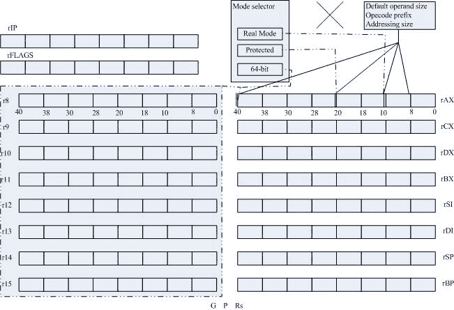
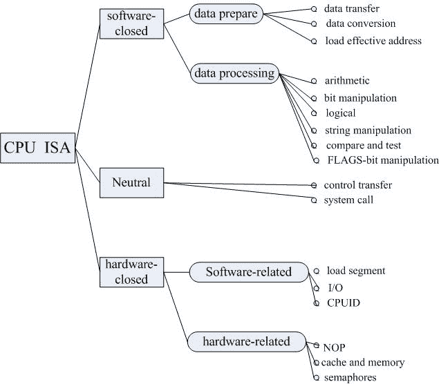
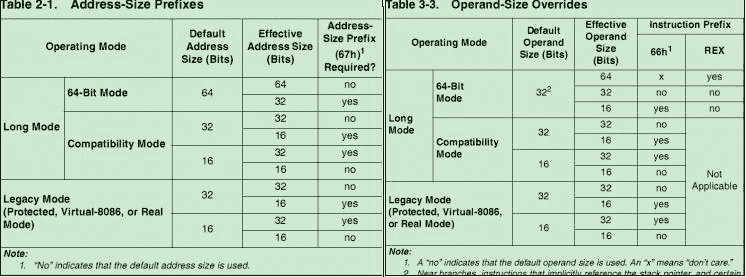
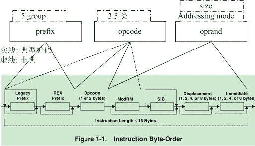

# Newbie 的系统学习历程

> 原文：[`www.pediy.com/kssd/pediy12/98032.html`](https://www.pediy.com/kssd/pediy12/98032.html)

啊，我是新手，没上过什么学，读过一点书，对软件很感兴趣，陆陆续续看了一点计算机方面的书，差不多 1 年半了吧，想了想也应该是时候系统地开始学习了，于是就有了这个小帖。

做事总得有个目标，那我的就应该是找碗饭吃。像名字一样，`need a job`。不过谁雇都无所谓啦，完全没有这个证那个证，那就自己雇自己得了，省得自己付出劳动吃饭都要点头哈腰的，什么玩意，这世道。由于没这个证那个证，"白道"进不去啦，"黑道"我的人生不允许走，那就是"灰道"，别怪我，我没得选择。

再分析下目前的条件，懂点英文，看过几本计算机的 `ebook`，数学没有学过，嗯，条件不算好，脚踏实地慢慢来呗。

那就这样了，我要走计算机灰道，如果有谁看上了，觉得我的技能服务值得买，就买吧，开个好价我就卖。不过应该短期你也看不上，呵呵。

废话到此，`Here I go~`

`********************************************************************`

主帖更新约定：

每天下午 5 点半前结束一天的学习，6 点应该能放上一天的总结，周 1-6 如无意外，定时更新，周日休息。

`********************************************************************`

`##############################`

## 学习规划

`##############################`

计算机这玩意对个人来说过于庞大，这是我这 1 年多时间得出的结论！[](img/afde35a5f3b3a4675abb3221cf07c6d1.jpg "124.gif")，只得先规划一下学习生涯。

我要做的是 `target software DIY`，嗯，先给这行起个名先，`TSDer--target software DIYer`，哈哈！那对 `system developer` 来说，只能最大限度地从 `Hardware` 的终点和 `Software` 的起点开始 `build` 起来，那就是 `CPU` 的 `architecture` 开始了。没有选择的余地，`x86` 架构，这只有这个，而且以后发展决定用 `AMD` 的 `CPU`，便宜又好用，避免以后 `Intel` 来个 `SSE6,7,8` 什么的，又不授权，那我没银子用得起，那得白学了，虽然目前两家还是一样，不过 `I` 记还是少惹为妙，人家是精英，我惹不起躲得起。

平凡的 `needAjob` 计算机学前班正式入学！

教材：`AMD64 Architecture Programmer’s Manual` series----

*   `Volume 1: Application Programming`
*   `Volume 2: System Programming`
*   `Volume 3: General Purpose and System Instructions`
*   `Volume 4: 128-Bit Media Instructions`
*   `Volume 5: 64-Bit Media and x87 Floating-Point Instructions`

学时：不知道，到学成为止

毕业考试：一个 `Assembler`，一个 `Deassembler`，一个 `Debugger`，以上 3 个完成除 `UI` 之外的设计和代码

我的预计学历：`architecture--OS--OS API`

我看过一点这 5 个 `PDF` 文裆，决定按照自己的实际情况稍微调整一下学程安排。好吧，就算开课了，从 `Vol 1` 开始，让我们欢迎亲爱的 `needAjob` 小同学！[](img/afde35a5f3b3a4675abb3221cf07c6d1.jpg "124.gif")[](img/afde35a5f3b3a4675abb3221cf07c6d1.jpg "124.gif")[](img/afde35a5f3b3a4675abb3221cf07c6d1.jpg "124.gif")[](img/afde35a5f3b3a4675abb3221cf07c6d1.jpg "124.gif")[](img/afde35a5f3b3a4675abb3221cf07c6d1.jpg "124.gif")

我的学前班宣言：好好学习，天天向上！[](img/2aa97d64a7e0b211d2f8f207eb382aa7.jpg "酷")

## DAY 1

`VOL 1` 的前 2 章是总结性的章节，跳过，无实际意义，我希望能从零散逐渐堆积起来，从总结看起相当于重复劳动。

进度：`3.1.3` 完结

小结：`x86` 的 `GPPU` (`general purpose programming unit`) 中有 `register` 这种 `module`，它其中的属性有 `size` 和数量。

所有 `instruction` 使用的 `register` 的 `size` 由 `operating mode`，和 `effective operand size` 决定，其中 `effecitve operand size` 的决定因素有 2，1 是 `Default operand size`，另外一个是 `opcode prefix`；

部分 `instruction` 除了以上两个，还由 `addressing size` 和 `stack size` 决定。

`CPU` 能用的 `GPRs` 数量由 `operating mode` 决定，`legacy mode` 和 `compability mode` 有 8 个 `GPRs`，一个 `EIP`，一个 `EFLAGS`

`Long mode` 有 16 个 `GPRs`，一个 `RIP`，一个 `RFLAGS`

要注意的是，`register` 在不同的 `operating mode` 间有重叠现象，`Long mode` 能用的 `GPRs` 还有 `REX prefix` 的因素。

关键字：`size`，`number`

收工，希望有朋友看到错误的话帮忙及时指出，谢谢，为表示感谢以后我也会这样去帮别人。

我发现人脑记图比记 1,2,3,4 厉害多了，所以补张图：



## DAY 2

进度：`3.3.1` 完结

小结：完成 `GPPU` 的 `rFLAGS` 的相关位使用学习，

`1 control bit (DF)+ 4 arithmetic result bits(ZF+SF+OF+CF) + 1 pairity bit(PF)+1 useless bit(AF)`

感觉 `register` 和表达式的描述没太大的关系，和机器相关多一点。以后写 `decompiler` 的时候应该要注意把有关 `register` 的东西全部抽象掉才好。

再有就是 `GPPU` 提供支持的 `Date Type`: `BCD`，`integer`，`unsigned interger`，`string`. 就这 4 样。其他没有硬件支持的必须要全部要 `bit manipulation`。`Date Type` 当然也有 `size` 属性，和 `register` 对应，感觉重复了，没必要理会，在 `opcode` 学习时再细看。

弄清楚了上图的一个地方，就是 `opcode addressing size` 如何决定使用 `register size`，很简单，`immediate addressing` 的时候，嘿~

收获不多，但似乎都弄清楚了。

写了几句 `deassembler` 在数据交互时会用到的代码：

```c
#include "991_my_bit.h"

map<DWORD, string> _b2h_map[4][4] = {
    (0,"00"),  (1,"01"),  (2,"02"),  (3,"03"),
    (4,"04"),  (5,"05"),  (6,"06"),  (7,"07"),
    (8,"08"),  (9,"09"),  (10,"10"), (11,"11"),
    (12,"12"), (13,"13"), (14,"14"), (15,"15"),
    };

inline void _991BinToHex32(DWORD resource, string target) {
    target="";
    const int DWWIDTH=4;
    for(int i=0; i<dwwidth; ++i){
        DWORD tmp=0;
        tmp=NIBBLEMASK & resource;
        int j=tmp>>2;
        int k=tmp&(BIT0 |BIT1);
        target+=_b2h_map[J][K].replace(tmp);
        resource>>=4;
    }
    const int BLOCK=2*sizeof(BYTE);         //2 bytes in the string for each byte in DWORD
    target.swapA(0, BLOCK*sizeof(DWORD)/sizeof(BYTE), BLOCK);
};
```

## DAY 4

休息了一个星期天，打了大半天的 `大航海 2`。星期天是个好东西，大家都应该好好遵重一下她。特别是 `IT` 的，一不小心就瘁死，够吓人的。不过今天不在状态，注意力不集中，老想着找款网游打些生活费，伤脑筋，如果谁有打钱不太累的游戏介绍一下，感激涕零。[](img/d23858dd221cce728a3a61b46badb044.jpg "恐怖!")

进度：`3.3.3` 完结

小结：上一天完成了 `GPPU register` 认识，今天就有它的完结篇，`CPU` 支持的 `data type`，前一天所说的那 4 种 `int`，`UINT`，`string`，`BCD`，以及 `hardware limit` 对这些 `date type` 的影响。比如，为什么 `FLAGS` 的 `SF<>OF` 会导致 `Jcc`，`SETcc`，`CMOVcc` 的 `cc` 条件中的 `L` 和 `NGE`，而当 `SF=OF` 时则相反。思考一下我感觉是很有益的。

完成了 `register` 相关 (也就是 `operand`)，当然就到了 `opcode`。`AMD64` 的指令集有点复杂，我算了下 260 多条，`opecode` 展开的话就更多了。我根据我的感觉，把它们分成了 3.5 类，也就是 3 大类，5 小类。具体又画了张图，



当然，划分不会绝对，2 个极端之间相互融合注定有条桥

比如，`data conversion` 中的 `BSWAP` 指令，涉及 `endian`，这是硬件相关

所有这些指令小类，`I/O`，`control transfer` 和 `system call` 属于复杂指令，这里的复杂是指除了完成本身的功能之外，还涉及到 `CPU` 的各种 `mechanism`，主要是 `hardware protection`。要进一步地深入研究。

今天不在状态，烦~ "凡劳苦担重担的，都到我这里来，我就使你得着安息." [](img/65a46d670c4ac01e17bcc70193b248af.jpg "皱眉")

## DAY 5

进度：第二章，`3.5`，`3.8` 完结

小结：发现学了 `register` 和 `data type` 之后，还有一个很重要的相关内容跳过了，就是 `addressing`，跑回去做了第二章的学习。`addressing` 也有 `size` 属性，还有 `addressing method`，很琐碎的东西，就不多说了。

以前一直搞不清楚为什么有 `instruction` 中有 `addressing size` 还需要 `operand size` 的相关考虑，难道默认 32-bit 的 `addressing` 会要默认 16-bit 的 `operand size` ?? [](img/8665dab461df9ff5e20e52adf9adf6de.jpg "伤心") 今天仔细地看了一下这两个表，结果地理大发现，看图



这两个默认情况下是一致的，也就是 32-bit 的默认就是两个都是 32-bit，反之则是 16-bit。因为这两个的默认同时由 `CS descriptor` 的 `D-bit` 决定。

`instruction` 有了 `opcode`，`oprand`，再加上 `opcode prefix` 就形成一条完整的 `instruction`。`prefix` 有 5 组，也是很琐碎。我把成分成 3 类，`function`，`instrution`，`mechanism`，不是很复杂。

今天空闲时看了一下 `VOL 1` 中剩下的内容，结果发现 `GPPU` 要学完了，剩下 `I/O`，`control transfer` 和一些系统优化相关。决定放弃系统优化，然后把 `control transfer` 并入 `system programming`，也就是 `VOL 2`。所以，今天就提前把相对简单的 `I/O` 指令先完成掉，结果发现 `I/O` 的 `protection` 不难，无非是 `EFLAGS` 的 `IOPL(I/O privilege level)`，`CS` 的 `CPL(current privilege level)` 之间的比较。但由于有涉及 `TSS(task-state-segment)`。一并放入 `VOL 2`。

那还有什么？没了！下一阶段就是 `FPU`，还有 `SSE` 相关内容了。接下来几天做 `GPPU` 阶段复习，顺便开始 `deassembler`，和 `assembler` 的设计。[](img/afde35a5f3b3a4675abb3221cf07c6d1.jpg "124.gif")[](img/afde35a5f3b3a4675abb3221cf07c6d1.jpg "124.gif")

## DAY 8

进度：`VOL 3` 一,二章完结，

`X86 deassembler` 的 `GPPU instruction prefix` 处理代码

小结：这两章的内容部分和前面的重复，还有部分对本书的一些书写约定作说明，用于掌握的信息量不大，主要就是 `X86` 的 `instruction format`。我看完了之后，得出的结论只有一个：只有神经病才会把 `ISA` 设计成这副模样。把 `ISA` 搞得这么复杂不是神经病一般人干不了这活。原来时间和金钱是会把人变成神经病的。[](img/d23858dd221cce728a3a61b46badb044.jpg "恐怖!")[](img/d23858dd221cce728a3a61b46badb044.jpg "恐怖!") 废话到此。

`X86` 的 `instruction format`:



我自己对这图没把握，估计仅仅对 `Legacy Protected Mode` 的 `GPPU` 有效，因为看它把 `X87`，`XMM`，`MMX` 写得很不一样似的，很吓人。我觉得写出这些 `instruction` 有什么相同的特点意义不算太大，不如从零堆积有用。

到些，再说点题外话，一本手册编得这么烂 (大量重复内容，有些图片漏印掉内容，逻辑看起来不清晰)，`AMD` 这么大一公司... 对比起来，让人匪夷所思！而且还是放在 `Developer Center` 的内容。难道钱都拿去打广告了？？还是拿去买 `ATI` 了？？ `AMD` 输给 `Intel`，不无道理，有好几次我都在对照着看 `Intel` 的手册才搞清楚它写的是什么玩意。


今天的 `deassembler` 算是开工了，我在写代码的时候发现一个很严重的问题：在写代码的阶段总是有新的思路，然后这时候不跳回去重新设计，而是直接进行代码级修改。这是极其无效率的行为！初学的应该吸取这样的教训，别把坏习惯留在学习的阶段。虽然只写了几句，不过花了我整个钟头时间。

还有就是我看的一些英文书说能不使用 `global variable` 就不要使用，我不知道中文的怎么写，不过我的经验应该有用，就是：注意 `variable` 的使用范围是不错，不过不要太拘泥，`global` 和 `local` 是个相对的概念。`variable` 的作用范围才是关键。

附代码(未经测试):

```c
/*************************************************
 *
 * purpose:  check the number of prefix,
 *           report all kinds of result,
 *           supply opecode entry point
 *
 * prototype:  int GetPrefix((char*));
 *
 * Local: int i  //i=report state
 *
 * global: char* pOpcode
 *
 * In:  char* pInstrctn
 *
 * Out: state indicator  //0~5 Normal, 6 too much prefix, 7 repeated prefix
 *
 * type-define: enum prefixclass_t
 *
 *************************************************/

/******** For test only**********/
enum prefixclass_t{
    Noprefix, Operandsizepre, Addresssizepre,
    Repeatpre, Lockpre, Segmentpre,
    Error_prefix_repeated, Error_prefix_too_much};
char *pOpcode;
/******** For test only**********/

int GetPrefix(char* pInstrctn)
{
    extern char* pOpcode;
    prefixclass_t tLastprefix=Noprefix;
    int i=0;
    for(;;){
        switch(*(pInstrctn+i)){
        case 66h:                    //66h=Operandsizepre
            if(Operandsizepre==tLastprefix)
                return Error_prefix_repeated;
            else
                break;
        case 67h:                    //67h=Addresssizepre
            if(Addresssizepre==tLastprefix)
                return Error_prefix_repeated;
            else
                break;
        case 0xF3:                   //f3h, f2h=Repeatpre
        case 0xF2:
            if(Repeatpre==tLastprefix)
                return Error_prefix_repeated;
            else
                break;
        case 0xF0:                   //f0h=Lockpre
            if(Lockpre==tLastprefix)
                return Error_prefix_repeated;
            else
                break;
        case 0x2E: case 0x3E: case 0x26:        //all=Segmentpre
        case 0x36: case 0x64: case 0x65:
            if(Segmentpre==tLastprefix)
                return Error_prefix_repeated;
            else
                break;
        default:
            return i;
        }
        i++;
        pOpcode=pInstrctn+i;
        if(i>5)
            return Error_prefix_too_much;
    }
}
```

引用: 最初由 `WuDuPaoPao`发布  这是学前班啊……这难道还是基础不好，我想请问楼主那前两年看的基本 `ebook` 是哪方面的啊……我也参考一下先……

1. `The C++ Programming Language`
2. `The C Programming Language`
3. `Reversing_Secrets_of_Reverse_Engineering`
3. `Programming Windows`
4. `Programming Applications for Microsoft Windows`
5. `Platform SDK Documentation`
6. `Microsoft Windows Internals` (前几章, 越看越不懂了, 停手)
7. `The Art of Assembly Language Programming`
8. `The Essentials of Computer Organization and Architecture`
9. `Data Structures and Algorithms` (粗略地看了下)
10. `operating system principles---PER BRINCH HANSEN` (几章)
11. `Compilers - Principles, Techniques, and Tools 2e -Aho -` (瞄了几眼~)
12. 其他, 比如 `hamming code`, `Run Length Limited code`, `huffman code`, `regular expression`, `TCP/IP` 杂七杂八什么的.

排名不分先后, 主要就是多看点, 找到自己真正喜欢的是什么, 最遗憾的是没有看过计算机图形学和其他多媒体处理, 数学没学过, 等数学入了门再看吧

加油吧, 静下心来会比这看得多的, 我大部分的时间都拿来在网上发牢骚了, 很可惜.

### DAY 16

好久没能更新了，最近家里发生了一些事，烦着，不过还好，人还支持得住，也没忘学习。

以前没系统地写过大一点的程序，觉得自己语言过关，写那些不过是简单地重复劳动，结果不是这样的。我碰到了很多的问题，比如，经常修改设计，算法，甚至是数据结构。。。还有对付 `BUG`，有时还要全部推倒。我看软件工程的整个流程都要掌握才能避免一些低级的重复的劳动。

还有很多想说，不过说多了也没用，需要自己亲自体会，这几天还得再对设计进行评估，前几天的努力又给 `BUG` 掉了，惨~~

`PS`: 我是体会到自己努力的心血被盗将是怎么样的一个心境了，所以以后学成，我一定不能去破解人家的软件，觉得贵可以用正当竞争的方式去解决问题，不能用旁门左道。这话一说出来，我的盗版 `XP` 就是该换掉了。
