# 【分享】Crack 之初体验-第一课

> 原文：[`www.pediy.com/kssd/pediy12/143858.html`](https://www.pediy.com/kssd/pediy12/143858.html)

PS: 写给超级无敌还在门外的小菜鸟的入门教程，高手请自动飘过。

Crack 之初体验系列[[-第二课](http://bbs.pediy.com/showthread.php?t=143948)]-[第三课](http://bbs.pediy.com/showthread.php?p=1028413&posted=1#post1028413)

这段时间确实过得挺无聊空虚寂寞的，知道该干什么，但就是不想去干（PS：我还有救吗？），于是乎，闲得慌啊，于是乎，昨天下了一个愤怒的小鸟 PC 版（游戏开发者别来找我哈，我就小小地破解了你们的游戏而已。。。）来玩，游戏挺大的，30 多兆，当然可想而知，要么是关卡多，要么是游戏画面做得精致，后来玩了下，体验还不错。

然后我就高高兴兴地愤怒了，打得那些猪头无还手之力啊，一路过关斩将，勇猛无敌，那叫一个潇洒啊。但是到第二大关的时候就卡住了，因为那是一个共享软件（就是可以试玩，但是想得到全部关卡或者以后一直都可以玩的话，就得付费），况且那个软件是老外开发的，就算我想付费，还得付美元，还不知道怎么给人家兑过去，一怒之下，`CRACK` 之！

PS: 大家如果既木钱又木技术，最好下载软件的时候看清楚，软件按收不收费分为几类：

1. 免费软件。这个就不介绍了吧，随便用那种

2. 共享软件。就是可以试用，但最终人家还是想要你的钱滴。。

3. 商业软件。这个就是看一眼都要钱的那种。。。。。哈哈，吓你们的，没那么抠门哈。

那么什么是 `CRACK` 呢？翻译成四川话就是破解（普通话也一样！。。。）。别以为这个很高深哈，其实有些很简单的，比如刚刚我提到那个游戏，几整几不整就破解了，呵呵。

话说大家经常遇到的软件收费都是以什么形式呢？

我想估计大家遇到的情况都差不多。一个软件，比如，稍微大一点的软件如 `photoshop`，`office2010`，工程上的 `UG`, `ProE`，`AUTOCAD`, `3DMAX`，当然大家知道的最大的软件莫过于 `Microsoft Windows`，这也算软件吧，也是要钱的，为什么大家安装的 `win7`, `win8`，`win9`，`win10` 没收费呢，其实这个费用要么就是包含在电脑费用里了，要么就是你们用的盗版（其实我用的也是盗版 `win7`，比尔盖茨别找我哈。。。），相信大家对盗版这词不陌生吧。

那么比如正版 `windows` 吧，安装完以后要干嘛啊？不是上网，而是输入从某某地方得到的序列号。再比如 `Microsoft office2010` 吧，试用 30 天，30 天一过你要是不拿钱出来，就不能用了。比如 `photoshop` 吧，也是安装完成后就得输入序列号。。。。。。等等等等

我怎么觉得废话有点多啊。没事，这个算是我自己的学习笔记，也能姑且作为完全新手入门教程吧，如果大家有此方面的意愿，就让我们一起进步吧。

PS：我是菜鸟，大白菜的菜。

刚刚说到大多数软件向你要钱都是通过要求你输入序列号这么个方法的，那么序列号从哪儿得来呢，那当然是你把钱给别人打过去，人家就把序列号 `EMAIL` 给你，一手交钱，一手交货。完事之后你把得到的序列号一输进软件激活那个框框（PS：我是四川人），然后软件就成功激活了，你以后一直都可以用了。（当然，前提是你得找得到那个输入序列号的框框，并且完整无误地输入了人家给你的那个序列号）

那么，问题就来了，如果你发现这个软件还真不错，过了试用期还想用，但是又没钱（其实不是没钱，大多数时候是觉得麻烦），怎么办呢？

解决办法如下：

1. 到网上搜索序列号（或者叫注册码，激活码），一般能搜到很多很多，但有些可以用有些不可以用，接着一个个地试，直到激活成功为止。

2. 直接重新下载破解版。这个大家不陌生吧，基本所有要钱的软件都会在网上有破解版，破解版的意思就是说：这个版本已经破解了，不会再收费了。但是同时问题也随之而来，是谁破解了这个软件？他为什么要破解这个软件？他用了那么多精力去破解，难道他一点利益都不想捞？所有大家经常遇到的问题就是破解版的软件里会有大量的广告，甚至病毒、木马。那这个软件还能放心用吗？PS：不是所有的破解版都是这样，我只是说有一些。。。

3. 等待免费版到来。这个办法还是可行的，就像 `iphone4` 刚刚开始卖的时候要一万多，过半年一年就值不了几百块钱了（这个叫夸张手法，汗。。。），软件也有其生命周期，潮流一过，说不定人家就免费了呢，大家坐等吧。。。。海枯石烂，永不变心。（言情看多了吧你？？？）

4. 自己 `crack` 吧。这个不过多介绍，等会儿警察叔叔请我去喝茶就不好了。

那么什么是 `crack` 呢？我先百度一下哈。恩，以下是百度上 copy 过来的。

引用: `crack`, 最直接的意为钥匙、破解意，`cracker`, 破解者

`CRACK` 这个名词很容易和 `HACK` 混淆，但是许多人不理解 `CRACK` 这个东西，但是接触过软件破解的人一定了解这个词 `CRACKER` 分析下就是软件破解者的意思（注意这里有多了个 `ER`），许多共享软件就是我们的 `CRACKER` 来完成破解的，就是现在俗称的 `XX` 软件破解版

许多程序员写的作品 都会被 `Cracker` 破解 程序员也会写一些 `CrackMe` 来练习破解 (`CreackMe` 就是破解我的意思)

这个解释很清楚明了吧，不用我多说了吧。

下一个问题，如何 `crack`？

首先申明，这是一门技术，而且永无止境，加密与解密从来就是你缠我打，一直没停过。所以，我们需要从基本功开始练习，然后慢慢地向高端发展。有人说，学这个干嘛啊，网上都已经有那么多人在做破解，何必费力呢，等等就是了？

其实这是有好处的，这个技术学好了，相信你对计算机就已经相当了解了，对安全方面的问题也会有认识，也可以从事正当的行业，比如安全顾问，安全工程师，密码设计师，计算机安全维护。。。。。。这个我胡吹的哈，呵呵，反正如果你觉得这个值得学习，那就学吧，不懂行的怎么解释也是枉然，是吧？

好，让我们菜鸟起航吧。

接下来，我会用一个超级简单的例子来慢慢讲解 `crack`！

首先，需要什么工具？很简单。

1. 一台电脑，`windows` 系统（玩 `linux` 的家伙请绕道）；

2. 一个人；

3. 一个软件，名字叫 `OllyDBG`, 最新版本好像是 `2.01`，嘿嘿，我用得还是 `1.01` 版，如果大家下载的 `2.01` 版不好使，那就还是用 `1.01` 版吧，记得下载中文版，如果你用英文版的没问题我也不强求，如果网上找不到，mail 我。

开张工作大概就只要这些东西，以后肯定会用到更多的东西，等以后接触到的时候咱们再介绍，免得说多了吓到你们。

你们安装 `OllyDBG` 吧，我休息会儿。。。。。

额，我相信你们把 `OllyDBG`（以后咱们都简称为 `OD`，记住！！！）都安装好了吧。`OK`，先来了解一下 `OD` 这个软件。

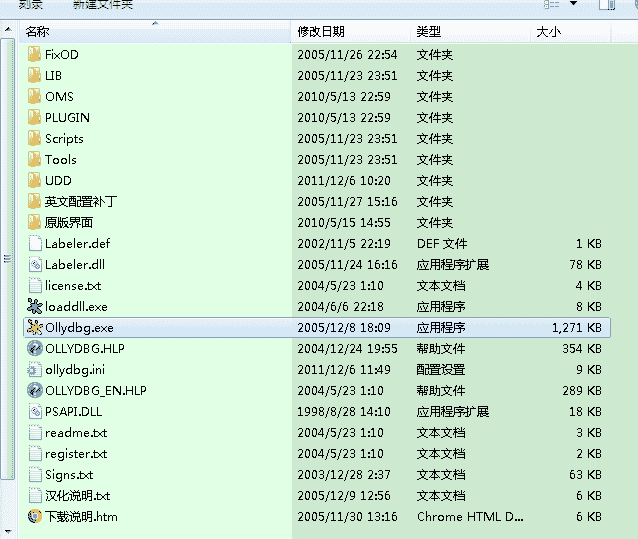

图 1. 我电脑上 `OD` 安装完成以后的文件夹

好了，我们开始使用这个东东吧。双击 `Ollydbg.exe` 启动。

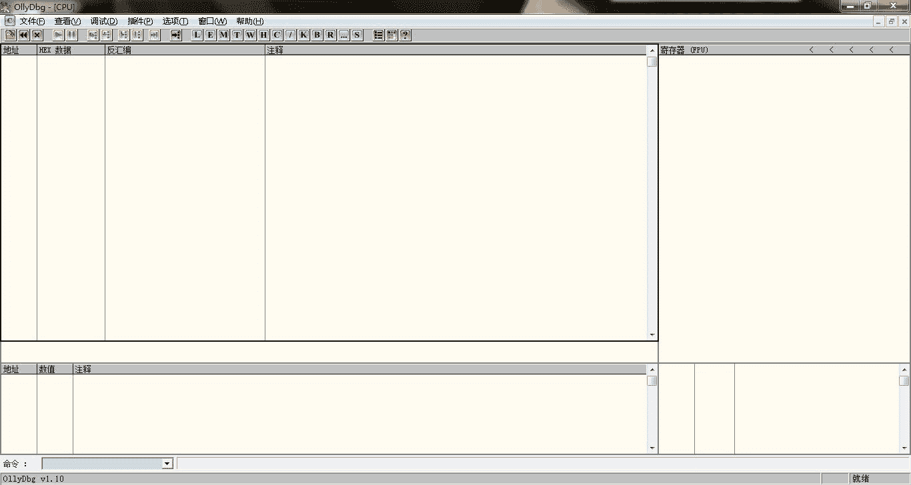

图 2. `OD` 启动后的样子

怎么全是白框框？？？？呵呵，就是这个样子的

额，由于本人不擅编辑，`OD` 的教程还是推荐大家到看雪论坛（http://bbs.pediy.com/showpost.php?p=514664&postcount=2）看吧，那儿很讲得很清楚。

大家先去那儿看看吧，看完再回来。 我先  。。。。

---------------------------------------------------------------------------------------------------------------------------------------------------------------------------------

`OK`, 我相信你现在对 `OD` 这个软件已经有了初步的了解，如果还觉得不够了解，那继续百度 google 吧。要相信，这只是一个软件，学软件不难的。

好吧，人生第一个 `crackme` [点击下载](http://115.com/file/aqotqym8)

把这个小白鼠下载下来。随便找个地方放着，桌面也行，一般我都把桌面当屠宰场。。。。

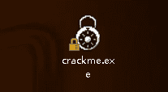

`OK`。就是这个家伙了，至于为什么我这个图标上有一个锁的标志，我表示我也不是很清楚，只知道我昨天对系统做了点小动作，有谁知道怎么去掉这个锁的麻烦告诉我一声，谢谢。

好，开工！

首先，运行一下这个小白鼠，开它有什么反应，如果有关于（about）、帮助（help）等，翻开看看，点击各个按钮，看下有什么反应

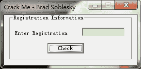

偶，相当简单的一个 `crackme`，上面有作者的名字：`Brad Soblesky`，我表示，这人我不认识。然后下面叫我们输入注册码（Enter Registration），然后有一个输入框，那个框框就是要输入注册码的地方，输完以后点击一下 `check`，就知道输入的注册码对不对了。

`OK`，先随便输入点什么看看吧。就输入 `iloveswu` 吧

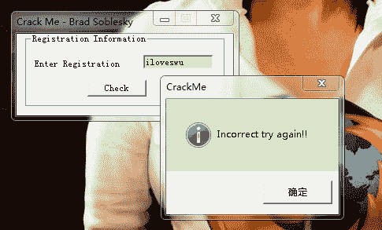

恩，看到了吧（别看后面，人家害羞嘛），我随便输入然后点击 `check` 就弹出了一个对话框，大概意思明白吧，就是“输错了，再试试”。那大家想知道正确答案是什么吗？我也想知道，可是谁知道呢？

这个小白鼠的名字叫 `crackme`，当然是叫我们破解它，正确答案肯定不会是 `1234567` 了。。。不信你试试。

`OK`，这个 `crackme` 就是这么简单，没有多余的事情可做，那，就只能 `crack` 了。

本来我们应该先查查它加壳没有的，但是鉴于这是个新手教程，加壳脱壳的事情咱以后慢慢学，所以这一步就跳过了，我检测过了，它没加壳，编写语言是 `Microsoft Visual C++ 6.0`。

----关于什么是壳，为什么加壳，怎么加壳，怎么脱壳这些问题，如果你认为前面的东西你都弄懂了，你可以自己去了解一下。

然后我们怎么来破解它呢？那就要用到刚刚提到的那个叫 `OD` 的软件了，怎么样，第一次用这个软件感觉还好吧？大家没有神经错乱，大小便失禁吧？呵呵，开个玩笑，继续！！

PS: 大家以后做多了这些事，肯定不希望每次都先去启动 `OD`，再在菜单中打开文件，因为麻烦啊，所以教给大家一个小技巧。首先打开 `OD`，找到选项->添加到浏览器

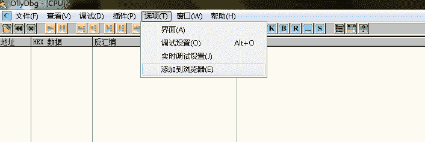

打开之后看到这个：然后点击添加 `OllyDbg` 到系统资源管理器菜单（其实也就是右键菜单），然后点击完成。

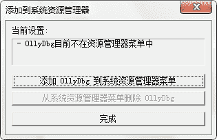

然后在任意可执行程序上点击右键，看见了那个“用 `OllyDbg` 打开”了吗？对了，这样就方便多了，不用每次都要去先启动 `OD` 了。

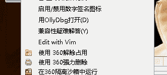

当然，还有一个小窍门要告诉大家。以后会用到很多工具，什么乱七八糟的工具一大把，如果每个工具都在右键菜单占有一个，可想而知，你那个右键菜单得多长啊，还有就是很多工具还不会让你添加右键菜单，那么就要用到 `windows` 提供的一个“发送到”功能了。就是这个。

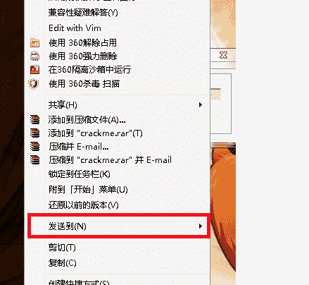

比如以后会用到一个查壳的工具叫 `PEID`，把这个 `PEID.exe` 的快捷方式放进去，要查壳的时候只需在程序上右键->发送到->`PEID.exe` 就行了，很快捷吧。那么如何把这个快捷方式添加进去呢？方法如下：创建程序的快捷方式，比如

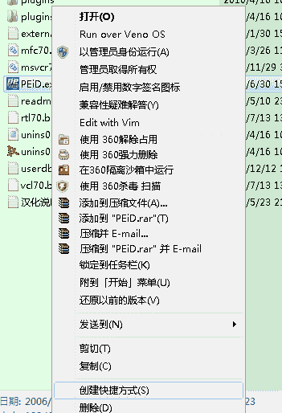

然后把这个快捷方式放到 `C:\Users\Administrator\AppData\Roaming\Microsoft\Windows\SendTo` 这个文件夹下面，其实那里面已经有几个系统默认的，比如什么传真啊，桌面快捷方式啊，压缩文件啊之类的。没用的东西果断删掉，比如传真，你会用到吗？这个路径是 `win7` 下面的，`xp` 的路径自己百度，我也不知道相不相同。要找到这个文件夹你首先得把隐藏文件的选项关掉，这个不至于不知道吧？

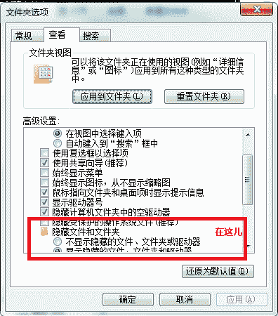

现在我假设你把 `OD` 的快捷方式已经拉到了 `SendTo` 这个文件夹里面，`OK`，现在再在刚刚那个小白鼠上点击右键->发送到，看到 `OD` 的快捷方式了吧，用力地点击一下，这个小白鼠就被 `OD` 载入了。

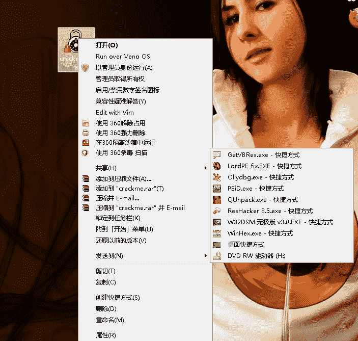

载入后就是这个样子吧，你们的跟我的一样吧？。。。。。

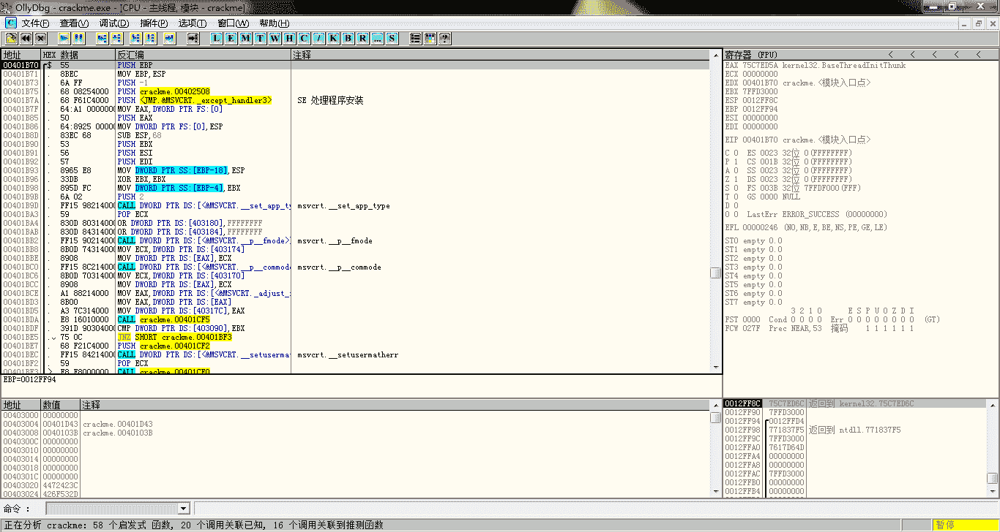

哇，这次那几个白框框里终于有东西了。

现在，我们主要关心的就是左上角这个大框框了，它的名字叫反汇编窗口，意思就是这个程序已经被反汇编了，代码都在那儿呢，你们看得懂的看看吧，什么 `PUSH`, `MOV`, `XOR`, `CALL`, `POP`, `OR` 这些指令，见过吧？额，好像在梦里见过。。。。

-------问：为什么程序能够被反汇编？

-------答：通常，编写程序是利用高级语言如 `C`，`pascal` 等高级语言进行编程的，然后再经过编译程序生成可以被计算机系统直接执行的文件（机器语言）。反汇编即是指将这些执行文件反编译还原成汇编语言或其他高级语言。但通常反编译出来的程序与原程序会存在许多不同，虽然执行效果相同，但程序代码会发生很大的变化，非编程高手很难读懂。

---------一句话解答：因为二进制程序的机器码与汇编代码一一对应，既然能编译过去，就能反编译回来

`Ok`，我相信大多数能够看到这里的同学对汇编还是有一定了解的，那我就不多废话了。

回答正题上，如何破解这个小白鼠？

鉴于很多新手同学最开始学习的时候头脑中并没有什么实质上的概念，所以，我觉得先把方法教给大家，让大家自己去品味为什么要这么做，而不是那么做。

首先，在反汇编窗口中右键，找到这个超级字串参考+(U)->查找 `ASCII`，如果是中文，就查找 `UNICODE`，道理自己去搜索。

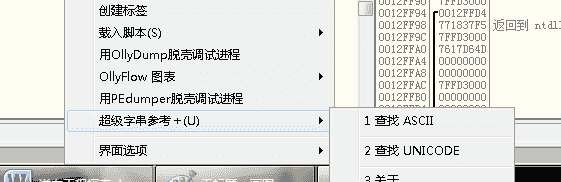

或者下面这个也行，查找->所有参考文本字串。上面那个是 `OD` 的插件实现的功能，下面这个是 `OD` 自带的功能。相比来说，上面那个更牛 B，更高级，推荐用“超级字串参考”

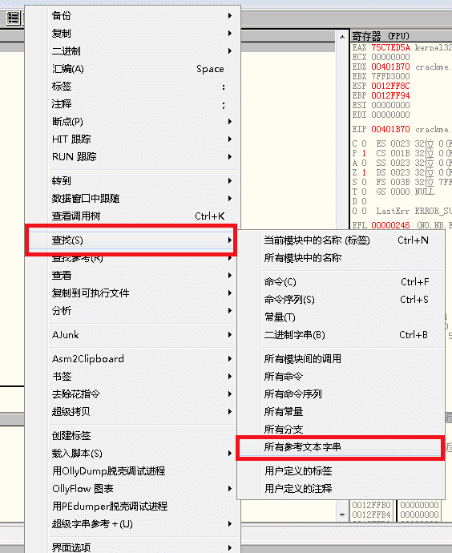

打开以后就看到了下面这个画面：

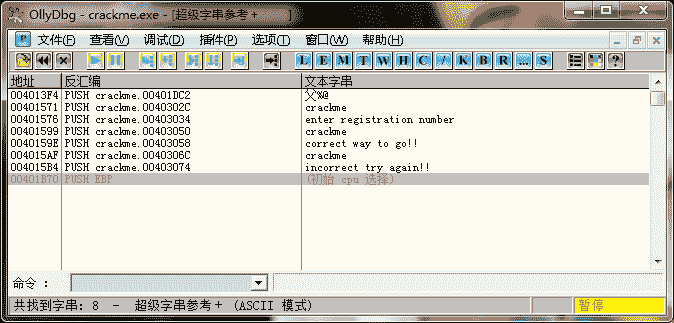

这次，英文再不好也认识那几个单词吧，“`incorrect try again!!`”这不是刚刚程序弹出来那个错误提示框上面的句子吗？

往上面看，有一句 `correct way to go!!` 明显就是说如果输入的注册码正确了，就会弹出一个对话框，里面写有一句“`correct way to go!!`”

`Ok`。我们在“`correct way to go！！`”这句上双击，然后就回到了反汇编窗口，并且光标停留在了一条语句上。这条语句就是出现了 `correct way to go` 的那条语句。

鼠标滚轮向上滚几行，然后，看到了吧，这个小白鼠的五脏六腑都尽在我们眼底，马上我们就来弄清楚它是怎么工作的。

其他的语句都不用管，就看和 `correct`、`incorrect` 这几条语句有关的代码。

```
代码:
```


```
0040156F  .|   6A40           PUSH 40

00401571  .|   682C304000     PUSH crackme.0040302C               ; crackme

00401576  .|   6834304000     PUSH crackme.00403034               ; enter registration number

0040157B  .|   8B4D E0        MOV ECX,DWORD PTR SS:[EBP-20]

0040157E  .|   E87B050000     CALL <JMP.&MFC42.#4224_?MessageBoxA@CWnd>

00401583  .|   EB3C           JMP SHORT crackme.004015C1

00401585  |>   8D4D E4        LEA ECX,DWORD PTR SS:[EBP-1C]

00401588  .|   51             PUSH ECX                              ; /String2

00401589  .|   8D55 F4        LEA EDX,DWORD PTR SS:[EBP-C]          ; |

0040158C  .|   52             PUSH EDX                              ;|String1

0040158D  .|   FF15 00204000 CALL DWORD PTR DS:[<&KERNEL32.lstrcmpA>] ;\lstrcmpA

00401593  .|   85C0           TEST EAX,EAX

00401595  .|   7516           JNZ SHORT crackme.004015AD

00401597  .|   6A40           PUSH 40

00401599  .|   6850304000     PUSH crackme.00403050                 ;  crackme

0040159E  .|   6858304000     PUSH crackme.00403058                 ;  correct way to go!!

004015A3  .|   8B4D E0        MOV ECX,DWORD PTR SS:[EBP-20]

004015A6  .|   E853050000     CALL <JMP.&MFC42.#4224_?MessageBoxA@CWnd>

004015AB  .|   EB14           JMP SHORT crackme.004015C1

004015AD  |>   6A 40          PUSH 40

004015AF  .|   686C304000     PUSH crackme.0040306C                 ;  crackme

004015B4  .|   6874304000     PUSH crackme.00403074                 ;  incorrect try again!!

004015B9  .|   8B4D E0        MOV ECX,DWORD PTR SS:[EBP-20]

004015BC  .|   E83D050000     CALL <JMP.&MFC42.#4224_?MessageBoxA@CWnd>

004015C1  |>   8BE5           MOV ESP,EBP

004015C3  .|   5D             POP EBP

004015C4  .\   C3             RETN
```

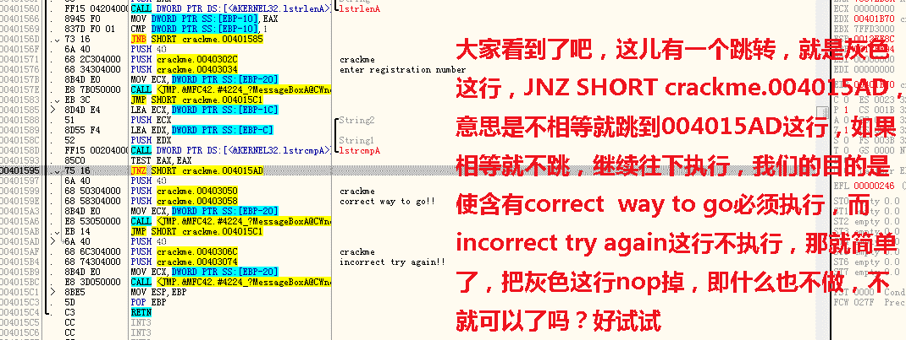

Ok，现在，双击 `00401595 .| 7516 JNZ SHORT crackme.004015AD` 这行，出现一个对话框：

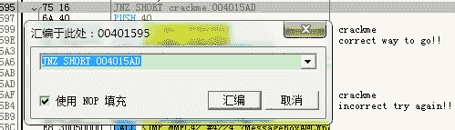

然后，将里面的语句改成 `NOP`，然后点击“汇编”按钮，其实这儿还有很多种方法，比如将 `JNZ` 改成 `JE`，也就是置反，但是这样改的话等到你输入了正确的验证码却会出现错误的提示，输入错误的验证码就提示正确，所以算不上 `100%`破解，万一你脑子进水输入了正确的那个验证码呢？另外还可以随便改，只要不把程序改崩溃，我们的目的只有一个，就是运行那段提示 `correct way to go` 的程序段。

处理过后，代码就变成了这个样子：

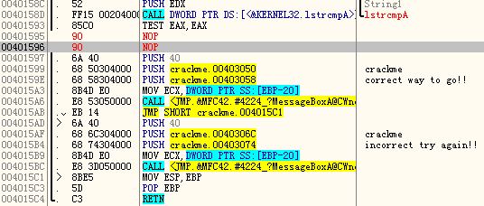

那这样改后程序还能工作吗？我们来试一试。在反汇编窗口右键->复制到可执行文件->所有修改

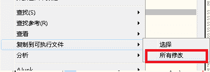

然后点击全部复制：

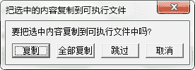

然后会弹出一个窗口，在窗口中右键->保存文件，另取一个名字把这个文件保存下来。以后如果要保存修改过的文件都是这么操作的，大家记住就是了。

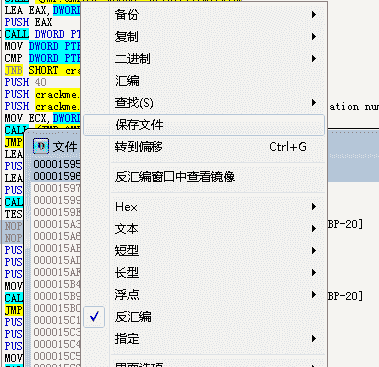

保存好以后，怎么变种了？图标怎么变成骷髅啦？太神奇了？难道是我把程序搞错了，不是吧，赶紧打开刚刚保存的 `crackme1.exe` 看看！

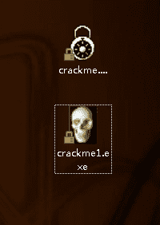

诶，还是刚刚那个啊？？试一试，随便输入点什么，还是比如 `iloveswu` 吧

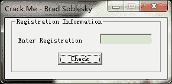

输入后 `check` 下：

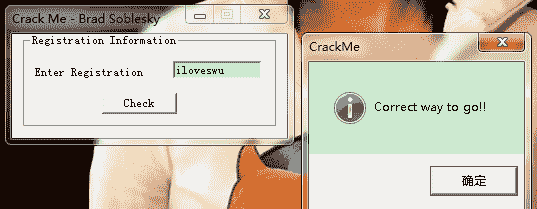

瞧，对了吧，`Correct way to go!!`

这也验证了我们前面的假设：弹出一个对话框，里面有一句 `Correct way to go!!`

说明我们已经成功把这个小白鼠从男性变成女性！！！至于为什么程序的图标会从一把锁（还是时钟？？？）变成一个骷髅，以后等我弄懂了再来告诉大家。

呵呵，刚刚讲了那么多，不知道大家能看进去多少，反正我是手指打字都打酸了。

刚刚给大家讲的方法其实是“暴力破解法”，现在给大家讲讲破解方法的分类

一般按破解的程度分为：

1. 暴力破解。也就是刚刚我给大家演示的那种。
2. 完全破解。

暴力破解，顾名思义就是暴力修改程序的代码来达到破解的目的，这种破解方法最直接，最有效。比如找到程序的启动代码，直接将验证注册那段程序跳过，你们想这软件的启动时间是不是也相应地减少了啊（虽然感觉不出来。。。）？或者在验证即将开始的时候直接一个大跳跳到验证成功那儿去，那多霸气啊，就像把娃生了再去见丈母娘一样，很爽吧！

不过这种暴力破解的方法我只推荐大家初学的时候用用，到后面了应该精益求精，力求完全破解。

所谓完全破解，当然是指在不改动原程序代码的同时能够破解它，比如我们后面会讲到的弄清它的注册码的运算公式以及运行机制，然后写出注册机，不管你怎么变，注册机一算就算出来了。顺便提一下注册机，其实注册机就相当于一个计算器，又或者一个函数，你给定参数（用户名啊之类的需要用户提供的），它算出结果（注册码根据用户提供的参数计算出来的），但是我们刚刚那个例子没有要我们输入参数啊，对，那个参数就叫 `NULL`。

注册机----只是为了减少人的劳动力、并且使传播变得容易 而诞生的。

好了，今天的课就讲到这儿，下一次课我们仍然讲这个小白鼠（啊，不要扔转头。。。）。

当然了，下次的课更高级，我们将学习完全破解，而不是暴力破解它，男人嘛，要学会绅士一点，偶尔暴力下是可以的。。。。。。并且写出注册机（至少把运算代码写出来），抱歉，我不知道我还记不记得怎么用 `vc++`。。。。。。已经几年没摸过了
