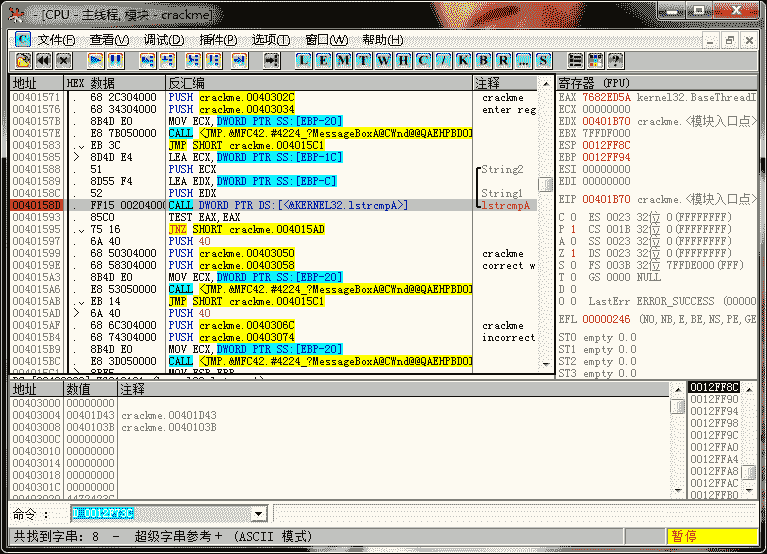
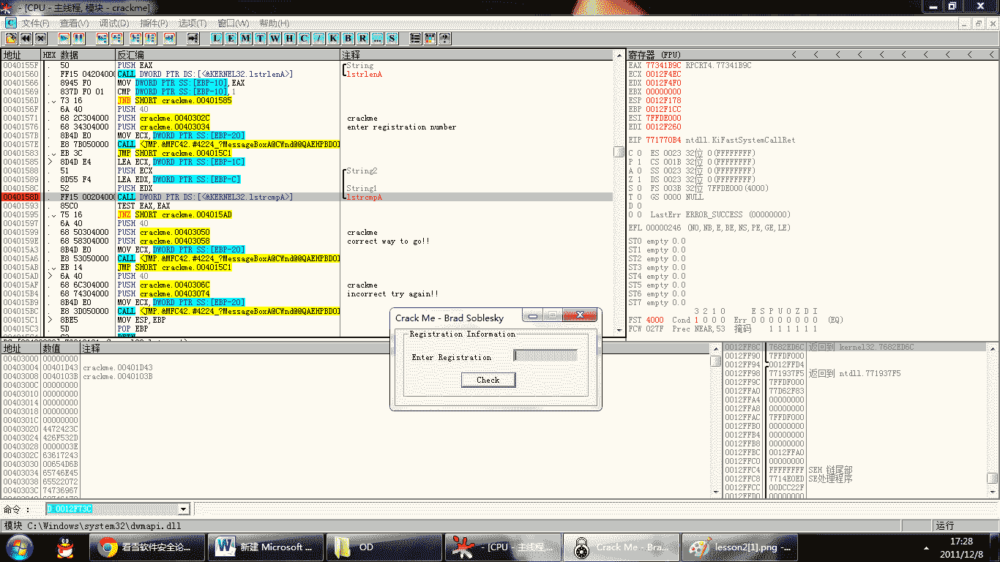
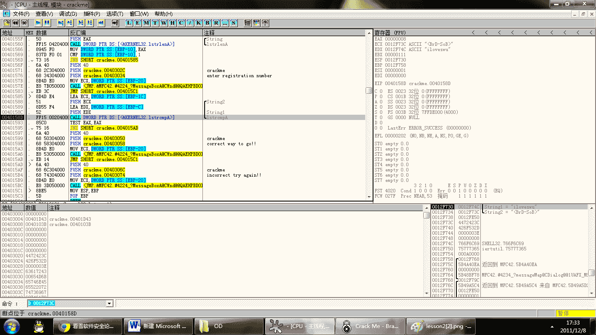
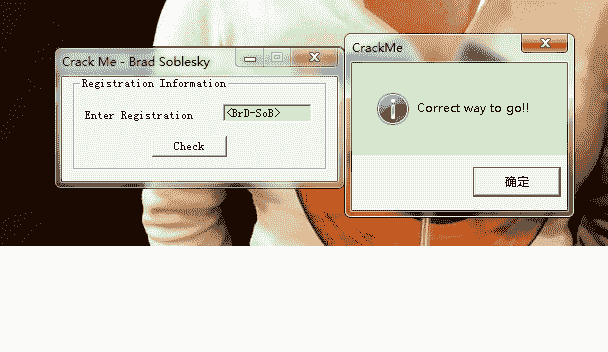

# Crack 之初体验-第二课

> 原文：[`www.pediy.com/kssd/pediy143948.html`](https://www.pediy.com/kssd/pediy12/143948.html)

`Crack` 之初体验-第一课链接：`http://bbs.pediy.com/showthread.php?t=143858`

`Crack` 之初体验-第三课链接：`http://bbs.pediy.com/showthread.php?t=144053`

引用: 在开始第二课之前，先讲个大家都很熟悉的事吧。

小学的时候，老师告诉我们，3-5 是没有结果的，因为小的数字不可以去减大的数字。但是后来学了负数了，老师告诉我们，其实 3-5 是有结果的，结果等于-2.

初中的时候，老师告诉我们，负数是绝对没有平方根的，因为这世界上没有哪一个数的平方会等于负数。但是后来学了虚数，老师告诉我们，其实负数也有平方根，比如-1 的平方根就等于 `i`。

后来，我们又得知，0 是不能够做分母的，因为任何数除以 0 都不会有结果。但是后来这个结论又被高中老师推翻了，因为任何数除以 0 其实是有结果的，其结果等于∞。

所以，大家看了以上文字以后得出的结论是什么呢？

呵呵，大家的结论也许千奇百怪，但是我最终要扯到今天的课程上来，所以，我的结论就是：当我们在学习知识的时候，并且正在一步一步往上爬，一步一步学习更高深的知识的时候，为了减少学习难度，为了不让初学的人看到那么多难题而打退堂鼓，我们可以先假设一些“错误的”结论，等到学得更多了，知道更多了，再回头来推翻它。

所以，作为给新手级别的入门教程，我会对一些问题进行回避，可能会发表一些“错误的”言论，以尽可能地降低大家的学习难度，让大家能信心百倍地学习。

如果有大神不吝光临寒舍，并且发现了这些错误，请不要恶语相加，也不要滔滔不绝讲述其原理，如果您认为这个问题确实不容忽视，确实觉得就算是作为菜鸟也不能犯这样的错误，那么请指正出来。另外一种情况是：因为本人也是菜鸟，除了那些故意犯的错误，也难免会真真正正地犯错误，如果您发现了这种不是本人故意犯的，而是确实是由于本人水平有限而犯的错，请一定要告诉我，谢谢！

好，开始

鉴于众位专家评审团一致认为上一篇文章（[Crack 之初体验-第一课](http://bbs.pediy.com/showthread.php?t=143858)）言语累赘，读之太累，俗称 B 话太多，所以这篇文章我会尽量少说点话。但是我看了各位的评论，还是有很多人（当然，基本是菜鸟）认为说仔细点好，因为他们刚刚接触这个东西，很多地方都不懂，所以我也认为能说详细点就说详细点。但是，这节课我再说得详细，也不可能再做那种：让你把 `OD` 添加进右键菜单还给你截个图这种傻事。大家既然都看了我讲得第一节课了，对 `OD`，对各种操作应该还是有一定了解了，以后这种事情我最多是把步骤贴出来，具体位置大家自己去找。比如，我让大家把 `OD` 调试设置里面的异常全部忽略，你就不要来问我这个设置在哪儿，从哪儿打开这种问题。

OK。这回真的开始了！

上一节课我们讲了一些关于 `CRACK` 的基本知识，以及通过一个简单的例子稍微了解了一下 `crack`。这节课我们将更深入地来学习。所有需要的知识我都不会先讲，都是在要用到的地方才讲，免得大家看了又忘了。还有，任何事情你看到别人做觉得很简单，但是正当自己要做的时候却感觉无从下手，所有呢，动手，多练“左右互博”，呵呵

上节课我们把那个小白鼠（[点击下载](http://115.com/file/aqotqym8)）的五脏六腑都搞乱了，话说暴力破解（以后我们都简称爆破）真的很暴力，但我们又岂能满足于爆破呢？所有这节课我们来点有高科技含量的破解技术。

首先，把这个小白鼠用 `OD` 载入。`OD` 的主界面不是有四个大框框吗？上一节课我们只用到了左上角那个反汇编窗口，其他窗口正闲得蛋疼呢，所有今天我们将用到右上角这个窗口，它的名字叫“寄存器窗口”。

话说，寄存器是什么？说到寄存器，话可就多了去了，不过我们今天只讲我们将用到的几个寄存器，学名“通用寄存器”，一般我们就叫它寄存器，下面是百度上抄来的。

引用: 通用寄存器

顾名思义，通用寄存器是那些你可以根据自己的意愿使用的寄存器，修改他们的值通常不会对计算机的运行造成很大的影响。通用寄存器最多的用途是计算。

`EAX`：通用寄存器。相对其他寄存器，在进行运算方面比较常用。在保护模式中，也可以作为内存偏移指针（此时，`DS` 作为段寄存器或选择器）

`EBX`：通用寄存器。通常作为内存偏移指针使用（相对于 `EAX`、`ECX`、`EDX`），`DS` 是默认的段寄存器或选择器。在保护模式中，同样可以起这个作用。

`ECX`：通用寄存器。通常用于特定指令的计数。在保护模式中，也可以作为内存偏移指针（此时，`DS` 作为寄存器或段选择器）。

`EDX`：通用寄存器。在某些运算中作为 `EAX` 的溢出寄存器（例如乘、除）。在保护模式中，也可以作为内存偏移指针（此时，`DS` 作为段寄存器或选择器）。

上述寄存器包括对应的 16-bit 分组和 8-bit 分组。

简单点说，这几个寄存器就相当于系统预定的几个变量，你可以拿它们来储存数据，可以读取它们里面所包含的值，也可以给它们赋值。只是，对于我们初学者来说，只要知道它们存在，并且程序在运行的过程中会把一些数据（比如我们要找的注册码）储存在里面就行了。

还有呢，在这个寄存器窗口中，你会看到除了 `EAX`,`ECX`,`EDX`,`EBX` 这几个之外的其他一些东西，我们暂时不管，只看前面那 4 个。如果这个寄存器中的值变化了，表明上一条运行的语句改变了它的值，这个不难理解吧，只要它变化了，它就会变红（害羞了还是怎么的？？？）。

OK，我们再来看看小白鼠那几行关键的代码：（大家不会找不到了吧？赶紧翻翻上一课，看看我们如何才能找到这几句关键代码所在的位置）

代码:

```
0040155F  .  50            PUSH EAX                                ; /String
00401560  .  FF15 04204000 CALL DWORD PTR DS:[<&KERNEL32.lstrlenA>] ; \lstrlenA
00401566  .  8945 F0       MOV DWORD PTR SS:[EBP-10],EAX
00401569  .  837D F0 01    CMP DWORD PTR SS:[EBP-10],1
0040156D  .  73 16         JNB SHORT crackme.00401585
0040156F  .  6A 40         PUSH 40
00401571  .  68 2C304000   PUSH crackme.0040302C                   ;  crackme
00401576  .  68 34304000   PUSH crackme.00403034                   ;  enter registration number
0040157B  .  8B4D E0       MOV ECX,DWORD PTR SS:[EBP-20]
0040157E  .  E8 7B050000   CALL <JMP.&MFC42.#4224_?MessageBoxA@CWnd>
00401583  .  EB 3C         JMP SHORT crackme.004015C1
00401585  |>  8D4D E4       LEA ECX,DWORD PTR SS:[EBP-1C]
00401588  .  51            PUSH ECX                                ; /String2
00401589  .  8D55 F4       LEA EDX,DWORD PTR SS:[EBP-C]            ; |
0040158C  .  52            PUSH EDX                                ; |String1
0040158D  .  FF15 00204000 CALL DWORD PTR DS:[<&KERNEL32.lstrcmpA>] ; \lstrcmpA
00401593  .  85C0          TEST EAX,EAX
00401595  .  75 16         JNZ SHORT crackme.004015AD
00401597  .  6A 40         PUSH 40
00401599  .  68 50304000   PUSH crackme.00403050                   ;  crackme
0040159E  .  68 58304000   PUSH crackme.00403058                   ;  correct way to go!!
004015A3  .  8B4D E0       MOV ECX,DWORD PTR SS:[EBP-20]
004015A6  .  E8 53050000   CALL <JMP.&MFC42.#4224_?MessageBoxA@CWnd>
004015AB  .  EB 14         JMP SHORT crackme.004015C1
004015AD  |>  6A 40         PUSH 40
004015AF  .  68 6C304000   PUSH crackme.0040306C                   ;  crackme
004015B4  .  68 74304000   PUSH crackme.00403074                   ;  incorrect try again!!
004015B9  .  8B4D E0       MOV ECX,DWORD PTR SS:[EBP-20]
004015BC  .  E8 3D050000   CALL <JMP.&MFC42.#4224_?MessageBoxA@CWnd>
004015C1  |>  8BE5          MOV ESP,EBP
004015C3  .  5D            POP EBP
004015C4  \.  C3            RETN
```

OK，大家注意右边的注释，就是在“;”后面的那些文字。我们来一行一行地分析这些代码的含义。

讲之前，我先简单介绍一下在汇编里面典型的函数调用是怎么回事，以下摘抄自本论坛：

引用: 1.1 调用约定

在分析汇编代码时总是要遇到无数的 `Call`，对于这些 `Call`，尽量要根据 `Call` 之前传递的参数和 `Call` 的返回值来判断 `Call` 的功能。传递参数的工作必须由函数调用者和函数本身来协调，计算机提供了一种被称为栈的数据结构来支持参数传递。

当参数个数多于一个时，按照什么顺序把参数压入堆栈。函数调用后，由谁来把堆栈恢复。在高级语言中，通过函数调用约定来说明这两个问题。常见的调用约定有：


【例】按`__stdcall` 约定调用函数 `test2(Par1, Par2)`

```
push par2 ; 参数 2

push par1 ; 参数 1

call test2;

{

push ebp ; 保护现场原先的 EBP 指针

mov ebp, esp ; 设置新的 EBP 指针，指向栈顶

mov eax, [ebp+0C] ; 调用参数 2

mov ebx, [ebp+08] ; 调用参数 1

sub esp, 8 ; 若函数要用局部变量，则要在堆栈中留出点空间

…

add esp, 8 ; 释放局部变量占用的堆栈

pop ebp ; 恢复现场的 ebp 指针

ret 8 ; 返回（相当于 ret; add esp,8）

}
```

那么，看我们那个小白鼠的代码。比如这两行：

代码:

```
0040155F  .  50            PUSH EAX                                ; /String
00401560  .  FF15 04204000 CALL DWORD PTR DS:[<&KERNEL32.lstrlenA>] ; \lstrlenA
```

前面一个 `push` 语句将函数的参数压入堆栈，然后一个 `CALL` 调用函数，就这么简单。这个函数只有一个参数，所以只 `PUSH` 了一次，如果有 N 个参数，那就 `PUSH N` 次，秩序是从最后一个参数开始，依次 `PUSH` 入栈，最后 `CALL` 调用，然后函数调用完了就返回，一般来说返回结果放在 `EAX` 里面。

OK,说明上面这两句是在调用一个函数，这个函数是干什么的呢？不知道！但是从它后面的注释里，我们依稀看到几个字母：`lstrlenA`。这几个字母什么意思？编过程的都知道，字符常量 `string` 通常我们都会简写为 `str`，而长度的英文是 `length`，我们一般也简写为 `len`，那么是不是我们就可以猜测这个函数的作用是：检测字符串长度的！

对了，其实这就是一个检测字符串长度的函数。

那么检测长度干嘛呢？当然是判断你输没输东西进去了！如果你任何东西都不输入，直接点击 `check`，看看会出现是什么。那肯定会弹出来一个对话框，上面有一句话：`enter registration number`，意思是叫你输入注册码。

所以，这个函数就是判断你有没有输入东西，如果没有输入，它就提醒你输入。

刚刚我们讲到，函数一般都会有返回值，而且返回值一般都保存在 `EAX` 这个寄存器里面，那我们来瞧瞧。

代码:

```
0040155F  .  50            PUSH EAX                                ; /String
00401560  .  FF15 04204000 CALL DWORD PTR DS:[<&KERNEL32.lstrlenA>] ; \lstrlenA
00401566  .  8945 F0       MOV DWORD PTR SS:[EBP-10],EAX
00401569  .  837D F0 01    CMP DWORD PTR SS:[EBP-10],1
0040156D  .  73 16         JNB SHORT crackme.00401585
```

在 `00401566` 这行，也就是 `CALL` 这个检测字符串长度的函数 `lstrlenA` 调用返回后的下一行，它将 `EAX` 的值保存在 `DWORD PTR SS:[EBP-10]`里面，至于“`DWORD PTR SS:[EBP-10]`”这是个什么东西，我们暂且不管，就把它也理解成一个可以储存数据的变量吧，然后下一行就将 `DWORD PTR SS:[EBP-10]`与 1 进行比较，这里就相当于直接拿 `EAX` 和 1 比较了吧！！

`CMP` 这个命令就是比较 `compare` 的简写，命令我就不解释了，不清楚的查看[8088 汇编速查手册](http://www.pediy.com/tutorial/chap2/Chap2-2.htm)。

我们刚刚说到，函数返回后一般会将返回值放在 `EAX` 中，并且上面的函数返回后将 `EAX` 和 1 比较，然后后面紧接着一条 `JNB` 语句（关于汇编跳转语句请查看-[8088 汇编跳转](http://www.pediy.com/tutorial/chap2/Chap2-3.htm)），说明它会根据比较的结果进行相应的跳转，那么这儿的意思再明显不过了：如果 `EAX` 大于或者等于 1，那么就跳转，否则就不跳。也就是说，如果你没有输入任何东西，它就不跳，继续执行下一条语句。那我们看看下几条语句是什么呢。。。

代码:

```
0040156F  .  6A 40         PUSH 40
00401571  .  68 2C304000   PUSH crackme.0040302C                   ;  crackme
00401576  .  68 34304000   PUSH crackme.00403034                   ;  enter registration number
0040157B  .  8B4D E0       MOV ECX,DWORD PTR SS:[EBP-20]
0040157E  .  E8 7B050000   CALL <JMP.&MFC42.#4224_?MessageBoxA@CWnd>
00401583  .  EB 3C         JMP SHORT crackme.004015C1
```

好，假设我们没有输入任何东西，就直接点击了 `check`，那么程序就会运行到这儿。大家看到那儿有个 `CALL` 以及后面的那句 `enter registration number` 了吧？这不明摆着这是个弹出提示你输入注册码的对话框的函数吗？看见了吧，函数调用都是先 `PUSH` 几个参数，然后 `CALL`，至于说为什么这次在 `PUSH` 之后、`CALL` 之前有一个 `MOV ECX,DWORD PTR SS:[EBP-20]`，我表示，我也不清楚，但这不影响我们读懂这段代码，所以，先不管了。

刚刚是假设我们没输入东西，现在如果我们输入了东西了呢，还是比如 `iloveswu` 吧，是不是经过那个检查长度的函数检查，哦，原来我们已经输入了东西，并且长度是 8 个字符。所以它就会执行那句 `JNB SHORT crackme.00401585`。


这个跳转的目的地是 `0401585`，大家应该注意到每行代码前面都有一个地址，比如 `00401585`，这就好比人的住宿地址一样，只有通过地址才能找到人，不然你上哪儿找去。

OK，闲话不多说，来看看 `00401585` 这行是什么东西。

代码：

```
00401585  |>  8D4D E4       LEA ECX,DWORD PTR SS:[EBP-1C]
00401588  |.  51            PUSH ECX                            ; /String2
00401589  |.  8D55 F4       LEA EDX,DWORD PTR SS:[EBP-C]       ; |
0040158C  |.  52            PUSH EDX                            ; |String1
0040158D  |.  FF15 00204000 CALL DWORD PTR DS:[<&KERNEL32.lstrcmpA>] ; \lstrcmpA
00401593  |.  85C0          TEST EAX,EAX
00401595  |.  75 16         JNZ SHORT crackme.004015AD
```

大家看到，这儿也是一个函数，函数调用完毕后一句 `TEST EAX,EAX`，然后就一句跳转语句。那说明什么啊？说明这个函数也是在做一个事情，做完以后根据结果的不同选择跳转还是不跳转，其实大家看到后面那个注释里的函数名，大概也猜到了这个函数的功能，就是比较两个字符串是否相同，如果相同就不跳走，如果不相同就跳走。

也就是说：它把我们输入进去的注册码和正确的注册码进行比较，如果相同说明注册码正确，弹出 `correct way to go` 的对话框。如果不相同，说明输入错误，就弹出 `incorrect try again` 的对话框。

现在大家明白了它运行的原理了吧？

好，既然知道了它是怎么工作的，那就可以想解决办法了。

上一课中，我们解决的办法是暴利破解，就是将验证完注册码后准备跳转的那条语句改了。本来，如果比较发现注册码错误了，他就会跳走，那我们就偏不要它跳走，索性直接将跳转语句 `NOP` 掉，或者将 `JNZ` 改为 `JZ`，上次我们就是这样处理的。

这一课我们当然不会爆破了，那怎么解决呢？

那只有一个办法，找到正确的注册码！！！

怎么找？在哪儿找？

呵呵，童鞋们现在可别蒙了，我们现在开始吧。

我们的目的是要找到正确的注册码，那么这个正确的注册码到底在哪儿呢？

嘿嘿，不知道大家还有没有印象，刚刚我们讲到了一个函数，它的作用是比较我们输入的注册码是不是和真实的注册码相同。那么，现在知道了在哪儿找了吧？

好，现在我们讲一讲怎样把这个正确的注册码搞到手。

这就必须讲到 `OD` 的一个功能了，叫做：下断点。

那么什么是断点呢？哦，这可不是张敬轩唱的那个歌：

引用: 我吻过你的脸

你双手曾在我的双肩

感觉有那么甜我那么依恋

我们讲的这个断点，说得简单点，就是我们在程序的某一条语句上打上一个记号，当程序运行到这句的时候就自动停下来，等待我们去检查，然后如果我们想继续了，只需要在让它运行就行了。

在 `OD` 里面，下断点的快捷键是 `F2`，当某条语句被下来 断点以后，这条语句的地址会变成红色（顺便提一句，正在运行的那条语句地址会是黑色），就像这样：



OK。关于断点我就讲这么多，如果大家想知道更多，自己搜索去。。。。

好，既然我们想得到正确的注册码，再看这几条语句：

代码：

```
00401585  |>  8D4D E4       LEA ECX,DWORD PTR SS:[EBP-1C]
00401588  |.  51            PUSH ECX                            ; /String2
00401589  |.  8D55 F4       LEA EDX,DWORD PTR SS:[EBP-C]       ; |
0040158C  |.  52            PUSH EDX                            ; |String1
0040158D  |.  FF15 00204000 CALL DWORD PTR DS:[<&KERNEL32.lstrcmpA>] ; \lstrcmpA
00401593  |.  85C0          TEST EAX,EAX
00401595  |.  75 16         JNZ SHORT crackme.004015AD
```

说明 `string1` 和 `string2` 就是存放正确的注册码和我们输入的注册码的地方，但是到底哪个里面放的是我们想要的那个正确的注册码呢？我也不知道。。。

但是不妨来看看就知道了。

OK，我们在 `0040158D  |.  FF15 00204000 CALL DWORD PTR DS:[<&KERNEL32.lstrcmpA>] ; \lstrcmpA` 这句上下断点，如上图所示。

我说一句，很多人都会问，在这句上下断点，那当程序停下来的时候，下断点这句到底执没执行呢？我很明确地告诉大家，下断点这句是没有执行的，程序在执行完下断点的前一句，并且准备执行被下断点这句的时候，被中断了。不信你们自己试试。

OK，大家将光标移动到 `0040158D  |.  FF15 00204000 CALL DWORD PTR DS:[<&KERNEL32.lstrcmpA>] ; \lstrcmpA` 这句上，然后按 `F2`，或者在这句上点击 右键->断点->切换，也可以。下了断点以后，这句的地址就会变红。

然后，我们来运行一下这个小白鼠。按 `F9` 运行（关于 `OD` 的快捷键，大家自己去记就是了，其实也不用记，只要你经常用，自然就记住了）

OK，我们看到任务栏出现了这个 `crackme` 的程序。如下图：



我们随便输入点什么吧，比如还是 `iloveswu` 吧，输完以后点击 `check`，诶，大家奇怪为什么没有弹出那个错误对话框了吧？因为我们下了断点，现在对断点了解多一点了吧，它会把程序拦下来，不管你要做什么。

赶紧切回 `OD` 来看看，大家看到什么了，不可能什么都没发现吧？



大家再仔细看看反汇编窗口中我们下了断点的那行！有没有发现那一行的地址背景变成了黑色？那说明什么？

说明程序已经运行到这一行上了！

OK。我们现在再来看看右上角的寄存器窗口，在 `ECX` 和 `EDX` 后面分别有一个字符串，而且其中一个居然是我们刚刚输入的 `iloveswu`！

那，我们是否有理由相信那另外一个字符串就是我们要找的正确的注册码？

不确定？那我们试试！这里注意：如果你想在刚刚那个被调试的程序里直接输入 `<BrD-SoB>` 来验证，那是绝对不可能的，因为它虽然被拦住了，但人家本来应该做的事还没做完，所以你怎么点击那个程序的输入框都是无济于事的，所以必须重新打开一个这个 `crackme` 程序，输入 `<BrD-SoB>`：



看到没有，这就是正确的注册码！

OK，刚刚那个程序已经被拦下来了，那我们怎么让它再次运行呢？

按 `F9`，它就会再运行起来，现在，那个提示注册码错误的对话框出来了吧？

好吧，正确的注册码已经找到了，但是我相信你们心中肯定有万千个疑问，为什么它会在这里，而不是那里？是不是每个 `crackme` 都是这么被破解的？

所以，首先我要说的是，不要怕困难，其实 `crack` 就是这么简单。其次，这只是我们第一个 `crackme`，相对来说，它是最简单的，以后肯定会有更难的，但没什么好怕的。

OK，我们来总结一下，我们是怎么找到这个正确的注册码的。

首先，我们分析程序代码后知道程序的运行流程是这样的：

1. 程序会首先读入我们输入的注册码
2. 随后调用函数判断我们输入的注册码长度
    1. 如果长度小于 1，弹出“请输入注册码”的对话框
    2. 如果长度大于或等于 1，就调用字符串比较函数，比较我们输入的注册码和正确的注册码
        1. 如果相同，弹出正确的对话框
        2. 如果不相同，弹出错误对话框

所以，我们要想得到正确的注册码，就必须到步骤 2.2 那儿去找，也就是比较两个注册码的函数那儿。我们要得到原滋原味的正确注册码，就必须在这个函数执行之前去，不然等这个函数执行完以后再去看，谁知道这个函数有没有毁尸灭迹啊？保不定什么也找不到，这就是我们要在 `CALL` 这句下断点的原因。这也算一个经验吧，大家以后记得，要找什么重要的数据，一定要在 `CALL` 上（或者之前）下断点，说不定有什么收获哦。

其实我们看到，在这个 `CALL` 之前，有两个参数 `string1` 和 `string2` 被压入了堆栈，`PUSH ECX` 和 `PUSH EDX`，这 `ECX` 和 `EDX` 里面就保存了两个真假注册码，不信来看看 `OD` 右下角的堆栈窗口，大家看到了那个正确的注册码和我们输入的假注册码了吧？至于堆栈是什么东西，不懂的童鞋请自行查阅资料，我就不讲了。这些知识都是死的，只有我们的智慧是活的，我只负责把活的东西讲死，不负责把死的东西讲活，哼。。。。

大家今天收获还多吧，我可是打字都打累了。

今天的课就讲到这个地方。大家看完后再去翻翻论坛的一些基础文章，顺便温习一下我今天讲的课程，积极的童鞋请自己往前学，比较懒的（如我这种）就等着我的下一课吧。

本人夜观星象，推测我下一课会讲一个 `name-serial` 的例子，比今天这个肯定要高级一点，不过道理都一样，别灰心，我们一起进步。
