# 算法分析实战篇和应用篇之提高(二)动态调试和静态汇编（IDA ABC）

> 原文：[`www.pediy.com/kssd/pediy10/64020.html`](https://www.pediy.com/kssd/pediy10/64020.html)

【文章标题】: 算法分析实战篇和应用篇之提高(二)动态调试和静态汇编（IDA ABC）  
【文章作者】: NBA2005  
【作者邮箱】: stockfox1699@sohu.com  
【作者 QQ 号】: 382309369  
【软件名称】: `Pic2Ico` `2.1`  
【下载地址】: http://www.newhua.com/soft/45891.htm  
【加壳方式】: `ASPack` `2.001` -> Alexey Solodovnikov  
【使用工具】: `PEID`、`OD`、`IDA`  
【操作平台】: `WinXP`  
【作者声明】: 认真看了一本书，书名叫《雷峰的故事》，感动之余，写下此文。感谢看雪论坛及网上的雷峰们的辛勤汗水和劳动成果。

老夫聊发教学文  
A B C D 君莫笑  
抛砖引玉共进步  
破解技术节节高  

初学破解三道坎  
爆破算法注册机  
提高破解三种心  
耐心恒心和虚心

## 序篇：巧卸还原精灵

前两天朋友聚餐，席上某大学的一位电教系主任得知我有破解爱好，向我求救：

由于近来的磁碟机病毒猖狂，他们系的上百台电脑安装了国内的某一键还原精灵软件。后来才发现居然不知道管理员的默认密码。现在无法安装一套教学软件，必须将一键还原精灵软件完全卸载。

电教系主任是一个，那双眼睛真好看。看着看着我就来到了电教室。技术员向我抱怨该国内某一键还原精灵软件的恶毒。当时他分别下载了美国的、台湾的和国内的一键还原精灵软件，出于爱国情结他最后选择并安装了最新版本的国产软件。事后才发现就国内的软件没有告知默认的管理员密码，美国的、台湾的软件都明确告知默认的管理员密码。我听着听着汗就下来了，真是色字头上一把刀啊，这问题还真棘手。该一键还原精灵软件应该是写入 `MBR` 处，先于 `WIN` 系统启动。用 `DEBUG` 调试？我的功力不够啊。你遇到这种情况怎么办？哥们泡妞真的不容易啊。

\*\*\*\*\*\*\*\*\*\*\*\*\*\*\*\*\*\*\*\*\*\*\*\*\*\*\*\*\*\*\*\*\*\*请先思考\*\*\*\*\*\*\*\*\*\*\*\*\*\*\*\*\*\*\*\*\*\*\*\*\*\*\*\*\*\*\*\*\*\*

\*\*\*\*\*\*\*\*\*\*\*\*\*\*\*\*\*\*\*\*\*\*\*\*\*\*\*\*\*\*\*\*\*\*请先思考\*\*\*\*\*\*\*\*\*\*\*\*\*\*\*\*\*\*\*\*\*\*\*\*\*\*\*\*\*\*\*\*\*\*

\*\*\*\*\*\*\*\*\*\*\*\*\*\*\*\*\*\*\*\*\*\*\*\*\*\*\*\*\*\*\*\*\*\*请先思考\*\*\*\*\*\*\*\*\*\*\*\*\*\*\*\*\*\*\*\*\*\*\*\*\*\*\*\*\*\*\*\*\*\*

### 娱乐花絮一

泡妞秘籍 1：要泡妞，先破解。

可是怎么办呢？网上搜，必有我师。可怪了，网上关于这问题都是要泡妞的急盼解放军--期盼破解。只好响应伟大的毛主席的号召？自立更生！望着那迷人的眼睛，我灵机一动，计上心来。我实验性地在一台机器上安装了台湾的一键还原精灵软件，目的是覆盖掉 `MBR` 上的管理员密码信息，然后用台湾软件的默认的管理员密码将之卸载。国内的一键还原精灵软件在 `WIN` 系统也轻松卸载。原理很简单，台湾的和国内的一键还原精灵软件的程序原理是一样的。这种方法很简单,剩下的一百多台就交给技术员吧。一个软件首先要做的，是如何完善自己的功能，其次才是如何保护自己的软件。简单在网上一搜，发现对这款国内的一键还原精灵软件是骂声不断。根本的原因是它剥夺了试用用户的选择权。虽然可以通过邮件获得默认的管理员密码，但用户只是试用，就如此麻烦，以后的升级和问题咨询想来也是令人头疼的。该电教系就打消了购买此软件的初衷，依然用原来的 `Ghost` 光盘备份。

说这个经历是想说明两点：

1. 实践是最好的老师。要学好破解，就要勇于实践。灵感来源于辛勤的实践。光看不练是没用的。
2. 破解没有固定的模式。我的文章里说的固定模式是相对的，是为了方便初学者的模仿和理解而提出来的。破解的最高境界应该是无招胜有招，利用软件的保护漏洞应势利导，有针对性地进行破解。

## 第一章 破解的系统性思路

我是一个很菜的菜鸟，破解是我自学人生中最得意的一项爱好。虽然我很菜，但我能了解初学破解的种种困惑。虽然不自量力，但我还是努力写下自己自学破解的一些思考，仙剑奇侠们还是宽容我的无知和好为人师吧。个人的体会：坚持破文是学习破解的相当有效率的方法。了解是一回事，完全让别人看明白则需要更深入的理解和透彻的钻研。

许多的初学者刚接触算法分析时,看了许多的破文并跟着做成功.但一到自己独立破解时,往往不知该如何下手。这种情况很常见。最常见的原因有两种。一种是自己缺乏破解该软件的相关破解知识。实战要求的是你破解的综合素质，差一点就是破解不了。另一种情况是大多数破文属于回忆性质的，是破文作者的总结回顾文章。而初学者渴望现场直播式的指导，而不是比赛回顾的录象剪辑。`Petnt` 大侠的破文受到大多数人的喜爱，就是因为他始终以一种现场解说的模式来叙述自己的破解过程，有破解关键处的思考和常规处理手段，也有神来之猜想。总的来说，初学者渴望的是较系统的实战直播性质的破文，而不是片面而零碎的回忆录或记叙文。

看过了我的《算法分析实战篇和应用篇之入门篇》，破解的基础知识也掌握得八九不离十了。但拿到了具体的软件，为什么还是不知如何下手呢？最根本的原因是：初学者的脑中没有系统的破解思路。我们要对软件进行算法分析，就必须解答算法分析的三个基本问题：

### 1. 注册判断的关键位置在哪？具体又分为两部分：

*   A. 注册成功与失败的关键位置。
*   B. 注册判断的关键 `CALL`。
    *   判断方法：确定关键变量，按照就近原则顺藤摸瓜。

### 2. 注册判断的关键变量是谁？

### 3. 注册判断的程序流程。具体又分为两部分：

*   A. 注册正确的程序流程。
*   B. 注册正确的程序流程所要求的一些条件。

**1. 注册判断的关键位置在哪？**

*   A. 这其实是一个如何下断点的问题。我在上篇《算法分析实战篇和应用篇之提高(一)我的常用断点系统》中和入门篇中已经详细说明了。
*   B. 关键 `CALL` 往往与注册判断的关键变量相互关联。
    *   判断方法：确定关键变量，按照就近原则顺藤摸瓜。

**2. 注册判断的关键变量是谁？**

这是高手讲解的盲区，却是不会编程的初学者最感困惑的知识点。其实很简单，一点就懂。这里感到疑惑的多是业余的破解者，建议看懂《加密和解密 II》`P33` 的函数章节。我就偷个懒，不和看雪老大抢镜头了，毕竟京城的美女都喜欢看雪。

关键变量 != 注册标志变量  
也可以是算法中的计算注册码的关键变量。

**3. 注册判断的程序流程。具体又分为两部分：**

*   A. 注册正确的程序流程。
*   B. 注册正确的程序流程所要求的一些条件。这里算法分析的难点就是程序小模块的具体功能的研判。

这是算法分析最关键和最难掌握、最难理解的部分，我在入门篇中再三强调。本篇中依然对此进行重点而具体的阐述。

上述的三个基本问题就是破解软件的系统性的破解思路。剩下的就是运用自己掌握的各种破解知识对这三个问题进行解答的具体而耐心的过程。你可以看看各种破文，其实都是解答这三个问题的具体过程，不同的只是解答的侧重点不一样。有经验的老手看了破文后就能将心得迅速运用破解实战，就是因为他早就具有了这种系统的破解思路。他需要的只是从破文中学习破解具体且高效率的技巧和相关破解经验。高手的破文往往对这三个问题的具体的难点进行提示，不具备系统性的破解思路的初学者往往看了后印象不深，更谈不上运用于实战了。

### 娱乐花絮二

泡妞秘籍 2：泡妞成功的三个基本要素

1.  绝对信心。
    自信心是做每一样事情的基本条件，泡妞也不例外。
2.  女性喜欢有才（或财）的男人。破解是我泡妞中利用最多的武器。
3.  真诚，永远是俘虏女性芳心的最强武器。耐心是赢得芳心的常规武器。而无赖属于非常规武器，偶尔运用得当，会有奇效。

我相信，看了我的这篇文章，你会领略到看雪论坛上许多关于算法分析破文的精彩和珍贵。你也没有理由不对他们的辛勤劳动和无私奉献作出回应。如果你是美女，就给他们一个嫣然一笑百魅生，破文不精死不休。

## 第二章 IDA 的优缺点

我的文章拖了这么久，就是没有一个合适的 `CRACK ME` 例子。反正我浏览了整个 `CRACK ME` 论坛的文章，就是没看到我满意的。另一个原因就是我要在网上上万篇的破文中筛选出我需要的文章，这个工作量无疑是巨大而枯燥的。在为 `MM` 的系列服务中，我破解到了这个软件，才有了这篇文章的完成。

下面我就以这个简单的软件 `Pic2Ico` `2.1` 为例，对算法分析的三个基本问题进行具体的阐述。

一个系统的逆向工程应该是动态调试和静态汇编的完美结合。本文就以 `OD` 和 `IDA` 两个代表工具来进行解说。随着 `OD` 的横空出世，静态汇编软件已经被业余破解爱好者忽略了。`IDA` 却因使用的复杂和对计算机系统性能的高要求，而令业余破解爱好者望而生畏。

`IDA` 的字符串查找不受区块的限制。`IDA` 对系统的配置越来越高，但它强大的分析能力又吸引着众多破解爱好者。其中最常用的就是流程图功能。去年底又公开了一种伪代码的插件，吸引了众多破解高手转学 C 语言。这么多的优点,铸就了 `IDA` 的破解霸主地位。

`IDA` 一出，谁与争锋？

我也是只知道点常识性的 `IDA` 知识。满瓶的不说，我这半调子就献丑了。希望仙剑奇侠们对 `IDA` 的插件编写等关键功能多多指教，增加我的感性认识。

## 第三章 脱壳的感性认识

首先，用 `PEID` 得知有壳：`ASPack` `2.001` -> Alexey Solodovnikov。这是个很简单的壳。

脱壳不是本文的重点，因此只进行简要的说明。脱壳其实是对关键的执行代码的解密过程，脱壳要具备的基本知识有：

1.  程序的流程结构。
2.  `PE` 文件结构。
3.  脱壳的基本常识。`F7` 和 `F8` 的运用、花指令、`SEH` 知识等。

确定 `OEP` 入口点的常规标准是：虚拟地址的数值突变。即通常说的一个大的跨段跳转。学过脱壳的人都知道这个标准。但这个标准的理论依据是什么？相信有不少人会被初学者问住了。

绝大多数 `PE` 加壳程序在被加密的程序中加上一个或多个块（段），因此根据跨段的转移指令（`JMP`）就能找到入口点。现在这常规标准在许多猛壳中并不适用。根据上述的原理，我们可以大致猜想出猛壳是如何弱化 `OEP` 入口点的常规标准的。

详细的叙述见《加密和解密 II》`P370`。

在 `OD` 中脱壳的简要步骤：

```assembly
00656001  >  60             pushad
00656002    E8 72050000    call     00656579
00656007    EB 4C          jmp      short 00656055
```

单步 `F8` 到 `00656055`，命令行中输入：`hr esp`。运行 `F9`，停在：

```assembly
006564F4   /75 08         jnz      short 006564FE
006564F6   |B8 01000000   mov      eax, 1
006564FB   |C2 0C00       retn     0C
006564FE   \68 18164000   push     00401618
00656503    C3            retn
```

命令行中输入：`hd`。删除硬件断点。单步运行过 `00656503`，就来到入口点处：

```assembly
00401618   /EB 10         jmp      short 0040162A
```

运用 `ollydump` 插件，选方式一，很容易脱掉。

## 第四章 静态脱壳--`IDA` 操作入门

接下来，我们要换用 `IDA` 来静态脱壳。

文件 -> 新建：

```
[ATTACH] http://bbs.pediy.com/attachment.php?attachmentid=13758&stc=1&d=1209685245 [/ATTACH]
```

选择要静态分析的文件：

注意右上角的红圆点，有三种颜色的变化，含义（根据英文翻译）：

*   绿色：预备。
*   黄色：思考。
*   红色：关键。

圆点变黄了。
圆点又变红了。
红线内的数值不断变化，说明 `IDA` 正在分析，耐心等待。许多初学者想使用 `IDA` 的流程图功能，却发现迟迟不见流程图的出现，最常见的原因就是 `IDA` 没有分析完毕。较大或复杂的软件往往要分析一天以上，具体时间由程序的复杂度和你计算机的性能决定。耐心等吧，喜欢它就要包容它的缺点。与同事、朋友共处或谈恋爱一样，既要追求完美，又要承认、包容缺陷。

分析完毕的圆点颜色：

`IDA` 程序代码显示全景：

放大流程图：

很直观的流程，两个程序大分支，其中一个又有两个小分支。

右键，反汇编代码视图和图形视图切换：

按 `G`，跳转到指定地址（`6564FE`）：

```assembly
.xtzy:006564FE

.xtzy:006564FE loc_6564FE:           ; CODE XREF: start+4F3_j
.xtzy:006564FE         push    0
.xtzy:00656503         retn
.xtzy:00656503 start   endp
```

直接 `OD` 设断：

```assembly
xtzy:00656503         retn
```

哈哈，一步就到了入口点。`IDA` 是脱猛壳的利器。

### 娱乐花絮三

泡妞秘籍 3：一份优厚的工作是泡妞的催化剂。

## 第五章 一段简单壳代码的动态分析

`IDA` 中按 `G`，跳转到指定地址（`6564FE`）：

```assembly
.xtzy:006564FE

.xtzy:006564FE loc_6564FE:           ; CODE XREF: start+4F3_j
.xtzy:006564FE         push    0
.xtzy:00656503         retn
.xtzy:00656503 start   endp
```

与 `OD` 动态跟踪运行至此的对比：

```assembly
006564FE   \68 18164000  push     00401618
00656503    C3           retn
```

发现了吗？`push` 后的数值是不一样的。这是为什么呢？`IDA` 的静态分析不容易回答这个问题。用 `OD` 动态调试很容易来解答。高手就不要凑热闹了。

`OD`，`CTRL+F2`->`CTRL+S` à 输入：

```
push 0
retn
```

`CTRL+F2`，设内存写入断点：

```assembly
006564FE   68 00000000  push     0
```

`F9`，停在：

```assembly
006564ED    8985 7B2E4400  mov      dword ptr [ebp+442E7B], eax      ; Pic2Ico.00401618
006564F3    61           popad
006564F4    75 08        jnz      short 006564FE
006564F6    B8 01000000  mov      eax, 1
006564FB    C2 0C00      retn     0C
006564FE    68 00000000  push     0
00656503    C3           retn
```

看到了吗？数值没变呢。

```assembly
006564FE    68 00000000  push     0
```

`F8` 单步一下，

```assembly
006564F3    61           popad
006564F4    75 08        jnz      short 006564FE
006564F6    B8 01000000  mov      eax, 1
006564FB    C2 0C00      retn     0C
006564FE    68 18164000  push     00401618
00656503    C3           retn
```

明白了吗？`eax` 的值怎么来的，向上看：

```assembly
006564DD    8B85 4E2A4400  mov      eax, dword ptr [ebp+442A4E]
```


`006564E3    50                      push    eax`

`006564E4    0385 E0374400   add      eax, dword ptr [ebp+4437E0]`

`006564EA    59                      pop     ecx`

`006564EB    0BC9                    or      ecx, ecx`

`006564ED    8985 7B2E4400   mov      dword ptr [ebp+442E7B], eax`

`006564F3    61                      popad`

`006564F4    75 08                   jnz     short 006564FE`

`006564F6    B8 01000000     mov      eax, 1`

`006564FB    C2 0C00           retn    0C`

`006564FE    68 18164000     push    00401618`

`00656503    C3                      retn`

《加密和解密 II》P391 处就有详细的注释。

### 第六章 OD 和 IDA 追踪源头的小技巧

`006564D8   ^^E9 EBFEFFFF     jmp     006563C8`

`006564DD    8B85 4E2A4400   mov      eax, dword ptr [ebp+442A4E]`

`006564DD    8B85 4E2A4400   mov      eax, dword ptr [ebp+442A4E]`

这一句的源头在哪？`IDA` 很直观：

`PageUp` 向上翻页：

什么？`OD` 的 `CTRL+R` 键？

难道没招了？`minus`,即小键盘减号键：

`00656001 >   60                   pushad`

`00656002    E8 72050000     call    00656579`

`00656007    EB 4C            jmp     short 00656055`

`00656055    BB 7C294400     mov      ebx, 0044297C`

`0065605A    03DD             add      ebx, ebp`

`0065605C    2B9D AD294400   sub      ebx, dword ptr [ebp+4429AD]`

`00656062    83BD E0374400 0>cmp      dword ptr [ebp+4437E0], 0`

`00656069    899D E0374400   mov      dword ptr [ebp+4437E0], ebx`

`0065606F    0F85 68040000   jnz      006564DD`

这里介绍了 `OD` 中追踪源头的两种常用方法。与 `IDA` 相比较，感觉还是 `IDA` 直观、容易理解。但 `OD` 的小巧和快速，则占有使用上的方便。

以后，遇到这个弱壳，快捷的脱壳方法：

`OD`，`CTRL+S`：

`push 0`

`retn`

高手的破文中，这种形式屡见不怪。

### 第七章 OD 快捷键的个人心得总结

既然是提高篇，就要对 `OD` 的使用高要求了。所以快捷键多了。

自己的 `OD` 总结心得：

常用反汇编快捷键：

`F2` 设断点或取消断点。

`F3` 打开新文件

`F4` 运行到当前行。

`F5` 最大化\\恢复活动窗口，使多个窗口切换。如不必重复查找字符串，在查找字符串窗口和 CPU 窗口切换。

`F7` 进入 `CALL`

`F8` 通过 `CALL`

`F9` 运行

`F12` 暂停

`ALT+F9` 返回程序领空。

`CTRL+F2` 重新运行程序

`ALT+X` 程序退出。

`*` 程序执行位置 即 `EIP`。或命令行：`AT 数据`。

空格 汇编修改(使用 `NOP` 填充要打勾) 选定目标行或多行 `ALT+退格键` 撤消修改（注：选定行可不连续）

冒号： 添加标签

分号； 加注释

回车键在修改寄存器的值和看十六和十进制的转换经常用到（等同鼠标双击）（信息窗口无效，只能用鼠标右键，鼠标双击也无效）。

查找 `CTRL+F` 查找命令 同 `CTRL+L` 重复上一次查找

`CTRL+S` 查找命令序列

`CTRL+B` 二进制字符串

`CTRL+N` 当前模块中的名称

`CTRL+R` 查找参考-->选定命令 即查找指定范围全部参考。{ `ALT+F7` 前一参考

`CTRL+O` 分析-->扫描目标文件  `ALT+F8` 后一参考

`CTRL+G` 转到地址

频率较高的快捷键：`F5`、`*`、`ALT+退格键`、`?`表达式---->计算表达式的值及十六和十进制的转换。

`RUN` 跟踪

`+` 下一地址

`-` 上一地址

`+`和 `CTRL` 下一进程

`-`和 `CTRL` 上一进程

`CTRL+F11` 追踪进入 等同 `F7` 和 `F8`

`CTRL+F12`

`CTRL+T` 设置条件 `RUN` 跟踪

条件断点

`SHIFT+F2` 条件

`SHIFT+F4` 条件记录

特殊操作技巧：

选取多行：鼠标拖动拉下。或 `SHIFT+鼠标左键`点开始和结束位置。

撤消多处修改：选定目标行或多行 `ALT+退格键` 撤消修改（注：选定行的修改可散在分布，但必须全部用鼠标选取在内）

窗口切换：窗口里选择或窗口选层叠+`F5` 结合鼠标选点。窗口选层叠第一次设置就行，只要不改，以后就不需要操作了。

十进制和十六进制转换：鼠标右键选修改或命令行`?` 表达式 OR 数据

返回程序领空：

1. `ALT+F9`。

2. 或者点击菜单查看->内存，或者点击工具栏上那个“M”按钮（也可以按组合键 `ALT+M`），选 `CODE` 按 `F2`，运行。

3. 查找标签或注释：查找->用户定义的标签或注释。

4. 在堆栈中的第一行“选反汇编中跟踪”就可以返回到上一层的调用这里的地方。

出现一个对话框必然是程序调用一个子程序来完成，在汇编状态下也就是必须要调用一个“`CALL`”来完成程序的调用，当程序出现错误对话框时，此时用 `OD` 的暂停键，会暂停在调用这个子程序代码里面，但在汇编代码里面这个完成绘制对话框的 `CALL` 里面也会调用很多的 `CALL`，而且会一层一层地调用，最终还会调用系统，这一点可以暂停后我们会在堆栈中发现。那怎么才能一步步从最后面的一层一层的 `CALL` 慢慢返回到我们要找的最原始的调用子程序的 `CALL` 呢？这个是关键，如果找到了，这个 `CALL` 所在的段也就是最关键的了，能跳过它的跳转也是最关键的跳转了。这一点并不难。

我们再来说一下 `CALL` 的调用，调用一个子程序的时候：1、向堆栈中压入下一行程序的地址；2.`JMP` 到 `call` 的子程序地址处

关键是 1、在堆栈中压入了下一行程序的地址，其目的是为了调用子程序结束后返回用的，如果走到一个 `CALL` 的时候我们 `F7` 一次跟进后会停在所调用的子程序的开头第一个代码处，这时看堆栈的第一行压入了调用时的下一行地址。这个也是我们要利用的：我们只要在程序某段的开头第一行代码下断（下面也行，这样可以避免不必要的干扰）中断后在堆栈中的第一行“选反汇编中跟踪”就可以返回到上一层的调用这里的地方了，回到上一层后，如果发现关键段不是这段，再在此段的开头第一行下断，向上找。这样可以一层一层向上找，直到找到最初的调用的 `CALL`，这里就是关键段了！

当然暂停后用 `AIT+K` 也可以看的到（但觉得有时不能准确定位）。

5. 显示内存数据：数据窗口 `CTRL+G` 输入内存数据或右键操作。命令行：`D 内存数据`。

6. tracing tips

大凡找到字符串后就开始 trace 了，包括 `f8`, `f7`。如果需要跟踪的代码很长或者不熟悉跟踪的技巧，就会花费很多的时间。这时，可以使用 `ctl+f8`，这是 `olly` 的 `animate` 功能，将程序预演一次，然后可以 `f12`,再 `alt+f9`，将程序交给用户。比如说，在可疑的代码处设置 `breakpoint`,然后 `clt+f8`，让程序预演，再在认为可能是关键的地方 `f12`,这样就可以对需要 trace 代码有一个大概的影响，并且可以帮助修正不必要的 `bp`。这种方法是不是根高效呢？

7. searching tips

`olly` 默认只在 `code` 段搜索字符串，所以，要想找到藏得更深的字符串，就要动脑子了。工具条上的那个 `m` 按钮是用来查看 `module` 的。点它，然后 `clt+b`，就可以搜索 `code` 段以外的 `ascii`, `unicode`, `binary` 字符串了。

找到了字符串就要好好利用，记下它的地址，再再 `command bar` 里输入

`d targetaddress`，就可以看到了，然后在字符串上点右键，选 `search for reference`，就可以看到有哪些指令在调用这个字符串了。也可以用 `set breakpoint on each reference`. 这样迅速跟踪到相关的指令。

8. tailing strings

软件中的大部分字符串一般是 `contant`，所以可以修改他们。比如说，`unregisterd version`,这样的字符串，就可以将它修改成 `registered to **`,注意了，在修改时，要选 `keep size`,否则容易出错。 (这里我用 `lena` 的原文，挺幽默的：

`this won't cause other nags) `。采用相同的方法，可以修改字符串，直到自己满意为止。

9. finding cmps

对于那些简单的在启动时就通过常量来判断注册状态的软件来说，我们很容易找到 `where to patch`。找到与 `unregisted`，`registered` 相关的字符串，然后检查他们附近的哪些 `jmp` 是跳过，跳入 `registered` 状态的，跟踪条件跳转前的比较或者返回值就可以看到程序判断注册与否的常量了。强制执行跳入到 `registered` 状态的跳转就是 `plain, stupid, but effective` 的破解 ， 或者将比较用得常量改成与跳出 `registered` 状态相同的比较常量就可以。也可以将条出 `registered` 状态的跳转 `nop` 掉。 还可以试试 `mov al, 1 :)`

最左边三个绿底色：打开新文件 返回汇编窗口 关闭当前进程或窗口

中间的七个粉红底的调试：运行 暂停 `F7` `F8` 单步跟踪 `CTRL+F7` `F8` 自动单步跟踪 `ALT+F9` 执行到用户代码

中间的绿底工具栏 输入要跟随的表达式

蓝底色查看工具栏 ：`L` `E` `M` `T` `W` `H` `C` / `K` `B` `R` ... `S`

`ALT+L` 打开 `LOG` 窗口

`ALT+E` 打开 `MODULES` 窗口

`ALT+M` 打开内存窗口

`ALT+T` 打开 `THREAD` 窗口

`ALT+W` 打开 `WIN` 窗口

`ALT+H` 打开 `HELP` 窗口

`ALT+C` 打开 `CPU` 窗口

`/` `PATCHES`

`ALT+K` 调用堆栈

`ALT+B` 打开断点窗口

`ALT+R` `OLLYmachine recent files`

... `RUN TRACE`

`S` `SOURCE`

`ALT+F5` 使 `OLLYDBG` 界面位于其他 `WIN` 窗口之上。

最右边的三个绿底：调试选项 界面选项 帮助

### 第八章 NAG 窗口的位置确定---OD 的独特魅力

这个软件老是跳出一个时间限制的注册（`NAG`）窗口。个人的理解：这方面是 `OD` 的拿手好戏。

方法 1：

`OD` 载入脱壳后的执行文件，`CTRL+F8`，出现注册窗口时停在：

`005057EC   .   FF56 18        call    dword ptr [esi+18]`

设断此 `CALL`，单步一过此 `CALL`，`NAG` 窗口就出现了。

设断此 `CALL`，单步 `F7` 进此 `CALL`，`CTRL+F8`：

`004018D6   .   E8 FDA90C00   call    004CC2D8`

`004018DB   .   A1 00E65200   mov      eax, dword ptr [52E600]`

重复设断子 `CALL`，`CTRL+F2`，`F7` 进入，`CTRL+F8`：

`004CC309   .   FF57 2C        call    dword ptr [edi+2C]`

`004CC30C   .   33C0          xor      eax, eax`

重复以上步骤：

`004029F1  |.   E8 63741000   call    00509E59`

`004029F6  |>   8BE5          mov      esp, ebp`

重复以上步骤：

`0040887A  |.   FF92 E8000000 call    dword ptr [edx+E8]               ;  001.004C8F04`

`00408880  |>   8B4D DC        mov      ecx, dword ptr [ebp-24]`

命令解释：`Ctrl+F8` → 自动步进扫描，按 `F12` 可停止 。

方法 2：

`F12` 暂停和 `Ctrl+F9` 的组合寻 `NAG` 窗口位置：

`004C90DA   .   33C0          xor      eax, eax`

`Ctrl+F9` 几次，直到一个 `CALL` 下一行：

`0040887A  |.   FF92 E8000000 call    dword ptr [edx+E8]`

`00408880  |>   8B4D DC        mov      ecx, dword ptr [ebp-24]`

设断 `CALL`，发现此 `CALL` 一单步过就出 `NAG` 窗口。

总结：`OD` 有两个确定 `NAG` 窗口的组合。

### 第九章 提示杀手---F12 暂停和 Ctrl+F9 的组合

算法分析的三个基本问题：

1.注册判断的关键位置在哪？具体又分为两部分：

A.注册成功与失败的关键位置。

B.注册判断的关键 `CALL`。

2.注册判断的关键变量是谁？

3.注册判断的程序流程。具体又分为两部分：

A.注册正确的程序流程。

B.注册正确的程序流程所要求的一些条件。

下面开始采用脱壳后的执行文件进行分析。

第一个问题很简单,我的上篇`<我的常用断点系统>`都能搞定(似乎 `XP` 万能断点无效)。

我用 `OD` 来个针对这个软件的下断法，利用了对用户名的限制提示:

什么都不输入,点 `register`,出现错误提示:

`please input your full name!`

`F12` 暂停和 `Ctrl+F9` 的组合断下:

`004C90DA   .   33C0          xor      eax, eax`

跟踪来到:

`00427F40  |.   FF4D C4        dec      dword ptr [ebp-3C]`

`00427F29  |.   BA DE3B5200   mov      edx, 00523BDE                  ;  ASCII "Please input your Full Name!"`

`00427F2E  |.   8D45 F8        lea      eax, dword ptr [ebp-8]`

`00427F31  |.   E8 CE150E00   call    00509504`

`00427F36  |.   FF45 C4        inc      dword ptr [ebp-3C]`

`00427F39  |.   8B00           mov      eax, dword ptr [eax]`

`00427F3B  |.   E8 D0A80A00   call    004D2810`

`00427F40  |.   FF4D C4        dec      dword ptr [ebp-3C]`

向上到段首:

`00427EB0  /.   55             push    ebp`

`00427EB1  |.   8BEC           mov      ebp, esp`

粗粗浏览这部分整个段,向下看到了关键信息:

`004281B5  |.   BA 1>mov      edx, 00523C19                  ;  ASCII "Register successfully!",LF,"Thank you."`

`004281BA  |.   8D45>lea      eax, dword ptr [ebp-30]`

`004281BD  |.   E8 4>call    00509504`


# 逆向分析与注册验证逻辑

## 汇编代码段

```
004281C2  |.  FF45>inc     dword ptr [ebp-3C]  
004281C5  |.  8B00 mov     eax, dword ptr [eax]  
004281C7  |.  E8 4>call    004D2810  
004281CC  |.  FF4D>dec     dword ptr [ebp-3C]  
004281CF  |.  8D45>lea     eax, dword ptr [ebp-30]  
004281D2  |.  BA 0>mov     edx, 2  
004281D7  |.  E8 8>call    00509664  
004281DC  |.  8B45>mov     eax, dword ptr [ebp-5C]  
004281DF  |.  E8 C>call    004C8CAC  
004281E4  |.  EB 3>jmp     short 0042821D  
004281E6  |>  66:C>mov     word ptr [ebp-48], 80  
004281EC  |.  BA 3>mov     edx, 00523C3B             ;  ASCII "Your registration code is invalid.",  
             LF,"If you have purchased this software and get  
             the wrong code, maybe you have not downloaded  
             and installed the latest version. Or please send  
             email to: support@exeicon.com ",LF
```

现在我们完全确定了这个大段就是注册判断的关键位置所在。

## 第十章 IDA 的字符串查找

好，看我 `IDA` 的了。载入执行文件-->`SHIFT+F12`-->点 `strings` -->`ALT+T`,输入错误提示 `register`-->`CTRL+T`-->看到：`register successfully!\nThank you.`-->双击之-->来到 `data.00523c19` 处，提示大聚会啊。怎么来到相应的代码处？

这是初学 `IDA` 的菜鸟问题，菜鸟应笑我，营养太不良。大侠们，可怜可怜吧，给点破解营养吧。鼠标放在提示后面有个向上的小箭头处，双击此。

> 泡妞秘籍 4：好的形象是成功的一半。健硕的体魄、高雅的谈吐和渊博的知识，最少具备其一。

## 第十一章 注册判断的关键变量

### 2. 注册判断的关键变量是谁？

```
004281E6  |>  \66:C>mov     word ptr [ebp-48], 80
```

**信息窗口：**
跳转来自 `00427FC1`

```
004281EC  |.  BA 3>mov     edx, 00523C3B             ;  ASCII "Your registration code is invalid.",
             "If you have purchased this software and get the
             wrong code, maybe you have not downloaded and
             installed the latest version. Or please send
             email to: support@exeicon.com ",LF
004281F1  |.  8D45>lea     eax, dword ptr [ebp-34]
```

来到：

```
00427FBA  |.  80B9>cmp     byte ptr [ecx+3E4], 0
00427FC1  |.  0F84>je      004281E6
```

注册判断的关键变量，为零错，为 1 注册成功：

`byte ptr [ecx+3E4]`

**查找所有命令：**

找到的命令

| 地址 | 反汇编 | 注释 |
| :--- | :--- | :--- |
| `00407AAF` | `cmp byte ptr [ecx+3E4], 0` | |
| `00407B6A` | `cmp byte ptr [ecx+3E4], 0` | |
| `00407EF8` | `cmp byte ptr [ecx+3E4], 0` | |
| `004083F1` | `cmp byte ptr [ecx+3E4], 0` | |
| `00408868` | `cmp byte ptr [ecx+3E4], 0` | |
| `00408B44` | `cmp byte ptr [ecx+3E4], 0` | |
| `00427ECE` | `cmp byte ptr [ecx+3E4], 0` | |
| `00427FBA` | `cmp byte ptr [ecx+3E4], 0` | (初始 CPU 选择) |
| `00428067` | `cmp byte ptr [ecx+3E4], 0` | |

## 第十二章 关键 CALL 的研判方法

此软件关键 `CALL` 的研判是许多人的难点，这是初学破解的必经历程。判断方法：确定关键变量，按照就近原则顺藤摸瓜。

向上看，发现关键 `CALL`：

```
00427F8F  |.  E8 6>call    004262FC                   ; \001.004262FC
00427F94  |.  59   pop     ecx
00427F95  |.  8B0D>mov     ecx, dword ptr [52E328]     ;  001._IconConverter
00427F9B  |.  8B11 mov     edx, dword ptr [ecx]
00427F9D  |.  8882>mov     byte ptr [edx+3E4], al
00427FA3  |.  FF4D>dec     dword ptr [ebp-3C]
00427FA6  |.  8D45>lea     eax, dword ptr [ebp-C]
00427FA9  |.  BA 0>mov     edx, 2
00427FAE  |.  E8 B>call    00509664
00427FB3  |.  A1 2>mov     eax, dword ptr [52E328]
00427FB8  |.  8B08 mov     ecx, dword ptr [eax]
00427FBA  |.  80B9>cmp     byte ptr [ecx+3E4], 0
00427FC1  |.  0F84>je      004281E6
```

## 第十三章 明明白白 CALL 的含义---给基本 CALL 自动加注释

`IDA` 的流程图很直观地显示上述关键变量处的程序流程分歧点。但对关键 `CALL` 的判断不如 `OD` 好理解。但 `IDA` 可以省却不少猜 `CALL` 的工作量。

`OD` 中：

```
00427F85  |.  E8 F>call    004D8188
```

`IDA` 中：

```
call    @TControl@GetText$qqrv ; TControl::GetText(void)
```

这又说明了 `IDA` 的一大优势：大部分的基本的 `CALL` 不用猜具体含义。前提是要有该软件的签名文件。

我们可以通过 `IDA` 创建 `MAP` 文件，再通过 `OD` 中的 `GODUP` 插件载入此 `MAP`，从而使 `OD` 获得 `IDA` 在这方面的功能。

最近几年开始受到老手欢迎的 `Windbg` 专业级的动态调试器在这方面同样具有巨大的优势。但它同样具有软件体积大，`symbol` 文件巨大的笨重的缺点。`Windbg` 可以用于 `Kernel` 模式调试是受欢迎的主要原因。

## 第十四章 程序流程把握能力的三种培养方法

### 3. 注册判断的程序流程

具体又分为两部分：
1. 注册正确的程序流程。
2. 注册正确的程序流程所要求的一些条件。

我说过：程序流程的把握能力是算法分析的核心。怎样培养程序流程的把握能力？个人的经验认为有三种方法可行：
*   `one`: 阅读程序段，手工画出流程图。初学者推荐此法。
*   `two`: 学会编程。老手建议用此法。
*   `three`: 使用 `IDA`。逆向大工程和密码学推荐。

平时练习时，建议前两种方法。`IDA` 可以做为答案帮助自己理解程序流程。从上可以看出，科班生学破解在此处很轻松。我自己是深有体会，一位同时学破解的科班朋友在此处的提高让我羡慕了好一阵子。

## 第十五章 OD 的 MAP 文件

破解到一定的水平和层次，要求多看多想少调试。即要求提高自己的静态汇编破解的能力。`IDA` 的流程图功能在程序流程的把握上具有巨大的优势。提高静态汇编理解能力有助于提高 `IDA` 的使用效率。

载入 `IDA` 转换的 `MAP` 文件后的 `OD`，许多 `CALL` 地址的地方变成了有注释含义的语句，

**注册判断主程序段：**

```
00427EB0  >/.  5>push    ebp
00427EB1  |.  8>mov     ebp, esp
00427EB3  |.  8>add     esp, -64
00427EB6  |.  8>mov     dword ptr [ebp-60], edx
00427EB9  |.  8>mov     dword ptr [ebp-5C], eax
00427EBC  |.  B>mov     eax, 0052462C
00427EC1  |.  E>call    <@__InitExceptBlockLDTC>
00427EC6  |.  8>mov     edx, dword ptr [52E328]      ;  001._IconConverter
00427ECC  |.  8>mov     ecx, dword ptr [edx]
00427ECE  |.  8>cmp     byte ptr [ecx+3E4], 0
00427ED5  |.  0>jnz     <loc_428215>
00427EDB  |.  6>mov     word ptr [ebp-48], 8
00427EE1  |.  8>lea     eax, dword ptr [ebp-4]
00427EE4  |.  E>call    <unknown_libname_44>
00427EE9  |.  8>mov     edx, eax
00427EEB  |.  F>inc     dword ptr [ebp-3C]
00427EEE  |.  8>mov     ecx, dword ptr [ebp-5C]
00427EF1  |.  8>mov     eax, dword ptr [ecx+300]
00427EF7  |.  E>call    <TControl::GetText(void)>
00427EFC  |.  8>lea     eax, dword ptr [ebp-4]
00427EFF  |.  E>call    <System::AnsiString::Length(void>
00427F04  |.  8>cmp     eax, 3
00427F07  |.  0>setl    dl
00427F0A  |.  8>and     edx, 1
00427F0D  |.  5>push    edx                       ; /Arg1
00427F0E  |.  F>dec     dword ptr [ebp-3C]        ; |
00427F11  |.  8>lea     eax, dword ptr [ebp-4]    ; |
00427F14  |.  B>mov     edx, 2                    ; |
00427F19  |.  E>call    <sub_509664>              ; \001.00509664
00427F1E  |.  5>pop     ecx
00427F1F  |.  8>test    cl, cl
00427F21  |.  7>je      short <loc_427F5F>
00427F23  |.  6>mov     word ptr [ebp-48], 14
00427F29  |.  B>mov     edx, 00523BDE             ;  ASCII "Please input your Full Name!"
00427F2E  |.  8>lea     eax, dword ptr [ebp-8]
00427F31  |.  E>call    <sub_509504>
00427F36  |.  F>inc     dword ptr [ebp-3C]
00427F39  |.  8>mov     eax, dword ptr [eax]
00427F3B  |.  E>call    <Dialogs::ShowMessage(System::An>
00427F40  |.  F>dec     dword ptr [ebp-3C]
00427F43  |.  8>lea     eax, dword ptr [ebp-8]
00427F46  |.  B>mov     edx, 2
00427F4B  |.  E>call    <sub_509664>
00427F50  |.  8>mov     ecx, dword ptr [ebp-58]
00427F53  |.  6>mov     dword ptr fs:[0], ecx
00427F5A  |.  E>jmp     <loc_428227>
00427F5F  |>   6>push    1F4                    ; /Timeout = 500. ms
00427F64  |.  E>call    <Sleep>                  ; \Sleep
00427F69  |.  6>mov     word ptr [ebp-48], 20
00427F6F  |.  8>lea     eax, dword ptr [ebp-C]
00427F72  |.  E>call    <unknown_libname_44>
00427F77  |.  8>mov     edx, eax
00427F79  |.  F>inc     dword ptr [ebp-3C]
00427F7C  |.  8>mov     ecx, dword ptr [ebp-5C]
00427F7F  |.  8>mov     eax, dword ptr [ecx+304]
00427F85  |.  E>call    <TControl::GetText(void)>
00427F8A  |.  8>lea     edx, dword ptr [ebp-C]
00427F8D  |.  F>push    dword ptr [edx]          ; /Arg1
00427F8F  |.  E>call    <sub_4262FC>             ; \001.004262FC
00427F94  |.  5>pop     ecx
00427F95  |.  8>mov     ecx, dword ptr [52E328]  ;  001._IconConverter
00427F9B  |.  8>mov     edx, dword ptr [ecx]
00427F9D  |.  8>mov     byte ptr [edx+3E4], al
00427FA3  |.  F>dec     dword ptr [ebp-3C]
00427FA6  |.  8>lea     eax, dword ptr [ebp-C]
00427FA9  |.  B>mov     edx, 2
00427FAE  |.  E>call    <sub_509664>
00427FB3  |.  A>mov     eax, dword ptr [52E328]
00427FB8  |.  8>mov     ecx, dword ptr [eax]
00427FBA  |.  8>cmp     byte ptr [ecx+3E4], 0
00427FC1  |.  0>je      <loc_4281E6>
```


```
00427FC7  |.  6>mov     word ptr [ebp-48], 2C  
00427FCD  |.  8>lea     eax, dword ptr [ebp-10]  
00427FD0  |.  E>call    <unknown_libname_44>  
00427FD5  |.  8>mov     edx, eax  
00427FD7  |.  F>inc     dword ptr [ebp-3C]  
00427FDA  |.  8>mov     ecx, dword ptr [ebp-5C]  
00427FDD  |.  8>mov     eax, dword ptr [ecx+304]  
00427FE3  |.  E>call    <TControl::GetText(void)>  
00427FE8  |.  8>lea     edx, dword ptr [ebp-10]  
00427FEB  |.  8>mov     eax, dword ptr [ebp-5C]  
00427FEE  |.  0>add     eax, 320  
00427FF3  |.  E>call    <sub_509694>  
00427FF8  |.  F>dec     dword ptr [ebp-3C]  
00427FFB  |.  8>lea     eax, dword ptr [ebp-10]  
00427FFE  |.  B>mov     edx, 2  
00428003  |.  E>call    <sub_509664>  
00428008  |.  8>mov     eax, dword ptr [ebp-5C]  
0042800B  |.  0>add     eax, 320  
00428010  |.  E>call    <System::AnsiString::c_str(void)>  
00428015  |.  0>movsx   edx, byte ptr [eax+17]  
00428019  |.  8>cmp     edx, 30  
0042801C  |.  7>jl      short <loc_428034>  
0042801E  |.  8>mov     eax, dword ptr [ebp-5C]  
00428021  |.  0>add     eax, 320  
00428026  |.  E>call    <System::AnsiString::c_str(void)>  
0042802B  |.  0>movsx   edx, byte ptr [eax+17]  
0042802F  |.  8>cmp     edx, 39  
00428032  |.  7>jle     short <loc_428043>  
00428034 |>   8>mov     ecx, dword ptr [52E328]        ;  001._IconConverter  
0042803A  |.  8>mov     eax, dword ptr [ecx]  
0042803C  |.  C>mov     byte ptr [eax+3E4], 0  
00428043 |>   B>mov     dl, 1  
00428045  |.  A>mov     eax, dword ptr [<off_47E484>]  
0042804A  |.  E>call    <Registry::TRegistry::TRegistry(>  
0042804F  |.  8>mov     dword ptr [ebp-64], eax  
00428052  |.  B>mov     edx, 80000001  
00428057  |.  8>mov     eax, dword ptr [ebp-64]  
0042805A  |.  E>call    <Registry::TRegistry::SetRootKey>  
0042805F  |.  8>mov     edx, dword ptr [52E328]        ;  001._IconConverter  
00428065  |.  8>mov     ecx, dword ptr [edx]  
00428067  |.  8>cmp     byte ptr [ecx+3E4], 0  
0042806E  |.  0>je      <loc_42817A>  
00428074  |.  6>mov     word ptr [ebp-48], 38  
0042807A  |.  B>mov     edx, 00523BFB                  ;  ASCII "Software\\XTZY\\Pic2Ico"  
0042807F  |.  8>lea     eax, dword ptr [ebp-14]  
00428082  |.  E>call    <sub_509504>  
00428087  |.  F>inc     dword ptr [ebp-3C]  
0042808A  |.  8>mov     edx, dword ptr [eax]  
0042808C  |.  B>mov     cl, 1  
0042808E  |.  8>mov     eax, dword ptr [ebp-64]  
00428091  |.  E>call    <Registry::TRegistry::OpenKey(Sy>  
00428096  |.  8>test    al, al  
00428098  |.  0>setne   al  
0042809B  |.  8>and     eax, 1  
0042809E  |.  5>push    eax                             ; /Arg1  
0042809F  |.  F>dec     dword ptr [ebp-3C]              ; |  
004280A2  |.  8>lea     eax, dword ptr [ebp-14]         ; |  
004280A5  |.  B>mov     edx, 2                          ; |  
004280AA  |.  E>call    <sub_509664>                    ; \\001.00509664  
004280AF  |.  5>pop     ecx  
004280B0  |.  8>test    ecx, ecx  
004280B2  |.  0>je      <loc_42817A>  
004280B8  |.  8>lea     eax, dword ptr [ebp-1C]  
004280BB  |.  E>call    <unknown_libname_44>  
004280C0  |.  8>mov     edx, eax  
004280C2  |.  F>inc     dword ptr [ebp-3C]  
004280C5  |.  8>mov     ecx, dword ptr [ebp-5C]  
004280C8  |.  8>mov     eax, dword ptr [ecx+304]  
004280CE  |.  E>call    <TControl::GetText(void)>  
004280D3  |.  8>lea     edx, dword ptr [ebp-1C]  
004280D6  |.  F>push    dword ptr [edx]  
004280D8  |.  6>mov     word ptr [ebp-48], 44  
004280DE  |.  B>mov     edx, 00523C11                   ;  ASCII "NO"  
004280E3  |.  8>lea     eax, dword ptr [ebp-18]  
004280E6  |.  E>call    <sub_509504>  
004280EB  |.  F>inc     dword ptr [ebp-3C]  
004280EE  |.  8>mov     edx, dword ptr [eax]  
004280F0  |.  8>mov     eax, dword ptr [ebp-64]  
004280F3  |.  5>pop     ecx  
004280F4  |.  E>call    <sub_47E824>  
004280F9  |.  F>dec     dword ptr [ebp-3C]  
004280FC  |.  8>lea     eax, dword ptr [ebp-1C]  
004280FF  |.  B>mov     edx, 2  
00428104  |.  E>call    <sub_509664>  
00428109  |.  F>dec     dword ptr [ebp-3C]  
0042810C  |.  8>lea     eax, dword ptr [ebp-18]  
0042810F  |.  B>mov     edx, 2  
00428114  |.  E>call    <sub_509664>  
00428119  |.  8>lea     eax, dword ptr [ebp-24]  
0042811C  |.  E>call    <unknown_libname_44>  
00428121  |.  8>mov     edx, eax  
00428123  |.  F>inc     dword ptr [ebp-3C]  
00428126  |.  8>mov     ecx, dword ptr [ebp-5C]  
00428129  |.  8>mov     eax, dword ptr [ecx+300]  
0042812F  |.  E>call    <TControl::GetText(void)>  
00428134  |.  8>lea     edx, dword ptr [ebp-24]  
00428137  |.  F>push    dword ptr [edx]  
00428139  |.  6>mov     word ptr [ebp-48], 50  
0042813F  |.  B>mov     edx, 00523C14                   ;  ASCII "Name"  
00428144  |.  8>lea     eax, dword ptr [ebp-20]  
00428147  |.  E>call    <sub_509504>  
0042814C  |.  F>inc     dword ptr [ebp-3C]  
0042814F  |.  8>mov     edx, dword ptr [eax]  
00428151  |.  8>mov     eax, dword ptr [ebp-64]  
00428154  |.  5>pop     ecx  
00428155  |.  E>call    <sub_47E824>  
0042815A  |.  F>dec     dword ptr [ebp-3C]  
0042815D  |.  8>lea     eax, dword ptr [ebp-24]  
00428160  |.  B>mov     edx, 2  
00428165  |.  E>call    <sub_509664>  
0042816A  |.  F>dec     dword ptr [ebp-3C]  
0042816D  |.  8>lea     eax, dword ptr [ebp-20]  
00428170  |.  B>mov     edx, 2  
00428175  |.  E>call    <sub_509664>  
0042817A |>   8>mov     eax, dword ptr [ebp-64]  
0042817D  |.  E>call    <sub_47E5F4>  
00428182  |.  8>mov     edx, dword ptr [ebp-64]  
00428185  |.  8>mov     dword ptr [ebp-2C], edx  
00428188  |.  8>cmp     dword ptr [ebp-2C], 0  
0042818C  |.  7>je      short <loc_4281AF>  
0042818E  |.  8>mov     ecx, dword ptr [ebp-2C]  
00428191  |.  8>mov     eax, dword ptr [ecx]  
00428193  |.  8>mov     dword ptr [ebp-28], eax  
00428196  |.  6>mov     word ptr [ebp-48], 68  
0042819C  |.  B>mov     edx, 3  
004281A1  |.  8>mov     eax, dword ptr [ebp-2C]  
004281A4  |.  8>mov     ecx, dword ptr [eax]  
004281A6  |.  F>call    dword ptr [ecx-4]  
004281A9  |.  6>mov     word ptr [ebp-48], 5C  
004281AF |>   6>mov     word ptr [ebp-48], 74  
004281B5  |.  B>mov     edx, 00523C19                   ;  ASCII "Register successfully!",LF,"Thank you."  
004281BA  |.  8>lea     eax, dword ptr [ebp-30]  
004281BD  |.  E>call    <sub_509504>  
004281C2  |.  F>inc     dword ptr [ebp-3C]  
004281C5  |.  8>mov     eax, dword ptr [eax]  
004281C7  |.  E>call    <Dialogs::ShowMessage(System::An>  
004281CC  |.  F>dec     dword ptr [ebp-3C]  
004281CF  |.  8>lea     eax, dword ptr [ebp-30]  
004281D2  |.  B>mov     edx, 2  
004281D7  |.  E>call    <sub_509664>  
004281DC  |.  8>mov     eax, dword ptr [ebp-5C]  
004281DF  |.  E>call    <Forms::TCustomForm::Close(void)>  
004281E4  |.  E>jmp     short <loc_42821D>  
004281E6 |>   6>mov     word ptr [ebp-48], 80  
004281EC  |.  B>mov     edx, 00523C3B                   ;  ASCII "Your registration code is invalid.",LF,"If you have purchased this software and get the wrong code, maybe you have not downloaded and installed the latest version. Or please send email to: support@exeicon.com ",LF  
004281F1  |.  8>lea     eax, dword ptr [ebp-34]  
004281F4  |.  E>call    <sub_509504>  
004281F9  |.  F>inc     dword ptr [ebp-3C]  
004281FC  |.  8>mov     eax, dword ptr [eax]  
004281FE  |.  E>call    <Dialogs::ShowMessage(System::An>  
00428203  |.  F>dec     dword ptr [ebp-3C]  
00428206  |.  8>lea     eax, dword ptr [ebp-34]  
00428209  |.  B>mov     edx, 2  
0042820E  |.  E>call    <sub_509664>  
00428213  |.  E>jmp     short <loc_42821D>  
00428215 |>   8>mov     eax, dword ptr [ebp-5C]  
```


## 第十六章 Pic2Ico 2.1 注册主程序的功能模块简要理解

粗粗的阅读后，我们大致了解了此段的大致含义和重要程序功能块：

1. 判断用户名是否为空。

```
00427F19  |.  E>call    <sub_509664>                   ; \001.00509664
00427F1E  |.  5>pop     ecx
00427F1F  |.  8>test    cl, cl
00427F21  |.  7>je      short <loc_427F5F>
00427F23  |.  6>mov     word ptr [ebp-48], 14
00427F29  |.  B>mov     edx, 00523BDE                 ;  ASCII "Please input your Full Name!"
00427F2E  |.  8>lea     eax, dword ptr [ebp-8]
00427F31  |.  E>call    <sub_509504>
```

2. 注册成功的关键判断：

```
00427F8F  |.  E>call    <sub_4262FC>                   ; \001.004262FC
00427F94  |.  5>pop     ecx
00427F95  |.  8>mov     ecx, dword ptr [52E328]        ;  001._IconConverter
00427F9B  |.  8>mov     edx, dword ptr [ecx]
00427F9D  |.  8>mov     byte ptr [edx+3E4], al
00427FA3  |.  F>dec     dword ptr [ebp-3C]
00427FA6  |.  8>lea     eax, dword ptr [ebp-C]
00427FA9  |.  B>mov     edx, 2
00427FAE  |.  E>call    <sub_509664>
00427FB3  |.  A>mov     eax, dword ptr [52E328]
00427FB8  |.  8>mov     ecx, dword ptr [eax]
00427FBA  |.  8>cmp     byte ptr [ecx+3E4], 0
00427FC1  |.  0>je      <loc_4281E6>
```

3. 经典的语句，判断是否为数字。后来调试才证实是注册码的 20-24 位必须为数字。

关键 `call` `<sub_4262FC>` 里对 20-24 位没有交代。这个软件的巧妙就在于：在程序的两处分别进行判断，迷惑了一些人。那些以注册码的获得为目的的人可能会蒙对，虽然错误地理解为 20-24 位为任意字符，却没有输入字母，而是运气地输入数字。但写注册机时，这种理解的粗心是致命的。因此将注册机的编写作为比算法分析（并追出注册码）层次更高的境界是有理由的。

```
00428010  |.  E>call    <System::AnsiString::c_str(void)>
00428015  |.  0>movsx   edx, byte ptr [eax+17]
00428019  |.  8>cmp     edx, 30
0042801C  |.  7>jl      short <loc_428034>
0042801E  |.  8>mov     eax, dword ptr [ebp-5C]
00428021  |.  0>add     eax, 320
00428026  |.  E>call    <System::AnsiString::c_str(void)>
0042802B  |.  0>movsx   edx, byte ptr [eax+17]
0042802F  |.  8>cmp     edx, 39
00428032  |.  7>jle     short <loc_428043>
00428034  |>  8>mov     ecx, dword ptr [52E328]        ;  001._IconConverter
0042803A  |.  8>mov     eax, dword ptr [ecx]
0042803C  |.  C>mov     byte ptr [eax+3E4], 0
00428043  |>  B>mov     dl, 1
```

4. 将注册信息写入注册表，形式：

```
Windows Registry Editor Version 5.00
[HKEY_CURRENT_USER\Software\XTZY\Pic2Ico]
"NO"="520NBA2005YH*QH*UK*12345C*AN*PD*MO*OAD*RP2I3"
"Name"="NBA2005"
```

其中 `NO` 就是注册码。

```
0042804A  |.  E>call    <Registry::TRegistry::TRegistry(>
0042804F  |.  8>mov     dword ptr [ebp-64], eax
00428052  |.  B>mov     edx, 80000001
00428057  |.  8>mov     eax, dword ptr [ebp-64]
0042805A  |.  E>call    <Registry::TRegistry::SetRootKey>
0042805F  |.  8>mov     edx, dword ptr [52E328]        ;  001._IconConverter
00428065  |.  8>mov     ecx, dword ptr [edx]
00428067  |.  8>cmp     byte ptr [ecx+3E4], 0
0042806E  |.  0>je      <loc_42817A>
00428074  |.  6>mov     word ptr [ebp-48], 38
0042807A  |.  B>mov     edx, 00523BFB                 ;  ASCII "Software\XTZY\Pic2Ico"
0042807F  |.  8>lea     eax, dword ptr [ebp-14]
00428082  |.  E>call    <sub_509504>
00428087  |.  F>inc     dword ptr [ebp-3C]
0042808A  |.  8>mov     edx, dword ptr [eax]
0042808C  |.  B>mov     cl, 1
0042808E  |.  8>mov     eax, dword ptr [ebp-64]
00428091  |.  E>call    <Registry::TRegistry::OpenKey(Sy>
00428096  |.  8>test    al, al
00428098  |.  0>setne   al
0042809B  |.  8>and     eax, 1
0042809E  |.  5>push    eax                            ; /Arg1
0042809F  |.  F>dec     dword ptr [ebp-3C]             ; |
004280A2  |.  8>lea     eax, dword ptr [ebp-14]        ; |
004280A5  |.  B>mov     edx, 2                         ; |
004280AA  |.  E>call    <sub_509664>                   ; \001.00509664
004280AF  |.  5>pop     ecx
004280B0  |.  8>test    ecx, ecx
004280B2  |.  0>je      <loc_42817A>
004280B8  |.  8>lea     eax, dword ptr [ebp-1C]
004280BB  |.  E>call    <unknown_libname_44>
004280C0  |.  8>mov     edx, eax
004280C2  |.  F>inc     dword ptr [ebp-3C]
004280C5  |.  8>mov     ecx, dword ptr [ebp-5C]
004280C8  |.  8>mov     eax, dword ptr [ecx+304]
004280CE  |.  E>call    <TControl::GetText(void)>
004280D3  |.  8>lea     edx, dword ptr [ebp-1C]
004280D6  |.  F>push    dword ptr [edx]
004280D8  |.  6>mov     word ptr [ebp-48], 44
004280DE  |.  B>mov     edx, 00523C11                 ;  ASCII "NO"
004280E3  |.  8>lea     eax, dword ptr [ebp-18]
004280E6  |.  E>call    <sub_509504>
004280EB  |.  F>inc     dword ptr [ebp-3C]
004280EE  |.  8>mov     edx, dword ptr [eax]
004280F0  |.  8>mov     eax, dword ptr [ebp-64]
004280F3  |.  5>pop     ecx
004280F4  |.  E>call    <sub_47E824>
004280F9  |.  F>dec     dword ptr [ebp-3C]
004280FC  |.  8>lea     eax, dword ptr [ebp-1C]
004280FF  |.  B>mov     edx, 2
00428104  |.  E>call    <sub_509664>
00428109  |.  F>dec     dword ptr [ebp-3C]
0042810C  |.  8>lea     eax, dword ptr [ebp-18]
0042810F  |.  B>mov     edx, 2
00428114  |.  E>call    <sub_509664>
00428119  |.  8>lea     eax, dword ptr [ebp-24]
0042811C  |.  E>call    <unknown_libname_44>
00428121  |.  8>mov     edx, eax
00428123  |.  F>inc     dword ptr [ebp-3C]
00428126  |.  8>mov     ecx, dword ptr [ebp-5C]
00428129  |.  8>mov     eax, dword ptr [ecx+300]
0042812F  |.  E>call    <TControl::GetText(void)>
00428134  |.  8>lea     edx, dword ptr [ebp-24]
00428137  |.  F>push    dword ptr [edx]
00428139  |.  6>mov     word ptr [ebp-48], 50
0042813F  |.  B>mov     edx, 00523C14                 ;  ASCII "Name"
00428144  |.  8>lea     eax, dword ptr [ebp-20]
00428147  |.  E>call    <sub_509504>
0042814C  |.  F>inc     dword ptr [ebp-3C]
0042814F  |.  8>mov     edx, dword ptr [eax]
00428151  |.  8>mov     eax, dword ptr [ebp-64]
00428154  |.  5>pop     ecx
00428155  |.  E>call    <sub_47E824>
0042815A  |.  F>dec     dword ptr [ebp-3C]
0042815D  |.  8>lea     eax, dword ptr [ebp-24]
00428160  |.  B>mov     edx, 2
00428165  |.  E>call    <sub_509664>
```

## 第十七章 程序功能段的功能理解和提高方法

这里详细说明的原因，是因为对程序功能段的功能理解是破解水平和效率的表现，是初学算法分析的难点，也是众多破文根本不重视的地方。对程序功能段的功能的研判能力如何进行提高？

我个人的建议：

1. 初学者注意记忆和积累一些经典的功能段。如上述的判断是否为数字和写入注册信息的功能段，都是最常用和最基本的。在高手的破文中，有许多这方面的精彩，可以借鉴记忆。《加密和解密 II》中有较全面而系统的基本和常用的汇编功能段的阐述，熟读并理解记忆后，你再多做练习和总结，相信士别三日当刮目相看。

举例

小写转大写的程序段：

```
00401126  |.  0FBE8C05 44FF>movsx   ecx, byte ptr [ebp+eax-BC]       ;  用户名
0040112E  |.  83F9 61       cmp     ecx, 61
00401131  |.  7C 07         jl      short 0040113A                 ;  不是大写就转换成大写
00401133  |.  90            nop
00401134  |.  90            nop
00401135  |.  90            nop
00401136  |.  90            nop
00401137  |.  83E9 20       sub     ecx, 20
0040113A  |>  8BF1          mov     esi, ecx
```

2. 人门者最好学一门编程语言。自己编程一段单一的功能，自己反汇编研究，不断的总结、记忆和积累。

推荐一位破解模范的痴情之作：

> 【原创】菜鸟看懂算法以后之一：头痛的 64 次左移
> --------------------------------------------------------------------------------
> 标 题: 【原创】菜鸟看懂算法以后之一：头痛的 64 次左移
> 作 者: jney2
> 时 间: 2005-04-22,13:07
> 链 接: `http://bbs.pediy.com/showthread.php?t=13072`
> 菜鸟看懂算法以后之一：头痛的 64 次左移

好了，关于算法分析的要点和难点、相应的学习提高方法基本介绍差不多了。

## 第十八章 关键 `CALL` 的被调用情况分析方法

对于这个软件，我再进入关键 `CALL`，进行简要的分析。

首先，我们要了解此关键 `CALL` 的调用情况。

`OD` 的方法：

```
004262FC  >/$  5>push    ebp
```

信息窗口：

```
本地调用来自 00426B07, _TForm3_suiButton2Click+0DF
001.sub_4262FC
```

```
004262FD  |.  8>mov     ebp, esp
004262FF  |.  8>add     esp, -90
00426305  |.  5>push    esi
00426306  |.  5>push    edi
```


`00426307` `|.` `B>` `mov eax, 00523D88`  

`0042630C` `|. ` `E>` `call <@\_\_InitExceptBlockLDTC>`  

发现有两处调用：  

IDA 的方法：  

或者直接快捷键 `X`：  

原来这个软件是注册验证和重新启动程序两次验证。  

### 第十九章 加 `MAP` 后的 `OD` 关键 `CALL` 代码  

注册码的符合条件判断段，也是算法分析的关键处：  

```
004262FC >/$  5>push    ebp
004262FD  |.  8>mov     ebp, esp
004262FF  |.  8>add     esp, -90
00426305  |.  5>push    esi
00426306  |.  5>push    edi
00426307  |.  B>mov     eax, 00523D88
0042630C  |.  E>call    <@\_\_InitExceptBlockLDTC>
00426311  |.  C>mov     dword ptr [ebp-C], 1
00426318  |.  8>lea     edx, dword ptr [ebp+8]
0042631B  |.  8>lea     eax, dword ptr [ebp+8]
0042631E  |.  E>call    <System::AnsiString::AnsiString(
00426323  |.  F>inc     dword ptr [ebp-C]
00426326  |.  6>mov     word ptr [ebp-18], 8
0042632C  |.  C>mov     byte ptr [ebp-29], 0
00426330  |.  6>mov     word ptr [ebp-18], 14
00426336  |.  8>lea     eax, dword ptr [ebp-4]
00426339  |.  E>call    <unknown\_libname\_44>
0042633E  |.  8>mov     edx, eax
00426340  |.  F>inc     dword ptr [ebp-C]
00426343  |.  8>lea     eax, dword ptr [ebp+8]
00426346  |.  E>call    <sub\_5099AC>
0042634B  |.  8>lea     edx, dword ptr [ebp-4]
0042634E  |.  8>lea     eax, dword ptr [ebp+8]
00426351  |.  E>call    <sub\_509694>
00426356  |.  F>dec     dword ptr [ebp-C]
00426359  |.  8>lea     eax, dword ptr [ebp-4]
0042635C  |.  B>mov     edx, 2
00426361  |.  E>call    <sub\_509664>
00426366  |.  8>lea     eax, dword ptr [ebp+8]
00426369  |.  E>call    <System::AnsiString::Length(void)
0042636E  |.  8>cmp     eax, 2C
00426371  |.  0>jnz     <loc\_4265BB>
00426377  |.  B>mov     esi, 005237CA                    ;  ASCII "1z1h+2a0n-0g8y\*9a1n|"
0042637C  |.  8>lea     edi, dword ptr [ebp-7C]
0042637F  |.  B>mov     ecx, 5
00426384  |.  F>rep     movs dword ptr es:[edi], dword p>
00426386  |.  A>movs    byte ptr es:[edi], byte ptr [esi>
00426387  |.  6>mov     word ptr [ebp-18], 8
0042638D  |.  8>lea     eax, dword ptr [ebp+8]
00426390  |.  E>call    <System::AnsiString::c\_str(void)>
00426395  |.  0>movsx   edx, byte ptr [eax+28]
00426399  |.  8>cmp     edx, 50
0042639C  |.  7>je      short <loc\_4263C1>
0042639E  |.  3>xor     eax, eax
004263A0  |.  5>push    eax
004263A1  |.  F>dec     dword ptr [ebp-C]
004263A4  |.  8>lea     eax, dword ptr [ebp+8]
004263A7  |.  B>mov     edx, 2
004263AC  |.  E>call    <sub\_509664>
004263B1  |.  5>pop     eax
004263B2  |.  8>mov     edx, dword ptr [ebp-28]
004263B5  |.  6>mov     dword ptr fs:[0], edx
004263BC  |.  E>jmp     <loc\_4265DA>
004263C1 |>  8>lea     eax, dword ptr [ebp+8]
004263C4  |.  E>call    <System::AnsiString::c\_str(void)>
004263C9  |.  0>movsx   edx, byte ptr [eax+29]
004263CD  |.  8>cmp     edx, 32
004263D0  |.  7>je      short <loc\_4263F5>
004263D2  |.  3>xor     eax, eax
004263D4  |.  5>push    eax
004263D5  |.  F>dec     dword ptr [ebp-C]
004263D8  |.  8>lea     eax, dword ptr [ebp+8]
004263DB  |.  B>mov     edx, 2
004263E0  |.  E>call    <sub\_509664>
004263E5  |.  5>pop     eax
004263E6  |.  8>mov     edx, dword ptr [ebp-28]
004263E9  |.  6>mov     dword ptr fs:[0], edx
004263F0  |.  E>jmp     <loc\_4265DA>
004263F5 |>  8>lea     eax, dword ptr [ebp+8]
004263F8  |.  E>call    <System::AnsiString::c\_str(void)>
004263FD  |.  0>movsx   edx, byte ptr [eax+2A]
00426401  |.  8>cmp     edx, 49
00426404  |.  7>je      short <loc\_426429>
00426406  |.  3>xor     eax, eax
00426408  |.  5>push    eax
00426409  |.  F>dec     dword ptr [ebp-C]
0042640C  |.  8>lea     eax, dword ptr [ebp+8]
0042640F  |.  B>mov     edx, 2
00426414  |.  E>call    <sub\_509664>
00426419  |.  5>pop     eax
0042641A  |.  8>mov     edx, dword ptr [ebp-28]
0042641D  |.  6>mov     dword ptr fs:[0], edx
00426424  |.  E>jmp     <loc\_4265DA>
00426429 |>  8>lea     eax, dword ptr [ebp+8]
0042642C  |.  E>call    <System::AnsiString::c\_str(void)>
00426431  |.  0>movsx   edx, byte ptr [eax+2B]
00426435  |.  8>cmp     edx, 33
00426438  |.  7>je      short <loc\_42645D>
0042643A  |.  3>xor     eax, eax
0042643C  |.  5>push    eax
0042643D  |.  F>dec     dword ptr [ebp-C]
00426440  |.  8>lea     eax, dword ptr [ebp+8]
00426443  |.  B>mov     edx, 2
00426448  |.  E>call    <sub\_509664>
0042644D  |.  5>pop     eax
0042644E  |.  8>mov     edx, dword ptr [ebp-28]
00426451  |.  6>mov     dword ptr fs:[0], edx
00426458  |.  E>jmp     <loc\_4265DA>
0042645D |>  8>lea     eax, dword ptr [ebp+8]
00426460  |.  E>call    <System::AnsiString::c\_str(void)>
00426465  |.  5>push    eax                   ; /Arg2
00426466  |.  8>lea     edx, dword ptr [ebp-64]          ; |
00426469  |.  5>push    edx                   ; |Arg1
0042646A  |.  E>call    <\_strcpy>                ; \\001.004FE1B4
0042646F  |.  8>add     esp, 8
00426472  |.  0>movsx   ecx, byte ptr [ebp-63]
00426476  |.  8>cmp     ecx, 32
00426479  |.  0>jnz     <loc\_4265BB>
0042647F  |.  C>mov     byte ptr [ebp-63], 23
00426483  |.  C>mov     byte ptr [ebp-29], 1
00426487  |.  C>mov     dword ptr [ebp-30], 2
0042648E |>  8>/mov     eax, dword ptr [ebp-30]
00426491  |.  0>|movsx   edx, byte ptr [ebp+eax-7C]
00426496  |.  8>|mov     ecx, dword ptr [ebp-30]
00426499  |.  0>|movsx   eax, byte ptr [ebp+ecx-65]
0042649E  |.  0>|add     edx, eax
004264A0  |.  8>|mov     ecx, dword ptr [ebp-30]
004264A3  |.  0>|movsx   eax, byte ptr [ebp+ecx-64]
004264A8  |.  3>|xor     edx, eax
004264AA  |.  8>|mov     ecx, dword ptr [ebp-30]
004264AD  |.  0>|movsx   eax, byte ptr [ebp+ecx-7C]
004264B2  |.  3>|xor     edx, eax
004264B4  |.  5>|push    edx                   ; /Arg1
004264B5  |.  E>|call    <sub\_40E1E4>                ; \\001.0040E1E4
004264BA  |.  5>|pop     ecx
004264BB  |.  B>|mov     ecx, 1A
004264C0  |.  9>|cdq
004264C1  |.  F>|idiv    ecx
004264C3  |.  8>|add     edx, 41
004264C6  |.  8>|mov     eax, dword ptr [ebp-30]
004264C9  |.  0>|movsx   ecx, byte ptr [ebp+eax-5B]
004264CE  |.  3>|cmp     edx, ecx
004264D0  |.  7>|je      short <loc\_4264D8>
004264D2  |.  C>|mov     byte ptr [ebp-29], 0
004264D6  |.  E>|jmp     short <loc\_4264E1>
004264D8 |>  F>|inc     dword ptr [ebp-30]
004264DB  |.  8>|cmp     dword ptr [ebp-30], 0A
004264DF  |.^ 7>\\jl     short <loc\_42648E>
004264E1 |>  8>cmp     byte ptr [ebp-29], 0
004264E5  |.  0>je      <loc\_4265AE>
004264EB  |.  C>mov     dword ptr [ebp-34], 18
004264F2  |.  6>mov     word ptr [ebp-18], 8
004264F8  |.  8>cmp     dword ptr [ebp-34], 28
004264FC  |.  7>jge     short <loc\_426549>
004264FE |>  8>/mov     edx, dword ptr [ebp-34]
00426501  |.  0>|movsx   eax, byte ptr [ebp+edx-7B]
00426506  |.  B>|mov     ecx, 6
0042650B  |.  9>|cdq
0042650C  |.  F>|idiv    ecx
0042650E  |.  8>|mov     ecx, edx
00426510  |.  8>|mov     eax, dword ptr [ebp-34]
00426513  |.  0>|movsx   edx, byte ptr [ebp+eax-7A]
00426518  |.  D>|shl     edx, cl
0042651A  |.  8>|mov     eax, dword ptr [ebp-34]
0042651D  |.  0>|movsx   ecx, byte ptr [ebp+eax-79]
00426522  |.  0>|or      edx, ecx
00426524  |.  5>|push    edx                   ; /Arg1
00426525  |.  E>|call    <sub\_40E1E4>                ; \\001.0040E1E4
0042652A  |.  5>|pop     ecx
0042652B  |.  B>|mov     ecx, 1A
00426530  |.  9>|cdq
00426531  |.  F>|idiv    ecx
00426533  |.  8>|add     dl, 61
00426536  |.  8>|mov     eax, dword ptr [ebp-34]
00426539  |.  8>|mov     byte ptr [ebp+eax-A8], dl
```


# 汇编代码片段

```
00426540  |.  F>|inc     dword ptr [ebp-34]  
00426543  |.  8>|cmp     dword ptr [ebp-34], 28  
00426547  |.^ 7>\jl      short <loc_4264FE>  
00426549  |>   C>mov     byte ptr [ebp-80], 5A  
0042654D  |.  C>mov     byte ptr [ebp-7F], 59  
00426551  |.  C>mov     dword ptr [ebp-38], 18  
00426558  |.  6>mov     word ptr [ebp-18], 8  
0042655E  |.  8>cmp     dword ptr [ebp-38], 28  
00426562  |.  7>jge     short <loc_4265AE>  
00426564  |>   8>/mov    edx, dword ptr [ebp-38]  
00426567  |.  0>|movsx  eax, byte ptr [ebp+edx-A8]  
0042656F  |.  C>|shl     eax, 4  
00426572  |.  8>|mov     edx, dword ptr [ebp-38]  
00426575  |.  0>|movsx   ecx, byte ptr [ebp+edx-A7]  
0042657D  |.  D>|sar     ecx, 1  
0042657F  |.  3>|xor     eax, ecx  
00426581  |.  5>|push    eax                     ; /Arg1  
00426582  |.  E>|call    <sub_40E1E4>           ; \001.0040E1E4  
00426587  |.  5>|pop     ecx  
00426588  |.  B>|mov     ecx, 1A  
0042658D  |.  9>|cdq  
0042658E  |.  F>|idiv    ecx  
00426590  |.  8>|add     edx, 41  
00426593  |.  8>|mov     eax, dword ptr [ebp-38]  
00426596  |.  0>|movsx   eax, byte ptr [ebp+eax-64]  
0042659B  |.  3>|cmp     edx, eax  
0042659D  |.  7>|je      short <loc_4265A5>  
0042659F  |.  C>|mov     byte ptr [ebp-29], 0  
004265A3  |.  E>|jmp     short <loc_4265AE>  
004265A5  |>   F>|inc     dword ptr [ebp-38]  
004265A8  |.  8>|cmp     dword ptr [ebp-38], 28  
004265AC  |.^ 7>\jl      short <loc_426564>  
004265AE  |>   0>movsx   edx, byte ptr [ebp-5A]  
004265B2  |.  8>cmp     edx, 59  
004265B5  |.  7>je      short <loc_4265BB>  
004265B7  |.  C>mov     byte ptr [ebp-29], 0  
004265BB  |>   8>mov     al, byte ptr [ebp-29]  
004265BE  |.  5>push    eax  
004265BF  |.  F>dec     dword ptr [ebp-C]  
004265C2  |.  8>lea     eax, dword ptr [ebp+8]  
004265C5  |.  B>mov     edx, 2  
004265CA  |.  E>call    <sub_509664>  
004265CF  |.  5>pop     eax  
004265D0  |.  8>mov     edx, dword ptr [ebp-28]  
004265D3  |.  6>mov     dword ptr fs:[0], edx  
004265DA  |>   5>pop     edi  
004265DB  |.  5>pop     esi  
004265DC  |.  8>mov     esp, ebp  
004265DE  |.  5>pop     ebp  
004265DF  \\.  C>retn  
```

## 第二十章 关键 CALL 的功能模块简要分析

静态汇编后，粗粗看一遍，大致的理解是单线程、顺序判断结构，程序的流程很简单，明码比较和暗码比较相交错：

### 1. 注册码的长度限制条件

```
00426369  |.  E>call    <System::AnsiString::Length(void)>
0042636E  |.  8>cmp     eax, 2C
00426371  |.  0>jnz     <loc_4265BB>
```

### 2. 参与算法分析的关键常量的赋值处

```
00426377  |.  B>mov     esi, 005237CA           ;  ASCII "1z1h+2a0n-0g8y*9a1n|"
```

判断常量的依据：

### 3. 四位相连的明码比较

后来经过动态调试证实是最后四位。

```
00426390  |.  E>call    <System::AnsiString::c_str(void)>
00426395  |.  0>movsx   edx, byte ptr [eax+28]
00426399  |.  8>cmp     edx, 50
0042639C  |.  7>je      short <loc_4263C1>
0042639E  |.  3>xor     eax, eax
004263A0  |.  5>push    eax
004263A1  |.  F>dec     dword ptr [ebp-C]
004263A4  |.  8>lea     eax, dword ptr [ebp+8]
004263A7  |.  B>mov     edx, 2
004263AC  |.  E>call    <sub_509664>
004263B1  |.  5>pop     eax
004263B2  |.  8>mov     edx, dword ptr [ebp-28]
004263B5  |.  6>mov     dword ptr fs:[0], edx
004263BC  |.  E>jmp     <loc_4265DA>

004263C1  |>   8>lea     eax, dword ptr [ebp+8]
004263C4  |.  E>call    <System::AnsiString::c_str(void)>
004263C9  |.  0>movsx   edx, byte ptr [eax+29]
004263CD  |.  8>cmp     edx, 32
004263D0  |.  7>je      short <loc_4263F5>
004263D2  |.  3>xor     eax, eax
004263D4  |.  5>push    eax
004263D5  |.  F>dec     dword ptr [ebp-C]
004263D8  |.  8>lea     eax, dword ptr [ebp+8]
004263DB  |.  B>mov     edx, 2
004263E0  |.  E>call    <sub_509664>
004263E5  |.  5>pop     eax
004263E6  |.  8>mov     edx, dword ptr [ebp-28]
004263E9  |.  6>mov     dword ptr fs:[0], edx
004263F0  |.  E>jmp     <loc_4265DA>

004263F5  |>   8>lea     eax, dword ptr [ebp+8]
004263F8  |.  E>call    <System::AnsiString::c_str(void)>
004263FD  |.  0>movsx   edx, byte ptr [eax+2A]
00426401  |.  8>cmp     edx, 49
00426404  |.  7>je      short <loc_426429>
00426406  |.  3>xor     eax, eax
00426408  |.  5>push    eax
00426409  |.  F>dec     dword ptr [ebp-C]
0042640C  |.  8>lea     eax, dword ptr [ebp+8]
0042640F  |.  B>mov     edx, 2
00426414  |.  E>call    <sub_509664>
00426419  |.  5>pop     eax
0042641A  |.  8>mov     edx, dword ptr [ebp-28]
0042641D  |.  6>mov     dword ptr fs:[0], edx
00426424  |.  E>jmp     <loc_4265DA>

00426429  |>   8>lea     eax, dword ptr [ebp+8]
0042642C  |.  E>call    <System::AnsiString::c_str(void)>
00426431  |.  0>movsx   edx, byte ptr [eax+2B]
00426435  |.  8>cmp     edx, 33
00426438  |.  7>je      short <loc_42645D>
```

### 4. 另外两处的字符明码比较

#### 第二位判断

```
00426472  |.  0FBE>movsx ecx, byte ptr [ebp-63]
00426476  |.  83F9>cmp  ecx, 32                 ;  第二位为 32=2
00426479  |.  0F85>jnz  004265BB
```

#### 第十一位的判断

```
004265AE  |>  \0FBE>movsx edx, byte ptr [ebp-5A]
004265B2  |.  83FA>cmp  edx, 59
004265B5       74 0>je  short 004265BB
```

### 5. 推断第 1、3-10 为任意，可自己指定

循环块（一）根据注册码 3-10 位和 `1z1h+2a0n-0g8y*9a1n|` 的 3-10 位计算出 12-19 位：

```
00426377  |.  B>mov     esi, 005237CA           ;  ASCII "1z1h+2a0n-0g8y*9a1n|"
0042637C  |.  8>lea     edi, dword ptr [ebp-7C]
0042637F  |.  B>mov     ecx, 5
00426384  |.  F>rep     movs dword ptr es:[edi], dword ptr [esi]
00426386  |.  A>movs    byte ptr es:[edi], byte ptr [esi]
00426387  |.  6>mov     word ptr [ebp-18], 8
0042638D  |.  8>lea     eax, dword ptr [ebp+8]
00426390  |.  E>call    <System::AnsiString::c_str(void)>
00426395  |.  0>movsx   edx, byte ptr [eax+28]
00426399  |.  8>cmp     edx, 50
0042639C  |.  7>je      short <loc_4263C1>
0042639E  |.  3>xor     eax, eax
004263A0  |.  5>push    eax
004263A1  |.  F>dec     dword ptr [ebp-C]
004263A4  |.  8>lea     eax, dword ptr [ebp+8]
004263A7  |.  B>mov     edx, 2
004263AC  |.  E>call    <sub_509664>
004263B1  |.  5>pop     eax
004263B2  |.  8>mov     edx, dword ptr [ebp-28]
004263B5  |.  6>mov     dword ptr fs:[0], edx
004263BC  |.  E>jmp     <loc_4265DA>

004263C1  |>   8>lea     eax, dword ptr [ebp+8]
004263C4  |.  E>call    <System::AnsiString::c_str(void)>
004263C9  |.  0>movsx   edx, byte ptr [eax+29]
004263CD  |.  8>cmp     edx, 32
004263D0  |.  7>je      short <loc_4263F5>
004263D2  |.  3>xor     eax, eax
004263D4  |.  5>push    eax
004263D5  |.  F>dec     dword ptr [ebp-C]
004263D8  |.  8>lea     eax, dword ptr [ebp+8]
004263DB  |.  B>mov     edx, 2
004263E0  |.  E>call    <sub_509664>
004263E5  |.  5>pop     eax
004263E6  |.  8>mov     edx, dword ptr [ebp-28]
004263E9  |.  6>mov     dword ptr fs:[0], edx
004263F0  |.  E>jmp     <loc_4265DA>

004263F5  |>   8>lea     eax, dword ptr [ebp+8]
004263F8  |.  E>call    <System::AnsiString::c_str(void)>
004263FD  |.  0>movsx   edx, byte ptr [eax+2A]
00426401  |.  8>cmp     edx, 49
00426404  |.  7>je      short <loc_426429>
00426406  |.  3>xor     eax, eax
00426408  |.  5>push    eax
00426409  |.  F>dec     dword ptr [ebp-C]
0042640C  |.  8>lea     eax, dword ptr [ebp+8]
0042640F  |.  B>mov     edx, 2
00426414  |.  E>call    <sub_509664>
00426419  |.  5>pop     eax
0042641A  |.  8>mov     edx, dword ptr [ebp-28]
0042641D  |.  6>mov     dword ptr fs:[0], edx
00426424  |.  E>jmp     <loc_4265DA>

00426429  |>   8>lea     eax, dword ptr [ebp+8]
0042642C  |.  E>call    <System::AnsiString::c_str(void)>
00426431  |.  0>movsx   edx, byte ptr [eax+2B]
00426435  |.  8>cmp     edx, 33
00426438  |.  7>je      short <loc_42645D>
0042643A  |.  3>xor     eax, eax
```


# 6. 循环块（二）

```
0042643C  |.  5>push    eax  
0042643D  |.  F>dec     dword ptr [ebp-C]  
00426440  |.  8>lea     eax, dword ptr [ebp+8]  
00426443  |.  B>mov     edx, 2  
00426448  |.  E>call    <sub_509664>  
0042644D  |.  5>pop     eax  
0042644E  |.  8>mov     edx, dword ptr [ebp-28]  
00426451  |.  6>mov     dword ptr fs:[0], edx  
00426458  |.  E>jmp     <loc_4265DA>  
0042645D  |  > 8>lea    eax, dword ptr [ebp+8]  
00426460  |.  E>call    <System::AnsiString::c_str(void)>  
00426465  |.  5>push    eax                     ; /Arg2  
00426466  |.  8>lea     edx, dword ptr [ebp-64]   ; |  
00426469  |.  5>push    edx                     ; |Arg1  
0042646A  |.  E>call    <_strcpy>                 ; \001.004FE1B4  
0042646F  |.  8>add     esp, 8  
00426472  |.  0>movsx   ecx, byte ptr [ebp-63]  
00426476  |.  8>cmp     ecx, 32  
00426479  |.  0>jnz     <loc_4265BB>  
0042647F  |.  C>mov     byte ptr [ebp-63], 23  
00426483  |.  C>mov     byte ptr [ebp-29], 1  
00426487  |.  C>mov     dword ptr [ebp-30], 2  
0042648E  |  > 8>/mov   eax, dword ptr [ebp-30]  
00426491  |.  0>|movsx  edx, byte ptr [ebp+eax-7C]  
00426496  |.  8>|mov    ecx, dword ptr [ebp-30]  
00426499  |.  0>|movsx  eax, byte ptr [ebp+ecx-65]  
0042649E  |.  0>|add    edx, eax  
004264A0  |.  8>|mov    ecx, dword ptr [ebp-30]  
004264A3  |.  0>|movsx  eax, byte ptr [ebp+ecx-64]  
004264A8  |.  3>|xor    edx, eax  
004264AA  |.  8>|mov    ecx, dword ptr [ebp-30]  
004264AD  |.  0>|movsx  eax, byte ptr [ebp+ecx-7C]  
004264B2  |.  3>|xor    edx, eax  
004264B4  |.  5>|push   edx                     ; /Arg1  
004264B5  |.  E>|call   <sub_40E1E4>             ; \001.0040E1E4  
004264BA  |.  5>|pop    ecx  
004264BB  |.  B>|mov    ecx, 1A  
004264C0  |.  9>|cdq  
004264C1  |.  F>|idiv   ecx  
004264C3  |.  8>|add    edx, 41  
004264C6  |.  8>|mov    eax, dword ptr [ebp-30]  
004264C9  |.  0>|movsx  ecx, byte ptr [ebp+eax-5B]  
004264CE  |.  3>|cmp    edx, ecx  
004264D0  |.  7>|je     short <loc_4264D8>  
004264D2  |.  C>|mov    byte ptr [ebp-29], 0  
004264D6  |.  E>|jmp    short <loc_4264E1>  
004264D8  |  > F>|inc   dword ptr [ebp-30]  
004264DB  |.  8>|cmp    dword ptr [ebp-30], 0A  
004264DF  |.^ 7>\jl    short <loc_42648E>  
```

# 6. 循环块（二）

```
004264FE  |  > /8>/mov  edx, dword ptr [ebp-34]  
00426501  |. |0>|movsx  eax, byte ptr [ebp+edx-7B]  
00426506  |. |B>|mov    ecx, 6  
0042650B  |. |9>|cdq  
0042650C  |. |F>|idiv   ecx  
0042650E  |. |8>|mov    ecx, edx  
00426510  |. |8>|mov    eax, dword ptr [ebp-34]  
00426513  |. |0>|movsx  edx, byte ptr [ebp+eax-7A]  
00426518  |. |D>|shl    edx, cl  
0042651A  |. |8>|mov    eax, dword ptr [ebp-34]  
0042651D  |. |0>|movsx  ecx, byte ptr [ebp+eax-79]  
00426522  |. |0>|or     edx, ecx  
00426524  |. |5>|push   edx                     ; /Arg1  
00426525  |. |E>|call   <sub_40E1E4>             ; \001.0040E1E4  
0042652A  |. |5>|pop    ecx  
0042652B  |. |B>|mov    ecx, 1A  
00426530  |. |9>|cdq  
00426531  |. |F>|idiv   ecx  
00426533  |. |8>|add    dl, 61  
00426536  |. |8>|mov    eax, dword ptr [ebp-34]  
00426539  |. |8>|mov    byte ptr [ebp+eax-A8], dl  
00426540  |. |F>|inc    dword ptr [ebp-34]  
00426543  |. |8>|cmp    dword ptr [ebp-34], 28  
00426547  |.\ 7>\jl    short <loc_4264FE>  
```

# 6. 循环块（三）

```
00426564  |  > /8>/mov  edx, dword ptr [ebp-38]  
00426567  |. |0>|movsx  eax, byte ptr [ebp+edx-A8]  
0042656F  |. |C>|shl    eax, 4  
00426572  |. |8>|mov    edx, dword ptr [ebp-38]  
00426575  |. |0>|movsx  ecx, byte ptr [ebp+edx-A7]  
0042657D  |. |D>|sar    ecx, 1  
0042657F  |. |3>|xor    eax, ecx  
00426581  |. |5>|push   eax                     ; /Arg1  
00426582  |. |E>|call   <sub_40E1E4>             ; \001.0040E1E4  
00426587  |. |5>|pop    ecx  
00426588  |. |B>|mov    ecx, 1A  
0042658D  |. |9>|cdq  
0042658E  |. |F>|idiv   ecx  
00426590  |. |8>|add    edx, 41  
00426593  |. |8>|mov    eax, dword ptr [ebp-38]  
00426596  |. |0>|movsx  eax, byte ptr [ebp+eax-64]  
0042659B  |. |3>|cmp    edx, eax  
0042659D  |. |7>|je     short <loc_4265A5>  
0042659F  |. |C>|mov    byte ptr [ebp-29], 0  
004265A3  |. |E>|jmp    short <loc_4265AE>  
004265A5  |  > F>|inc   dword ptr [ebp-38]  
004265A8  |. |8>|cmp    dword ptr [ebp-38], 28  
004265AC  |.\ 7>\jl    short <loc_426564>  
```

循环块（二）和循环块（三）里，根据 `2-17` 位注册码计算出 `25-40` 位的注册码。

循环结构的理解，是初学算法分析的难点。参见《加密和解密 II》P37。

这方面科班生应该没有问题。

在循环结构的直观理解上，个人认为 `OD` 比 `IDA` 有优势。

由于这是提高篇，我没有逐句地给出注释，也算给软件作者面子了。

# 7. 局部的注册标志，关键变量

```
004264E1  |  > \807D>cmp    byte ptr [ebp-29], 0    ;  注册标志  
004264E5      0F84>je      004265AE  
```

## 找到的命令

| 地址 | 反汇编 | 注释 |
| :--- | :--- | :--- |
| `0042632C` | `mov byte ptr [ebp-29], 0` | |
| `004264D2` | `mov byte ptr [ebp-29], 0` | (初始 CPU 选择) |
| `0042659F` | `mov byte ptr [ebp-29], 0` | |
| `004265B7` | `mov byte ptr [ebp-29], 0` | |
| `0046758E` | `mov byte ptr [ebp-29], 0` | |
| `00426483` | `|. C645>mov byte ptr [ebp-29], 1` | `12F96B=1` 注册标志 |

## 找到的命令

| 地址 | 反汇编 | 注释 |
| :--- | :--- | :--- |
| `00426483` | `mov byte ptr [ebp-29], 1` | (初始 CPU 选择) |
| `004675A2` | `mov byte ptr [ebp-29], 1` | |

# 8. 全局注册标志

```
00427F9D  |.  8882>mov     byte ptr [edx+3E4], al        ; 为注册标志  
00427FBA  |.  80B9>cmp     byte ptr [ecx+3E4], 0         ;  为注册标志 1 是注册成功  
00427FC1  |.  0F84>je      004281E6                      ;  判断注册码的第一个条件 跳则出错  
00428067  |.  80B9>cmp     byte ptr [ecx+3E4], 0         ;  注册标志  
0042806E  |.  0F84>je      0042817A  
```

## 第二十一章 关键 CALL 伪代码

附关键 CALL 伪代码（类似 C 语言）：

`**************`

```c
char __cdecl sub_4262FC()
{
  char ST10_1_0; // ST10_1@0
  char *v1; // eax@1
  const char *v3; // eax@10
  int v4; // edx@12
  int v5; // edx@19
  char *v6; // ST0C_4@24
  char v7; // [sp+7Fh] [bp-29h]@1
  __int16 v8; // [sp+90h] [bp-18h]@1
  signed int v9; // [sp+9Ch] [bp-Ch]@1
  char v10; // [sp+2Ch] [bp-7Ch]@2
  _BYTE v11[20]; // [sp+2Fh] [bp-79h]@2
  char dest; // [sp+44h] [bp-64h]@10
  char v13; // [sp+45h] [bp-63h]@10
  signed int v14; // [sp+78h] [bp-30h]@11
  char v15; // [sp+43h] [bp-65h]@12
  char v16; // [sp+4Dh] [bp-5Bh]@12
  signed int v17; // [sp+74h] [bp-34h]@16
  char v18; // [sp+2Eh] [bp-7Ah]@17
  char v19; // [sp+2Dh] [bp-7Bh]@17
  char v20; // [sp+0h] [bp-A8h]@17
  char v21; // [sp+28h] [bp-80h]@18
  char v22; // [sp+29h] [bp-7Fh]@18
  signed int v23; // [sp+70h] [bp-38h]@18
  _BYTE v24[39]; // [sp+1h] [bp-A7h]@19
  char v25; // [sp+4Eh] [bp-5Ah]@22
  __InitExceptBlockLDTC(ST10_1_0);
  System__AnsiString__AnsiString();
  v7 = 0;
  v8 = 20;
  unknown_libname_44();
  sub_5099AC();
  sub_509694();
  v9 = 2;
  sub_509664();
  v1 = (char *)System__AnsiString__Length();
  if ( v1 == (char *)44 )
  {
    memcpy(&v10, "1z1h+2a0n-0g8y*9a1n|", 0x14u);
    v11[17] = a1z1h2a0n0g8y9a[20];
    v8 = 8;
    if ( *(_BYTE *)(System__AnsiString__c_str() + 40) != 80 )
    {
      --v9;
      sub_509664();
      return 0;
    }
    if ( *(_BYTE *)(System__AnsiString__c_str() + 41) != 50 )
    {
      --v9;
      sub_509664();
      return 0;
    }
    if ( *(_BYTE *)(System__AnsiString__c_str() + 42) != 73 )
    {
      --v9;
      sub_509664();
```


# 代码段

```c
  return 0;  
}  
if ( *(_BYTE *)(System__AnsiString__c_str() + 43) != 51 )  
{  
  --v9;  
  sub_509664();  
  return 0;  
}  
v3 = (const char *)System__AnsiString__c_str();  
v1 = strcpy(&dest, v3);  
if ( v13 == 50 )  
{  
  v13 = 35;  
  v7 = 1;  
  v14 = 2;  
  while ( 1 )  
  {  
    v4 = sub_40E1E4(*(&v10 + v14) ^ *(&dest + v14) ^ (*(&v15 + v14) + *(&v10 + v14))) % 26 + 65;  
    v1 = (char *)v14;  
    if ( v4 != *(&v16 + v14) )  
      break;  
    ++v14;  
    if ( v14 >= 10 )  
      goto LABEL_15;  
  }  
  v7 = 0;  
LABEL_15:  
  if ( v7 )  
  {  
    v17 = 24;  
    v8 = 8;  
    do  
    {  
      *(&v20 + v17) = sub_40E1E4(v11[v17] | (*(&v18 + v17) << *(&v19 + v17) % 6)) % 26 + 97;  
      ++v17;  
    }  
    while ( v17 < 40 );  
    v21 = 90;  
    v22 = 89;  
    v23 = 24;  
    v8 = 8;  
    while ( 1 )  
    {  
      v5 = sub_40E1E4(((signed int)v24[v23] >> 1) ^ 16 * *(&v20 + v23)) % 26 + 65;  
      v1 = (char *)*(&dest + v23);  
      if ( v5 != (_DWORD)v1 )  
        break;  
      ++v23;  
      if ( v23 >= 40 )  
        goto LABEL_22;  
    }  
    v7 = 0;  
  }  
LABEL_22:  
  if ( v25 != 89 )  
    v7 = 0;  
}  
}  
LOBYTE(v1) = v7;  
v6 = v1;  
--v9;  
sub_509664();  
return v6;  
}  
```

********************************************************************************************************************************************************************************************************************************************************************************************************************************

## 第二十二章 注册补丁的制作方法

我尊重该软件作者的辛勤劳动，因此给出不完整的注册码：

`NAME`：`NBA2005`

`NO`：`520NBA2005YH*QH*UK*12345C*AN*PD*MO*OAD*RP2I3`

### 9. 该软件制作破解补丁的方法：

`Windows Registry Editor Version 5.00`

`[HKEY_CURRENT_USER\Software\XTZY\Pic2Ico]`

`"NO"="520NBA2005YH*QH*UK*12345C*AN*PD*MO*OAD*RP2I3"`

`"Name"="NBA2005"`

## 第二十三章 掩耳盗铃地善意提醒

在网上一搜，许多论坛对此软件都有破解版，但仅限于自己论坛内传播。相信作者不会怪我的，因为看我这篇文章的人，要破解这个软件是迟早的事。在此我掩耳盗铃地善意提醒：

看我文章者不要制造、转播此软件的破解补丁。

在看雪论坛上搜到一篇此软件 `1.9` 版的破文，更减轻了我的罪过。

不过说实话，这篇文章我看不明白，有误人子弟之嫌。这验证了我在文章开头的观点：

{
坚持破文是学习破解的相当有效率的方法。了解是一回事，完全让别人看明白则需要更深入的理解和透彻的钻研。
}

不过，作为刚有成功喜悦的同道，还是值得庆贺的。写注册机似乎有些吃力不讨好，说明对注册机制的理解深度上功力欠火候。

{
`Pic2Ico 1.9`
【原创】菜鸟死追注册码(详细版，求精华，补上算法)

`http://bbs.pediy.com/showthread.php?threadid=27300`
}

## 第二十四章 后记

认真看了一本书，书名叫《雷峰的故事》，感动之余，写下此文作为读书心得，感谢看雪论坛及网上的雷峰们的辛勤汗水和劳动成果。据说，那位电教系主任就是看到了这感人的一幕，心弦暗动......

老夫聊发教学文
`A B C D` 君莫笑
抛砖引玉共进步
破解技术节节高
初学破解三道坎
爆破算法注册机
提高破解三种心
耐心恒心和虚心

### 上传的附件

| 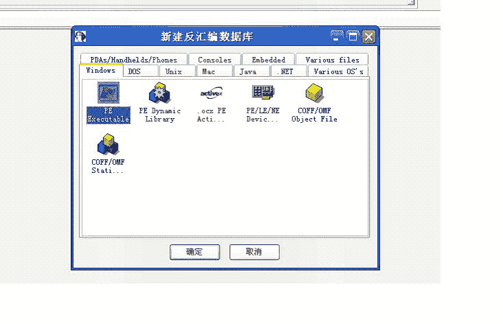 | |
| | |
| 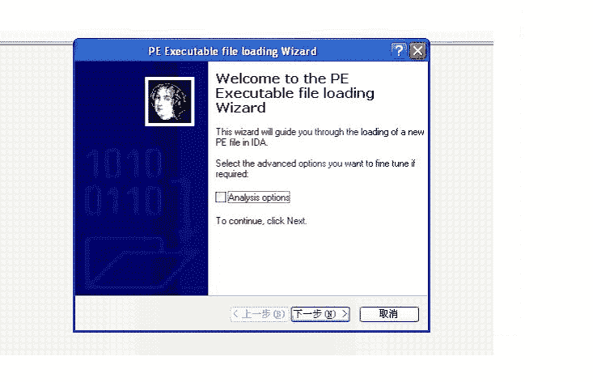 | |
| | |
|  | |
| | |
| 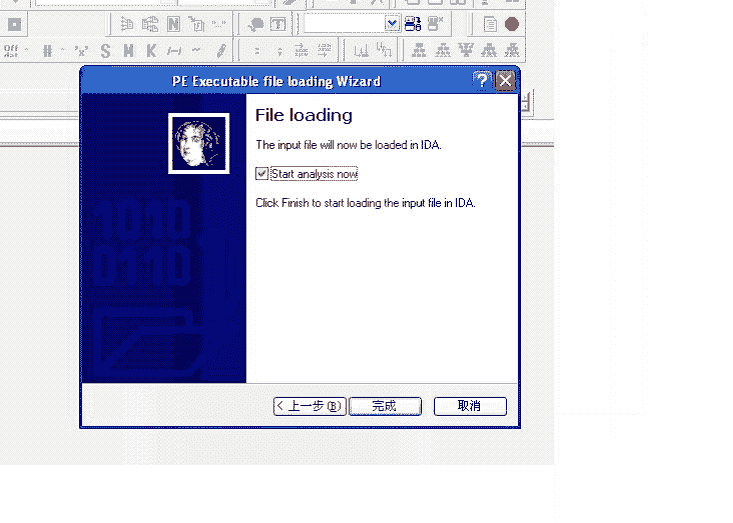 | |
| | |
| 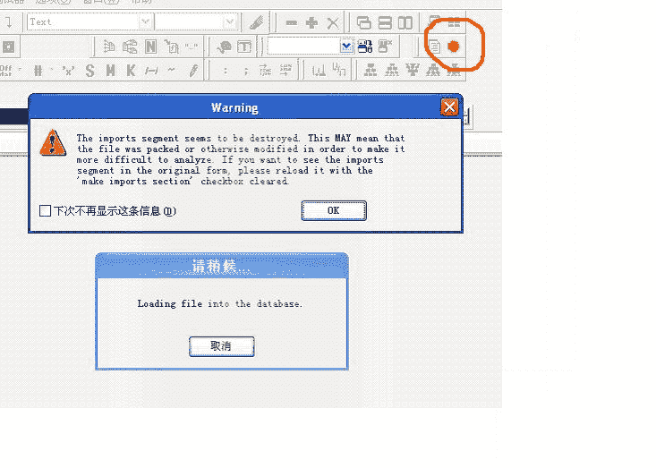 | |
| | |
| 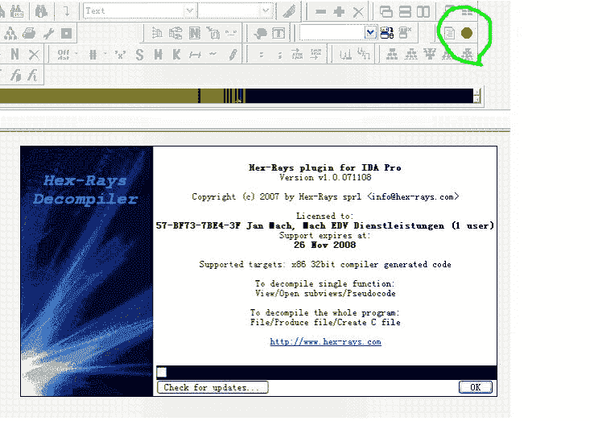 | |
| | |
| 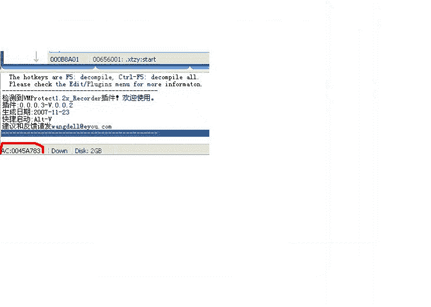 | |
| | |
| 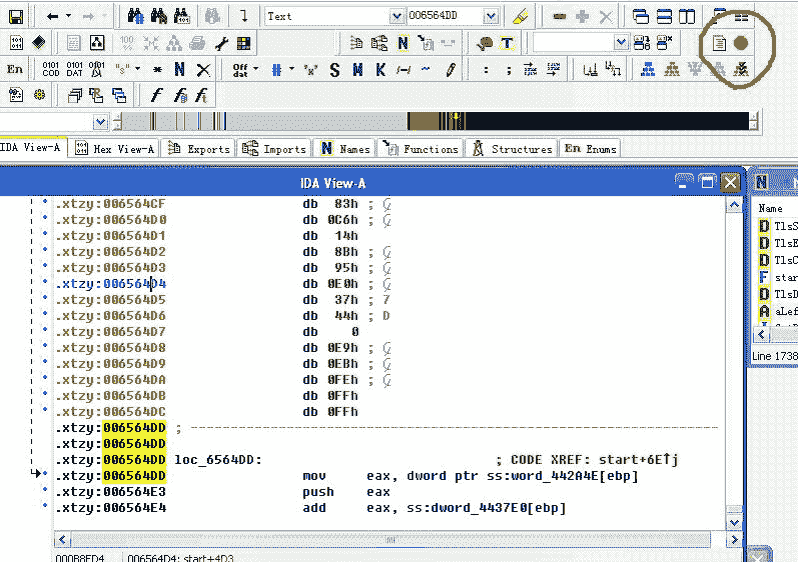 | |
| | |
| 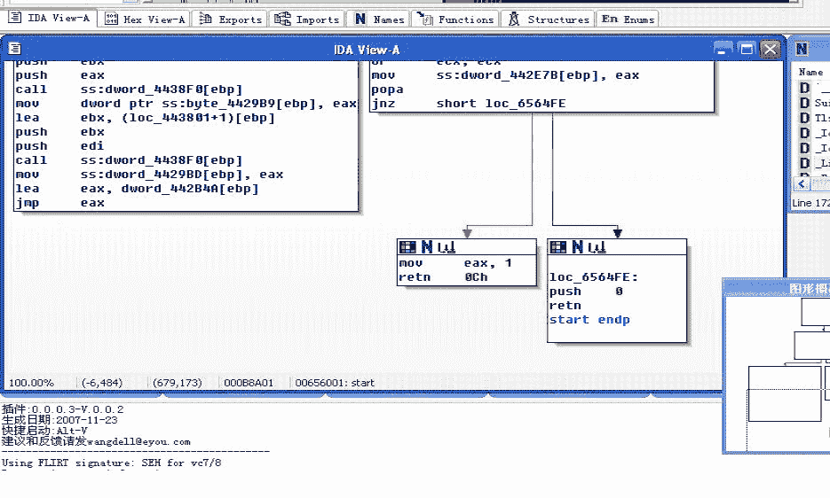 | |
| | |
|  | `010.jpg` |
| | |
| 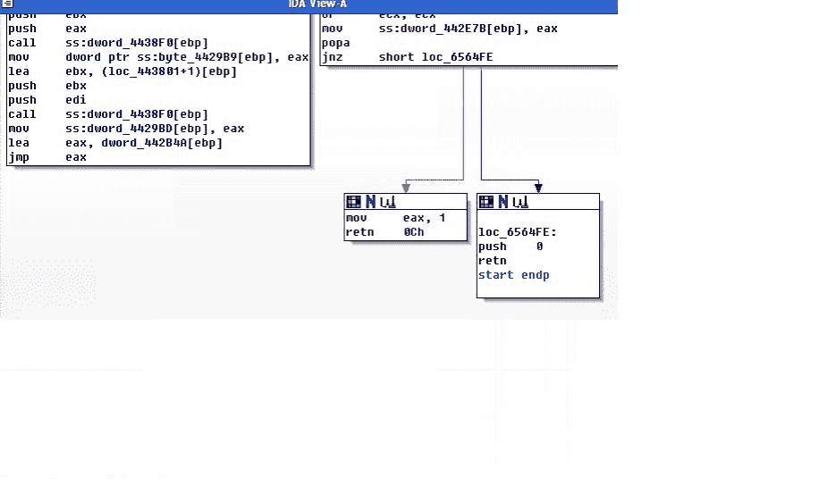 | |
| | |
| 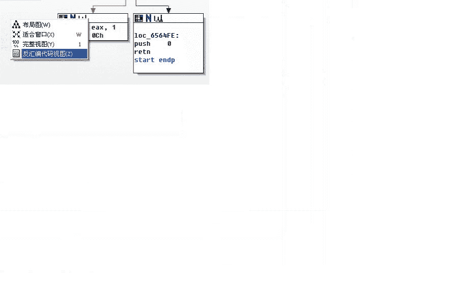 | |
| | |
| 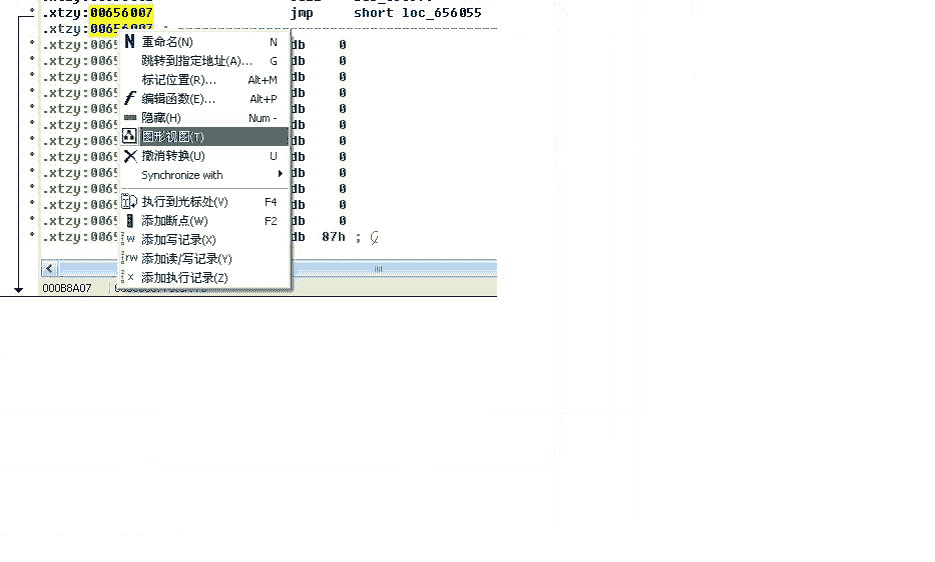 | |
| | |
| 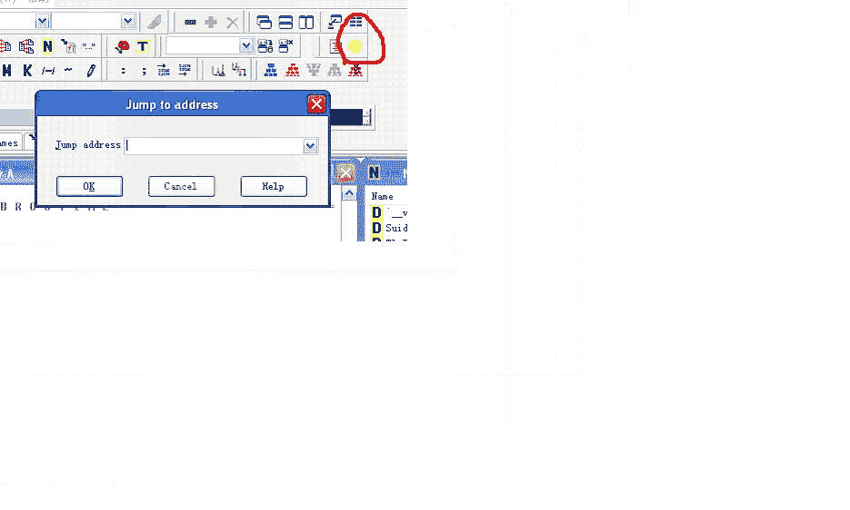 | |
| | |
| 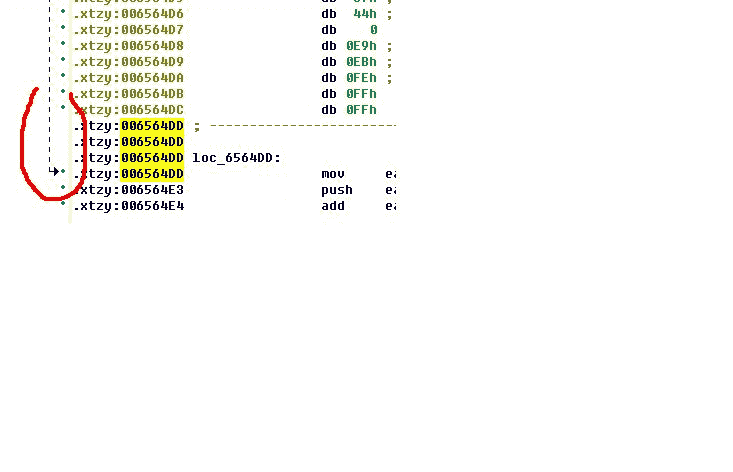 | |
| | |
| 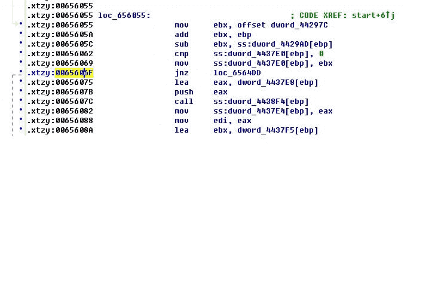 | |
| | |
| 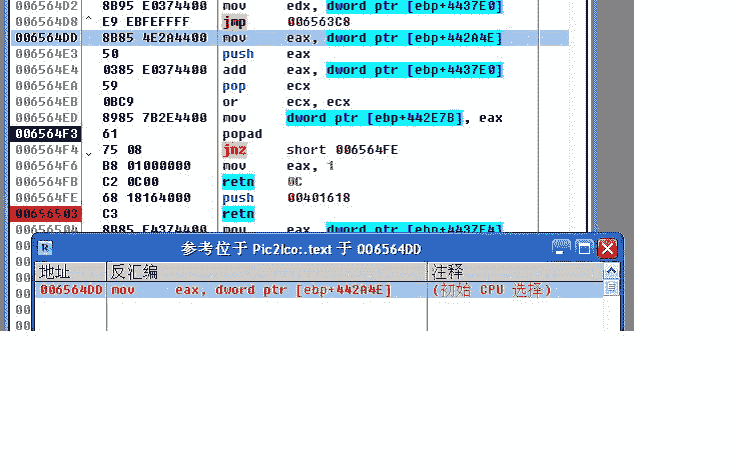 | |
| | |
| 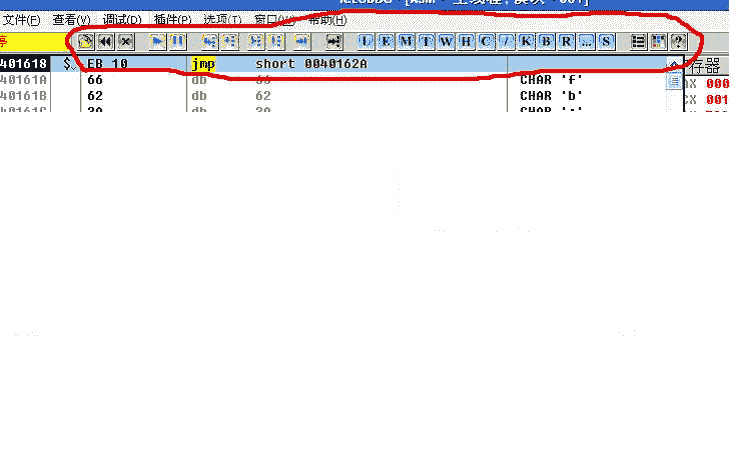 | `018.jpg` |
| | |
| 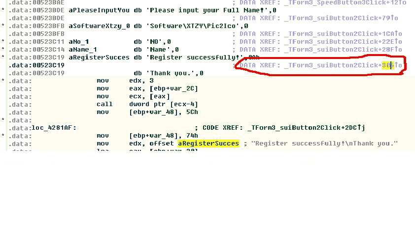 | |
| | |
| 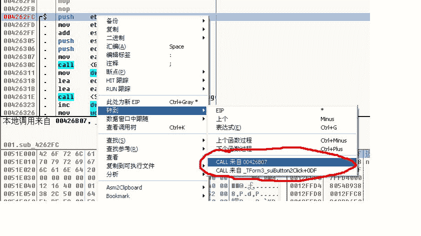 | |
| | |
| 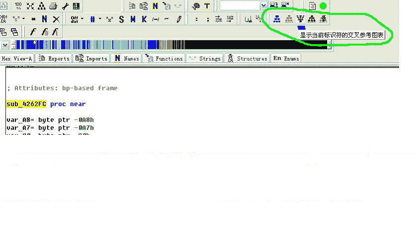 | |
| | |
| 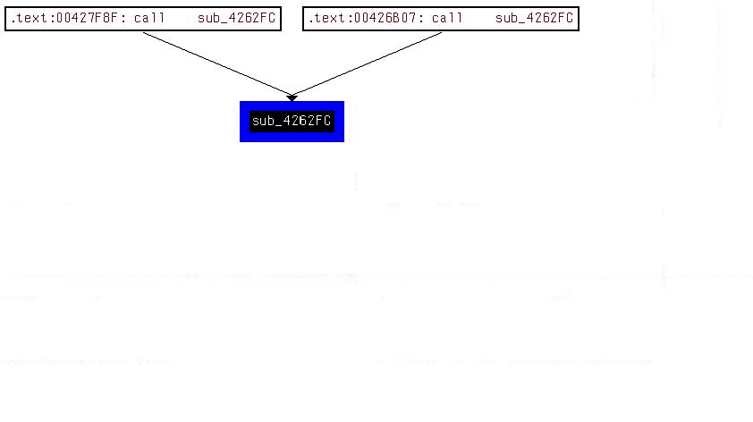 | |
| | |
| 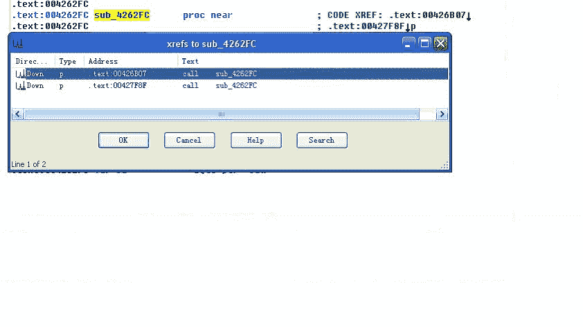 | |
| | |
| 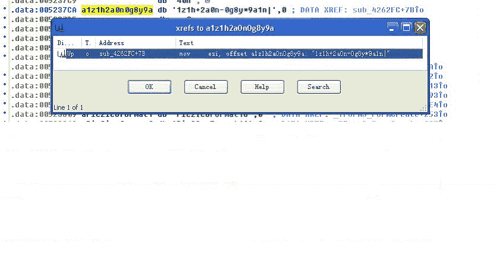 | |
