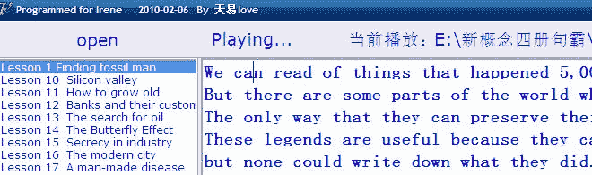

# 英语点读机的详细制作教程(含源码)

> 原文：[`www.pediy.com/kssd/pediy11/106874.html`](https://www.pediy.com/kssd/pediy11/106874.html)

## 1. 项目背景与工具

自制英语学习机。试了很多软件，感觉“xxx 背单词 5 白金版”功能比较强劲，但只能点读单词和例句。能不能自己做个点读句子的学习机？Let's go!

工具方面，`ring3` 下用 `delphi` 就够了。

### 1.1 核心问题

1. 发出声音用什么函数？如果用 `function PlaySoundA; external 'winmm.dll' name 'PlaySoundA';`，那么就需要 `wav` 格式的数据。
2. 我有很多 `mp3`，如何把 `mp3` 格式的数据转换为 `wav` 格式？
3. 我还有很多相应的 `.lrc` 文件，如何根据其中的时间信息定位到 `MP3` 中相应的位置？

围绕这些问题，首先需要恶补 `MP3` 格式的知识。

## 2. MP3 帧头结构解析

4 个字节的帧头 `FRAMEHEADER` 格式如下：

```
AAAAAAAA AAABBCCD EEEEFFGH IIJJKLMM
```

字段定义：

- **A**: 11 位 (31-21)，Frame sync (all bits set)
- **B**: 2 位 (20,19)，MPEG Audio version
  - `00` - MPEG Version 2.5
  - `01` - reserved
  - `10` - MPEG Version 2
  - `11` - MPEG Version 1
- **C**: 2 位 (18,17)，Layer description
  - `00` - reserved
  - `01` - Layer III
  - `10` - Layer II
  - `11` - Layer I
- **D**: 1 位 (16)，Protection bit
  - `0` - Protected by CRC (16bit crc follows header)
  - `1` - Not protected
- **E**: 4 位 (15,12)，Bitrate index

| bits | V1,L1 | V1,L2 | V1,L3 | V2,L1 | V2,L2 | V2,L3 |
| :--- | :--- | :--- | :--- | :--- | :--- | :--- |
| `0000` | free | free | free | free | free | free |
| `0001` | 32 | 32 | 32 | 32 | 32 | 8 (8) |
| `0010` | 64 | 48 | 40 | 64 | 48 | 16 (16) |
| `0011` | 96 | 56 | 48 | 96 | 56 | 24 (24) |
| `0100` | 128 | 64 | 56 | 128 | 64 | 32 (32) |
| `0101` | 160 | 80 | 64 | 160 | 80 | 64 (40) |
| `0110` | 192 | 96 | 80 | 192 | 96 | 80 (48) |
| `0111` | 224 | 112 | 96 | 224 | 112 | 56 (56) |
| `1000` | 256 | 128 | 112 | 256 | 128 | 64 (64) |
| `1001` | 288 | 160 | 128 | 288 | 160 | 128 (80) |
| `1010` | 320 | 192 | 160 | 320 | 192 | 160 (96) |
| `1011` | 352 | 224 | 192 | 352 | 224 | 112 (112) |
| `1100` | 384 | 256 | 224 | 384 | 256 | 128 (128) |
| `1101` | 416 | 320 | 256 | 416 | 320 | 256 (144) |
| `1110` | 448 | 384 | 320 | 448 | 384 | 320 (160) |
| `1111` | bad | bad | bad | bad | bad | bad |

*Notes: All values are in kbps*
`V1` - MPEG Version 1; `V2` - MPEG Version 2 and Version 2.5
`L1` - Layer I; `L2` - Layer II; `L3` - Layer III

- **F**: 2 位 (11,10)，Sampling rate frequency index (values are in Hz)

| bits | MPEG1 | MPEG2 | MPEG2.5 |
| :--- | :--- | :--- | :--- |
| `00` | 44100 | 22050 | 11025 |
| `01` | 48000 | 24000 | 12000 |
| `10` | 32000 | 16000 | 8000 |
| `11` | reserv. | reserv. | reserv. |

- **G**: 1 位 (9)，Padding bit
  - `0` - frame is not padded
  - `1` - frame is padded with one extra bit
- **H**: 1 位 (8)，Private bit (unknown purpose)
- **I**: 2 位 (7,6)，Channel Mode
  - `00` - Stereo
  - `01` - Joint stereo (Stereo)
  - `10` - Dual channel (Stereo)
  - `11` - Single channel (Mono)
- **J**: 2 位 (5,4)，Mode extension (Only if Joint stereo)

| value | Intensity stereo | MS stereo |
| :--- | :--- | :--- |
| `00` | off | off |
| `01` | on | off |
| `10` | off | on |
| `11` | on | on |

- **K**: 1 位 (3)，Copyright
  - `0` - Audio is not copyrighted
  - `1` - Audio is copyrighted
- **L**: 1 位 (2)，Original
  - `0` - Copy of original media
  - `1` - Original media
- **M**: 2 位 (1,0)，Emphasis
  - `00` - none
  - `01` - 50/15 ms
  - `10` - reserved
  - `11` - CCIT J.17

## 3. 关键变量与帧大小计算

两个关键变量：

1. **每帧的播放时间**：有 26ms 也有 52ms 的。观察发现主要跟 `MPEG Version` 相关。
   我的英文 `MP3` 资料都是 `MPEG Version 2.5`，所以使用 52ms。

2. **帧大小**：
   ```
   FrameSize = (((MpegVersion == MPEG1 ? 144 : 72) * Bitrate) / SamplingRate) + PaddingBit
   ```
   例如：资料是 `Bitrate = 32000`，`SamplingRate = 11025`，`PaddingBit = 0`
   ```
   FrameSize = (72 * 32000) / 11025 + 0 = 208 bytes
   ```

加上 `.lrc` 文件中的时间信息，就可以定位出每个句子在 `MP3` 文件中的偏移位置。

## 4. 逆向工程：MP3 转 WAV

接下来需要寻找转换 `MP3` 到 `wav` 格式的函数。偶然发现“xxx 背单词 5 白金版”中有一个 `xxx.dll`，其中有个导出函数 `Mp3BuftoWaveBuf`，这正是所需。

使用古董 `OD` 进行调试。下断点 `bp Mp3BuftoWaveBuf`，运行后点句子朗读立即断下。单步几下来到这里：

```
0046F210  /$  8B4424 10     MOV EAX,DWORD PTR SS:[ESP+10]
0046F214  |.  8B4C24 0C     MOV ECX,DWORD PTR SS:[ESP+C]
0046F218  |.  8B5424 08     MOV EDX,DWORD PTR SS:[ESP+8]
0046F21C  |.  50            PUSH EAX
0046F21D  |.  8B4424 08     MOV EAX,DWORD PTR SS:[ESP+8]
0046F221  |.  51            PUSH ECX
0046F222  |.  52            PUSH EDX
0046F223  |.  50            PUSH EAX
0046F224  |.  E8 AD750600   CALL <JMP.&AudioConvert.#4>  //Mp3BuftoWaveBuf
0046F229  |.  83C4 10       ADD ESP,10
0046F22C  \.  C3            RETN
```

`push` 了 4 次，显然有 4 个参数。查看堆栈发现：
- 第一个参数是 `MP3` 格式数据的首地址
- 第二个参数是 `MP3` 数据长度
- 第三、四个参数都是指针，分别指向转换后 `wav` 格式数据的首地址和转换的长度

由此可以得到每个句子的 `wav` 格式数据。

## 5. 逆向工程：播放声音

最后使用 `wav` 格式数据发声。下断点 `bp PlaySoundA` 断在下面：

```
00404CC5  |.  8B15 CCB65500 MOV EDX,DWORD PTR DS:[55B6CC]  //edx 指向我们的 wav 格式数据，前面的大量工作就是干这个的
00404CCB  |.  6A 04         PUSH 4
00404CCD  |.  6A 00         PUSH 0
00404CCF  |.  52            PUSH EDX
00404CD0  |.  FF15 38075200 CALL DWORD PTR DS:[<&WINMM.PlaySoundA>]  ;  WINMM.PlaySoundA
```

单步经过这个 `call` 就能听到朗读句子了。调试准备到此为止，该用 `delphi` 来实现了。

## 6. Delphi 核心代码实现

### 6.1 外部函数声明与线程过程

```delphi
implementation

// 逆出来的函数声明
function Mp3BuftoWaveBuf(mp3Buf :PAnsiChar; mp3len:DWORD; var pWaveBufAddr:PDWORD; var lpwaveLen:PDWORD) : DWORD; stdcall; external 'tianyi_love.dll';

// 朗读线程函数
procedure  MyThreadFunc(Sender: TObject);
var
  filehandle, maphandle: THandle;
  filesize, wavedata, tmp, len: DWORD;
  mp3data: PAnsiChar;
  pwaveLen: PDWORD;
begin
   mp3data := nil;
   maphandle := 0;
   filehandle := 0;
   try
     filehandle := FileOpen(form1.Label1.Caption, fmOpenReadWrite);
     filesize := GetFileSize(filehandle, Nil);
     maphandle := CreateFileMapping(filehandle, nil, PAGE_READWRITE, 0, filesize, nil);
     mp3data:= MapViewOfFile(maphandle, FILE_MAP_ALL_ACCESS, 0, 0, filesize);
     tmp := cardinal(mp3data);
     tmp := tmp + mp3offset[current_line-1];
     mp3data := pchar(tmp);
     if  current_line = total then  len := filesize - mp3offset[current_line-1] + 1
       else  len := mp3offset[current_line] - mp3offset[current_line-1] + 1;
     Mp3BuftoWaveBuf(mp3data, len, pBufAddr, pwaveLen);    // 对不起，借用一下
     asm
       ADD ESP, $10
       mov eax, pBufAddr
       mov wavedata, eax
     end;
     PlaySoundA(pchar(wavedata), 0, 4); // 朗读句子
     playing := false;
     form1.Label3.Caption := '';
   finally
     UnmapViewOfFile(mp3data);
     CloseHandle(maphandle);
     CloseHandle(filehandle);
     TerminateThread(hThreadHandle, 0);
   end;
end;
```

### 6.2 初始化偏移量计算

```delphi
procedure TForm1.ListBox1Click(Sender: TObject);
var
  i, lines: integer;
  ss, tmp: string;
  mp3off: real;
begin
  FillChar(mp3offset, SizeOf(mp3offset), 0);
  memo2.Clear;
  Richedit1.Clear;
  tmp := Listbox1.items[Listbox1.itemindex];
  ss := tmp + '.mp3';
  Label1.Caption := current_path + ss;
  memo2.Lines.LoadFromFile(current_path + tmp + '.lrc');
  total := memo2.lines.count;
  for lines := 0 to memo2.lines.count - 1 do
    begin
      tmp := memo2.lines[lines];
      i := pos('\]', tmp);
      ss := copy(tmp, i + 1, length(tmp) - i);
      RichEdit1.Lines.Add(ss);
      i := pos(':', tmp);
      ss := copy(tmp, i - 2, 2);
      mp3off := strtofloat(ss) * 60;
      i := pos('.', tmp);
      ss := copy(tmp, i - 2, 2);
      mp3off :=  strtofloat(ss) + mp3off;
      i := pos('\]', tmp);
      ss := copy(tmp, i - 2, 2);
      mp3off :=  strtofloat(ss) / 100 + mp3off;
      mp3off := mp3off * 208 / 0.052;  // 此处是根据我的 MP3 资料计算的两个定位时用到的关键值，加几行代码就智能了
      tmp := floattostr(mp3off);
      mp3offset[lines] := cardinal(strtoint(tmp)); // 得到每个句子在 MP3 中的开始偏移量，存入数组备用
    end;
end;
```

### 6.3 鼠标点击触发朗读

```delphi
procedure TForm1.RichEdit1MouseDown(Sender: TObject; Button: TMouseButton;
  Shift: TShiftState; X, Y: Integer);
var
   MemoInfo: TMemoInfo;
   i: integer;
begin
   if playing then exit;
   GetMemoPos(RichEdit1, MemoInfo);
   with MemoInfo do
     begin
       i := Succ(Line);
       if i > total then exit;
       current_line := i;  // 得到朗读句子的行号
     end;
   playing := true;
   hThreadHandle := CreateThread(nil, 0, @MyThreadfunc, nil, 0, dwThreadID); // 生成朗读线程，开始朗读指定句子
   if hThreadHandle = 0 then   showmessage('Didn’t Create a Thread');
   Label3.Caption := 'Playing...';
end;
```




By 天易 love 2010-02-07

上传的附件

|  | 程序含源码.rar |
| :--- | :--- |
