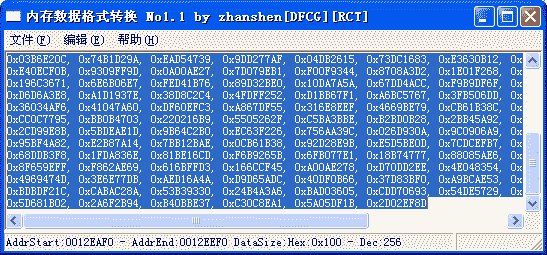
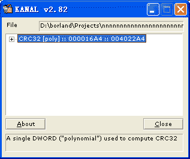

# 没什么好东西，一个故事加一个算法

> *文章中有些错误，大家小心*

> 原文：[www.pediy.com/kssd/pediy09/pediy09-172.htm](https://www.pediy.com/kssd/pediy09/pediy09-172.htm)

> 密码学系列－hash 双璧之一 `CRC32` 详解

> `kflnig`

> 引用: `if you don’t want to read this story goto l1:`

> “其实，星期三打电话给你，我完全不想说那些，可是一听到你的声音。我就打消了说原本那些话的冲动。虽然在和你聊时，我还几度想说，可是最终没有。这已经不是第一次我把想说的东西换成其它的了。

> 我本是想让你和我两个人一起在 `5.1` 的时候出去玩。这也是我打电话给编辑去问稿费的原因。我不想花父母的钱，而我自己的钱不搭介。我也不知道，假如这样做会有什么意义。但是，我就是想，想留一些事迹在我们的生命里。

> 我说过我很忙，其实这不假，写稿子，花了我大量的时间。

> 我曾想过假如你成了我的女朋友那会怎样。我想，你不会了解我的很多东西。我的很多烦恼，在别人看来都是不可理解的。所以我想，这不可能。我也曾想过可以和你一起手拉手（我在读的时候舍掉了手拉手，这三个敏感字眼）走在大街上，只是向兄妹一样。我可以很自豪的向世界宣告，你——小翠，是我的妹妹。我想，这也不可能。

> 我想过很多，最后成了很多的不可能。

> 我本来打算拿了稿费一边可以闲逛，一边可以给你买点东西。

> 我想我自己太天真了。有些东西，比我想象中的要复杂的多！

> 你说你想见见大家。其实，我想见的女生中，除了你真的不多了。

> 我很不会顾虑自己的身体，所以希望有人可以来提醒我注意身体。我想这个人最好是我的女朋友。然而，我又不希望我们之间的关系会变成其它，却又希望关系可以变得更好一点。

> 我不知道你现在听着我说这些的时候有什么感受。我不希望你听了这些之后就对我的印象分减到零。甚至不理我。

> 我不知道，我这个做哥哥的在你的心目中有多大份量，我不知道这样会不会造成一种大哥好色好坏的影响，但我想说，我不否认我有点，但是更多的，我渴望一种亲密无间的感觉，而这种感觉少有人能够给我。只有上次吴清芳喝醉之后拉着我的衣袖，站都站不稳的时候才有这种感觉。

> 有时，我又庆幸你不会和我一起出去玩，因为我真的不知道假如单独和你在一起时没事干的时候，我该怎么办。这样的结果，就省得尴尬。

> 我希望有那么一个朋友可以把我当成宝贝，一点点也好。可是没有……

> 你是什么都不缺，而我的一份关心，也无多大意义。在众人间，你自拥有你的一份美丽，使不少人都绕你公转。而我就是最远处的海王星。

> 我把这些说出来是希望你可以多了解我一点，我也可以多了解你一点。我并不了解你，不知道你到底是个怎么样的女生，你在想什么，你在乎什么，你讨厌什么。

> 我本想把这个写成信告诉你。但最终，我想我还是打电话把它读出来给你听。寄信太慢了。”

> 我读完这封信，我不知道她有没有听清楚。只换来一句，“大哥今天你好怪啊！”

> ……

> 过了约两个礼拜，我打过去一个电话。

> 聊到：

> 她说：大哥你会做 `PPT`（幻灯片）吗？

> 我毫不犹豫的应承下来。

> 她的语气带着点高兴，毕竟我这个大哥干这种事也不会差到哪里去。

> 别说做幻灯片了。如果她说：“哥，你把月亮摘下来好吗？”

> 我会说：“我试试看！”

> ……

> 她说：你生日怎么过？

> 我说：没打算。

> 她说：我听你的。

> 我说：不知道。

> 她说：我听你的。

> 然后她又依稀仿佛记起了什么的说：“如果合理的话，我会答应的。”

> 当我听着“合理”这两个字时，我知道她害怕我说，“我想和你两个人一起出去！”

> 为什么，为什么！我问我自己，难道我就这么差吗？难道我就这么一文不值吗？有时候心不是很痛，可你却很难过。我想在那个地点，那个时刻，我站在电话亭中，看着暗夜的雨，我很难过！

> 的确，我还年幼，在别人眼里我还只是一个高中生。我还不合适去干很多事。

> 我本想去开个玩笑对她说：你做我女朋友好吗？

> 如果她说“好的”，那也正是我以前梦中，无数遍的场景，也许结局不甚好，但我可以有那么一段时间，我可以不再心慌到自言自语，用拳砸墙壁，蒙灌下很多的饮料；如果她说“不”，那么我可以向骗李竹青一样，骗她说：“其实我有女朋友，她叫李竹青……”但我知道我很她的关系经不起这种玩笑。

> 我希望有一天，可以有那么一个人，可以和我一起坐在草地上看星星，看黑夜。

> 我想假如我再优秀一点，再帅气点那该多好啊！或许，我就可以有一个把我当成宝贝点的女友了。或许，我可以不再在心理上，那么无助。可是，这不可能。虽然我还期待……

> 我想假如我真的开这个玩笑的话，她记不会说是，也不会说不是。或许她会带着惊诧的口吻说：“大哥你今天怎么了？”

> 我在我的梦里构建了一个我的王国，与现实越走越远。当我发现两者的矛盾已经是水火不容的时候，我也无法再在我的完美王国中多走一步。霎时间，我的完美王国分崩离析！

> 梦：

> 梦中有很多时候，我能和一个爱我的她在一起。我想过和她一起去流浪。想象着一起经过风雨心酸。

> 我去卖电脑，写文章挣稿费，当网管，建网站，努力学习……她也帮我料理琐事，煮饭烧菜，温习功课。我们一起过着甜蜜的小日子……

> 我做过很多的梦，我不知道，在和现实巨大的反差对比之下，我的心里是否已经接近崩溃的边缘。我想我做梦的时候，心中也是酸的……

> 常常，午夜的钟声敲响，灯光下还有一个瘦削的背影和一台电脑……

> 我已逐渐了解到自己本就孱弱的身体，现在愈来愈欠佳，常常在深呼吸时发现，心口很疼，才明白平时的恶习对自己的伤害有多深。

> 我想关心一个人就应该说出来，爱一个人应该说出来，于是我决定说……

> 我爱你。

> 上面这是以前的一则真实的故事，我给那个我最爱的女孩看过。可是现在，当我最爱的女孩说要我做她大哥！我想在这个时候，我的心中，有点痛。我一共有了两个妹妹。

> `l1:`

> 作者声明：文章太长，错误难免，唯恐误人子弟，大家踊跃提出批评，在下努力改正。

> 一个好的 `hacker` 得需要很多东西，汇编是一个，密码学也必须了解，但作为一个 `cracker`，那么对于密码学一定要精通的！

> 而《手册》上就缺少这一类文章。所以我就打算写了一些关于算法的文章。顺便详细谈及一下：软件保护的课题。

> 本文不会涉及到很多概念，但是却会涉及到不少代码。

> `CRC32` 出现在很多的地方，网络上的报文，几乎都用 `CRC32` 作校验。所以 `CRC32` 的使用范围是非常广的。`winrar` 中也常常出现说：`crc` 校验错误！在我们软件保护中，也常常用 `CRC32` 作为校验，来防止爆破！

> 所以我希望你好好学好这个算法。我希望你看了我的文章之后可以牢牢掌握它！内容有些枯燥，但是希望你可以看懂！但希望你在看这个文章之前，有一点 `c` 编程的知识。这篇文章太长了，所以最好你可以分多次看完。

> 首先需要一些前置知识。

> `little-endian` 和 `big-endian` 原则，我只讲一遍。

> `Big-endian` 和 `Little-endian` 是用来表述一组有序的字节数存放在计算机内存中时的顺序的术语。`Big-endian`(即“大端结束”或者“大尾”)是将高位字节（序列中最重要的值）先存放在低地址处的顺序，而 `Little-endian`（即“小端结束”或者“小尾”）是将低位字节（序列中最不重要的值）先存放在低地址处的顺序。举例来说，在使用 `Big-endian` 顺序的计算机中，要存储一个十六进制数 `4F52` 所需要的字节将会以 `4F` `52` 的形式存储（比如 `4F` 存放在内存的 `1000` 位置，而 `52` 将会被存储在 `1001` 位置）。而在使用 `Little-endian` 顺序的系统中，存储的形式将会是 `52` `4F`（`52` 在地址 `1000` 处，`4F` 在地址 `1001` 处）。`IBM` 的 `370` 种大型机、大多数基于 `RISC` 的计算机以及 `Motorola` 的微处理器使用的是 `Big-endian` 顺序，`TCP/IP` 协议也是。而 `Intel` 的处理器和 `DEC` 公司的一些程序则使用的 `Little-endian` 方式。

> 为了防止小鸟不懂我还是再来个示例吧。比如说

> `esp=12FF400`

> 这个地址的指向的内存中的值是 `00` `01` `02` `03`。

> 我来一条 `mov` 语句，`mov eax,[esp]`；

> 那么按照 `little-endian` 原则，`eax` 中的值是 `03` `02` `01` `00`

> 然后推荐给众位朋友一个好东西，`borland c++ builder 6.0`，因为它的编译效率比 `vc` 的高，我写了一个求 `1`——`1` 百万的素数算法比 `vc6.0` 高了 `10%`。而且，在控制台编程方面，基本和 `vc` 没有区别，还有 `vc6.0` 用内联汇编会有 `bug`，而她没有，这么好的东西，你还不去用。

> 还有一定要懂内联汇编，`bbs.pediy.com` 上有我的内联汇编教程，但我不知道光盘中编辑有没有放。（我前几天写了篇文章，打包了我自己的内联汇编教程，如果发表，编辑会把它放进去的）

> 本文分三部分，

> 1、初识 `CRC32`

> 2、`CRC32` 的冲突寻找

> 3、`CRC32` 的高级状态

### 初识 `CRC32`

> 首先看下面的代码，这是我从某个使用 `CRC32` 作为算法的软件中 `copy` 出来的。可以给你一个对 `CRC32` 有一个感性的认识

> `/*403163*/` `MOVZX EDX,BYTE PTR DS:[EAX]`；`EAX` 中是要进行 `CRC32` 校验的值的地址，取一个 `byte` 作为待会儿将要进行校验的

> `/*403166*/` `MOV ECX,ESI`；`esi` 中是 `CRC` 校验值

> `/*403168*/` `AND ECX,0FF`；保留末尾的两个 `byte`

> `/*40316E*/` `XOR ECX,EDX`；和要进行 `CRC` 校验的值的一个 `byte` 进行异或运算

> `/*403170*/` `MOV EBP,DWORD PTR DS:[EDI+ECX*4]`；查表

> `/*403173*/` `SHR ESI,8`；`esi` 右移 `1` 个 `byte`

> `/*403176*/` `XOR ESI,EBP`；和查表得到的值进行异或

> `/*403178*/` `INC EAX`；指向下一个将要进行 `CRC` 校验的值

> `/*403179*/` `DEC EBX`；`ebx` 是用来控制循环次数的

> `/*40317A*/` `JNZ SHORT 00403163`

> 如上面的代码，这样最后的 `esi` 就是我们的 `CRC32` 校验值！（`esi` 的初始值是 `0xFFFFFFFF`）

> 但是也有些时候，软件会在最后执行 `not esi` 作为 `CRC32` 的校验值，我也不知道真正的 `CRC32` 算法是怎么设计的。但是这么一条语句关系不大。

> 至于那张上面提到的表，我截了张图，

> 

> 图 1

> 这是表中的一部分。下面是生成表的算法。

```c
voidGenCrc32Tbl()
{
    int i,j;
    for(i=0;i<256;++i){
        CRC=i;
        for(j=0;j<8;++j)
        {//这个循环实际上就是用"计算法"来求取 CRC 的校验码
            if(CRC & 1)
                CRC=(CRC>>1)^0xEDB88320;
            else //0xEDB88320 就是 CRC-32 多项表达式的值
                CRC>>=1;
        }
        CRC_32_Tbl[i]=CRC.
    }
}
```

> 稍微注释一下，`&` 是 `and` 运算；`^` 是 `xor` 运算；`>>` 是 `shr`（右移）运算

> 上面就是生成 `CRC32` 表的算法，当然我们也可以直接把静态生成后的码表直接 `copy` 到代码中。是不是很简单，的确 `CRC32` 是 `hash` 算法中最最简单的一个，而且它需要的计算量很低，所以应用才会如此广泛！

> 上面就差不多把 `CRC32` 讲完了。总结一下，你要大概知道它的算法流程，也得知道大概有一个表要查。表的生成，记不记就无所谓了，毕竟这年头要记的东西太多了，如果一一记住纵然是电脑也不怎么可能。

> 真正的代码实现，网上太多了，我来写个大家都看的懂的。

```c
int calcCRC32(char *DataBuff,unsigned int BufLen)
{
    //DataBuff 是指向数据串的指针，BufLen 是数据串的长度
    unsigned int CRC32=0xffffffff; //设置初始值，还有一定要加上 unsigned，否则在下面进行移位>>时，会使用 sar（算术右移），而不是我们期待的 shr（逻辑右移）
    int i;
    unsigned char ch; //这里的 unsigned，加与不加一个样
    for(i=0; i<BufLen; ++i)
    {
        ch=*DataBuff;
        CRC32 = table[(CRC32^ch)& 0xff] ^ (CRC32>>8);
        ++DataBuff;
    }
}
```

> 只要这么一些就够了。耐心点，努力看懂它。真正意义上了解 `CRC32` 的算法。

### `CRC32` 的冲突寻找

> 假设，你已经颇了解 `CRC32` 了。我们首先了解一下，一个好的 `hash` 算法的定义（我自己的记忆中好像老鸟们是这么说的）。

> `HASH` 值很平均，不会在某一个位上出现某个值特别多

> `crc32`，在上面这个著名的定义中是完全满足的。

> 可是我们看，`crc32` 校验值，只是一个 `32bit` 的值，也就是一个 `DWORD` 而已。

> 先说个概念“碰撞”，所谓碰撞就是说不同的数据经过 `hash` 算法之后，却得到同样的结果。

> 所以假使你 `crc32` 的 `hash` 值非常平均，但搜索到碰撞的概率还是有是 `0xFFFFFFFF` 分之 `1`。不要觉得它很小，我们自己的微机，完全可以在短时间内搜索到一组碰撞。`HASH` 实际上应该很容易得出碰撞。

> 比如，一个 `hash` 值是 `0x15A7393A`，这是我随便举的，我并不知道，是什么数据的 `crc32` 校验值。但我就是可以另外找到一组值，也可以得到这个校验值。看我如何寻找冲突！

```cpp
#include <iostream.h>

const int sj[]={……这是码表，太长了所以就略去了};

void main()
{
    unsigned int n;
    int b;
    for (n=0x00000000;n<=0x10000000;++n)
    {
        _asm
        {
            mov ebx,4
            lea EAX,n
            MOV ESI,0xFFFFFFFF
            line1:
            MOVZX EDX,byte ptr[EAX+ebx-1];EAX 是伪码的地址
            MOV ECX,ESI
            and ECX,0xFF
            XOR ECX,EDX
            shl ecx,2; 相当于 ecx=ecx*4
            MOV edi,sj[ECX];
            SHR ESI,8
            XOR ESI,edi
            dec EBX;EBX 是注册码长度
            JNZ line1
            CMP ESI,0x15A7393A
            JZ line2
            push 0
            pop b
            jmp line3
            line2:
            push 1
            pop b
            line3:
        }
        if (b) cout<<n;
    }
}
//
```

> 不到 `30s` 出来一个 `2b` `2a` `30` `35`。化成 `ASCII` 码就是 `+*05`

> 强烈的说一遍，注意看和第一部分的代码区别，还要注意 `little-endian` 原则。一般情况下，是可以找到冲突的。如果找不到冲突，我们可以再稍微改变一下。只不过这个稍微有点麻烦，因为我不能向上面那样投机取巧的用一条 `for` 语句就 `OK` 了，我只得自己去操纵内存，不过也很简单，`^_^`，你不妨自己去看看！所以 `crc32` 在人为的去寻找冲突的情况下是不牢靠的，但是 `crc32` 在自然状态下是很好的。

### `CRC32` 的高级状态

> 我将会用很长很长很长的篇幅来讲这个，主要涉及到的是利用 `crc32` 作软件保护！如果你是个想保护自己软件的程序员，那么下面的就看好了。

> 为了下面的可读性，我将引入一些符号

> `crc32(data)` 表示用 `crc32` 对 `data` 进行处理生成校验值。

> 看到过一个软件它的注册算法是

```c
if (crc32(key)==a) 注册成功;
```


`else`注册失败;  

`a`表示某个`int`常量。很明显，这个是在人为的去寻找冲突的情况下是不牢靠的。但是这已经比明码比较的软件有了质的提升了，可以阻挡 30％的`cracker`了。可是它偏偏遇到了我，^\_^！  

也许你会说假如这样  

```
if (md5(key)==a)注册成功;  
else 注册失败;  
```

会安全的多，的确，`md5`在现在的状态下很牢靠!可是无可否认的，`md5`算法很难写，比起`crc32`不知要难多少倍。所以我们的目标是用`crc32`作为算法写一个安全的注册过程！  

我推荐的是假如注册码`key`是一个`8byte`的长度。  

那么我们可以这样分`DWORD high，low`。  

用`high`表示高`4byte`，`low`表示低`4byte`。  

我们分别这样进行`crc32`  

```
if (crc32(key)==a1)注册成功;  
else 注册失败;  
if (crc32(high)==a2)注册成功;  
else 注册失败;  
if (crc32(low)==a3)注册成功;  
else 注册失败;  
```

这样是绝对不是一台微机凭着暴力搜索，可以搜索出来的。^\_^，你的软件在这个时候就可以安全了。

现在讲讲这个该死的`PEID`。先要纠正一下`kanxue`兄在其书《加密与解密》中的一个小错误，这也算不上是错误，是由于时代的局限性^\_^  

他说：用动态生成的`CRC32`的码表是不会被`PEID`的插件`kanal`查到算法的。只有你静态嵌入码表数组才会被发现。  

可是这个时代已经一去不复返了。所以，为了安全，我们一定要找到一种方法躲过这个该死的`PEID`。  

我们直接去反汇编`PEID`的插件看代码是不怎么现实的，因为`PEID`扫描之后说：`ACProtect V1.3X-1.4X DLL -> risco`。*看到这个我想就意味着壳盲止步。但我想，它不会很智能，通过黑箱方法也可以躲过 PEID 的法眼。*  

首先我们静态放入码表到程序中，我们用`kanal`插件查找，`kanal`如图 2 所说：  

  

图 2  

上面一行是说在哪里找到了这个`crc32`的码表，前面一个数字说明的是磁盘中的地点，后面一个说的是内存中的地点。下面一行是说明在哪里检测到操作这个码表。  

好了，它给了我们一个很好的提示，假如……我们用`winhex`打开这个应用程序，来到`0x14A4`。数据如下：  

```
Offset 0 1 2 3 4 5 6 7 8 9 A B C D E F  
000014A0 00 00 00 00 00 00 00 00 96 30 07 77 2C 61 0E EE.  
```

根据此我们可以看到`0x14a4`处是`crc32`码表的开始处。我就暂时，把这个码表的第一个值，由`0x00000000`改成`0x00000001`。  

同样我们用`winhex`，来到`0x16a4`。  

```
Offset 0 1 2 3 4 5 6 7  
000016A0 AD 6C BA C0 20 83 B8 ED  
```

我们很容易知道，`0x16a4`是码表的第 129 个值。在静态码表中，我们也先暂时把它改掉。上面我这么写，只是为了告诉小鸟你在碰到问题时应该具有的思路！当然如果你自己去试，还是会发现不少问题，但因为篇幅总是有限的，我现在只能告诉你怎么做。`sj`是码表的数组。我们要把它改回来，成为真正的`crc32`码表。  

最好这么写  

```
sj[0]=0;  
sj[128]=0xedb88320-1;  
++sj[128];  
```

在我这个版本的`kanal`中如果这么写  

```
sj[0]=0;  
sj[128]=0xedb88320；  
```

依旧可以被发现在使用`CRC32`算法。  

看来`kanal`判断是否为`crc32`的码表的方法是取了其中的第 1 个和第 129 个值作为判断的。  

`CRC32`还有一个不得不提的作用就是作为校验，虽然现在看来那么不牢靠。我将在另外一篇关于软件保护的文章中谈到这个东西，相信大家也看累了。休息一会。  

最后谈及一下`kyo`的《一个经典的 crackme 算法分析》，作为对他的补充。这是篇不错的文章，适合刚刚起步的小鸟看！  

可是`kyo`可能也是一个刚出道不久的`cracker`吧！不过他已经很不错了，因为想当年，我搞`CRC32`（当时我不知道，软件应用了这个算法），^\_^，丑事不说了。因为他犯了不少错误。  

1、 这个`crackme`用了经典的算法，叫`CRC32`  
2、 `PEID`的插件查不到，并不是说，就没有算法，所以总是查不到，也不能大意  

我一看他截的图就知道，这个算法是`CRC32`，首先是代码很像，其次他说是一张`100h`的表，在经典算法中，不是`CRC32`那还是什么呢？  

```
40101B    LEA EAX,DWORD PTR DS:[ECX-1]  
40101E    PUSH ECX  
40101F    MOV ECX,8  

401024    SHR EAX,1  
401026    JNB SHORT CrackMe_.0040102A  
401028    XOR EAX,EDX  
40102A    DEC ECX  
40102B    JNZ SHORT CrackMe_.00401024  

40102D    POP ECX  
40102E    MOV DWORD PTR DS:[ECX*4+403017],EAX  
401035    DEC ECX  
401036    JNZ SHORT CrackMe_.0040101B  
```

这里就是在动态生成码表，只是作者生成这个码表的方法怪怪的，也正是因为这个方法，所以可以不被`kanal`找到算法。因为我在第一部分给出的动态生成码表的方法是从第一个算到最后一个，这个正好相反，从最后一个开始生成。记住又是一个可以`fool kanal`的好方法。  

还有一个地方他说：这个让程序自己来算，最后用户名是`kyo327`的话值为`37969166`。  

嘿，这个小家伙，这么懒惰！作为一个`cracker`怎么可以这样，所以我这里就点一下。就是用户名的`CRC32`校验值（要`not`一下的）。很容易的。不用动态调试，直接`IDA`分析一下就知道了。用汇编写的好的代码可读性很好。  

不过`kyo`的`masm`功底肯定比我好，因为我不会用`masm`写注册机。他说：如果各位读者知道跟那两个`call`的简单思路不妨告诉我，我感激不尽。现在他肯定也对我感激不尽了。  

他说：一直搞到晚上 3 点半。^\_^，看来实力不如我了，我只搞了几分钟，就都知道了。可是也是前程可谓，多多努力啊，`kyo`。  

写到这里大家一定要去调试一下那个`crackme`，以提高自己的`CRC32`水平！  

期待以后的密码学系列文章吧！我们共同提高。  

翻到 5 月的这本手册的最后一页，看到了一点好玩的，有人说：快码加编和`cracker`都是讲一些代码的利用，并在一起就可以了！我想，要不以后只要一个版块就可以了，`computer`，反正都是讲电脑知识吗！

`lnig1@163.com`  
浙江省绍兴县柯桥中学高二（3）班李宁
