# 酷狗 7 7.1.1.11072 版本去广告~附修改后的程序

> 原文：[`www.pediy.com/kssd/pediy12/141203.html`](https://www.pediy.com/kssd/pediy12/141203.html)

【文章标题】: 酷狗 7 7.1.1.11072 版本去广告  
【文章作者】: 黑箜  
【作者邮箱】: `kong@shadowkong.com`  
【软件名称】: 酷狗 7  
【加壳方式】: `Nothing found [Overlay] *`  
【使用工具】: `PEID`+`OD`+`FILEMON`+`REGMON`  
【操作平台】: `WIN-XP`  
【软件介绍】: G.CN 酷狗 7  
【作者声明】: 只是感兴趣，没有其他目的。请各位多多指教,希望版主能给激活码~

--------------------------------------------------------------------------------

## 初衷

昨天看书累了想听听歌,于是打开酷狗 7 发现这播放器不错但是置顶那长幅广告好难看.于是就想把它去掉好了,网上说可以通过修改外部文件`[skinres.skn]`而实现,但我发现最新版的`[skinres.skn]`已经是经过加密处理的~`[估计是酷狗看之前的版本去广告太简单]`

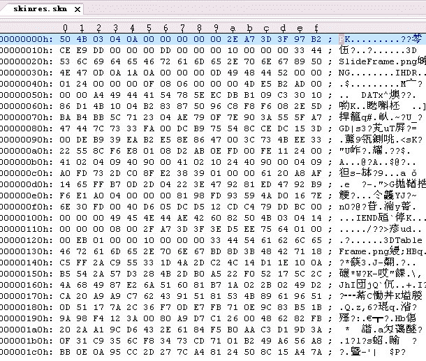

既然此法行不通 那就自己想其他办法搞定吧~

### 第一步:用 `PEID` 查壳

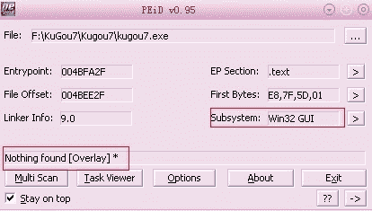

`PEID` 啥都没发现..但是 `LINKER INFO` 显示是 `9.0`

我是初入门 这也不知道具体啥意思 反正按通常的步骤往下走~

### 第二步:既然网上说可以修改外部文件来实现,那就给我们一个信息就是:关于显示广告的参数可能保存在外部文件而非 `PE` 文件里面~所以这个时候用 `FILEMON` 工具监视一下:

`FILEMON` 设置如下:

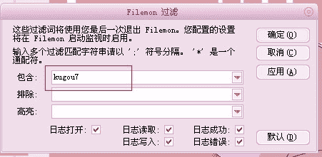

(具体操作参照老大们的<加密与解密>)

检测到的自我感觉有用的信息如下:

(1)酷狗 7 有个自我崩溃测试功能:`[跟楼的兄弟指出 这个是用来发给开发人员的 不是程序自我保护 谢谢指出]`

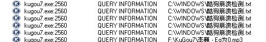

等会儿就会发现,这个自我崩溃的子功能会一定层度上保护了软件的被入侵或者被修改~

(2)酷狗 7 首先会读取

`C:\Documents and Settings\计算机用户名\Application Data\KuGou7` 文件夹下的 配置文件 各种小图片 等

以及根目录下的文件等~包括之前提到的经过加密处理的`[skinres.skn]`

### 第三步:用 `REGMON` 工具(操作类似 `FILEMON`)监控酷狗 7 的一系列注册表操作~

检测到的信息如下:

除了基本的配置信息之外,还有安装日期等,基本上没有异常

### 第四步:用 `OD` 直接反汇编试试(本人用的是虚拟机反汇编 因为现在有一些软件有很强的反 `OD` 检测 万一发现有 `INT3` 等中断指定加入就会自动死机或者自动崩溃,之前也发现的酷狗 7 有自我崩溃检查功能 所以用虚拟机比较方便(重启开机等))

经过 10 秒后 代码出来了 入口就是:

```
008BFA2F > $ E8 7F5D0100 call 008D57B3
008BFA34 .^ E9 79FeFFFF jmp 008BF8B2
008BFA39 $ C3 retn
008BFA3A /$ B8 01638D00 mov eax, 008D6301
008BFA3F |. A3 0432A300 mov dword ptr [A33204], eax
008BFA44 |. C705 0832A300>mov dword ptr [A33208], 008D59E8
008BFA4E |. C705 0C32A300>mov dword ptr [A3320C], 008D599C
008BFA58 |. C705 1032A300>mov dword ptr [A33210], 008D59D5
008BFA62 |. C705 1432A300>mov dword ptr [A33214], 008D593E
008BFA6C |. A3 1832A300 mov dword ptr [A33218], eax
008BFA71 |. C705 1C32A300>mov dword ptr [A3321C], 008D6279 ; 入口地址
008BFA7B |. C705 2032A300>mov dword ptr [A33220], 008D595A ; 入口地址
008BFA85 |. C705 2432A300>mov dword ptr [A33224], 008D58BC ; 入口地址
008BFA8F |. C705 2832A300>mov dword ptr [A33228], 008D5849 ; 入口地址
```

如果你经常反自己写的软件的话 会发现入口和自己写的软件不一样~进来就是一个 `CALL` 然后就是 `JMP` 猜测有可能是之前有代码加密 这个第一个 `CALL` 应该是代码解密~

(新手 妄自揣测 见笑~)

现在对我们的目的进行分析 我们的目的是要去掉酷狗上面那长长的恶心的广告:


因为有 `WIN32` 汇编 和 16 位汇编以及 `C` 的编程经验 所以我第一感觉这应该是一个位图处理,以及这是一个在线广告,(之前断网测试过 断网情况下 是显示不了 `GIF` 格式的广告的~)于是就想到了 `CreateFile` `BitBlt` `Revt` `Send` `CreateBitmap` 等几个函数~

于是查看所有函数调用 首先对所有 `BitBlt` 函数下断:(为什么先对 `BitBlt` 下断?因为..按函数排列后它在最前面 最容易找..见笑)~

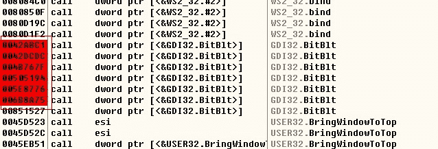

之后在一个一个函数跟进去对函数操作的前面指令下断(方便观察参数入栈)

然后按 `F9` 让程序运行起来~

发现程序中断在此:`[7C81EB33]`

```
7C81EB2D FF15 0415807C call dword ptr [<&ntdll.RtlRaiseExcep>; ntdll.RtlRaiseException
7C81EB33 5E pop esi ; 07076750
7C81EB34 C9 leave
7C81EB35 C2 1000 retn 10
7C81EB38 85FF test edi, edi
```

仔细分析这并不是程序领空,并不用想太多 继续按 `F9` 让程序继续走~

程序再次中断 此处发现是正好中断在 `BITBLT` 函数之前~:

```
005E874F |. 8B5424 1C mov edx, dword ptr [esp+1C] ;我下的断点~
005E8753 |. 8B4C24 20 mov ecx, dword ptr [esp+20]
005E8757 |. 2B4C24 18 sub ecx, dword ptr [esp+18]
005E875B |. 68 2000CC00 push 0CC0020 ; /ROP = SRCCOPY
005E8760 |. 6A 08 push 0 ; |YSrc = 0 (0.)
005E8762 |. 6A 08 push 0 ; |XSrc = 0 (0.)
005E8764 |. 8BD8 mov ebx, eax ; |
005E8766 |. 8B4424 30 mov eax, dword ptr [esp+30] ; |
005E876A |. 56 push esi ; |hSrcDC
005E876B 2BC2 sub eax, edx
005E876D 50 push eax
005E876E 51 push ecx
005E876F 52 push edx
005E8770 8B5424 34 mov edx, dword ptr [esp+34]
005E8774 |. 52 push edx ; |XDest
005E8775 |. 55 push ebp ; |hDestDC
005E8776 |. FF15 48519500 call dword ptr [<&GDI32.BitBlt>] ; \BitBlt
```

从 `005E874F` 开始按 `F8` 单步跟入~

我们知道 `BITBLT` 函数的参数是:

```
BOOL BitBlt(int x,int y,int nWidth,int nHeight,CDC*pSrcDC,int xSrc,int ySrc,DWORD dwRop);
```

`x`：目标矩形区域的左上角 `x` 轴坐标点。

`y`：目标矩形区域的左上角 `y` 轴坐标点。

`nWidth`：在目标设备中绘制位图的宽度。

`nHight`：在目标设备中绘制位图的高度。

`pSrcDC`：源设备上下文对象指针。

`xSrc`：源设备上下文的起点 `x` 轴坐标，函数从该起点复制位图到目标设备。

`ySrc`：源设备上下文的起点 `y` 轴坐标，函数从该起点复制位图到目标设备。

`dwRop`：光栅操作代码

单步入发现

```
BitBlt(,ebp,0,0,26C,3C,esi,0,0,DWORD dwRop);
```

这里有用的信息是`(26C,3C)` 显然是 `620*60` 仔细看一下 正是广告的长和高!

在这里似乎发现了达到目的的关键代码~于是 我们把它修改为:

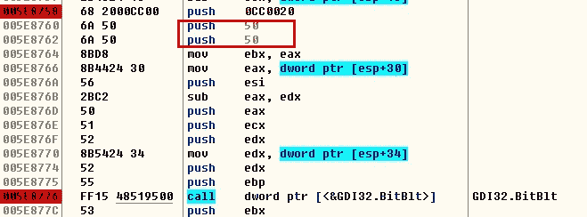

把显示起点坐标从`(0,0)`设置为`(0x50,0x50)` 因为酷狗有崩溃检查功能 这里为了以防万一 只修改常量 不修改寄存器和内存 若这里修改有效 则广告的显示位置即将移位 `(若移位 则验证了这段代码的关键性)`~

修改完后别着急下一步,直接 另存文件 运行试试:

运行第一秒:

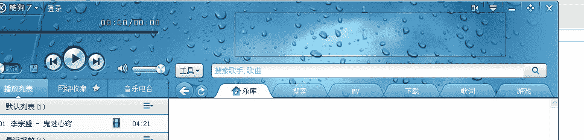

运行第二秒后:

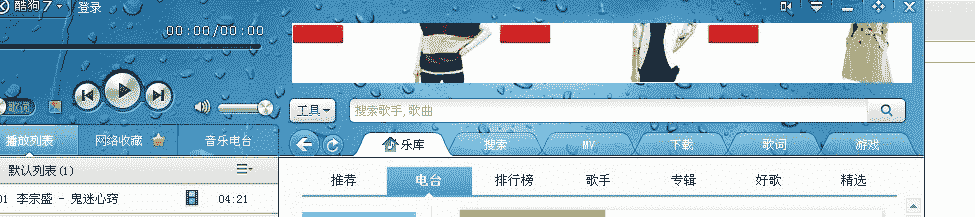

运行前 2 秒 看不到广告 第三秒后广告重新出现~

分析下 这原因应该是

前两秒出现的应该就是代码修改的地方

两秒后再出现的广告 应该是通过网络传输的 而且处理代码也和前两秒的不一样~这说明 我们之前修改后的文件只达到的一点点目的 而没有达到完全去掉广告`但是我们最少确定了 广告框的属性是 620X60(0x26c,0x3c)`

接下来 我们来到 `M` 窗口 因为之前

```
005E874F |. 8B5424 1C mov edx, dword ptr [esp+1C] ;我下的断点~
005E8753 |. 8B4C24 20 mov ecx, dword ptr [esp+20]
005E8757 |. 2B4C24 18 sub ecx, dword ptr [esp+18]
005E875B |. 68 2000CC00 push 0CC0020 ; /ROP = SRCCOPY
005E8760 |. 6A 08 push 0 ; |YSrc = 0 (0.)
005E8762 |. 6A 08 push 0 ; |XSrc = 0 (0.)
005E8764 |. 8BD8 mov ebx, eax ; |
005E8766 |. 8B4424 30 mov eax, dword ptr [esp+30] ; |
005E876A |. 56 push esi ; |hSrcDC
005E876B 2BC2 sub eax, edx
005E876D 50 push eax
005E876E 51 push ecx
005E876F 52 push edx
005E8770 8B5424 34 mov edx, dword ptr [esp+34]
005E8774 |. 52 push edx ; |XDest
005E8775 |. 55 push ebp ; |hDestDC
005E8776 |. FF15 48519500 call dword ptr [<&GDI32.BitBlt>] ; \BitBlt
```

这段代码里 我们发现 广告框的大小属性是从 `012xxxx` 的内存位置读出来的 我们现在直接去到内存窗口 然后 `CTRL+B` 查找 输入 `3C`:

发现:

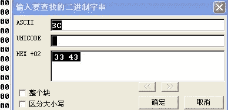

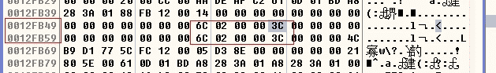

`(0x26C,0x3C)`这对数据被保存在内存的两个地方~`(这是否可以解释为 一对用于初始显示 一对用于通过网络获取广告 GIF 后二次显示?)`

尝试修改内存:

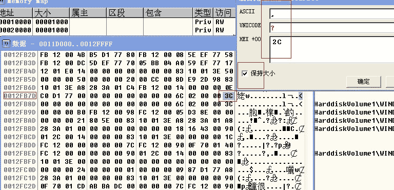

然后再次按运行 会发现程序还是不听话 并没有达到要求,然后尝试用 `KEYMAKE` 工具修改 内存 记下内存地址后~生成内存补丁,发现还是不行~

那是不是说明数据真正的保存在外部文件呢?每次显示的时候重新从外部获取?这暂时来说也有可能~但是肯定不是明码的出现在内存 这是值得肯定的(自我认为~)

为了验证自己的猜想 我现在直接在 `CUP` 窗口 现在反汇编窗口 `F9` 让程序跑起来(程序自解密) 然后中断下来 估计如果有加密的话 应该也解掉密了~

直接查找常量:`3C`

发现有很多 `3C` 没办法 按 `CTRL+L` 一个一个找 终于发现一处可疑的地方:

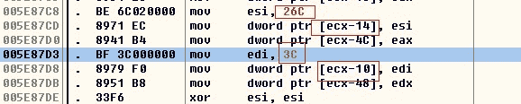

这里 `3C` 和 `26C` 都出现了 在这里下断 看看程序把数据放到内存的什么地方 一看 果然放在 `BitBlt` 函数取出的地址处~这里似乎看到的胜利的曙光~别急 我们修改 `3C` 看看(`26C` 太大 修改小了会出现 `NOP` 指令 可能会引发酷狗崩溃检查程序`[跟楼的兄弟指出 这里有误 崩溃检测是用来给开发人员用的 出现 NOP 指令的观点也不正确 再次感谢 ]` 所以我们要在不影响指令大小的情况下修改 把 `3C` 修改为 `0`),然后保存文件 退出 `OD` 运行酷狗 7 果然广告看不到了`[因为(620,0) 显示不出来]`

我们在放一首歌 听上几次 看看会不会出什么问题~

最后发现果然没什么问题 酷狗崩溃程序也没发现到~在这里去长幅广告也算完成(去下角的小广告直接修改配置文件就可以)~

修改后效果:

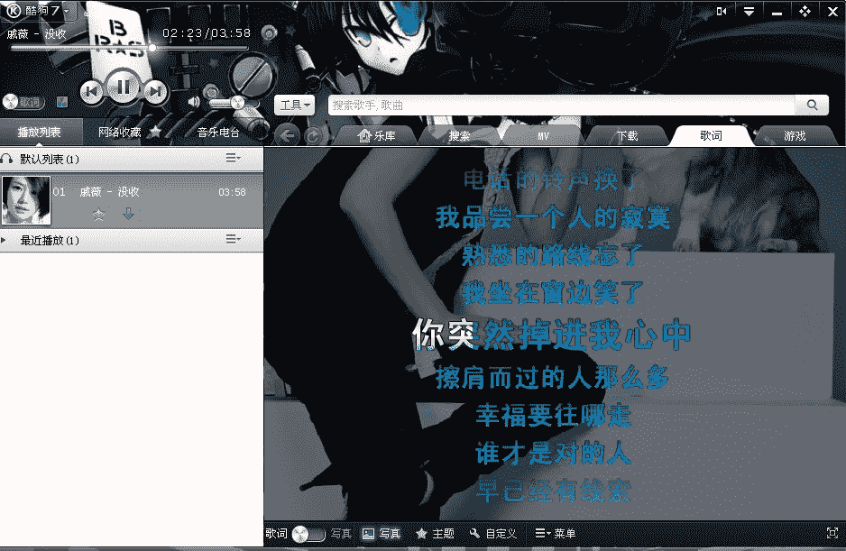

小弟初入门 若有错误 请各位指出~~切莫见笑

望..版主发个激活码(没 `KX` 下载各位朋友帖子的东西不方面学习啊...万分感激)!


附上修改后的酷狗 exe：`http://dl.dbank.com/c0gwjzdka2`

另外图片不知道怎么上传..就直接附件了 不好意思
