# WMV to AVI MPEG DVD WMV Converter 1.4.8

> 原文：[`www.pediy.com/kssd/pediy08/pediy8-83.htm`](https://www.pediy.com/kssd/pediy08/pediy8-83.htm)

FCG 学员区资料，转载请注明。

目标：`apis32 v 2.5`
保护方式：`RSA8`

以前 `ArchFire`/`ATA` 写过，但你看了这片文章可能会有新的收获。

另一个目标：`WMV to AVI MPEG DVD WMV Converter 1.4.8`
保护方式：`RSA256`
`http://www.alloksoft.com/wmv.htm`

## 1. Brief Introduction to RSA

取自 `RSA-Tool 2` 的 Help。

### 1.1. About RSA

RSA is a Public Key Cryptosystem developed in 1977 by Ronald Rivest, Adi Shamir and Leonard Adleman. Since 09-20-2000 the U.S. Patent #4,405,829 on this Algorithm EXPIRED! That means that the Algorithm is Public Domain now and can be used by everyone for free, even in commercial software.

### 1.2. Parameters

*   `P = 1st large prime number`
*   `Q = 2nd large prime number (sizes of P and Q should not differ too much!)`
*   `E = Public Exponent (a random number which must fulfill : GCD(E, (P-1)*(Q-1))==1)`
*   `N = Public Modulus, the product of P and Q: N=P*Q`
*   `D = Private Exponent: D=E^(-1) mod ((P-1)*(Q-1))`

Parameters `N` and `E` are public whereas `D` is -private- and must NEVER be published! `P` and `Q` are not longer needed after keygeneration and should be destroyed.

To obtain `D` from the public key `(N, E)` one needs to try splitting `N` in its both prime factors `P` and `Q`. For a large Modulus `N (512 bit and more)` with carefully chosen primefactors `P` and `Q` this is a very difficult problem.

All the security of the `RSA` encryption scheme relies on that integer factorization problem (tough there's no mathematical proof for it). To find out more read here:
`http://www.rsasecurity.com/rsalabs/challenges/factoring/rsa155.html`

### 1.3. Encryption

To encrypt a messageblock `(M)` (which must be < `N`), compute:

`Ciphertext = C = M^E mod N.`

Note: If the entire message `(M)` is > `N` it must be split into smaller blocks with size < `N`

### 1.4. Decryption

To decrypt a given Ciphertext `(C)` to retrieve the Plaintext `(M)` as result, compute: `M=C^D mod N`. The `' ^ '` sign in the above equations means `'power of'`, not `XOR`!

Note that the `RSA` scheme does also work the other way round: `C=M^D mod N` and `M=C^E mod N`. It's on you how you implement it. Just ALWAYS make SURE that you -NEVER- publish the private exponent `D`, `P` and/or `Q` !

## 2. Make a keygen for apis32 v2.5

### 2.1 Tools used

【Dynamic Debugger】`OllyDBG v1.10 fly` 修改版

### 2.2 Trace registration code checking routine

好啦，开工，用 `OD` 载入目标 `apis32.exe`，这个程序是加壳了的，弹出消息框“要继续分析吗？”，选择“否”，停留在入口点：

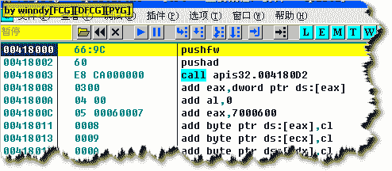

**汇编指令注释：**

`PUSHFW` pushes the bottom 16 bits of the flags register (or the whole flags register, on processors below a 386) onto the stack.

`PUSHAD` pushes, in succession, `EAX`, `ECX`, `EDX`, `EBX`, `ESP`, `EBP`, `ESI` and `EDI` on the stack, decrementing the stack pointer by a total of 32. The value of `SP` or `ESP` pushed is its original value, as it had before the instruction was executed.

这是具有压缩壳特色的开头，壳的结尾必定是用 `popad`，`popfw`，来还原寄存器。下面我们就搜索这两条指令，`ctrl+S`，搜索

`Popad`
`Popfw`

找到了：

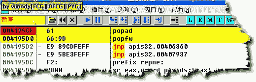

光标停留在 `popad` 那一行，`F2` 下断点，再 `F9` 运行，中断在 `popad`，`F7` 单步，执行 `jmp 00406360`，后到达程序入口点：

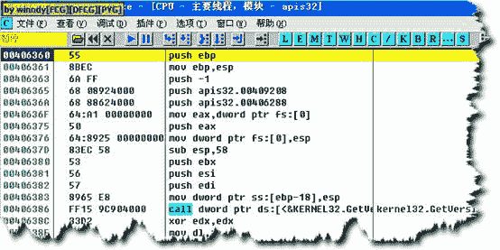

然后用 `OllyDUMP` 插件 Dump 出程序，`Rebuild import` 选项中选 `method 2`，dump 出的程序保存为 `aris32_unpacked.exe`，运行，OK。

到达 `OEP` 的第二种方法(ESP 定律)：

载入 `apis32`，下硬件断点：`HR esp,(esp=0012FFC4)`

`F9` 运行，中断在：`004195D2 - E9 89CDFEFF jmp apis32.00406360`，这时注意观察：`ESP＝0012FFC4.`

与下断点时的 `esp` 相同。这就是堆栈平衡原理，压缩壳在运行解压的程序时，应保证堆栈的安全，否则程序会崩溃。

**注释：**

Hardware breakpoints or `BPM` (Breakpoint on Memory) use the Debug Registers. In the architectural x86 (+386) 4 debug registers (`DR0-DR3`) exists in the processor. So we can only set 4 `BPM`. The `DR4` and `DR5` are reserved registers, the `DR6` register is for the debugger and the `DR7` register still using for the type of break for the `DR0-DR3` registers.

脱壳完毕，下面就去跟踪脱壳后的程序，追踪注册码的检验过程。

先在注册窗口输入任意用户名和注册码，看其提示信息，然后再搜索字符串，找到提示信息，这样就定位到注册码校验的代码附近了。

右键，搜索，字符串，然后看到全部字符串：

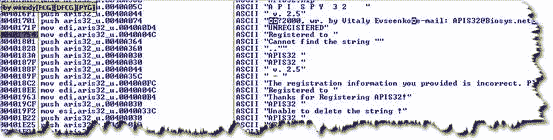

敏感字符串真多啊！

如图，`F2` 下断，再双击下断的那一行，来到程序中，往上翻，

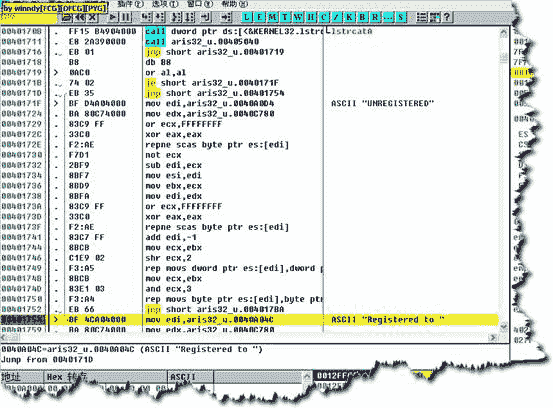

看红色线，是从上面 `0040171D` 跳过来的。上面一句是 `je`，如果注册码校验失败，`je` 就跳了，注册码成功，`je` 不跳，下一句跳到 `00401754`。

再往上看：

```
00401711 |. E8 2A390000 call aris32_u.00405040
```

显然，这个 `call` 就是用来检验注册码的。光标停在 `00401711` 这一行，回车，进入这个 `call`，在这个 `call` 开头下断点。

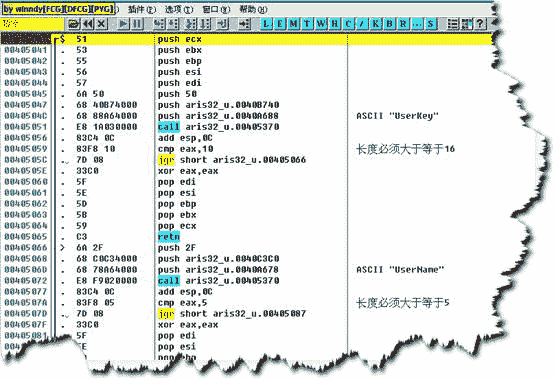

重新载入脱壳后的程序，进入注册窗口，输入用户名：`winndy`，注册码：`1234567890`

断在 `00405040`，执行 `call 00405370` 后，发现，`eax＝0A`，这是输入的假注册码：“`1234567890`”的长度。

同理，用户名的长度也要大于等于 5。

更改注册码长度为 16，`1234567890abcdef`，重新跟踪。

```
004050DA |. BE 41B74000 mov esi,aris32_u.0040B741 ; ASCII "234567890abcdef"
004050DF |. BF 54B74000 mov edi,aris32_u.0040B754 ; ASCII "123456780abcdef"
```

从这里我们可以看到，第 9 个字符被去掉了，因此注册码格式为：`12345678-90abcdef`。

```
004050E4 |> 57 /push edi
004050E5 |. E8 E6010000 |call aris32_u.004052D0 \=è见下面
004050EA |. 8ACB |mov cl,bl ；bl 是计数器，初值为 0
004050EC |. 83C4 04 |add esp,4
004050EF |. 80C1 50 |add cl,50
004050F2 |. 83C7 02 |add edi,2 ；指针后移
004050F5 |. 32C1 |xor al,cl ；与返回结果 Xor
004050F7 |. FEC3 |inc bl
004050F9 |. 8846 FF |mov byte ptr ds:[esi-1],al ；保存运算结果
004050FC |. C606 00 |mov byte ptr ds:[esi],0
004050FF |. 46 |inc esi
00405100 |. 80FB 08 |cmp bl,8
00405103 |.^ 72 DF \\jb short aris32_u.004050E4
```

`004050E5` 处调用的函数：

```
004052D0 /$ 8B4C24 04 mov ecx,dword ptr ss:[esp+4] ; aris32_u.0040B754
004052D4 |. 8A01 mov al,byte ptr ds:[ecx]
004052D6 |. 3C 39 cmp al,39 ；<=9?
004052D8 |. 7E 04 jle short aris32_u.004052DE
004052DA |. 04 C9 add al,0C9 ；41h＋C9＝10A
004052DC |. EB 02 jmp short aris32_u.004052E0
004052DE |. 04 D0 add al,0D0 ；39＋D0＝109
004052E0 |. 8A49 01 mov cl,byte ptr ds:[ecx+1]
004052E3 |. 80F9 39 cmp cl,39
004052E6 |. 7E 09 jle short aris32_u.004052F1 ;<=9?
004052E8 |. C0E0 04 shl al,4 ;左移 4 位
004052EB |. 80E9 37 sub cl,37 ；
004052EE |. 0AC1 or al,cl ；合并为一个字节
004052F0 |. C3 retn
004052F1 |. C0E0 04 shl al,4
004052F4 |. 80E9 30 sub cl,30
004052F7 |. 0AC1 or al,cl
004052F9 \\. C3 retn
```

上面这段程序的功能是讲输入的注册码字符串，每两个转化为一个 `byte`，例：“`12`”转化为 `12h`。

再往下面看。

```
00405300 /$ 53 push ebx
00405301 |. 55 push ebp
00405302 |. 8B6C24 10 mov ebp,dword ptr ss:[esp+10]
00405306 |. 56 push esi
00405307 |. 57 push edi
00405308 |. 8B7C24 14 mov edi,dword ptr ss:[esp+14]
0040530C |. 33C9 xor ecx,ecx
0040530E |. 2BFD sub edi,ebp
00405310 |. 897C24 18 mov dword ptr ss:[esp+18],edi
00405314 |. EB 04 jmp short aris32_u.0040531A
00405316 |. 8B7C24 18 /mov edi,dword ptr ss:[esp+18]
0040531A |. 8D3429 lea esi,dword ptr ds:[ecx+ebp]
0040531D |. 33D2 |xor edx,edx
0040531F |. B8 01000000 |mov eax,1
00405324 |. C74424 14 07000>|mov dword ptr ss:[esp+14],7 //这是循环计数器
0040532C |. 8A1437 |mov dl,byte ptr ds:[edi+esi] //取一个 byte，由注册码变换而来
0040532F |. 8BFA |mov edi,edx
00405331 |. 8BD7 |/mov edx,edi
00405333 |. 0FAFC2 ||imul eax,edx
00405336 |. 3D 99880000 ||cmp eax,8899
0040533B |. 7E 0A ||jle short aris32_u.00405347
0040533D |. 99 ||cdq
0040533E |. BB 99880000 ||mov ebx,8899
00405343 |. F7FB ||idiv ebx
00405345 |. 8BC2 ||mov eax,edx //Mod 8899，取余数
00405347 |. 8B5424 14 ||mov edx,dword ptr ss:[esp+14]
```


```
0040534B   |.  4A                |dec edx
0040534C   |.  895424 14         |mov dword ptr ss:[esp+14],edx
00405350   |.^ 75 DF            |\jnz short aris32_u.00405331
00405352   |.  99               |cdq
00405353   |.  BF BB000000      |mov edi,0BB
00405358   |.  F7FF            |idiv edi
0040535A   |.  41               |inc ecx
0040535B   |.  83F9 08         |cmp ecx,8
0040535E   |.  8816            |mov byte ptr ds:[esi],dl   //mod 0BB，保存余数
00405360   |.  C60429 00       |mov byte ptr ds:[ecx+ebp],0
00405364   |.^ 7C B0           \jl short aris32_u.00405316
00405366   |.  5F              pop edi
00405367   |.  5E              pop esi
00405368   |.  5D              pop ebp
00405369   |.  5B              pop ebx
0040536A   \.  C3              retn
```

继续往下看：

```
0040514B   |.  80F9 08         cmp cl,8                              ; cl 是用户名长度
0040514E   |.  884C24 10       mov byte ptr ss:[esp+10],cl
00405152   |.  73 30           jnb short aris32_u.00405184           ;长度<8 时，补到 8 位
00405154   |.  8B5424 10       mov edx,dword ptr ss:[esp+10]
00405158   |.  BF C0C34000     mov edi,aris32_u.0040C3C0            ; ASCII "winndy"
0040515D   |.  81E2 FF000000   and edx,0FF
00405163   |.  83C9 FF         or ecx,FFFFFFFF
00405166   |.  81C2 5EB74000   add edx,aris32_u.0040B75E            ; ASCII "winndy"
0040516C   |.  F2:AE          repne scas byte ptr es:[edi]
0040516E   |.  F7D1           not ecx
00405170   |.  2BF9           sub edi,ecx
00405172   |.  8BC1           mov eax,ecx
00405174   |.  8BF7           mov esi,edi
00405176   |.  8BFA           mov edi,edx
00405178   |.  C1E9 02        shr ecx,2
0040517B   |.  F3:A5          rep movs dword ptr es:[edi],dword ptr es:[esi]
0040517D   |.  8BC8           mov ecx,eax
0040517F   |.  83E1 03        and ecx,3
00405182   |.  F3:A4          rep movs byte ptr es:[edi],byte ptr es:[esi]
00405184   |> C605 66B74000 0 mov byte ptr ds:[40B766],0           ；用户名长度补足 8 位了
0040518B   |.  B9 54B74000     mov ecx,aris32_u.0040B754            ；ecx 指向注册码变换二来的 8 个 bytes
00405190   |.  BE 08000000     mov esi,8
00405195   |> 8A01            /mov al,byte ptr ds:[ecx]
00405197   |.  3C 20          |cmp al,20
00405199   |.  73 0E          |jnb short aris32_u.004051A9
0040519B   |.  33D2           |xor edx,edx                    ；标志直接清 0
0040519D   |.  25 FF000000    |and eax,0FF
004051A2   |.  8A51 0A        |mov dl,byte ptr ds:[ecx+A]     ；ecx+A 指向用户名
004051A5   |.  0BD0           |or edx,eax
004051A7   |.  EB 0C          |jmp short aris32_u.004051B5
004051A9   |> 33D2           |xor edx,edx                 ；
004051AB   |.  25 FF000000    |and eax,0FF
004051B0   |.  8A51 0A        |mov dl,byte ptr ds:[ecx+A]
004051B3   |.  33D0           |xor edx,eax                   

; 比较，如果 edx=eax，会置 edx 为零
004051B5   |> 03EA           |add ebp,edx                   

; ebp 保存比较结果，如果每次 edx 都为 0，则 ebp 最终也为 0
004051B7   |.  41             |inc ecx
004051B8   |.  4E             |dec esi
004051B9   |.^ 75 DA         \jnz short aris32_u.00405195
004051BB   |.  33C0           xor eax,eax
004051BD   |.  5F             pop edi
004051BE   |.  85ED           test ebp,ebp                     ; ebp 为 0 吗？
004051C0   |.  5E             pop esi
004051C1   |.  5D             pop ebp
004051C2   |.  0F94C0         sete al        ；置注册码比较成功标志
004051C5   |.  5B             pop ebx
004051C6   |.  59             pop ecx
004051C7   \.  C3             retn
```

至此，整个算法跟踪过来了。在下面一节里，总结一下算法。

### 2.3 `algorithm` `summary`

回顾一下验证过程：

1. 注册码长度大于等于 16
2. 用户名长度大于等于 5，不足 8 位的取用户名的前几位将其补足到 8 位。
3. 忽略注册码的第 9 位，第 9 位定为 `-`。
4. 依次取注册码的两位，保存为一个 `byte`，为方便起见，设注册码为十六进制字符 (当然也可一为非十六进制字符，因为程序没有去验证)，且注册码长度为 17，格式为：`XXXXXXXX-XXXXXXXX`。
5. 将 8 个 `bytes` 一次与 `50h`，…`57h` 异或。
6. 取出一个 `byte`，记为 `m`，`n=n×m`，`n` 的初值为 1，如果 `n` 大于 `8899H`，则 `mod` `8899H`，余数赋给 `n`。这样循环其次 7 次。
7. 将 `byte` `Mod` `0BBh`，保存余数。
8. 将这最终的 8 个 `bytes` 与用户名相比较，如果相等，则注册成功。

在下面的两节里，将用两种不同的思路来做出注册机来。

### 2.4 `write` `a` `keygen` `:Searching` `Table`

如何求出上面算法的逆运算呢？

倒着推导。

给定一个用户名，如 `winndy`，取一个 `byte`，难以求得注册码相应的一个 `byte`。因为第 6 步不好求逆。但大家不要忘了第 6 步取的是一个 `byte`，最多也只有 256 个，这样就可以采用穷举法：

对于从 0 到 255 的这些 `byte`，按照第 6 和第 7 步，将每个 `byte` 所对应的 `byte` 算出来，这样可以得到一个对应的表格，然后根据用户名的 `byte` 做为 `index`，查找表格就可以得到注册码的 `byte`，然后再与相应的 `50h`，..，`57h` 异或，即可得到注册码。

思路非常简单。

我用 `VB` 编了简单的程序，制作了表格，写出了注册机。详见源码。

注册机中加入了 `xm` 音乐，为此，花了我不少时间，最后找到 `uFMOD`，`Excellent`！

### 2.5 `write` `a` `keygen` `:RSA`

如果你了解 `RSA`，则可看出，第 6 步实际上是 `RSA` 运算。

参考了 `ArchFire/ATA` @2002-12-14 在看雪的文章：《`Api32` `keygen`: `learn` `how` `to` `use` `RSA`》。

2.4 节的注册机是我自己做的，后来参考看雪精华，才发现这篇好文章。在此之前，我未接触过用 `RSA` 的程序，也难怪啊！

废话打住，下面介绍 `RSA8`：

第 6 步：`C=((M⁷) mod 8899) mod 0bb=(M⁷) mod 0bb`, 因为 `8899 mod 0bb=0`

因此大数 `n=0BBh`。将 `n` 分解为两个素数的积，`n=11*0B,p=11h,q=0Bh,`

`f=(p-1)*(q-1)= 10*0a\=0a0`,从程序知 `e=7`，下面就找 `d`，使得：`(d*e) mod f=1`。

即为求 `e` 的模逆 (mod `f`). 这需要有数论的知识，

下面给出一个例子，手工用辗转相除法求模逆，实际中，用 `te!` 的 `RSA-Tool` 可以计算出 `d`，附录中还给出其它相关资料： ![]

好了，本例中，我们的 `d` 为：`d=17h`。有兴趣的可以去算一下，加深理解。

于是，由用户名求注册码的过程即为：

`M=(C¹⁷) mod 0BBh`

详见注册机源码，与穷举法比较一下，好好体会。

### 2.6 `Some` `Questions` `and` `Assignment`

1. 程序中并没有对输入的 `byte` 作要求，实际 `RSA` 算法应使 `C` 小于 `0BBh`，因此我们的注册码不是唯一的，这是我通过穷举法发现的。给出一个例子：

`Winnhijk`

`7B6F1011-4E6B5B6A` ＝＝》 `RSA` 算法求得

`B6A8AFAE-81AC9EAF`

`B6A8AFAE-81AC9E6A`

`B6A810AE-81AC9E6A`

我们在求得 `M` 后，`M` 是小于 `0BBh` 的，事实上如果我们将 `M` 加上 `0BBh`，如果 `M` 仍小于 256，即仍为一个 `byte`，继续参加后面的 `xor` 运算，得到的注册码仍是正确的。

在方法 1，由穷举得到的表格中可以很明显地看出来。

2. 根据验证过程，注册码长度大于等于 16 都是可以的，而且去掉第 9 个字符后的注册码个数也不一定为偶数，注册码也不一定要为 16 进制字符，试想一下：

考虑把最后两个字符换成一个非 16 进制字符，比如 `z` (ascii 为 `7Ah`)，`7Ah+C9h=143`,由 `z` 求得的 `al` 等于多少？`z` 代替哪两个 16 进制字符？请下去自己尝试一下。（答案是 `F0`）

`F0 xor 57＝A7` ，`A7――>28`（()

`Winnhij(`

`7B6F1011-4E6B5BF0`  `7B6F1011-4E6B5Bz`

反之，给出两个十六进制字符，其对应的非十六进制字符存在吗？如果存在，是多少？

3. 请用其他编程语言，写出注册机。

4. 注册码保存在注册表中：`HKEY_LOCAL_MACHINE\SOFTWARE\APIS32`

上面是 `RSA8`，加密的明文是 8 `bytes`，下面来看一个 `RSA256`，加密的数是 256 个 `bits`，看作一个 256 进制的数。在内存中有 32 个 `bytes`，高位在后，低位在前，这一点务必要清楚。

## 3. `Make` `a` `keygen` `for` `WMV` `to` `AVI` `MPEG` `DVD` `WMV` `Converter` `v1.4.8`

### 3.1 `Tools` `used`

【`Dynamic` `Debugger`】 `OllyDBG` `v1.10` `fly` 修改版

【`Other`】 `RSA-Tool` `2` `v17` `by` `tE!` \[TMG\]

PPSIQS `V1.1` `by` `Satoshi` `Tomabechi` `2001`

PPSIQS `V1.1` `download` `URL`： `http://www.asahi-net.or.jp/~KC2H-MSM/cn/`

### 3.2 `Trace` `registration` `code` `checking` `routine`

载入 `WMV` `to` `AVI` `MPEG` `DVD` `WMV` `Converter.exe`，这个程序是没有加壳的。

首先输入 `winndy`， `1234567890`，看看提示信息。

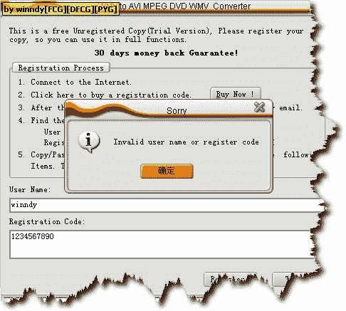

右键，搜速，字符串：

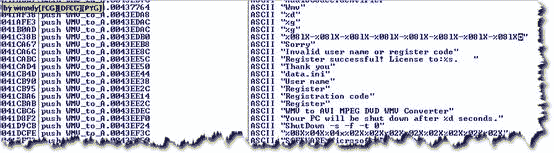

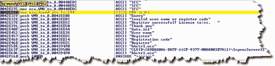

看到错误提示字符串了吧？老规矩，下断。

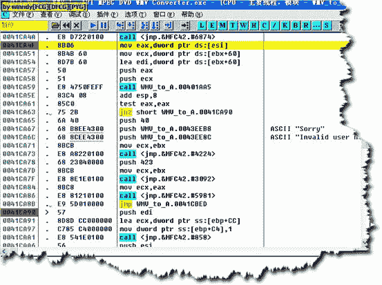

注意 `0041CA63` 处的 `jnz`，前面 `0041CA59` 处的 `call` 就是注册码验证关键部分。

在 `0041CA4F` 处下断，然后 `F7` 跟进 `call` `00401AA5`。

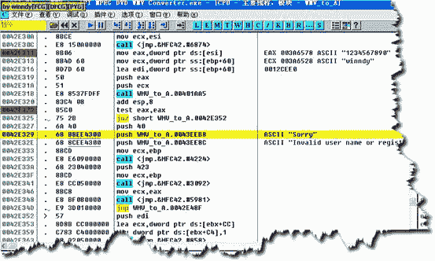

同理，上面也下断。

输入假注册码后，停留在 `0042E311`。

`F7` 进入 `00401AA5`：

```
00401AA5    $ /E9 76A70100     jmp WMV_to_A.0041C220
0041C220    > \6A F           >push -1
0041C222    .  68 1          >push WMV_to_A.00431D19             ;  SE handler installation
0041C227    .  64:A        >mov eax,dword ptr fs:[0]
0041C22D    .  50        push eax
0041C22E    .  64:8       >mov dword ptr fs:[0],esp
0041C235    .  81EC      >sub esp,94
0041C23B    .  8B84     >mov eax,dword ptr ss:[esp+A4]
0041C242    .  53        push ebx
0041C243    .  56        push esi
0041C244    .  50        push eax
0041C245    .  8D4C     >lea ecx,dword ptr ss:[esp+10]
0041C249    .  C744     >mov dword ptr ss:[esp+60],CD49046B
0041C251    .  C744     >mov dword ptr ss:[esp+64],829A80CB
0041C259    .  C744     >mov dword ptr ss:[esp+68],3F5157C0
0041C261    .  C744     >mov dword ptr ss:[esp+6C],B50C6384
0041C269    .  C744     >mov dword ptr ss:[esp+70],AA56D550
0041C271    .  C744     >mov dword ptr ss:[esp+74],B05ADF71
0041C279    .  C744     >mov dword ptr ss:[esp+78],7B2E3CD4
0041C281    .  C744     >mov dword ptr ss:[esp+7C],CFB69AC3
```

注意上面这些 `dword`，一共 256 个 `bits`，组成大数 `n`。

`D` `esp+60`

下面是内存中的数据：

```
0012C 634  6B 04 49 CD CB 80 9A 82  k 

* * *

I 退€殏 

0012C63C  C0 57 51 3F 84 63 0C B5  繵 Q?刢.
0012C644  50 D5 56 AA 71 DF 5A B0  P 誚猶遉
0012C64C  D4 3C 2E 7B C3 9A B6 CF  ?.{脷断
```

`RSA256`，这是 256 进制数，低位在前，高位在后，

`N＝CFB69AC37B2E3CD4B05ADF71AA56D550B50C63843F5157C0829A80CBCD49046B`

利用 `RSA－Tool` 将其转化为十进制数：


## 93951393961625247111454448822519571285412527322314031847324223587660098765931

也许有人要问，究竟是怎么识别算法为 `RSA256` 的，这主要靠经验了，首先需要熟悉各种加密算法，了解各种算法的常数，其次还要注意观察特征。都不行时，还得靠慢慢分析，这需要有很大的耐心。

```asm
0041C289    .   E8 E>call <jmp.&MFC42.#537>     ; kernel32.lstrlenA;MSVCRT.memcpy
0041C28E    .   8B8C>mov ecx,dword ptr ss:[esp+B0]
0041C295    .   C784>mov dword ptr ss:[esp+A4],0
0041C2A0    .   51   push ecx
0041C2A1    .   8D4C>lea ecx,dword ptr ss:[esp+C]
0041C2A5    .   E8 C>call <jmp.&MFC42.#537>
0041C2AA    .   8B54>mov edx,dword ptr ss:[esp+C]
0041C2AE    .   8B35>mov esi,dword ptr ds:[<&MSVCRT._mbsc>; msvcrt._mbscmp
0041C2B4    .   68 6>push WMV_to_A.0043FC60       ; /s2 = ""
0041C2B9    .   52   push edx                     ; |s1
0041C2BA    .   C684>mov byte ptr ss:[esp+AC],1   ; |
0041C2C2    .   FFD6 call esi                     ; \\_mbscmp
0041C2C4    .   83C4>add esp,8
0041C2C7    .   85C0 test eax,eax
0041C2C9    .   0F84>je WMV_to_A.0041C4DE         ; 不跳
0041C2CF    .   8B44>mov eax,dword ptr ss:[esp+8]
0041C2D3    .   68 6>push WMV_to_A.0043FC60
0041C2D8    .   50   push eax
0041C2D9    .   FFD6 call esi                     ; msvcrt._mbscmp
0041C2DB    .   83C4>add esp,8
0041C2DE    .   85C0 test eax,eax
0041C2E0    .   0F84>je WMV_to_A.0041C4DE         ; 不跳
0041C2E6    .   57   push edi
0041C2E7    .   6A 0>push 0
0041C2E9    .   8D4C>lea ecx,dword ptr ss:[esp+44]
0041C2ED    .   E8 8>call WMV_to_A.00401974
0041C2F2    .   6A 0>push 0
0041C2F4    .   8D4C>lea ecx,dword ptr ss:[esp+4C]
0041C2F8    .   C684>mov byte ptr ss:[esp+AC],2
0041C300    .   E8 6>call WMV_to_A.00401974
0041C305    .   B3 0>mov bl,3
0041C307    .   68 0>push 10001
```

注意这一句，这也是 `RSA` 的一个特征，`E = Public Exponent`，`E` 一般等于 `10001H`。

```asm
0041C30C    .   8D4C>lea ecx,dword ptr ss:[esp+5C]
0041C310    .   889C>mov byte ptr ss:[esp+AC],bl
0041C317    .   E8 5>call WMV_to_A.00401974       ; BigCreate
0041C31C    .   8D4C>lea ecx,dword ptr ss:[esp+58]
0041C320    .   C684>mov byte ptr ss:[esp+A8],4
0041C328    .   51   push ecx
0041C329    .   8D4C>lea ecx,dword ptr ss:[esp+4C]
0041C32D    .   E8 4>call WMV_to_A.00402072
0041C332    .   8D4C>lea ecx,dword ptr ss:[esp+58]
0041C336    .   889C>mov byte ptr ss:[esp+A8],bl
0041C33D    .   E8 5>call WMV_to_A.00401F96
0041C342    .   8D54>lea edx,dword ptr ss:[esp+60]
0041C346    .   6A 0>push 8
0041C348    .   52   push edx
0041C349    .   8D4C>lea ecx,dword ptr ss:[esp+48]
0041C34D    .   E8 9>call WMV_to_A.00401AEB       ; -----
0041C352    .   B9 0>mov ecx,8
0041C357    .   33C0 xor eax,eax
0041C359    .   8D7C>lea edi,dword ptr ss:[esp+18]
0041C35D    .   8D54>lea edx,dword ptr ss:[esp+2C]
0041C361    .   F3:A>rep stos dword ptr es:[edi]
0041C363    .   8D44>lea eax,dword ptr ss:[esp+34]
0041C367    .   8D4C>lea ecx,dword ptr ss:[esp+30]
0041C36B    .   50   push eax
0041C36C    .   51   push ecx
0041C36D    .   8D44>lea eax,dword ptr ss:[esp+30]
0041C371    .   52   push edx
0041C372    .   8D4C>lea ecx,dword ptr ss:[esp+30]
0041C376    .   50   push eax
0041C377    .   8D54>lea edx,dword ptr ss:[esp+30]
0041C37B    .   51   push ecx
0041C37C    .   8D44>lea eax,dword ptr ss:[esp+30]
0041C380    .   52   push edx
0041C381    .   8B54>mov edx,dword ptr ss:[esp+24]
0041C385    .   8D4C>lea ecx,dword ptr ss:[esp+30]
0041C389    .   50   push eax
0041C38A    .   51   push ecx
0041C38B    .   68 B>push WMV_to_A.0043EDB0       ; |format = "%08lX-%08lX-%08lX-%08lX-%08lX-%08lX-%08lX-%08lX"
```

注意这个格式化字符串，这也就是注册码的格式。

所以下次就按照注册码的正确格式来输入假注册码：

`12345678-90abcdef-12345678-90abcdef-12345678-90abcdef-12345678-90abcdef`

```asm
0041C390    .   52   push edx                     ; |s
0041C391    .   FF15>call dword ptr ds:[<&MSVCRT.sscanf>] ; \\sscanf
0041C397    .   8B44>mov eax,dword ptr ss:[esp+50] ; 注册码第五段，
0041C39B    .   8B4C>mov ecx,dword ptr ss:[esp+4C] ; 第四段，
0041C39F    .   8B7C>mov edi,dword ptr ss:[esp+48] ; 第三段，
0041C3A3    .   8B54>mov edx,dword ptr ss:[esp+44] ; 第二段，
0041C3A7    .   03C1 add eax,ecx
0041C3A9    .   8B4C>mov ecx,dword ptr ss:[esp+5C] ; 第八段
0041C3AD    .   03C7 add eax,edi
0041C3AF    .   8B7C>mov edi,dword ptr ss:[esp+58] ; 第七段
0041C3B3    .   03C2 add eax,edx
0041C3B5    .   8B54>mov edx,dword ptr ss:[esp+54] ; 第 6 段
0041C3B9    .   33C8 xor ecx,eax
0041C3BB    .   8B44>mov eax,dword ptr ss:[esp+40] ; 第一段，eax＝12345678
0041C3BF    .   83C4>add esp,28                   ；调整堆栈
0041C3C2    .   03D0 add edx,eax
0041C3C4    .   894C>mov dword ptr ss:[esp+34],ecx ；结果保存之
0041C3C8    .   33FA xor edi,edx
0041C3CA    .   6A 0>push 0                       ；堆栈调整，esp－4
0041C3CC    .   8D4C>lea ecx,dword ptr ss:[esp+3C]
0041C3D0    .   897C>mov dword ptr ss:[esp+34],edi ；结果保存之
```

经过变换后的注册码为：

```text
0012C718  78 56 34 12 EF CD AB 90  xV4 锿珢
0012C720  78 56 34 12 EF CD AB 90  xV4 锿珢
0012C728  78 56 34 12 EF CD AB 90  xV4 锿珢
0012C730  1F 72 D4 B0 21 85 6B D5  ­r 园!卥
```

可以看到第 7 个 `dword` 和第 8 个 `dword` 变了。设第 `i` 个 `dword` 为 `code(i)`,

`Code(8)= (code(5)+code(4)+code(3)+code(2)) Xor code(8)`

`code(7) =(code(1)+code(6)) xor code(7)`

下面就用 `RSA256` 对这个 256 进制数进行解密，解密出来的数据经过高低位字节交换后，是用户名，则注册成功。

```asm
0041C3D4    .   E8 9>call WMV_to_A.00401974
0041C3D9    .   8D4C>lea ecx,dword ptr ss:[esp+18]
0041C3DD    .   6A 0>push 8
0041C3DF    .   51   push ecx
0041C3E0    .   8D4C>lea ecx,dword ptr ss:[esp+40]
0041C3E4    .   C684>mov byte ptr ss:[esp+B0],5
0041C3EC    .   E8 F>call WMV_to_A.00401AEB       ; BigCreate
0041C3F1    .   8D54>lea edx,dword ptr ss:[esp+38]
0041C3F5    .   8D44>lea eax,dword ptr ss:[esp+50]
0041C3F9    .   52   push edx
0041C3FA    .   50   push eax
0041C3FB    .   8D4C>lea ecx,dword ptr ss:[esp+48]
0041C3FF    .   E8 2>call WMV_to_A.00401E33       ; 这个 call 可以不理
0041C404    .   B9 0>mov ecx,8
0041C409    .   33C0 xor eax,eax
0041C40B    .   8D7C>lea edi,dword ptr ss:[esp+18]
0041C40F    .   6A 0>push 8
0041C411    .   F3:A>rep stos dword ptr es:[edi]  ; 0012C718 起始处的数据块清 0
0041C413    .   8D4C>lea ecx,dword ptr ss:[esp+1C]
0041C417    .   C684>mov byte ptr ss:[esp+AC],6
0041C41F    .   51   push ecx
0041C420    .   8D4C>lea ecx,dword ptr ss:[esp+58]
0041C424    .   E8 0>call WMV_to_A.0040202C       ；DeRSA
```

经过这个 `call` 之后，注册码数据区变为：

```text
D 0012C718

0012C718  43 CA 85 DB E3 C4 39 C3  C 蕝坫?
0012C720  42 CE 4B 65 67 3C A3 C5  B 蜬 eg<Ｅ
0012C728  05 0D 29 7E 07 06 81 1F  .)~?
0012C730  D8 1D 83 37 33 4A F9 80  ??3J 鶂
```

```asm
0041C429    .   B9 0>mov ecx,8                     ; 0012C718
0041C42E    .   33C0 xor eax,eax
0041C430    .   8DBC>lea edi,dword ptr ss:[esp+80]
0041C437    .   F3:A>rep stos dword ptr es:[edi]
0041C439    .   5F   pop edi
0041C43A    >   8A54>mov dl,byte ptr ss:[esp+eax+17]    ; esp+14=0012C718
0041C43E    .   8A4C>mov cl,byte ptr ss:[esp+eax+16]    ; esp+7C=0012C780
0041C442    .   8854>mov byte ptr ss:[esp+eax+7C],dl
0041C446    .   8B54>mov edx,dword ptr ss:[esp+eax+14]
0041C44A    .   884C>mov byte ptr ss:[esp+eax+7D],cl
0041C44E    .   8A4C>mov cl,byte ptr ss:[esp+eax+14]
0041C452    .   C1EA>shr edx,8
0041C455    .   8854>mov byte ptr ss:[esp+eax+7E],dl
0041C459    .   884C>mov byte ptr ss:[esp+eax+7F],cl
0041C45D    .   83C0>add eax,4
0041C460    .   83F8>cmp eax,20
0041C463    .^ 7C D>jl short WMV_to_A.0041C43A      ; Big Endian 变换
```

通过观察，上面这个循环将一个 `dword` 的高低字节交换。

```text
0012C718  43 CA 85 DB E3 C4 39 C3  C 蕝坫?
0012C720  42 CE 4B 65 67 3C A3 C5  B 蜬 eg<Ｅ
0012C728  05 0D 29 7E 07 06 81 1F  .)~?
0012C730  D8 1D 83 37 33 4A F9 80  ??3J 鶂
```

变换为：

```text
0012C780  DB 85 CA 43 C3 39 C4 E3  蹍蔆?你
0012C788  65 4B CE 42 C5 A3 3C 67  eK 蜝牛<g
0012C790  7E 29 0D 05 1F 81 06 07  ~).­?
0012C798  37 83 1D D8 80 F9 4A 33  7?貈鵍 3
```


### 3.2 Disassembly Analysis

```
0041C465    .  8D 54>lea edx,dword ptr ss:[esp+7C]        ;  0012C780
0041C469    .  8D 4C>lea ecx,dword ptr ss:[esp+10]
0041C46D    .  52    push edx
0041C46E    .  E8 0>call <jmp.&MFC42.#537>    ;  kernel32.lstrlenA;MSVCRT.memcpy
0041C473    .  8B 44>mov eax,dword ptr ss:[esp+10]        ;  eax 是由注册码经 RSA 解密得来的字符串
0041C477    .  8B 4C>mov ecx,dword ptr ss:[esp+C]         ;  ecx 指向用户名

D ecx

003A6620  77 69 6E 6E 64 79 00 BA  winndy.
003A6628  0D F0 AD BA 0D F0 AD BA  .瓠?瓠
003A6630  0D F0 AD BA 0D F0 AD BA  .瓠?瓠
003A6638  0D F0 AD BA 0D F0 AD BA  .瓠?瓠

0041C47B    .  50    push eax
0041C47C    .  51    push ecx
0041C47D    .  FFD6 call esi                                  ;  msvcrt._mbscmp
```

关键的比较，注册码由 `RSA` 解密，与用户名进行比较。

```
0041C47F    .  83 C4>add esp,8
0041C482    .  8D 4C>lea ecx,dword ptr ss:[esp+10]
0041C486    .  85 C0 test eax,eax
0041C488    .  C6 84>mov byte ptr ss:[esp+A4],6
0041C490    .  0F 84>je WMV_to_A.0041C51C             ;  要跳
0041C496    .  E8 A>call <jmp.&MFC42.#800>
0041C49B    .  8D 4C>lea ecx,dword ptr ss:[esp+4C]
0041C49F    .  C6 84>mov byte ptr ss:[esp+A4],5
0041C4A7    .  E8 E>call WMV_to_A.00401F96
0041C4AC    .  8D 4C>lea ecx,dword ptr ss:[esp+34]
0041C4B0    .  88 9C>mov byte ptr ss:[esp+A4],bl
0041C4B7    .  E8 D>call WMV_to_A.00401F96
0041C4BC    .  8D 4C>lea ecx,dword ptr ss:[esp+44]
0041C4C0    .  C6 84>mov byte ptr ss:[esp+A4],8
0041C4C8    .  E8 C>call WMV_to_A.00401F96
0041C4CD    .  8D 4C>lea ecx,dword ptr ss:[esp+3C]
0041C4D1    .  C6 84>mov byte ptr ss:[esp+A4],1
0041C4D9    .  E8 B>call WMV_to_A.00401F96
0041C4DE    >  8D 4C>lea ecx,dword ptr ss:[esp+8]
0041C4E2    .  C6 84>mov byte ptr ss:[esp+A4],0
0041C4EA    .  E8 5>call <jmp.&MFC42.#800>
0041C4EF    .  8D 4C>lea ecx,dword ptr ss:[esp+C]
0041C4F3    .  C7 84>mov dword ptr ss:[esp+A4],-1
0041C4FE    .  E8 4>call <jmp.&MFC42.#800>
0041C503    .  5E    pop esi
0041C504    .  33 C0 xor eax,eax                          ;  flag
0041C506    .  5B    pop ebx
0041C507    .  8B 8C>mov ecx,dword ptr ss:[esp+94]
0041C50E    .  64:8>mov dword ptr fs:[0],ecx
0041C515    .  81 C4>add esp,0A0
0041C51B    .  C3    retn
0041C51C    >  E8 2>call <jmp.&MFC42.#800>
0041C521    .  8D 4C>lea ecx,dword ptr ss:[esp+4C]
0041C525    .  C6 84>mov byte ptr ss:[esp+A4],5
0041C52D    .  E8 6>call WMV_to_A.00401F96
0041C532    .  8D 4C>lea ecx,dword ptr ss:[esp+34]
0041C536    .  88 9C>mov byte ptr ss:[esp+A4],bl
0041C53D    .  E8 5>call WMV_to_A.00401F96
0041C542    .  8D 4C>lea ecx,dword ptr ss:[esp+44]
0041C546    .  C6 84>mov byte ptr ss:[esp+A4],9
0041C54E     .  E8 4>call WMV_to_A.00401F96
0041C553    .  8D 4C>lea ecx,dword ptr ss:[esp+3C]
0041C557    .  C6 84>mov byte ptr ss:[esp+A4],1
0041C55F    .  E8 3>call WMV_to_A.00401F96
0041C564    .  8D 4C>lea ecx,dword ptr ss:[esp+8]
0041C568    .  C6 84>mov byte ptr ss:[esp+A4],0
0041C570    .  E8 D>call <jmp.&MFC42.#800>
0041C575    .  8D 4C>lea ecx,dword ptr ss:[esp+C]
0041C579    .  C7 84>mov dword ptr ss:[esp+A4],-1
0041C584    .  E8 C>call <jmp.&MFC42.#800>
0041C589    .  8B 8C>mov ecx,dword ptr ss:[esp+9C]
0041C590    .  5E    pop esi
0041C591    .  B8 0>mov eax,1                          ;  flag
0041C596    .  5B    pop ebx
0041C597    .  64:8>mov dword ptr fs:[0],ecx
0041C59E    .  81 C4>add esp,0A0
0041C5A4    .  C3    retn
```

### 3.3 Algorithm Summary

现在回顾一下注册码的验证过程：

1.  注册码格式为：
    `12345678-90abcdef-12345678-90abcdef-12345678-90abcdef-12345678-90abcdef`
2.  注册码的第 7 段和第 8 段要由前 6 段来修改。
3.  修改后的 256 bits 数据，经 `RSA` 解密，得到一个 256 bits 数据。
4.  此 256 bits 数据的 `dword` 高低位交换，交换后如果等于用户名，则注册成功。

知道算法以后，下面就来写注册机，我用的编程语言为 `Win32ASM`，编程工具：`MASM8.2`。

### 3.4 Write a Keygen: RSA

最难的是大数 `N` 的分解，`N=p*q`，`RSA-Tool` 分解太慢，最好的工具是 `PPSIQS V1.1` by Satoshi Tomabechi 2001。

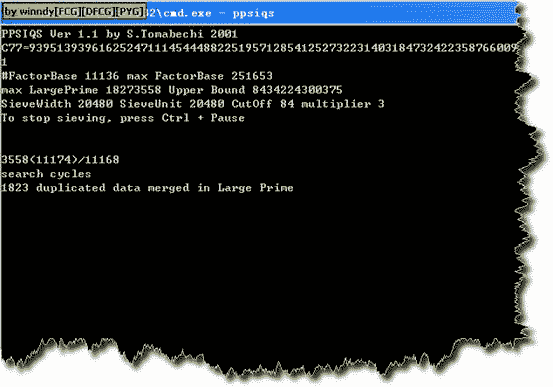

经过 1 个小时多一点(`P4 1.7G`)，分解完毕，结果保存在 `SIQS.LOG` 中，得到

`93951393961625247111454448822519571285412527322314031847324223587660098765931 = P39 * P39`

`P39 = 304268020309461933344817079717793018591`
`P39 = 308778404861838864852708240341186890741`

打开 `RSA-Tool`，将它们转为十六进制数：

`E4E7E39EE5E5C98788BF466DDCBAB2DF＝(304268020309461933344817079717793018591)`
`E84C8EBF8D5AA6A5ACB2569542DBCBF5＝(308778404861838864852708240341186890741)`

计算 `D`：

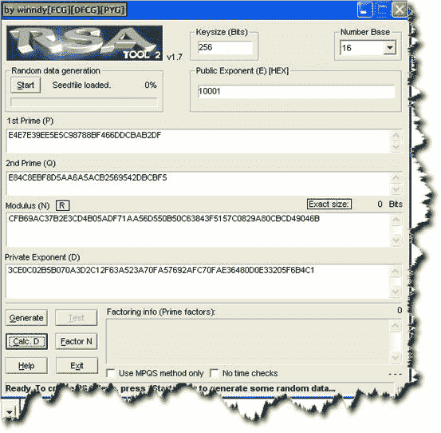

`D＝3CE0C02B5B070A3D2C12F63A523A70FA57692AFC70FAE36480D0E33205F6B4C1`
`＝27535870961668946496129164486976149735850411661692136930155875617194596807873`

利用 `C=M^D mod N` 便可以计算注册码了。

还是倒推。

用户名为 256 bits 数据，把用户名的 `ascii` 码每个 `dword` 经过高低字变换，保存为 `M`。

然后调用 `C=M^D mod N`，计算注册码 `C`，`C` 的第 7 段和第 8 段再经过 `Xor` 处理，再用格式化字符串输出，即为注册码：

`"%08lX-%08lX-%08lX-%08lX-%08lX-%08lX-%08lX-%08lX"`，关于 `wsprintf` 函数，见附录。

注册机采用了 `biglib v.0.01e` by fleur。感谢作者！

注册码保存在 `data.ini` 文件中，读取注册码：`GetPrivateProfileString`，写入注册码：`WritePrivateProfileString`。若用户名前后有空格，可以注册成功，但是下次运行时仍提示未注册。原因在于 `GetPrivateProfileString` 函数，忽略了字符串前后的空格。

### 3.5 Some Questions and Assignment

仔细体会一下，是如何识别出 `RSA` 算法的，例子中，识别出算法后，很多 `call` 的功能都不了解，但通过观察数据区的变化，仍写出了注册机。事实上，对于标准算法，例如，`MD5` 等，通常都是靠识别出特征，然后写出注册机的。即使看 `MD5` 的高级语言源码也很困难，更不用说去看汇编版的了，所以熟悉各种标准算法的特征是很关键的。

有兴趣的可以去尝试进入 `call` 跟踪一下，看能不能看懂某个 `call` 的功能，再用高级语言实现之。

还有一个任务，请尝试用其他语言写出注册机。另外，网上有个 `miracl` 库，全称是 `MIRACL - Multiprecision Integer and Rational Arithmetic C Library`。

## 4. Conclusion

本文介绍了用 `RSA` 算法保护的软件的破解方法。从简单的 `RSA8` 到复杂的 `RSA256`，并且给出了 `RSA8` 的穷举方法。还介绍了 `RSA-Tool 2 by te! [TMG]` 的使用方法，以及利用 `ppsiqs v1.1` 分解大数。还介绍了 `OllyDBG` 动态调试工具的基本使用方法。为了补充数论的知识，还给出了一个手动求模逆的例题。

## 5. Appendix

### 附录一：Euclid 算法

参考：[http://zhdf.blog.edu.cn/user2/52478/archives/2006/1073022.shtml](http://zhdf.blog.edu.cn/user2/52478/archives/2006/1073022.shtml)

今天在看 `RSA` 加密算法的时候看到了可以用扩充的 `euclid` 算法来简化 `d` 的计算。一查才发现原来 `euclid` 算法就是下面这个式子：

`GCD (a, b) = GCD (b, a % b)`

下面这个是著名求最大公约数的辗转相除算法的代码实现：

```c
int Euclid_Algorithm (int m, int n)  
{  
        int temp = m;
        if (!m || !n) return 0;  
        if (m < n)    {m = n; n = temp;}
        while (1) {  
                if (!(m = m % n)) return n;  
                if (!(n = n % m)) return m;  
        }  
}
```

而扩展的 `euclid` 算法的原理是这样的：

`k*k-1=1(mod 26)`
`k-1` 叫 `k` 的模逆，可以用扩展的 `Euclid` 算法求出来。
`ax = 1 (mod 26)` 其中 `x = a-1`
相当于 `ax + by = 1`，`b = 26`，求满足条件的一组 `x, y`。当然我们只要 `x` 就好。

现在考虑一般的 `ax + by = 1` 如何求解。

因为满足条件的 `x, y` 存在的条件是 `GCD(a, b) = 1`.
然后有 `ax + by = GCD (a, b)`
而同时有 `bx' + (a % b)y' = GCD (b, a % b)`
由 `Euclid` 定理 `GCD (a, b) = GCD (b, a % b)`
所以，有 `ax + by = bx' + (a % b)y'= bx' + (a - [a/b]*b)y'= bx' + ay' - [a/b]*b y'= ay' + b(x' - [a/b]y')`

对应，得 `x = y'`，`y = x' - [a/b]y'`。`[a/b]` 是 `a/b` 再取整。
特别的，在 `b = 0` 的时候，`GCD (a, b) = a = a * 1 + b * 0`
即 `x = 1`, `y = 0`

数论对于很多算法看来还是很有用的……

### 附录二：sscanf

`sscanf <stdio.h>`

```c
int sscanf(
   const char *buffer,
   const char *format [,
   argument ] ... 
);
```

**Parameters**

*   `buffer`
    Stored data
*   `format`
    Format-control string. For more information, see Format Specifications.
*   `argument`
    Optional arguments

**Return Value**

Each of these functions returns the number of fields successfully converted and assigned; the return value does not include fields that were read but not assigned. A return value of 0 indicates that no fields were assigned. The return value is `EOF` for an error or if the end of the string is reached before the first conversion.

**Remarks**

The `sscanf` function reads data from `buffer` into the location given by each `argument`. Every `argument` must be a pointer to a variable with a type that corresponds to a type specifier in `format`. The `format` argument controls the interpretation of the input fields and has the same form and function as the `format` argument for the `scanf` function. If copying takes place between strings that overlap, the behavior is undefined.

**Format Specification Fields: `scanf` and `wscanf` Functions**

A format specification has the following form:

`%[*] [width] [{h | l | I64 | L}]type`

The `format` argument specifies the interpretation of the input and can contain one or more of the following:


White-space characters: blank (`` ` ``); tab (`` \t ``); or newline (`` \n ``). A white-space character causes `scanf` to read, but not store, all consecutive white-space characters in the input up to the next non–white-space character. One white-space character in the format matches any number (including 0) and combination of white-space characters in the input.

Non–white-space characters, except for the percent sign (`%`). A non–white-space character causes `scanf` to read, but not store, a matching non–white-space character. If the next character in `stdin` does not match, `scanf` terminates.

Format specifications, introduced by the percent sign (`%`). A format specification causes `scanf` to read and convert characters in the input into values of a specified type. The value is assigned to an argument in the argument list.

The format is read from left to right. Characters outside format specifications are expected to match the sequence of characters in `stdin`; the matching characters in `stdin` are scanned but not stored. If a character in `stdin` conflicts with the format specification, `scanf` terminates, and the character is left in `stdin` as if it had not been read.

When the first format specification is encountered, the value of the first input field is converted according to this specification and stored in the location that is specified by the first argument. The second format specification causes the second input field to be converted and stored in the second argument, and so on through the end of the format string.

An input field is defined as all characters up to the first white-space character (space, tab, or newline), or up to the first character that cannot be converted according to the format specification, or until the field width (if specified) is reached. If there are too many arguments for the given specifications, the extra arguments are evaluated but ignored. The results are unpredictable if there are not enough arguments for the format specification.

Each field of the format specification is a single character or a number signifying a particular format option. The type character, which appears after the last optional format field, determines whether the input field is interpreted as a character, a string, or a number.

The simplest format specification contains only the percent sign and a type character (for example, `%s`). If a percent sign (`%`) is followed by a character that has no meaning as a format-control character, that character and the following characters (up to the next percent sign) are treated as an ordinary sequence of characters, that is, a sequence of characters that must match the input. For example, to specify that a percent-sign character is to be input, use `%%`.

An asterisk (`*`) following the percent sign suppresses assignment of the next input field, which is interpreted as a field of the specified type. The field is scanned but not stored

——By `windy`【FCG】【DFCG】【PYG】

———2006.3.10 完稿

`4dd466d0e1e0cc123afbe504da2462ca`
