# ECC 加密算法入门介绍

> 原文：[`www.pediy.com/kssd/pediy06/pediy6014.htm`](https://www.pediy.com/kssd/pediy06/pediy6014.htm)

作者：ZMWorm\[CCG\]

E-Mail：zmworm@sohu.com

主页：Http://ZMWorm.Yeah.Net/

## 前言

同 `RSA`（Ron Rivest，Adi Shamir，Len Adleman 三位天才的名字）一样，`ECC`（Elliptic Curves Cryptography，椭圆曲线密码编码学）也属于公开密钥算法。目前，国内详细介绍 `ECC` 的公开文献并不多（反正我没有找到）。有一些简介，也是泛泛而谈，看完后依然理解不了 `ECC` 的实质（可能我理解力太差）。前些天我从国外网站找到些材料，看完后对 `ECC` 似乎懵懂了。于是我想把我对 `ECC` 的认识整理一下，与大家分享。当然 `ECC` 博大精深，我的认识还很肤浅，文章中错误一定不少，欢迎各路高手批评指正，小弟我洗耳恭听，并及时改正。文章将采用连载的方式，我写好一点就贴出来一点。本文主要侧重理论，代码实现暂不涉及。这就要求你要有一点数学功底。最好你能理解 `RSA` 算法，对公开密钥算法有一个了解。《近世代数基础》《初等数论》之类的书，最好您先翻一下，这对您理解本文是有帮助的。别怕，我尽量会把语言通俗些，希望本文能成为学习 `ECC` 的敲门砖。

## 一、从平行线谈起

平行线，永不相交。没有人怀疑把：）不过到了近代这个结论遭到了质疑。平行线会不会在很远很远的地方相交了？事实上没有人见到过。所以“平行线，永不相交”只是假设（大家想想初中学习的平行公理，是没有证明的）。既然可以假设平行线永不相交，也可以假设平行线在很远很远的地方相交了。即平行线相交于无穷远点 `P∞`（请大家闭上眼睛，想象一下那个无穷远点 `P∞`，`P∞` 是不是很虚幻，其实与其说数学锻炼人的抽象能力，还不如说是锻炼人的想象力）。给个图帮助理解一下：

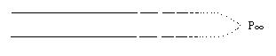

直线上出现 `P∞` 点，所带来的好处是所有的直线都相交了，且只有一个交点。这就把直线的平行与相交统一了。为与无穷远点相区别把原来平面上的点叫做平常点。

以下是无穷远点的几个性质。

*   直线 `L` 上的无穷远点只能有一个。
    （从定义可直接得出）
*   平面上一组相互平行的直线有公共的无穷远点。
    （从定义可直接得出）
*   平面上任何相交的两直线 `L1`、`L2` 有不同的无穷远点。
    （否则 `L1` 和 `L2` 有公共的无穷远点 `P`，则 `L1` 和 `L2` 有两个交点 `A`、`P`，故假设错误。）
*   平面上全体无穷远点构成一条**无穷远直线**。（自己想象一下这条直线吧）
*   平面上全体无穷远点与全体平常点构成**射影平面**。

## 二、射影平面坐标系

射影平面坐标系是对普通平面直角坐标系（就是我们初中学到的那个笛卡儿平面直角坐标系）的扩展。我们知道普通平面直角坐标系没有为无穷远点设计坐标，不能表示无穷远点。为了表示无穷远点，产生了射影平面坐标系，当然射影平面坐标系同样能很好的表示旧有的平常点（数学也是“向下兼容”的）。

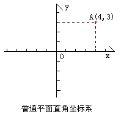

我们对普通平面直角坐标系上的点 `A` 的坐标 `(x,y)` 做如下改造：

令 `x=X/Z`，`y=Y/Z`（`Z≠0`）；则 `A` 点可以表示为 `(X:Y:Z)`。

变成了有三个参量的坐标点，这就对平面上的点建立了一个新的坐标体系。

**例 2.1**：求点 `(1,2)` 在新的坐标体系下的坐标。

**解**：∵`X/Z=1`，`Y/Z=2`（`Z≠0`）∴`X=Z`，`Y=2Z` ∴坐标为 `(Z:2Z:Z)`，`Z≠0`。即 `(1:2:1)` `(2:4:2)` `(1.2:2.4:1.2)` 等形如 `(Z:2Z:Z)`，`Z≠0` 的坐标，都是 `(1,2)` 在新的坐标体系下的坐标。

我们也可以得到直线的方程 `aX+bY+cZ=0`（想想为什么？提示：普通平面直角坐标系下直线一般方程是 `ax+by+c=0`）。新的坐标体系能够表示无穷远点么？那要让我们先想想无穷远点在哪里。根据上一节的知识，我们知道无穷远点是两条平行直线的交点。那么，如何求两条直线的交点坐标？这是初中的知识，就是将两条直线对应的方程联立求解。平行直线的方程是：

`aX+bY+c[1]Z =0`；`aX+bY+c[2]Z =0` (`c[1]≠c[2]`)；

（为什么？提示：可以从斜率考虑，因为平行线斜率相同）；

将二方程联立，求解。有 `c[2]Z= c[1]Z= -(aX+bY)`，∵`c[1]≠c[2]` ∴`Z=0` ∴`aX+bY=0`；

所以无穷远点就是这种形式 `(X：Y：0)` 表示。注意，平常点 `Z≠0`，无穷远点 `Z=0`，因此无穷远直线对应的方程是 `Z=0`。

**例 2.2**：求平行线 `L1`：`X+2Y+3Z=0` 与 `L2`：`X+2Y+Z=0` 相交的无穷远点。

**解**：因为 `L1∥L2` 所以有 `Z=0`，`X+2Y=0`；所以坐标为 `(-2Y:Y:0)`，`Y≠0`。即 `(-2:1:0)` `(-4:2:0)` `(-2.4:1.2:0)` 等形如 `(-2Y:Y:0)`，`Y≠0` 的坐标，都表示这个无穷远点。

看来这个新的坐标体系能够表示射影平面上所有的点，我们就把这个能够表示射影平面上所有点的坐标体系叫做**射影平面坐标系**。

**练习**：

1.  求点 `A(2,4)` 在射影平面坐标系下的坐标。
2.  求射影平面坐标系下点 `(4.5:3:0.5)`，在普通平面直角坐标系下的坐标。
3.  求直线 `X+Y+Z=0` 上无穷远点的坐标。
4.  判断：直线 `aX+bY+cZ=0` 上的无穷远点 和 无穷远直线与直线 `aX+bY=0` 的交点，是否是同一个点？

## 三、椭圆曲线

上一节，我们建立了射影平面坐标系，这一节我们将在这个坐标系下建立椭圆曲线方程。因为我们知道，坐标中的曲线是可以用方程来表示的（比如：单位圆方程是 `x²+y²=1`）。椭圆曲线是曲线，自然椭圆曲线也有方程。

**椭圆曲线的定义**：

一条椭圆曲线是在射影平面上满足方程

`Y²Z+a[1]XYZ+a[3]YZ²=X³+a[2]X²Z+a[4]XZ²+a[6]Z³`

----------------\[3-1\]

的所有点的集合，且曲线上的每个点都是非奇异（或光滑）的。

**定义详解**：

*   `Y²Z+a[1]XYZ+a[3]YZ² = X³+a[2]X²Z+a[4]XZ²+a[6]Z³` 是 `Weierstrass` 方程（维尔斯特拉斯，Karl Theodor Wilhelm Weierstrass, 1815-1897），是一个齐次方程。
*   椭圆曲线的形状，并不是椭圆的。只是因为椭圆曲线的描述方程，类似于计算一个椭圆周长的方程（计算椭圆周长的方程，我没有见过，而对椭圆线积分（设密度为 1）是求不出来的。谁知道这个方程，请告诉我呀^\_^），故得名。

我们来看看椭圆曲线是什么样的。

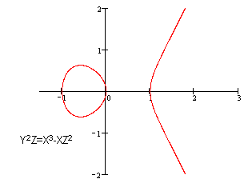
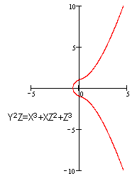

*   所谓“非奇异”或“光滑”的，在数学中是指曲线上任意一点的偏导数 `Fx`，`Fy`，`Fz` 不能同时为 0。如果你没有学过高等数学，可以这样理解这个词，即满足方程的任意一点都存在切线。
*   下面两个方程都不是椭圆曲线，尽管他们是方程\[3-1\]的形式。

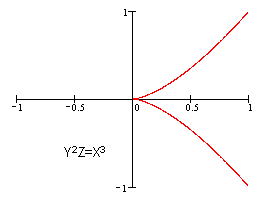
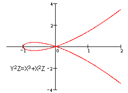

因为他们 在 `(0:0:1)` 点处（即原点）没有切线。

*   椭圆曲线上有一个无穷远点 `O∞`(0:1:0)，因为这个点满足方程\[3-1\]。

知道了椭圆曲线上的无穷远点。我们就可以把椭圆曲线放到普通平面直角坐标系上了。因为普通平面直角坐标系只比射影平面坐标系少无穷远点。我们在普通平面直角坐标系上，求出椭圆曲线上所有平常点组成的曲线方程，再加上无穷远点 `O∞`(0:1:0)，不就构成椭圆曲线了么？

我们设 `x=X/Z`，`y=Y/Z` 代入方程\[3-1\]得到：

`y²+a[1]xy+a[3]y = x³+a[2]x²+a[4]x+a[6]`

-------------------------\[3-2\]

也就是说满足方程\[3-2\]的光滑曲线加上一个无穷远点 `O∞`，组成了椭圆曲线。为了方便运算，表述，以及理解，今后论述椭圆曲线将主要使用\[3-2\]的形式。

本节的最后，我们谈一下求椭圆曲线一点的切线斜率问题。

由椭圆曲线的定义可以知道，椭圆曲线是光滑的，所以椭圆曲线上的平常点都有切线。而切线最重要的一个参数就是斜率 `k`。

**例 3.1**：求椭圆曲线方程 `y²+a[1]xy+a[3]y=x³+a[2]x²+a[4]x+a[6]` 上，平常点 `A(x,y)` 的切线的斜率 `k`。

**解**：

令 `F(x,y)= y²+a[1]xy+a[3]y-x³-a[2]x²-a[4]x-a[6]`

求偏导数

`Fx= a[1]y-3x²-2a[2]x-a[4]`

`Fy= 2y+a[1]x +a[3]`

则导数为：

`f'(x)=- Fx/ Fy=-( a[1]y-3x²-2a[2]x-a[4])/(2y+a[1]x +a[3])`

`= (3x²+2a[2]x+a[4]-a[1]y) /(2y+a[1]x +a[3])`

所以

`k=(3x²+2a[2]x+a[4]-a[1]y) /(2y+a[1]x +a[3])`

------------------------\[3-3\]

看不懂解题过程没有关系，记住结论\[3-3\]就可以了。

**练习**：

1.  将给出图例的椭圆曲线方程 `Y²Z=X³-XZ²` 和 `Y²Z=X³+XZ²+Z³` 转换成普通平面直角坐标系上的方程。

## 四、椭圆曲线上的加法

上一节，我们已经看到了椭圆曲线的图象，但点与点之间好象没有什么联系。我们能不能建立一个类似于在实数轴上加法的运算法则呢？天才的数学家找到了这一运算法则

自从近世纪代数学引入了群、环、域的概念，使得代数运算达到了高度的统一。比如数学家总结了普通加法的主要特征，提出了加群（也叫交换群，或 `Abel`（阿贝尔）群），在加群的眼中。实数的加法和椭圆曲线的上的加法没有什么区别。这也许就是数学抽象把：）。关于群以及加群的具体概念请参考近世代数方面的数学书。

**运算法则**：任意取椭圆曲线上两点 `P`、`Q` （若 `P`、`Q` 两点重合，则做 `P` 点的切线）做直线交于椭圆曲线的另一点 `R’`，过 `R’` 做 `y` 轴的平行线交于 `R`。我们规定 `P+Q=R`。（如图）

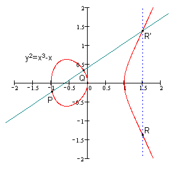
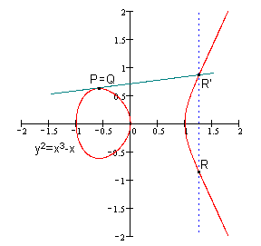

**法则详解**：

*   这里的 `+` 不是实数中普通的加法，而是从普通加法中抽象出来的加法，他具备普通加法的一些性质，但具体的运算法则显然与普通加法不同。
*   根据这个法则，可以知道椭圆曲线无穷远点 `O∞` 与椭圆曲线上一点 `P` 的连线交于 `P’`，过 `P’` 作 `y` 轴的平行线交于 `P`，所以有 无穷远点 `O∞+ P = P`。这样，无穷远点 `O∞` 的作用与普通加法中零的作用相当（`0+2=2`），我们把无穷远点 `O∞` 称为 **零元**。同时我们把 `P’` 称为 `P` 的**负元**（简称，负 `P`；记作，`-P`）。（参见下图）

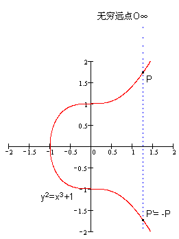

*   根据这个法则，可以得到如下结论：如果椭圆曲线上的三个点 `A`、`B`、`C`，处于同一条直线上，那么他们的和等于零元，即 `A+B+C= O∞`
*   `k` 个相同的点 `P` 相加，我们记作 `kP`。如下图：`P+P+P = 2P+P = 3P`。

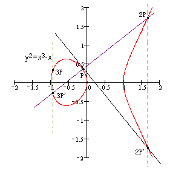

下面，我们利用 `P`、`Q` 点的坐标 `(x[1],y[1])`，`(x[2],y[2])`，求出 `R=P+Q` 的坐标 `(x[4],y[4])`。

**例 4.1**：求椭圆曲线方程 `y²+a[1]xy+a[3]y=x³+a[2]x²+a[4]x+a[6]` 上，平常点 `P(x[1],y[1])`，`Q(x[2],y[2])` 的和 `R(x[4],y[4])` 的坐标。

**解**：

(1) 先求点 `-R(x[3],y[3])`

因为 `P,Q,-R` 三点共线，故设共线方程为 `y=kx+b`,其中

若 `P≠Q(P,Q` 两点不重合) 则

直线斜率 `k=(y[1]-y[2])/(x[1]-x[2])`

若 `P=Q(P,Q` 两点重合) 则直线为椭圆曲线的切线，故由例 3.1 可知：

`k=(3x[2]+2a[2]x+a[4] -a[1]y) /(2y+a[1]x+a[3])`

因此 `P,Q,-R` 三点的坐标值就是方程组：

`y²+a[1]xy+a[3]y=x³+a[2]x²+a[4]x+a[6]`

-----------------\[1\]

`y=(kx+b)`

-----------------\[2\]

的解。

将\[2\]，代入\[1\] 有

`(kx+b)²+a[1]x(kx+b)+a3 =x³+a[2]x²+a[4]x+a[6]`

--------\[3\]

对\[3\]化为一般方程，根据三次方程根与系数关系（当三次项系数为 1 时；-`x[1]x[2]x[3]` 等于常数项系数， `x[1]x[2]+x[2]x[3]+x[3]x[1]` 等于一次项系数，-(`x[1]+x[2]+x[3]`) 等于二次项系数。）

所以

`-(x[1]+x[2]+x[3])=a[2]-ka[1]-k²`

`x[3]=k²+ka[1]+a[2]+x[1]+x[2]`

---------------------求出点 `-R` 的横坐标

因为 `k=(y[1]-y[3])/(x[1]-x[3])` 故

`y[3]=y[1]-k(x[1]-x[3])`

-------------------------------求出点 `-R` 的纵坐标

(2) 利用 `-R` 求 `R`

显然有

`x[4]=x[3]= k²+ka[1]+a[2]+x[1]+x[2]`

--------------求出点 `R` 的横坐标

而 `y[3] y[4]` 为 `x=x[4]` 时 方程 `y²+a[1]xy+a[3]y=x[3]+a[2]x[2]+a[4]x+a[6]` 的解

化为一般方程 `y²+(a[1]x+a[3])y-(x³+a[2]x²+a[4]x+a[6])=0` , 根据二次方程根与系数关系得：

`-(a[1]x+a[3])=y[3]+y[4]`

故

`y[4]=-y[3]-(a[1]x+a[3])=k(x[1]-x[4])-y[1]-(a[1]x[4]+a[3])`

---------------求出点 `R` 的纵坐标

即：

`x[4]=k²+ka[1]+a[2]+x[1]+x[2]`

`y[4]=k(x[1]-x[4])-y[1]-a[1]x[4]-a[3]`

本节的最后，提醒大家注意一点，以前提供的图像可能会给大家产生一种错觉，即椭圆曲线是关于 `x` 轴对称的。事实上，椭圆曲线并不一定关于 `x` 轴对称。如下图的 `y²-xy=x³+1`

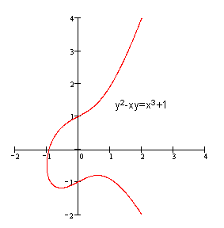

## 五、密码学中的椭圆曲线

我们现在基本上对椭圆曲线有了初步的认识，这是值得高兴的。但请大家注意，前面学到的椭圆曲线是连续的，并不适合用于加密；所以，我们必须把椭圆曲线变成离散的点。

让我们想一想，为什么椭圆曲线为什么连续？是因为椭圆曲线上点的坐标，是实数的（也就是说前面讲到的椭圆曲线是定义在实数域上的），实数是连续的，导致了曲线的连续。因此，我们要把椭圆曲线定义在有限域上（顾名思义，有限域是一种只有由有限个元素组成的域）。

域的概念是从我们的有理数，实数的运算中抽象出来的，严格的定义请参考近世代数方面的书。简单的说，域中的元素同有理数一样，有自己得的加法、乘法、除法、单位元(1)，零元(0),并满足交换率、分配率。

下面，我们给出一个有限域 `F[p]`，这个域只有有限个元素。

*   `F[p]` 中只有 `p`（`p` 为素数）个元素 `0,1,2 …… p-2,p-1`；
*   `F[p]` 的加法（`a+b`）法则是 `a+b≡c (mod p)`；即，(`a+c`)÷`p` 的余数 和 `c`÷`p` 的余数相同。
*   `F[p]` 的乘法(`a×b`)法则是 `a×b≡c (mod p)`；

`F[p]` 的除法(`a÷b`)法则是 `a/b≡c (mod p)`；即 `a×b^(\-1)≡c (mod p)`；（`b^(\-1)` 也是一个 0 到 `p-1` 之间的整数，但满足 `b×b^(\-1)≡1 (mod p)`；具体求法可以参考初等数论，或我的另一篇文章）。

`F[p]` 的单位元是 `1`，零元是 `0`。

同时，并不是所有的椭圆曲线都适合加密。`y²\=x³+ax+b` 是一类可以用来加密的椭圆曲线，也是最为简单的一类。下面我们就把 `y²\=x³+ax+b` 这条曲线定义在 `F[p]` 上：

选择两个满足下列条件的小于 `p`(`p` 为素数)的非负整数 `a`、`b`

`4a³+27b²≠0 (mod p)`

则满足下列方程的所有点(`x,y`)，再加上 无穷远点 `O∞` ，构成一条椭圆曲线。

`y²\=x³+ax+b (mod p)`

其中 `x,y` 属于 0 到 `p-1` 间的整数，并将这条椭圆曲线记为 `Ep(a,b)`。

我们看一下 `y²\=x³+x+1 (mod 23)` 的图像

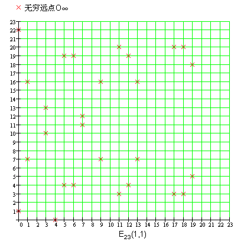

是不是觉得不可思议？椭圆曲线，怎么变成了这般模样，成了一个一个离散的点？

椭圆曲线在不同的数域中会呈现出不同的样子，但其本质仍是一条椭圆曲线。举一个不太恰当的例子，好比是水，在常温下，是液体；到了零下，水就变成冰，成了固体；而温度上升到一百度，水又变成了水蒸气。但其本质仍是 `H[2]O`。

`F[p]` 上的椭圆曲线同样有加法，但已经不能给以几何意义的解释。不过，加法法则和实数域上的差不多，请读者自行对比。

1. 无穷远点 `O∞` 是零元，有 `O∞+ O∞= O∞`，`O∞+P=P`
2. `P(x,y)` 的负元是 `(x,-y)`，有 `P+(-P)= O∞`
3. `P(x[1],y[1]),Q(x[2],y[2])` 的和 `R(x[3],y[3])` 有如下关系：

   `x[3]≡k²\-x[1]\-x[2]`

   `y[3]≡k(x[1]\-x[3])-y[1]`

   其中若 `P=Q` 则 `k=(3x²+a)/2y[1]` 若 `P≠Q`，则 `k=(y[2]\-y[1])/(x[2]\-x[1])`

**例 5.1** 已知 `E23(1,1)` 上两点 `P(3,10)`，`Q(9,7)`，求 1)`-P`，2)`P+Q`，3) `2P`。

**解**

1. `–P` 的值为 `(3,-10)`
2. `k=(7-10)/(9-3)=-1/2`，2 的乘法逆元为 12 因为 `2*12≡1 (mod 23)`
   `k≡-1*12 (mod 23)` 故 `k=11`。
   `x=11²\-3-9=109≡17 (mod 23);`
   `y=11[3-(-6)]-10=89≡20 (mod 23)`
   故 `P+Q` 的坐标为 `(17,20)`
3. `k=[3(3²)+1]/(2*10)=1/4≡6 (mod 23)`
   `x=6²\-3-3=30≡20 (mod 23)`
   `y=6(3-7)-10=-34≡12 (mod 23)`
   故 `2P` 的坐标为 `(7,12)`

最后，我们讲一下椭圆曲线上的点的阶。

如果椭圆曲线上一点 `P`，存在最小的正整数 `n`，使得数乘 `nP=O∞`，则将 `n` 称为 `P` 的 **阶**，若 `n` 不存在，我们说 `P` 是无限阶的。

事实上，在有限域上定义的椭圆曲线上所有的点的阶 `n` 都是存在的（证明，请参考近世代数方面的书）

**练习：**

1. 求出 `E11` 上所有的点。
2. 已知 `E11` 上一点 `G(2,7)`，求 `2G` 到 `13G` 所有的值。

## 六、椭圆曲线上简单的加密/解密

公开密钥算法总是要基于一个数学上的难题。比如 `RSA` 依据的是：给定两个素数 `p`、`q` 很容易相乘得到 `n`，而对 `n` 进行因式分解却相对困难。那椭圆曲线上有什么难题呢？

考虑如下等式：

`K=kG` `\[其中 K,G 为 Ep(a,b)上的点，k 为小于 n（n 是点 G 的阶）的整数\]`

不难发现，给定 `k` 和 `G`，根据加法法则，计算 `K` 很容易；但给定 `K` 和 `G`，求 `k` 就相对困难了。

这就是椭圆曲线加密算法采用的难题。我们把点 `G` 称为基点（base point），`k`（`k<n`，`n` 为基点 `G` 的阶）称为私有密钥（privte key），`K` 称为公开密钥（public key)。

现在我们描述一个利用椭圆曲线进行加密通信的过程：

1. 用户 A 选定一条椭圆曲线 `Ep(a,b)`，并取椭圆曲线上一点，作为基点 `G`。
2. 用户 A 选择一个私有密钥 `k`，并生成公开密钥 `K=kG`。
3. 用户 A 将 `Ep(a,b)` 和点 `K`，`G` 传给用户 B。
4. 用户 B 接到信息后，将待传输的明文编码到 `Ep(a,b)` 上一点 `M`（编码方法很多，这里不作讨论），并产生一个随机整数 `r`（`r<n`）。
5. 用户 B 计算点 `C[1]\=M+rK`；`C[2]\=rG`。
6. 用户 B 将 `C[1]`、`C[2]` 传给用户 A。
7. 用户 A 接到信息后，计算 `C[1]\-kC[2]`，结果就是点 `M`。因为

   `C[1]\-kC[2]\=M+rK-k(rG)=M+rK-r(kG)=M`

   再对点 `M` 进行解码就可以得到明文。

在这个加密通信中，如果有一个偷窥者 H，他只能看到 `Ep(a,b)`、`K`、`G`、`C[1]`、`C[2]` 而通过 `K`、`G` 求 `k` 或通过 `C[2]`、`G` 求 `r` 都是相对困难的。因此，H 无法得到 A、B 间传送的明文信息。

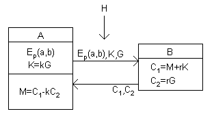

密码学中，描述一条 `Fp` 上的椭圆曲线，常用到六个参量：

`T=(p,a,b,G,n,h)`。

（`p` 、`a` 、`b` 用来确定一条椭圆曲线，
`G` 为基点，
`n` 为点 `G` 的阶，
`h` 是椭圆曲线上所有点的个数 `m` 与 `n` 相除的整数部分）

这几个参量取值的选择，直接影响了加密的安全性。参量值一般要求满足以下几个条件：

1. `p` 当然越大越安全，但越大，计算速度会变慢，200 位左右可以满足一般安全要求；
2. `p≠n×h`；
3. `p^t≠1 (mod n)`，`1≤t<20`；
4. `4a³+27b²≠0 (mod p)`；
5. `n` 为素数；
6. `h≤4`。

## 七、椭圆曲线在软件注册保护的应用

我们知道将公开密钥算法作为软件注册算法的好处是 Cracker 很难通过跟踪验证算法得到注册机。下面，将简介一种利用 `Fp(a,b)` 椭圆曲线进行软件注册的方法。

软件作者按如下方法制作注册机（也可称为签名过程）

1. 选择一条椭圆曲线 `Ep(a,b)`，和基点 `G`；
2. 选择私有密钥 `k`（`k<n`，`n` 为 `G` 的阶），利用基点 `G` 计算公开密钥 `K=kG`；
3. 产生一个随机整数 `r`（`r<n`），计算点 `R=rG`；
4. 将用户名和点 `R` 的坐标值 `x,y` 作为参数，计算 `SHA`（Secure Hash Algorithm 安全散列算法，类似于 `MD5`）值，即 `Hash=SHA(username,x,y)`；
5. 计算 `sn≡r - Hash * k (mod n)`
6. 将 `sn` 和 `Hash` 作为 用户名 `username` 的序列号

软件验证过程如下：（软件中存有椭圆曲线 `Ep(a,b)`，和基点 `G`，公开密钥 `K`）

1. 从用户输入的序列号中，提取 `sn` 以及 `Hash`；
2. 计算点 `R≡sn*G+Hash*K ( mod p )`，如果 `sn`、`Hash` 正确，其值等于软件作者签名过程中点 `R(x,y)` 的坐标，因为

   `sn≡r-Hash*k （mod n）`

   所以

   `sn*G + Hash*K`

   `=(r-Hash*k)*G+Hash*K`

   `=rG-Hash*kG+Hash*K`

   `=rG- Hash*K+ Hash*K`

   `=rG=R ；`

3. 将用户名和点 `R` 的坐标值 `x,y` 作为参数，计算 `H=SHA(username,x,y)`；
4. 如果 `H=Hash` 则注册成功。如果 `H≠Hash` ，则注册失败(为什么？提示注意点 `R` 与 `Hash` 的关联性)。

简单对比一下两个过程：

作者签名用到了：椭圆曲线 `Ep(a,b)`，基点 `G`，私有密钥 `k`，及随机数 `r`。

软件验证用到了：椭圆曲线 `Ep(a,b)`，基点 `G`，公开密钥 `K`。

Cracker 要想制作注册机，只能通过软件中的 `Ep(a,b)`，点 `G`，公开密钥 `K` ，并利用 `K=kG` 这个关系获得 `k` 后，才可以。而求 `k` 是很困难的。

**练习：**

下面也是一种常于软件保护的注册算法，请认真阅读，并试回答签名过程与验证过程都用到了那些参数，Cracker 想制作注册机，应该如何做。

软件作者按如下方法制作注册机（也可称为签名过程）

1. 选择一条椭圆曲线 `Ep(a,b)`，和基点 `G`；
2. 选择私有密钥 `k`（`k<n`），利用基点 `G` 计算公开密钥 `K=kG`；
3. 产生一个随机整数 `r`（`r<n`），计算点 `R(x,y)=rG`；
4. 将用户名作为参数，计算 `Hash=SHA(username)`；
5. 计算 `x’=x (mod n)`
6. 计算 `sn≡(Hash+x’*k)/r (mod n)`
7. 将 `sn` 和 `x’` 作为 用户名 `username` 的序列号

软件验证过程如下：(软件中存有椭圆曲线 `Ep(a,b)`，和基点 `G`，公开密钥 `K`)

1. 从用户输入的序列号中，提取 `sn` 以及 `x’`；
2. 将用户名作为参数，计算 `Hash=SHA(username)`；
3. 计算 `R=(Hash*G+x’*K)/sn`，如果 `sn`、`Hash` 正确,其值等于软件作者签名过程中点 `R(x,y)`，因为

   `sn≡(Hash+x’*k)/r (mod n)`

   所以

   `(Hash*G+x’*K)/sn`

   `=(Hash*G+x’*K)/[(Hash+x’*k)/r]`

   `=(Hash*G+x’*K)/[(Hash*G+x’*k*G)/(rG)]`

   `=rG*[(Hash*G+x’*K)/(Hash*G+x’*K)]`

   `=rG=R (mod p)`

4. `v≡x (mod n)`
5. 如果 `v=x’` 则注册成功。如果 `v≠x’` ，则注册失败。

## 八、结语

历经半个多月断断续续的写作，这篇拙作终于算告一段落了。为写这篇文章，我查了大量的资料，但为了使文章更通俗易懂，我尽量避免涉及专业术语，`F[2]n` 域上的椭圆曲线本文也没有涉及。不过，一些名词描述的可能还不太精确，希望众读者对文章的问题，多多批评指正。我也仅仅把这篇文章作为初稿，我会不断修订他的。最后感谢看雪、Sunbird、CCG 以及看雪论坛所有成员对我的支持，感谢一切帮助过我的人，没有你们的鼓励，这篇文章我是没有动力写完的，谢谢，谢谢大家！

2003-5-3 初稿，于看雪论坛

2004-7-11 二稿，修正一张图片

<全文完>

### 主要参考文献

张禾瑞，《近世代数基础》，高等教育出版社，1978

闵嗣鹤 严士健，《初等数论》，高等教育出版社，1982

段云所，《网络信息安全》第三讲，北大计算机系

Michael Rosing ，chapter5《Implementing Elliptic Curve Cryptography》，Softbound，1998

《SEC 1: Elliptic Curve Cryptography》，Certicom Corp.，2000

《IEEE P1363a / D9》，2001

┌───┐ ▓▓▓▓▓▓▓▓▓▓▓▓▓▓▓▓▓▓▓▓▓▓▓▓▓▓
│\ ╱│ ▓ ☆ ECC 加密算法入门介绍 ★ ▓
│ \╱/ │ ▓▓▓▓▓▓▓▓▓▓▓▓▓▓▓▓▓▓▓▓▓▓▓▓
│╱∨ │ ▓ ☆版权所有 ZMWorm[CCG], 转载请保留完整性★ ▓
└─┴─┘ ▓▓▓▓▓▓▓▓▓▓▓▓▓▓▓▓▓▓▓▓▓▓▓▓▓

   4dd466d0e1e0cc123afbe504da2462ca
