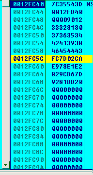

# snagItV 7.01

> 原文：[www.pediy.com/kssd/pediy06/pediy6606.htm](https://www.pediy.com/kssd/pediy06/pediy6606.htm)

**【破解作者】** `ftts[BCG]`  
**【使用工具】** `ollydbg`  
**【破解平台】** `Win2003`  
**【软件名称】** `snagIt32V` `7.01`  
**【下载地址】** 来自网络，自己去找  
**【软件简介】** 一个很好屏幕捕捉软件，  
**【软件大小】** `8.7M`  
**【加壳方式】** 无壳  
**【破解声明】** 我是一只小菜鸟，偶得一点心得，愿与大家分享：

------------------------------------------------------------------------

## 【破解内容】

输入用户名：`ftts[BCG]`

注册码：`AD28DC019012A94578`

`AD28DC01` `9012` `A9` `4578` 这里是要分开来看的。`AD28DC01` 是用来比较的，`9012` `A9` `4578` 是用来计算密码表的。

计算注册码的入口，用查 `ascll` 查不到的，可以用 `bpx getwindowtexta` 将它断下来。

------------------------------------- 从下面这段代码开始吧！

```asm
00544BFA   |>  53              push ebx
00544BFB   |.   57              push edi
00544BFC   |.   8B7C24 18        mov edi,dword ptr ss:[esp+18]
00544C00   |.   8BCF            mov ecx,edi
00544C02   |.   FF15 B0E45500   call dword ptr ds:[<&MFC71.#6180>]      ;  MFC71.7C18A010
00544C08   |.   8BCF            mov ecx,edi
00544C0A   |.   FF15 ACF15500   call dword ptr ds:[<&MFC71.#2902>]      ;  MFC71.7C146AB0
00544C10   |.   83F8 0E         cmp eax,0E      比较注册码是不是大于，14 位
00544C13   |.   0F8C E6000000   jl SnagIt32.00544CFF-->跳向失败了
00544C19   |.   8BCF            mov ecx,edi
00544C1B   |.   FF15 2CF35500   call dword ptr ds:[<&MFC71.#876>]       ;  MFC71.7C158BCD
00544C21   |.   68 783B5900     push SnagIt32.00593B78                  ;  ASCII "0123456789ABCDEF-"
00544C26   |.   50              push eax
00544C27   |.   FF15 40F45500   call dword ptr ds:[<&MSVCR71._mbsspn>] ;  MSVCR71._mbsspn
00544C2D   |.   83C4 08         add esp,8
00544C30   |.   8BCF            mov ecx,edi
00544C32   |.   8BD8            mov ebx,eax
00544C34   |.   FF15 ACF15500   call dword ptr ds:[<&MFC71.#2902>]      ;  MFC71.7C146AB0
00544C3A   |.   3BD8            cmp ebx,eax    这里注册码不是 18 位就会出错了 ，这里的两组数是不会相等的，注册码
00544C3C       0F85 BD000000   jnz SnagIt32.00544CFF                    ;  这里是不能跳的，跳的话注册失败了喔！
00544C42   |.   68 70185600     push SnagIt32.00561870
00544C47   |.   68 64705600     push SnagIt32.00567064
00544C4C   |.   8BCF            mov ecx,edi
00544C4E   |.   FF15 C0E45500   call dword ptr ds:[<&MFC71.#5491>]     ;  MFC71.7C189DD6
00544C54   |.   8B1E            mov ebx,dword ptr ds:[esi]
00544C56   |.   8BCF            mov ecx,edi
00544C58   |.   FF15 2CF35500   call dword ptr ds:[<&MFC71.#876>]       ;  MFC71.7C158BCD
00544C5E   |.   50              push eax
00544C5F   |.   8BCD            mov ecx,ebp
00544C61   |.   FF15 2CF35500   call dword ptr ds:[<&MFC71.#876>]       ;  MFC71.7C158BCD
00544C67   |.   50              push eax
00544C68   |.   8BCE            mov ecx,esi
00544C6A   |.   FF53 1C         call dword ptr ds:[ebx+1C]             ;  这个 call 是关键算法了,是动态的 跟进去
00544C6D   |.   8BD8            mov ebx,eax
00544C6F   |.   80FB 01         cmp bl,1
00544C72       75 53           jnz short SnagIt32.00544CC7             ;  这里不能跳 ，跳就注册失败了
00544C74   |.   8BCF            mov ecx,edi
00544C76   |.   C746 30 01000000 mov dword ptr ds:[esi+30],1    ----->这里下去就是保存你的注册信息了
00544C7D   |.   C786 C8000000 00000> mov dword ptr ds:[esi+C8],0
00544C87   |.   FF15 2CF35500   call dword ptr ds:[<&MFC71.#876>]       ;  MFC71.7C158BCD
00544C8D   |.   50              push eax                               ; /Arg2
00544C8E   |.   68 B02A5700     push SnagIt32.00572AB0                 ; |Arg1 = 00572AB0 ASCII
"RegistrationKey"
00544C93   |.   8BCE            mov ecx,esi                              ; |
00544C95   |.   E8 66F5FFFF     call SnagIt32.00544200                   ; \SnagIt32.00544200
00544C9A   |.   8BCD            mov ecx,ebp
00544C9C   |.   FF15 2CF35500   call dword ptr ds:[<&MFC71.#876>]       ;  MFC71.7C158BCD
00544CA2   |.   50              push eax                               ; /Arg2
00544CA3   |.   68 D02A5700     push SnagIt32.00572AD0                 ; |Arg1 = 00572AD0 ASCII "RegisteredTo"
00544CA8   |.   8BCE            mov ecx,esi                              ; |
00544CAA   |.   E8 51F5FFFF     call SnagIt32.00544200                   ; \SnagIt32.00544200
00544CAF   |.   8B4424 14       mov eax,dword ptr ss:[esp+14]
00544CB3   |.   57              push edi
00544CB4   |.   55              push ebp
00544CB5   |.   50              push eax
00544CB6   |.   8BCE            mov ecx,esi
00544CB8   |.   E8 23F8FFFF     call SnagIt32.005444E0
00544CBD   |.   5F              pop edi
00544CBE   |.   66:8BC3         mov ax,bx
00544CC1   |.   5B              pop ebx
00544CC2   |.   5E              pop esi
00544CC3   |.   5D              pop ebp
00544CC4   |.   C2 0C00         retun 0C
```

------------------------------------------------------------------------- 注册算法跟进去

```asm
004BBD7C    .  B8 D3515500      mov eax,SnagIt32.005551D3
004BBD81    .  E8 7ADE0800      call SnagIt32.00549C00
004BBD86    .  83EC 58          sub esp,58
004BBD89    .  53              push ebx
004BBD8A    .  FF75 0C         push dword ptr ss:[ebp+C]
004BBD8D    .  894D E4         mov dword ptr ss:[ebp-1C],ecx
004BBD90    .  33DB            xor ebx,ebx
004BBD92    .  8D4D 0C         lea ecx,dword ptr ss:[ebp+C]
004BBD95    .  895D EC        mov dword ptr ss:[ebp-14],ebx
004BBD98    .  C745 E0 01000000 mov dword ptr ss:[ebp-20],1
004BBD9F    .  C645 F3 0A      mov byte ptr ss:[ebp-D],0A
004BBDA3    .  885D F2         mov byte ptr ss:[ebp-E],bl
004BBDA6    .  FF15 28F35500   call dword ptr ds:[<&MFC71.#304>]      ;  MFC71.7C16A59C
004BBDAC    .  8D4D 0C         lea ecx,dword ptr ss:[ebp+C]
004BBDAF    .  895D FC         mov dword ptr ss:[ebp-4],ebx
004BBDB2    .  FF15 ACF15500   call dword ptr ds:[<&MFC71.#2902>]     ;  MFC71.7C146AB0
004BBDB8    .  83F8 0E         cmp eax,0E---------------------------->这里可能是假像吧！
004BBDBB       74 17           je short SnagIt32.004BBDD4
004BBDBD    .  8D4D 0C         lea ecx,dword ptr ss:[ebp+C]
004BBDC0    .  FF15 ACF15500   call dword ptr ds:[<&MFC71.#2902>]     ;  MFC71.7C146AB0
004BBDC6    .  83F8 12         cmp eax,12                              ;  呵呵！这里的注册码要 18 位
004BBDC9    .  74 09           je short SnagIt32.004BBDD4
004BBDCB    .  C645 F3 0C      mov byte ptr ss:[ebp-D],0C
004BBDCF    .  E9 89010000     jmp SnagIt32.004BBF5D                  ;  到这里就失败了，所以上面要跳
004BBDD4   >  56              push esi
004BBDD5    .  57              push edi
004BBDD6    .  6A 02           push 2
004BBDD8    .  6A 0C           push 0C
004BBDDA    .  8D45 E8         lea eax,dword ptr ss:[ebp-18]
004BBDDD    .  50              push eax
004BBDDE    .  8D4D 0C         lea ecx,dword ptr ss:[ebp+C]
004BBDE1    .  FF15 40E75500   call dword ptr ds:[<&MFC71.#4109>]    ;  MFC71.7C188D88
004BBDE7    .  6A 10           push 10
004BBDE9    .  53              push ebx
004BBDEA    .  8BC8            mov ecx,eax
004BBDEC    .  FF15 2CF35500   call dword ptr ds:[<&MFC71.#876>]     ;  MFC71.7C158BCD
004BBDF2    .  8B35 64F55500   mov esi,dword ptr ds:[<&MSVCR71.strtoul>>; |MSVCR71.strtoul
004BBDF8    .  50              push eax                               ; |s
004BBDF9    .  FFD6            call esi                               ; \strtoul
004BBDFB    .  83C4 0C         add esp,0C
004BBDFE    .  8D4D E8         lea ecx,dword ptr ss:[ebp-18]
004BBE01    .  8BF8            mov edi,eax
004BBE03    .  FF15 34F35500   call dword ptr ds:[<&MFC71.#578>]     ;  MFC71.7C1771B1
```


### 机器码分析
```
004BBE09   .  66:83FF 41             cmp di,41  

004BBE0D     0F82 44010000       jb SnagIt32.004BBF57                 ;  跳就失败  

004BBE13   .  81C7 BFFF0000       add edi,0FFBF                         ;  就是这里了，99 是不行的了 用 A9 可以  

004BBE19   .  66:83FF 50          cmp di,50  

004BBE1D   .  72 74              jb short SnagIt32.004BBE93          我估记这个 A9 是与版本信息有关  

004BBE1F   .  8D4D 0C           lea ecx,dword ptr ss:[ebp+C]    用我提供的注册码，显示版本信息是 6.8 的  

004BBE22   .  FF15 ACF15500      call dword ptr ds:[<&MFC71.#2902>]       ;  MFC71.7C146AB0  

004BBE28   .  83F8 12           cmp eax,12  

004BBE2B   .  0F85 86000000     jnz SnagIt32.004BBEB7  

004BBE31   .  6A 04             push 4  

004BBE33   .  8D45 08          lea eax,dword ptr ss:[ebp+8]  

004BBE36   .  50                push eax  

004BBE37   .  8D4D 0C          lea ecx,dword ptr ss:[ebp+C]  

004BBE3A   .  FF15 1CE75500    call dword ptr ds:[<&MFC71.#5563>]       ;  MFC71.7C188DED  

004BBE40   .  6A 10            push 10  

004BBE42   .  53                push ebx  

004BBE43   .  8BC8              mov ecx,eax  

004BBE45   .  FF15 2CF35500    call dword ptr ds:[<&MFC71.#876>]        ;  MFC71.7C158BCD  

004BBE4B   .  50                push eax  

004BBE4C   .  FFD6              call esi  

004BBE4E   .  83C4 0C          add esp,0C  

004BBE51   .  8D4D 08          lea ecx,dword ptr ss:[ebp+8]  

004BBE54   .  8945 EC          mov dword ptr ss:[ebp\-14],eax          ;  ss:[12dde4]=4578  

004BBE57   .  FF15 34F35500    call dword ptr ds:[<&MFC71.#578>]        ;  MFC71.7C1771B1  

004BBE5D   .  8D4D 0C          lea ecx,dword ptr ss:[ebp+C]  

004BBE60   .  FF15 ACF15500    call dword ptr ds:[<&MFC71.#2902>]       ;  MFC71.7C146AB0  

004BBE66   .  83E8 04         sub eax,4  

004BBE69   .  50                push eax  

004BBE6A   .  8D45 08          lea eax,dword ptr ss:[ebp+8]  

004BBE6D   .  50                push eax  

004BBE6E   .  8D4D 0C          lea ecx,dword ptr ss:[ebp+C]  

004BBE71   .  FF15 B4E45500    call dword ptr ds:[<&MFC71.#3997>]       ;  MFC71.7C188E36  

004BBE77   .  50                push eax  

004BBE78   .  8D4D 0C          lea ecx,dword ptr ss:[ebp+C]  

004BBE7B   .  C645 FC 01       mov byte ptr ss:[ebp\-4],1  

004BBE7F   .  FF15 90E45500    call dword ptr ds:[<&MFC71.#781>]        ;  MFC71.7C150F15  

004BBE85   .  8D4D 08          lea ecx,dword ptr ss:[ebp+8]  

004BBE88   .  885D FC          mov byte ptr ss:[ebp\-4],bl  

004BBE8B   .  FF15 34F35500    call dword ptr ds:[<&MFC71.#578>]        ;  MFC71.7C1771B1  

004BBE91   .  EB 24            jmp short SnagIt32.004BBEB7  

004BBE93   >  FF75 08         push dword ptr ss:[ebp+8]              ; /s  

004BBE96   .  FF15 54F45500   call dword ptr ds:[<&MSVCR71.\_strdup>]   ; \_\_strdup  

004BBE9C   .  8BF0            mov esi,eax  

004BBE9E   .  3BF3            cmp esi,ebx  

004BBEA0   .  59                pop ecx  

004BBEA1   .  74 14            je short SnagIt32.004BBEB7  

004BBEA3   .  8B4D E4          mov ecx,dword ptr ss:[ebp\-1C]  

004BBEA6   .  56                push esi                              ; /Arg1  

004BBEA7   .  E8 D4820800      call SnagIt32.00544180               ; \SnagIt32.00544180  

004BBEAC   .  56                push esi                              ; /block  

004BBEAD   .  8945 EC          mov dword ptr ss:[ebp\-14],eax          ; |  

004BBEB0   .  FF15 DCF45500    call dword ptr ds:[<&MSVCR71.free>]     ; \free  

004BBEB6   .  59                pop ecx  

004BBEB7   >  66:395D EC       cmp word ptr ss:[ebp\-14],bx  

004BBEBB   .  0F84 9A000000   je SnagIt32.004BBF5B                 ;  这里是不能跳的  

004BBEC1   .  6A 0F            push 0F                               ; /n = F (15.)  

004BBEC3   .  8D45 D0          lea eax,dword ptr ss:[ebp\-30]          ; |  

004BBEC6   .  53                push ebx                              ; |c  

004BBEC7   .  50                push eax                              ; |s  

004BBEC8   .  E8 97DD0800      call <jmp.&MSVCR71.memset>           ; \memset  

004BBECD   .  83C4 0C          add esp,0C  

004BBED0   .  6A 0E            push 0E  

004BBED2   .  6A 0E            push 0E  

004BBED4   .  8D4D 0C          lea ecx,dword ptr ss:[ebp+C]  

004BBED7   .  FF15 F4E45500   call dword ptr ds:[<&MFC71.#2468>]       ;  MFC71.7C15102A  

004BBEDD   .  50                push eax                              ; |src  

004BBEDE   .  8D45 D0          lea eax,dword ptr ss:[ebp\-30]          ; |  

004BBEE1   .  50                push eax                              ; |dest  

004BBEE2   .  E8 77DD0800      call <jmp.&MSVCR71.memcpy>           ; \memcpy  

004BBEE7   .  83C4 0C          add esp,0C  

004BBEEA   .  6A FF            push -1  

004BBEEC   .  8D4D 0C          lea ecx,dword ptr ss:[ebp+C]  

004BBEEF   .  FF15 E8E45500   call dword ptr ds:[<&MFC71.#5403>]       ;  MFC71.7C16A479  

004BBEF5   .  8D45 9C          lea eax,dword ptr ss:[ebp\-64]  

004BBEF8   .  50                push eax  

004BBEF9   .  E8 B2970800      call SnagIt32.005456B0  

004BBEFE   .  85C0              test eax,eax  

004BBF00   .  59                pop ecx  

004BBF01   .  74 58            je short SnagIt32.004BBF5B             ;  不能跳  

004BBF03   .  6A 02            push 2  

004BBF05   .  8D45 E0          lea eax,dword ptr ss:[ebp\-20]  

004BBF08   .  50                push eax  

004BBF09   .  8D45 9C          lea eax,dword ptr ss:[ebp\-64]  

004BBF0C   .  50                push eax  

004BBF0D   .  E8 AE970800      call SnagIt32.005456C0  

004BBF12   .  83C4 0C          add esp,0C  

004BBF15   .  85C0              test eax,eax  

004BBF17   .  74 42            je short SnagIt32.004BBF5B             ;  不能跳  

004BBF19   .  6A 02            push 2  

004BBF1B   .  8D45 EC          lea eax,dword ptr ss:[ebp\-14]  

004BBF1E   .  50                push eax  

004BBF1F   .  8D45 9C          lea eax,dword ptr ss:[ebp\-64]  

004BBF22   .  50                push eax  

004BBF23   .  E8 98970800      call SnagIt32.005456C0  

004BBF28   .  83C4 0C          add esp,0C  

004BBF2B   .  85C0              test eax,eax  

004BBF2D   .  74 2C            je short SnagIt32.004BBF5B             ;  不能跳  

004BBF2F   .  8D45 D0          lea eax,dword ptr ss:[ebp\-30]  

004BBF32   .  50                push eax  

004BBF33   .  8D45 9C          lea eax,dword ptr ss:[ebp\-64]  

004BBF36   .  50                push eax  

004BBF37   .  E8 44980800      call SnagIt32.00545780----->这里比较注册码要跟进去  

004BBF3C   .  85C0              test eax,eax  

004BBF3E   .  59                pop ecx  

004BBF3F   .  59                pop ecx  

004BBF40   .  74 19            je short SnagIt32.004BBF5B             ;  不能跳     

004BBF42   .  66:83FF 63       cmp di,63                               ;  注意 edi  不能小于 63  

                                      它是由 A9＋0FFBF  计算出来的  

004BBF46     73 06            jnb short SnagIt32.004BBF4E          ;  这里要跳   

004BBF48   .  C645 F3 0B      mov byte ptr ss:[ebp\-D],0B  

004BBF4C   .  EB 0D           jmp short SnagIt32.004BBF5B  

004BBF4E   >  885D F3          mov byte ptr ss:[ebp\-D],bl  

004BBF51   .  C645 F2 01     mov byte ptr ss:[ebp\-E],1               ;  只要到这里就注册成功了，哈哈  

004BBF55   .  EB 04           jmp short SnagIt32.004BBF5B  

004BBF57   >  C645 F3 0C      mov byte ptr ss:[ebp\-D],0C  

004BBF5B   >  5F                pop edi  

004BBF5C   .  5E                pop esi  

004BBF5D   >  8D4D 0C          lea ecx,dword ptr ss:[ebp+C]  
```


```asm
004BBF60   .  FF15 34F35500       call dword ptr ds:[<&MFC71.#578>]        ;  MFC71.7C1771B1  

004BBF66   .  8B4D F4            mov ecx,dword ptr ss:[ebp-C]  

004BBF69   .  33C0              xor eax,eax                              ;  这里是没问题的  

004BBF6B   .  8A65 F3          mov ah,byte ptr ss:[ebp-D]  

004BBF6E   .  5B               pop ebx  

004BBF6F   .  64:890D 00000000 mov dword ptr fs:[0],ecx  

004BBF76   .  8A45 F2         mov al,byte ptr ss:[ebp-E]                 ;  ss[12ddea]  这里便 eax 要不等于 0  

004BBF79   .  C9               leave  

004BBF7A   .  C2 0800           retn 8  

004BBF7D   .  B8 CC2B5800       mov eax,SnagIt32.00582BCC  

004BBF82   .  C3               retn  

004BBF83   $  E9 588A0800       jmp SnagIt32.005449E0  

004BBF88   .  56               push esi  

004BBF89   .  8BF1             mov esi,ecx  

004BBF8B   .  E8 F3FFFFFF      call SnagIt32.004BBF83  

004BBF90   .  F64424 08 01     test byte ptr ss:[esp+8],1  

004BBF95   .  74 07           je short SnagIt32.004BBF9E  

004BBF97   .  56               push esi                                   ; /block  

004BBF98   .  E8 E3C60800      call <jmp.&MFC71.#764>                      ; \\free  

004BBF9D   .  59               pop ecx  

004BBF9E   >  8BC6             mov eax,esi  

004BBFA0   .  5E               pop esi  

004BBFA1   .  C2 0400          retn 4  

\-----------------------------------------------------------------  这下面是比较注册码  

00545780  /$  83EC 7C          sub esp,7C  

00545783  |.  33C0            xor eax,eax  

00545785  |.  B9 30000000     mov ecx,30  

0054578A  |.  8D9B 00000000   lea ebx,dword ptr ds:[ebx]  

00545790  |>  0FB7D0          /movzx edx,ax  

00545793  |.  40              |inc eax  

00545794  |.  884C14 04      |mov byte ptr ss:[esp+edx+4],cl            ;  ss[12dd05  

00545798  |.  41              |inc ecx  

00545799  |.  66:83F9 39     |cmp cx,39  

0054579D  |.^ 76 F1          \\jbe short SnagIt32.00545790  

0054579F  |.  B9 41000000     mov ecx,41                                 ;  这里是把栈初始化  

005457A4  |>  0FB7D0          /movzx edx,ax  

005457A7  |.  40              |inc eax  

005457A8  |.  884C14 04      |mov byte ptr ss:[esp+edx+4],cl  

005457AC  |.  41              |inc ecx  

005457AD  |.  66:83F9 46     |cmp cx,46  

005457B1  |.^ 76 F1          \\jbe short SnagIt32.005457A4  

005457B3  |.  55              push ebp  

005457B4  |.  8BAC24 88000000 mov ebp,dword ptr ss:[esp+88]  

005457BB  |.  56              push esi  

005457BC  |.  8D45 0C        lea eax,dword ptr ss:[ebp+C]               ;  ss[12ddd4]=A9  

005457BF  |.  6A 02          push 2                                     ;  这里可能是一个函数吧！  

005457C1  |.  50              push eax  

005457C2  |.  E8 49FFFFFF    call SnagIt32.00545710                     ;  A9 入 eax  

005457C7  |.  8BB424 90000000 mov esi,dword ptr ss:[esp+90]  

005457CE  |.  894424 10      mov dword ptr ss:[esp+10],eax             ;  ss[12dd00]  

005457D2  |.  0FB706          movzx eax,word ptr ds:[esi]  

005457D5  |.  8D48 02        lea ecx,dword ptr ds:[eax+2]  

005457D8  |.  83C4 08        add esp,8  

005457DB  |.  83F9 32        cmp ecx,32  

005457DE  |.  7F 0E          jg short SnagIt32.005457EE  

005457E0  |.  66:8B5424 08   mov dx,word ptr ss:[esp+8]  

005457E5  |.  66:895430 02   mov word ptr ds:[eax+esi+2],dx            ;  ds[12dd9a]  

005457EA  |.  66:8306 02     add word ptr ds:[esi],2  

005457EE  |>  8D45 08        lea eax,dword ptr ss:[ebp+8]  

005457F1  |.  6A 04          push 4                                     ;  eax 指针指向“9012A9"  

005457F3  |.  50              push eax  

005457F4  |.  E8 17FFFFFF    call SnagIt32.00545710                     ;  9012 入 eax  

005457F9  |.  894424 10      mov dword ptr ss:[esp+10],eax  

005457FD  |.  0FB706          movzx eax,word ptr ds:[esi]  

00545800  |.  8D48 02        lea ecx,dword ptr ds:[eax+2]  

00545803  |.  83C4 08        add esp,8  

00545806  |.  83F9 32        cmp ecx,32  

00545809  |.  7F 0E          jg short SnagIt32.00545819  

0054580B  |.  66:8B5424 08   mov dx,word ptr ss:[esp+8]  

00545810  |.  66:895430 02   mov word ptr ds:[eax+esi+2],dx            ;  ds[12dd9c]  

00545815  |.  66:8306 02     add word ptr ds:[esi],2  

00545819  |>  8D4424 2C      lea eax,dword ptr ss:[esp+2C]  

0054581D  |.  57              push edi  

0054581E  |.  50              push eax  

0054581F  |.  E8 8C000000     call SnagIt32.005458B0                     ;  这里与密码表有关  

00545824  |.  0FB70E          movzx ecx,word ptr ds:[esi]  

00545827  |.  51              push ecx  

00545828  |.  8D7E 02        lea edi,dword ptr ds:[esi+2]  

0054582B  |.  8D5424 38      lea edx,dword ptr ss:[esp+38]  

0054582F  |.  57              push edi  

00545830  |.  52              push edx  

00545831  |.  E8 8A090000     call SnagIt32.005461C0  

00545836  |.  8D4424 40      lea eax,dword ptr ss:[esp+40]  

0054583A  |.  50              push eax  

0054583B  |.  8D4C24 34      lea ecx,dword ptr ss:[esp+34]  

0054583F  |.  51              push ecx  

00545840  |.  E8 3B0A0000     call SnagIt32.00546280                     ;  这里要跟进去，计算密码表  

00545845  |.  33C0            xor eax,eax  

00545847  |.  B9 0C000000     mov ecx,0C  

0054584C  |.  F3:AB          rep stos dword ptr es:[edi]  

0054584E  |.  83C4 18        add esp,18  

00545851  |.  66:AB          stos word ptr es:[edi]  

00545853  |.  33D2            xor edx,edx  

00545855  |.  5F              pop edi                                   ;  这里的 edi 要注意  

00545856  |>  0FB7CA          /movzx ecx,dx  

00545859  |.  8BC1            |mov eax,ecx  

0054585B  |.  D1E8            |shr eax,1  

0054585D  |.  8A0428          |mov al,byte ptr ds:[eax+ebp]  

00545860  |.  3C 61           |cmp al,61  

00545862  |.  72 0C           |jb short SnagIt32.00545870  

00545864  |.  3C 7A           |cmp al,7A  

00545866  |.  77 08           |ja short SnagIt32.00545870  

00545868  |.  0FB6C0          |movzx eax,al  

0054586B  |.  83E8 20         |sub eax,20  

0054586E  |.  EB 03           |jmp short SnagIt32.00545873  

00545870  |>  0FB6C0          |movzx eax,al  

00545873  |>  0FB64C0C 1C     |movzx ecx,byte ptr ss:[esp+ecx+1C]       ;  esp=12dcf8  

00545878  |.  83E1 0F         |and ecx,0F  

0054587B  |.  0FBE4C0C 0C     |movsx ecx,byte ptr ss:[esp+ecx+C]       ;  这里是 跟密码表对比  

00545880  |.  0FB6C0          |movzx eax,al  

00545883  |.  3BC8            |cmp ecx,eax－－－> 这里下个断点， 依次按 F9 就可以把前 8 位注册码读出来了  

00545885  |.  75 14           |jnz short SnagIt32.0054589B              ;  这里是不能跳的，跳则失败了  

00545887  |.  83C2 02         |add edx,2  

0054588A  |.  66:83FA 10     |cmp dx,10  

0054588E  |.^ 72 C6         \\jb short SnagIt32.00545856  

00545890  |.  5E              pop esi  

00545891  |.  B8 01000000     mov eax,1    eax 要等 于 1  

00545896  |.  5D              pop ebp  

00545897  |.  83C4 7C         add esp,7C  

0054589A  |.  C3              retn  

0054589B  |>  5E              pop esi                                  ;  跳则失败  

0054589C  |.  33C0            xor eax,eax   等于 0 失败  

0054589E  |.  5D              pop ebp  

0054589F  |.  83C4 7C         add esp,7C  

005458A2  \\.  C3             retn  

－－－－－－－－－－－－－－－－－－－－－－－－－  

005458B0  /$  8B4424 04      mov eax,dword ptr ss:[esp+4]  

005458B4  |.  33C9            xor ecx,ecx  

005458B6  |.  8948 14        mov dword ptr ds:[eax+14],ecx  
```


# 汇编代码分析

## 初始化内存数据

```
005458B9   |.   8948 10              mov dword ptr ds:[eax+10],ecx  

005458BC   |.   C700 01234567        mov dword ptr ds:[eax],67452301          ;  这下面四组是最初的数，最后要被密码表  

代替  

005458C2   |.   C740 04 89ABCDEF     mov dword ptr ds:[eax+4],EFCDAB89  

005458C9   |.   C740 08 FEDCBA98     mov dword ptr ds:[eax+8],98BADCFE  

005458D0   |.   C740 0C 76543210     mov dword ptr ds:[eax+C],10325476  
```

---

## 计算密友表逻辑

```
00546280   /$  83EC 08              sub esp,8  

00546283   |.   56                  push esi  

00546284   |.   57                  push edi  

00546285   |.   8B7C24 18           mov edi,dword ptr ss:[esp+18]            ;   

00546289   |.   33C9                xor ecx,ecx  

0054628B   |.   8D47 12             lea eax,dword ptr ds:[edi+12]  

0054628E   |.   8BFF                mov edi,edi  

00546290   |>   8A50 FE             /mov dl,byte ptr ds:[eax-2]  

00546293   |.   88540C 08           |mov byte ptr ss:[esp+ecx+8],dl  

00546297   |.   8A50 FF             |mov dl,byte ptr ds:[eax-1]  

0054629A   |.   88540C 09           |mov byte ptr ss:[esp+ecx+9],dl  

0054629E   |.   8A10                |mov dl,byte ptr ds:[eax]  

005462A0   |.   88540C 0A           |mov byte ptr ss:[esp+ecx+A],dl  

005462A4   |.   8A50 01             |mov dl,byte ptr ds:[eax+1]  

005462A7   |.   88540C 0B           |mov byte ptr ss:[esp+ecx+B],dl  

005462AB   |.   83C1 04             |add ecx,4  

005462AE   |.   83C0 04             |add eax,4  

005462B1   |.   83F9 08             |cmp ecx,8  

005462B4   |.^  72 DA               \jb short SnagIt32.00546290  

005462B6   |.   8B4F 10             mov ecx,dword ptr ds:[edi+10]  

005462B9   |.   C1E9 03             shr ecx,3  

005462BC   |.   83E1 3F             and ecx,3F  

005462BF   |.   83F9 38             cmp ecx,38  

005462C2   |.   B8 38000000         mov eax,38  

005462C7   |.   72 05               jb short SnagIt32.005462CE  

005462C9   |.   B8 78000000         mov eax,78  

005462CE   |>   2BC1                sub eax,ecx  

005462D0   |.   50                  push eax  

005462D1   |.   68 A0885B00         push SnagIt32.005B88A0  

005462D6   |.   57                  push edi  

005462D7   |.   E8 E4FEFFFF         call SnagIt32.005461C0  

005462DC   |.   6A 08               push 8  

005462DE   |.   8D4424 18           lea eax,dword ptr ss:[esp+18]  

005462E2   |.   50                  push eax  

005462E3   |.   57                  push edi  

005462E4   |.   E8 D7FEFFFF         call SnagIt32.005461C0                      ;  这里是关键的 计算密码表  

005462E9   |.   8B4C24 2C           mov ecx,dword ptr ss:[esp+2C]  

005462ED   |.   83C4 18             add esp,18  

005462F0   |.   41                  inc ecx  

005462F1   |.   8D47 02             lea eax,dword ptr ds:[edi+2]  

005462F4   |.   BE 04000000         mov esi,4  

005462F9   |.   8DA424 00000000     lea esp,dword ptr ss:[esp]  

00546300   |>   8A50 FE             /mov dl,byte ptr ds:[eax-2]  

00546303   |.   8851 FF             |mov byte ptr ds:[ecx-1],dl               ;  这里的循环是转移密码表  

00546306   |.   8A50 FF             |mov dl,byte ptr ds:[eax-1]  

00546309   |.   8811                |mov byte ptr ds:[ecx],dl  

0054630B   |.   8A10                |mov dl,byte ptr ds:[eax]  

0054630D   |.   8851 01             |mov byte ptr ds:[ecx+1],dl  

00546310   |.   8A50 01             |mov dl,byte ptr ds:[eax+1]  

00546313   |.   8851 02             |mov byte ptr ds:[ecx+2],dl  

00546316   |.   83C0 04             |add eax,4  

00546319   |.   83C1 04             |add ecx,4  

0054631C   |.   4E                  |dec esi  

0054631D   |.^  75 E1               \jnz short SnagIt32.00546300  

0054631F   |.   B9 16000000         mov ecx,16  

00546324   |.   33C0                xor eax,eax  

00546326   |.   F3:AB               rep stos dword ptr es:[edi]  

00546328   |.   5F                  pop edi  

00546329   |.   5E                  pop esi  

0054632A   |.   83C4 08             add esp,8  

0054632D   \.   C3                  retn  
```

---

## 关键密码表计算逻辑

```
005461C0   /$  8B4C24 0C           mov ecx,dword ptr ss:[esp+C]  

005461C4   |.   53                  push ebx  

005461C5   |.   8B5C24 08           mov ebx,dword ptr ss:[esp+8]  

005461C9   |.   8B53 10             mov edx,dword ptr ds:[ebx+10]  

005461CC   |.   55                  push ebp  

005461CD   |.   8BC2                mov eax,edx  

005461CF   |.   56                  push esi  

005461D0   |.   C1E8 03             shr eax,3  

005461D3   |.   8D14CA              lea edx,dword ptr ds:[edx+ecx*8]  

005461D6   |.   8D34CD 00000000     lea esi,dword ptr ds:[ecx*8]  

005461DD   |.   83E0 3F             and eax,3F  

005461E0   |.   3BD6                cmp edx,esi  

005461E2   |.   57                  push edi  

005461E3   |.   8953 10             mov dword ptr ds:[ebx+10],edx  

005461E6   |.   73 03               jnb short SnagIt32.005461EB  

005461E8   |.   FF43 14             inc dword ptr ds:[ebx+14]  

005461EB   |>   8B7B 14             mov edi,dword ptr ds:[ebx+14]  

005461EE   |.   8BD1                mov edx,ecx  

005461F0   |.   C1EA 1D             shr edx,1D  

005461F3   |.   BD 40000000         mov ebp,40  

005461F8   |.   03FA                add edi,edx  

005461FA   |.   2BE8                sub ebp,eax  

005461FC   |.   3BCD                cmp ecx,ebp  

005461FE   |.   897B 14             mov dword ptr ds:[ebx+14],edi  

00546201   |.   72 54               jb short SnagIt32.00546257  

00546203   |.   8B7424 18           mov esi,dword ptr ss:[esp+18]  

00546207   |.   8D7C18 18           lea edi,dword ptr ds:[eax+ebx+18]  

0054620B   |.   8BCD                mov ecx,ebp  

0054620D   |.   8BC1                mov eax,ecx  

0054620F   |.   C1E9 02             shr ecx,2  

00546212   |.   F3:A5               rep movs dword ptr es:[edi],dword ptr ds>  

00546214   |.   8BC8                mov ecx,eax  

00546216   |.   83E1 03             and ecx,3  

00546219   |.   F3:A4               rep movs byte ptr es:[edi],byte ptr ds:>  

0054621B   |.   8D4B 18             lea ecx,dword ptr ds:[ebx+18]  

0054621E   |.   53                  push ebx  

0054621F   |.   E8 BCF6FFFF         call SnagIt32.005458E0                      ;  这里面跟进去就是计算密码表了  

00546224   |.   8D75 3F             lea esi,dword ptr ss:[ebp+3F]  

00546227   |.   8BFD                mov edi,ebp  

00546229   |.   8B6C24 20           mov ebp,dword ptr ss:[esp+20]  

0054622D   |.   83C4 04             add esp,4  

00546230   |.   3BF5                cmp esi,ebp  

00546232   |.   73 1B               jnb short SnagIt32.0054624F  

00546234   |>   8B4C24 18           /mov ecx,dword ptr ss:[esp+18]  

00546238   |.   8D4C31 C1           |lea ecx,dword ptr ds:[ecx+esi-3F]  

0054623C   |.   53                  |push ebx  

0054623D   |.   E8 9EF6FFFF         |call SnagIt32.005458E0  

00546242   |.   83C6 40             |add esi,40  

00546245   |.   83C4 04             |add esp,4  

00546248   |.   83C7 40             |add edi,40  

0054624B   |.   3BF5                |cmp esi,ebp  

0054624D   |.^  72 E5               \jb short SnagIt32.00546234  

0054624F   |>   8B4C24 1C           mov ecx,dword ptr ss:[esp+1C]  

00546253   |.   33C0                xor eax,eax  

00546255   |.   EB 02               jmp short SnagIt32.00546259  

00546257   |>   33FF                xor edi,edi  

00546259   |>   8B5424 18           mov edx,dword ptr ss:[esp+18]  

0054625D   |.   2BCF                sub ecx,edi  

0054625F   |.   8D3417              lea esi,dword ptr ds:[edi+edx]  

00546262   |.   8D7C18 18           lea edi,dword ptr ds:[eax+ebx+18]  

00546266   |.   8BC1                mov eax,ecx  

00546268   |.   C1E9 02             shr ecx,2  

0054626B   |.   F3:A5               rep movs dword ptr es:[edi],dword ptr ds>  

0054626D   |.   8BC8                mov ecx,eax  

0054626F   |.   83E1 03             and ecx,3  

00546272   |.   F3:A4               rep movs byte ptr es:[edi],byte ptr ds:>  

00546274   |.   5F                  pop edi  

00546275   |.   5E                  pop esi  
```


```
00546276   |.  5D                    pop ebp  
00546277   |.  5B                    pop ebx  
00546278   \.  C3                    retn  
```

> 密码表计算 要跟进去

```
005458E0  /$  8B4424 04             mov eax,dword ptr ss:[esp+4]             ;  这里是最重要的吧！  看到有点晕了吧！往
005458E4  |.  83EC 44              sub esp,44
005458E7  |.  53                   push ebx
005458E8  |.  55                   push ebp
005458E9  |.  56                   push esi
005458EA  |.  57                   push edi
005458EB  |.  83C1 02             add ecx,2
005458EE  |.  8D7424 14           lea esi,dword ptr ss:[esp+14]
005458F2  |.  BF 10000000         mov edi,10
005458F7  |>  0FB659 FF           movzx ebx,byte ptr ds:[ecx-1]
005458FB  |.  33D2               xor edx,edx
005458FD  |.  8A71 01            mov dh,byte ptr ds:[ecx+1]
00545900  |.  83C6 04            add esi,4
00545903  |.  83C1 04            add ecx,4
00545906  |.  8A51 FC            mov dl,byte ptr ds:[ecx-4]
00545909  |.  C1E2 08            shl edx,8                                  ;  这里要注册意了呀！是很重要的
0054590C  |.  0BD3               or edx,ebx
0054590E  |.  0FB659 FA          movzx ebx,byte ptr ds:[ecx-6]
00545912  |.  C1E2 08            shl edx,8
00545915  |.  0BD3               or edx,ebx
00545917  |.  4F                 dec edi
00545918  |.  8956 FC            mov dword ptr ds:[esi-4],edx
0054591B  |.^ 75 DA              jnz short SnagIt32.005458F7
0054591D  |.  8B70 04            mov esi,dword ptr ds:[eax+4]              ;  这里该用到了吧！efcdab89
00545920  |.  8B78 08            mov edi,dword ptr ds:[eax+8]              ;  98badcfe
00545923  |.  8B50 0C            mov edx,dword ptr ds:[eax+C]              ;  10325476
00545926  |.  8B00               mov eax,dword ptr ds:[eax]                ;  67452301
00545928  |.  8B6C24 14          mov ebp,dword ptr ss:[esp+14]             ;  45780001
0054592C  |.  8BDF               mov ebx,edi
0054592E  |.  23DE               and ebx,esi                                ;  esi=efcdab89,ebx=98badcfe-->88888888
00545930  |.  8BCE               mov ecx,esi
00545932  |.  F7D1               not ecx                                    ;   10325476
00545934  |.  23CA               and ecx,edx
00545936  |.  0BCB               or ecx,ebx                                 ;  ebx=88888888,ecx=10325476--> 98badcfe
00545938  |.  03CD               add ecx,ebp                                ;  ebp=45780001,ecx=98badcfe-->de32dcff
0054593A  |.  8D8C08 78A46AD7    lea ecx,dword ptr ds:[eax+ecx+D76AA478]
00545941  |.  8B6C24 18          mov ebp,dword ptr ss:[esp+18]             ;  ebp=901200a9
00545945  |.  8BC1               mov eax,ecx                                ;  eax=67452301,ecx=1ce2a478
00545947  |.  C1E1 07            shl ecx,7                                  ;  71523c00
0054594A  |.  C1E8 19            shr eax,19                                 ;  E
0054594D  |.  0BC1               or eax,ecx                                 ;  eax=71523c0e
0054594F  |.  03C6               add eax,esi                                ;  esi=efcdab89,eax=71523c0e->611fe797
00545951  |.  8BC8               mov ecx,eax
00545953  |.  F7D1               not ecx                                    ;  ecx=9ee01868
00545955  |.  23CF               and ecx,edi
00545957  |.  8BDE               mov ebx,esi
00545959  |.  23D8               and ebx,eax
0054595B  |.  0BCB               or ecx,ebx
0054595D  |.  03CD               add ecx,ebp
0054595F  |.  8B6C24 1C          mov ebp,dword ptr ss:[esp+1C]
00545963  |.  8D940A 56B7C7E8    lea edx,dword ptr ds:[edx+ecx+E8C7B756]
0054596A  |.  8BCA               mov ecx,edx
```

> 下面的一些代码略了

```
00546114  |.  F7D7               not edi
00546116  |.  0BF9               or edi,ecx
00546118  |.  33FE               xor edi,esi
0054611A  |.  03FD               add edi,ebp
0054611C  |.  8DBC38 827E53F7    lea edi,dword ptr ds:[eax+edi+F7537E82]
00546123  |.  8B6C24 40          mov ebp,dword ptr ss:[esp+40]
00546127  |.  8BC7               mov eax,edi
00546129  |.  C1E7 06            shl edi,6
0054612C  |.  C1E8 1A            shr eax,1A
0054612F  |.  0BC7               or eax,edi                                 ;  edi=a07e5480, eax=31 --> eax=a07e54b1
00546131  |.  8BFE               mov edi,esi
00546133  |.  F7D7               not edi
00546135  |.  03C1               add eax,ecx
00546137  |.  0BF8               or edi,eax
00546139  |.  33F9               xor edi,ecx
0054613B  |.  03FD               add edi,ebp
0054613D  |.  8B6C24 1C          mov ebp,dword ptr ss:[esp+1C]
00546141  |.  8DBC3A 35F23ABD    lea edi,dword ptr ds:[edx+edi+BD3AF235]
00546148  |.  8BD7               mov edx,edi
0054614A  |.  C1E7 0A            shl edi,0A
0054614D  |.  8B5C24 38          mov ebx,dword ptr ss:[esp+38]
00546151  |.  C1EA 16            shr edx,16
00546154  |.  0BD7               or edx,edi
00546156  |.  03D0               add edx,eax
00546158  |.  8BF9               mov edi,ecx
0054615A  |.  F7D7               not edi
0054615C  |.  0BFA               or edi,edx
0054615E  |.  33F8               xor edi,eax
00546160  |.  03FD               add edi,ebp
00546162  |.  8DB43E BBD2D72A    lea esi,dword ptr ds:[esi+edi+2AD7D2BB]
00546169  |.  8BFE               mov edi,esi
0054616B  |.  C1E6 0F            shl esi,0F
0054616E  |.  C1EF 11            shr edi,11
00546171  |.  0BFE               or edi,esi
00546173  |.  8BF0               mov esi,eax
00546175  |.  F7D6               not esi
00546177  |.  03FA               add edi,edx
```

> 来到这里

```
00546179  |.  0BF7               or esi,edi
0054617B  |.  33F2               xor esi,edx                                ;  edx=824f88aa,esi=ebe9f97f-->   69a671d5
0054617D  |.  03F3               add esi,ebx
0054617F  |.  8D8C31 91D386EB    lea ecx,dword ptr ds:[ecx+esi+EB86D391]
00546186  |.  8B7424 58          mov esi,dword ptr ss:[esp+58]
0054618A  |.  8B1E               mov ebx,dword ptr ds:[esi]
0054618C  |.  03D8               add ebx,eax
0054618E  |.  891E               mov dword ptr ds:[esi],ebx                 ; 这是第一组:ebx=fc7d02ca
00546190  |.  8BC1               mov eax,ecx
00546192  |.  8B5E 04            mov ebx,dword ptr ds:[esi+4]
00546195  |.  C1E0 15            shl eax,15
00546198  |.  C1E9 0B            shr ecx,0B
0054619B  |.  0BC1               or eax,ecx
0054619D  |.  03C3               add eax,ebx                                ;  eax=0fc93cda,ebx=efcdab89--> ff96e863
0054619F  |.  03C7               add eax,edi
005461A1  |.  8946 04            mov dword ptr ds:[esi+4],eax               ;    这是第二组:e978e1e2
005461A4  |.  8B46 08            mov eax,dword ptr ds:[esi+8]
005461A7  |.  03C7               add eax,edi                                ;  eax=98badcfe,edi=e9e1f97e-> 829cd67d
005461A9  |.  8946 08            mov dword ptr ds:[esi+8],eax               ;  这是第三组：829cd67d
005461AC  |.  8B46 0C            mov eax,dword ptr ds:[esi+C]
005461AF  |.  5F                 pop edi
005461B0  |.  03C2               add eax,edx                                ;  eax=824f88aa, edx=10325476--> 9281dd20
005461B2  |.  8946 0C            mov dword ptr ds:[esi+C],eax               ;  这是第四组：9281dd20
005461B5  |.  5E                 pop esi
005461B6  |.  5D                 pop ebp
005461B7  |.  5B                 pop ebx
005461B8  |.  83C4 44            add esp,44
005461BB  \.  C3                 retn
```

非常抱歉，我这里不能提供注册算法了，你自己也可以看到密码表的计算是有多长，感兴趣的自己可以去算算


# 致谢与版权说明

向 `pmma` 表示感谢。我参考了他写的 `SnagIt v6.21` 零售版的破解教程才破解这个版本的。

我提供的注册码式用于现在最新版本的 `snagit 7.12`，你可以到 `snagit` 的官方网站去下载。

## 版权声明

本文纯属技术交流，转载请注明作者并保持文章的完整，谢谢！

**下载地址**：[`www.techsmith.com/download/s...=DownloadSnagIt`](http://www.techsmith.com/download/snagitdefault.asp?lid=DownloadSnagIt)

**密码表**：



## 补充分析

```assembly
00545856  |> /0FB7CA               movzx ecx,dx                esp=12fc40
00545859  |. |8BC1                 mov eax,ecx
0054585B  |. |D1E8                 shr eax,1
0054585D  |. |8A0428              mov al,byte ptr ds:[eax+ebp] 这里依次取你的注册码前 8 位    
00545860  |. |3C 61               cmp al,61
00545862  |. |72 0C               jb short SnagIt32.00545870
00545864  |. |3C 7A               cmp al,7A
00545866  |. |77 08               ja short SnagIt32.00545870
00545868  |. |0FB6C0              movzx eax,al
0054586B  |. |83E8 20             sub eax,20
0054586E  |. |EB 03               jmp short SnagIt32.00545873
00545870  |> |0FB6C0              movzx eax,al
00545873  |> |0FB64C0C 1C         movzx ecx,byte ptr ss:[esp+ecx+1C]    ; ss[12fc5c]=CA
                                                          ; ss[12fc5e]=7d
                                                          ; ss[12fc60]=e2
                                                          ; ss[12fc62]=78
                                                          ; ss[12fc64]=7d
                                                          ; ss[12fc66]=9c
                                                          ; ss[12fc68]=20
                                                          ; ss[12fc6a]=81
00545878  |. |83E1 0F             and ecx,0F

ecx=a
ecx=d
ecx=2
ecx=8
ecx=d
ecx=c
ecx=0
ecx=1

0054587B  |. |0FBE4C0C 0C         movsx ecx,byte ptr ss:[esp+ecx+C]      ;  这里是 跟密码表对比

ss[12fc40+C+a]=41(A)
ss[12fc40+C+d]=44(D)
ss[12fc40+C+2]=32(2)
ss[12fc40+C+8]=38(8)
ss[12fc40+C+d]=44(D)
ss[12fc40+C+c]=43(C)
ss[12fc40+C+0]=30(0)
ss[12fc40+C+1]=31(1)   －－－－>这些是由密码表而来的前 8 位注册码了，后十位应该是计算出密码表的吧

00545880  |. |0FB6C0              movzx eax,al   al=41 
00545883  |. |3BC8                cmp ecx,eax
00545885  |. |75 14               jnz short SnagIt32.0054589B            ;  这里是不能跳的，跳则失败了
00545887  |. |83C2 02             add edx,2
0054588A  |. |66:83FA 10          cmp dx,10    这里是比较前 8 位注册码是否取完
0054588E  |.^\\72 C6             \\jb short SnagIt32.00545856
```

`4dd466d0e1e0cc123afbe504da2462ca`
