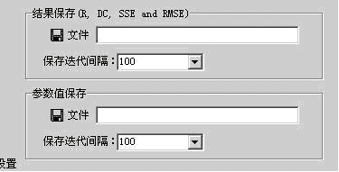

# 1stOptv1.5 Demo

> 原文：[`www.pediy.com/kssd/pediy08/pediy8-313.htm`](https://www.pediy.com/kssd/pediy08/pediy8-313.htm)

## 移花接木巧妙 Crack 1stOptv1.5 Demo

追本溯源轻松 Keygen 1stOptv1.0

【文章标题】: 移花接木巧妙 Crack 1stOptv1.5 Demo

追本溯源轻松 Keygen 1stOptv1.0

【文章作者】: `winndy`

【联系方式】: `CNwinndy@hotmail.com`

【目标】:

*   `1stOptv1.5` Demo : `http://www.7d-soft.com/cn/index.htm`
*   `1stOptv1.0`
*   `Auto2Fit3.0`

【使用工具】: `OllyICE`、`DEDE`、`OllyDump` 插件、`CodeHelper` 插件

【操作平台】: `Windows2003` Server

【作者声明】: 本文纯属技术交流，只作学习使用，不得用于商业用途。转载请注明作者并保持文章的完整。失误之处敬请诸位大侠赐教!

【文章结构】:

*   一、揭开迷雾：`1stOptv1.5` 是个 Demo
*   二、移花接木：`1stOptv1.0` 功能齐全
*   三、追本溯源：`Auto2Fit` v3.0 和 `THKStreams` Delphi Component
*   四、修复 Bug：帮作者修复，同时学习 Inline Patch

### 一、揭开迷雾：`1stOptv1.5` 是个 Demo

#### 1. 脱壳

`Aspack` 压缩，到达 OEP 后直接用 `OllyDump`(缺省参数)脱壳，可以运行。

#### 2. 未运行版本的限制

1.  关于窗口上显示“未注册版”。
2.  右键复制结果时，弹出 MessageBox“未注册版不能进结果复制操作！”。
3.  代码本上右键粘贴，弹出 MessageBox“未注册版不能进行粘贴操作！”。
4.  双击左侧文件浏览器中的 Example 文件，窗口标题后 `[]` 内是文件的全路径，修改 Example 文件后，点保存，弹出 MessageBox“未注册版不能保存为‘.mff’格式！”。
5.  若新建一个代码文件，则窗口标题后 `[]` 内是 `Untitled1`，点保存，弹出保存对话框，save 后不弹出任何对话框(1.0 中会弹出 MessageBox“未注册版不能保存为‘.mff’格式！”)，但实际上文件没有保存，而且窗口标题不含路径。
6.  在新建一个代码文件前，双击左侧文件浏览器中的文件，窗口标题随着改变，但在新建一个代码文件后，也就是窗口标题变为 `[Untitled1]` 后，再双击左侧文件浏览器中的文件，窗口标题不再改变。注意：在 1.0 版的使用版中不存在这个现象。
7.  点“编辑”，再“插入”，再点“文件数据”，弹出 MessageBox “未注册版不能进行数据插入操作！”。
8.  算出结果后，右键点击保存，可以看到可以保存为文本文件，选择文件名后，弹出 MessageBox “未注册版不能保存结果内容！”

#### 3. 载入 1stOpt\_unpacked

右键查找参考字符串，搜索“未注册”，在本段代码起始处设好断点：

**第一处：**

```
0068E23C    push   ebx            ; 下断
 [省略…]
0068E2C8  mov     eax, 0068E2E0    ;  未注册版不能进结果复制操作！
0068E2CD  call    0046E9B8        ;  D7.Dialogs.ShowMessage(AnsiString);
0068E2D2  pop     esi
0068E2D3  pop     ebx
0068E2D4  retn
```

**第二处：**

```
0068E300   mov    eax, 0068E314      ;  未注册版不能进行粘贴操作！
0068E305   call   0046E9B8          ;  D7.Dialogs.ShowMessage(AnsiString);
0068E30A   retn
```

**第三处：**

```
0068E330  push   ebp
 [省略…]
0068E341  mov   eax, 0068E36C     ;  未注册版不能保存为.mff 文件！
0068E346  call   0046E9B8        ;  D7.Dialogs.ShowMessage(AnsiString);
 [省略…]
```

**第四处：**

```
0069F404  mov    eax, 0069F418    ;  未注册版不能进行插入数据操作！
0069F409  call   0046E9B8        ;  D7.Dialogs.ShowMessage(AnsiString);
0069F40E  retn
```

在进行调试的时候，根本找不到一个可以跳到实际执行程序功能的地方，即使是向上面的 call 追，也还是毫无头绪。开始怀疑这就是 Demo 版。干脆把 1.0 的拿来看看，对比一下，看有什么值得借鉴的参考的地方。

在网眼天下，有篇爆破的文章：

完美爆破 1stOpt1.0 数学优化分析综合工具软件包

【破文作者】`luzhmu`

跟了一下，关键点在于

```
0062A954    mov     eax, ebx
```

前面则有：

```
0062A8E9    xor     ebx, ebx     //改为 mov  bl, 1 就可以了
0062A8EB    jmp     short 0062A8EF
0062A8ED    mov     bl, 1
0062A8EF    xor     eax, eax
```

想要爆破的话，将 `xor ebx, ebx` 改为 `mov bl, 1` 就可以了，都是 2 个 bytes。

爆破后，发现一个奇怪的现象，运行完爆破后的 exe 文件，`1stOpt.dll` 就变成正式注册文件了，即再运行原文件，仍显示注册成功。看来，程序在校验完 `1stOpt.dll` 后，重新写了注册文件。这就激起了我写注册机的想法。别急。

在跟踪 1.0 的时候，我看到解码出很奇怪的字符串：

```
0062A7E0    call    [ecx+5C]    
```

这句执行之后，`d [edx]`，可以在内存中看到：

```
00CB8030  €?0€?DCHTTVVUPNWORWQVDAFGM
00CB8050  G..BHASQMMPQMJOMYAFKATXV..SYUWVC
00CB8070  TWHIHIUDABLMKWP..TFLDDBEQKSXWVLJ
 [省略后面的…]
```

仔细看看这些字符串，夹杂着：用户名(`xycheng`)，`CPUID`，`HardDiskID`，1.0(谁都猜得到是版本号).

转念一想，要是我把 1.5 的 `1stOpt.dll` 拿来，把版本号改为 1.5，那不就可以得到一个 1.5 的正式版注册文件吗？会出现 MessageBox“版本号不同”，很容易找到 `lstrcmp`，把它跳过，得到 1.5 版的正式注册文件。

满怀激动的心情，把 `1stOpt.dll` 放到 1.5 目录下去，仍然是未注册。难道算法改变了？那你至少也得读这个 `1stOpt.dll` 文件吧。搜索字符串，未找到；干脆删了这个 `1stOpt.dll`，看你报错不，结果它不理睬。在 1.0 下，则会报“缺少库文件”的错。

再比较一下 1.0 和 1.5 弹出“未注册版不能…”的代码，发现 1.5 根本就不包含正式功能的代码。

晕死了！就无法破解了吗？

### 二、移花接木：`1stOptv1.0` 功能齐全

哈哈，幸好 1.0 的代码功能是齐全的，何不把 1.0 的代码拿到 1.5 中来使用呢？这两个版本差别不大，应该是没问题的。最后是移植成功，幸亏不要我去修改 Import Table。

上面，已经得到注册文件了，有了正式版 1.0。分别用 OD 打开 1.0 和 1.5，找到相对应的地方，用你最喜欢的十六进制编辑工具(我用 `winhex`，`shooo` 教我用的)把 1.0 的代码复制到 1.5 里面去。1.5 的代码很短，空间不够，跳到一个空白地方在进行复制。复制完一个功能，就打开 OD 进行调试，知道这个功能调试好，再复制下一个功能。

#### 第一处

**1.5 修改前**

```
0068E2C8  mov     eax, 0068E2E0        ;  未注册版不能进结果复制操作！
0068E2CD  call  0046E9B8               ;  D7.Dialogs.ShowMessage(AnsiString);
0068E2D2  pop     esi
0068E2D3  pop     ebx
0068E2D4  retn
```

**修改后：**

```
0068E2C8    mov     eax, [esi+394]
0068E2CE    call    005262A0
0068E2D3    pop     esi
0068E2D4    pop     ebx
0068E2D5    retn
```

**1.0 中是：**

```
00683530   mov   eax, [esi+394]
00683536   call    0050D820
0068353B   pop     esi
0068353C   pop     ebx
0068353D   retn
```

#### 第二处

**1.5 修改后：**

```
0068E300   push   ebx
0068E301   push   esi
0068E302   mov    ebx, eax
 [省略…]
0068E329   jmp    006D0156    ;空间不够，跳到其他地方去
006D0156   jge    short 006D0173
 [省略…]
006D017B   pop    ebx
006D017C   retn
```

**1.5 修改前：**

```
0068E300  mov   eax, 0068E314      ;  未注册版不能进行粘贴操作！
0068E305  call  0046E9B8          ;  D7.Dialogs.ShowMessage(AnsiString);
0068E30A  retn
```

**1.0 中：**

```
00683540   .  53         push    ebx                          ;  Paste
00683541   .  56         push    esi
 [省略…]
006835A5   .  5B         pop     ebx
006835A6   .  C3         retn
```

#### 第三处

**1.5 修改后：**

```
0068E330   jmp    006D0180           ;  空间不够，jmp to save .mff
006D0180   push   ebp             ;  save .mff file fixed code
006D0181   .mov   ebp, esp
006D0183    add    esp, -28
 [省略…]
006D01AD   push   ebp
006D01AE   push   006D03FF
006D01B3    push   dword ptr fs:[eax]
006D01B6    mov    fs:[eax], esp
006D01B9    mov    eax, [6D91D8]
 [省略…]
006D01D9  mov  eax, [41712C]
006D01DE  call  004036EC      ;  D7.System.TObject.Create(TObject;Boolean);
 [省略…]
006D01F3  mov  edx, 006D0418    ;  ASCII "1stOpt File"
006D0202  mov  edx, [6D88CC]    ;    1.5
006D0208   .  E8 7B45D3FF    call    00404788
 [省略…]
006D03CE  mov    eax, [6D91D8]
006D03D3  mov    eax, [eax]
006D03D5  xor    edx, edx
006D03D7  call   004629AC
006D03DC  xor    eax, eax
006D03DE  pop    edx
006D03DF  pop    ecx
006D03E0  pop    ecx
006D03E1   mov    fs:[eax], edx
006D03E4   push   006D0406
006D03E9   lea    eax, [ebp-28]
006D03EC   mov    edx, 4
006D03F1   call   00404588
006D03F6   lea    eax, [ebp-8]
006D03F9   call   00404564
006D03FE   retn

006D03FF   jmp    00403E9C  ；跳到==D7.System.@HandleFinally;
006D0404   jmp    short 006D03E9
006D0406   pop    edi
006D0407   pop    esi
006D0408   pop    ebx
006D0409   mov    esp, ebp
006D040B   pop    ebp
006D040C   retn   0C
```

**1.5 修改前：**

```
0068E330    push   ebp
0068E331    mov    ebp, esp
0068E333    xor    eax, eax
0068E335    push   ebp
0068E336    push   0068E359
0068E33B    push   dword ptr fs:[eax]
0068E33E    mov    fs:[eax], esp
0068E341    mov    eax, 0068E36C         ;  未注册版不能保存为.mff 文件！
 [省略…]
```

**1.0 中：**

```
006835A8   push   ebp             ;  保存.mff 文件
006835A9   mov    ebp, esp
006835AB   add    esp, -28
 [省略…]
```

#### 第四处

**在 1.5 中修改后：**

```
0069F404  jmp    006D04C0        ；空间不够，跳到别处  
006D04C0   push   ebp            ;  InsertFileData
006D04C1   mov    ebp, esp
006D04C3   xor    ecx, ecx
 [省略…]
006D053D  |.  90           nop   ；在 1.0 中校验注册没，nop 掉
 [省略…]
006D054A  |.  90           nop
 [省略…]
```

**1.5 修改前：**

```
0069F404  mov   eax, 0069F418      ;  未注册版不能进行插入数据操作！
0069F409  call  0046E9B8          ;  D7.Dialogs.ShowMessage(AnsiString);
0069F40E   retn
```

**在 1.0 中：**

```
00693E7C   push   ebp            ;  InsertFileData
00693E7D   mov    ebp, esp
00693E7F   xor    ecx, ecx
 [省略…]
00693EF9   mov    eax, 2
00693EFE   call   0062A538       ；校验注册没有
00693F03   test   al, al
00693F05   je     short 00693F76
```

比较 1.0 和 1.5 的代码，复制过来后，要注意修改 call，还有一些变量，push 的常量。

修改的方法为：

1.  找到在 1.5 中与 1.0 中相同的函数，进入 1.0 的 call，复制几行能唯一标识这个函数的代码，`Ctrl+S`，在 1.5 中搜索，找到后，找到函数起始地址，修正 call。
2.  举个例子\[例子举的都是第三处的\]：

```
006D01AE   push   006D03FF
006D03FF   jmp    00403E9C  ；跳到==D7.System.@HandleFinally;
```


# 1stOpt v1.5 逆向工程修复记录

## 一、SEH 处理函数修复
`006D01AE` 附近的这段代码是安装 SEH 处理函数的，`push` 的这个常量是跳到 `D7.System.@HandleFinally` 的代码的地址。`006D03FF` 处的 `jmp` 则是跳到 `HandleFinally`。

这两处都要修复。找 `00403E9C` 的方法通 `call`。Push `006D03FF`，这个常量就是 `006D03FE` `retn` 后面的那句。

### 例子
#### 3. 例子
`006D01F3  mov  edx, 006D0418    ;  ASCII "1stOpt File"`

这个好修复，观察 1.0 的代码，可以知道，`mov` 进 `edx` 的常量指向一个字符串。

#### 4. 例子
`006D0202  mov  edx, [6D88CC]    ;    1.5`

这种不太好修复。

通过调试 1.0，可以看到执行 `006D0202` 后，`d [edx]`，看到字符串 1.0。等我们修复后，可以来验证。

具体怎么找到 `6D88CC` 的，记不太清了，好像运气比较好，^\_^。

对于 1.5 种的 `006D03CE     mov     eax, [6D91D8]`

在 1.0 种对应的代码是：`006837F6  mov     eax, [6C9028]`

通过在 1.0 中 `ctrl+s`，搜索 `mov     eax, [6C9028]`，可以得到好几处，再通过某一处很有特点的代码，在 1.5 中搜索到这段代码，进而找到 1.5 中相对应的 `mov     eax, [6D91D8]`。

这样，四个基本功能都修复完毕。还有几个小地方。

可以利用 `DeDe`，找到结果面板中保存为文本文件所对应的过程的起始地址：

```
反编译后，找到所有的 save* 事件，然后全部下断点，再点保存，中断在哪里就是哪里了。
```

### 第五处
#### 1.5 中修改后：
```
006986BC     jmp     006D0670      ;  跳到其他地方去，Save2textClick
006986C1     nop

006D0670     push    ebp           ;  ResultSave2TxtClick
006D0671   .  8BEC           mov     ebp, esp

[省略…]
```

修复的方法同上。

#### 1.5 修改前：
```
006986BC    push    ebx
006986BD    mov     ebx, [eax+380]

[省略…]

006986F3     je      short 006986FF
006986F5     mov   eax, 00698750     ;  未注册版不能保存结果内容！
006986FA     call    0046E9B8        ;  D7.Dialogs.ShowMessage(AnsiString);
006986FF     pop     ebx
00698700     retn
```

#### 1.0 中：
```
0068D01C   push    ebp               ;  Save2textClick
0068D01D   mov     ebp, esp

[省略…]
```

## 二、限制与功能修复

### 第六处：解决限制⑥
`DeDe` 反编译，找到 `RzShellList1DblClick` 事件。

#### 1.5 中：
`0063338C     push    ebp            ;  RzShellList1DblClick`

#### 1.0 中：
`0062C964     push    ebp            ;  RzShellList1DblClick`

同时运行 1.0 和 1.5，观察程序流程，容易找到关键地方。

#### 1.0 中：
```
0062CAC5    mov     edx, 0062CCC8       ;  ASCII ".mff"
0062CACA    call     00404910           ;  D7.System.@LStrCmp;
0062CACF    je      short 0062CAE3
0062CAD1    mov     eax, 2
0062CAD6    call    0062A538           ；校验注册没有
0062CADB    test    al, al
0062CADD    je      0062CC54
0062CAE3    push    0062CCD8            ;  ASCII "1stOpt - ["
0062CAE8    push    dword ptr [ebp-4]
```

#### 1.5 修改前：
```
006334D7    mov     edx, 006336C8    ;  ASCII ".mff"
006334DC   call    00404910           ;  D7.System.@LStrCmp;
006334E1    je      short 0063350C
006334E3    push    006336D8          ;  ASCII "1stOpt - ["
006334E8    push    dword ptr [ebp-4]
```

在 1.0 中 `0062CACF    je      short 0062CAE3` 直接跳到了 `0062CAE3    push    0062CCD8            ;  ASCII "1stOpt - ["`

而在 1.5 中，`006334E1    je      short 0063350C` 把 `006334E3    push    006336D8          ;  ASCII "1stOpt - ["` 这句跳过了。

清楚了，把 `je      short 0063350C` 直接 `nop` 掉。

保存后运行，OK！

### 第七处：解决新建文件后不能保存文件
（窗口标题已带绝对路径的可以保存）。

新建文件，点工具栏的保存图标，中断在下面：

#### 1.5 中：
`0068E754      push    ebp               ;  SaveActionExecute`

#### 1.0 中：
`00683C40      push    ebp               ;  SaveActionExecute`

同时调试 1.0 和 1.5，比较流程，这个还比较难找：

#### 1.5 中，跟到这里：
```
006908A0      push    ebp               ;  savefile
006908A1      mov     ebp, esp
006908A3      mov     ecx, 0D

[省略…]

00690995   .  84C0           test    al, al
00690997   .  0F84 EA020000  je      00690C87
0069099D   .  EB 31          jmp     short 006909D0   ;这是修改后的代码
0069099F     90             nop
006909A0   .  8BC3           mov     eax, ebx
```

#### 1.5 修改前的代码：
```
00690995      test    al, al
00690997      je      00690C87
0069099D    lea     edx, [ebp-20]    //这段代码要跳过
006909A0     mov     eax, ebx
006909A2     call    0046CC0C
006909A7     mov     eax, [ebp-20]
```

#### 1.0 中：
```
00685DE8      push    ebp                  ;  save2file
00685DE9      mov     ebp, esp
00685DEB      mov     ecx, 0D

[省略…]

00685EDD     test    al, al
00685EDF     je      006861DD
00685EE5     mov     eax, 3
00685EEA     call    0062A538 ；检验注册没有
00685EEF     test    al, al
00685EF1     jnz     short 00685F26
00685EF3     lea     edx, [ebp-20]
00685EF6     mov     eax, ebx
00685EF8     call    0046CC0C
```

对比 1.0 和 1.5 的流程，可以找到关键点。

新建文件后，窗口标题能变为绝对路径，可以保存文件。

### 第八处：修改关于窗口中的“未注册版”
用 `ultraedit`，搜索到“未注册版”，改为“  winndy”。

不太会修改资源，未注册版有 8 个 bytes，所以也该成 8 个 bytes 了，在 `winndy` 前还加了两个空格。

到这里，`1stOptv1.5` 修复完毕。没什么技巧，完全是体力活啊！

`1.0` 的注册机还没做出来呢。

## 三、追本溯源：Auto2Fit v3.0 和 THKStreams Delphi Component

在跟踪 `1stOptv1.5` 的时候，用 `DFMEditor` 查看资源，可以发现一个 `TREGFORM`，打开一看，“Auto2Fit Reristration”，“Send Mail to CPC-X Software”，于是 google 了个 `Auto2Fit v3` 来玩玩。安装后，界面和 `1stOpt` 没啥两样，只是 `Auto2Fit` 是英文界面而已。`Auto2Fit` 是 `1stOpt` 的前身？在 `Auto2Fit` 中看到了很多参考字符串，这个好像更适合做注册机。下面就跟踪 `Auto2Fit`。

点关于，停在下面：

```
005FB4A4  push    ebp

[省略…]

005FB4F8  mov  ecx, 005FBD60      ;  ASCII "CPUHDID.txt"
005FB4FD  mov   edx, [ebp-38]
005FB500  call    00404808
005FB505  mov   eax, [ebp-214]
005FB50B  call   0040CB2C          ;  D7.SysUtils.FileExists(AnsiString):Boolean;
005FB510  test    al, al
005FB512  jnz    short 005FB588
005FB514  lea    eax, [ebp-218]
005FB51A  mov  ecx, 005FBD60       ;  ASCII "CPUHDID.txt"
```

检查 `exe` 的目录中是否存在 `CPUHDID.txt`，若不存在则创建，第一行是 `CPUID`，第二行是 `HardDiskID`。很容易得到生成 `CPUID` 和 `HardDiskID` 的算法。写注册机时会用到。

```
005FB9ED  cmp    dword ptr [6A77A8], 1
005FB9F4   je     short 005FB9FF
005FB9F6  cmp    dword ptr [6A77A8], 5
005FB9FD  jnz     short 005FBA0E
005FB9FF  lea     eax, [ebp-34]
005FBA02  mov    edx, 005FBDEC     ;  ASCII " (Single User License)"
005FBA07  call    004045B8
005FBA0C  jmp    short 005FBA6F
005FBA0E  cmp    dword ptr [6A77A8], 2
005FBA15  je     short 005FBA20
005FBA17  cmp     dword ptr [6A77A8], 6
005FBA1E  jnz     short 005FBA2F
005FBA20  lea     eax, [ebp-34]
005FBA23  mov   edx, 005FBE0C     ;  ASCII " (2-4 Users License)"
005FBA28  call    004045B8         ;  D7.System.@LStrLAsg(void;void;void;void);
005FBA2D  jmp   short 005FBA6F

[省略…]
```

很明显，`[6A77A8]` 是注册的类型。

```
al=0     trial user
al=1 ,5  (Single User License)
al=2 ,6  (2-4 Users License)
al=3 ,7  (5-10 Users License)
al=4 ,8  (Site License)

1<=al<=4  "Standard Version "
5<=al<=8  "Professional Version "
```

往上面看，有两处 `call`：

```
005FB98C     call    005FAC00      
005FB9B8     call    005FB290      
```

都很重要。

第一个 `call` 读注册表中的键值（有两处），检查 `Auto2Fit.Lic`；
第二个 `call` 检查 `AFCorelib.dll`。

跟进后会发现：首先读 `HKEY_LOCAL_MACHINE\SOFTWARE\Microsoft\OfficeAF` 下的几个值：

1. `eu_id`:
“95-120-124-111-113-115-125-126-111-124-111-110-42-96-111-124-125-115-121-110”
2. `gc_id`:6
3. `st_id`:
64 位浮点数：
`00 00 00 00 E0 06 E3 40`
`38967.000000000000000`
4. `vs_id`:0

注意只有在 `gc_id=0` 的情况下，才采取读 `Auto2Fit.Lic`。

其中 `eu_id` 经过一个函数解密为用户名：

```
005FADA5  call    005FA7A0                     ;  用户名解密
```

“95-120-124-111-113-115-125-126-111-124-111-110-42-96-111-124-125-115-121-110”
就是 `Unregistered Version`。

然后会压入这些参数，进入一个 `call`：

```
005FADAA  mov     eax, [ebp-120]             ;  用户名
005FADB0  mov     edx, [ebp+8]               ;  p_vs_id
005FADB3  mov     edx, [edx]                 ;  vs_id
005FADB5  call    005FA8C4                   ;  校验 licensefile
005FADBA  mov     [ebp-10], eax
005FADBD  cmp     dword ptr [ebp-10], 0
005FADC1   jnz     short 005FADDA        ;  跳
005FADC3   push    0                   ;  /Arg1 = 00000000
005FADC5   mov     cx, [5FB210]           ;  |
005FADCC  mov     dl, 2                  ;  |
005FADCE   mov     eax, 005FB21C         ;  |ASCII "Missing Auto2Fit License File!"
005FADD3   call    0046E004              ;  \Auto2Fit.0046E004
005FADD8   jmp     short 005FADF8
```

`Auto2Fit.Lic` 是没有的，得自己构造一个假 `Auto2Fit.Lic`。

难点就在于这里了，难得构造一个格式符合要求的 `Auto2Fit.Lic`，能通过这段验证，每次都说“Auto2Fit.Lic 已损坏”。一层一层的跟进去，头都大了，仅知道第 3 个 byte 开始，必须是 `01 02 …08`。

在这里卡了。

后来，查看 `DeDe` 反汇编出来的代码的时候，看到:

```
* Reference to class THKStreams
|
005FA9F8   A1DC255300             mov     eax, dword ptr [$005325DC]
* Reference to : THKStreams._PROC_005327CC()
|
```


# 逆向分析与破解记录

## 1. 初步跟踪与组件识别

开始调试时，我们观察到以下汇编指令：

```
005FA9FD   E8CA7DF3FF      call    005327CC
005FAA02   8945EC          mov     [ebp-$14], eax
005FAA05   8B45EC          mov     eax, [ebp-$14]
* Reference to field THKStreams.OFFS_0024
005FAA08   C6402401        mov     byte ptr [eax+$24], $01
005FAA0C   8B45EC          mov     eax, [ebp-$14]
```

不禁产生好奇感，这个 `THKStreams` 究竟是什么类啊！？

Google 一下，原来是个 Delphi 流文件加密的组件，开源的，太好了，有救了。

下了 1.7 的：`THKStreams v1.7 by Harry Kakoulidis 1/2002`

里面还有个 demo，演示 `THKStreams` 的使用。

## 2. 源码分析与许可证伪造

用 Delphi 打开组件源码和 demo 工程，组件采用了 `blowfish` 加密和 `LHA` 压缩算法。学习了一下这些源码。一边跟踪，一边对照源码，很容易就识别出了 `Auto2Fit` 中的那些 `call`。用 demo 工程中的一个 `memo`，生成了 `Auto2Fit.Lic`。但还是出错，然后又 google，恶补了一下 `TStringList` 的用法。又仔细看了看 demo 的代码。

```
HKS.AddStream('MEMO1',ms);    //Add it to THKStreams with ID 'MEMO1'
```

关键在上面这句，`'MEMO1'` 相当于流文件中的一个标签了，在我们的 `Auto2Fit.Lic` 中对应的标签是什么呢。后来跟踪 `Auto2Fit`，发现标签是 `'AFLicenseFile'`。

重新伪造 `Auto2Fit.Lic`，继续调试。

参考 `HKStreams` 的源码和 demo 工程的代码，以及 `DeDe` 反汇编出来的代码，还有 `CodeHelper` 插件，可以给出很好的注释：

```
005FAAAC    mov     edx, 005FABA4   ;  ASCII "AFLicenseFile"
005FAAB1    mov     eax, [ebp-14]
005FAAB4    call    00532858
;  procedure THKStreams.GetStream(const ID: string; Dest: TStream);
005FAAB9    mov     edx, [ebp-10]
005FAABC    mov     eax, ebx
005FAABE    mov     ecx, [eax]
005FAAC0    call    [ecx+5C]          ;  TStringList.LoadFromStream(TStream)
005FAAC3    mov     eax, ebx
005FAAC5    mov     edx, [eax]
005FAAC7    call    [edx+14]           ;  TStringList.GetCount()
005FAACA    cmp     eax, 0D
005FAACD    je      short 005FAAD6
005FAACF   mov     esi, 2
005FAAD4   jmp     short 005FAB2E
005FAAD6   lea     ecx, [ebp-3C]
005FAAD9   xor     edx, edx
005FAADB   mov     eax, ebx
005FAADD   mov     edi, [eax]
005FAADF   call    [edi+C]
005FAAE2   mov     eax, [ebp-3C]
005FAAE5  mov     edx, 005FABBC      ;  ASCII "auto2fit_license_file"
005FAAEA  call    004048CC                      ;  D7.System.@LStrCmp;
005FAAEF   jnz     short 005FAB29
005FAAF1   lea     ecx, [ebp-40]
005FAAF4   mov     edx, 3
005FAAF9   mov     eax, ebx
005FAAFB   mov     edi, [eax]
005FAAFD   call    [edi+C]
005FAB00   mov     eax, [ebp-40]
005FAB03   mov     edx, [ebp-4]
005FAB06   call    004048CC           ;  D7.System.@LStrCmp;
005FAB0B   jnz     short 005FAB29
005FAB0D   lea     ecx, [ebp-44]
005FAB10   mov     edx, 7
005FAB15   mov     eax, ebx
005FAB17   mov     edi, [eax]
005FAB19   call    [edi+C]
005FAB1C  mov     eax, [ebp-44]
005FAB1F  mov     edx, [ebp-C]
005FAB22  call    004048CC            ;  D7.System.@LStrCmp;
005FAB27  je      short 005FAB2E
```

上面代码中有 4 处关键地方，用红色标记出来。

### 关键逻辑分析

*   **第一处**：`005FAACA  cmp eax, 0D`
    这是告诉我们，`TStringList` 里有 `0D` (13) 行。

*   **第二处**：`005FAAD9  xor edx, edx`
    这是告诉我们，第 0 个 (即第 1 行) 是 `"auto2fit_license_file"`。

*   **第三处**：`005FAAF4  mov edx, 3`

*   **第四处**：`005FAB10  mov edx, 7`

第三和第四处暂时看不出来，随便填，伪造 `Auto2Fit.Lic`，继续跟踪。

后来可以跟踪出，第三处是用户名，与注册表中的 `eu_id` 解密出来的用户名要一样。

第四处是密码，这个密码是由用户名，经过 3 处主要的变换生成的。

### 密码验证

`Fish Blowfish` 加密的密码的地方：

```
00532A74   mov     edx, [ebp-14]                     ;  key
00532A77   mov     eax, [ebp-8]
00532A7A  call    00530338
;  Procedure DecryptStream(ms : TmemoryStream; Const Key : string);
00532A7F  xor     eax, eax
```

可以看到，`key` 就是第四处的密码。

于是很快就生成了用户名为 “`Unregistered Version`” 的 `Auto2Fit.Lic` 文件，过关。

## 3. 注册表验证

继续跟踪，又检查另一处注册表：

```
HKEY_LOCAL_MACHINE\SOFTWARE\Microsoft\Shared\OfficeAF
```

里面的键值同：

```
HKEY_LOCAL_MACHINE\SOFTWARE\Microsoft\OfficeAF
```

修改注册表，顺利通过。

## 4. AFCorelib.dll 验证

下面就到了验证 `AFCorelib.dll` 的函数中。

```
005FB2D0   mov   ecx, 005FB468     ;  ASCII "AFCorelib.dll"
005FB2D5   call    00404808
005FB2DA  mov   eax, [ebp-10]
005FB2DD  call    0040CB2C        ;  D7.SysUtils.FileExists(AnsiString):Boolean;
005FB2E2   test    al, al
005FB2E4   jnz     short 005FB2F2
```

密码在这里找到：

```
005FB34B   mov   edx, 005FB480        ;  ASCII "auto2fitneuralpower"
005FB350   .  E8 1F92E0FF   call    00404574
```

流标签仍然是：`'AFLicenseFile'`。

验证里面的信息的代码为：

```
005FB39A     lea     edx, [ebp-18]
005FB39D     lea     eax, [ebp-14]
005FB3A0     call    0067AA08          ;  GetDiskID,CPUID
005FB3A5    lea     ecx, [ebp-28]
005FB3A8    mov    edx, 0C
005FB3AD    mov   eax, [ebp-8]
005FB3B0    mov   esi, [eax]
005FB3B2    call    [esi+C]
005FB3B5    mov   eax, [ebp-28]
005FB3B8    mov   edx, 005FB49C     ;  ASCII "False"
005FB3BD    call    004048CC        ;  D7.System.@LStrCmp;
005FB3C2    jnz     short 005FB404
005FB3C4    lea     ecx, [ebp-2C]
005FB3C7    mov     edx, 0A
005FB3CC    mov     eax, [ebp-8]
005FB3CF    mov     ebx, [eax]
005FB3D1    call    [ebx+C]
005FB3D4    mov     edx, [ebp-2C]
005FB3D7    mov     eax, [ebp-14]     ;  比较 CPUID
005FB3DA    call    004048CC         ;  D7.System.@LStrCmp;
005FB3DF     je      short 005FB402   ；goodboy
005FB3E1     lea     ecx, [ebp-30]
005FB3E4    mov     edx, 0B
005FB3E9    mov     eax, [ebp-8]
005FB3EC    mov     ebx, [eax]
005FB3EE    call    [ebx+C]
005FB3F1    mov     edx, [ebp-30]      ；比较 HardDiskID
005FB3F4    mov     eax, [ebp-18]
005FB3F7    call    004048CC         ;  D7.System.@LStrCmp;
005FB3FC    je      short 005FB402   ；goodboy
```

`TStringList` 中 `index` 为 `0C`：`"False"`

`TStringList` 中 `index` 为 `0A`：`CPUID`

`TStringList` 中 `index` 为 `0B`：`HardDiskID`

其他任意。

再伪造 `AFCorelib.dll`。

还是显示未注册。

后来跟踪由用户名生成 `key` 的过程。有个地方很可疑。

`ASCII "131938520"`

由 `13193852` 和 `0` 连接而来。

`13193852` 又是怎么来的呢？

```
005FB956  cmp     dword ptr [6A2BE4], 1         ;  00C9527C(13193852)
005FB95D  jnz     short 005FB9A5
```

不可能。

后来把 `vs_id` 改成步为 0 的数，便于识别和跟踪。

```
005FA931     mov     eax, ebx               ;  vs_id
005FA933     dec     eax
005FA934     sub     eax, 4
005FA937     jnb     short 005FA943           ;  >=5
005FA939     mov     edi, 1                  ;  *****
005FA93E    mov     [ebp-8], ebx           ;  vs_id
005FA941    jmp     short 005FA958
005FA943    mov     eax, ebx
005FA945    add     eax, -5
005FA948    sub     eax, 4
005FA94B    jnb     short 005FA958            ;  >=9
005FA94D   mov     edi, 2                     ;  edi=00C9527C
005FA952    sub     ebx, 4                   ;  5<vs_id<9
005FA955    mov     [ebp-8], ebx             ;  vs_id-4
005FA958    lea     edx, [ebp-20]
005FA95B    mov     eax, edi
005FA95D    call    0040C76C                ;  Hex2Decimal
005FA962     lea     eax, [ebp-20]            ;  00C9527C
005FA965    push    eax          ;  d [eax]:00C95958   13193852
005FA966    lea     edx, [ebp-24]
005FA969    mov     eax, [ebp-8]
005FA96C   call    0040C76C
005FA971    mov     edx, [ebp-24]            ;  d edx "0"
005FA974    pop     eax                       ;  d [eax] 13193852
005FA975    call    004047C4                 ;  D7.System.@LStrCat;
005FA97A   mov     eax, [ebp-20]
005FA97D  call    0040C84C            ;  D7.SysUtils.StrToInt(AnsiString):Integer;
005FA982   imul    ebx, eax, 2710        ;  317C7580,eax=0018
```

`00C9527C` (`13193852`) 是保存在 `edi` 中，上面有两处改变 `edi` 的地方，用红色标记出来了。

后来发现这个字符串是由 `vs_id` 得来，`vs_id` 来决定注册版本的类型。

*   标准版：`mov edi, 1`
*   专业版：`mov edi, 2`

如果 `vs_id>=9`，那么 `edi` 就是 `00C9527C` (`13193852`)。

## 5. 用户名生成 Key 的三处变换

下面再看用户名生成 `key`，共有三处变换：

### 第一处变换

```
005FA982   imul    ebx, eax, 2710         ;  317C7580,eax=0018
005FA988   push    0
005FA98A  push    1317BEB         ;  Hex2Dec(1317BEB)= 20020203
005FA98F  lea     edx, [ebp-C]
005FA992  mov     eax, [ebp-4]
005FA995   call    005FC364       ;  用户名变换
```

### 第二处变换

```
005FA9BB    push    edx
005FA9BC    push    eax           ;  版本号 3.0*1000
005FA9BD    lea     edx, [ebp-28]
005FA9C0    mov     eax, [ebp-C]
```


# 第三处：`005FA9D3` 处的指令序列

```
005FA9C3    call    005FC364             ;  ***
005FA9D3    mov     eax, ebx
005FA9D5    cdq
005FA9D6    push    edx
005FA9D7    push    eax                  ; Int(vs_id 得来的字符串) * 0x2710
005FA9D8    lea     edx, [ebp-30]
005FA9DB    mov     eax, [ebp-C]
005FA9DE    call    005FC364             ;  get key
```

再看看 `005FC364`，这个 `call` 也不复杂，可以去看注册机源码：

```
function TFrmKeygen.NameTransform(var UserName:String;dwNumber:DWORD):String;
```

什么都清楚了。

还有几处小地方：

1. 用户名长度区间：`[4,25]`。
2. `"95-120-124-111-113-115-125-126-111-124-111-110-42-96-111-124-125-115-121-110"` 就是 `Unregistered Version`。
3. 由用户名的 `ascii` 的十进制加上 `10`，但最后一个字符除外。
4. `gc_id` 是使用次数
5. `st_id` 是安装时间

下面就是写注册机了。

还有一点要说明的是：对于 `TStringList` 中不要求的字符串，更完美的办法是随机生成，为了简便起见，我没有这样写，大家可以看注册机源码。

这样，`Auto2Fit v3.0` 的注册机就写出来了，哈哈。

我们再来写 `1stOptv1.0` 的注册机吧。

关键点就是找到 `key` 和流文件标签，以及 `TstringList` 中的结构。`1stOpt.dll` 不用我们伪造，太好了！

## 在这里 `fish key`：

```
00535850    mov     edx, [ebp-14]        ;  key
00535853    mov     eax, [ebp-8]
00535856    call    0053310C

            ;  Procedure DecryptStream(ms : TmemoryStream; Const Key : string);

0053585B    xor     eax, eax
```

会发现 `key=mfit`，是常量。

流文件标签在这里找到：

```
0062A7CB    mov     edx, 0062A978        ;  ASCII "licensefile"
0062A7D0    mov     eax, [ebp-8]
0062A7D3    call    00535634

            ;  procedure THKStreams.GetStream(const ID: string; Dest: TStream);
```

`TStringList` 的结构在这里看：

```
0062A7E6    mov     edx, 64              ;  version 1.0
0062A7EB    mov     eax, [ebp-18]
0062A7EE    mov     ebx, [eax]
0062A7F0    call    [ebx+C]
0062A7F3    mov     edx, [ebp-28]
0062A7F6    mov     eax, 006CD8F8
0062A7FB    call    004045B8
0062A800    lea     ecx, [ebp-24]
0062A803    mov     edx, 0A
0062A808    mov     eax, [ebp-18]
0062A80B    mov     ebx, [eax]
0062A80D    call    [ebx+C]
0062A810    lea     edx, [ebp-1C]
0062A813    mov     eax, [ebp-24]
0062A816    call    00403360             ;  StrtoInt
0062A81B    mov     ebx, eax             ;  17(23)
0062A81D    lea     ecx, [ebp-24]
0062A820    mov     edx, 14
0062A825    mov     eax, [ebp-18]
0062A828    mov     esi, [eax]
0062A82A    call    [esi+C]
0062A82D    lea     edx, [ebp-20]
0062A830    mov     eax, [ebp-24]
0062A833    call    00403360             ;  StrtoInt
0062A838    mov     esi, eax             ;  22(34)
0062A83A    cmp     dword ptr [ebp-1C], 0
0062A83E    jnz     short 0062A846
0062A840    cmp     dword ptr [ebp-20], 0
0062A844    je      short 0062A84D
0062A846    xor     ebx, ebx
0062A848    jmp     0062A8EF
0062A84D    lea     ecx, [ebp-2C]
0062A850    mov     edx, ebx
0062A852    mov     eax, [ebp-18]
0062A855    mov     ebx, [eax]
0062A857    call    [ebx+C]
0062A85A    mov     eax, [ebp-2C]
0062A85D    lea     edx, [ebp-1C]
0062A860    call    00403360             ;  StrtoInt
0062A865    mov     [ebp-20], eax
0062A868    cmp     dword ptr [ebp-1C], 0
0062A86C    jnz     short 0062A876
0062A86E    mov     eax, [ebp-20]
0062A871    mov     [6CD8FC], eax
0062A876    cmp     dword ptr [6CD8FC], 1E     ;  过期，30 天
0062A87D    setg    [6C8160]
0062A884    lea     ecx, [ebp-30]
0062A887    mov     edx, esi
0062A889    mov     eax, [ebp-18]
0062A88C    mov     ebx, [eax]
0062A88E    call    [ebx+C]
0062A891    mov     edx, [ebp-30]
0062A894    mov     eax, 006CD8F4
0062A899    call    004045B8
0062A89E    lea     edx, [ebp-10]
0062A8A1    lea     eax, [ebp-C]
0062A8A4    call    0069BEB0           ;  GetCPUID and HardDiskID
0062A8A9    cmp     dword ptr [ebp-1C], 0
0062A8AD    jnz     short 0062A8CC
0062A8AF    lea     ecx, [ebp-34]
0062A8B2    mov     edx, 96
0062A8B7    mov     eax, [ebp-18]
0062A8BA    mov     ebx, [eax]
0062A8BC    call    [ebx+C]
0062A8BF    mov     edx, [ebp-34]      ；比较 CPUID
0062A8C2    mov     eax, [ebp-C]

;  CPUID EDX 00CE8F48 ASCII "00000F29-0001080A-00004400-BFEBFBFF"

0062A8C5    call    00404910           ;  D7.System.@LStrCmp;
0062A8CA    je      short 0062A8ED     ;  要 jump
0062A8CC    lea     ecx, [ebp-38]
0062A8CF    mov     edx, 97
0062A8D4    mov     eax, [ebp-18]
0062A8D7    mov     ebx, [eax]
0062A8D9    call    [ebx+C]
0062A8DC    mov     edx, [ebp-38]     ；比较 HardDiskID
0062A8DF    mov     eax, [ebp-10]
0062A8E2    call    00404910           ;  D7.System.@LStrCmp;
0062A8E7    je      short 0062A8ED
0062A8E9    xor     ebx, ebx
0062A8EB    jmp     short 0062A8EF
0062A8ED    mov     bl, 1              ；置标志
```

总结出来 `TStringList` 的结构为：

1. 版本号：`Index` 为 `0x64`
   ```
   0062A7E6    mov     edx, 64         ;  version 1.0
   ```
2. 使用天数 `index` 的指针在 `0A`
   ```
   0062A803    mov     edx, 0A         ;  Ascii  23
   ```
3. 用户名的 `index` 的指针的 `0x14`
   ```
   0062A820    mov     edx, 14         ;  Ascii  34
   ```
4. `index`：`ox23`，字符串 `0`，是使用天数 `<=30`
5. `index`：`0x34`，字符串 `"xycheng"`，是用户名
6. `index`：`0x96`，指向 `CPUID`
7. `index`：`0x97`，指向 `HardDiskID`

其中，只要 `CPUID` 和 `HardDiskID` 之一与本机的相同，就认为是注册成功。

`0A` 和 `0x14` 处的字符串应该是随机的(在范围之内)，指向使用天数和用户名的 `index`。

在注册机的编写中，为简便，固定了。详细算法见注册机源码。

`1stOpt v1.0` 的注册机就这样轻松搞定，还没有 `Auto2Fit v3.0` 复杂。

要是能拿到 `v1.5` 的正式文件，呵护，`1.5` 的注册文件也可以生成。

几近完美了，但程序中似乎有个 `bug`，作者留给我们的，在 `Auto2Fitv3.0`，`1stOptv1.0` 和 `v1.5` 中都存在。列在下面一节中。

# 四、修复 Bug：帮作者修复，同时学习 `Inline Patch`

在 `1stOptv1.5`、`1.0` 和 `Auto2Fit v3.0` 中，算法设置，选项里：结果保存和参数值保存，只能设置一个，如图：



但是用键盘，可以在文本框中输入路径，运行后，可生成结果保存文件和参数值保存文件。但点旁边的文件按钮，却不能同时设置两个文本框中的路径。正式注册版也如此，看来是个 `bug` 了。

既然 `1stOptv1.5` 被整成这个样子，何不把这个 `bug` 也修复一下。

```
0068F47A    mov     edx, [ebp-38]
0068F47D    pop     eax
0068F47E    call    00404910       ;  D7.System.@LStrCmp;
0068F483    jnz     short 0068F4D6
0068F485    push    0
0068F487    push    0068F5E8       ;  文件”
0068F48C    lea     edx, [ebp-44]
0068F48F    mov     eax, ebx
0068F491    call    0046CC0C
0068F496    push    dword ptr [ebp-44]
0068F499    push    0068F62C      ;  “已被用于保存结果文件,请试另一文件名!
0068F49E    lea     eax, [ebp-40]
0068F4A1    mov     edx, 3
0068F4A6    call    004048C0
0068F4AB    mov     eax, [ebp-40]    ;  |
0068F4AE    cx, [68F620]            ;  |
0068F4B5    xor     edx, edx         ;  |
0068F4B7    call    0046E8C0        ;  \1stOpt_u.0046E8C0
0068F4BC    jmp     short 0068F4D6
0068F4BE    lea     edx, [ebp-48]
0068F4C1    mov     eax, ebx
0068F4C3    call    0046CC0C
0068F4C8    mov     edx, [ebp-48]
0068F4CB    mov     eax, [esi+5C8]
0068F4D1    call    0044540C    ;  D7.Controls.TControl.SetText(TControl;TCaption);
0068F4D6    xor     eax, eax
```

关键在这里：

```
0068F483    jnz     short 0068F4D6
```

跳到了 `0068F4D6`，正好把上面那个 `TControl.SetText` 跳过去了。

`0068F47E` 处的比较，是看结果文件名和参数文件名相同否。

修改方法，是跳到 `0068F4BE`，

```
0068F483    jnz     short 0068F4BE
```

保存，运行，`OK`！

```
jnz     short 0068F4D6
```

的机器码是 `75 51`

```
jnz     short 0068F4BE
```

的机器码是 `75 39`

只改动一个 `byte` 就 `ok` 了。

`1stOpt v1.0` 中：

```
006849C2    call    00404910          ;  D7.System.@LStrCmp;
006849C7    jnz     short 00684A1A     ；应该跳到 00684A02

[省略…]

00684A02    lea     edx, [ebp-48]
00684A05    mov     eax, ebx

[省略…]

00684A15    call    0044540C
00684A1A    xor     eax, eax
```

`006849C7` 处的机器码由 `75 51` 改成 `75 39`。

很简单，就一个 `byte`，下面学着对 `v1.0` 来 `Inline patch` 一下，越是简单，用来学习入门越是有效果。

脱壳后的 `V1.0` 的 `EP` 是

```
006C0608 > $  55        push    ebp
```

基地址为 `00400000`。

`006C0608－00400000＝002C0608`

下面用 `ultraedit` 打开未脱壳的 `1stOpt.exe`，搜索 `08 06 2C 00`，找到唯一一处。

```
0010c4d2h: 08 06 2C 00          ;  ..,.
```


将其改成：`0077114B` (code patch 到的地方) － `00400000` ＝ `0037114B`  

`0010c4d2h`: `4B 11 37 00`                 ; `..,.`  

三个 byte。这样程序解压后，首先跳到我们 patch 的地方 `0077114B`。  

然后把 `006849C7` 处的机器码由 `75 51` 改成 `75 39`。  

再跳到原来的入口 `006C0608`。  

在没有脱壳的 `v1.0` 文件中写下下面的汇编代码，找到机器码：  

```
0077114B    C605 C8496800 39     mov     byte ptr [6849C8], 39  
00771152    68 08066C00           push    006C0608  
00771157    C3                    retn  
```

在 `rva=0077114B-00400000(Imagebase)=0037114B` 所对应的 `raw offset` 处写上上面的机器码。  

用 `LordPE` 打开未脱壳的 `1stOpt.exe`，可以看到 `002C06D0` 在 `.aspack` 段。  

`.aspack` 段的 `VOffset` 是 `00371000`，`VSize` 是 `00002000`，`ROffset` 是 `0010C400`，`RSize` 是 `00001A00`。  

`Roffset＝(0037114B－00371000)+ 0010C400=0010C54B`  

用 `LordPE` 的 `FLC` 可以验证。  

用 `ultraedit` 跳到 `offset`：`0010C54B`，然后写下上面的机器码：  

```
C605C8496800396808066C00C3
```

保存之。`Inline Patch` 成功。  

参考了：`http://www.pediy.com/bbshtml/BBS2/FORUM260.HTM`  

下面再用 `DUP` 来作个 `patcher` 玩玩。  

`DUP` 很好用。有兴趣的还可以借助 `the aPE` 来玩玩 `Inline patch`。  

【经验总结】:  

1. 尽管 `1stOptv1.5` 是个 `demo`，但是 `v1.0` 和 `v1.5` 的关于这些基本功能的代码应该没有改变，所以可以直接把 `v1.0` 中的代码移植到 `v1.5` 中去。幸运的是修复 `call` 的时候，可以在 `1.5` 中找到与 `1.0` 中相对应的函数，主要也是根据函数的特征代码查找到的，要不然的话，要我去修改 `Import Table`，再导入其他函数，累死我去，也许还不一定做得出来。  

2. 通过追本溯源，找到文件加密的核心组建 `HKStreams`，这样就把主要精力集中在分析 `Auto2Fit v3.0` 的注册机制上，而不是把精力耗费在逆向 `HKStreams` 上了，这可是个开源的组件啊。否则，让我去分析 `HKStreams` 的 `blowfish` 算法和 `LHA` 算法，那我磨掉我的意志力的。这也算是一种从大局着手的思想，也是代码复用的折射。另外，会编程，对于逆向具有很大的帮助，如 `DFCG` 的”我要”所说的，正向和逆向从来就不是对立的。  

【致谢】: `Pediy`,`Unpack.cn`,`FCG`,`DFCG`,`PYG`,`FST`,`Exetools`,`ARTeam`,`Tuts4you`,`0wei` 的朋友  

【杀青时间】:`2006.09.21` 

`4dd466d0e1e0cc123afbe504da2462ca`
