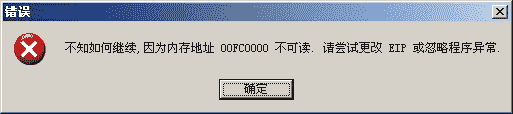
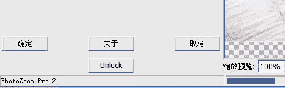
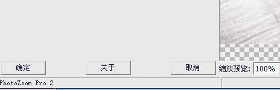

# PhotoZoomPro2 2.1.8 脱壳修复与写代码破解(合精版)

> 原文：[`www.pediy.com/kssd/pediy09/pediy09-9.htm`](https://www.pediy.com/kssd/pediy09/pediy09-9.htm)

> 【文章标题】: `PhotoZoomPro2 2.1.8` 脱壳修复与破解(合精版)

> 【文章作者】: `[qyc]`小 Q

> 【作者主页】: `http://www.iv2.cn`

> 【软件名称】: `PhotoZoomPro2`

> 【软件大小】: `3.35M`

> 【下载地址】: 自己搜索下载

> 【加壳方式】: `ASProtect 2.1x SKE` -> `Alexey Solodovnikov` -> `Version: ASProtect 1.35 build 04.25 or 06.26 Release [Extract]`

> 【保护方式】: 加密壳

> 【编写语言】: `VC++`

> 【使用工具】: `PEID`, `IRE`, `OD`

> 【操作平台】: `Win XP SP2`

> 【软件介绍】: `PhotoZoomPro2` 是一个图片放大软件

> 【作者声明】: 只是感兴趣，没有其他目的。失误之处敬请诸位大侠赐教!

---

## 【详细过程】

原贴 : `http://bbs.pediy.com/showthread.php?threadid=37499` 这个贴只是修正! 让文章完整一些!

`PhotoZoomPro2` 是一个图片放大软件,小 Q 一直以来都是用最低版本的! 知到有最新版! 可以就是没有用的机会,因为没有破解! 自己以前脱壳技术水平又不高一直没对它下手! 直到 `Aspr2.XX_IATfixer_v2.2s.osc` 的出现,才给了偶这次动它的机会,今天公司叫偶放大图片就再次下 `PhotoZoomPro2` 最新版本是: `2.1.8`

### 1. 解决问题: 变态自校验

`PEID` ---> `ASProtect 2.1x SKE` -> `Alexey Solodovnikov`

插件 ---> `Version: ASProtect 1.35 build 04.25 or 06.26 Release [Extract]`

`OD` 加载 程序 `Aspr2.XX_IATfixer_v2.2s.osc` 脚本完全 dumped, `IRE` 修复 IAT,一个指针未修复,用插件搞定! 下面是精彩部分

运行程序发现出错不能运行,一开始还以为壳偷了代码,认为 10 分变态,我所知 `ASProtect 1.35` 是不会偷代码的!

#### 脱壳后变态入口:

```
00584FEF > $  E8 190D0100   call    00595D0D-------->F8 死// F7 进
00584FF4   .^ E9 16FEFFFF   jmp     00584E0F
00584FF9   $  6A 0C         push    0C
00584FFB   .  68 F0D16F00   push    006FD1F0
00585000   .  E8 DFC40000   call    005914E4
00585005   .  8B75 08       mov     esi, [ebp+8]
```

来到:

```
00584F47   .  85C0         test    eax, eax
00584F49   .  7D 08       jge     short 00584F53
00584F4B   .  6A 09       push    9
00584F4D   .  E8 90330000 call    005882E2
00584F52   .  59          pop     ecx
00584F53   >  53          push    ebx
00584F54   .  E8 A5340000 call    005883FE--------------->内存异常!程序不可读! F7 进
00584F59   .  59          pop     ecx
00584F5A   .  85C0        test    eax, eax
00584F5C   .  74 07       je      short 00584F65
```

下面就是变态过程:

```
00588456  . /73 0F        jnb     short 00588467
00588458  > |8B06         /mov    eax, [esi]
0058845A  . |85C0         |test   eax, eax
0058845C  . |74 02        |je     short 00588460
0058845E  . |FFD0         |call   eax    --------> 相当变态的动态地址(异常将在这里发生)!
00588460  > |83C6 04      |add    esi, 4
00588463  . |3BF7         |cmp    esi, edi
00588465  .^|72 F1        \jb     short 00588458------->来回不知多少次,你别用 F8 了!
00588467  > \\833D BC1F7500>cmp    dword ptr [751FBC], 0
```

直接 `F9` 后,错误提示内存 `00FC0000` 不可读.见图! 好伽伙,这招毒啊!



点确定后! 看堆栈: (这是由 `CCDebuger` 的提示!,错误精确定位法)

```
0012FF14   005BFC10  返回到 dumped_.005BFC10 来自 dumped_.0058CD38---->这里回车
0012FF18   005EB69F  返回到 dumped_.005EB69F 来自 dumped_.005BFC06
0012FF1C   00632E7C  ASCII "file" -------------------->这分明就是在检验文件吗!
```

```
005BFC06  /$  B8 A3125E00   mov     eax, 005E12A3
005BFC0B  |.  E8 28D1FCFF   call    0058CD38--------->这里一定是出错地方  (F2 下断)
005BFC10  |.  51            push    ecx-------------->找到这里
005BFC11  |.  56            push    esi
005BFC12  |.  8BF1          mov     esi, ecx
```

重载进入 `call 0058CD38` :

```
0058CD38  /$  68 0000FC00   push    0FC0000------>是不是错误提示地址啊
0058CD3D  \\.  C3            retn
0058CD3E      AE            db      AE
0058CD3F      2D            db      2D                       ;  CHAR '-'
0058CD40      1B            db      1B
0058CD41      77            db      77                       ;  CHAR 'w'
0058CD42      BD            db      BD
0058CD43      5E            db      5E                       ;  CHAR '^'
0058CD44      8B            db      8B
0058CD45      BC            db      BC
0058CD46      19            db      19
0058CD47      42            db      42                       ;  CHAR 'B'
0058CD48      B5            db      B5
0058CD49      35            db      35                       ;  CHAR '5'
0058CD4A      E4            db      E4
0058CD4B      AF            db      AF
0058CD4C      57            db      57                       ;  CHAR 'W'
0058CD4D      E7            db      E7
0058CD4E      C6            db      C6
0058CD4F      2C            db      2C                       ;  CHAR ','
0058CD50      2E            db      2E                       ;  CHAR '.'
0058CD51      22            db      22                       ;  CHAR '"'
0058CD52      D5            db      D5
0058CD53      0A            db      0A
0058CD54      D9            db      D9
0058CD55      BD            db      BD
0058CD56      CA            db      CA
0058CD57      CC            int3
```

执行 `push 0FC0000` 后就是空白代码,程序出错,程序被 `WINDOWS` 关闭,所有问题连接而来(狂晕中).

55555,要是偶能用程序语言写出代码就好罗,可是写不出,呵呵!

以上所知! 找到了问题所在,那就是出注意解决问题啦! 各位考考你们,让想到啦,请举手哈(鸡蛋青菜全向偶飞来! 不要,我马上解决)

解决问题很简单:跟踪原程序(哈哈! 大家别扁偶啊,老大们都是这样做的)

以下代码是由 `cyto` 兄提供的(代码大小字节写入刚刚好) (不过用我跟到的代码也行,不过你得找空间写,详情请见原贴)

Emulate Standard system Functions.
可以在原处还原.

```
0058CD38     6A FF               push -1
0058CD3A     50                 push eax
0058CD3B     64:A1 00000000     mov eax,dword ptr fs:[0]
0058CD41     50                 push eax
0058CD42     8B4424 0C          mov eax,dword ptr ss:[esp+C]
0058CD46     64:8925 00000000   mov dword ptr fs:[0],esp
0058CD4D     896C24 0C          mov dword ptr ss:[esp+C],ebp
0058CD51     8D6C24 0C          lea ebp,dword ptr ss:[esp+C]
0058CD55     50                 push eax
0058CD56     C3                 retn
```

16 进:

```
6A FF 50 64 A1 00 00 00 00 50 8B 44 24 0C 64 89 25 00 00 00 00 89 6C 24 0C 8D 6C 24 0C 50 C3
```

OK ,保存后,测试运行程序(已可运行!)


以下代码 `machenglin` 兄提供修改(不过,程序已可运行),得问一下 `machenglin` 兄为何要修改???

### 第 1 处修改

原来是:

```
00400138    0010              add byte ptr ds:[eax],dl
0040013A    0000              add byte ptr ds:[eax],al
0040013C    0002              add byte ptr ds:[eax],dl
```

修改为:

```
00400138    0010              add byte ptr ds:[eax],dl
0040013A    0000              add byte ptr ds:[eax],al
0040013C    0010              add byte ptr ds:[eax],dl
```

### 第 2 处修改

原来是:

```
00720078    0000              add byte ptr ds:[eax],al
0072007A    0000              add byte ptr ds:[eax],al
0072007C  ^ 70 A7             jo short un_Phot0.00720025
0072007E    E3 00             jecxz short un_Phot0.00720080
```

修改为:

```
00720078    0000              add byte ptr ds:[eax],al
0072007A    0000              add byte ptr ds:[eax],al
0072007C    0000              add byte ptr ds:[eax],al
0072007E    0000              add byte ptr ds:[eax],al
```

## 2.解决问题: 写代码进行破解!

下面是破解过程(花了小 `Q` 两天的时间,与你分享一下):

直接运行程序进行假码分析破解! `bp MessageBoxA` 断下返回如下:

```
004C1D12   > \FFB6 C8010000 push    dword ptr [esi+1C8]
004C1D18   .  8B86 A0010000 mov     eax, [esi+1A0]
004C1D1E   .  8B0F            mov     ecx, [edi]
004C1D20   .  8B13            mov     edx, [ebx]
004C1D22   .  50              push    eax
004C1D23   .  51              push    ecx
004C1D24   .  52              push    edx
004C1D25   .  FF96 B4010000 call    [esi+1B4]---------------->这里重点(等一下要重载进入)  F2 下断
004C1D2B   .  83C4 10         add     esp, 10
004C1D2E   .  84C0            test    al, al
004C1D30   .^. 0F84 52FFFFFF je      004C1C88----------------->不跳就出现注册成功(不过没用的)
004C1D36   .  68 884B6300    push    00634B88                     ;   ASCII "Message"
004C1D3B   .  8D4D E4         lea     ecx, [ebp-1C]
004C1D3E   .  E8 ADF5F3FF    call    004012F0
004C1D43   .  68 489A6200    push    00629A48                     ;   ASCII "Unlocking successful!"
004C1D48   .  C745 FC 07000> mov     dword ptr [ebp-4], 7
004C1D4F   .  E8 93780100    call    004D95E7
004C1D54   .  59              pop     ecx
004C1D55   .  50              push    eax
004C1D56   .  8D4D E0         lea     ecx, [ebp-20]
```

```
004C1E60   .  E8 ABF4F4FF    call    00411310
004C1E65   .  834D FC FF     or      dword ptr [ebp-4], FFFFFFFF  >>>>返回这里,看上面
004C1E69   .  8D4D EC        lea     ecx, [ebp-14]
004C1E6C   .  E8 DFF4F3FF    call    00401350
004C1E71   .  32C0            xor     al, al
```

进入 `call [esi+1B4]` 向下看:

```
004023A0   .  8A4C24 10     mov     cl, [esp+10]
004023A4   .  33C0           xor     eax, eax
004023A6   .  F6C1 07       test    cl, 7
004023A9   .  75 07         jnz     short 004023B2
004023AB   .  B8 04000000   mov     eax, 4
004023B0   .  EB 0A         jmp     short 004023BC
004023B2   >  F6C1 01       test    cl, 1
004023B5   .  75 05         jnz     short 004023BC
004023B7   .  B8 02000000   mov     eax, 2
004023BC   >  8B4C24 0C     mov     ecx, [esp+C]
004023C0   .  8B5424 08     mov     edx, [esp+8]
004023C4   .  51             push    ecx                           ; /Arg5
004023C5   .  8B4C24 08     mov     ecx, [esp+8]                    ; |
004023C9   .  52             push    edx                           ; |Arg4-->邮件地址
004023CA   .  51             push    ecx                           ; |Arg3-->用户名
004023CB   .  BA 06000000    mov     edx, 6                        ; |
004023D0   .  2BD0           sub     edx, eax                      ; |
004023D2   .  52             push    edx                           ; |Arg2 假码
004023D3   .  68 04507000    push    00705004                      ; |Arg1 = 00705004
004023D8   .  E8 1CCD0B00    call    004BF0F9  ---------->重点进行比较解码!  F7 进
004023DD   .  83C4 14        add     esp, 14
004023E0   .  85C0           test    eax, eax
004023E2   .  A3 90FF7100    mov     [71FF90], eax
004023E7   .  0F9DC0         setge   al
004023EA   .  C3              retn
```

```
004BF0F9  /$  55             push    ebp
004BF0FA  |.  8BEC           mov     ebp, esp
004BF0FC  |.  56             push    esi
004BF0FD  |.  33F6           xor     esi, esi
004BF0FF  |.  3975 0C        cmp     [ebp+C], esi
004BF102  |.  7E 21          jle     short 004BF125
004BF104  |>  FF75 18        /push   dword ptr [ebp+18]
004BF107  |.  8B45 08        |mov     eax, [ebp+8]
004BF10A  |.  FF75 14        |push   dword ptr [ebp+14]
004BF10D  |.  FF75 10        |push   dword ptr [ebp+10]
004BF110  |.  FF34B0         |push   dword ptr [eax+esi*4]
004BF113  |.  E8 34FDFFFF    |call    004BEE4C-------------->比较,算法全在这里进行!(小 Q 跟得大多了,不进)
004BF118  |.  83C4 10        |add     esp, 10
004BF11B  |.  84C0           |test    al, al
004BF11D  |.  75 0C          |jnz     short 004BF12B--->呵呵//很重要,注册比较成功,第一个将会跳!
004BF11F  |.  46             |inc     esi               ;要不然就再比较其它操作系统的注册码! 这里 JMP 保存
004BF120  |.  3B75 0C        |cmp     esi, [ebp+C]
004BF123  |.^ 7C DF          \jl      short 004BF104
004BF125  |>  83C8 FF       or      eax, FFFFFFFF
004BF128  |>  5E             pop     esi
004BF129  |.  5D             pop     ebp
004BF12A  |.  C3             retn
004BF12B  |>  8BC6           mov     eax, esi
004BF12D  \.^ EB F9          jmp     short 004BF128
```

保存后进行注册!说是成功了后软件被关闭了//哈哈//再运行//软件被无情关闭,软件作者毒啊! 以下代码小 `Q` 跟了一天!

```
004059AB   .  E8 B6990B00    call    004BF366---------------> 这里检验是否进行注册过
004059B0   .  83C4 10        add     esp, 10
004059B3   .  84C0           test    al, al
004059B5   .  0F84 1C010000 je      00405AD7--------->没注册就跳(为什么我没注册修改上面 004BF11D,不会关闭,就是这里跳了,呵呵)
004059BB   .  8B4C24 44     mov     ecx, [esp+44]
004059BF   .  8B5424 4C     mov     edx, [esp+4C]
004059C3   .  8B4424 54     mov     eax, [esp+54]
004059C7   .  51             push    ecx                           ; /Arg5
004059C8   .  52             push    edx                           ; |Arg4
004059C9   .  50             push    eax                           ; |Arg3
```


```
    004059CA   .  6A 06             push    6                             ; |Arg2 = 00000006  

    004059CC   .  68 04507000   push    00705004                         ; |Arg1 = 00705004  

    004059D1   .  E8 23970B00   call    004BF0F9 --------->这里检验注册码是正确(也是检验老注册或被放水的注册码)  

    004059D6   .  83C4 14       add     esp, 14  

    004059D9   .  85C0          test    eax, eax  

    004059DB   .  A3 00507000   mov     [705000], eax  

    004059E0   .  7C 3C         jl      short 00405A1E---->放水的,假的注册码,都会跳去告诉你此注册非法  

    004059E2   .  8B4C24 54     mov     ecx, [esp+54]  

    004059E6   .  51           push    ecx  

    004059E7   .  8D8D AC000000 lea     ecx, [ebp+AC]  

    004059ED   .  E8 3EE20200   call    00433C30  

    004059F2   .  8B5424 4C     mov     edx, [esp+4C]  

    004059F6   .  52           push    edx  

    004059F7   .  8D8D B0000000 lea     ecx, [ebp+B0]  

    004059FD   .  E8 2EE20200   call    00433C30  

    00405A02   .  8B4424 44     mov     eax, [esp+44]  

    00405A06   .  50           push    eax  

    00405A07   .  8D8D B4000000 lea     ecx, [ebp+B4]  

    00405A0D   .  E8 1EE20200   call    00433C30  

    00405A12   .  C685 A9000000>mov     byte ptr [ebp+A9], 1  

    00405A19   .  E9 B9000000   jmp     00405AD7  

    00405A1E   .  A1 4CE27000   mov     eax, [70E24C]  

    00405A23   .  85C0          test    eax, eax  

    00405A25   .  75 05         jnz     short 00405A2C  

    00405A27   .  B8 55F55E00   mov     eax, 005EF555  

    00405A2C   >  8B0D 78D76200 mov     ecx, [62D778]  

    00405A32   .  51           push    ecx  

    00405A33   .  6A 00         push    0  

    00405A35   .  50           push    eax  

    00405A36   .  8D4C24 20     lea     ecx, [esp+20]  

    00405A3A   .  E8 E1E00200   call    00433B20  

    00405A3F   .  B3 21         mov     bl, 21  

    00405A41   .  68 1C035F00   push    005F031C                     ;  ASCII "The unlock information you entered is invalid."  

    00405A46   .  889C24 A80000>mov     [esp+A8], bl  

    00405A4D   .  E8 953B0D00   call    004D95E7  

    00405A52   .  83C4 04       add     esp, 4  

    00405A55   .  85C0          test    eax, eax  

    00405A57   .  75 05         jnz     short 00405A5E  

    00405A59   .  B8 55F55E00   mov     eax, 005EF555  

    00405A5E   >  8B15 78D76200 mov     edx, [62D778]  

    00405A64   .  52           push    edx  

    00405A65   .  6A 00         push    0  

    00405A67   .  50           push    eax  

    00405A68   .  8D4C24 30     lea     ecx, [esp+30]  

    00405A6C   .  E8 AFE00200   call    00433B20  

    00405A71   .  8D4424 14     lea     eax, [esp+14]  

    00405A75   .  50           push    eax  

    00405A76   .  8D4C24 28     lea     ecx, [esp+28]  

    00405A7A   .  6A 00         push    0  

    00405A7C   .  51           push    ecx  

    00405A7D   .  C68424 B00000>mov     byte ptr [esp+B0], 22  

    00405A85   .  E8 F4FA0C00   call    004D557E  

    00405A8A   .  8B4C24 30     mov     ecx, [esp+30]  

    00405A8E   .  8B41 F4       mov     eax, [ecx-C]  

    00405A91   .  83C1 F4       add     ecx, -0C  

    00405A94   .  83C4 0C       add     esp, 0C  

    00405A97   .  83F8 FF       cmp     eax, -1                          ;  Switch (cases 1..1)  

    00405A9A   .  889C24 A40000>mov     [esp+A4], bl  

    00405AA1   .  74 0C         je      short 00405AAF  

    00405AA3   .  83C0 FF       add     eax, -1  

    00405AA6   .  8901         mov     [ecx], eax  

    00405AA8   .  75 05         jnz     short 00405AAF  

    00405AAA   .  E8 51CE0200   call    00432900                         ;  Case 1 of switch 00405A97  

    00405AAF   >  8B4C24 14     mov     ecx, [esp+14]                    ;  Default case of switch 00405A97  

    00405AB3   .  8B41 F4       mov     eax, [ecx-C]  

    00405AB6   .  83C1 F4       add     ecx, -0C  

    00405AB9   .  83F8 FF       cmp     eax, -1                          ;  Switch (cases 1..1)  

    00405ABC   .  C68424 A40000>mov     byte ptr [esp+A4], 20  

    00405AC4   .  74 0C         je      short 00405AD2  

    00405AC6   .  83C0 FF       add     eax, -1  

    00405AC9   .  8901         mov     [ecx], eax  

    00405ACB   .  75 05         jnz     short 00405AD2  

    00405ACD   .  E8 2ECE0200   call    00432900                         ;  Case 1 of switch 00405AB9  

    00405AD2   >  E8 AE520D00   call    004DAD85                         ;  Default case of switch 00405AB9  

    00405AD7   >  8B17          mov     edx, [edi]  

    00405AD9   .  8B82 10020000 mov     eax, [edx+210]  

    00405ADF   .  6A 0E         push    0E  

    00405AE1   .  8BCF         mov     ecx, edi  

    00405AE3   .  FFD0         call    eax  

    00405AE5   .  8B17          mov     edx, [edi]  

    00405AE7   .  8B82 88020000 mov     eax, [edx+288]  

    00405AED   .  6A 01         push    1  

    00405AEF   .  8BCF         mov     ecx, edi  

    00405AF1   .  FFD0         call    eax  

    00405AF3   .  8D4C24 28     lea     ecx, [esp+28]  

    00405AF7   .  51           push    ecx                                ; /Arg1  

    00405AF8   .  8BCD         mov     ecx, ebp                           ; |  

    00405AFA   .  E8 21D7FFFF   call    00403220                         ; \3.00403220  

    00405AFF   .  8B8D C0000000 mov     ecx, [ebp+C0]  

    00405B05   .  50           push    eax  

    00405B06   .  C68424 A80000>mov     byte ptr [esp+A8], 23  

    00405B0E   .  E8 2DB60000   call    00411140  

    00405B13   .  8B4C24 28     mov     ecx, [esp+28]  

    00405B17   .  8B41 F4       mov     eax, [ecx-C]  

    00405B1A   .  83C1 F4       add     ecx, -0C  

    00405B1D   .  83F8 FF       cmp     eax, -1                          ;  Switch (cases 1..1)  

    00405B20   .  C68424 A40000>mov     byte ptr [esp+A4], 20  

    00405B28   .  74 0C         je      short 00405B36  

    00405B2A   .  83C0 FF       add     eax, -1  

    00405B2D   .  8901         mov     [ecx], eax  

    00405B2F   .  75 05         jnz     short 00405B36  

    00405B31   .  E8 CACD0200   call    00432900                         ;  Case 1 of switch 00405B1D  

    00405B36   >  8B85 C0000000 mov     eax, [ebp+C0]                    ;  Default case of switch 00405B1D  

    00405B3C   .  8B80 88010000 mov     eax, [eax+188]  

    00405B42   .  8B50 38       mov     edx, [eax+38]  

    00405B45   .  8D48 38       lea     ecx, [eax+38]  

    00405B48   .  8B42 1C       mov     eax, [edx+1C]  

    00405B4B   .  FFD0         call    eax  

    00405B4D   .  8B17          mov     edx, [edi]  

    00405B4F   .  8B82 88000000 mov     eax, [edx+88]  

    00405B55   .  6A 01         push    1  

    00405B57   .  8BCF         mov     ecx, edi  

    00405B59   .  FFD0         call    eax  

    00405B5B   .  80BD A9000000>cmp     byte ptr [ebp+A9], 0---------->主程序窗口创建!  

    00405B62   .  75 07         jnz     short 00405B6B----------->此 JNE,跳就不会注册窗口  

    00405B64   .  8BCD         mov     ecx, ebp  

    00405B66   .  E8 F5E4FFFF   call    00404060------------->注册窗口  

    00405B6B   >  8BCD         mov     ecx, ebp  

    00405B6D   .  E8 DEDBFFFF   call    00403750--------------->重点! 解码 CALL 刚测试运行也是在这里被关闭的  (F2 下断)  

    00405B72   .  8D4C24 28     lea     ecx, [esp+28]  

    00405B76   .  51           push    ecx  
```

上面 `004BF11D jnz short 004BF12B` 修改成：`004BF11D JMP short 004BF12B`

都会胜利运行到 `00405B6D . E8 DEDBFFFF call 00403750`


# 调用入口 00403750

## 汇编代码分析

```
00403750   $  83EC 2C       sub     esp, 2C
00403753   .  57            push    edi
00403754   .  8BF9          mov     edi, ecx
00403756   .  80BF A9000000>cmp     byte ptr [edi+A9], 0
0040375D   .  0F84 AD010000 je      00403910
00403763   .  803D E4FF7100>cmp     byte ptr [71FFE4], 0
0040376A   .  0F85 A0010000 jnz     00403910
00403770   .  55            push    ebp
00403771   .  B8 007D7869   mov     eax, 69787D00
00403776   .  56            push    esi
00403777   .  A3 D8FF7100   mov     [71FFD8], eax
0040377C   .  A3 DCFF7100   mov     [71FFDC], eax
00403781   .  A3 E0FF7100   mov     [71FFE0], eax
00403786   .  C705 CCFF7100>mov     dword ptr [71FFCC], 0
00403790   .  C705 D0FF7100>mov     dword ptr [71FFD0], 17D00
0040379A   .  C705 D4FF7100>mov     dword ptr [71FFD4], 4787D00
004037A4   .  8B87 B4000000 mov     eax, [edi+B4]
004037AA   .  8B8F B0000000 mov     ecx, [edi+B0]
004037B0   .  8B97 AC000000 mov     edx, [edi+AC]
004037B6   .  50            push    eax
004037B7   .  A1 00507000   mov     eax, [705000]
004037BC   .  51            push    ecx
004037BD   .  8B0C85 045070>mov     ecx, [eax*4+705004]
004037C4   .  52            push    edx
004037C5   .  51            push    ecx
004037C6   .  6A 06         push    6
004037C8   .  68 CCFF7100   push    0071FFCC
004037CD   .  C605 E4FF7100>mov     byte ptr [71FFE4], 1
004037D4   .  E8 EBC30B00   call    004BFBC4
004037D9   .  8D5424 24     lea     edx, [esp+24]
004037DD   .  52            push    edx
004037DE   .  6A 04         push    4
004037E0   .  68 CCFF7100   push    0071FFCC
004037E5   .  E8 E6750C00   call    004CADD0
004037EA   .  A1 00507000   mov     eax, [705000]
004037EF   .  8B3485 1C5070>mov     esi, [eax*4+70501C]
004037F6   .  8BEE          mov     ebp, esi
004037F8   .  8D5424 30     lea     edx, [esp+30]
004037FC   .  83C4 24       add     esp, 24
004037FF   .  33C9          xor     ecx, ecx
00403801   .  2BEA          sub     ebp, edx
00403803   >  8D440C 0C     lea     eax, [esp+ecx+C]
00403807   .  0FB61428      movzx   edx, byte ptr [eax+ebp]
0040380B   .  3010          xor     [eax], dl
0040380D   .  0FB6540E 01   movzx   edx, byte ptr [esi+ecx+1]
00403812   .  3050 01       xor     [eax+1], dl
00403815   .  0FB6540E 02   movzx   edx, byte ptr [esi+ecx+2]
0040381A   .  3050 02       xor     [eax+2], dl
0040381D   .  0FB6540E 03   movzx   edx, byte ptr [esi+ecx+3]
00403822   .  3050 03       xor     [eax+3], dl
00403825   .  83C1 04       add     ecx, 4
00403828   .  83F9 10       cmp     ecx, 10
0040382B   .^ 7C D6        jl      short 00403803
0040382D   .  6A 10         push    10
0040382F   .  8D4424 10     lea     eax, [esp+10]
00403833   .  50            push    eax
00403834   .  FF15 7C007200 call    [72007C]
```

> **注意**：程序运行到 `call [72007C]` 时出错。原因是抽掉的 `GetProcAddress` 需要重新指定为 `call [5EE354]`（因为脱壳时用插件修复的）。

```
0040383A   .  EB 04         jmp     short 00403840
0040383C     EB            db      EB
0040383D     05            db      05
0040383E   .  8901          mov     [ecx], eax
00403840   >  6A 68         push    68
00403842   .  68 20FB5E00   push    005EFB20
00403847   .  68 28FF7100   push    0071FF28
0040384C   .  E8 4FCB1200   call    005303A0
00403851   .  8B8F B4000000 mov     ecx, [edi+B4]
00403857   .  8B97 B0000000 mov     edx, [edi+B0]
0040385D   .  8B87 AC000000 mov     eax, [edi+AC]
00403863   .  51            push    ecx
00403864   .  8B0D 00507000 mov     ecx, [705000]
0040386A   .  52            push    edx
0040386B   .  8B148D 045070>mov     edx, [ecx*4+705004]
00403872   .  50            push    eax
00403873   .  52            push    edx
00403874   .  6A 1A         push    1A
00403876   .  68 28FF7100   push    0071FF28
0040387B   .  E8 44C30B00   call    004BFBC4
00403880   .  83C4 24       add     esp, 24
00403883   .  68 DC5B500E   push    0E505BDC
00403888   .  8D4C24 20     lea     ecx, [esp+20]
0040388C   .  E8 EF3E0C00   call    004C7780
00403891   .  8D4C24 1C     lea     ecx, [esp+1C]
00403895   .  E8 B63D0C00   call    004C7650
```

> **注意**：`call 004C7650` 涉及解除水印重要数据。

```
0040389A   .  8B0D 00507000 mov     ecx, [705000]
004038A0   .  8B0C8D B0F85E>mov     ecx, [ecx*4+5EF8B0]
004038A7   .  330C85 30FF71>xor     ecx, [eax*4+71FF30]
004038AE   .  83C0 02       add     eax, 2
004038B1   .  81C1 A01F4000 add     ecx, 00401FA0
004038B7   .  81E9 A01F4000 sub     ecx, 00401FA0
004038BD   .  E9 47000000   jmp     00403909
004038C2     27            db      27              ;  CHAR '''
004038C3     77            db      77              ;  CHAR 'w'
004038C4   .  64:C3        retn
004038C6     7E            db      7E              ;  CHAR '~'
004038C7     B9            db      B9
004038C8   .  CB          retf
004038C9     C1            db      C1
004038CA     3E            db      3E              ;  CHAR '>'
004038CB     71            db      71              ;  CHAR 'q'
004038CC     B2            db      B2
004038CD     84            db      84
004038CE     77            db      77              ;  CHAR 'w'
004038CF     4D            db      4D              ;  CHAR 'M'
004038D0     11            db      11
004038D1     41            db      41              ;  CHAR 'A'
004038D2     96            db      96
004038D3     13            db      13
004038D4     AB            db      AB
004038D5     67            db      67              ;  CHAR 'g'
004038D6     C0            db      C0
004038D7     81            db      81
004038D8   .  5D          pop     ebp
004038D9   .  C2 74A7     retn    0A774
004038DC     48            db      48              ;  CHAR 'H'
004038DD     AF            db      AF
004038DE     90            nop
004038DF     B0            db      B0
004038E0     D2            db      D2
004038E1     7B            db      7B              ;  CHAR '{'
004038E2     0F            db      0F
004038E3     33            db      33              ;  CHAR '3'
004038E4   .  B5 A7       mov     ch, 0A7
004038E6   .  5A          pop     edx
004038E7   .  CB          retf
004038E8     87            db      87
004038E9     FC            db      FC
004038EA     18            db      18
```


这是一个汇编代码片段的列表。由于原始文本是逐行的引用块（quote block），且包含大量十六进制数据，为了保持格式整洁并符合“优化段落格式”的要求，将其转换为代码块形式以保留对齐和结构。

```text
    004038EB      73            db      73                    ;  CHAR 's'
    004038EC      63            db      63                    ;  CHAR 'c'
    004038ED      B4            db      B4
    004038EE      6F            db      6F                    ;  CHAR 'o'
    004038EF      D7            db      D7
    004038F0      7D            db      7D                    ;  CHAR '}'
    004038F1      78            db      78                    ;  CHAR 'x'
    004038F2      04            db      04
    004038F3      80            db      80
    004038F4      13            db      13
    004038F5      AB            db      AB
    004038F6      BB            db      BB
    004038F7      27            db      27                    ;  CHAR '''
    004038F8      6E            db      6E                    ;  CHAR 'n'
    004038F9      E8            db      E8
    004038FA      91            db      91
    004038FB      CC            int3
    004038FC      17            db      17
    004038FD      F4            db      F4
    004038FE      6F            db      6F                    ;  CHAR 'o'
    004038FF      36            db      36                    ;  CHAR '6'
    00403900      92            db      92
    00403901      9C            db      9C
    00403902      35            db      35                    ;  CHAR '5'
    00403903      AA            db      AA
    00403904      C0            db      C0
    00403905      6A            db      6A                    ;  CHAR 'j'
    00403906  . DF51 B1       fist    word ptr [ecx-4F]
    00403909  > 8BCF           mov     ecx, edi
    0040390B  . E8 B0FDFFFF   call    004036C0------------->这里你跟进会发现可以跳过未注册字样!
    00403910  > 5F            pop     edi
    00403911  . 83C4 2C       add     esp, 2C
    00403914  . C3            retn
    ~~~~~~~~~~~~~~~~~~~~~~~~~~~~~~~~~~~~~~~~~~~~~~~~~~~~~~~~~~~~~~~~~~~~~~~~~~到这里结束~~~~~~~~~~~~~~

    ============================================================================

    注意以上虚线部分,多数代码已作过处理(这又是一天的分析),与放水的注册码的 1.2.8 版对比后,发现这里本来是要进行解锁的!

    (依据是: 0040390B 处)

    下面进行写代码进行解锁 (有很多问题,我不可能在这里说得很清楚,以后代码是我分析了一天的结果写出来的)

    =================================================================================

    16 进代码如下:

    E8 4E EA FF FF 90 90 90 EB 04 4C 41 45 52 8B 8F C0 00 00 00 8B 11 8B 82 D8 02 00 00 FF D0 85 C0
    5E 5D 74 22 8B 10 6A 00 8B C8 8B 82 AC 02 00 00 68 9C 18 00 00 FF D0 85 C0 74 0B 8B 10 8B C8 8B
    42 18 6A 00 FF D0 EB 04 90 90 90 90 8B CF E8 B0 FD FF FF 5F 83 C4 2C C3

    >>>>>>>>>>>>>>>>>>>>>>>>>>>>>>>>>>>>>>>>>>>>>>>>>>>>>>>>>>>>>>>>>>>>>>>>>>>>>>>>>>>>>>>>>>>

    简单说一下找解除水印地址方法: 查找所有命令: call 004C7650

    找到的命令

    地址        反汇编                  注释
    00403895   call    004C7650----->第一个找到也是我们第一个看到的!
    004C544C   call    004C7650
    004C5584   call    004C7650
    004C7709   call    004C7650----->发现此地黄金 10 俩(很重要),点击进入
    004C7734   call    004C7650
    004C7754   call    004C7650

    ----------------------------------------------------------------------------------------

    004C7700  /$ 56            push    esi               ;  点这里,看动态数据区,本地调用!
    004C7701  |. 8B7424 08     mov     esi, [esp+8]
    004C7705  |. 85F6          test    esi, esi
    004C7707  |. 74 0F         je      short 004C7718
    004C7709  |. E8 42FFFFFF   call    004C7650
    004C770E  |. 33D2          xor     edx, edx
    004C7710  |. F7F6          div     esi
    004C7712  |. 5E            pop     esi
    004C7713  |. 8BC2          mov     eax, edx
    004C7715  |. C2 0400       retn    4
    004C7718  |>  33C0         xor     eax, eax
    004C771A  |. 5E            pop     esi
    004C771B  \\.  C2 0400     retn    4

    本地调用来自 00402373, 004BEF32, 004BF1A3, 004BFC8C, 004BFF19, 004C556D, 004C55C7, 004C5618, 004C564F, ...........

    呵呵!第一个就是要去的地址!

    ---------------------------------------------------------------------

    00402310  /$  64:A1 0000000>mov     eax, fs:[0]       ;  开始解除水印
    00402316  |.  6A FF           push    -1
    00402318  |.  68 EE1C5C00    push    005C1CEE
    0040231D  |.  50             push    eax
    0040231E  |.  64:8925 00000>mov     fs:[0], esp
    00402325  |.  B8 01000000    mov     eax, 1
    0040232A  |.  8405 BCFF7100 test    [71FFBC], al
    00402330  |.  56             push    esi
    00402331  |.  57             push    edi
    00402332  |.  75 20          jnz     short 00402354
    00402334  |.  0905 BCFF7100 or      [71FFBC], eax
    0040233A  |.  B9 A0FF7100    mov     ecx, 0071FFA0
    0040233F  |.  C74424 10 000>mov     dword ptr [esp+10>
    00402347  |.  E8 84540C00    call    004C77D0
    0040234C  |.  C74424 10 FFF>mov     dword ptr [esp+10>
    00402354  |>  BF 2CE27000    mov     edi, 0070E22C
    00402359  |.  8DA424 000000>lea     esp, [esp]
    00402360  |>  8B37           /mov    esi, [edi]
    00402362  |.  81EE 3C3C3D3E |sub     esi, 3E3D3C3C
    00402368  |.  8BC6           |mov    eax, esi
    0040236A  |.  C1E8 10        |shr    eax, 10
    0040236D  |.  50             |push   eax
    0040236E  |.  B9 A0FF7100    |mov    ecx, 0071FFA0
    00402373  |.  E8 88530C00    |call   004C7700          ;  查看到这里
    00402378  |.  03C6           |add     eax, esi
    0040237A  |.  8907           |mov     [edi], eax
    0040237C  |.  83C7 04        |add     edi, 4
    0040237F  |.  81FF 4CE27000  |cmp     edi, 0070E24C
    00402385  |.^ 7C D9          \\jl     short 00402360
    00402387  |.  8B4C24 08     mov     ecx, [esp+8]
    0040238B  |.  5F             pop     edi
    0040238C  |.  64:890D 00000>mov     fs:[0], ecx
    00402393  |.  5E             pop     esi
    00402394  |.  83C4 0C       add     esp, 0C
    00402397  \\.  C3            retn

    <<<<<<<<<<<<<<<<<<<<<<<<<<<<<<<<<<<<<<<<<<<<<<<<<<<<<<<<<<<<<<<<<<<<<<<<<<<<<<<<<<<<<<<<<<<<

    =================================================================================

    从 004038BD 写到 00403908 如下:

    =================================================================================

    004038BD      E8 4EEAFFFF   call    00402310 ;  进行解除水印! 也许你会问这地址怎得到的?(呵呵,远在天边,近在眼前),上面讲的就是
    004038C2      90            nop           ;  NOP 占位|  呵呵,就是 00403895 处的 call 004C7650 入手的
    004038C3      90            nop           ;  NOP 占位|
    004038C4      90            nop           ;  NOP 占位|
    004038C5      EB 04         jmp     short 004038CB
    004038C7      4C            dec     esp
    004038C8      41            inc     ecx
    004038C9      45            inc     ebp
    004038CA      52            push    edx
    004038CB      8B8F C0000000 mov     ecx, [edi+C0]
    004038D1      8B11          mov     edx, [ecx]
    004038D3      8B82 D8020000 mov     eax, [edx+2D8]
    004038D9      FFD0          call    eax
    004038DB      85C0          test    eax, eax
    004038DD      5E            pop     esi
    004038DE      5D            pop     ebp
    004038DF      74 22         je      short 00403903
    004038E1      8B10          mov     edx, [eax]
    004038E3      6A 00         push    0
    004038E5      8BC8          mov     ecx, eax
```


# PhotoZoomPro2 2.2.4 Photoshop 插件破解教程

## 1. 主程序修改数据

### 1.1 汇编代码片段

```asm
004038E7      8B82 AC020000   mov     eax, [edx+2AC]  
004038ED      68 9C180000     push    189C  
004038F2      FFD0            call    eax               --->设置注册标致  
004038F4      85C0            test    eax, eax  
004038F6      74 0B          je      short 00403903  
004038F8      8B10            mov     edx, [eax]  
004038FA      8BC8            mov     ecx, eax  
004038FC      8B42 18        mov     eax, [edx+18]  
004038FF      6A 00          push    0  
00403901      FFD0            call    eax                   ;  灰化菜单"解码"  
00403903      EB 04          jmp     short 00403909  
00403905      90             nop                           ;  NOP 占位|  
00403906      90             nop  
00403907      90             nop  
00403908      90             nop                           ;  NOP 占位|  
00403909      8BCF            mov     ecx, edi             ;  原来的  
0040390B      E8 B0FDFFFF     call    004036C0             ;  解除"未注册"字样等  
00403910      5F             pop     edi  
00403911      83C4 2C        add     esp, 2C  
00403914      C3             retn  
```

### 1.2 成功破解说明

PhotoZoomPro2 2.2.4 Photoshop 插件成功破解！

要把扩展名改为 `DLL`，用 `Aspr2.XX_unpacker_v1.0` 进行脱壳（感谢 `VolX`，你的脚本大强啦！）。

破解过程跟破解主程序方法都差不多。

以下数据可以帮你快速定位修改：

**一处：**

```
83 C4 10 84 C0 75 0C 46 3B 75 0C
```

**二处：**

```
83 C4 10 84 C0
```

## 2. 移除 "Unlock" 注册按钮

**目的：** 去掉 PhotoZoomPro2 2.2.4 Photoshop 插件 `Unlock` 注册按钮。



看看软件，再与看看正式注册版，`Unlock` 注册按钮在注册后是会被移除的！



由于是 `PS` 插件，我们一般要中断 `PS` 加载了插件即可！

**操作步骤：**

1. `OD` 加载 `PS` >> 运行 >> 打开一张图片
2. 我先选 `bp EnableWindow` 下断
3. 文件 >> 导出 >> `PhotoZoom Pro 2`
4. 中断后取消断点，然后打开模块窗口，先择加载了的插件，进行插件领空！
5. `bpx GetWindowTextA`
6. 315 次 `F9` 后（总共 317 次，也就是倒数第二次，你不得不按 `^\_^`），记得看着堆栈

**堆栈信息：**

```
0012DE88   00011276  |hWnd = 00011276 ('Unlock',class='Button',parent=00170D88)  
0012DE8C   2360CEB4  |Buffer = 2360CEB4  
0012DE90   00000007  \Count = 7  
0012DE94   2360CC48  
```

### 2.1 调试代码段 1

```asm
232BDF84    FF15 D8253823   CALL DWORD PTR DS:[<&user32.GetWindowTex>; USER32.GetWindowTextA 这里开始 F8  
232BDF8A    8B4D E8         MOV ECX,DWORD PTR SS:[EBP-18]  
232BDF8D    E8 3E1DFDFF     CALL 3.2328FCD0  
232BDF92    5E              POP ESI  
232BDF93    8B4D F4         MOV ECX,DWORD PTR SS:[EBP-C]  
232BDF96    8BC7            MOV EAX,EDI  
232BDF98    5F              POP EDI  
232BDF99    64:890D 0000000>MOV DWORD PTR FS:[0],ECX  
232BDFA0    C9              LEAVE  
232BDFA1    C3              RETN--------->返回  
```

### 2.2 调试代码段 2

一直 `F8` 到 `232D8D55`：

```asm
232D8CA4    5F              POP EDI  
232D8CA5    5E              POP ESI  
232D8CA6    8AC3            MOV AL,BL  
232D8CA8    5B              POP EBX  
232D8CA9    64:890D 0000000>MOV DWORD PTR FS:[0],ECX----------->; 在这里下个断  
232D8CB0    C9              LEAVE  
232D8CB1    C2 2000         RETN 20             ----------->; 注意: 这里是最近一次退出,最后也是在这返回  
232D8CB4    8B06            MOV EAX,DWORD PTR DS:[ESI]  
232D8CB6    8D4D EC         LEA ECX,DWORD PTR SS:[EBP-14]  
232D8CB9    51              PUSH ECX  
232D8CBA    FF75 1C         PUSH DWORD PTR SS:[EBP+1C]  
232D8CBD    8BCE            MOV ECX,ESI  
232D8CBF    FF90 38020000   CALL DWORD PTR DS:[EAX+238]  
232D8CC5    53              PUSH EBX  
232D8CC6    6A 0A           PUSH 0A  
232D8CC8    8D4D 10         LEA ECX,DWORD PTR SS:[EBP+10]  
232D8CCB    8BF8            MOV EDI,EAX  
232D8CCD    E8 EE6CFBFF     CALL 3.2328F9C0  
232D8CD2    3B05 3C5A4123   CMP EAX,DWORD PTR DS:[23415A3C]  
232D8CD8    74 06           JE SHORT 3.232D8CE0  
232D8CDA    81CF 00200000   OR EDI,2000  
232D8CE0    FF75 EC         PUSH DWORD PTR SS:[EBP-14]  
232D8CE3    8D45 10         LEA EAX,DWORD PTR SS:[EBP+10]  
232D8CE6    50              PUSH EAX  
232D8CE7    FF75 18         PUSH DWORD PTR SS:[EBP+18]  
232D8CEA    8BCE            MOV ECX,ESI  
232D8CEC    FF75 14         PUSH DWORD PTR SS:[EBP+14]  
232D8CEF    57              PUSH EDI  
232D8CF0    68 ACED4123     PUSH 3.2341EDAC               ; ASCII "BUTTON"  
232D8CF5    E8 7C9CFFFF     CALL 3.232D2976  
232D8CFA    8AD8            MOV BL,AL  
232D8CFC   ^ EB 97         JMP SHORT 3.232D8C95  
232D8CFE    B8 4B263723     MOV EAX,3.2337264B  
232D8D03    E8 C8890500     CALL 3.233316D0  
232D8D08    81EC 0C010000   SUB ESP,10C  
232D8D0E    53              PUSH EBX  
232D8D0F    56              PUSH ESI  
232D8D10    8BF1            MOV ESI,ECX  
232D8D12    57              PUSH EDI  
232D8D13    56              PUSH ESI  
232D8D14    8D8D E8FEFFFF   LEA ECX,DWORD PTR SS:[EBP-118]  
232D8D1A    E8 3B1D0100     CALL 3.232EAA5A  
232D8D1F    8D45 E4         LEA EAX,DWORD PTR SS:[EBP-1C]  
232D8D22    33DB            XOR EBX,EBX  
232D8D24    50              PUSH EAX  
232D8D25    8BCE            MOV ECX,ESI  
232D8D27    895D FC         MOV DWORD PTR SS:[EBP-4],EBX  
232D8D2A    E8 21EAFEFF     CALL 3.232C7750  
232D8D2F    50              PUSH EAX  
232D8D30    8D8D E8FEFFFF   LEA ECX,DWORD PTR SS:[EBP-118]  
232D8D36    C645 FC 01      MOV BYTE PTR SS:[EBP-4],1  
232D8D3A    E8 7C090100     CALL 3.232E96BB  
232D8D3F    8D4D E4         LEA ECX,DWORD PTR SS:[EBP-1C]  
232D8D42    885D FC         MOV BYTE PTR SS:[EBP-4],BL  
232D8D45    E8 315BFFFF     CALL 3.232CE87B  
232D8D4A    8B06            MOV EAX,DWORD PTR DS:[ESI]  
232D8D4C    8D4D E8         LEA ECX,DWORD PTR SS:[EBP-18]  
232D8D4F    51              PUSH ECX  
232D8D50    8BCE            MOV ECX,ESI  
232D8D52    FF50 40         CALL DWORD PTR DS:[EAX+40]  
232D8D55    50              PUSH EAX               -----------> ; 返回这里,不想再按 F8,就在上面下个断吧  
232D8D56    8D45 E0         LEA EAX,DWORD PTR SS:[EBP-20]  
232D8D59    50              PUSH EAX               -----------> ; 这是我第一次,我当然是 F8 向下走啦...  
232D8D5A    C645 FC 02      MOV BYTE PTR SS:[EBP-4],2  
232D8D5E    E8 CBC4FEFF     CALL 3.232C522E  
232D8D63    59              POP ECX  
232D8D64    59              POP ECX  
```

下面略.....

............

### 2.3 调试代码段 3

`RETN 20` 返回再 `F8`: 6 次后

```asm
232D8CB1    C2 2000         RETN 20 返回再 F8: 6 次后  
```

```asm
231DAB3B    85F6            TEST ESI,ESI  
231DAB3D    C64424 40 13    MOV BYTE PTR SS:[ESP+40],13  
231DAB42    0F84 82000000   JE 3.231DABCA          ----------->; 呵呵.重要一跳,我们 JMP 保存  
231DAB48    8B15 3C5A4123   MOV EDX,DWORD PTR DS:[23415A3C]  
231DAB4E    52              PUSH EDX  
231DAB4F    6A 00           PUSH 0  
231DAB51    68 94CE4123     PUSH 3.2341CE94               ; ASCII "button"  
231DAB56    8D4C24 58       LEA ECX,DWORD PTR SS:[ESP+58]  
231DAB5A    E8 21560B00     CALL 3.23290180  
231DAB5F    83CB 20         OR EBX,20  
231DAB62    68 CC6A3823     PUSH 3.23386ACC               ; ASCII "Unlock"  
231DAB67    C64424 44 14    MOV BYTE PTR SS:[ESP+44],14  
231DAB6C    895C24 14       MOV DWORD PTR SS:[ESP+14],EBX  
231DAB70    E8 EA920900     CALL 3.23273E5F  
231DAB75    83C4 04         ADD ESP,4  
231DAB78    85C0            TEST EAX,EAX  
231DAB7A    75 05           JNZ SHORT 3.231DAB81  
231DAB7C    B8 F8323823     MOV EAX,3.233832F8  
231DAB81    8B0D 3C5A4123   MOV ECX,DWORD PTR DS:[23415A3C]  
```


```
231DAB87    51                 PUSH ECX
231DAB88    6A 00              PUSH 0
231DAB8A    50                 PUSH EAX
231DAB8B    8D4C24 54          LEA ECX,DWORD PTR SS:[ESP+54]
231DAB8F    E8 EC550B00        CALL 3.23290180
231DAB94    8D5424 4C          LEA EDX,DWORD PTR SS:[ESP+4C]
231DAB98    52                 PUSH EDX
231DAB99    68 54E04B23        PUSH 3.234BE054
231DAB9E    6A 00              PUSH 0
231DABA0    68 08BF4823        PUSH 3.2348BF08
231DABA5    68 10BF4823        PUSH 3.2348BF10
231DABAA    8D4424 5C          LEA EAX,DWORD PTR SS:[ESP+5C]
231DABAE    50                 PUSH EAX
231DABAF    6A FF              PUSH -1
231DABB1    83CB 40            OR EBX,40
231DABB4    55                 PUSH EBP
231DABB5    8BCE               MOV ECX,ESI
231DABB7    C74424 60 15000>   MOV DWORD PTR SS:[ESP+60],15
231DABBF    895C24 30          MOV DWORD PTR SS:[ESP+30],EBX
231DABC3    E8 B8F4FFFF        CALL 3.231DA080
231DABC8    EB 02              JMP SHORT 3.231DABCC  ----------->; 最终返回在这里(目的地到啦)
231DABCA    33C0               XOR EAX,EAX
```

\=================================================================================

OD 单独加载地址: `1000AB62` |. `68 CC6A1B10` `PUSH 3.101B6ACC` ; `ASCII "Unlock"`

\=================================================================================

以上代码，你们自己理解一下哈，小 Q 就不多说了！保存后，软件就是完全版了，哈哈！最好的文章与你分享！`2.1.8` 原创破解权小 Q 保留！

（不提供破解文件）

历经 3 天的分析 // 终于有了一个结果！心里有说不出的高兴啊！我希望大家有时间跟贴谈一下水印的解除有多少相关函数？

感谢 VolX 的 `Aspr2.XX_IATfixer_v2.2s.osc` 脚本！没有你脚本，就没有这文章！

感谢看雪 `cyto` 兄提供的（脱壳后的校验）在原处还原经典代码 和 `machenglin` 兄的两处修改！与 `CCDebuger` 的提示！

谢谢你看到这里！有空来偶的小站玩玩 `http://www.iv2.cn` （艾微儿）

By `[qyc]` 小 Q `iv2.cn` `2007/1/9/12:50`

---

### 经验总结

`[理解财富]` `[创造财富]` 其实财富就在你身边，关键是你要去发现它！每一天的时间总是是你的！没有 `timerstop.com`

坚持就是胜利！

---

### 版权声明

本文原创于看雪技术论坛，转载请注明作者并保持文章的完整，谢谢！

`4dd466d0e1e0cc123afbe504da2462ca`
