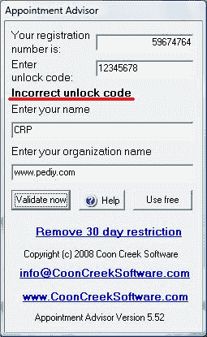
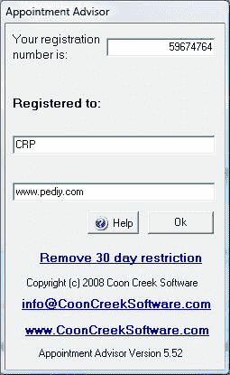

# Appointment Advisor 5.52 算法分析(顺贺中秋)

> 原文：[`www.pediy.com/kssd/pediy10/72705.html`](https://www.pediy.com/kssd/pediy10/72705.html)

【文章标题】: Appointment Advisor 5.52 算法分析  
【文章作者】: CRP  
【作者邮箱】: cccttt@126.com  
【作者主页】: No  
【作者 QQ 号】: 249810097  
【软件名称】: Appointment Advisor 5.52  
【软件大小】: 15742KB  
【下载地址】: `http://www.onlinedown.net/soft/72975.htm`  
【加壳方式】: 无壳  
【保护方式】: 序列号+解锁码  
【编写语言】: Borland C++ 1999 [Overlay]  
【使用工具】: OD  
【操作平台】: VISTA SP1  
【软件介绍】: Appointment Advisor 是一个易于使用的工具，跟踪和优化您的工作日程  
【作者声明】: 本人乃破解界一大菜鸟，对破解只是感兴趣，没有其他目的。失误之处敬请诸位大侠赐教!

--------------------------------------------------------------------------------

【详细过程】

这是一个国外软件。按照看雪要求，必须得分析国外软件，所以费了不少力，找了一个软柿子，高手们别见笑哈。希望能申请到精华。这样，我上半年完成一篇，下半年一篇，算是完成了一个心愿。

言归正传。安装后，先正常运行程序。点出注册框，是一个根据序列号算出解锁码的注册程式。随便输入 `12345678`，点 `Validate now`，显示 `Incorrect unlock code` 错误提示。



有提示，就好办了。

用 `PEID` 侦壳，无壳，立即 `OD` 载入。查 ASCII 码，找字符 `Incorrect unlock code` 所在的区域代码，应该就是判断注册的关键部分。

结果如下：

```
00446297   .  BA 962A6800   mov     edx, 00682A96                      ;  incorrect unlock code
```

看来，这句跳转来自 `00445DB5`, `00445DBD` 两个地方。向上跟踪，经过分析，找到以下代码段，多调试几次，就会发现 `00445D42` 处的 `call 004462FC` 为关键算法 `CALL`。

＝＝＝＝＝＝＝＝＝＝＝＝＝＝＝＝＝＝＝＝＝＝＝＝＝＝＝＝＝＝＝＝＝＝＝＝＝＝＝＝＝＝

```
00445CE5   .  8D55 F0      lea     edx, dword ptr [ebp-10]  
00445CE8   .  8D45 FC      lea     eax, dword ptr [ebp-4]             ;  假码  
00445CEB   .  E8 54932100  call    0065F044  
00445CF0   .  FF4D A0      dec     dword ptr [ebp-60]  
00445CF3   .  8D45 F0      lea     eax, dword ptr [ebp-10]  
00445CF6   .  BA 02000000  mov     edx, 2  
00445CFB   .  E8 14932100  call    0065F014  
00445D00   .  FF4D A0      dec     dword ptr [ebp-60]                 ;  edx 放假码  
00445D03   .  8D45 F4      lea     eax, dword ptr [ebp-C]  
00445D06   .  BA 02000000  mov     edx, 2  
00445D0B   .  E8 04932100  call    0065F014  
00445D10   .  66:C745 94 44>mov    word ptr [ebp-6C], 44  
00445D16   .  33C9         xor     ecx, ecx  
00445D18   .  894D EC      mov     dword ptr [ebp-14], ecx  
00445D1B   .  8D55 EC      lea     edx, dword ptr [ebp-14]  
00445D1E   .  FF45 A0      inc     dword ptr [ebp-60]  
00445D21   .  8B45 80      mov     eax, dword ptr [ebp-80]  
00445D24   .  8B80 00030000 mov    eax, dword ptr [eax+300]  
00445D2A   .  E8 31CD2100  call    <jmp.&VCL50.Mask::TCustomMaskEdi>  
00445D2F   .  8D55 EC      lea     edx, dword ptr [ebp-14]  
00445D32   .  8B12         mov     edx, dword ptr [edx]               ;  机器码  
00445D34   .  33C0         xor     eax, eax  
00445D36   .  8945 E8      mov     dword ptr [ebp-18], eax  
00445D39   .  8D4D E8      lea     ecx, dword ptr [ebp-18]  
00445D3C   .  FF45 A0      inc     dword ptr [ebp-60]  
00445D3F   .  8B45 80      mov     eax, dword ptr [ebp-80]  
00445D42   .  E8 B5050000  call    004462FC                             ;  关键算法 CALL  
00445D47   .  8D55 E8      lea     edx, dword ptr [ebp-18]  
00445D4A   .  8D45 F8      lea     eax, dword ptr [ebp-8]  
00445D4D   .  E8 F2922100  call    0065F044  
00445D52   .  FF4D A0      dec     dword ptr [ebp-60]  
00445D55   .  8D45 E8      lea     eax, dword ptr [ebp-18]  
00445D58   .  BA 02000000  mov     edx, 2  
00445D5D   .  E8 B2922100  call    0065F014  
00445D62   .  FF4D A0      dec     dword ptr [ebp-60]                 ;  竟然出现了真码，内存注册机可在此下断  
00445D65   .  8D45 EC      lea     eax, dword ptr [ebp-14]  
00445D68   .  BA 02000000  mov     edx, 2  
00445D6D   .  E8 A2922100  call    0065F014  
00445D72   .  8B45 FC      mov     eax, dword ptr [ebp-4]  
00445D75   .  E8 FEA72100  call    <jmp.&VCL50.Sysutils::StrToInt>  
00445D7A   .  8BF0         mov     esi, eax  
00445D7C   .  8B45 F8      mov     eax, dword ptr [ebp-8]  
00445D7F   .  E8 F4A72100  call    <jmp.&VCL50.Sysutils::StrToInt>   ;  比较  
00445D84   .  8BC8         mov     ecx, eax  
00445D86   .  8BFE         mov     edi, esi  
00445D88   .  2BF9         sub     edi, ecx  
00445D8A   .  8BC7         mov     eax, edi  
00445D8C   .  99           cdq  
00445D8D   .  33C2         xor     eax, edx  
00445D8F   .  2BC2         sub     eax, edx  
00445D91   .  8985 74FFFFFF mov    dword ptr [ebp-8C], eax  
00445D97   .  66:C745 94 14>mov    word ptr [ebp-6C], 14  
00445D9D   .  EB 0D        jmp     short 00445DAC  
00445D9F   .  33DB         xor     ebx, ebx  
00445DA1   .  66:C745 94 34>mov    word ptr [ebp-6C], 34  
00445DA7   .  E8 F8D72100  call    <jmp.&CC3250MT.\_CatchCleanup>  
00445DAC   >  8B85 74FFFFFF mov     eax, dword ptr [ebp-8C]  
00445DB2   .  83F8 02      cmp     eax, 2  
00445DB5   .  0F8D D6040000 jge     00446291                           ;  跳走则注册不成功  
00445DBB   .  84DB         test    bl, bl  
00445DBD   .  0F84 CE040000 je      00446291                           ;  跳走则注册不成功  
00445DC3   .  8B15 A8B56C00 mov     edx, dword ptr [6CB5A8]  
00445DC9   .  C682 550A0000>mov      byte ptr [edx+A55], 1  
```
＝＝＝＝＝＝＝＝＝＝＝＝＝＝＝＝＝＝＝＝＝＝＝＝＝＝＝＝＝＝＝＝＝＝＝＝＝＝＝＝＝＝

进入 `CALL 004462FC`，分析如下：

====================================================================================================

```
004462FC   $  55           push    ebp                              ;  关键算法 CALL 入口  
004462FD   .  8BEC         mov     ebp, esp  
004462FF   .  83C4 B8      add     esp, -48  
00446302   .  B8 302F6800  mov     eax, 00682F30  
00446307   .  53           push    ebx  
00446308   .  56           push    esi  
00446309   .  57           push    edi  
0044630A   .  894D F0      mov     dword ptr [ebp-10], ecx  
0044630D   .  8955 FC      mov     dword ptr [ebp-4], edx  
00446310   .  E8 2F4E2000  call    0064B144                         ;  机器码入栈  
00446315   .  C745 E8 01000>mov     dword ptr [ebp-18], 1  
0044631C   .  8D55 FC      lea     edx, dword ptr [ebp-4]  
0044631F   .  8D45 FC      lea     eax, dword ptr [ebp-4]  
00446322   .  E8 158B2100  call    0065EE3C  
00446327   .  FF45 E8      inc     dword ptr [ebp-18]  
0044632A   .  33D2         xor     edx, edx  
0044632C   .  66:C745 DC 08>mov     word ptr [ebp-24], 8  
00446332   .  66:C745 DC 14>mov     word ptr [ebp-24], 14  
00446338   .  8955 F8      mov     dword ptr [ebp-8], edx  
0044633B   .  8D55 F8      lea     edx, dword ptr [ebp-8]  
0044633E   .  FF45 E8      inc     dword ptr [ebp-18]  
00446341   .  8D45 FC      lea     eax, dword ptr [ebp-4]  
00446344   .  E8 8B8F2100  call    0065F2D4  
00446349   .  66:C745 DC 08>mov     word ptr [ebp-24], 8  
0044634F   .  68 00003F40  push    403F0000  
00446354   .  6A 00         push    0  
00446356   .  68 00000040  push    40000000                         ;  ASCII "MZP"  
0044635B   .  6A 00         push    0  
0044635D   .  E8 56D32100  call    <jmp.&CC3250MT.\_pow>  
00446362   .  83C4 10      add     esp, 10  
00446365   .  D825 10654400 fsub    dword ptr [446510]  
0044636B   .  DD5D BC      fstp    qword ptr [ebp-44]  
0044636E   .  66:C745 DC 20>mov     word ptr [ebp-24], 20  
00446374   .  8B45 F8      mov     eax, dword ptr [ebp-8]  
00446377   .  E8 FCA12100  call    <jmp.&VCL50.Sysutils::StrToInt>  
0044637C   .  66:C745 DC 08>mov     word ptr [ebp-24], 8  
00446382   .  8BD8         mov     ebx, eax  
00446384   .  EB 10        jmp     short 00446396  
00446386   .  BB 659A4501  mov     ebx, 1459A65  
0044638B   .  66:C745 DC 28>mov     word ptr [ebp-24], 28  
00446391   .  E8 0ED22100  call    <jmp.&CC3250MT.\_CatchCleanup>  
00446396   >  83FB 05      cmp     ebx, 5  
00446399   .  7D 05        jge     short 004463A0  
```


```
  0044639B   .  BB 659A4501   mov     ebx, 1459A65  

  004463A0   >  8BCB          mov     ecx, ebx                     ;  ecx=038E908C XOR 12214336 = 11AFD3BA  

  004463A2   .  81F1 36432112 xor     ecx, 12214336                ;  ecx 入机器码的 16 制数  

  004463A8   .  8BC1          mov     eax, ecx  

  004463AA   .  99            cdq  

  004463AB   .  33C2          xor     eax, edx  

  004463AD   .  2BC2          sub     eax, edx  

  004463AF   .  8BD8          mov     ebx, eax  

  004463B1   .  8BCB          mov     ecx, ebx  

  004463B3   .  81C9 61341221 or      ecx, 21123461                ;  11AFD3BA OR 21123461 =31BFF7FB  

  004463B9   .  8BC1          mov     eax, ecx  

  004463BB   .  99            cdq  

  004463BC   .  33C2          xor     eax, edx  

  004463BE   .  2BC2          sub     eax, edx  

  004463C0   .  8BD8          mov     ebx, eax                     ;  11AFD3BA  

  004463C2   .  895D B8       mov     dword ptr [ebp-48], ebx  

  004463C5   .  DB45 B8       fild    dword ptr [ebp-48]           ;  浮点加载整数  

  004463C8   .  DD5D C4       fstp    qword ptr [ebp-3C]           ;  fstp 弹栈，将 st0 弹出,ST7 存放  

  004463CB   .  DD45 C4       fld     qword ptr [ebp-3C]           ;  浮点加载  

  004463CE   .  D80D 14654400 fmul    dword ptr [446514]          ;  浮点乘法  

  004463D4   .  DD5D C4       fstp    qword ptr [ebp-3C]  

  004463D7   .  EB 09         jmp     short 004463E2  

  004463D9   >  DD45 C4       fld     qword ptr [ebp-3C]  

  004463DC   .  DC65 BC       fsub    qword ptr [ebp-44]  

  004463DF   .  DD5D C4       fstp    qword ptr [ebp-3C]           ;  相减  

  004463E2   >  DD45 C4       fld     qword ptr [ebp-3C]           ;  29213255505  

  004463E5   .  DC5D BC       fcomp   qword ptr [ebp-44]  

  004463E8   .  DFE0          fstsw   ax                           ;  保存状态字的值到 AX  

  004463EA   .  9E            sahfs          ;  恢复标志  

  004463EB   .^ 77 EC        ja      short 004463D9           ;  大于或等于则继续相减，直接差小于 2147483647  

  004463ED   .  DD45 C4       fld     qword ptr [ebp-3C]  

  004463F0   .  E8 39D22100   call    <jmp.&CC3250MT.__ftol>  

  004463F5   .  8BD8          mov     ebx, eax                     ;  eax=4D3EE75E(十进制：1295968094)  

  004463F7   .  8BCB          mov     ecx, ebx  

  004463F9     81F1 10567081 xor     ecx, 81705610                ;  ecx=4D3EE75E xor  81705610  

  004463FF   .  8BC1          mov     eax, ecx  

  00446401   .  99            cdq  

  00446402   .  33C2          xor     eax, edx  

  00446404   .  2BC2          sub     eax, edx  

  00446406   .  8BD8          mov     ebx, eax  

  00446408   .  895D B8       mov     dword ptr [ebp-48], ebx      ;  33B14EB2 存入 EBP-48,即存于 0012EB74  

  0044640B   .  DB45 B8       fild    dword ptr [ebp-48]           ;  浮点加载  

  0044640E   .  DD5D C4       fstp    qword ptr [ebp-3C]           ;  以浮点数弹出  

  00446411   .  DB2D 18654400 fld     tbyte ptr [446518]           ;  加载实数 ds:[00446518]=0.0454545454545454528  

  00446417   .  DC4D C4       fmul    qword ptr [ebp-3C]           ;   

  0044641A   .  DD5D C4       fstp    qword ptr [ebp-3C]  

  0044641D   .  EB 09         jmp     short 00446428  

  0044641F   >  DD45 C4       fld     qword ptr [ebp-3C]  

  00446422   .  DC65 BC       fsub    qword ptr [ebp-44]  

  00446425   .  DD5D C4       fstp    qword ptr [ebp-3C]  

  00446428   >  DD45 C4       fld     qword ptr [ebp-3C]  

  0044642B   .  DC5D BC       fcomp   qword ptr [ebp-44]  

  0044642E   .  DFE0          fstsw   ax  

  00446430   .  9E            sahfs  

  00446431   .^ 77 EC        ja      short 0044641F           ;  大于或等于则继续相减，直接差小于 2147483647        

  00446433   .  DD45 C4       fld     qword ptr [ebp-3C]  

  00446436   .  E8 F3D12100   call    <jmp.&CC3250MT.__ftol>  

  0044643B   .  8BD8          mov     ebx, eax  

  0044643D   .  8BCB          mov     ecx, ebx  

  0044643F   .  81C9 22221111 or      ecx, 11112222  

  00446445   .  8BC1          mov     eax, ecx  

  00446447   .  99            cdq  

  00446448   .  33C2          xor     eax, edx                 ;   

  0044644A   .  2BC2          sub     eax, edx  

  0044644C   .  8BD8          mov     ebx, eax                 ;  ebx=1359A3B3,堆栈 ss:[0012EB74]=33B14EB2  

  0044644E   .  895D B8       mov     dword ptr [ebp-48], ebx      ;  堆栈 ss:[0012EB74]=1359A3B3 (十进制 324641715.)  

  00446451   .  DB45 B8       fild    dword ptr [ebp-48]  

  00446454   .  DD5D C4       fstp    qword ptr [ebp-3C]  

  00446457   .  DD45 C4       fld     qword ptr [ebp-3C]  

  0044645A   .  D80D 24654400 fmul    dword ptr [446524]          ;  st=324641715.00000000000，ds:[00446524]=30.00000，作乘法  

  00446460   .  DD5D C4       fstp    qword ptr [ebp-3C]  

  00446463   .  EB 09         jmp     short 0044646E  

  00446465   >  DD45 C4       fld     qword ptr [ebp-3C]  

  00446468   .  DC65 BC       fsub    qword ptr [ebp-44]  

  0044646B   .  DD5D C4       fstp    qword ptr [ebp-3C]  

  0044646E   >  DD45 C4       fld     qword ptr [ebp-3C]  

  00446471   .  DC5D BC       fcomp   qword ptr [ebp-44]  

  00446474   .  DFE0          fstsw   ax  

  00446476   .  9E            sahfs  

  00446477   .^ 77 EC        ja      short 00446465  

  00446479   .  DD45 C4       fld     qword ptr [ebp-3C]           ;  注意这个结果，里面有解锁真码  

  0044647C   .  E8 ADD12100   call    <jmp.&CC3250MT.__ftol>  

  00446481   .  8BD8          mov     ebx, eax                     ;  含真码的  

  00446483   .  B9 E8030000   mov     ecx, 3E8                     ;  3EB = 十进制 1000  

  00446488   .  8BC3          mov     eax, ebx  

  0044648A   .  99            cdq                            ;  CDQ 双字扩展. (把 EAX 中的字的符号扩展到 EDX 中去)  

  0044648B   .  F7F9          idiv    ecx                      ;  整数 3E8，即十进制除以 1000，相当于左移 3 位，eax 处为真码  

  0044648D   .  66:C745 DC 2C>mov     word ptr [ebp-24], 2C       ;  2C 存入 0012EB98  

  00446493   .  8BD8          mov     ebx, eax                     ;  此处 EBX 存放真正的注册码  
```

下面，我用我机器上实际运算过程，来分析下如何由机器码，算出解锁码的。

我的电脑机器是`59674764`，由注册程序提供。

首先，`038E908C XOR 12214336 = 11AFD3BA`

`11AFD3BA`再与`21123461`（固定值）相 OR，得到`31BFF7FB`（十进制：`834664443`），存于`0012EB74`

其次，`834664443 * ds:[00446514]=35.00000 = 29213255505`

计算出的值，与`2147483647.000000`比较大小，大于或等于则继续计算，过程如下：

`29213255505 - 2147483647 =27065771858`

`27065771858 - 2147483647 = 24918288211`

`24918288211 - 2147483647 = 22770804564`

`22770804564 －2147483647 = 20623320917`

……

`3443451741 －2147483647 =  1295968094`

结果`1295968094`小于`2147483647`，则程序不再跳转，执行一步运算。

`1295968094`（十六进制`4D3EE75E`）`XOR 81705610`（固定值）= `CC4EB14E`

再由`CC4EB14E XOR FFFFFFFF = 33B14EB1`

`33B14EB1 - FFFFFFFF = 33B14EB2`（十进制：`867258034`）

将结果`33B14EB2`存于`[EBP-48]=0012EB74`处，

取实数`ds:[00446518]=0.0454545454545454528`

将`867258034.0000000`（十六进制）`* 0.0454545454545454528 = 39420819.727272729600`(放入`st`)，

将`st=39420819.727272724480`与堆栈`ss:[0012EB78]=2147483647.000000`比较

没有实现，继续执行下一行代码

然后，`02598393`（十进制`39420819`）`OR 11112222 = 1359A3B3`

将`1359A3B3`（十进制`324641715`）放入`st=324641715.00000000000`，

与`ds:[00446524]=30.00000`作乘法，结果`st=9739251449.9999989760`

`st=9739251449.9999989760`与堆栈`ss:[0012EB78]=2147483647.000000`比较大小

大于或等于则作相减运算，

`9739251449.9999989760 －2147483647.000000 ＝7591767802.999998976`

`7591767802.999998976 － 2147483647.000000 ＝5444284155.999998976`

`5444284155.999998976 － 2147483647.000000 ＝3296800508.999998976`

`3296800508.999998976 － 2147483647.000000 ＝ 1149316861.999998976`

`44812EFE`（十进制`1149316862`）左移 3 位，得真正的解锁码为`1149316`（十进制）。


注册成功后，会在注册表中 `Windows Registry Editor Version 5.00` 生成注册信息。其中，`Last_access` 存放注册成功解锁码（非明码）。

```
[HKEY_LOCAL_MACHINE\SOFTWARE\Coon Creek Software]

[HKEY_LOCAL_MACHINE\SOFTWARE\Coon Creek Software\AppAdvisor]

[HKEY_LOCAL_MACHINE\SOFTWARE\Coon Creek Software\AppAdvisor\5.0]
```



---

### 经验总结

总的感觉，难度不高，但稍显烦琐。思路是由注册错误提示，找出注册关键部分，进而找出算法 `CALL`，再进行算法分析。

由于本人也是初学，所以请高手多多指点。

---

### 版权声明

本文原创于看雪技术论坛，转载请注明作者并保持文章的完整，谢谢！

2008 年 09 月 13 日 21:53:43
