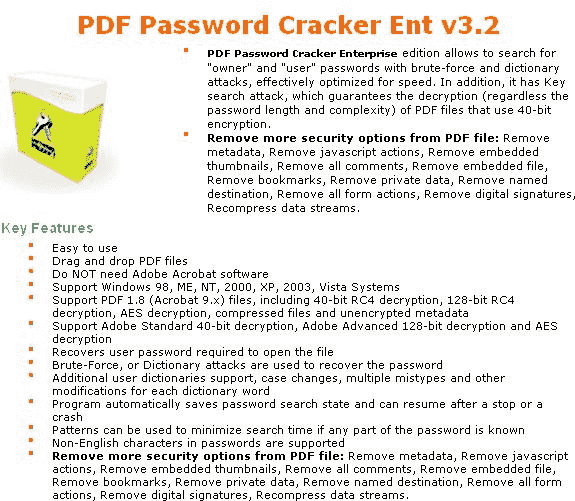
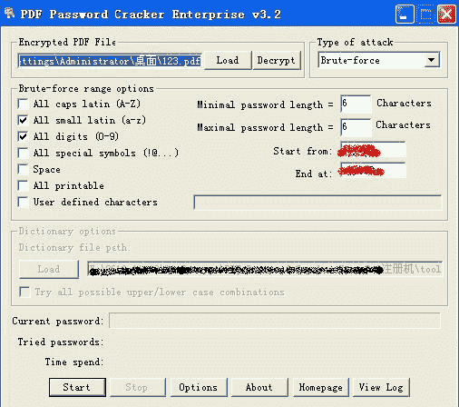

# PDF Password Cracker Ent v3.2 算法分析及注册机

> 原文：[`www.pediy.com/kssd/pediy11/125114.html`](https://www.pediy.com/kssd/pediy11/125114.html)

【文章标题】: `PDF Password Cracker Ent v3.2` 算法分析及注册机

【软件名称】: `PDF Password Cracker Ent v3.2`

【软件大小】: `2.25 MB`

【下载地址】: [`http://www.crackpdf.com/index.html`](http://www.crackpdf.com/index.html)

【加壳方式】: `UPX 0.89.6 - 1.02 / 1.05 - 1.24 -> Markus & Laszlo`

【保护方式】: 注册码

【编写语言】: `Microsoft Visual C++ 6.0`

今天有空，写篇文章。软件没什么保护，很适合大家练手。





OD 载入下断点 `GetDlgItemTextA`，而后在密码框输入任意位数字符例如：`123456789`，随即断到下面，

显然关键 call 就是 `00408060`

```
004086AA    68 945C4F00     PUSH crackpdf.004F5C94            ; ASCII "12345678901234567890"
004086AF    68 14040000     PUSH 414
004086B4    56              PUSH ESI
004086B5    F3:AB          REP STOS DWORD PTR ES:[EDI]
004086B7    FF15 C0E44800  CALL DWORD PTR DS:[48E4C0]          ; USER32.GetDlgItemTextA
004086BD    68 945C4F00     PUSH crackpdf.004F5C94            ; ASCII "12345678901234567890"
004086C2    E8 99F9FFFF     CALL crackpdf.00408060            //关键 call
004086C7    83C4 04         ADD ESP,4
004086CA    85C0            TEST EAX,EAX                      //eax=0 over
004086CC    74 44          JE SHORT crackpdf.00408712
004086CE    6A 40          PUSH 40
004086D0    68 942D4D00     PUSH crackpdf.004D2D94            ; Thank you.
004086D5    68 502D4D00     PUSH crackpdf.004D2D50            ; Thank you for purchase the PDF
                                                              ; Cracker Enterprise v3.2.
004086DA    56              PUSH ESI
004086DB    FF15 E8E44800  CALL DWORD PTR DS:[48E4E8]          ; USER32.MessageBoxA
.......................................................省略部分代码
00408712    6A 10          PUSH 10
00408714    6A 00          PUSH 0
00408716    68 102D4D00     PUSH crackpdf.004D2D10            ; Your registration key is wrong, please
                                                              ; check it and try again.
0040871B    56              PUSH ESI
0040871C    FF15 E8E44800  CALL DWORD PTR DS:[48E4E8]          ; USER32.MessageBoxA
```

下面分析关键 call， F7 进入：

```
00408060    83EC 18         SUB ESP,18
00408063    83C9 FF         OR ECX,FFFFFFFF
00408066    33C0            XOR EAX,EAX                    //默认  al=0 over
00408068    53              PUSH EBX
00408069    56              PUSH ESI
0040806A    8B7424 24       MOV ESI,DWORD PTR SS:[ESP+24]
0040806E    57              PUSH EDI
0040806F    8BFE            MOV EDI,ESI
00408071    F2:AE          REPNE SCAS BYTE PTR ES:[EDI]
00408073    F7D1            NOT ECX
00408075    49              DEC ECX
00408076    83F9 14         CMP ECX,14                    //判断注册码长度是否等于 20，不是就 over
00408079    74 07          JE SHORT crackpdf.00408082
0040807B    5F              POP EDI
0040807C    5E              POP ESI
0040807D    5B              POP EBX
0040807E    83C4 18         ADD ESP,18                    //返回默认值 al=0 over
00408081    C3              RETN
00408082    8A46 0E         MOV AL,BYTE PTR DS:[ESI+E]     //取 key[14]
00408085    8A4E 0F         MOV CL,BYTE PTR DS:[ESI+F]     //取 key[15]
00408088    8D5424 0C       LEA EDX,DWORD PTR SS:[ESP+C]
0040808C    32DB            XOR BL,BL
0040808E    52              PUSH EDX
0040808F    884424 1C       MOV BYTE PTR SS:[ESP+1C],AL
00408093    885C24 1D       MOV BYTE PTR SS:[ESP+1D],BL
00408097    884C24 10       MOV BYTE PTR SS:[ESP+10],CL    //key[15]
0040809B    885C24 11       MOV BYTE PTR SS:[ESP+11],BL    //'\\0'
0040809F    E8 AE3F0600     CALL crackpdf.0046C052
004080A4    8BF8            MOV EDI,EAX                   //edi=atoi(key[15])
004080A6    8D4424 1C       LEA EAX,DWORD PTR SS:[ESP+1C]
004080AA    50              PUSH EAX                       //key[14]
004080AB    E8 A23F0600     CALL crackpdf.0046C052
004080B0    03F8            ADD EDI,EAX                   //edi=atoi(key[14])+atoi(key[15])
004080B2    83C4 08         ADD ESP,8
004080B5    83FF 0A         CMP EDI,0A                    //atoi(key[14])+atoi(key[15])=10  条件 1
004080B8    74 09          JE SHORT crackpdf.004080C3
004080BA    5F              POP EDI
004080BB    5E              POP ESI
004080BC    33C0            XOR EAX,EAX                   //al=0 over
004080BE    5B              POP EBX
004080BF    83C4 18         ADD ESP,18
004080C2    C3              RETN
004080C3    8A0E            MOV CL,BYTE PTR DS:[ESI]         //key[0]
004080C5    8A56 01         MOV DL,BYTE PTR DS:[ESI+1]       // key[1]
004080C8    8D4424 0C       LEA EAX,DWORD PTR SS:[ESP+C]
004080CC    884C24 18       MOV BYTE PTR SS:[ESP+18],CL
004080D0    50              PUSH EAX
004080D1    885C24 1D       MOV BYTE PTR SS:[ESP+1D],BL
004080D5    885424 10       MOV BYTE PTR SS:[ESP+10],DL
004080D9    885C24 11       MOV BYTE PTR SS:[ESP+11],BL
004080DD    E8 703F0600     CALL crackpdf.0046C052
004080E2    8D4C24 1C       LEA ECX,DWORD PTR SS:[ESP+1C]
004080E6    8BF8            MOV EDI,EAX                   //edi=atoi(key[1])
004080E8    51              PUSH ECX
004080E9    E8 643F0600     CALL crackpdf.0046C052         //edi=atoi(key[0])
004080EE    03F8            ADD EDI,EAX
004080F0    83C4 08         ADD ESP,8
004080F3    83FF 0B         CMP EDI,0B                    //atoi(key[0])+atoi(key[1])=11  条件 2
004080F6    74 09          JE SHORT crackpdf.00408101
004080F8    5F              POP EDI
004080F9    5E              POP ESI
004080FA    33C0            XOR EAX,EAX                  //al=0 over
004080FC    5B              POP EBX
004080FD    83C4 18         ADD ESP,18
00408100    C3              RETN
00408101    807E 05 32      CMP BYTE PTR DS:[ESI+5],32      //key[5]=50   条件 3
00408105    74 09          JE SHORT crackpdf.00408110
00408107    5F              POP EDI
00408108    5E              POP ESI
00408109    33C0            XOR EAX,EAX                //al=0 over
0040810B    5B              POP EBX
0040810C    83C4 18         ADD ESP,18
0040810F    C3              RETN
00408110    8A56 07         MOV DL,BYTE PTR DS:[ESI+7]
00408113    8A46 08         MOV AL,BYTE PTR DS:[ESI+8]
00408116    8D4C24 0C       LEA ECX,DWORD PTR SS:[ESP+C]
0040811A    885424 18       MOV BYTE PTR SS:[ESP+18],DL
0040811E    51              PUSH ECX
0040811F    885C24 1D       MOV BYTE PTR SS:[ESP+1D],BL
00408123    884424 10       MOV BYTE PTR SS:[ESP+10],AL
00408127    885C24 11       MOV BYTE PTR SS:[ESP+11],BL
0040812B    E8 223F0600     CALL crackpdf.0046C052
00408130    8D5424 1C       LEA EDX,DWORD PTR SS:[ESP+1C]
00408134    8BF0            MOV ESI,EAX
00408136    52              PUSH EDX
00408137    E8 163F0600     CALL crackpdf.0046C052
0040813C    83C4 08         ADD ESP,8
0040813F    03F0            ADD ESI,EAX
00408141    33C0            XOR EAX,EAX
00408143    83FE 0F         CMP ESI,0F                 // atoi(key[7])+atoi(key[8])=15  条件 4
00408146    5F              POP EDI
00408147    5E              POP ESI
00408148    0F94C0          SETE AL                     //条件 4 也满足就设定 al=1 success
0040814B    5B              POP EBX
0040814C    83C4 18         ADD ESP,18
0040814F    C3              RETN
```

这里主要用到了下面这个函数：

```
int atoi(const char *nptr);
```

函数说明: `atoi()`会扫描参数`nptr`字符串，跳过前面的空格字符，直到遇上数字或正负符号才开始做转换，而再遇到非数字或字符串结束时('\0')才结束转换，并返回转换后的整型数，这个算法中仅用来转换注册码中的某一位字符为十进制数。

## 算法总结

条件 1: `atoi(key[14])+atoi(key[15])=10`


条件 2：`atoi(key\[0\])+atoi(key\[1\])=11`

条件 3：`key\[5\]=50`

条件 4：`atoi(key\[7\])+atoi(key\[8\])=15`

因此注册码只要满足如下形式即可：`(38)random1(2)random2(69)random3(28)random4`

其中 `random1` 为 3 位；`random2` 为 1 位；`random3` 为 5 位；`random4` 为 4 位。

给出注册机代码如下：

```pas
unit Unit1;

interface

uses
  Windows, Classes, Controls, Forms, StdCtrls, Buttons;

type
  TForm1 = class(TForm)
    Label1: TLabel;
    Edit1: TEdit;
    Label2: TLabel;
    Button1: TButton;
    procedure Button1Click(Sender: TObject);
  private
  public
    end;

var
  Form1: TForm1;

implementation

{$R \*.dfm}

procedure TForm1.Button1Click(Sender: TObject);

var
     i:byte;
     str,random1,random2,random3,random4:string;

begin
      Randomize;
      while length(str)<$d  do
        begin
            i := random(150);
            if (i < $7a) and (i > $61) then str:=str+char(i);
        end;
       random1:=copy(str,1,3);
       random2:=copy(str,4,1);
       random3:=copy(str,5,5);
       random4:=copy(str,10,4);
       edit1.Text:='38'+random1+'2'+random2+'69'+random3+'28'+random4;

end;

end.
```

附件：注册机

上传的附件

|  | `keygen.rar` |
| :--- | :--- |
