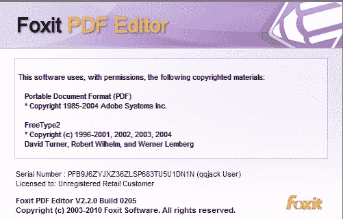

# 新手菜鸟关于 Foxit pdf eidtor 破解，及注册机附上

> 原文：[`www.pediy.com/kssd/pediy12/132615.html`](https://www.pediy.com/kssd/pediy12/132615.html)

在家闲着没事，升级了下`Foxit PDF`，发现下了个`FoxitPDFEditor`,打开发现不注册创建有标签，逆一下看有没有戏，呵呵……

`PEID`查壳，没有壳（好事，还不咋会……）

`od`载入

打开`install license key`

胡乱输入一个`KEY`提示错误后，暂停，查看调用堆栈，来到

```
00422D58    .   50             push eax                     ; /输入的注册码
00422D59    .   E8 D259FEFF    call PDFEdit.00408730        ;单步进入
00408730   /$   64:A1 00000000  mov eax,dword ptr fs:\[0\]  ;
00408736   |.   6A FF           push -1
00408738   |.   68 EBE96800     push PDFEdit.0068E9EB
0040873D   |.   50             push eax
0040873E   |.   64:8925 0000000>mov dword ptr fs:\[0\],esp
00408745   |.   81EC 88000000   sub esp,88
0040874B   |.   55             push ebp
0040874C   |.   8BAC24 9C000000 mov ebp,dword ptr ss:\[esp+9C\]
00408753   |.   56             push esi
00408754   |.   81FD 18258000   cmp ebp,PDFEdit.00802518
0040875A   |.   57             push edi
0040875B   |.   8BF1           mov esi,ecx
0040875D   |.   0F84 95000000   je PDFEdit.004087F8
00408763   |.   68 18277D00     push PDFEdit.007D2718       ;  ASCII "pedkey.txt"
00408768   |.   8D4424 10       lea eax,dword ptr ss:\[esp+10\]
0040876C   |.   6A 00           push 0
0040876E   |.   50             push eax
0040876F   |.   E8 EC100E00     call PDFEdit.004E9860
00408774   |.   8BC8           mov ecx,eax                  ; |
00408776   |.   E8 F5130E00     call PDFEdit.004E9B70        ; \\PDFEdit.004E9B70
0040877B   |.   8B4424 0C       mov eax,dword ptr ss:\[esp+C\]
0040877F   |.   C78424 9C000000>mov dword ptr ss:\[esp+9C\],0
0040878A   |.   85C0           test eax,eax
0040878C   |.   74 05           je short PDFEdit.00408793
0040878E   |.   8B40 04         mov eax,dword ptr ds:\[eax+4\]
00408791   |.   EB 02           jmp short PDFEdit.00408795
00408793   |>   33C0           xor eax,eax
00408795   |>   53             push ebx
00408796   |.   50             push eax
00408797   |.   8D4C24 14       lea ecx,dword ptr ss:\[esp+14\]
0040879B   |.   E8 D0491D00     call PDFEdit.005DD170      ;  计算 pedkey.txt 路径
004087A0   |.   50             push eax
004087A1   |.   8D4C24 18       lea ecx,dword ptr ss:\[esp+18\]
004087A5   |.   E8 03BF2600     call PDFEdit.006746AD
004087AA   |.   8B4C24 14       mov ecx,dword ptr ss:\[esp+14\]
004087AE   |.   68 24277D00     push PDFEdit.007D2724        ;  ASCII "wb"
004087B3   |.   51             push ecx
004087B4   |.   E8 040B0D00     call PDFEdit.004D92BD ;以写二进制文件的形式打开 pedkey.txt
004087B9   |.   8BD8           mov ebx,eax
004087BB   |.   8BFD           mov edi,ebp
004087BD   |.   83C9 FF        or ecx,FFFFFFFF
004087C0   |.   33C0           xor eax,eax
004087C2   |.   F2:AE          repne scas byte ptr es:\[edi\]
004087C4   |.   F7D1           not ecx
004087C6   |.   49             dec ecx
004087C7   |.   53             push ebx
004087C8   |.   51             push ecx
004087C9   |.   6A 01           push 1
004087CB   |.   55             push ebp
004087CC   |.   E8 82090D00     call PDFEdit.004D9153
004087D1   |.   53             push ebx
004087D2   |.   E8 FF080D00     call PDFEdit.004D90D6      ;把注册码信息写入 pedkey.txt
004087D7   |.   83C4 1C         add esp,1C
004087DA   |.   8D4C24 14       lea ecx,dword ptr ss:\[esp+14\]
004087DE   |.   E8 5CBE2600     call PDFEdit.0067463F
004087E3   |.   8D4C24 10       lea ecx,dword ptr ss:\[esp+10\]
004087E7   |.   C78424 A0000000>mov dword ptr ss:\[esp+A0\],-1
004087F2   |.   E8 398C1D00     call PDFEdit.005E1430
004087F7   |.   5B             pop ebx
004087F8   |>   8D5424 14       lea edx,dword ptr ss:\[esp+14\]
004087FC   |.   8D4424 54       lea eax,dword ptr ss:\[esp+54\]
00408800   |.   52             push edx
00408801   |.   8D8E 14070000   lea ecx,dword ptr ds:\[esi+714\]
00408807   |.   50             push eax
00408808   |.   A1 90258000     mov eax,dword ptr ds:\[802590\]
0040880D   |.   8D96 14080000   lea edx,dword ptr ds:\[esi+814\]
00408813   |.   51             push ecx
00408814   |.   8DBE 14060000   lea edi,dword ptr ds:\[esi+614\]
0040881A   |.   52             push edx
0040881B   |.   6A 00           push 0
0040881D   |.   57             push edi
0040881E   |.   68 D4267D00     push PDFEdit.007D26D4      ;  ASCII "2009/02/05"
00408823   |.   68 D0267D00     push PDFEdit.007D26D0         ;  ASCII "PED"
00408828   |.   50             push eax
00408829   |.   E8 E2EE2300     call PDFEdit.00647710      ;  从文件读取 KEY 信息
0040882E   |.   83C4 24         add esp,24
00408831   |.   8986 10060000   mov dword ptr ds:\[esi+610\],eax
00408837   |.   85C0           test eax,eax                 ;  eax 中的值决定注册码是否正确
00408839   |.   75 13           jnz short PDFEdit.0040884E
0040883B   |.   803F 00         cmp byte ptr ds:\[edi\],0
0040883E   |.   74 0E           je short PDFEdit.0040884E
00408840   |.   6A FF           push -1
00408842   |.   6A 00           push 0
00408844   |.   68 92130000     push 1392
00408849   |.   E8 C55B2700     call PDFEdit.0067E413
0040884E   |>   8B86 10060000   mov eax,dword ptr ds:\[esi+610\]
00408854   |.   85C0           test eax,eax
00408856   |.   75 0B           jnz short PDFEdit.00408863
00408858   |.   6A FF           push -1
0040885A   |.   6A 00           push 0
0040885C   |.   68 11140000     push 1411
00408861   |.   EB 22           jmp short PDFEdit.00408885
00408863   |>   68 E0267D00     push PDFEdit.007D26E0          ;  ASCII "PEDTEMP"
00408868   |.   57             push edi
00408869   |.   E8 A2640D00     call PDFEdit.004DED10
0040886E   |.   83C4 08         add esp,8
00408871   |.   85C0           test eax,eax
00408873   |.   6A FF           push -1
00408875   |.   6A 00           push 0
00408877   |.   75 07           jnz short PDFEdit.00408880
00408879   |.   68 0F140000     push 140F
0040887E   |.   EB 05           jmp short PDFEdit.00408885
00408880   |>   68 10140000     push 1410
00408885   |>   E8 895B2700     call PDFEdit.0067E413          ;  提示错误
0040888A   |.   8B8C24 94000000 mov ecx,dword ptr ss:\[esp+94\]
00408891   |.   5F             pop edi
00408892   |.   5E             pop esi
00408893   |.   5D             pop ebp
00408894   |.   64:890D 0000000>mov dword ptr fs:\[0\],ecx
0040889B   |.   81C4 94000000   add esp,94
004088A1   \\.   C2 0400          retn 4
```

在乱输入注册码修改`eax`值后显示

（图片丢失）


至此软件破解，`about`显示

（图片丢失）

但注册机的话，还差远啦

分析到这里说明关键`call`是

```
call PDFEdit.00647710       ;  从文件读取 KEY 信息
```

跟进

```
00647710   /$   8B4C24 04       mov ecx,dword ptr ss:\[esp+4\]
00647714   |.   81EC 04010000   sub esp,104
0064771A   |.   8D4424 00       lea eax,dword ptr ss:\[esp\]
0064771E   |.   53             push ebx
0064771F   |.   55             push ebp
00647720   |.   56             push esi
00647721   |.   57             push edi
00647722   |.   68 04010000     push 104             ; /BufSize = 104 (260.)
00647727   |.   50             push eax               ; |PathBuffer
00647728   |.   51             push ecx               ; |hModule
00647729   |.   FF15 5CBD8100   call dword ptr ds:\[<&KERNEL32.GetModuleFileNameA>\]   ; \\GetModuleFileNameA
0064772F   |.   8D7C24 10       lea edi,dword ptr ss:\[esp+10\]
00647733   |.   83C9 FF        or ecx,FFFFFFFF
00647736   |.   33C0           xor eax,eax
00647738   |.   F2:AE          repne scas byte ptr es:\[edi\]
0064773A   |.   F7D1           not ecx
0064773C   |.   49             dec ecx
0064773D   |.   83F9 01         cmp ecx,1
```


```
00647740   |.  7E 15          jle short PDFEdit.00647757  

00647742   |.  B0 5C          mov al,5C             ;  

00647744   |>  38440C 10      /cmp byte ptr ss:[esp+ecx+10],al  

00647748   |.  74 08          |je short PDFEdit.00647752  

0064774A   |.  49             |dec ecx  

0064774B   |.  83F9 01        |cmp ecx,1  

0064774E   |.^ 7F F4         \jg short PDFEdit.00647744  

00647750   |.  EB 05          jmp short PDFEdit.00647757  

00647752   |>  C6440C 10 00    mov byte ptr ss:[esp+ecx+10],0  

00647757   |>  83C9 FF        or ecx,FFFFFFFF  

0064775A   |.  BF EC397D00     mov edi,PDFEdit.007D39EC  

0064775F   |.  33C0           xor eax,eax  

00647761   |.  8D5424 10       lea edx,dword ptr ss:[esp+10]  

00647765   |.  F2:AE          repne scas byte ptr es:[edi]  

00647767   |.  F7D1           not ecx  

00647769   |.  2BF9           sub edi,ecx  

0064776B   |.  8BD9           mov ebx,ecx  

0064776D   |.  8BF7           mov esi,edi  

0064776F   |.  83C9 FF        or ecx,FFFFFFFF  

00647772   |.  8BFA           mov edi,edx  

00647774   |.  F2:AE          repne scas byte ptr es:[edi]  

00647776   |.  8BCB           mov ecx,ebx  

00647778   |.  4F             dec edi  

00647779   |.  C1E9 02        shr ecx,2  

0064777C   |.  F3:A5         rep movs dword ptr es:[edi],dword ptr ds:[esi]  

0064777E   |.  8BCB           mov ecx,ebx  

00647780   |.  8B9424 1C010000 mov edx,dword ptr ss:[esp+11C]  

00647787   |.  83E1 03        and ecx,3  

0064778A   |.  8D5C24 10       lea ebx,dword ptr ss:[esp+10]  

0064778E   |.  F3:A4         rep movs byte ptr es:[edi],byte ptr ds:[esi]  

00647790   |.  8BFA           mov edi,edx  

00647792   |.  83C9 FF        or ecx,FFFFFFFF  

00647795   |.  F2:AE          repne scas byte ptr es:[edi]  

00647797   |.  F7D1           not ecx  

00647799   |.  2BF9           sub edi,ecx  

0064779B   |.  8BF7           mov esi,edi  

0064779D   |.  8BE9           mov ebp,ecx  

0064779F   |.  8BFB           mov edi,ebx  

006477A1   |.  83C9 FF        or ecx,FFFFFFFF  

006477A4   |.  F2:AE          repne scas byte ptr es:[edi]  

006477A6   |.  8BCD           mov ecx,ebp  

006477A8   |.  4F             dec edi  

006477A9   |.  C1E9 02        shr ecx,2  

006477AC   |.  F3:A5         rep movs dword ptr es:[edi],dword ptr ds:[esi]  

006477AE   |.  8BCD           mov ecx,ebp  

006477B0   |.  8D5C24 10       lea ebx,dword ptr ss:[esp+10]  

006477B4   |.  83E1 03        and ecx,3  

006477B7   |.  F3:A4         rep movs byte ptr es:[edi],byte ptr ds:[esi]  

006477B9   |.  BF CCA47F00     mov edi,PDFEdit.007FA4CC                   ;  ASCII "key.txt"  

006477BE   |.  83C9 FF        or ecx,FFFFFFFF  

006477C1   |.  F2:AE          repne scas byte ptr es:[edi]  

006477C3   |.  F7D1           not ecx  

006477C5   |.  2BF9           sub edi,ecx  

006477C7   |.  8BF7           mov esi,edi  

006477C9   |.  8BE9           mov ebp,ecx  

006477CB   |.  8BFB           mov edi,ebx  

006477CD   |.  83C9 FF        or ecx,FFFFFFFF  

006477D0   |.  F2:AE          repne scas byte ptr es:[edi]  

006477D2   |.  8BCD           mov ecx,ebp  

006477D4   |.  4F             dec edi  

006477D5   |.  C1E9 02        shr ecx,2  

006477D8   |.  F3:A5         rep movs dword ptr es:[edi],dword ptr ds:[esi]  

006477DA   |.  8B8424 38010000 mov eax,dword ptr ss:[esp+138]  

006477E1   |.  8BCD           mov ecx,ebp  

006477E3   |.  83E1 03        and ecx,3  

006477E6   |.  50             push eax  

006477E7   |.  8B8424 34010000 mov eax,dword ptr ss:[esp+134]  

006477EE   |.  F3:A4         rep movs byte ptr es:[edi],byte ptr ds:[esi]  

006477F0   |.  8B8C24 38010000 mov ecx,dword ptr ss:[esp+138]  

006477F7   |.  51             push ecx  

006477F8   |.  8B8C24 34010000 mov ecx,dword ptr ss:[esp+134]  

006477FF   |.  50             push eax  

00647800   |.  8B8424 34010000 mov eax,dword ptr ss:[esp+134]  

00647807   |.  51             push ecx  

00647808   |.  8B8C24 34010000 mov ecx,dword ptr ss:[esp+134]  

0064780F   |.  50             push eax  

00647810   |.  8B8424 34010000 mov eax,dword ptr ss:[esp+134]  

00647817   |.  51             push ecx  

00647818   |.  50             push eax  

00647819   |.  8D4C24 2C       lea ecx,dword ptr ss:[esp+2C]  

0064781D   |.  52             push edx  

0064781E   |.  51             push ecx  

0064781F   |.  E8 4CF7FFFF     call PDFEdit.00646F70                  ;  关键调用  

00647824   |.  83C4 24        add esp,24  

00647827   |.  5F             pop edi  

00647828   |.  5E             pop esi  

00647829   |.  5D             pop ebp  

0064782A   |.  5B             pop ebx  

0064782B   |.  81C4 04010000   add esp,104  

00647831   \.  C3             retn  

跟进  

0064781D   |.  52             push edx                ;  串常量"PED"  

0064781E   |.  51             push ecx                ;  pedkey.txt 文件路径  

0064781F   |.  E8 4CF7FFFF     call PDFEdit.00646F70        ;  关键调用  

00646F70   /$  B8 F8130000     mov eax,13F8  

00646F75   |.  E8 E642E9FF     call PDFEdit.004DB260  

00646F7A   |.  53             push ebx  

00646F7B   |.  55             push ebp                             ;  写入第一值  

00646F7C   |.  8BAC24 08140000 mov ebp,dword ptr ss:[esp+1408]  

00646F83   |.  56             push esi  

00646F84   |.  57             push edi  

00646F85   |.  68 C8A47F00     push PDFEdit.007FA4C8                  ; /Arg2 = 007FA4C8 ASCII "FSL"  

00646F8A   |.  55             push ebp                             ; |Arg1  

00646F8B   |.  E8 9720E9FF     call PDFEdit.004D9027                  ; \PDFEdit.004D9027  

00646F90   |.  83C4 08        add esp,8  

00646F93   |.  85C0           test eax,eax  

00646F95   |.  75 0A          jnz short PDFEdit.00646FA1  

00646F97   |.  BE B8A47F00     mov esi,PDFEdit.007FA4B8               ;  ASCII "Foxit SSH Link"  

00646F9C   |.  E9 B8000000     jmp PDFEdit.00647059  

00646FA1   |>  68 B4A47F00     push PDFEdit.007FA4B4                  ; /Arg2 = 007FA4B4 ASCII "PTC"  

00646FA6   |.  55             push ebp                             ; |Arg1  

00646FA7   |.  E8 7B20E9FF     call PDFEdit.004D9027                  ; \PDFEdit.004D9027  

00646FAC   |.  83C4 08        add esp,8  

00646FAF   |.  85C0           test eax,eax  

00646FB1   |.  75 0A          jnz short PDFEdit.00646FBD  

00646FB3   |.  BE A0A47F00     mov esi,PDFEdit.007FA4A0               ;  ASCII "PDF Text Converter"  

00646FB8   |.  E9 9C000000     jmp PDFEdit.00647059  

00646FBD   |>  68 9CA47F00     push PDFEdit.007FA49C                  ; /Arg2 = 007FA49C ASCII "PTV"  

00646FC2   |.  55             push ebp                             ; |Arg1  

00646FC3   |.  E8 5F20E9FF     call PDFEdit.004D9027                  ; \PDFEdit.004D9027  

00646FC8   |.  83C4 08        add esp,8  

00646FCB   |.  85C0           test eax,eax  

00646FCD   |.  75 0A          jnz short PDFEdit.00646FD9  

00646FCF   |.  BE 8CA47F00     mov esi,PDFEdit.007FA48C               ;  ASCII "PDF Text Viewer"  

00646FD4   |.  E9 80000000     jmp PDFEdit.00647059  

00646FD9   |>  68 88A47F00     push PDFEdit.007FA488                  ; /Arg2 = 007FA488 ASCII "WAC"  

00646FDE   |.  55             push ebp                             ; |Arg1  

00646FDF   |.  E8 4320E9FF     call PDFEdit.004D9027                  ; \PDFEdit.004D9027  

00646FE4   |.  83C4 08        add esp,8  

00646FE7   |.  85C0           test eax,eax  

00646FE9   |.  75 07          jnz short PDFEdit.00646FF2  
```


```
00646FEB   |.  BE 7CA47F00     mov esi,PDFEdit.007FA47C                         ;  ASCII "WAC Server"  

00646FF0   |.  EB 67           jmp short PDFEdit.00647059  

00646FF2   |>  68 78A47F00     push PDFEdit.007FA478                            ; /Arg2 = 007FA478 ASCII "PPO"  

00646FF7   |.  55             push ebp                                         ; |Arg1  

00646FF8   |.  E8 2A20E9FF    call PDFEdit.004D9027                            ; \\PDFEdit.004D9027  

00646FFD   |.  83C4 08        add esp,8  

00647000   |.  85C0           test eax,eax  

00647002   |.  75 07          jnz short PDFEdit.0064700B  

00647004   |.  BE 64A47F00    mov esi,PDFEdit.007FA464                         ;  ASCII "PDF Page Organizer"  

00647009   |.  EB 4E          jmp short PDFEdit.00647059  

0064700B   |>  68 60A47F00    push PDFEdit.007FA460                            ; /Arg2 = 007FA460 ASCII "PPP"  

00647010   |.  55             push ebp                                         ; |Arg1  

00647011   |.  E8 1120E9FF    call PDFEdit.004D9027                            ; \\PDFEdit.004D9027  

00647016   |.  83C4 08        add esp,8  

00647019   |.  85C0           test eax,eax  

0064701B   |.  75 07          jnz short PDFEdit.00647024  

0064701D   |.  BE 48A47F00    mov esi,PDFEdit.007FA448                         ;  ASCII "PDF Page Organizer Pro"  

00647022   |.  EB 35          jmp short PDFEdit.00647059  

00647024   |>  68 D0267D00    push PDFEdit.007D26D0                            ; /Arg2 = 007D26D0 ASCII "PED"  

00647029   |.  55             push ebp                                         ; |Arg1  

0064702A   |.  E8 F81FE9FF    call PDFEdit.004D9027                            ; \\PDFEdit.004D9027  

0064702F   |.  83C4 08        add esp,8  

00647032   |.  85C0           test eax,eax  

00647034   |.  75 07          jnz short PDFEdit.0064703D  

00647036   |.  BE 00277D00    mov esi,PDFEdit.007D2700                         ;  ASCII "PDF Editor"  

0064703B   |.  EB 1C          jmp short PDFEdit.00647059  

0064703D   |>  68 44A47F00    push PDFEdit.007FA444                            ; /Arg2 = 007FA444 ASCII "FRP"  

00647042   |.  55             push ebp                                         ; |Arg1  

00647043   |.  E8 DF1FE9FF    call PDFEdit.004D9027                            ; \\PDFEdit.004D9027  

00647048   |.  83C4 08        add esp,8  

0064704B   |.  BE 30A47F00    mov esi,PDFEdit.007FA430                         ;  ASCII "Foxit Reader Pro"  

00647050   |.  85C0           test eax,eax  

00647052   |.  74 05          je short PDFEdit.00647059  

00647054   |.  BE 20A47F00    mov esi,PDFEdit.007FA420                         ;  ASCII "Foxit License"  

00647059   |>  8BBC24 0C140000 mov edi,dword ptr ss:\[esp+140C\]  

00647060   |.  8B1D 54BD8100  mov ebx,dword ptr ds:\[<&KERNEL32.GetPrivateProfileSt>;  kernel32.GetPrivateProfileStringA  

00647066   |.  57             push edi                                         ; /IniFileName  

00647067   |.  8D8424 0C010000 lea eax,dword ptr ss:\[esp+10C\]                 ; |  

0064706E   |.  68 00010000    push 100                                         ; |BufSize = 100 (256.)  

00647073   |.  50             push eax                                         ; |ReturnBuffer  

00647074   |.  68 18258000    push PDFEdit.00802518                            ; |Default = ""  

00647079   |.  68 1CA47F00    push PDFEdit.007FA41C                            ; |Key = "SN"  

0064707E   |.  56             push esi                                         ; |Section  

0064707F   |.  FFD3           call ebx                                         ; \\GetPrivateProfileStringA  

00647081   |.  8A8424 08010000 mov al,byte ptr ss:\[esp+108\]  

00647088   |.  84C0           test al,al  

0064708A   |.  75 20          jnz short PDFEdit.006470AC  

0064708C   |.  57             push edi                                         ; /IniFileName  

0064708D   |.  8D8C24 0C010000 lea ecx,dword ptr ss:\[esp+10C\]                 ; |  

00647094   |.  68 00010000    push 100                                         ; |BufSize = 100 (256.)  

00647099   |.  51             push ecx                                         ; |ReturnBuffer  

0064709A   |.  BE 20A47F00    mov esi,PDFEdit.007FA420                         ; |ASCII "Foxit License"  

0064709F   |.  68 18258000    push PDFEdit.00802518                            ; |Default = ""  

006470A4   |.  68 1CA47F00    push PDFEdit.007FA41C                            ; |Key = "SN"  

006470A9   |.  56             push esi                                         ; |Section => "Foxit License"  

006470AA   |.  FFD3           call ebx                                         ; \\GetPrivateProfileStringA  

006470AC   |>  57             push edi  

006470AD   |.  8D9424 0C100000 lea edx,dword ptr ss:\[esp+100C\]  

006470B4   |.  68 00040000    push 400  

006470B9   |.  52             push edx  

006470BA   |.  68 18258000    push PDFEdit.00802518  

006470BF   |.  68 14A47F00    push PDFEdit.007FA414                            ;  ASCII "Modules"  

006470C4   |.  56             push esi  

006470C5   |.  FFD3           call ebx  ; \\GetPrivateProfileStringA  

006470C7   |.  57             push edi  

006470C8   |.  8D8424 0C060000 lea eax,dword ptr ss:\[esp+60C\]  

006470CF   |.  68 00010000    push 100  

006470D4   |.  50             push eax  

006470D5   |.  68 18258000    push PDFEdit.00802518  

006470DA   |.  68 0CA47F00    push PDFEdit.007FA40C                            ;  ASCII "Users"  

006470DF   |.  56             push esi  

006470E0   |.  FFD3           call ebx  ; \\GetPrivateProfileStringA  

006470E2   |.  57             push edi  

006470E3   |.  8D8C24 0C050000 lea ecx,dword ptr ss:\[esp+50C\]  

006470EA   |.  68 00010000    push 100  

006470EF   |.  51             push ecx  

006470F0   |.  68 18258000    push PDFEdit.00802518  

006470F5   |.  68 00A47F00    push PDFEdit.007FA400                            ;  ASCII "Licensee"  

006470FA   |.  56             push esi  

006470FB   |.  FFD3           call ebx  ; \\GetPrivateProfileStringA  

006470FD   |.  57             push edi  

006470FE   |.  8D9424 0C030000 lea edx,dword ptr ss:\[esp+30C\]  

00647105   |.  68 00010000    push 100  

0064710A   |.  52             push edx  

0064710B   |.  68 18258000    push PDFEdit.00802518  

00647110   |.  68 F4A37F00    push PDFEdit.007FA3F4                            ;  ASCII "ExpireDate"  

00647115   |.  56             push esi  

00647116   |.  FFD3           call ebx  ; \\GetPrivateProfileStringA  

00647118   |.  57             push edi  

00647119   |.  8D8424 0C070000 lea eax,dword ptr ss:\[esp+70C\]  

00647120   |.  68 00010000    push 100  

00647125   |.  50             push eax  

00647126   |.  68 18258000    push PDFEdit.00802518  

0064712B   |.  68 ECA37F00    push PDFEdit.007FA3EC                            ;  ASCII "Sign"  

00647130   |.  56             push esi  

00647131   |.  FFD3           call ebx  ; \\GetPrivateProfileStringA  

00647133   |.  57             push edi  

00647134   |.  8D8C24 0C040000 lea ecx,dword ptr ss:\[esp+40C\]  

0064713B   |.  68 00010000    push 100  

00647140   |.  51             push ecx  

00647141   |.  68 18258000    push PDFEdit.00802518  

00647146   |.  68 E0A37F00    push PDFEdit.007FA3E0                            ;  ASCII "LicenseDate"  

0064714B   |.  56             push esi  

0064714C   |.  FFD3           call ebx  ; \\GetPrivateProfileStringA  

0064714E   |.  57             push edi  

0064714F   |.  8D9424 0C020000 lea edx,dword ptr ss:\[esp+20C\]  

00647156   |.  68 00040000    push 400
```


```
0064715B   |.  52                  push edx  

0064715C   |.  68 18258000        push PDFEdit.00802518  

00647161   |.  68 0C277D00        push PDFEdit.007D270C                                 ;  ASCII "CDKey"  

00647166   |.  56                  push esi  

00647167   |.  FFD3                call ebx  ;\GetPrivateProfileStringA  

00647169   |.  6A 03               push 3                                       ; /Arg3 = 00000003  

0064716B   |.  8D8424 0C010000     lea eax,dword ptr ss:[esp+10C]                     ; |  

00647172   |.  55                  push ebp                                 ; |Arg2  

00647173   |.  50                  push eax                                 ; |Arg1  

00647174   |.  E8 C442E9FF         call PDFEdit.004DB43D                     ;\PDFEdit.004DB43D  

00647179   |.  83C4 0C             add esp,0C  

0064717C   |.  85C0                test eax,eax       ;必须跳，  

0064717E   |.  74 0D               je short PDFEdit.0064718D  

00647180   |.  5F                  pop edi  

00647181   |.  5E                  pop esi  

00647182   |.  5D                  pop ebp  

00647183   |.  33C0                xor eax,eax  

00647185   |.  5B                  pop ebx  

00647186   |.  81C4 F8130000       add esp,13F8  

0064718C   |.  C3                  retn  

0064718D   |>  8D8C24 08050000     lea ecx,dword ptr ss:[esp+508]  

00647194   |.  68 B0267D00         push PDFEdit.007D26B0                     ; /Arg2 = 007D26B0 ASCII "Unregistered Retail Customer"  

00647199   |.  51                  push ecx                                 ; |Arg1  

0064719A   |.  E8 881EE9FF         call PDFEdit.004D9027                     ;\PDFEdit.004D9027  

0064719F   |.  83C4 08             add esp,8  

006471A2   |.  85C0                test eax,eax          

006471A4   |.  0F85 ED010000       jnz PDFEdit.00647397               ;此处调向错误处理  

006471AA   |.  B9 20000000         mov ecx,20                               ;  数据区 buf 大小  

006471AF   |.  8DBC24 88000000     lea edi,dword ptr ss:[esp+88]  

006471B6   |.  8D9424 08020000     lea edx,dword ptr ss:[esp+208]  

006471BD   |.  F3:AB               rep stos dword ptr es:[edi]                 ;  数据区清零  

006471BF   |.  52                  push edx                                 ; /Arg1  

006471C0   |.  E8 123AE9FF         call PDFEdit.004DABD7                     ;\小写转大写  

006471C5   |.  8B8424 0C020000     mov eax,dword ptr ss:[esp+20C]  

006471CC   |.  83C4 04             add esp,4  

006471CF   |.  898424 88000000     mov dword ptr ss:[esp+88],eax                ;  取注册码前四位送入数据区 buf，buf 大小 128 字节  

006471D6   |.  33C0                xor eax,eax  

006471D8   |>  83F8 02             /cmp eax,2                               ;  算法第一处，对部分注册码进行计算  

006471DB   |.  B9 05000000         |mov ecx,5                               ;  取注册码的 5，7,10,12 位左移 4 位分别于 6,8,11,13 相加并减 0x51  

006471E0   |.  7C 05               |jl short PDFEdit.006471E7  

006471E2   |.  B9 06000000         |mov ecx,6  

006471E7   |>  8D0C41              |lea ecx,dword ptr ds:[ecx+eax*2]  

006471EA   |.  8A940C 08020000     |mov dl,byte ptr ss:[esp+ecx+208]  

006471F1   |.  8A9C0C 09020000     |mov bl,byte ptr ss:[esp+ecx+209]  

006471F8   |.  C0E2 04             |shl dl,4  

006471FB   |.  02D3                |add dl,bl  

006471FD   |.  80EA 51             |sub dl,51  

00647200   |.  889404 8C000000     |mov byte ptr ss:[esp+eax+8C],dl                ;  计算结果 append 到数据区 buf  

00647207   |.  40                  |inc eax  

00647208   |.  83F8 04             |cmp eax,4  

0064720B   |.^ 7C CB               \jl short PDFEdit.006471D8  

0064720D   |.  BF A8A37F00         mov edi,PDFEdit.007FA3A8                     ;  ASCII "Write to sales@foxitsoftware.com for more information."  

00647212   |.  83C9 FF             or ecx,FFFFFFFF  

00647215   |.  33C0                xor eax,eax  

00647217   |.  8D9424 90000000     lea edx,dword ptr ss:[esp+90]  

0064721E   |.  F2:AE               repne scas byte ptr es:[edi]  

00647220   |.  F7D1                not ecx                               ;  取串长  

00647222   |.  2BF9                sub edi,ecx  

00647224   |.  68 80000000         push 80  

00647229   |.  8BC1                mov eax,ecx  

0064722B   |.  8BF7                mov esi,edi  

0064722D   |.  8BFA                mov edi,edx  

0064722F   |.  8D9424 8C000000     lea edx,dword ptr ss:[esp+8C]  

00647236   |.  C1E9 02             shr ecx,2  

00647239   |.  F3:A5               rep movs dword ptr es:[edi],dword ptr ds:[esi]   ;  串常量 append 到数据区  

0064723B   |.  8BC8                mov ecx,eax  

0064723D   |.  8D4424 18           lea eax,dword ptr ss:[esp+18]  

00647241   |.  83E1 03             and ecx,3  

00647244   |.  52                  push edx                                 ;  压入计算处理的结果  

00647245   |.  F3:A4               rep movs byte ptr es:[edi],byte ptr ds:[esi]  

00647247   |.  33C9                xor ecx,ecx  

00647249   |.  50                  push eax                                 ;  第二个参数  

0064724A   |.  894C24 20           mov dword ptr ss:[esp+20],ecx  

0064724E   |.  894C24 24           mov dword ptr ss:[esp+24],ecx  

00647252   |.  894C24 28           mov dword ptr ss:[esp+28],ecx  

00647256   |.  894C24 2C           mov dword ptr ss:[esp+2C],ecx  

0064725A   |.  E8 213D0100         call PDFEdit.0065AF80                     ;  对数据区 buf 中的数据进行计算  

0064725F   |.  8B9424 24140000     mov edx,dword ptr ss:[esp+1424]  

00647266   |.  83C4 0C             add esp,0C  

00647269   |.  85D2                test edx,edx  

0064726B   |.  74 24               je short PDFEdit.00647291  

0064726D   |.  8DBC24 08020000     lea edi,dword ptr ss:[esp+208]  

00647274   |.  83C9 FF             or ecx,FFFFFFFF  

00647277   |.  33C0                xor eax,eax  

00647279   |.  F2:AE               repne scas byte ptr es:[edi]  

0064727B   |.  F7D1                not ecx  

0064727D   |.  2BF9                sub edi,ecx  

0064727F   |.  8BC1                mov eax,ecx  

00647281   |.  8BF7                mov esi,edi  

00647283   |.  8BFA                mov edi,edx  

00647285   |.  C1E9 02             shr ecx,2  

00647288   |.  F3:A5               rep movs dword ptr es:[edi],dword ptr ds:[esi]  

0064728A   |.  8BC8                mov ecx,eax  

0064728C   |.  83E1 03             and ecx,3  

0064728F   |.  F3:A4               rep movs byte ptr es:[edi],byte ptr ds:[esi]  

00647291   |>  8B9424 24140000     mov edx,dword ptr ss:[esp+1424]  

00647298   |.  85D2                test edx,edx  

0064729A   |.  74 24               je short PDFEdit.006472C0  

0064729C   |.  8DBC24 08050000     lea edi,dword ptr ss:[esp+508]  

006472A3   |.  83C9 FF             or ecx,FFFFFFFF  

006472A6   |.  33C0                xor eax,eax  

006472A8   |.  F2:AE               repne scas byte ptr es:[edi]  

006472AA   |.  F7D1                not ecx  

006472AC   |.  2BF9                sub edi,ecx  

006472AE   |.  8BC1                mov eax,ecx  

006472B0   |.  8BF7                mov esi,edi  

006472B2   |.  8BFA                mov edi,edx  

006472B4   |.  C1E9 02             shr ecx,2  

006472B7   |.  F3:A5               rep movs dword ptr es:[edi],dword ptr ds:[esi]  

006472B9   |.  8BC8                mov ecx,eax  

006472BB   |.  83E1 03             and ecx,3  

006472BE   |.  F3:A4               rep movs byte ptr es:[edi],byte ptr ds:[esi]  

006472C0   |>  33C9                xor ecx,ecx  

006472C2   |.  8D7424 14           lea esi,dword ptr ss:[esp+14]  

006472C6   |>  8A16                /mov dl,byte ptr ds:[esi]                     ;  esi 中为通过部分注册码计算的最后结果，长度为 16 个字节  

006472C8   |.  83F9 04             |cmp ecx,4                               ;  算法最后一部分  

006472CB   |.  B8 0F000000         |mov eax,0F                               ;  取注册码的 15，17,20,22 位左移 4 位分别于 16,18,21,23 相加并减 0x51  

006472D0   |.  7C 05               |jl short PDFEdit.006472D7               ;  计算值分别于 esi 中第 0,4，8，12 位比较，如果都相等则注册码正确  

006472D2   |.  B8 10000000         |mov eax,10  
```


## 汇编分析：注册码验证逻辑

```
006472D7   |>  03C1            |add eax,ecx  

006472D9   |.  8A9C04 08020000 |mov bl,byte ptr ss:[esp+eax+208]                 ;  取注册码 a 位值,  

006472E0   |.  C0E3 04         |shl bl,4  

006472E3   |.  029C04 09020000 |add bl,byte ptr ss:[esp+eax+209]                 ;  取注册码 a+1 位值  

006472EA   |.  80EB 51         |sub bl,51  

006472ED   |.  3AD3            |cmp dl,bl  

006472EF   |.  0F85 06040000   |jnz PDFEdit.006476FB  

006472F5   |.  83C1 02         |add ecx,2  

006472F8   |.  83C6 04         |add esi,4  

006472FB   |.  83F9 08         |cmp ecx,8  

006472FE   |.^ 7C C6           \jl short PDFEdit.006472C6  

00647300   |.  8B9424 20140000 |mov edx,dword ptr ss:[esp+1420]  
```

看到调用 `GetPrivateProfileStringA` 

原来 `pedkey.txt` 文件其实就是一个 ini 文件，保存注册信息的。

### 构造合法 `pedkey` 文件

经单步跟踪构造合法 `pedkey` 文件：

```ini
[PDF Editor]  

SN="PED"  

Modules="MyModules"  

Users="qqjack"  

Licensee="Unregistered Retail Customer"  

ExpireDate="2012/12/12"  

Sign="MySelf"  

LicenseDate="2011/04/16"  

CDKey="111111111111111111111111111"
```

跟踪发现 `SN` 必须为 `PED`，`Licensee="Unregistered Retail Customer"`。其它随意。

这样可以顺利到达注册码计算处。

#### 跟入计算核心

```
0064725A   |.  E8 213D0100     call PDFEdit.0065AF80                               ;  对数据区 buf 中的数据进行计算  

0065AF80   /$  6A FF           push -1  

0065AF82   |.  68 687B6A00     push PDFEdit.006A7B68                               ;  SE 句柄安装  

0065AF87   |.  64:A1 00000000  mov eax,dword ptr fs:[0]  

0065AF8D   |.  50              push eax  

0065AF8E   |.  64:8925 0000000>mov dword ptr fs:[0],esp  

0065AF95   |.  83EC 2C         sub esp,2C  

0065AF98   |.  56              push esi  

0065AF99   |.  6A 01           push 1                                              ; /Arg1 = 00000001  

0065AF9B   |.  8D4C24 08       lea ecx,dword ptr ss:[esp+8]                        ; |向地址 ECX 写入  

0065AF9F   |.  E8 0CA20000     call PDFEdit.006651B0                               ; \\算法预处理处，对变量 buf2 进行初始化  

0065AFA4   |.  8B4424 08       mov eax,dword ptr ss:[esp+8]  

0065AFA8   |.  C74424 38 00000>mov dword ptr ss:[esp+38],0  

0065AFB0   |.  8B48 04         mov ecx,dword ptr ds:[eax+4]  

0065AFB3   |.  8B4424 48       mov eax,dword ptr ss:[esp+48]  

0065AFB7   |.  50              push eax  

0065AFB8   |.  8B540C 0C       mov edx,dword ptr ss:[esp+ecx+C]  

0065AFBC   |.  8D740C 0C       lea esi,dword ptr ss:[esp+ecx+C]  

0065AFC0   |.  8B4C24 48       mov ecx,dword ptr ss:[esp+48]  

0065AFC4   |.  51              push ecx                                            ;  数据区 buf 地址  

0065AFC5   |.  8BCE            mov ecx,esi  

0065AFC7   |.  FF52 04         call dword ptr ds:[edx+4]                           ;  对修改的部分注册码进行计算,结果存入 buf2  

0065AFCA   |.  8B4424 40       mov eax,dword ptr ss:[esp+40]  

0065AFCE   |.  8B16            mov edx,dword ptr ds:[esi]  

0065AFD0   |.  50              push eax  

0065AFD1   |.  8BCE            mov ecx,esi                                         ;  计算结果  

0065AFD3   |.  FF52 08         call dword ptr ds:[edx+8]                           ;  进行 buf2 二次计算，得出最后运算结果  

0065AFD6   |.  8D4C24 2C       lea ecx,dword ptr ss:[esp+2C]  

0065AFDA   |.  C74424 38 FFFFF>mov dword ptr ss:[esp+38],-1  

0065AFE2   |.  E8 09880000     call PDFEdit.006637F0  

0065AFE7   |.  8B4C24 30       mov ecx,dword ptr ss:[esp+30]  

0065AFEB   |.  5E              pop esi  

0065AFEC   |.  64:890D 0000000>mov dword ptr fs:[0],ecx  

0065AFF3   |.  83C4 38         add esp,38  

0065AFF6   \\.  C3              retn
```

跟入 `call PDFEdit.006651B0`；`\\算法预处理处，对变量 buf2 进行初始化`。其调用函数如下：

```
00665250   /$  33C0            xor eax,eax  

00665252   |.  8941 10         mov dword ptr ds:[ecx+10],eax  

00665255   |.  8941 0C         mov dword ptr ds:[ecx+C],eax  

00665258   |.  8B41 20         mov eax,dword ptr ds:[ecx+20]  

0066525B   |.  C700 01234567   mov dword ptr ds:[eax],67452301                      ;  保存常量到 buf2[0]  

00665261   |.  8B51 20         mov edx,dword ptr ds:[ecx+20]  

00665264   |.  C742 04 89ABCDE>mov dword ptr ds:[edx+4],EFCDAB89                   ;  保存常量到 buf2[1]  

0066526B   |.  8B41 20         mov eax,dword ptr ds:[ecx+20]  

0066526E   |.  C740 08 FEDCBA9>mov dword ptr ds:[eax+8],98BADCFE                   ;  保存常量到 buf2[2]  

00665275   |.  8B49 20         mov ecx,dword ptr ds:[ecx+20]  

00665278   |.  C741 0C 7654321>mov dword ptr ds:[ecx+C],10325476                   ;  保存常量到 buf2[3]  

0066527F   \\.  C3              retn
```

跟入 `call dword ptr ds:[edx+4]`；`对修改的部分注册码进行计算,结果存入 buf2`。调用如下：

实际这里调用了两次，第一次第二个参数为 `buf`；第二次第二个参数为 `buf+sizeof(buf)/2`。

```
00665287    .  50               push eax                                            ;  数据区 buf/buf+sizeof(buf)/2  

00665288    .  51               push ecx                                            ;  buf2  

00665289    .  E8 B2000000     call PDFEdit.00665340                               ;  计算核心函数
```

跟入 `call dword ptr ds:[edx+8]`；`进行 buf2 二次计算，得出最后运算结果`。

```
006652A0    > /53               push ebx  

006652A1    . |8BD9             mov ebx,ecx  

006652A3    . |55               push ebp  

006652A4    . |56               push esi  

006652A5    . |8D6B D8          lea ebp,dword ptr ds:[ebx-28]  

006652A8    . |68 80000000      push 80  

006652AD    . |6A 38            push 38  

006652AF    . |8BCD             mov ecx,ebp  

006652B1    . |E8 DAE6FFFF      call PDFEdit.00663990                               ;  计算新的数据区 buf3  

006652B6    . |8B73 F0          mov esi,dword ptr ds:[ebx-10]  

006652B9    . |3BF6             cmp esi,esi  

006652BB    . |74 0B            je short PDFEdit.006652C8  

006652BD    . |57               push edi  

006652BE    . |B9 0E000000      mov ecx,0E  

006652C3    . |8BFE             mov edi,esi  

006652C5    . |F3:A5            rep movs dword ptr es:[edi],dword ptr ds:[esi]  

006652C7    . |5F               pop edi  

006652C8    > |8B43 F0          mov eax,dword ptr ds:[ebx-10]                       ;  地址  

006652CB    . |8B4B E4          mov ecx,dword ptr ds:[ebx-1C]  

006652CE    . |8948 38          mov dword ptr ds:[eax+38],ecx                       ;  将 ecx 值置入 buf3 的倒数第八字节后，经调试发现 ecx 值固定为 0x400  

006652D1    . |8B53 F0          mov edx,dword ptr ds:[ebx-10]  

006652D4    . |8B43 E8          mov eax,dword ptr ds:[ebx-18]  

006652D7    . |8942 3C          mov dword ptr ds:[edx+3C],eax                       ;  将 eax 值置入 buf3 的倒数第四字节后，经调试发现 ecx 值固定为 0  

006652DA    . |8B4B F0          mov ecx,dword ptr ds:[ebx-10]  

006652DD    . |8B53 F8          mov edx,dword ptr ds:[ebx-8]  

006652E0    . |51               push ecx                                            ;  新数据区 buf3  

006652E1    . |52               push edx                                            ;  buf2  

006652E2    . |E8 59000000     call PDFEdit.00665340             ; 核心函数 计算最终结果
```

跟入 `call PDFEdit.00663990`；`计算新的数据区 buf3`。

```
00663990   /$  53               push ebx  

00663991   |.  56               push esi  

00663992   |.  8BF1             mov esi,ecx  

00663994   |.  8B5C24 0C        mov ebx,dword ptr ss:[esp+C]                          ;  第二参数固定为 0x38  

00663998   |.  57               push edi  

00663999   |.  8B56 0C          mov edx,dword ptr ds:[esi+C]                          ;  此处值固定为 0x400  

0066399C   |.  8B46 08          mov eax,dword ptr ds:[esi+8]                          ;  此处值固定为 0x40  

0066399F   |.  8B4E 18          mov ecx,dword ptr ds:[esi+18]                        ;  新数据区 buf3 地址  

006639A2   |.  C1EA 03          shr edx,3  

006639A5   |.  48               dec eax  

006639A6   |.  23D0             and edx,eax  

006639A8   |.  8A4424 14        mov al,byte ptr ss:[esp+14]                           ;  第一参数固定为 0x80
```


`006639AC` `.` `880411` `mov byte ptr ds:[ecx+edx],al` ; `buf3` 第一位填 `0x80`

`006639AF` `.` `42` `inc edx` ; 此值固定为 `1`

`006639B0` `.` `3BD3` `cmp edx,ebx`

`006639B2` `.` `77 1F` `ja short PDFEdit.006639D3` ; 跳转始终不实现

`006639B4` `.` `8B7E 18` `mov edi,dword ptr ds:[esi+18]` ; 小于

`006639B7` `.` `8BCB` `mov ecx,ebx` ; `0x38`

`006639B9` `.` `2BCA` `sub ecx,edx`

`006639BB` `.` `03FA` `add edi,edx`

`006639BD` `.` `8BD1` `mov edx,ecx`

`006639BF` `.` `33C0` `xor eax,eax`

`006639C1` `.` `C1E9 02` `shr ecx,2`

`006639C4` `.` `F3:AB` `rep stos dword ptr es:[edi]` ; `buf3` 以后各位填 `0`

`006639C6` `.` `8BCA` `mov ecx,edx`

`006639C8` `.` `83E1 03` `and ecx,3`

`006639CB` `.` `F3:AA` `rep stos byte ptr es:[edi]`

`006639CD` `.` `5F` `pop edi`

`006639CE` `.` `5E` `pop esi`

`006639CF` `.` `5B` `pop ebx`

`006639D0` `.` `C2 0800` `retn 8`

可见同样调用了核心计算函数 `call PDFEdit.00665340`

`00665340` `/$` `83EC 3C` `sub esp,3C` ; 关键计算

`00665343` `.` `8B4424 40` `mov eax,dword ptr ss:[esp+40]` ; 取第二参数 `tempBuf`

`00665347` `.` `53` `push ebx`

`00665348` `.` `55` `push ebp`

`00665349` `.` `56` `push esi`

`0066534A` `.` `8B50 0C` `mov edx,dword ptr ds:[eax+C]`

`0066534D` `.` `8B70 08` `mov esi,dword ptr ds:[eax+8]`

`00665350` `.` `8B08` `mov ecx,dword ptr ds:[eax]`

`00665352` `.` `8BEA` `mov ebp,edx`

`00665354` `.` `57` `push edi`

`00665355` `.` `8B78 04` `mov edi,dword ptr ds:[eax+4]`

`00665358` `.` `8B4424 54` `mov eax,dword ptr ss:[esp+54]` ; 取第二参数 `tempBuf`

`0066535C` `.` `33EE` `xor ebp,esi`

`0066535E` `.` `23EF` `and ebp,edi`

`00665360` `.` `8B18` `mov ebx,dword ptr ds:[eax]`

`00665362` `.` `33EA` `xor ebp,edx`

`00665364` `.` `03EB` `add ebp,ebx`

`00665366` `.` `895C24 54` `mov dword ptr ss:[esp+54],ebx`

`0066536A` `.` `8B58 04` `mov ebx,dword ptr ds:[eax+4]`

`0066536D` `.` `8D8C29 78A46AD7` `lea ecx,dword ptr ds:[ecx+ebp+D76AA478]`

`00665374` `.` `8BEE` `mov ebp,esi`

`00665376` `.` `C1C1 07` `rol ecx,7`

`00665379` `.` `33EF` `xor ebp,edi`

`0066537B` `.` `03CF` `add ecx,edi`

`0066537D` `.` `23E9` `and ebp,ecx`

`0066537F` `.` `895C24 20` `mov dword ptr ss:[esp+20],ebx`

`00665383` `.` `33EE` `xor ebp,esi`

`00665385` `.` `03EB` `add ebp,ebx`

`00665387` `.` `8B58 08` `mov ebx,dword ptr ds:[eax+8]`

`0066538A` `.` `895C24 40` `mov dword ptr ss:[esp+40],ebx`

`0066538E` `.` `8D942A 56B7C7E8` `lea edx,dword ptr ds:[edx+ebp+E8C7B756]`

`00665395` `.` `8BEF` `mov ebp,edi`

`00665397` `.` `C1C2 0C` `rol edx,0C`

`0066539A` `.` `03D1` `add edx,ecx`

`0066539C` `33E9` `xor ebp,ecx`

`0066539E` `.` `23EA` `and ebp,edx`

`006653A0` `.` `33EF` `xor ebp,edi`

`006653A2` `.` `03EB` `add ebp,ebx`

`006653A4` `.` `8B58 0C` `mov ebx,dword ptr ds:[eax+C]`

`006653A7` `.` `895C24 18` `mov dword ptr ss:[esp+18],ebx`

`006653AB` `.` `8DB42E DB702024` `lea esi,dword ptr ds:[esi+ebp+242070DB]`

`006653B2` `.` `8BEA` `mov ebp,edx`

`006653B4` `.` `C1C6 11` `rol esi,11`

`006653B7` `.` `03F2` `add esi,edx`

`006653B9` `.` `33E9` `xor ebp,ecx`

`006653BB` `.` `23EE` `and ebp,esi`

`006653BD` `.` `33E9` `xor ebp,ecx`

`006653BF` `.` `03EB` `add ebp,ebx`

`006653C1` `.` `8B58 10` `mov ebx,dword ptr ds:[eax+10]`

`006653C4` `.` `895C24 30` `mov dword ptr ss:[esp+30],ebx`

`006653C8` `.` `8DBC2F EECEBDC1` `lea edi,dword ptr ds:[edi+ebp+C1BDCEEE]`

`006653CF` `.` `8BEA` `mov ebp,edx`

`006653D1` `.` `C1C7 16` `rol edi,16`

`006653D4` `.` `03FE` `add edi,esi`

`006653D6` `.` `33EE` `xor ebp,esi`

`006653D8` `.` `23EF` `and ebp,edi`

`006653DA` `.` `33EA` `xor ebp,edx`

`006653DC` `.` `03EB` `add ebp,ebx`

`006653DE` `.` `8B58 14` `mov ebx,dword ptr ds:[eax+14]`

`006653E1` `.` `895C24 14` `mov dword ptr ss:[esp+14],ebx`

`006653E5` `.` `8D8C29 AF0F7CF5` `lea ecx,dword ptr ds:[ecx+ebp+F57C0FAF]`

`006653EC` `.` `8BEE` `mov ebp,esi`

`006653EE` `.` `C1C1 07` `rol ecx,7`

`006653F1` `.` `03CF` `add ecx,edi`

`006653F3` `.` `33EF` `xor ebp,edi`

`006653F5` `.` `23E9` `and ebp,ecx`

`006653F7` `.` `33EE` `xor ebp,esi`

`006653F9` `.` `03EB` `add ebp,ebx`

`006653FB` `.` `8B58 18` `mov ebx,dword ptr ds:[eax+18]`

`006653FE` `.` `895C24 28` `mov dword ptr ss:[esp+28],ebx`

`00665402` `.` `8D942A 2AC68747` `lea edx,dword ptr ds:[edx+ebp+4787C62A]`

`00665409` `.` `8BEF` `mov ebp,edi`

`0066540B` `.` `C1C2 0C` `rol edx,0C`

`0066540E` `.` `03D1` `add edx,ecx`

`00665410` `.` `33E9` `xor ebp,ecx`

`00665412` `.` `23EA` `and ebp,edx`

`00665414` `.` `33EF` `xor ebp,edi`

`00665416` `.` `03EB` `add ebp,ebx`

`00665418` `.` `8B58 1C` `mov ebx,dword ptr ds:[eax+1C]`

`0066541B` `.` `8DB42E 134630A8` `lea esi,dword ptr ds:[esi+ebp+A8304613]`

`00665422` `.` `C1C6 11` `rol esi,11`

`00665425` `.` `03F2` `add esi,edx`

`00665427` `.` `8BEA` `mov ebp,edx`

`00665429` `.` `895C24 10` `mov dword ptr ss:[esp+10],ebx`

`0066542D` `.` `33E9` `xor ebp,ecx`

`0066542F` `.` `23EE` `and ebp,esi`

`00665431` `.` `33E9` `xor ebp,ecx`

`00665433` `.` `03EB` `add ebp,ebx`

`00665435` `.` `8B58 20` `mov ebx,dword ptr ds:[eax+20]`

`00665438` `.` `895C24 24` `mov dword ptr ss:[esp+24],ebx`

`0066543C` `.` `8DBC2F 019546FD` `lea edi,dword ptr ds:[edi+ebp+FD469501]`

`00665443` `.` `8BEA` `mov ebp,edx`

`00665445` `.` `C1C7 16` `rol edi,16`

`00665448` `.` `33EE` `xor ebp,esi`

`0066544A` `.` `03FE` `add edi,esi`

`0066544C` `.` `23EF` `and ebp,edi`

`0066544E` `.` `33EA` `xor ebp,edx`

`00665450` `.` `03EB` `add ebp,ebx`

`00665452` `.` `8B58 24` `mov ebx,dword ptr ds:[eax+24]`

`00665455` `.` `895C24 38` `mov dword ptr ss:[esp+38],ebx`

`00665459` `.` `8D8C29 D8988069` `lea ecx,dword ptr ds:[ecx+ebp+698098D8]`

`00665460` `.` `8BEE` `mov ebp,esi`

`00665462` `.` `C1C1 07` `rol ecx,7`

`00665465` `.` `33EF` `xor ebp,edi`

`00665467` `.` `03CF` `add ecx,edi`

`00665469` `.` `23E9` `and ebp,ecx`

`0066546B` `.` `33EE` `xor ebp,esi`

`0066546D` `.` `03EB` `add ebp,ebx`

`0066546F` `.` `8B58 28` `mov ebx,dword ptr ds:[eax+28]`

`00665472` `.` `895C24 1C` `mov dword ptr ss:[esp+1C],ebx`

`00665476` `.` `8D942A AFF7448B` `lea edx,dword ptr ds:[edx+ebp+8B44F7AF]`

`0066547D` `.` `8BEF` `mov ebp,edi`

`0066547F` `.` `C1C2 0C` `rol edx,0C`

`00665482` `.` `03D1` `add edx,ecx`

`00665484` `.` `33E9` `xor ebp,ecx`

`00665486` `.` `23EA` `and ebp,edx`

`00665488` `.` `33EF` `xor ebp,edi`

`0066548A` `.` `03EB` `add ebp,ebx`

`0066548C` `.` `8B58 2C` `mov ebx,dword ptr ds:[eax+2C]`

`0066548F` `.` `895C24 34` `mov dword ptr ss:[esp+34],ebx`

`00665493` `.` `8DB42E B15BFFFF` `lea esi,dword ptr ds:[esi+ebp+FFFF5BB1]`

`0066549A` `.` `8BEA` `mov ebp,edx`

`0066549C` `.` `C1C6 11` `rol esi,11`

`0066549F` `.` `03F2` `add esi,edx`


```asm
006654A1   |. 33E9            xor ebp,ecx  
006654A3   |. 23EE            and ebp,esi  
006654A5   |. 33E9            xor ebp,ecx  
006654A7   |. 03EB            add ebp,ebx  
006654A9   |. 8B58 30         mov ebx,dword ptr ds:[eax+30]  
006654AC   |. 895C24 3C       mov dword ptr ss:[esp+3C],ebx  
006654B0   |. 8DBC2F BED75C89 lea edi,dword ptr ds:[edi+ebp+895CD7BE]  
006654B7   |. 8BEA            mov ebp,edx  
006654B9   |. C1C7 16         rol edi,16  
006654BC   |. 03FE            add edi,esi  
006654BE   |. 33EE            xor ebp,esi  
006654C0   |. 23EF            and ebp,edi  
006654C2   |. 33EA            xor ebp,edx  
006654C4   |. 03EB            add ebp,ebx  
006654C6   |. 8B58 34         mov ebx,dword ptr ds:[eax+34]  
006654C9   |. 895C24 2C       mov dword ptr ss:[esp+2C],ebx  
006654CD   |. 8D8C29 2211906B lea ecx,dword ptr ds:[ecx+ebp+6B901122]  
006654D4   |. 8BEE            mov ebp,esi  
006654D6   |. C1C1 07         rol ecx,7  
006654D9   |. 03CF            add ecx,edi  
006654DB   |. 33EF            xor ebp,edi  
006654DD   |. 23E9            and ebp,ecx  
006654DF   |. 33EE            xor ebp,esi  
006654E1   |. 03EB            add ebp,ebx  
006654E3   |. 8B58 38         mov ebx,dword ptr ds:[eax+38]  
006654E6   |. 8B40 3C         mov eax,dword ptr ds:[eax+3C]  
006654E9   |. 895C24 44       mov dword ptr ss:[esp+44],ebx  
006654ED   |. 8D942A 937198FD lea edx,dword ptr ds:[edx+ebp+FD987193]  
006654F4   |. 8BEF            mov ebp,edi  
006654F6   |. C1C2 0C         rol edx,0C  
006654F9   |. 03D1            add edx,ecx  
006654FB   |. 33E9            xor ebp,ecx  
006654FD   |. 23EA            and ebp,edx  
006654FF   |. 894424 48       mov dword ptr ss:[esp+48],eax  
00665503   |. 33EF            xor ebp,edi  
00665505   |. 03EB            add ebp,ebx  
00665507   |. 8DB42E 8E4379A6 lea esi,dword ptr ds:[esi+ebp+A679438E]  
0066550E   |. C1C6 11         rol esi,11  
00665511   |. 03F2            add esi,edx  
00665513   |. 8BEA            mov ebp,edx  
00665515   |. 33E9            xor ebp,ecx  
00665517   |. 23EE            and ebp,esi  
00665519   |. 33E9            xor ebp,ecx  
0066551B   |. 03E8            add ebp,eax  
0066551D   |. 8DBC2F 2108B449 lea edi,dword ptr ds:[edi+ebp+49B40821]  
00665524   |. 8BEE            mov ebp,esi  
00665526   |. C1C7 16         rol edi,16  
00665529   |. 03FE            add edi,esi  
0066552B   |. 33EF            xor ebp,edi  
0066552D   |. 23EA            and ebp,edx  
0066552F   |. 33EE            xor ebp,esi  
00665531   |. 036C24 20       add ebp,dword ptr ss:[esp+20]  
00665535   |. 8D8C29 62251EF6 lea ecx,dword ptr ds:[ecx+ebp+F61E2562]  
0066553C   |. 8BEF            mov ebp,edi  
0066553E   |. C1C1 05         rol ecx,5  
00665541   |. 03CF            add ecx,edi  
00665543   |. 33E9            xor ebp,ecx  
00665545   |. 23EE            and ebp,esi  
00665547   |. 33EF            xor ebp,edi  
00665549   |. 036C24 28       add ebp,dword ptr ss:[esp+28]  
0066554D   |. 8D942A 40B340C0 lea edx,dword ptr ds:[edx+ebp+C040B340]  
00665554   |. C1C2 09         rol edx,9  
00665557   |. 03D1            add edx,ecx  
00665559   |. 8BEA            mov ebp,edx  
0066555B   |. 33E9            xor ebp,ecx  
0066555D   |. 23EF            and ebp,edi  
0066555F   |. 33E9            xor ebp,ecx  
00665561   |. 036C24 34       add ebp,dword ptr ss:[esp+34]  
00665565   |. 8DB42E 515A5E26 lea esi,dword ptr ds:[esi+ebp+265E5A51]  
0066556C   |. 8BEA            mov ebp,edx  
0066556E   |. C1C6 0E         rol esi,0E  
00665571   |. 03F2            add esi,edx  
00665573   |. 33EE            xor ebp,esi  
00665575   |. 23E9            and ebp,ecx  
00665577   |. 33EA            xor ebp,edx  
00665579   |. 036C24 54       add ebp,dword ptr ss:[esp+54]  
0066557D   |. 8DBC2F AAC7B6E9 lea edi,dword ptr ds:[edi+ebp+E9B6C7AA]  
00665584   |. 8BEE            mov ebp,esi  
00665586   |. C1C7 14         rol edi,14  
00665589   |. 03FE            add edi,esi  
0066558B   |. 33EF            xor ebp,edi  
0066558D   |. 23EA            and ebp,edx  
0066558F   |. 33EE            xor ebp,esi  
00665591   |. 036C24 14       add ebp,dword ptr ss:[esp+14]  
00665595   |. 8D8C29 5D102FD6 lea ecx,dword ptr ds:[ecx+ebp+D62F105D]  
0066559C   |. 8BEF            mov ebp,edi  
0066559E   |. C1C1 05         rol ecx,5  
006655A1   |. 03CF            add ecx,edi  
006655A3   |. 33E9            xor ebp,ecx  
006655A5   |. 23EE            and ebp,esi  
006655A7   |. 33EF            xor ebp,edi  
006655A9   |. 036C24 1C       add ebp,dword ptr ss:[esp+1C]  
006655AD   |. 8D942A 53144402 lea edx,dword ptr ds:[edx+ebp+2441453]  
006655B4   |. C1C2 09         rol edx,9  
006655B7   |. 03D1            add edx,ecx  
006655B9   |. 8BEA            mov ebp,edx  
006655BB   |. 33E9            xor ebp,ecx  
006655BD   |. 23EF            and ebp,edi  
006655BF   |. 33E9            xor ebp,ecx  
006655C1   |. 03E8            add ebp,eax  
006655C3   |. 8BC2            mov eax,edx  
006655C5   |. 8DB42E 81E6A1D8 lea esi,dword ptr ds:[esi+ebp+D8A1E681]  
006655CC   |. 8B6C24 30       mov ebp,dword ptr ss:[esp+30]  
006655D0   |. C1C6 0E         rol esi,0E  
006655D3   |. 03F2            add esi,edx  
006655D5   |. 33C6            xor eax,esi  
006655D7   |. 23C1            and eax,ecx  
006655D9   |. 33C2            xor eax,edx  
006655DB   |. 03C5            add eax,ebp  
006655DD   |. 8B6C24 38       mov ebp,dword ptr ss:[esp+38]  
006655E1   |. 8DBC38 C8FBD3E7 lea edi,dword ptr ds:[eax+edi+E7D3FBC8]  
006655E8   |. 8BC6            mov eax,esi  
006655EA   |. C1C7 14         rol edi,14  
006655ED   |. 03FE            add edi,esi  
006655EF   |. 33C7            xor eax,edi  
006655F1   |. 23C2            and eax,edx  
006655F3   |. 33C6            xor eax,esi  
006655F5   |. 03C5            add eax,ebp  
006655F7   |. 8D8C08 E6CDE121 lea ecx,dword ptr ds:[eax+ecx+21E1CDE6]  
006655FE   |. C1C1 05         rol ecx,5  
00665601   |. 03CF            add ecx,edi  
00665603   |. 8BC7            mov eax,edi  
00665605   |. 33C1            xor eax,ecx  
00665607   |. 8B6C24 24       mov ebp,dword ptr ss:[esp+24]  
0066560B   |. 23C6            and eax,esi  
0066560D   |. 33C7            xor eax,edi  
0066560F   |. 03C3            add eax,ebx  
00665611   |. 8B5C24 18       mov ebx,dword ptr ss:[esp+18]  
00665615   |. 8D9410 D60737C3 lea edx,dword ptr ds:[eax+edx+C33707D6]  
0066561C   |. C1C2 09         rol edx,9  
0066561F   |. 03D1            add edx,ecx  
00665621   |. 8BC2            mov eax,edx  
00665623   |. 33C1            xor eax,ecx  
00665625   |. 23C7            and eax,edi  
00665627   |. 33C1            xor eax,ecx  
00665629   |. 03C3            add eax,ebx  
0066562B   |. 8B5C24 2C       mov ebx,dword ptr ss:[esp+2C]  
0066562F   |. 8DB430 870DD5F4 lea esi,dword ptr ds:[eax+esi+F4D50D87]  
00665636   |. 8BC2            mov eax,edx  
00665638   |. C1C6 0E         rol esi,0E  
0066563B   |. 03F2            add esi,edx  
0066563D   |. 33C6            xor eax,esi  
0066563F   |. 23C1            and eax,ecx  
00665641   |. 33C2            xor eax,edx  
00665643   |. 03C5            add eax,ebp  
00665645   |. 8B6C24 40       mov ebp,dword ptr ss:[esp+40]  
00665649   |. 8DBC38 ED145A45 lea edi,dword ptr ds:[eax+edi+455A14ED]  
00665650   |. 8BC6            mov eax,esi  
00665652   |. C1C7 14         rol edi,14  
00665655   |. 03FE            add edi,esi  
00665657   |. 33C7            xor eax,edi  
00665659   |. 23C2            and eax,edx  
0066565B   |. 33C6            xor eax,esi  
0066565D   |. 03C3            add eax,ebx  
```


```
0066565F   |.  8B5C24 10       mov ebx,dword ptr ss:[esp+10]

00665663   |.  8D8C08 05E9E3A9 lea ecx,dword ptr ds:[eax+ecx+A9E3E905]

0066566A   |.  8BC7            mov eax,edi

0066566C   |.  C1C1 05         rol ecx,5

0066566F   |.  03CF            add ecx,edi

00665671   |.  33C1            xor eax,ecx

00665673   |.  23C6            and eax,esi

00665675   |.  33C7            xor eax,edi

00665677   |.  03C5            add eax,ebp

00665679   |.  8B6C24 3C       mov ebp,dword ptr ss:[esp+3C]

0066567D   |.  8D9410 F8A3EFFC lea edx,dword ptr ds:[eax+edx+FCEFA3F8]

00665684   |.  C1C2 09         rol edx,9

00665687   |.  03D1            add edx,ecx

00665689   |.  8BC2            mov eax,edx

0066568B   |.  33C1            xor eax,ecx

0066568D   |.  23C7            and eax,edi

0066568F   |.  33C1            xor eax,ecx

00665691   |.  03C3            add eax,ebx

00665693   |.  8BDA            mov ebx,edx

00665695   |.  8DB430 D9026F67 lea esi,dword ptr ds:[eax+esi+676F02D9]

0066569C   |.  C1C6 0E         rol esi,0E

0066569F   |.  03F2            add esi,edx

006656A1   |.  33DE            xor ebx,esi

006656A3   |.  8BC3            mov eax,ebx

006656A5   |.  23C1            and eax,ecx

006656A7   |.  33C2            xor eax,edx

006656A9   |.  03C5            add eax,ebp

006656AB   |.  8B6C24 14       mov ebp,dword ptr ss:[esp+14]

006656AF   |.  8DBC38 8A4C2A8D lea edi,dword ptr ds:[eax+edi+8D2A4C8A]

006656B6   |.  8BC6            mov eax,esi

006656B8   |.  C1C7 14         rol edi,14

006656BB   |.  03FE            add edi,esi

006656BD   |.  33DF            xor ebx,edi

006656BF   |.  33C7            xor eax,edi

006656C1   |.  03DD            add ebx,ebp

006656C3   |.  8D8C0B 4239FAFF lea ecx,dword ptr ds:[ebx+ecx+FFFA3942]

006656CA   |.  8B5C24 24       mov ebx,dword ptr ss:[esp+24]

006656CE   |.  C1C1 04         rol ecx,4

006656D1   |.  03CF            add ecx,edi

006656D3   |.  33C1            xor eax,ecx

006656D5   |.  03C3            add eax,ebx

006656D7   |.  8D9C10 81F67187 lea ebx,dword ptr ds:[eax+edx+8771F681]

006656DE   |.  C1C3 0B         rol ebx,0B

006656E1   |.  03D9            add ebx,ecx

006656E3   |.  8BD3            mov edx,ebx

006656E5   |.  33D7            xor edx,edi

006656E7   |.  33D1            xor edx,ecx

006656E9   |.  8B6C24 34       mov ebp,dword ptr ss:[esp+34]

006656ED   |.  8BC3            mov eax,ebx

006656EF   |.  03D5            add edx,ebp

006656F1   |.  8B6C24 44       mov ebp,dword ptr ss:[esp+44]

006656F5   |.  8DB432 22619D6D lea esi,dword ptr ds:[edx+esi+6D9D6122]

006656FC   |.  C1C6 10         rol esi,10

006656FF   |.  03F3            add esi,ebx

00665701   |.  33C6            xor eax,esi

00665703   |.  8BD0            mov edx,eax

00665705   |.  33D1            xor edx,ecx

00665707   |.  03D5            add edx,ebp

00665709   |.  8B6C24 1C       mov ebp,dword ptr ss:[esp+1C]

0066570D   |.  8D943A 0C38E5FD lea edx,dword ptr ds:[edx+edi+FDE5380C]

00665714   |.  8B7C24 20       mov edi,dword ptr ss:[esp+20]

00665718   |.  C1C2 17         rol edx,17

0066571B   |.  03D6            add edx,esi

0066571D   |.  33C2            xor eax,edx

0066571F   |.  03C7            add eax,edi

00665721   |.  8B7C24 30       mov edi,dword ptr ss:[esp+30]

00665725   |.  8D8C08 44EABEA4 lea ecx,dword ptr ds:[eax+ecx+A4BEEA44]

0066572C   |.  8BC6            mov eax,esi

0066572E   |.  C1C1 04         rol ecx,4

00665731   |.  33C2            xor eax,edx

00665733   |.  03CA            add ecx,edx

00665735   |.  33C1            xor eax,ecx

00665737   |.  03C7            add eax,edi

00665739   |.  8DBC18 A9CFDE4B lea edi,dword ptr ds:[eax+ebx+4BDECFA9]

00665740   |.  8B5C24 10       mov ebx,dword ptr ss:[esp+10]

00665744   |.  C1C7 0B         rol edi,0B

00665747   |.  03F9            add edi,ecx

00665749   |.  8BC7            mov eax,edi

0066574B   |.  33C2            xor eax,edx

0066574D   |.  33C1            xor eax,ecx

0066574F   |.  03C3            add eax,ebx

00665751   |.  8DB430 604BBBF6 lea esi,dword ptr ds:[eax+esi+F6BB4B60]

00665758   |.  8BC7            mov eax,edi

0066575A   |.  C1C6 10         rol esi,10

0066575D   |.  03F7            add esi,edi

0066575F   |.  33C6            xor eax,esi

00665761   |.  8BD8            mov ebx,eax

00665763   |.  33D9            xor ebx,ecx

00665765   |.  03DD            add ebx,ebp

00665767   |.  8B6C24 28       mov ebp,dword ptr ss:[esp+28]

0066576B   |.  8D9413 70BCBFBE lea edx,dword ptr ds:[ebx+edx+BEBFBC70]

00665772   |.  8B5C24 2C       mov ebx,dword ptr ss:[esp+2C]

00665776   |.  C1C2 17         rol edx,17

00665779   |.  03D6            add edx,esi

0066577B   |.  33C2            xor eax,edx

0066577D   |.  03C3            add eax,ebx

0066577F   |.  8B5C24 54       mov ebx,dword ptr ss:[esp+54]

00665783   |.  8D8C08 C67E9B28 lea ecx,dword ptr ds:[eax+ecx+289B7EC6]

0066578A   |.  8BC6            mov eax,esi

0066578C   |.  C1C1 04         rol ecx,4

0066578F   |.  03CA            add ecx,edx

00665791   |.  33C2            xor eax,edx

00665793   |.  33C1            xor eax,ecx

00665795   |.  03C3            add eax,ebx

00665797   |.  8B5C24 18       mov ebx,dword ptr ss:[esp+18]

0066579B   |.  8DBC38 FA27A1EA lea edi,dword ptr ds:[eax+edi+EAA127FA]

006657A2   |.  C1C7 0B         rol edi,0B

006657A5   |.  03F9            add edi,ecx

006657A7   |.  8BC7            mov eax,edi

006657A9   |.  33C2            xor eax,edx

006657AB   |.  33C1            xor eax,ecx

006657AD   |.  03C3            add eax,ebx

006657AF   |.  8D9C30 8530EFD4 lea ebx,dword ptr ds:[eax+esi+D4EF3085]

006657B6   |.  8BC7            mov eax,edi

006657B8   |.  C1C3 10         rol ebx,10

006657BB   |.  03DF            add ebx,edi

006657BD   |.  33C3            xor eax,ebx

006657BF   |.  8BF0            mov esi,eax

006657C1   |.  33F1            xor esi,ecx

006657C3   |.  03F5            add esi,ebp

006657C5   |.  8B6C24 38       mov ebp,dword ptr ss:[esp+38]

006657C9   |.  8D9416 051D8804 lea edx,dword ptr ds:[esi+edx+4881D05]

006657D0   |.  C1C2 17         rol edx,17

006657D3   |.  03D3            add edx,ebx

006657D5   |.  33C2            xor eax,edx

006657D7   |.  03C5            add eax,ebp

006657D9   |.  8D8C08 39D0D4D9 lea ecx,dword ptr ds:[eax+ecx+D9D4D039]

006657E0   |.  C1C1 04         rol ecx,4

006657E3   |.  8B4424 3C       mov eax,dword ptr ss:[esp+3C]

006657E7   |.  8BF3            mov esi,ebx

006657E9   |.  03CA            add ecx,edx

006657EB   |.  33F2            xor esi,edx

006657ED   |.  33F1            xor esi,ecx

006657EF   |.  8B6C24 48       mov ebp,dword ptr ss:[esp+48]

006657F3   |.  03F0            add esi,eax

006657F5   |.  8DB43E E599DBE6 lea esi,dword ptr ds:[esi+edi+E6DB99E5]

006657FC   |.  C1C6 0B         rol esi,0B

006657FF   |.  03F1            add esi,ecx

00665801   |.  8BFE            mov edi,esi

00665803   |.  33FA            xor edi,edx

00665805   |.  33F9            xor edi,ecx

00665807   |.  03FD            add edi,ebp

00665809   |.  8BEE            mov ebp,esi

0066580B   |.  8DBC1F F87CA21F lea edi,dword ptr ds:[edi+ebx+1FA27CF8]

00665812   |.  8B5C24 40       mov ebx,dword ptr ss:[esp+40]

00665816   |.  C1C7 10         rol edi,10

00665819   |.  03FE            add edi,esi

0066581B   |.  33EF            xor ebp,edi

0066581D   |.  33E9            xor ebp,ecx

0066581F   |.  03EB            add ebp,ebx

00665821   |.  8D942A 6556ACC4 lea edx,dword ptr ds:[edx+ebp+C4AC5665]

00665828   |.  8BEE            mov ebp,esi

0066582A   |.  C1C2 17         rol edx,17
```


```
0066582D   |.  03D7            add edx,edi

0066582F   |.  F7D5            not ebp

00665831   |.  0BEA            or ebp,edx

00665833   |.  33EF            xor ebp,edi

00665835   |.  036C24 54       add ebp,dword ptr ss:[esp+54]

00665839   |.  8D8C29 442229F4 lea ecx,dword ptr ds:[ecx+ebp+F4292244]

00665840   |.  8BEF            mov ebp,edi

00665842   |.  C1C1 06         rol ecx,6

00665845   |.  03CA            add ecx,edx

00665847   |.  F7D5            not ebp

00665849   |.  0BE9            or ebp,ecx

0066584B   |.  33EA            xor ebp,edx

0066584D   |.  036C24 10       add ebp,dword ptr ss:[esp+10]

00665851   |.  8DB42E 97FF2A43 lea esi,dword ptr ds:[esi+ebp+432AFF97]

00665858   |.  8BEA            mov ebp,edx

0066585A   |.  C1C6 0A         rol esi,0A

0066585D   |.  03F1            add esi,ecx

0066585F   |.  F7D5            not ebp

00665861   |.  0BEE            or ebp,esi

00665863   |.  33E9            xor ebp,ecx

00665865   |.  036C24 44       add ebp,dword ptr ss:[esp+44]

00665869   |.  8DBC2F A72394AB lea edi,dword ptr ds:[edi+ebp+AB9423A7]

00665870   |.  8BE9            mov ebp,ecx

00665872   |.  C1C7 0F         rol edi,0F

00665875   |.  03FE            add edi,esi

00665877   |.  F7D5            not ebp

00665879   |.  0BEF            or ebp,edi

0066587B   |.  33EE            xor ebp,esi

0066587D   |.  036C24 14       add ebp,dword ptr ss:[esp+14]

00665881   |.  8D942A 39A093FC lea edx,dword ptr ds:[edx+ebp+FC93A039]

00665888   |.  8BEE            mov ebp,esi

0066588A   |.  C1C2 15         rol edx,15

0066588D   |.  03D7            add edx,edi

0066588F   |.  F7D5            not ebp

00665891   |.  0BEA            or ebp,edx

00665893   |.  33EF            xor ebp,edi

00665895   |.  03E8            add ebp,eax

00665897   |.  8BC7            mov eax,edi

00665899   |.  F7D0            not eax

0066589B   |.  8D8C29 C3595B65 lea ecx,dword ptr ds:[ecx+ebp+655B59C3]

006658A2   |.  8B6C24 18       mov ebp,dword ptr ss:[esp+18]

006658A6   |.  C1C1 06         rol ecx,6

006658A9   |.  03CA            add ecx,edx

006658AB   |.  0BC1            or eax,ecx

006658AD   |.  33C2            xor eax,edx

006658AF   |.  03C5            add eax,ebp

006658B1   |.  8B6C24 1C       mov ebp,dword ptr ss:[esp+1C]

006658B5   |.  8DB430 92CC0C8F lea esi,dword ptr ds:[eax+esi+8F0CCC92]

006658BC   |.  8BC2            mov eax,edx

006658BE   |.  C1C6 0A         rol esi,0A

006658C1   |.  03F1            add esi,ecx

006658C3   |.  F7D0            not eax

006658C5   |.  0BC6            or eax,esi

006658C7   |.  33C1            xor eax,ecx

006658C9   |.  03C5            add eax,ebp

006658CB   |.  8DBC38 7DF4EFFF lea edi,dword ptr ds:[eax+edi+FFEFF47D]

006658D2   |.  8B6C24 20       mov ebp,dword ptr ss:[esp+20]

006658D6   |.  8BC1            mov eax,ecx

006658D8   |.  C1C7 0F         rol edi,0F

006658DB   |.  03FE            add edi,esi

006658DD   |.  F7D0            not eax

006658DF   |.  0BC7            or eax,edi

006658E1   |.  33C6            xor eax,esi

006658E3   |.  03C5            add eax,ebp

006658E5   |.  8B6C24 24       mov ebp,dword ptr ss:[esp+24]

006658E9   |.  8D9410 D15D8485 lea edx,dword ptr ds:[eax+edx+85845DD1]

006658F0   |.  8BC6            mov eax,esi

006658F2   |.  C1C2 15         rol edx,15

006658F5   |.  03D7            add edx,edi

006658F7   |.  F7D0            not eax

006658F9   |.  0BC2            or eax,edx

006658FB   |.  33C7            xor eax,edi

006658FD   |.  03C5            add eax,ebp

006658FF   |.  8B6C24 48       mov ebp,dword ptr ss:[esp+48]

00665903   |.  8D8C08 4F7EA86F lea ecx,dword ptr ds:[eax+ecx+6FA87E4F]

0066590A   |.  8BC7            mov eax,edi

0066590C   |.  C1C1 06         rol ecx,6

0066590F   |.  03CA            add ecx,edx

00665911   |.  F7D0            not eax

00665913   |.  0BC1            or eax,ecx

00665915   |.  33C2            xor eax,edx

00665917   |.  03C5            add eax,ebp

00665919   |.  8B6C24 28       mov ebp,dword ptr ss:[esp+28]

0066591D   |.  8D8430 E0E62CFE lea eax,dword ptr ds:[eax+esi+FE2CE6E0]

00665924   |.  8BF2            mov esi,edx

00665926   |.  C1C0 0A         rol eax,0A

00665929   |.  03C1            add eax,ecx

0066592B   |.  F7D6            not esi

0066592D   |.  0BF0            or esi,eax

0066592F   |.  33F1            xor esi,ecx

00665931   |.  03F5            add esi,ebp

00665933   |.  8B6C24 2C       mov ebp,dword ptr ss:[esp+2C]

00665937   |.  8DB43E 144301A3 lea esi,dword ptr ds:[esi+edi+A3014314]

0066593E   |.  8BF9            mov edi,ecx

00665940   |.  C1C6 0F         rol esi,0F

00665943   |.  03F0            add esi,eax

00665945   |.  F7D7            not edi

00665947   |.  0BFE            or edi,esi

00665949   |.  33F8            xor edi,eax

0066594B   |.  03FD            add edi,ebp

0066594D   |.  8B6C24 30       mov ebp,dword ptr ss:[esp+30]

00665951   |.  8D9417 A111084E lea edx,dword ptr ds:[edi+edx+4E0811A1]

00665958   |.  8BF8            mov edi,eax

0066595A   |.  C1C2 15         rol edx,15

0066595D   |.  03D6            add edx,esi

0066595F   |.  F7D7            not edi

00665961   |.  0BFA            or edi,edx

00665963   |.  33FE            xor edi,esi

00665965   |.  03FD            add edi,ebp

00665967   |.  8B6C24 34       mov ebp,dword ptr ss:[esp+34]

0066596B   |.  8D8C0F 827E53F7 lea ecx,dword ptr ds:[edi+ecx+F7537E82]

00665972   |.  8BFE            mov edi,esi

00665974   |.  C1C1 06         rol ecx,6

00665977   |.  03CA            add ecx,edx

00665979   |.  F7D7            not edi

0066597B   |.  0BF9            or edi,ecx

0066597D   |.  33FA            xor edi,edx

0066597F   |.  03FD            add edi,ebp

00665981   |.  8B6C24 38       mov ebp,dword ptr ss:[esp+38]

00665985   |.  8DBC07 35F23ABD lea edi,dword ptr ds:[edi+eax+BD3AF235]

0066598C   |.  8BC2            mov eax,edx

0066598E   |.  C1C7 0A         rol edi,0A

00665991   |.  03F9            add edi,ecx

00665993   |.  F7D0            not eax

00665995   |.  0BC7            or eax,edi

00665997   |.  33C1            xor eax,ecx

00665999   |.  03C3            add eax,ebx

0066599B   |.  8DB430 BBD2D72A lea esi,dword ptr ds:[eax+esi+2AD7D2BB]

006659A2   |.  8BC1            mov eax,ecx

006659A4   |.  C1C6 0F         rol esi,0F

006659A7   |.  03F7            add esi,edi

006659A9   |.  F7D0            not eax

006659AB   |.  0BC6            or eax,esi

006659AD   |.  33C7            xor eax,edi

006659AF   |.  03C5            add eax,ebp

006659B1   |.  8D9410 91D386EB lea edx,dword ptr ds:[eax+edx+EB86D391]

006659B8   |.  C1C2 15         rol edx,15

006659BB   |.  8B4424 50       mov eax,dword ptr ss:[esp+50]

006659BF   |.  03D6            add edx,esi

006659C1   |.  8B18            mov ebx,dword ptr ds:[eax]

006659C3   |.  03D9            add ebx,ecx

006659C5   |.  8B48 04         mov ecx,dword ptr ds:[eax+4]

006659C8   |.  03CA            add ecx,edx

006659CA   |.  8918            mov dword ptr ds:[eax],ebx

006659CC   |.  8948 04         mov dword ptr ds:[eax+4],ecx

006659CF   |.  8B48 08         mov ecx,dword ptr ds:[eax+8]

006659D2   |.  03CE            add ecx,esi

006659D4   |.  8948 08         mov dword ptr ds:[eax+8],ecx

006659D7   |.  8B48 0C         mov ecx,dword ptr ds:[eax+C]

006659DA   |.  03CF            add ecx,edi

006659DC   |.  5F              pop edi

006659DD   |.  5E              pop esi

006659DE   |.  5D              pop ebp

006659DF   |.  8948 0C         mov dword ptr ds:[eax+C],ecx

006659E2   |.  5B              pop ebx

006659E3   |.  83C4 3C         add esp,3C
```


`006659E6` `. ` `C3` `retn`

核心函数无非是对两个参数中的值进行相关异或、与、加、一位等运算，这里不详细说明了。本来想用 C 实现此函数，但太长了，就 Copy，稍微修改一下，直接用吧

## 算法分析

整个算法分析可分为六部分：

1. 初始化 `buf2`
2. 计算数据区 `buf3`
3. 两次调用核心函数计算 `buf2`
4. 初始数据区 `buf3`
5. 最后调用核心函数以 `buf3` 为参数计算 `buf2`
6. 对注册码后部分进行计算和 `buf2` 进行比较，是否符合

可见算法没有计算出正确的注册码，而是根据提供的伪注册码进行某种规则计算看是否满足要求。

因此写注册机算出注册码，我只想到了一个方法穷举法 高手指点

在实际写注册机时，并没有完全穷举，而是通过时间初始化随机种子，再调用随机函数初始化注册序列，看其是否满足要求。因此注册机给出算法的时间也是随机的，看运气。

## 示例注册序列

小弟算出的几个注册序列

```ini
[PDF Editor]
SN="PED"
Modules="MyModules"
Users="qqjack"
Licensee="Unregistered Retail Customer"
ExpireDate="2012/12/12"
Sign="MySelf"
LicenseDate="2011/04/16"
CDKey="PFB9J6ZYJXZ36ZLSP683TU5U1DN1N"
```



下一个计算中……

## 注册机主过程

```c
unsigned char Code1[4], Code2[4];

srand(time(NULL));
char KeyCode[30] = {0};
KeyCode[30] = 0;

this->UpdateData();
m_BtnOk.EnableWindow(false);
this->ShowWindow(SW_SHOWMINIMIZED);

do
{
    TempBuf[0] = ConstateVaule4;
    TempBuf[1] = ConstateVaule5;
    TempBuf[2] = ConstateVaule6;
    TempBuf[3] = ConstateVaule7;

    for(int i=0; i<29; i++)
        KeyCode[i] = SubCode[int(1.0*rand()/RAND_MAX*39)];

    //    sprintf(KeyCode, "1234-5678-9abfc-cdef-ghij-klm");
    //    sprintf(KeyCode, "CDAZPX!TAI9!41PTQ1T9TJYWQFOER");

    for(i=0; i<29; i++)  //把 KeyCode 中的小写变大写
    {
        if(KeyCode[i] >= 'a' && KeyCode[i] <= 'z')
            KeyCode[i] = KeyCode[i] - 'a' + 'A';
    }

    Code1[0] = ((KeyCode[5]<<4) + KeyCode[6]) - 0x51;  //第五位与第六位进行运算保存到 Code1 的第一位
    Code1[1] = ((KeyCode[7]<<4) + KeyCode[8]) - 0x51;  //第七位与第八位进行运算保存到 Code1 的第二位
    Code1[2] = ((KeyCode[10]<<4) + KeyCode[11]) - 0x51; //第十位与第十一位进行运算保存到 Code1 的第三位
    Code1[3] = ((KeyCode[12]<<4) + KeyCode[13]) - 0x51; //第十二位与第十三位进行运算保存到 Code1 的第四位

    memcpy(OneceDoBuf, KeyCode, 4);  //取注册码前四位保存到 OneceDoBuf
    memcpy(&OneceDoBuf[4], Code1, 4); //取 Code1 中数据添加到 OneceDoBuf 中
    memcpy(&OneceDoBuf[8], ConstateStr, strlen(ConstateStr)); //把字符串常量数据添加到 OneceDoBuf 中

    Compute((unsigned*)OneceDoBuf);
    Compute((unsigned*)&OneceDoBuf[128/2]);

    memset(OneceDoBuf, 0, 128);
    GetAnotherData(OneceDoBuf);
    Compute((unsigned*)OneceDoBuf);

    Code2[0] = ((KeyCode[15]<<4) + KeyCode[16]) - 0x51;  //第十五位与第十六位进行运算保存到 Code2 的第一位
    Code2[1] = ((KeyCode[17]<<4) + KeyCode[18]) - 0x51;  //第十七位与第十八位进行运算保存到 Code2 的第二位
    Code2[2] = ((KeyCode[20]<<4) + KeyCode[21]) - 0x51;  //第二十位与第二十一位进行运算保存到 Code2 的第三位
    Code2[3] = ((KeyCode[22]<<4) + KeyCode[23]) - 0x51;

    if(IsKeyCode(Code2, (unsigned char*)TempBuf)) break;
} while(1);

this->ShowWindow(SW_NORMAL);
m_StatusCode = Part1 + "Users=\\"" + m_User + "\\r\\n" + Part2;
m_StatusCode += "CDKey=\\"" + CString(KeyCode) + "\\"";
m_BtnOk.EnableWindow(true);
this->UpdateData(false);
```

分析有错误的地方还希望大家指点，小菜学习中。

哇…… 好长。

实验对象 `Foxit PDF Editor2.2` 就不上传啦，太大拉，上传不了。

附上源码 `Foxit_PDF_EditorKeyGenCode.rar`

程序 `Foxit_PDF_EditorKeyGen.exe.rar`

上传的附件

|  |
| :--- |
| `Foxit_PDF_EditorKeyGen.rar` |

## 另一个计算出来的注册序列

```ini
[PDF Editor]
SN="PED"
Modules="MyModules"
Users="QQJACK"
Licensee="Unregistered Retail Customer"
ExpireDate="2012/12/12"
Sign="MySelf"
LicenseDate="2011/04/16"
CDKey="TJBD5HUIB96TGIZ5YYYIEJ.Z5NAF8"
```


