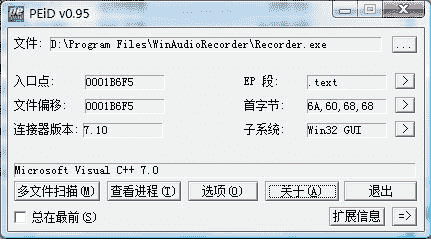
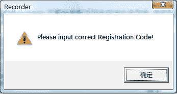
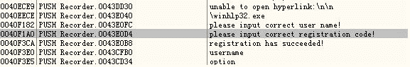

# WinAudio Recorder 破解手记

> 原文：[`www.pediy.com/kssd/pediy12/99813.html`](https://www.pediy.com/kssd/pediy12/99813.html)

【文章标题】: WinAudio Recorder 破解手记  
【文章作者】: 阿蔡  
【软件名称】: WinAudio Recorder2.2.2  
【下载地址】: 自行搜索  
【编写语言】: Microsoft Visual C++ 7.0(PEID 识别)  
【使用工具】: od & ida & peid  
【作者声明】: 第一次写技术文章,错误在所难免,敬请诸位大侠赐教!  

第一次成功破解程序(简单的 CrackMe 不算程序吧,不过此程序也很简单),并写出注册机,兴奋不已,写下笔记与大家分享(文笔不好敬请原谅,排版也不好),错误之处欢迎大家指正.  

我并没有尝试在网上搜索此软件的破解教程,不知道网上有没有,不过我的目的在于学习,所以这也就没关系了.  

首先用 PEID 查壳,如图:  

  

没有加壳,正好适合我等菜鸟.运行程序输入假注册码注册,结果如图:  

  

有提示信息,记之.OD 载入,F9 运行.出来注册窗口,用 `Ultra String Reference` 插件搜索字符串信息,找到刚才提示的字符串,如图:  

  

双击字符串来到下面的地方:  

代码:

```
0040F19C   .  6A 00          PUSH 0
0040F19E   .  6A 00          PUSH 0
0040F1A0   .  68 D4E04300    PUSH Recorder.0043E0D4                 ;  please input correct registration code!
0040F1A5   .  E8 6B160200    CALL Recorder.00430815
0040F1AA   .  5F            POP EDI
0040F1AB   .  5E            POP ESI
0040F1AC   .  5D            POP EBP
```

通过 IDA 对比,向上找,在不远处发现调用了 `CWnd::UpdateData()`(取得用户名和密码)这个函数,在这个函数的后面下断进行分析,下面为分析结果:  

代码:


```
0040F16E   .  E8 D0B10100   CALL Recorder.0042A343                  ;  UpdateData
0040F173   .  8B46 70       MOV EAX, DWORD PTR DS:\[ESI+70\]        ;  用户名
0040F176   .  8B68 F4       MOV EBP, DWORD PTR DS:\[EAX-C\]         ;  用户名长度
0040F179   .  83FD 02       CMP EBP, 2                              ;  长度是否大于 2,不大于则提示信息,注册失败
0040F17C   .  7D 15         JGE SHORT Recorder.0040F193
0040F17E   .  6A 00         PUSH 0
0040F180   .  6A 00         PUSH 0
0040F182   .  68 FCE04300   PUSH Recorder.0043E0FC                  ;  please input correct user name!
0040F187   .  E8 89160200   CALL Recorder.00430815
0040F18C   .  5F            POP EDI
0040F18D   .  5E            POP ESI
0040F18E   .  5D            POP EBP
0040F18F   .  83C4 0C       ADD ESP, 0C
0040F192   .  C3            RETN
0040F193   >  8B4E 74      MOV ECX, DWORD PTR DS:\[ESI+74\]        ;  KEY
0040F196   .  8379 F4 08    CMP DWORD PTR DS:\[ECX-C\], 8           ;  KEY 长度是否大于等于 8
0040F19A   .  7D 15         JGE SHORT Recorder.0040F1B1            ;  小于则提示信息,注册失败
0040F19C   .  6A 00         PUSH 0
0040F19E   .  6A 00         PUSH 0
0040F1A0   .  68 D4E04300   PUSH Recorder.0043E0D4                  ;  please input correct registration code!
0040F1A5   .  E8 6B160200   CALL Recorder.00430815
0040F1AA   .  5F            POP EDI
0040F1AB   .  5E            POP ESI
0040F1AC   .  5D            POP EBP
0040F1AD   .  83C4 0C       ADD ESP, 0C
0040F1B0   .  C3            RETN
0040F1B1   >  8B46 70      MOV EAX, DWORD PTR DS:\[ESI+70\]        ;  用户名
0040F1B4   .  8B48 F4      MOV ECX, DWORD PTR DS:\[EAX-C\]         ;  用户名长度
0040F1B7     85C9          TEST ECX, ECX
0040F1B9   .  7D 0A        JGE SHORT Recorder.0040F1C5            ;  用户名长度大于 0 则跳
0040F1BB   .  68 57000780  PUSH 80070057
0040F1C0   .  E8 AB22FFFF  CALL Recorder.00401470
0040F1C5   >  8A10         MOV DL, BYTE PTR DS:\[EAX\]             ;  取第一位用户名
0040F1C7   .  8B46 70      MOV EAX, DWORD PTR DS:\[ESI+70\]
0040F1CA   .  3978 F4      CMP DWORD PTR DS:\[EAX-C\], EDI
0040F1CD   .  7D 0A        JGE SHORT Recorder.0040F1D9            ;  用户名长度大于等于 1 则跳
0040F1CF   .  68 57000780  PUSH 80070057
0040F1D4   .  E8 9722FFFF  CALL Recorder.00401470
0040F1D9   >  8A40 01      MOV AL, BYTE PTR DS:\[EAX+1\]           ;  取第二位用户名
0040F1DC   .  884424 0E    MOV BYTE PTR SS:\[ESP+E\], AL           ;  保存到局部变量
0040F1E0     8B46 70      MOV EAX, DWORD PTR DS:\[ESI+70\]        ;  取用户名
0040F1E3   .  8B48 F4      MOV ECX, DWORD PTR DS:\[EAX-C\]         ;  用户名长度
0040F1E6   .  85C9          TEST ECX, ECX
0040F1E8   .  7D 0A        JGE SHORT Recorder.0040F1F4            ;  用户名长度大于等于 0 则跳
0040F1EA   .  68 57000780  PUSH 80070057
0040F1EF   .  E8 7C22FFFF  CALL Recorder.00401470
0040F1F4   >  8B4E 70      MOV ECX, DWORD PTR DS:\[ESI+70\]        ;  取用户名
0040F1F7   .  53            PUSH EBX
0040F1F8   .  8A18         MOV BL, BYTE PTR DS:\[EAX\]             ;  取第一位用户名
0040F1FA   .  3979 F4      CMP DWORD PTR DS:\[ECX-C\], EDI         ;  用户名长度是否大于 0
0040F1FD   .  7D 0A        JGE SHORT Recorder.0040F209
0040F1FF   .  68 57000780  PUSH 80070057
0040F204   .  E8 6722FFFF  CALL Recorder.00401470
0040F209   >  0FB6C2       MOVZX EAX, DL
0040F20C   .  83C8 52      OR EAX, 52                              ;  EAX = EAX | 0x52
0040F20F   .  99            CDQ
0040F210   .  BF 0A000000  MOV EDI, 0A
0040F215   .  F7FF          IDIV EDI                                ;  EAX = EAX / 10
0040F217   .  0FB64424 12  MOVZX EAX, BYTE PTR SS:\[ESP+12\]      ;  取第二位用户名
0040F21C   .  83C8 45      OR EAX, 45                              ;  EAX = EAX | 0x45
0040F21F   .  885424 16    MOV BYTE PTR SS:\[ESP+16\], DL          ;  保存余数
0040F223   .  99            CDQ
0040F224   .  F7FF          IDIV EDI
0040F226   .  0FB6C3       MOVZX EAX, BL
0040F229   .  83C8 43      OR EAX, 43
0040F22C   .  885424 12    MOV BYTE PTR SS:\[ESP+12\], DL          ;  保存余数
0040F230   .  99            CDQ
0040F231   .  F7FF          IDIV EDI
0040F233   .  0FB641 01    MOVZX EAX, BYTE PTR DS:\[ECX+1\]       ;  取第二位用户名
0040F237   .  83C8 4F      OR EAX, 4F
0040F23A   .  8BCF         MOV ECX, EDI
0040F23C   .  885424 17    MOV BYTE PTR SS:\[ESP+17\], DL          ;  保存余数
0040F240   .  99            CDQ
0040F241   .  F7F9         IDIV ECX
0040F243   .  33C0         XOR EAX, EAX
0040F245   .  33C9         XOR ECX, ECX
0040F247   .  85ED          TEST EBP, EBP                           ;  用户名长度
0040F249   .  885424 18    MOV BYTE PTR SS:\[ESP+18\], DL          ;  保存余数
0040F24D   .  7E 20        JLE SHORT Recorder.0040F26F            ;  不大于则跳
0040F24F   .  90            NOP
0040F250   >  85C9          TEST ECX, ECX
0040F252   .  0F8C D2000000 JL Recorder.0040F32A
0040F258   .  8B7E 70      MOV EDI, DWORD PTR DS:\[ESI+70\]        ;  用户名
0040F25B   .  3B4F F4      CMP ECX, DWORD PTR DS:\[EDI-C\]         ;  用户名长度
0040F25E   .  0F8F C6000000 JG Recorder.0040F32A
0040F264   .  0FB6140F     MOVZX EDX, BYTE PTR DS:\[EDI+ECX\]     ;  循环将相加每一位用户名的 ASCII 值相加,结果保存在 EAX 中
0040F268   .  03C2         ADD EAX, EDX
0040F26A   .  41            INC ECX
0040F26B   .  3BCD         CMP ECX, EBP
0040F26D   .^ 7C E1        JL SHORT Recorder.0040F250             ;  下一次循环
0040F26F   >  8B4E 74      MOV ECX, DWORD PTR DS:\[ESI+74\]        ;  取 KEY
0040F272   .  8B51 F4      MOV EDX, DWORD PTR DS:\[ECX-C\]         ;  取 KEY 长度
0040F275   .  85D2          TEST EDX, EDX
0040F277   .  7D 0A        JGE SHORT Recorder.0040F283            ;  长度大于 0 则跳
0040F279   .  68 57000780  PUSH 80070057
0040F27E   .  E8 ED21FFFF  CALL Recorder.00401470
0040F283   >  8A11         MOV DL, BYTE PTR DS:\[ECX\]             ;  取第一位 KEY
0040F285   .  8B4E 74      MOV ECX, DWORD PTR DS:\[ESI+74\]
0040F288   .  8379 F4 01   CMP DWORD PTR DS:\[ECX-C\], 1           ;  KEY 长度是否大于等于 1
0040F28C   .  885424 19    MOV BYTE PTR SS:\[ESP+19\], DL          ;  保存到局部变量
0040F290   .  7D 0A        JGE SHORT Recorder.0040F29C
0040F292   .  68 57000780  PUSH 80070057
0040F297   .  E8 D421FFFF  CALL Recorder.00401470
0040F29C   >  8A49 01      MOV CL, BYTE PTR DS:\[ECX+1\]           ;  取第 2 位 KEY
0040F29F   .  8B7E 74      MOV EDI, DWORD PTR DS:\[ESI+74\]
0040F2A2   .  884C24 13    MOV BYTE PTR SS:\[ESP+13\], CL
0040F2A6   .  837F F4 02   CMP DWORD PTR DS:\[EDI-C\], 2           ;  KEY 长度是否大于 2
0040F2AA   .  7D 0A        JGE SHORT Recorder.0040F2B6
0040F2AC   .  68 57000780  PUSH 80070057
0040F2B1   .  E8 BA21FFFF  CALL Recorder.00401470
0040F2B6   >  8A4F 02      MOV CL, BYTE PTR DS:\[EDI+2\]           ;  取第 3 位 KEY
0040F2B9   .  8B7E 74      MOV EDI, DWORD PTR DS:\[ESI+74\]
0040F2BC   .  884C24 14    MOV BYTE PTR SS:\[ESP+14\], CL
0040F2C0   .  837F F4 03   CMP DWORD PTR DS:\[EDI-C\], 3           ;  KEY 长度是否大于 3
0040F2C4   .  7D 0A        JGE SHORT Recorder.0040F2D0
0040F2C6   .  68 57000780  PUSH 80070057
0040F2CB   .  E8 A021FFFF  CALL Recorder.00401470
0040F2D0   >  8A4F 03      MOV CL, BYTE PTR DS:\[EDI+3\]           ;  取第四位 KEY
0040F2D3   .  8B7E 74      MOV EDI, DWORD PTR DS:\[ESI+74\]
0040F2D6   .  884C24 15    MOV BYTE PTR SS:\[ESP+15\], CL
0040F2DA   .  837F F4 04   CMP DWORD PTR DS:\[EDI-C\], 4
0040F2DE   .  7D 0A        JGE SHORT Recorder.0040F2EA
0040F2E0   .  68 57000780  PUSH 80070057
0040F2E5   .  E8 8621FFFF  CALL Recorder.00401470
0040F2EA   >  8A4F 04      MOV CL, BYTE PTR DS:\[EDI+4\]           ;  第五位 KEY
0040F2ED   .  8B7E 74      MOV EDI, DWORD PTR DS:\[ESI+74\]
0040F2F0   .  837F F4 05   CMP DWORD PTR DS:\[EDI-C\], 5
0040F2F4   .  7D 0A        JGE SHORT Recorder.0040F300
0040F2F6   .  68 57000780  PUSH 80070057
0040F2FB   .  E8 7021FFFF  CALL Recorder.00401470
0040F300   >  8A5F 05      MOV BL, BYTE PTR DS:\[EDI+5\]           ;  第六位 KEY
0040F303   .  8B7E 74      MOV EDI, DWORD PTR DS:\[ESI+74\]
0040F306   .  885C24 1A    MOV BYTE PTR SS:\[ESP+1A\], BL
0040F30A   .  837F F4 06   CMP DWORD PTR DS:\[EDI-C\], 6
0040F30E   .  7D 0A        JGE SHORT Recorder.0040F31A
0040F310   .  68 57000780  PUSH 80070057
0040F315   .  E8 5621FFFF  CALL Recorder.00401470
0040F31A   >  8A5F 06      MOV BL, BYTE PTR DS:\[EDI+6\]           ;  第七位 KEY
0040F31D   .  8B7E 74      MOV EDI, DWORD PTR DS:\[ESI+74\]
0040F320   .  885C24 1B    MOV BYTE PTR SS:\[ESP+1B\], BL
0040F324   .  837F F4 07   CMP DWORD PTR DS:\[EDI-C\], 7
0040F328   .  7D 0A        JGE SHORT Recorder.0040F334
0040F32A   >  68 57000780  PUSH 80070057
0040F32F   .  E8 3C21FFFF  CALL Recorder.00401470
0040F334   >  8A5F 07      MOV BL, BYTE PTR DS:\[EDI+7\]           ;  第八位 KEY
0040F337   .  0FB67C24 16  MOVZX EDI, BYTE PTR SS:\[ESP+16\]
0040F33C   .  0FB6D2       MOVZX EDX, DL                           ;  DL 为第一位 KEY 的 ASCII 值
0040F33F   .  83EA 30      SUB EDX, 30
0040F342   .  3BFA         CMP EDI, EDX                            ;  EDI = ((第一位用户名 | 0x52) % 0x0a)
0040F344   .  75 48        JNZ SHORT Recorder.0040F38E
0040F346   .  0FB65424 13  MOVZX EDX, BYTE PTR SS:\[ESP+13\]       ;  第二位 KEY
0040F34B   .  0FB67C24 12  MOVZX EDI, BYTE PTR SS:\[ESP+12\]       ;  ((第二位用户名 | 0x45) % 0x0a)
0040F350   .  83EA 30      SUB EDX, 30
0040F353   .  3BFA         CMP EDI, EDX
0040F355   .  75 37        JNZ SHORT Recorder.0040F38E            ;  不相等则跳,通过方法 2 来进行验证
0040F357   .  0FB65424 14  MOVZX EDX, BYTE PTR SS:\[ESP+14\]       ;  第三位 KEY
0040F35C   .  0FB67C24 17  MOVZX EDI, BYTE PTR SS:\[ESP+17\]       ;  ((第一位用户名 | 0x43) % 0x0a)
0040F361   .  83EA 30      SUB EDX, 30
0040F364   .  3BFA         CMP EDI, EDX
0040F366   .  75 26        JNZ SHORT Recorder.0040F38E            ;  不相等则跳,通过方法 2 来进行验证
0040F368   .  0FB65424 15  MOVZX EDX, BYTE PTR SS:\[ESP+15\]       ;  第四位 KEY
0040F36D   .  0FB67C24 18  MOVZX EDI, BYTE PTR SS:\[ESP+18\]       ;  ((第二位用户名 | 0x4f) % 0x0a)
0040F372   .  83EA 30      SUB EDX, 30
0040F375   .  3BFA         CMP EDI, EDX
0040F377   .  75 15        JNZ SHORT Recorder.0040F38E            ;  不相等则跳,通过方法 2 来进行验证
0040F379   .  99            CDQ
0040F37A   .  BF 0A000000  MOV EDI, 0A
0040F37F   .  F7FF          IDIV EDI                                ;  EAX=用户名各位 ASCII 值的累加
0040F381   .  0FB6C2       MOVZX EAX, DL                           ;  余数
0040F384   .  0FB6D1       MOVZX EDX, CL                           ;  第五位 KEY
0040F387   .  83EA 30      SUB EDX, 30
0040F38A   .  3BC2         CMP EAX, EDX
0040F38C   .  74 38        JE SHORT Recorder.0040F3C6             ;  相等则跳,注册成功,否则通过方法 2 进行验证,以下代码为方法 2 验证
0040F38E   >  807C24 19 38 CMP BYTE PTR SS:\[ESP+19\], 38         ;  与第一位 KEY 相比
0040F393     0F85 83000000 JNZ Recorder.0040F41C                  ;  不相等则跳,注册失败
0040F399   .  807C24 13 33 CMP BYTE PTR SS:\[ESP+13\], 33         ;  第二位 KEY
0040F39E     75 7C         JNZ SHORT Recorder.0040F41C
0040F3A0   .  8A5424 14    MOV DL, BYTE PTR SS:\[ESP+14\]         ;  第三位 KEY
0040F3A4   .  B0 36        MOV AL, 36
0040F3A6   .  3AD0         CMP DL, AL
0040F3A8     75 72         JNZ SHORT Recorder.0040F41C
0040F3AA   .  384424 15    CMP BYTE PTR SS:\[ESP+15\], AL         ;  第四位 KEY
0040F3AE     75 6C         JNZ SHORT Recorder.0040F41C
0040F3B0   .  3AC8         CMP CL, AL                             ;  CL 为第五位 KEY
0040F3B2     75 68         JNZ SHORT Recorder.0040F41C
0040F3B4   .  807C24 1A 31 CMP BYTE PTR SS:\[ESP+1A\], 31         ;  第六位 KEY
0040F3B9     75 61         JNZ SHORT Recorder.0040F41C
0040F3BB   .  807C24 1B 34 CMP BYTE PTR SS:\[ESP+1B\], 34         ;  第七位 KEY
0040F3C0     75 5A         JNZ SHORT Recorder.0040F41C
0040F3C2   .  3AD8         CMP BL, AL                             ;  BL 为第八位 KEY
0040F3C4     75 56         JNZ SHORT Recorder.0040F41C
0040F3C6   >  6A 00        PUSH 0                                 ;  注册成功
0040F3C8   .  6A 00        PUSH 0
0040F3CA   .  68 B8E04300  PUSH Recorder.0043E0B8                  ;  registration has succeeded!
0040F3CF   .  E8 41140200  CALL Recorder.00430815
0040F3D4   .  8B7E 70      MOV EDI, DWORD PTR DS:\[ESI+70\]
0040F3D7   .  E8 507A0200  CALL Recorder.00436E2C
0040F3DC   .  8B40 04      MOV EAX, DWORD PTR DS:\[EAX+4\]
0040F3DF   .  57            PUSH EDI                               ; /Arg3
0040F3E0   .  68 B0CF4300  PUSH Recorder.0043CFB0                  ; |username
0040F3E5   .  68 34CD4300  PUSH Recorder.0043CD34                  ; |option
0040F3EA   .  8BC8         MOV ECX, EAX                            ; |
0040F3EC   .  E8 3F150200  CALL Recorder.00430930                  ; \WriteProfileString 保存用户名
0040F3F1   .  8B7E 74      MOV EDI, DWORD PTR DS:\[ESI+74\]
0040F3F4   .  E8 337A0200  CALL Recorder.00436E2C
0040F3F9   .  8B40 04      MOV EAX, DWORD PTR DS:\[EAX+4\]
0040F3FC   .  57            PUSH EDI                               ; /Arg3
0040F3FD   .  68 9CCF4300  PUSH Recorder.0043CF9C                  ; |registration_code
0040F402   .  68 34CD4300  PUSH Recorder.0043CD34                  ; |option
0040F407   .  8BC8         MOV ECX, EAX                            ; |
0040F409   .  E8 22150200  CALL Recorder.00430930                  ; \WriteProfileString 保存密码
0040F40E   .  5B            POP EBX
0040F40F   .  5F            POP EDI
0040F410   .  8BCE         MOV ECX, ESI
0040F412   .  5E            POP ESI
0040F413   .  5D            POP EBP
0040F414   .  83C4 0C      ADD ESP, 0C
0040F417   .  E9 32970100  JMP Recorder.00428B4E
0040F41C   >  6A 00        PUSH 0                                 ;  注册失败
0040F41E   .  6A 00        PUSH 0
0040F420   .  68 A0E04300  PUSH Recorder.0043E0A0                  ;  registration failed!
0040F425   .  E8 EB130200  CALL Recorder.00430815
0040F42A   .  5B            POP EBX
0040F42B   .  5F            POP EDI
0040F42C   .  5E            POP ESI
0040F42D   .  5D            POP EBP
0040F42E   .  83C4 0C      ADD ESP, 0C
0040F431   .  C3            RETN
```


# 分析总结

通过分析可以发现算法其实很简单，但反汇编代码很长，感觉有很多无用代码，不知道是不是作者故意以此来增加我等菜鸟的分析难度的。

要成功注册的条件为：用户名必须大于等于 2，`KEY` 必须大于等于 8，注册码验证方法分两种（下面用 `C++` 语言进行描述）：

## 一、验证前五位注册码

只需要验证前面五位注册码，但是注册码的位数还是必须大于等于 5，否则前面验证长度的时候通不过。五位注册码要满足的条件为：

`Char *pName;` // 用户名

`Char *pKey;` // 注册码

1. `pKey[0] = (pName[0] | 0x52) % 10 + 0x30;`
2. `pKey[1] = (pName[1] | 0x45) % 10 + 0x30;`
3. `pKey[2] = (pName[0] | 0x43) % 10 + 0x30;`
4. `pKey[3] = (pName[1] | 0x4f) % 10 + 0x30;`
5. `pKey[4] = (各位用户名 ASCII 值累加的值 % 10) + 0x30;`

## 二、硬编码方式

第二种方法我实现想不出一个好名字来形容它，这里姑且叫它硬编码方式吧。因为这种方式不用考虑用户名（长度得大于 2 位），只要输入了这个注册码就可以注册成功（真想问一下作者干嘛要这样做 ^\_^），由上可知这个注册码为：`83666146`

下面帖一个正规的 `C++` 代码。

代码：

```
void  MakeKey(char* pName)
{
  int  iValue  =  0,iLen  =  strlen(pName);
  for (int  i  =  0;  i  <  iLen;  ++i)
  {
    iValue  +=  pName[i];          //累加用户名的 ASCII 值
  }
  //这里没有加 x30 就直接输出了,原因大家自己想吧,嘻...
  cout<<(pName[0]  |  0x52)  %  10;
  cout<<(pName[1]  |  0x45)  %  10;
  cout<<(pName[0]  |  0x43)  %  10;
  cout<<(pName[1]  |  0x4f)  %  10;
  cout<<iValue  %  10;
  //由于上面只有五位,所以还要多输出三位以上
  cout<<"-cai"<<endl;
}
```

---

# 版权声明

本文原创于看雪技术论坛，转载请注明作者并保持文章的完整，谢谢！

## 上传的附件

|  | | `WinAudio Recorder 破解手记.doc` |
| :---: | :---: | :---: |

|  | | `WinAudio_Recorder.zip` |
| :---: | :---: | :---: |
