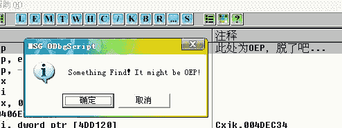
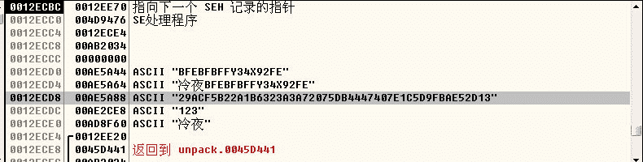
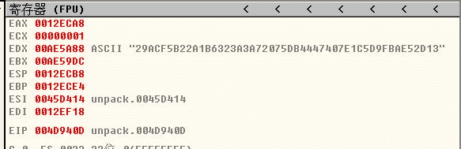
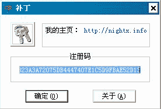

# 记对程序监控大师的破解体会

> 原文：[`www.pediy.com/kssd/pediy12/138328.html`](https://www.pediy.com/kssd/pediy12/138328.html)

**【文章标题】**: 记对程序监控大师的破解体会
**【文章作者】**: 冷夜/nightx
**【作者邮箱】**: lengyeasu@163.com
**【作者主页】**: http://nightx.info/
**【作者 QQ 号】**: 648274142
**【软件名称】**: 程序监控大师
**【软件大小】**: 499,200 字节
**【下载地址】**: 自己搜索下载
**【加壳方式】**: ASPack 2.12 -> Alexey Solodovnikov
**【保护方式】**: 加壳，重启验证注册码
**【编写语言】**: Delphi
**【使用工具】**: Ollyice, Peid, Keymake
**【操作平台】**: Windows
**【软件介绍】**: 对系统中的程序运行进行监控，防止未经授权的程序运
**【作者声明】**: 只是感兴趣，没有其他目的。失误之处敬请诸位大侠赐教!

----------------------------------------------------------------

## 详细过程

首先 `Peid` 查一下壳，加的是 `ASPack 2.12 -> Alexey Solodovnikov`。手工用 `ESP` 定律很简单。这里不这样做。

为了入门者学习更多，我以脚本的方法脱壳。

编写 `OD` 的脚本我整理了一些注释。

-------

```
var//定义变量
sto//单步，相当于 F8
mov addr,esp//将 ESP 寄存器地址存入 addr 中
bphws addr,"r" //下硬件访问断点
bphws addr, "x" //下硬件执行断点
bphwc addr //取消断点
run//相当于 F9
MSG "Something Find！It might be OEP!"//提示信息
cmt eip,"..."//在 EIP 处加注释
rtu //ALT+F9 返回
rtr //执行到返回，相当与 CTRL+F9
ret //结束脚本
sti //F7 跟进
esto//SHIFT+F9 忽略异常
findop eip, #FF630C#//查找特征码"FF630C"
bp addr //下 F2 断点
bc addr//取消断点
repl eip, #0F85????????#, #0F84????????#, 10//修改当前指令
MSGYN "。。。"//提示一些信息，YN 对话框
cmp $RESULT, 0//比较是否点"否"或"取消"
je end//如果点"否"或"取消"，就来到 end 处，end 是自己定义的一个函数模块
gpa "GetModuleHandleA", "kernel32.dll"//找特征 API 函数
mov addr, $RESULT //把找到的地址放变量 addr 中
add addr,5//addr=addr+5
find eip, #0F84????????# //查找特征码，"？"为通配符
```

-------

下面就分析一下脱壳过程:单步一次，一次 `ESP` 定律，单步三次即可。

这样编写脚本就很简单，如下：

-------

```
//////////////////////////////////////////////////
/// ASPack 2.12 -> Alexey Solodovnikov 脱壳脚本 ///
/// by 冷夜 ///
///[nightx.info](http://nightx.info) ///
/// 2011.8.5 ///
//////////////////////////////////////////////////
var addr//定义地址变量
sto//单步，相当于 F8
mov addr,esp//将 ESP 寄存器地址存入 addr 中
bphws addr,"r" //下硬件访问断点
run//相当于 F9
bphwc addr //取消断点
sto//单步，相当于 F8
sto
sto
cmt eip,"此处为 OEP，脱了吧..."//在 EIP 处加注释
MSG "Something Find！It might be OEP!"//提示信息
ret //结束脚本
```

-------

这里写脚本只是为了给入门者一点编写脚本的例子。至于这个简单的壳制作脚本自然是花哨了。

`OK`，编写完后测试一下。按照我们的要求到达 `OEP`，如图 1，



直接用 `OD` 插件 `DUMP` 出来即可。脱壳后的文件保存为 `unpack.exe` 运行一下，软件是重启验证型的。

载入 `Ollyice` 中，查找一下字符串，软件很简单，找到了“未购买用户”这一串。双击进入下面代码区域:

-------

```
004D9413  |.  /75 07                 jnz     short 004D941C
004D9415  |.  |C605 F0F54D00 01      mov     byte ptr [4DF5F0], 1
004D941C  |> \8BC3                   mov     eax, ebx
004D941E  |.   E8 59A8F2FF           call    00403C7C
004D9423  |.   803D F0F54D00 00      cmp     byte ptr [4DF5F0], 0
004D942A  |.   75 27                jnz     short 004D9453
004D942C  |.   8D55 E8              lea     edx, dword ptr [ebp-18]
004D942F  |.   A1 ECF54D00          mov     eax, dword ptr [4DF5EC]
004D9434  |.   E8 1B8AF6FF          call    00441E54
004D9439  |.   8D45 E8              lea     eax, dword ptr [ebp-18]
004D943C  |.   BA E8944D00          mov     edx, 004D94E8                 ;  - 未购买用户
004D9441  |.   E8 82B8F2FF          call    00404CC8
004D9446  |.   8B55 E8              mov     edx, dword ptr [ebp-18]
004D9449  |.   A1 ECF54D00          mov     eax, dword ptr [4DF5EC]
004D944E  |.   E8 318AF6FF          call    00441E84
004D9453  |>   33C0                 xor     eax, eax
004D9455  |.   5A                   pop     edx
004D9456  |.   59                   pop     ecx
004D9457  |.   59                   pop     ecx
004D9458  |.   64:8910              mov     dword ptr fs:[eax], edx
004D945B  |.   68 7D944D00          push    004D947D
004D9460  |>   8D45 E8              lea     eax, dword ptr [ebp-18]
004D9463  |.   E8 A0B5F2FF          call    00404A08
004D9468  |.   8D45 EC              lea     eax, dword ptr [ebp-14]
004D946B  |.   BA 05000000          mov     edx, 5
004D9470  |.   E8 B7B5F2FF          call    00404A2C
004D9475  \\.   C3                  retn
004D9476    .^ E9 95AFF2FF          jmp     00404410
004D947B    .^ EB E3               jmp     short 004D9460
```

-------

字符串参考还有部分是

-------

```
004D97DC  /.   55                  push    ebp
004D97DD  |.   8BEC                mov     ebp, esp
004D97DF  |.   6A 00               push    0
004D97E1  |.   33C0                xor     eax, eax
004D97E3  |.   55                  push    ebp
004D97E4  |.   68 59984D00         push    004D9859
004D97E9  |.   64:FF30             push    dword ptr fs:[eax]
004D97EC  |.   64:8920             mov     dword ptr fs:[eax], esp
004D97EF  |.   803D F0F54D00 01     cmp     byte ptr [4DF5F0], 1
004D97F6  |.   75 3C               jnz     short 004D9834
004D97F8  |.   8D45 FC             lea     eax, dword ptr [ebp-4]
004D97FB  |.   8B0D F4F54D00       mov     ecx, dword ptr [4DF5F4]
004D9801  |.   BA 6C984D00         mov     edx, 004D986C                 ;  本软件已注册给：
004D9806  |.   E8 01B5F2FF         call    00404D0C
004D980B  |.   8B55 FC             mov     edx, dword ptr [ebp-4]
004D980E  |.   A1 7CD24D00         mov     eax, dword ptr [4DD27C]
004D9813  |.   8B00                mov     eax, dword ptr [eax]
004D9815  |.   8B80 20030000       mov     eax, dword ptr [eax+320]
004D981B  |.   E8 6486F6FF         call    00441E84
004D9820  |.   A1 7CD24D00         mov     eax, dword ptr [4DD27C]
004D9825  |.   8B00                mov     eax, dword ptr [eax]
004D9827  |.   8B80 20030000       mov     eax, dword ptr [eax+320]
004D982D  |.   B2 01               mov     dl, 1
004D982F  |.   E8 4085F6FF         call    00441D74
004D9834  |>   A1 7CD24D00         mov     eax, dword ptr [4DD27C]
004D9839  |.   8B00                mov     eax, dword ptr [eax]
004D983B  |.   8B10                mov     edx, dword ptr [eax]
004D983D  |.   FF92 E8000000       call    near dword ptr [edx+E8]
004D9843  |.   33C0                xor     eax, eax
004D9845  |.   5A                  pop     edx
004D9846  |.   59                  pop     ecx
004D9847  |.   59                  pop     ecx
004D9848  |.   64:8910             mov     dword ptr fs:[eax], edx
004D984B  |.   68 60984D00         push    004D9860
004D9850  |>   8D45 FC             lea     eax, dword ptr [ebp-4]
004D9853  |.   E8 B0B1F2FF         call    00404A08
004D9858  \\.   C3                retn
```

-------

想来这部分就是软件判断注册成功后跳转的部分了。我们先不管这。在“未购买用户”部分有一个跳转：

```
004D942A  |.  75 27                jnz     short 004D9453
```

上方有个 `Call`：

```
004D941E  |.  E8 59A8F2FF          call    00403C7C
```

在这个 `Call` 按下 `F2` 下普通断点运行一下，堆栈里就会发现注册码了。如图 2。



这样破解追码就 `OK` 了。我们要做的当然不止这些。下面再做个补丁。

在断点上面有一处

```
004D940D  |.  58                   pop     eax
```

在这里下断点后运行。程序中断。此时寄存器 `EDX` 中就存放了真正的注册码。如图 3。



这样就可以用 `KeyMake` 制作一个内存注册机。

设置注册机信息：

1. 添加程序。添加 中断地址 `004D940D` 次数 `1` 指令 `58` 长度 `1`
2. 注册码选择内存方式--勾选寄存器--选择 `EDX`
3. 最后修改一下用户信息。选择一种方式生成即可。

运行一下。如图 4，成功得到真码。



文章还没完。既然用 `KeyMake` 可以编写。那我们自己也可以编写一下获取注册码：

`C` 语言的代码如下;

------

```c
#include <windows.h>

void main()
{
    PROCESS_INFORMATION pi;
    STARTUPINFO si;
    DEBUG_EVENT devent;
    CONTEXT Regs;
    Regs.ContextFlags = CONTEXT_FULL | CONTEXT_DEBUG_REGISTERS | CONTEXT_CONTROL;
}
```


ZeroMemory(&pi, sizeof(pi));

ZeroMemory(&si, sizeof(si));

si.cb = sizeof(si);

LPVOID breakAddr = (LPVOID)0x004D940D;  //这是断点地址，就是用工具生成注册机时要填的那个地址

BYTE firstByte = 0x58;      //同样是生成注册机时要填的那个第一字节

BYTE bp = 0xCC;

DWORD real;

BYTE buf[64];

int nCount = 0;

DWORD way;

//用调试方式创建需要破解的程序进程，此处进程为 Cxjk.exe

if(CreateProcess("Cxjk.exe", NULL, NULL, NULL, FALSE,
  DEBUG_ONLY_THIS_PROCESS | DEBUG_PROCESS, NULL, NULL, &si, &pi))
{
  //调试循环体
  while(TRUE)
  {
    //等待调试事件
    if(WaitForDebugEvent(&devent, INFINITE))
    {
      way = DBG_EXCEPTION_NOT_HANDLED;
      switch(devent.dwDebugEventCode)
      {
        case EXIT_PROCESS_DEBUG_EVENT:  //进程退出事件
          //return;
          break;
        case EXCEPTION_DEBUG_EVENT:     //异常事件
          {
            if(devent.u.Exception.ExceptionRecord.ExceptionCode == EXCEPTION_BREAKPOINT)
            {
              nCount++;
              //创建进程后会产生第一次异常中断，此时可以设置断点
              if(nCount == 1)
              {
                //读取第一个字节进行效验
                ReadProcessMemory(pi.hProcess, breakAddr, buf, 1, &real);
                if(buf[0] == firstByte)                  
                {
                  //设置断点
                  DWORD oldProtect;
                  VirtualProtectEx(pi.hProcess, breakAddr, 1, PAGE_READWRITE, &oldProtect);
                  WriteProcessMemory(pi.hProcess, breakAddr, &bp, 1, &real);
                  VirtualProtectEx(pi.hProcess, breakAddr, 1, oldProtect, NULL);
                }
                way = DBG_CONTINUE;
              }
              //如果是在断点处暂停，就可以读取内存中的注册码
              else if(devent.u.Exception.ExceptionRecord.ExceptionAddress == breakAddr)
              {
                GetThreadContext(pi.hThread, &Regs);
                ReadProcessMemory(pi.hProcess, (char *)Regs.Edx, buf, 64, &real);  //从寄存器 Edx 中读取注册码
                MessageBox(NULL, (char *)buf, "注册机 By 冷夜 http://nightx.info/     ", 0);
                //去除断点
                DWORD oldProtect;
                VirtualProtectEx(pi.hProcess, breakAddr, 1, PAGE_READWRITE, &oldProtect);
                WriteProcessMemory(pi.hProcess, breakAddr, &firstByte, 1, NULL);
                VirtualProtectEx(pi.hProcess, breakAddr, 1, oldProtect, NULL);
                //回到断点处继续执行
                Regs.Eip = (DWORD)breakAddr;
                SetThreadContext(pi.hThread, &Regs);
                way = DBG_CONTINUE;
              }
            }
            break;
          }
        }
        ContinueDebugEvent(pi.dwProcessId, pi.dwThreadId, way);
      }
  }
}
else
  MessageBox(NULL, "请将注册机和要破解程序放在同一目录", NULL, 0);

---

声明一下，代码不是我写的，是东拼西凑借鉴程序员的代码得到的。呵呵。运行一下。也成功。

用户名:`冷夜` 注册码;是 `29ACF5B22A1B6323A3A72075DB4447407E1C5D9FBAE52D13`

---

【经验总结】

软件还是很简单的。重要的只是思路而已。希望文章能对初学者有所帮助。

---

【版权声明】: 本文原创于冷夜/nightx, 转载请注明作者并保持文章的完整, 谢谢!

2011 年 08 月 05 日 08:26:48
