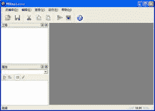
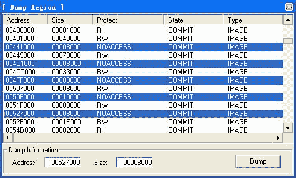
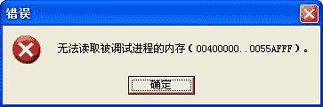
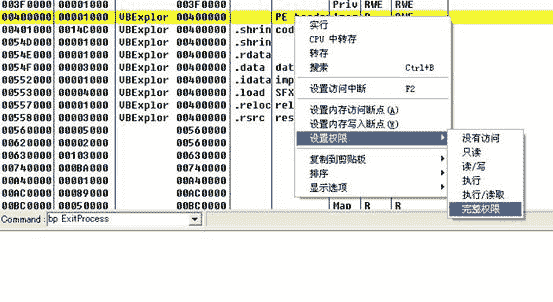
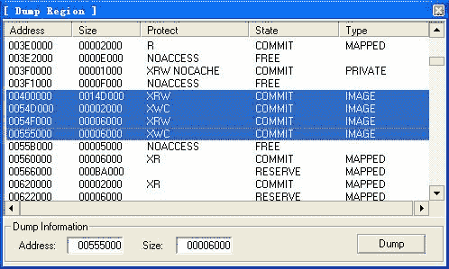

# 第四章 Dump 的位置

> 原文：[`www.pediy.com/kssd/pediy07/pediy7-659-4.htm`](https://www.pediy.com/kssd/pediy07/pediy7-659-4.htm)

## 一、在 OEP 处 dump

真正的金科玉律就是世上并无金科玉律。——G.B.Shaw

现在，你是不是还认为要 `dump` 就一定只能在 `OEP` 处呢？你现在是不是还觉得 `dump` 是一件没有技术含量的工作呢？好，下面我将详细的说明一下在什么地方 `dump` 将会得到事半功倍的效果！

一般来说，入门及的菜鸟都知道，在 `oep` 处 `dump` 下进程是正确的，当 `OD` 停在 `push ebp` 的时候，我们冲动的神情就连显示器也会害怕。在 `LordPE`, `Ollydump`…十八般兵器全用上以后，如果我们得到的是一个不能 `dump` 的对话框，那么一切就完了，此壳也因此打入冷宫！

那么，我们首先要知道。为什么我们要在 `OEP` 处 `dump` 呢？

一般来说，一个简单的压缩壳（比如 `UPX`），它在运行的时候会做什么事情呢？

1. 它要把压缩了的全部的代码数据释放到内存中。
2. 它要把 `IAT` 的地址写到适当位置

那么，它什么时候完成这些工作呢？

答案是最后一刻！

对，让我们来看看 `UPX` 的最后几句！

```
0040EA8D    09C0           or eax,eax
0040EA8F    74 07          je short NOTEPAD.0040EA98
0040EA91    8903           mov dword ptr ds:[ebx],eax                  ; kernel32._lwrite
0040EA93    83C3 04        add ebx,4
0040EA96  ^ EB E1          jmp short NOTEPAD.0040EA79
0040EA98    FF96 A8EC0000  call dword ptr ds:[esi+ECA8]
0040EA9E    61             popad
0040EA9F  - E9 2826FFFF    jmp NOTEPAD.004010CC
```

明显它在做“写”的工作，当写完了也就 `JMP OEP` 了。所以当它完全解压缩了以后，当它把 `IAT` 都写好了以后。我们就可以 `dump` 它了。而我们更多的选择在 `OEP` 的地方就是这个原因。因为在 `OEP` 处，它的代码和 `IAT` 一般是会解压完毕了的。

## 二、不在 OEP 处 dump

现在我们知道了，`dump` 的原则了以后。那么很好办，我们不一定要在 `OEP` 处 `dump` 了。好，我们可以在 `jmp NOTEPAD.004010CC` 这里 `dump`，也可以在 `0040EA9E    61             popad` 这里 `dump`。当然还可以在

```
004010CC    55             push ebp
004010CD    8BEC           mov ebp,esp   //在这里
004010CF    83EC 44        sub esp,44    //在这里
```

哈哈，什么位置都可以 `dump`！为什么一定要在 `OEP` 处呢？！

## 三、他山之石

下面我们来看看两篇高手的范文，让我们更深刻的理解一下 `dump` 的技巧，`dump` 的花样。^-^

### 1. 首先是 fly 的《Thinstall V2.501 脱壳——Win98 的 Notepad》

`http://bbs.pediy.com/showthread.php?s=&threadid=8158`

下面是引用部分

**二、获取加壳前程序的 PE Header 等数据**

`Ctrl+S` 搜索命令序列：

```
mov eax,dword ptr ds:[eax+3C]
mov ecx,dword ptr ss:[ebp-118]
```

找到在 `7FF427BA` 处，直接 `F4` 过去

```
7FF427A5     8B85 D4FDFFFF     mov eax,dword ptr ss:[ebp-22C]
7FF427AB     8B40 18           mov eax,dword ptr ds:[eax+18]
7FF427AE     8985 E8FEFFFF     mov dword ptr ss:[ebp-118],eax
7FF427B4     8B85 E8FEFFFF     mov eax,dword ptr ss:[ebp-118]
7FF427BA     8B40 3C           mov eax,dword ptr ds:[eax+3C]
//F4 到这里
7FF427BD     8B8D E8FEFFFF     mov ecx,dword ptr ss:[ebp-118]
7FF427C3     8D4401 18         lea eax,dword ptr ds:[ecx+eax+18]
7FF427C7     8985 D0FDFFFF     mov dword ptr ss:[ebp-230],eax  ; Notepad.004000E8
//在这里可以得到 PE Header 和 The Section Table 数据 ★
7FF427CD     C705 D05DF97F 020>mov dword ptr ds:[7FF95DD0],2
```

`PE Header`：

```
004000D0  50 45 00 00 4C 01 01 00 D6 57 5A 35 00 00 00 00  PE..L .諻 Z5....
004000E0  00 00 00 00 E0 00 0E 01 0B 01 03 0A 00 40 00 00  ....? ..@..
004000F0  00 70 00 00 00 00 00 00 CC 10 00 00 00 10 00 00  .p......?... ..
00400100  00 50 00 00 00 00 40 00 00 10 00 00 00 10 00 00  .P....@.. ... ..
00400110  04 00 00 00 00 00 00 00 04 00 00 00 00 00 00 00   ....... .......
00400120  C6 CA 00 00 00 04 00 00 00 00 00 00 02 00 00 00  剖... ...... ...
00400130  00 00 10 00 00 10 00 00 00 00 10 00 00 10 00 00  .. .. .... .. ..
00400140  00 00 00 00 10 00 00 00 00 00 00 00 00 00 00 00  .... ...........
00400150  00 60 00 00 8C 00 00 00 00 70 00 00 C8 42 00 00  .`..?...p..菳..
…… ……
```

毕竟只是捆绑壳，此时代码已经解压，现在 `dump` 则 `IAT` 等信息都是未加密的，正是脱壳的最佳时机！

我们可以看到，文中提到在跟踪到 `7FF427BA` 的时候整个 `IAT` 的信息已经解压完毕，而且还没加密，并且这时的代码也释放完毕了。所以在这里是完美的 `dump` 时机。而如果我们在寻找到 `OEP` 处的时候，那么一切都已经完了。狡猾的壳，把该隐藏的都隐藏起来了。那时我们再去 `dump`，得到的只是作者想要我们得到的东西，那只能说我们中了圈套了！

### 2. 接着是 csjwaman 的《Steel Box 脱壳》

`http://bbs.pediy.com/showthread.php?s=&threadid=8356`

下面是引用部分

共有 4 处要修复。其中第 4 处是程序退出时运行的。`004041D5` 处下断，运行程序，然后退出程序。程序就会断在 `004041D5` 处。此时要修复的代码都已解开：

```
00404100    55               PUSH EBP
00404101    8BEC             MOV EBP,ESP
00404103    53               PUSH EBX
00404104    56               PUSH ESI
00404105    57               PUSH EDI
00404106    BB 00704000      MOV EBX,anota2.00407000
0040410B    66:2E:F705 8E47>TEST WORD PTR CS:[40478E],4
00404115    0F85 DB000000    JNZ anota2.004041F6
0040411B    6A 00            PUSH 0
0040411D    FF15 D0824000    CALL NEAR DWORD PTR DS:[4082D0]
00404123    E8 9C020000      CALL anota2.004043C4
00404128    C783 08010000 0>MOV DWORD PTR DS:[EBX+108],1////已修复处 1
00404132    8D83 94020000    LEA EAX,DWORD PTR DS:[EBX+294]
00404138    50               PUSH EAX
00404139    FF15 84824000    CALL NEAR DWORD PTR DS:[408284]
0040413F    83EC 44          SUB ESP,44
00404142    C70424 44000000  MOV DWORD PTR SS:[ESP],44
00404149    C74424 2C 00000>MOV DWORD PTR SS:[ESP+2C],0
00404151    54               PUSH ESP
00404152    FF15 7C824000    CALL NEAR DWORD PTR DS:[40827C]
00404158    B8 0A000000      MOV EAX,0A
0040415D    F74424 2C 01000>TEST DWORD PTR SS:[ESP+2C],1
00404165    74 05            JE SHORT anota2.0040416C
00404167    0FB74424 30      MOVZX EAX,WORD PTR SS:[ESP+30]
0040416C    83C4 44          ADD ESP,44
0040416F    8983 FE000000    MOV DWORD PTR DS:[EBX+FE],EAX
00404175    FF15 60824000    CALL NEAR DWORD PTR DS:[408260]
0040417B    E8 21040000      CALL anota2.004045A1
00404180    8983 F4000000    MOV DWORD PTR DS:[EBX+F4],EAX
00404186    FF15 68824000    CALL NEAR DWORD PTR DS:[408268]
0040418C    8983 F0000000    MOV DWORD PTR DS:[EBX+F0],EAX
00404192    6A 00            PUSH 0
00404194    FF15 78824000    CALL NEAR DWORD PTR DS:[408278]
0040419A    8983 04010000    MOV DWORD PTR DS:[EBX+104],EAX
004041A0    E8 07010000      CALL anota2.004042AC
004041A5    B8 FF000000      MOV EAX,0FF////已修复处 2
004041AA    72 36            JB SHORT anota2.004041E2
004041AC    E8 5E020000      CALL anota2.0040440F
004041B1    E8 3B040000      CALL anota2.004045F1
004041B6    B8 FF000000      MOV EAX,0FF////已修复处 3
004041BB    72 07            JB SHORT anota2.004041C4
004041BD    53               PUSH EBX
004041BE    E8 57010000      CALL anota2.0040431A
004041C3    5B               POP EBX
004041C4    50               PUSH EAX
004041C5    E8 55010000      CALL anota2.0040431F
004041CA    E8 37010000      CALL anota2.00404306
004041CF    FFB3 F0000000    PUSH DWORD PTR DS:[EBX+F0]////已修复处 4
004041D5    FF15 5C824000    CALL NEAR DWORD PTR DS:[40825C]
```

把这些代码复制后覆盖到主程序 `404100－4041D4` 处就完成了。

上面的这段是在说明这么修复代码的段落。这壳在到达 `OEP` 处的时候有 4 个地方，并没有将代码完全的解压。所以我们在 `OEP` 处 `dump` 就得到 4 处没有解压的代码，而文中提到的办法是，先把程序 `dump` 下。等待程序运行把这些代码解压以后再进行粘贴。

“把这些代码复制后覆盖到主程序 `404100－4041D4` 处就完成了。”

这当然是个很好的办法，符合我们脱壳的逻辑。而我们在懂得他的原理以后大可大胆的想象。我们在等待这次处接压完毕以后再 `dump` 会如何呢？

## 四、实战

下面我们来脱一个比较有趣的壳吧！听说这个壳在 `9x` 是秒脱，但是在 `NT` 内核下的就不是那么简单的了。^-^

目标：`VBExplorer`

加壳方式：`Shrinker 3.4`

`OD` 载入以后

寻找 `OEP` 的过程很简单，在找到最后的异常以后

```
00554E7B    8B1F           mov ebx,dword ptr ds:[edi]//最后的异常
00554E7D    85DB           test ebx,ebx
00554E7F    74 6C          je short VBExplor.00554EED
00554E81    837D F4 00     cmp dword ptr ss:[ebp-C],0
00554E85    74 08          je short VBExplor.00554E8F
```

我们用 `F8` 走几步就能到达 `JMP OEP` 的地方

```
005546AE    8945 E0        mov dword ptr ss:[ebp-20],eax
005546B1    FF75 10        push dword ptr ss:[ebp+10]
005546B4    FF75 0C        push dword ptr ss:[ebp+C]
005546B7    FF75 08        push dword ptr ss:[ebp+8]
005546BA    FF55 E0        call dword ptr ss:[ebp-20]              ; VBExplor.00425342
//上面的就是 JMP OEP 的地方
```

下来我们看看 `OEP` 是什么东西：

```
00425342    0000           add byte ptr ds:[eax],al         //OEP
00425344    0000           add byte ptr ds:[eax],al
00425346    0000           add byte ptr ds:[eax],al
00425348    0000           add byte ptr ds:[eax],al
0042534A    0000           add byte ptr ds:[eax],al
0042534C    0000           add byte ptr ds:[eax],al
0042534E    0000           add byte ptr ds:[eax],al
```


## 逆向分析过程

`00425350    0000           add byte ptr ds:[eax],al`  
`00425352    0000           add byte ptr ds:[eax],al`  
`00425354    0000           add byte ptr ds:[eax],al`  
`00425356    0000           add byte ptr ds:[eax],al`

这就是我们得到的 OEP，怎么回事呢？怎么没有数据呢？

这个壳在之前并没有解压这个壳的代码和数据，而当我们在运行的时候执行或者读取这些指令那么就会产生异常，而这时壳代码再试图将他们解压。哈哈…现在知道了吧，如果我们在 OEP 处 dump 能得到什么呢？！

好了，我们下断点 `BP ExitProcess`。对！我们要在它退出的时候断下来！

OK，我们忽略掉所有的异常，运行它吧！让主界面出现在我们的机器上！这时我们要做的是让他的代码完全的从内存中释放出来！如果你不放心还可以使用一下这个软件的功能^-^



好了，退出吧，让它中断下来！

```
7C81CAA2 >   8BFF           mov edi,edi    //断在这里
7C81CAA4     55             push ebp
7C81CAA5     8BEC           mov ebp,esp
7C81CAA7     6A FF          push -1
```

行了，我们可以 dump 了….等等，在这里 dump 大家都明白它的原理了吧！使用 `LordPE` 来看看！出错了，不行吧！好看看是怎么回事呢？



发现了什么没有，原来它在释放数据的过程中，只释放了必要的一部分而另一部分并没有改变它的属性仍然是 `NOACCESS` 的属性。那么好吧！用 `OllyDump` 上吧。可是你会发现还是不行啊！



确定以后虽然能 dump 下来，但是却是 `0K` 的大小！

呵呵，为什么我们以前举的例子里面就可以，现在就不可以了呢？

答案很简单，我们以前是把整个区段从开头都设置成了不可访问的区段，而现在的只是把其中的一块设置成了 `NOACCESS`，也就是说这个技巧欺骗了 `OD`！

现在怎么办！

Fellow Me!!

用 `Alt+M` 打开内存镜象！



看到“完整权限”的字样了没有？我们将每个区段重新都设置它为完整的权限一次！

好了，现在我们再用 `LordPE` 看看吧！



看到了吧，不得不佩服 `OD` 的强大功能啊！

现在你可以用任何的工具将它 dump 下来了！注意 `OEP=425342`

用 `ImportREC` 可以简单的修复它的输入表。但是遗憾的是，事情还没有结束，在修复完了以后还有些毛病！

那就是运行以后，所有的资源好象都不见了，其实它只是有部分代码没有执行而已。OK，关于 dump 的我就讲这么多了。以后的完美脱壳，就留给大家去努力吧！

### 五. 小结

这是一个站在巨人肩膀上的时代，多东西需要借助别人的经验继续工作。而吸收和改进将是这个工作必要的阶段。

也许看了上面的文字，你会问我 2 个问题：

1. 我怎么知道代码或者 `IAT` 什么时候解压完毕？
2. 我怎么确定这个是最佳的 dump 的时机？

说实在的，这个是一个经验和辛苦的工作，作为菜鸟加懒鸟的我实在不愿意一步一步的跟踪，把整个壳的思想弄清楚。如果你能作到把整个壳的思路弄明白，把这个壳逆向一遍。那么我想上面的问题也是自然而然的解决了。所以，我们要对那些把整个壳的代码逆向的高手们致敬。同时我也要告诉各位，只要大家有时间，应该试这向这个方面努力。毕竟，只有这个方向才是一个真正的 `cracker` 应该做的，因为逆向学习才是 `cracker` 的第一精神，而破解的成果是第二位的。

`4dd466d0e1e0cc123afbe504da2462ca`
